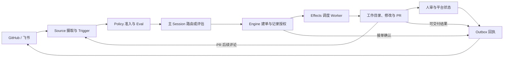

# Superagent Learning

这是一个围绕 **DeepSeek Harness Superagent 研究原型**的中文源码学习项目，包含 **32 篇已完成的源码精读与面试笔记**。它从一条 GitHub Issue 或飞书消息讲起，追踪 Agent 怎样判断谁有权交办任务、怎样持续执行并在人需要介入时交接，以及怎样把结果发回原会话。

想先看一遍完整流程，可以从端到端案例读起。准备系统设计面试，可以直接打开最后一篇的口述稿和白板题。 [32 篇完整目录](notes/README.md) · [端到端案例](notes/04-end-to-end-issue-to-pr.md) · [面试答辩手册](notes/32-system-design-interview-playbook.md)

## 这个项目研究什么

源码目录中的 `dsh-superagent` 是一个以 DeepSeek Harness 为宿主、面向**单个 GitHub 仓库**的主动式编码 Agent 原型，飞书是可选的消息入口。举例来说，维护者可以在 Issue 里请 Agent 修正文案。系统通过准入后建单，Worker 准备工作目录、验证修改并提交 PR。维护者在 PR 里补充要求时，消息可以沿订阅回到原工单。按默认交付约定，由人审查和合并，Agent 再把可用结果或适用的终态通知送回对应会话。 [原型说明](dsh-superagent-prototype/README.md) · [执行与交付](dsh-superagent-prototype/docs/003-execution.md)

这里的主动性有明确的开关。Source 能持续接收事件，Policy 决定哪些输入可以发起工作。对推断候选，团队可以关闭评估，在 `observe` 中查看拟接单的判断，或在 `auto` 中允许满足规则的候选建单。模型负责理解请求和提出动作，Engine 校验当前授权与状态，外部平台和人工评审决定远端操作的最终结果。 [产品设计原则](dsh-superagent-prototype/docs/000-philosophy.md) · [准入规则](notes/10-policy-admission-matrix.md) · [显式路由与推断评估](notes/11-explicit-routing-and-inferred-eval.md)



## 32 篇覆盖哪些内容

| 篇目 | 主题 | 重点入口 |
| --- | --- | --- |
| 01–04 | **架构与主链路**。主动式 Agent 的边界、DSH 插件装配、领域模型，以及从 Issue 到 PR 的完整路径 | [项目全景](notes/01-what-is-a-superagent.md) · [端到端走读](notes/04-end-to-end-issue-to-pr.md) |
| 05–09 | **事件接入与上下文**。GitHub 轮询、飞书实时流与历史补拉、游标、去重、Thread 关联和按需读取 | [Source 协议](notes/05-source-contract-and-trigger.md) · [GitHub 轮询](notes/06-github-polling-and-checkpoints.md) · [飞书接入](notes/07-feishu-live-backfill-and-threads.md) |
| 10–15 | **授权与任务路由**。显式请求、推断评估、Mandate、重排与超时、后续归属和人工介入 | [准入矩阵](notes/10-policy-admission-matrix.md) · [授权与复核](notes/13-decisions-mandates-and-revalidation.md) · [工单生命周期](notes/15-ticket-lifecycle-and-human-handoff.md) |
| 16–21 | **执行与交付**。主 Session 与 Worker、工作目录、并发槽位、后台任务、已读回执和 PR 绑定 | [角色分工](notes/16-orchestrator-worker-sessions.md) · [并发与背压](notes/18-worker-slots-and-backpressure.md) · [PR 交付](notes/21-pull-request-ownership-and-completion.md) |
| 22–28 | **持久化与治理**。SQLite 事务、Effects、Outbox、Prompt 版本、管理面板、权限边界和崩溃恢复 | [持久队列](notes/23-durable-effects-and-consistency.md) · [消息回执](notes/24-outbox-replies-and-attention.md) · [故障恢复](notes/28-pause-shutdown-and-crash-recovery.md) |
| 29–32 | **验证与系统设计**。并发测试、多租户演进、容量估算、成本与质量评估，以及项目答辩 | [测试证据](notes/29-testing-agent-invariants.md) · [生产演进](notes/30-production-scaling-and-multitenancy.md) · [评估指标](notes/31-evaluation-metrics-cost-and-latency.md) · [白板推演](notes/32-system-design-interview-playbook.md) |

多数笔记用状态图、时序图或决策表展开一个具体问题，并附源码定位、测试断言、短口述和追问。完整目录也列出了每一篇的原理与精读依据。 [全部篇目与阅读顺序](notes/README.md)

## 读完可以掌握什么

- **画出 Agent 控制面。** 说明一条消息如何从 Trigger 进入 Thread，如何经 Decision 留下 Mandate，以及一张 Ticket 为什么可以有多次 Assignment。
- **拆解模型与系统的职责。** 说明 Prompt、工具 Schema、应用授权、进程权限和平台账号各自约束什么。看到 Agent 报告「已完成」时，能定位应核对的 PR 和回执。 [信任边界](notes/27-trust-boundaries-and-permissions.md)
- **推演异步故障。** 遇到重复摄取、Worker 排队、中途停单、崩溃恢复或远端已发送但本地回执仍待结算，能指出当前已持久化的事实和下一步该查的记录。 [持久 Effects](notes/23-durable-effects-and-consistency.md) · [暂停与恢复](notes/28-pause-shutdown-and-crash-recovery.md)
- **把架构想法变成可验证的设计。** 能估算 Worker 槽位、解释租户隔离与迟到回写防护，并为误接率、有效交付、端到端时延和人工负担选择合适的分母。 [多租户容量算例](notes/30-production-scaling-and-multitenancy.md) · [成本与质量评估](notes/31-evaluation-metrics-cost-and-latency.md)

## 按目标选一条阅读路线

| 目标 | 建议顺序 |
| --- | --- |
| 第一次了解 Superagent | 先读 01 和 04，走完一个任务，再用 [03 领域模型](notes/03-domain-model-and-engine.md) 梳理对象关系 |
| 想深入工程实现 | 从 04 进入主链路，依次精读 10–15 的授权、16–21 的执行、22–28 的持久化与恢复 |
| 准备 Agent 或平台工程面试 | 先用 32 的 90 秒介绍、5 分钟源码讲解和 30 分钟白板题自测，再回到 13、18、23、27、29–31 补证据 |
| 想动手定位一次故障 | 读 [26 运营面板](notes/26-settings-api-and-operations-panel.md) 和 28，按消息 ID 依次找 Trigger、Decision、Ticket、Assignment 和回执，再用 29 找对应测试 |

可以用一道题检验是否读懂了。**维护者在 PR 提了补充意见，Worker 已收到但还没读，GitHub 此时显示 PR 已合并，工单能否结算？** 试着用 PR 归属、Input 已读与最近报告的顺序解释结果。答辩篇包含用模拟宿主复演这条路径的记录。 [Session 投递与已读](notes/19-session-delivery-and-read-receipts.md) · [答辩与复演](notes/32-system-design-interview-playbook.md)

## 仓库导航与本地验证

| 位置 | 用途 |
| --- | --- |
| [notes/](notes/) | 中文笔记和完整目录 |
| [dsh-superagent-prototype/](dsh-superagent-prototype/) | TypeScript 原型、原始设计文档与测试。笔记以提交 `7bd4741` 中的原型 `0.1.0` 为阅读基线 |
| [插件入口](dsh-superagent-prototype/src/index.ts) · [Runtime](dsh-superagent-prototype/src/app/runtime.ts) | 了解宿主依赖、启动顺序和模块装配 |
| [领域核心](dsh-superagent-prototype/src/core/) · [Sources](dsh-superagent-prototype/src/sources/) · [Executor](dsh-superagent-prototype/src/executor/) | 查状态变化、事件接入和 Worker 执行 |
| [测试](dsh-superagent-prototype/tests/) · [原型文档](dsh-superagent-prototype/docs/) | 从设计约定追到代码与测试 |

只阅读笔记可以直接打开 Markdown。想在本地核对实现，可使用 Node.js 22.19+ 的 22.x 版本或 Node.js 24+，以及锁定的 pnpm 11.7.0，从仓库根目录运行以下命令。 [包清单](dsh-superagent-prototype/package.json)

```sh
cd dsh-superagent-prototype
pnpm install --frozen-lockfile
pnpm check
```

`pnpm check` 依次运行类型检查、测试和构建。收官篇记录了基线的全量检查和模拟跨平台用例。真实接入需要配置 DeepSeek Harness、GitHub 账号及可选的飞书机器人，可按原型安装和部署文档操作。多租户、租约与配额调度是笔记中的生产设计方案，容量和成本数字用于白板演算。 [验证记录](notes/32-system-design-interview-playbook.md) · [原型安装](dsh-superagent-prototype/SETUP.md) · [部署手册](dsh-superagent-prototype/docs/006-deployment.md)
