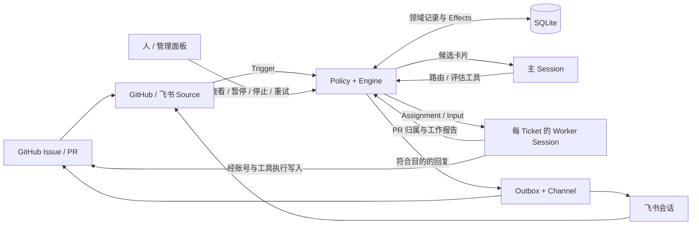

# 01 · 什么是主动式 Superagent

> 面试题　如果一个编码助手已经能读仓库、改代码、跑测试、开 PR，为什么还要做一个 Superagent？让助手在后台轮询 GitHub，够不够？

**短答**　这个原型解决的是团队如何把工作持续交给 Agent。它在 GitHub 和可选的飞书中接收事件，按来源和策略判断谁有权委托、这条消息属于哪项工作。授权通过后，系统用 Ticket 保存工作范围和进度，用独立的 DSH Session 执行，并在出现可交付结果或明确需要人工介入时回到相应会话。主动性体现为系统能够自行发现输入、在允许的条件下建单、在既有授权下持续推进。三个动作消耗的资源和承担的风险不同，各有自己的约束。 [项目说明](../dsh-superagent-prototype/README.md) · [设计原则](../dsh-superagent-prototype/docs/000-philosophy.md) · [Runtime](../dsh-superagent-prototype/src/app/runtime.ts)

本文以 `dsh-superagent-prototype` 在提交 `7bd4741` 中的实现为准。项目 README 将它定位为研究原型。本文中的 Superagent 指这个可持续接入团队工作、持有授权并交付结果的系统。读源码时可以始终抓住一个问题：**上一步产生的事实，对下一步到底有多大的授权效力？** [项目说明](../dsh-superagent-prototype/README.md) · [领域模型](../dsh-superagent-prototype/docs/001-domain.md)

## 1. 从一条 Issue 理解项目为什么存在

假设一个团队维护仓库 `example/portal`。维护者 Alice 在 Issue #42 写下「@portal-agent，帮助页把‘帐户设置’写成了‘帐户设值’，请改回‘帐户设置’」。这是一个具体、可验证、容易审查的任务。它只交代要修的地方与期望文字，代码路径、测试方式和 PR 内容留给执行方确定。以下仓库、账号和编号均为虚构示例。

用交互式编码助手时，Alice 可以自行打开 Session，把 Issue 链接和文字交给助手。助手有权限便可以完成同样的代码修改。团队仍然需要安排谁去发现 Issue、何时打开会话、如何把结果发布回 Issue，以及 Alice 第二天在 PR 下补充意见时，谁来找回昨天的工作。对于一次性任务，这些动作成本很小。任务变多后，很多成本来自人在多个入口间搬运信息，尤其是 Agent 执行和 PR 审查跨越不同时间段的时候。

也可以用固定工作流。例如规定带有某标签的 Issue 进入一个处理步骤，模板固定生成「确认 → 运行检查 → 留评」。如果输入有良好的结构，规则明确，步骤便于穷举，这个方案可以给出稳定的行为。遇到同一句「请改回帐户设置」出现在新 Issue、旧 PR、引用的历史内容和聊天转述中时，入口语义会不同。一个标签可以编码委托，一个评论也可以只是补充证据。工作流当然能增加这些分支，甚至调用模型。到那时，需要解释的已是分支的授权与工作连续性，而非工作流是否有模型节点。

这个原型把 GitHub Issue 和 PR、可选的飞书对话变成团队提交工作的入口。Alice 在 Issue 发出委托后，一次后台读取可以发现它。系统把收到的内容、作者及来源写成可追溯记录，由授权和路由逻辑决定它是否应该建单。后续 PR 评论还能进入已有任务。对 Alice 来说，原来的协作位置就是交付位置。对系统来说，事件、授权、工作单和模型 Session 都有自己的身份，可以在不同环节分别检查。 [GitHub Source](../dsh-superagent-prototype/src/sources/github.ts) · [领域模型](../dsh-superagent-prototype/src/core/model.ts) · [授权文档](../dsh-superagent-prototype/docs/002-authorization.md)

| 同一条错字需求 | 交互式编码助手 | 固定工作流示例 | DSH Superagent 原型 |
| --- | --- | --- | --- |
| 谁触发 | 人打开会话并提交请求 | 标签或结构化事件匹配规则 | 来源插件发现事件，事件可进入候选评估或已有 Ticket |
| 谁决定接下来做什么 | 当前操作者给指令，模型执行 | 预先编排的步骤和分支 | 代码先判断准入，模型结合候选语义路由或评估，Engine 校验结果 |
| 工作跨越多久 | 由会话及操作者的回访方式决定 | 由流程实例和预设等待点决定 | 可跨评论、执行回合、Assignment 和应用重启 |
| 结果在哪里出现 | 会话内或人指定的外部位置 | 固定通知出口 | 面向确认、答复、交付或提问的 Channel |
| 维护者如何接管 | 回到会话，直接纠正或停止 | 用预设审批、取消或重放节点 | 通过外部跟进、显式停止或管理面板处理 |

表格描述的是本案例中的典型使用方式。交互助手可以添加持久任务，工作流也可以加自然语言判断和人工停止。真正需要追问的是「谁提供目标、谁允许动作、状态由谁持有、失败后从哪里继续」。用这些问题比较系统，比给某一种工具贴上固定标签更适合面试。

### 从注意力成本推导三个设计选择

**第一，沿用协作现场。** 新增一个人必须频繁打开的入口，会让发现成本从工程师转到使用者。原型把主要对话保留在 Issue、PR 或飞书，管理面板用于看来源健康、等待人工处理的 Ticket 和发送失败等状态。由于输入和输出可以回到原有协作位置，维护者可以用正常的评论、评审与合并流程继续协作。面板提供的是系统级可见性和操作口，源码在 `overview` 中按状态提取当前需要人的工作。 [面板原则](../dsh-superagent-prototype/docs/005-panel.md) · [Overview 视图](../dsh-superagent-prototype/src/app/views/overview.ts)

**第二，只在委托足够清楚时进入执行。** 单一错字的修正方向和完成条件通常清楚。有人说「这页很难用」，目标、优先级和交互取舍都可能缺失。贸然生成一份重设计 PR 会引入模型成本，也会让团队花时间解释为什么它不合适。原型通过来源范围、身份和指向性得到准入强度。推断候选还要经过规则评估，检查明确方向、是否需要设计决定、规则是否命中以及意图依据等字段。代码可校验字段、规则覆盖和模式，模型仍承担对自然语言证据的判断。 [Policy 与结果校验](../dsh-superagent-prototype/src/policy.ts) · [准入提示词](../dsh-superagent-prototype/prompts/admission.md)

**第三，减少外部打扰，保留内部证据。** Alice 发出请求后，有用的信息包括收到后准备做哪项改动、有一个可审查的 PR、需要她回答具体问题，或者明确交付失败。Worker 每次搜文件、跑检查和改补丁的经过可以保留在 Session 或内部报告。普通 `progress` 报告没有相应人工答复需求时，`reportRelay` 可以留在内部。状态、日志和用户消息承担不同用途，减少用户消息可以与增加审计记录同时成立。 [设计原则](../dsh-superagent-prototype/docs/000-philosophy.md) · [报告中继](../dsh-superagent-prototype/src/app/notices.ts)

可以用一个假设算例说明取舍。设每处理 20 项工作，每项固定产生一条确认、一条交付和五条普通进度。全部外发时是 140 条，只发确认与交付时是 40 条。若其中三项需要一条明确的人工作答提醒，外发量会变为 43 条，各次执行仍能保留进度记录。这个算例只展示通知策略和消息量的关系。实际评估还要分别看是否错过需要人处理的事项、每条消息能否带来有效行动，以及错误接单产生了多少审查返工。

## 2. 主动性有三层，每层需要自己的许可

### 2.1 主动发现输入

GitHub watcher 可以轮询通知、订阅中的 Issue 或 PR，以及配置允许的其他事件。飞书接入带有实时消费和历史补拉。用户无需另开一个「现在让模型看这里」的会话。Source 把外部记录转换为 Trigger，携带来源、发送者、时间、文本、Thread 与可选的 Channel。随后 `Intake.receive` 用 Trigger ID 去重并应用 Source Scope，记录接收下来的事件及其处置。主 Session 是否拿到候选，要看后面的订阅归属和准入。 [GitHub watcher](../dsh-superagent-prototype/src/sources/github.ts) · [飞书消费者](../dsh-superagent-prototype/src/sources/feishu-loops.ts) · [Intake.receive](../dsh-superagent-prototype/src/core/intake.ts)

这一层主要消耗读取配额和本地记录空间，也会改变系统能够看到的信息范围。比如仓库机器人拥有读取权限，只说明平台允许它读取相应资源。应用仍须按配置决定哪些事件是监听对象，哪些范围允许评估未提及 Agent 的消息。团队可以允许 Agent 看某类事件，同时仅允许成员的明确指令触发工作。把这层说清楚，就能解释为什么「机器人看到消息」与「机器人接受委托」是相邻的两个问题。 [SourceRegistry.scope](../dsh-superagent-prototype/src/sources/registry.ts) · [GitHub Scope 配置](../dsh-superagent-prototype/src/sources/github.ts) · [settingsPolicy](../dsh-superagent-prototype/src/policy.ts)

### 2.2 主动判断是否启动新工作

Alice 在监听范围内提及 Agent，且她是该来源允许的发送者。Policy gate 可以赋予 `explicit` 强度。Engine 将候选交给主 Session，主 Session 通过 `orchestrator_route` 提交路由。它可以接受新事项、将适当的消息附到已有 Ticket、记录忽略或处理明确的停止请求。即使发送者被允许且消息提及 Agent，`explicit` 只表达可以使用显式路径，仍要判断这句话在语义上是否要求开始工作。「@portal-agent，我给你看一下之前的讨论」与「@portal-agent，请按这句文字改」都可能提及 Agent，语义不同。 [Policy gate](../dsh-superagent-prototype/src/policy.ts) · [路由工具](../dsh-superagent-prototype/src/app/tools/main.ts) · [路由提示词](../dsh-superagent-prototype/prompts/dispatch.md)

如果 Alice 没有提及 Agent，且这条消息能够被该来源观察并获准进入推断路径，它会以 `inferred` 强度成为候选。即便文字看上去有明确目标，系统也需要验证候选与团队启用规则的关系。在评估工具中，模型要评估启用规则，并给出方向与意图证据。规则覆盖、方向字段与当前模式由应用检查。`observe` 下，判为本来可以接受的事项会留下 `would_accept` 和建议范围等审计信息，决策仍为 `ignore`，没有 Ticket 和 Worker。`auto` 下，满足条件的推断结果才可用于接受。`off` 则禁止这一类推断候选，显式请求仍可走自己的路径。代码中 `eval.mode` 的 schema 默认值是 `observe`。 [Eval 配置与 assessmentOutcome](../dsh-superagent-prototype/src/policy.ts) · [MasterAssessor](../dsh-superagent-prototype/src/app/assessment.ts) · [Evals.decide](../dsh-superagent-prototype/src/core/evals.ts)

这两条路径都可能把卡片交给同一个主 Session，区别在于候选的授权来源和接受所需的检查。不能按「调用了模型」来判定是否属于推断式接单。显式路径也用模型理解请求，推断路径同样要将授权落到确定性检查。比如主 Session 对 `inferred` 候选直接调用 `orchestrator_route` 的 accept，没有提交评估通过的规则，Engine 会拒绝。这个约束比提示词中的「请走评估工具」更有约束力，因为它发生在写入授权记录前。 [路由调用与参数](../dsh-superagent-prototype/src/app/tools/main.ts) · [Engine 内部 Eval 决策](../dsh-superagent-prototype/src/core/evals.ts) · [运行时测试](../dsh-superagent-prototype/tests/runtime.spec.ts#L619)

### 2.3 主动推进已获授权的工作

接受请求后，Ticket 有了 Mandate，记录本次工作为什么能做、范围是什么以及所凭的策略和来源事实。执行层可以准备工作目录、启动 Worker Session 并让它读取原始请求。随后 Worker 按任务范围选择工具和步骤。对「修复一个错字」来说，定位对应文件、验证替换结果和准备可审查 PR 都可以作为完成目标所需的步骤。是否允许写入平台同时取决于 GitHub 账号、仓库权限和团队对分支或合并的控制。 [Mandate 与 Ticket 定义](../dsh-superagent-prototype/src/core/model.ts) · [Ticket 创建](../dsh-superagent-prototype/src/core/tickets.ts) · [部署说明](../dsh-superagent-prototype/docs/006-deployment.md)

维护者在已绑定的 PR 下发来「只修改帮助页，登录页先不动」，既有订阅可以把消息送给当前 Worker。合适的后续输入可以继续补充原工作的上下文。收到「把帮助页导航也重做一下」，Worker 应按现有任务范围判断，必要时用 handback 将消息交回评估路径。系统记录后续消息归属，主 Session 知道 Worker 已经收到并负责判断，因而同一条消息无需再被主 Session 转发一次。人工停止则是被明确保留的控制路径。 [后续消息归属](../dsh-superagent-prototype/src/core/model.ts) · [Worker 工具](../dsh-superagent-prototype/src/app/tools/executor.ts) · [主 Session 中继](../dsh-superagent-prototype/src/app/notices.ts) · [后续消息测试](../dsh-superagent-prototype/tests/followups.spec.ts)

| 动作 | 系统必须知道什么 | 能够写下什么事实 | 典型错误代价 |
| --- | --- | --- | --- |
| 发现 | 哪个 Source、哪个范围、怎样识别重复 | Trigger、过滤或扇出处置 | 漏事件、接收范围过大、重复记录 |
| 建单 | 谁提出、语义是否可执行、当前 Policy 是否允许 | Decision、Mandate、Ticket、初次 Assignment | 越权接单、重复占资源、给团队制造工作 |
| 推进 | 现有范围、当前 Assignment、Worker 与外部账号的能力 | 输入、报告、交付或停止状态 | 擅自扩大范围、错误改动、跟进丢失 |
| 对外发言 | 当下为什么要回复、消息应该去哪里 | Outbox 回执和投递结果 | 打扰无关人员、泄露上下文、重复通知 |

三层主动性还要配合独立的对外发言约束。系统可以监听大量事件，主动启动的工作却很少。已经有工作的 Worker 可以读到很多输入，实际对外回复也可能只有两三条。面试时可以直接用「每一层把哪种权力交给了谁」来组织回答。比如关闭推断式接单是对第二层的控制，而处理暂停还会影响新的评估、派发和出站回复，两者的作用范围不同。 [Policy 配置](../dsh-superagent-prototype/src/policy.ts) · [Runtime 暂停判断](../dsh-superagent-prototype/src/app/runtime.ts) · [回复规则](../dsh-superagent-prototype/src/core/replies.ts)

## 3. 从架构上看，谁持有什么状态



这张图省略了候选、执行、报告和回复之间的多个 Effects handler，箭头表示职责交接。管理面板的部分动作由 Settings 或 Runtime 处理，Ticket 命令进入 Engine。Worker 创建 PR 是其通过工具操作 GitHub 产生的独立外部结果，Worker 的报告用于把 PR 关联和当前状态写回 Ticket。Outbox 对 GitHub 或飞书发送的是应用整理过的回复及通知。这些动作的先后、持久化和失败恢复分别有自己的代码路径。 [Runtime 装配](../dsh-superagent-prototype/src/app/runtime.ts) · [管理路由](../dsh-superagent-prototype/src/app/http.ts) · [Worker 报告工具](../dsh-superagent-prototype/src/app/tools/executor.ts) · [Outbox](../dsh-superagent-prototype/src/app/outbox.ts)

### 3.1 Thread、Ticket、Assignment、Session 分别回答什么

- **Thread 回答「在哪段对话中发生」**。Issue #42 形成一个 GitHub Thread。后来创建的 PR #57 是另一段 Thread，Ticket 可以订阅它。一个 Thread 还能承载多项彼此独立的工作。消息进了哪段对话与它会产生几项工作，是两种关系。
- **Ticket 回答「当前被授权完成哪件事」**。它持有 Mandate、输入、回复地址和执行报告。团队成员可以在 PR 下补充要求，授权范围仍然可以追到最初接受它的 Decision。
- **Assignment 回答「现在这一趟执行尝试是谁在跑」**。Ticket 接受或符合条件的恢复会安排一次 Assignment。旧尝试可能失败、结束或被替换，新尝试继续同一 Ticket 下授权的工作。这个区分允许记录尝试历史。
- **Session 回答「模型在哪里收消息、调用工具和留下执行上下文」**。该原型使用一个主 Session，以及由 Ticket ID 派生身份的 Worker Session。一个 Ticket 可以经历多次 Assignment，仍然对应相同的 Worker Session 标识。业务是否结束由 Ticket 状态、报告与外部事实共同决定，Session idle 只说明回合状态。

这几个对象有各自的时间尺度。Issue 对话可能存在数周，错字 Ticket 可以一天结束，启动失败的一次 Assignment 可能只有几秒，Worker Session 历史还可以在任务结束后供人回看。把生命周期都压进一个状态值，会让「模型暂时空闲」「工作可审查」「任务被人叫停」混在一起。原型为管理面板另用 `ticketStage` 从存储事实派生待人处理、工作中、空闲或结束等状态。 [领域类型与 followupOwners](../dsh-superagent-prototype/src/core/model.ts) · [Worker Session ID](../dsh-superagent-prototype/src/executor/dsh.ts) · [ticketStage](../dsh-superagent-prototype/src/core/stage.ts)

### 3.2 原型和 DSH Harness 的分工

插件入口 `src/index.ts` 的 `inject` 列出了 `agents`、`sessionController`、`sessionPersistence`、`workspaceRegistry`、`permissionPresets`、`tools`、`systemPrompt`、`skills`、`webServer`、`llm`、`subprocess`。这是理解集成边界的直接证据。插件通过 Cordis 上下文消费这些服务，然后用 `new Runtime` 把工作域模块装配到一起。`package.json` 里声明 bundle patch、客户端插件和 DSH 相关依赖。 [入口与注入](../dsh-superagent-prototype/src/index.ts) · [包清单](../dsh-superagent-prototype/package.json) · [bundle patch](../dsh-superagent-prototype/cordis.patch.yml)

| 问题 | 原型代码的职责 | DSH 宿主提供的能力 |
| --- | --- | --- |
| 外部事件何时能变成任务 | Source、Policy、Engine 建立来源、策略和授权约束 | 通过插件框架装载编排与来源服务 |
| 模型应该扮演什么角色 | 绑定主 Session 与 Worker，注入领域提示词、工具入口和角色限制 | Session、Agent 运行、模型调用以及工具执行基础设施 |
| 工作目录与执行怎样管理 | 为 Ticket 确定目录和环境，安排启动、输入投递、并发及恢复 | Workspace、子进程、权限 preset 等接口 |
| 重启时看哪些事实 | 用 SQLite 恢复 Ticket、决策、队列和回复回执，重新对账 Assignment | Session 事件与持久化接口，帮助恢复模型侧的执行上下文 |
| 用户通过哪里管理 | 管理 API、读模型、面板和任务操作 | Web Server 和客户端扩展所需的宿主服务 |

`Runtime` 在状态目录打开 `orchestrator.sqlite`，装配 `Store`、`SourceRegistry`、`Sessions`、`DshExecutor`、`MasterAssessor`、`Outbox` 和 Engine。核心的任务状态通过同步事务修改。模型调用、Shell、外发与其他 I/O 在事务之外协调，持久 Effects 让工作意图可以留给后续处理。理解这一点，就能区分「这个应用保存了谁应该做什么」与「宿主如何让模型运行一轮」。对于 DSH 依赖内部的调度和权限实现，本文以本地调用处可观察的契约为证据。 [Runtime 构造与生命周期](../dsh-superagent-prototype/src/app/runtime.ts) · [Engine](../dsh-superagent-prototype/src/core/engine.ts) · [Effects](../dsh-superagent-prototype/src/app/effects.ts) · [Sessions](../dsh-superagent-prototype/src/app/sessions.ts)

这个分工对测试也有影响。若要检验「某条 Trigger 已经接受过时，再接受是否产生第二张 Ticket」，可以直接测 Engine 和仓储。若要检验「候选能被发送给主 Session，Worker 报告能被编排器接收」，就需要带有 Session、工具和事件服务的宿主夹具。若要判断「真实模型能否正确识别模糊委托」，则需要真实或可比较的模型输出、样本和人工标注。三类结论依赖不同证据。 [核心测试](../dsh-superagent-prototype/tests/core-engine.spec.ts) · [测试宿主](../dsh-superagent-prototype/tests/fixtures/host.ts) · [运行时测试](../dsh-superagent-prototype/tests/runtime.spec.ts)

## 4. 用错字案例走一次正常路径

### 4.1 摄取与建单

按照示例部署，账号能读取 `example/portal`，Issue 在监听范围，Alice 在 GitHub 来源的允许列表内。GitHub 通知入口读取 Issue，`issueTrigger` 将标题和正文组合为文本，以 Issue 编号参与生成稳定 Trigger ID，并携带 GitHub Thread 和回复 Channel。Issue 正文中的有效提及使 Trigger 带有 `addressed: 'mention'`。系统可能从多路读取到同一个 Issue，Intake 以 Trigger ID 识别重复。这个 ID 是本仓库原型范围里的事件身份。多仓库共享一份状态时，直接沿用同一命名范围会让两个仓库的同号 Issue 产生歧义。 [GitHub 读取入口](../dsh-superagent-prototype/src/sources/github.ts) · [issueTrigger](../dsh-superagent-prototype/src/sources/github-trigger.ts) · [Intake](../dsh-superagent-prototype/src/core/intake.ts)

在这条 Thread 上，假设没有 Worker 拥有本次消息。Intake 让它进入待评估队列。Engine 的 `evaluateDue` 推动待处理 Thread 开始 Eval，Policy gate 看到「允许的 Alice + 直接提及」给出显式强度。候选送到主 Session，模型可以理解这是一项明确的文字修复。`orchestrator_route` 的 accept 收取标题、工作区短名与确认文字，应用通过 Engine 记录接受及授权，订阅对应的 Thread，安排初次 Assignment。确认送到合适的 Channel 还需要 Outbox 成功，接受记录已写入时，Worker 或出站消息都可能仍在等待。 [Evals.start 与 decide](../dsh-superagent-prototype/src/core/evals.ts) · [MasterAssessor](../dsh-superagent-prototype/src/app/assessment.ts) · [主路由工具](../dsh-superagent-prototype/src/app/tools/main.ts) · [Ticket 创建](../dsh-superagent-prototype/src/core/tickets.ts)

Alice 可能看到一句确认「收到，会把帮助页的错字改回‘帐户设置’」。这句话的作用是对齐理解。她可以在代码还未改完时就指出具体位置或修正目标。它承诺要处理什么，不能当成已经交付。相应地，面试里说「Decision 是 accept」也只证明接单成功。想追实际运行，还需看 Assignment，想追确认送达，还需看回执。 [接受确认](../dsh-superagent-prototype/src/core/replies.ts) · [Outbox](../dsh-superagent-prototype/src/app/outbox.ts)

### 4.2 执行、评审与交付

Executor 读到启动 Effect 后，检查 Ticket 和 Assignment 是否还有效。取得 Worker 槽位后按配置准备工作目录并确保 Worker Session 存在。它给 Worker 原始 Trigger 和任务上下文。Worker 可在具备相应凭据和工具的前提下定位文件、改文案、验证并创建 PR #57。主 Session 的工作是路由和完成沟通，Worker 承担代码调查和技术执行。约束一方职责的措施包含提示词，Worker 工具列表和 Ticket 结束后的 guard 则由应用接入宿主的工具控制。 [DshExecutor](../dsh-superagent-prototype/src/executor/dsh.ts) · [Sessions](../dsh-superagent-prototype/src/app/sessions.ts) · [路由提示词](../dsh-superagent-prototype/prompts/dispatch.md)

Worker 用 `orchestrator_report` 提交 `ready` 和 PR 编号。如果提供了 PR，工具会读取 PR 并检查能否归属该 Ticket，然后将关联、报告和适当的内部中继放进一次事务。主 Session 读到可交付结果后可以用 `orchestrator_reply` 回复。Ticket 已有自己的 PR 时，`ready` 可以反映为等待人工评审。在案例里 Alice 此时有可审查的结果，也仍可在 PR 下提出修改。GitHub Source 看到相关 PR 合并后，Engine 再结合它跟踪的 PR 和是否还有未完成的后续工作判断何时结束 Ticket。GitHub 页面本身展示合并事实，`pullEndNotices` 服务的是相关的非 GitHub Channel。 [报告与归属](../dsh-superagent-prototype/src/app/tools/executor.ts) · [PR 绑定与结束](../dsh-superagent-prototype/src/sources/github-pull.ts) · [Ticket 结束条件](../dsh-superagent-prototype/src/core/tickets.ts) · [回复规则](../dsh-superagent-prototype/src/core/replies.ts)

| 时间点 | 维护者可看到的事实 | 系统可用来解释的事实 |
| --- | --- | --- |
| Alice 提交 Issue | Issue 正文已发表 | Source 读到后有 Trigger 和处置 |
| 主 Session 接受 | 确认送达后可在原对话看到 | 接受 Decision、Mandate、Ticket 及待启动 Assignment |
| Worker 创建 PR | GitHub 可见 PR 和修改 | Worker 报告可把 PR 登记到 Ticket，`ready` 形成审查状态 |
| Alice 留评 | GitHub PR 线程出现消息 | Trigger 按订阅进入 Ticket，由 Worker 判断输入归属 |
| 人合并 PR | GitHub 显示合并 | Source 确认外部事实后，Engine 按跟踪范围判断 Ticket 结束 |

这张表还有一个诊断用途。面试官问「用户说它没做，怎么查」，可以让用户提供外部消息或 PR 的标识，先找摄取记录、过滤原因与 Decision，再查 Ticket 的 Assignment 是否启动、是否有未投递输入或报告，最后看 Outbox 回执。这样按证据推进，比先询问模型「你为什么没做」更可重复。 [管理读模型](../dsh-superagent-prototype/src/app/views/overview.ts) · [记录视图](../dsh-superagent-prototype/src/app/views/records.ts)

## 5. 用反例检验主动性的边界

### 5.1 陌生用户也提及了 Agent

把 Issue 的发送者换成未列入 GitHub 来源允许列表的用户，正文保持完全相同。假设这一类 Issue 使用默认准入且没有已有 Ticket 参与，事件仍可被读取、存储，但它不会获得原来 Alice 的显式强度。默认配置下，未列入名单的提及走相应的 admission 单元格，默认结果是忽略。测试覆盖了这条路径，断言存在 `not_a_member` 原因，并且没有候选卡片。若团队明确把某一来源范围配置为允许这类提及，则需要带上那项配置重新判断。 [Admission 默认值](../dsh-superagent-prototype/src/admission.ts) · [Policy gate](../dsh-superagent-prototype/src/policy.ts) · [GitHub 对照测试](../dsh-superagent-prototype/tests/runtime.spec.ts#L489)

这个反例说明身份信息必须来自 Source，正文只是表达意图的材料。正文里写「我是管理员」也不能替代平台提供的作者身份。到了飞书，同一个真实的人可能拥有不同标识，原型按每个来源各自配置，身份合并不能从名字或消息文字推出来。 [领域模型](../dsh-superagent-prototype/docs/001-domain.md) · [Policy allowlist 查找](../dsh-superagent-prototype/src/policy.ts)

### 5.2 能不能用 CI 失败自动开启任意修复

测试失败至少有三种意义。它可能是正在进行的改动需要处理的反馈，可能是团队希望评估的默认分支异常，也可能是短暂的外部服务故障。当前 Ticket 绑定 PR 的 CI 可以作为工作输入，帮助 Worker 继续处理原目标。默认分支 CI 若要成为推断候选，要符合相应来源范围和准入配置，之后仍受规则、方向与模式约束。Policy 测试还区分默认分支 CI 和 PR CI 的准入。单凭一次 CI 失败就把改动范围扩到全仓库，会把「故障证据」误当成「执行授权」。 [CI Trigger](../dsh-superagent-prototype/src/sources/github-trigger.ts) · [机器人与 CI 准入](../dsh-superagent-prototype/src/policy.ts) · [Policy 测试](../dsh-superagent-prototype/tests/policy.spec.ts#L442)

### 5.3 已有 Ticket 时，谁来处理后续消息

当 Alice 在 PR 下补充范围内限制，订阅能让原 Ticket 的 Worker 收到。这一过程中可以保留两份视角。Worker 收到输入并负责判断范围，主 Session 收到跟进通知以保留协调能力，例如处理明确的停止。对于明显超出范围的请求，Worker 可以退回，新的授权由评估路径承担。对于仅作参考的 context-only 订阅，消息可抵达 Worker 作为上下文，归属与是否另行评估要按 `followupOwners` 判断。 [归属计算](../dsh-superagent-prototype/src/core/model.ts) · [Intake.receive](../dsh-superagent-prototype/src/core/intake.ts) · [followupNotice](../dsh-superagent-prototype/src/app/notices.ts) · [授权文档](../dsh-superagent-prototype/docs/002-authorization.md)

如果 Alice 后来被移出允许列表，也要问清当时正处在哪个阶段。策略变化会使受影响的在途 Eval 重新开始，相关的打开 Ticket 可以收到策略变化 Input。运行时测试覆盖了移出请求者后 Worker 收到变化通知且 Ticket 仍开放的情况。对于结束后要重新唤醒的 Ticket，`Tickets.wake` 则会调用当前 Policy 的 `revalidate`，人主动停止的 Ticket 也有独立终止约束。这些行为体现了原型对「待判断」「已在执行」「将重新执行」采用了不同控制策略。管理员若要立即停下当前工作，应使用针对 Ticket 的停止入口。 [策略变化](../dsh-superagent-prototype/src/app/settings.ts) · [Ticket 恢复与政策通知](../dsh-superagent-prototype/src/core/tickets.ts) · [运行时测试](../dsh-superagent-prototype/tests/runtime.spec.ts#L408)

### 5.4 Worker 拉起失败，Issue 为什么还能收到「已接受」

接单和启动之间有异步边界。接受事务可以先留下 Ticket、Assignment 和启动 Effect，Worker 拉起还依赖目录准备、可用槽位、Session 和执行环境。确认消息也通过 Outbox 独立发送，所以出现「收到确认，Worker 还排队」是可以解释的中间状态。准备失败时，应看失败报告、面板待处理项和重试条件。盲目让 Source 重播事件，既不能证明目录准备恢复，也与接单幂等的预期相冲突。 [Ticket.create](../dsh-superagent-prototype/src/core/tickets.ts) · [启动处理](../dsh-superagent-prototype/src/executor/dsh.ts) · [状态派生](../dsh-superagent-prototype/src/core/stage.ts)

持久 Effects 提供了继续尝试的依据。它把关联的副作用意图记录下来，派发失败时可以按种类退避。应用内部能够识别重复的 Trigger、接受决定和一些消息 ID。另一个问题是远端操作已经成功，但本地回执尚未写入时发生崩溃。能否避免外部重复还取决于远端接口的幂等能力及对账方式。面试中可以明确指出两处成功窗口之间的区别，避免把本地去重讲成所有外部写入都有严格一次保证。 [持久 Effects](../dsh-superagent-prototype/src/app/effects.ts) · [Outbox 回执](../dsh-superagent-prototype/src/app/outbox.ts) · [Session 投递](../dsh-superagent-prototype/src/app/delivery.ts)

## 6. 哪些限制由代码执行，哪些需要团队和平台一起保证

这套设计应同时从业务边界、模型指令和外部权限三个层面看。比如「未获准的推断候选不能从显式接受工具建单」，在应用的 Engine 层可被拒绝。再如「只修这一个错字」，Mandate 记录范围，Worker 收到原始请求与指令，模型要据此选择改动，团队还可以通过代码审查检查 patch 是否越过边界。当前应用的角色工具限制、目录、CLI 包装器与 GitHub 分支保护各自能限制不同动作。

| 约束 | 谁执行 | 面试可以怎样核对 |
| --- | --- | --- |
| 推断候选按规则与模式接受 | Policy、评估转换和 Engine | 查看 `assessmentOutcome`、`Evals.decide` 以及绕过显式路由的拒绝测试 |
| Worker 只处理委托范围内的事项 | Mandate、Worker 提示词与工具流程 | 查看原始请求和报告，再检查变更及是否必要时 handback |
| Ticket 结束后拒绝相应工作工具 | Session 装饰中的工具 guard | 查看 `Sessions.workOnly` 如何读取 Ticket 当前状态 |
| 启动和唤醒有并发预算 | Executor 槽位和 Effects 派发条件 | 查看 `WorkerSlots`、Worker 状态和并发测试 |
| PR 审批与目标分支写入权限 | GitHub 账号权限与仓库策略 | 对照实际分支保护、审批记录及平台写入结果 |

部署文档指出工作目录和命令包装器设定了执行默认值，操作系统隔离还需要额外部署措施。自动合并的交付约定写在提示词，GitHub 是否允许合并取决于平台条件、仓库保护及账号权限。若面试官把题改成「给多个互不信任的团队开放」，可以以这个单仓库装配为起点提出隔离的执行环境、独立凭据、租户边界和审计，而需要另外说明这些是待设计的生产能力。 [角色工具限制](../dsh-superagent-prototype/src/app/sessions.ts) · [执行目录与合并说明](../dsh-superagent-prototype/docs/003-execution.md) · [部署隔离](../dsh-superagent-prototype/docs/006-deployment.md)

引入主动判断后，人看见的会是被筛选后的候选、结果或提醒，需要留有办法复核看不见的部分。例如有资格被观察的内容中，多少错误地变成任务，多少有价值请求被漏掉，多少通知迫使别人返工。可以用 `observe` 的 `would_accept` 做人工对照，收集一批明确委托、日常讨论、历史引用、权限变更和跟进消息。根据人工判断区分误接、漏接和错误归属，再决定是否对限定场景打开 `auto`。原型提供审计记录作为原料，这个实验的样本、指标与上线标准仍需要定义。 [评估结果及审计](../dsh-superagent-prototype/src/policy.ts) · [管理记录](../dsh-superagent-prototype/src/app/views/records.ts)

## 7. 用本地测试检查关键判断

这些用例选用 GitHub 与飞书两种夹具，覆盖共同的领域链路。首个 GitHub 测试把通知和 Issue 读取替换为模拟响应，断言 GitHub 候选卡。创建 Ticket、确认回复和投递的组合断言来自飞书夹具。它们合起来说明各段行为如何受测试约束。真实仓库中的 PR 交付和模型生成质量需要另做验证。 [运行时测试](../dsh-superagent-prototype/tests/runtime.spec.ts) · [测试宿主夹具](../dsh-superagent-prototype/tests/fixtures/host.ts)

| 要核对的判断 | 测试具体检查了什么 |
| --- | --- |
| 允许成员在新 GitHub Issue 中提及 Agent，产生显式候选 | 替换 CLI 读取后调用 `pollRound`，检查 `strength: 'explicit'`、稳定 Trigger ID 和 `github:12`。 [GitHub 摄取测试](../dsh-superagent-prototype/tests/runtime.spec.ts#L474) |
| 接受显式委托建立任务与追踪关系 | 检查 Mandate 的来源和强度、Assignment running、Worker Session ID、Thread 订阅和飞书确认回执。再次接受同一 Trigger 时拿到原 Ticket。 [显式接单测试](../dsh-superagent-prototype/tests/runtime.spec.ts#L219) |
| 观察与自动接单的差异 | 对 `observe` 下的候选提交正向评估，断言空 Ticket 列表和 `would_accept: true`。改成 `auto` 后使用另一个 Trigger，断言创建带规则依据的 Ticket。 [观察与接单测试](../dsh-superagent-prototype/tests/runtime.spec.ts#L265) |
| 同任务的后续消息有既有归属 | 检查 Worker 收到新 Input、主 Session 收到 `follow_up` 卡片，Thread 的 Decision 历史仍只有原任务创建记录。 [跟进消息测试](../dsh-superagent-prototype/tests/runtime.spec.ts#L243) |
| 推断候选不能借显式工具提交 accept | 直接调用路由 accept，断言抛出拒绝且 Ticket 列表为空。 [拒绝路径测试](../dsh-superagent-prototype/tests/runtime.spec.ts#L619) |

在依赖已按仓库锁文件安装的环境，可从项目目录运行这些用例。它们通过模拟 CLI 和宿主接口来检查编排，用例本身不需要真实 GitHub、飞书账号或模型调用。

```bash
cd dsh-superagent-prototype
pnpm test tests/runtime.spec.ts tests/followups.spec.ts tests/policy.spec.ts \
  -t 'allowed sender|explicit member mention|proactive observation|delivers a follow-up|tells live workers|mode only|refuses an accept through orchestrator_route'
```

本次在临时检出目录中使用 Node.js `26.5.0`、锁文件指定的 pnpm `11.7.0` 运行了这组筛选用例。3 个测试文件通过，11 个用例通过，其余 424 个用例由筛选条件跳过。

## 8. 面试时怎么讲

### 60–90 秒口述版

> 我用 dsh-superagent 解释团队里的主动式 Agent。它把 GitHub Issue、PR 和可选的飞书作为任务入口，后台 Source 发现消息后生成 Trigger。应用按当前来源、发送者和策略判断这条消息能否触发新工作。授权成员的明确请求走显式路由，推断请求还要经过规则评估。observe 模式可以记录本来会接什么，auto 才能在条件满足时实际建单。
>
> 接受后用 Ticket 保存 Mandate 和进度，DSH 在对应的 Worker Session 里执行。这让工作可以跨回合继续，PR 上的后续评论也能送回同一个任务。Worker 报告可交付结果或者问题需要人决定时，主 Session 用 Outbox 回到合适的会话。代码里的停止、恢复、事务和持久队列保证工作有明确状态可查。这个项目的主动性来自持续感知、可授权建单和持续推进。三层权限分开后，团队可以放开感知，同时控制自动改动和对外发言的范围。

### 追问一　轮询加一个能读代码的模型，离 Superagent 还差什么？

轮询解决发现，模型和工具解决理解及执行。还需要回答谁能委托、是否属于既有任务、如何记住授权与进度、远端效果失败后如何恢复，以及结果应该交给谁。面试可以拿同一条消息重复抵达、Agent 跨天等待 PR 评审、用户提出新需求三个例子说明。Trigger ID 和摄取处理用于识别重复，Thread 订阅让评审反馈回到 Ticket，Mandate 与 handback 控制新需求是否要另走授权。 [Intake](../dsh-superagent-prototype/src/core/intake.ts) · [Ticket 与 Mandate](../dsh-superagent-prototype/src/core/model.ts) · [Engine](../dsh-superagent-prototype/src/core/engine.ts)

### 追问二　显式委托和自动接单都用了模型，如何区分？

看接受工作所凭的授权来源。显式候选有直接委托的准入依据，模型仍要决定是新任务、已有任务、停止或普通讨论。推断候选要经过团队规则、方向和证据检查，且只有 `auto` 模式可以实际接受。模型的判断会进入工具和 Engine 的校验。关闭自动接单之后，可以继续处理合格的显式请求。 [Policy](../dsh-superagent-prototype/src/policy.ts) · [显式路由工具](../dsh-superagent-prototype/src/app/tools/main.ts) · [推断结果校验](../dsh-superagent-prototype/src/app/assessment.ts)

### 追问三　为什么拆成主 Session 和 Worker Session？

它们看到的信息和负责的事情不同。主 Session 看候选及相关 Ticket，擅长判断归属并交付信息。Worker 集中完成一个 Ticket，拥有这项任务的工作目录、原始请求及执行历史。独立 Session 有助于让不同任务并发执行，并让长时间的代码操作从路由工作中移开。相应成本是多了消息交接，系统因此需要 Session 标识、结构化报告和输入投递状态。 [Sessions](../dsh-superagent-prototype/src/app/sessions.ts) · [Executor](../dsh-superagent-prototype/src/executor/dsh.ts) · [AgentDelivery](../dsh-superagent-prototype/src/app/delivery.ts)

### 追问四　能不能把 Worker ready 当作任务结束和消息送达？

需要按三个事实分别判断。Worker 报 `ready` 可能只表示 PR 已可审查，Ticket 可继续等待评审、后续工作和合并。是否结束读 Ticket 及其相关 PR 状态，通知是否送达查看 Outbox 回执。若监控把三者合并，会出现「PR 等人审时已算任务终结」「报告写了但用户没看到」等误判。 [Ticket 状态](../dsh-superagent-prototype/src/core/stage.ts) · [PR 结束处理](../dsh-superagent-prototype/src/core/tickets.ts) · [Outbox](../dsh-superagent-prototype/src/app/outbox.ts)

### 追问五　如果你只能选两个指标比较主动 Agent 的上线收益，会选什么？

我会先用「经人工判定的授权误接率」和「每项有效交付的人工介入次数」。前者以人工标为不应授权的新工作候选为分母，统计其中被错误接受的比例，分开看显式和推断路径。后者以人工认可的交付为分母，统计这些任务为了完成交付而发生的人工澄清、纠错和接管，常规必要的代码评审可以单独记录。两者能分别反映系统有没有多做事和有没有真正省人的注意力。在 observe 阶段可以用 `would_accept` 估算推断路径的潜在误接，之后在固定的低风险任务范围做小流量比较。 [设计原则](../dsh-superagent-prototype/docs/000-philosophy.md) · [审计结果](../dsh-superagent-prototype/src/policy.ts)

---

[返回连载目录](README.md) · 下一篇《Cordis 插件、DSH bundle 与运行时装配》
