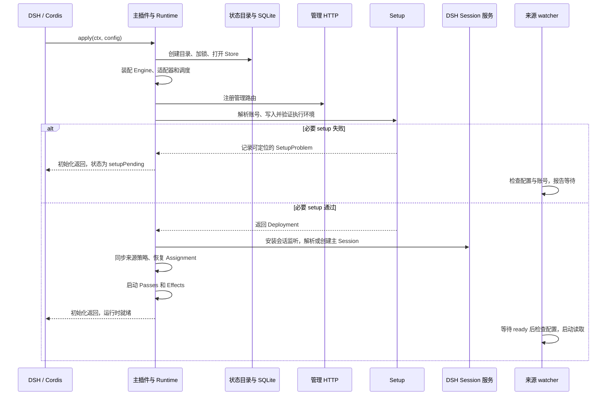

# 02 · Cordis 插件、DSH bundle 与运行时装配

> 面试题　Superagent 的进程启动后，GitHub 账号没有配置，为什么还能打开管理面板？把账号填好后，哪些组件需要重启，哪些状态应该接着用？

**短答**　这个原型由 DSH profile 装载一组协作插件。包清单声明可装载入口和 bundle patch，patch 向 Cordis 的配置列表插入主插件、来源插件及角色 preset。主插件的 `apply` 从宿主取得 Session、工具、Web Server 等服务，构造应用的 `Runtime`。Runtime 先锁定状态目录、打开 SQLite、装配组件和注册管理路由，再通过 setup 探测账号及执行环境。配置缺失时保留可以修复它的管理入口，后台评估、派发和来源轮询等待可用环境。修复配置后可以重启主插件，新的 Runtime 从 SQLite 与 DSH Session 两处找回不同性质的状态，再决定哪些工作可以继续。 [包清单](../dsh-superagent-prototype/package.json) · [bundle patch](../dsh-superagent-prototype/cordis.patch.yml) · [插件入口](../dsh-superagent-prototype/src/index.ts) · [Runtime](../dsh-superagent-prototype/src/app/runtime.ts)

本文使用提交 `7bd4741` 中的原型源码，延续第一篇的教学仓库 `example/portal`。设定一个独立的 DSH Web profile，计划让维护者 Alice 在 Issue #42 委托 Agent 修复错字。这次关注的是**第一条 Issue 到来之前，谁保证系统已经具备接活的条件**。文章也会追踪任务执行中更换 GitHub CLI 后的插件重启。 [第 01 篇](01-what-is-a-superagent.md) · [部署说明](../dsh-superagent-prototype/docs/006-deployment.md)

## 1. 先分清构建、装载、配置和启动

初看代码容易把 `package.json`、项目里的 `cordis.patch.yml`、部署示例里的 `cordis.patch.yml` 和面板里的 Settings 看成四份在写同一件事。它们实际回答的是四组问题。开发阶段要把 TypeScript 编译成宿主可加载的文件。装载阶段要告诉宿主启用哪些插件。配置阶段要确定这台机器的状态目录、账号和运行策略。到启动阶段，应用才有机会打开数据库，校验账号是否真的可用，按依赖顺序启动后台工作。各阶段遇到错误时，也由不同的人和入口修复。 [构建配置](../dsh-superagent-prototype/tsdown.config.ts) · [bundle patch](../dsh-superagent-prototype/cordis.patch.yml) · [profile 示例](../dsh-superagent-prototype/examples/profile.cordis.patch.yml) · [部署说明](../dsh-superagent-prototype/docs/006-deployment.md)

| 阶段 | 需要回答的问题 | 该原型的入口或产物 | 一类典型错误 |
| --- | --- | --- | --- |
| 构建 | Node 与浏览器分别加载什么 | `tsdown.config.ts`、`lib/*.js` 和服务端声明文件 | 没构建或产物入口缺失 |
| 装载 | 哪个 profile 装哪些服务 | 包清单的 DSH 元数据、bundle patch、profile patch | 缺宿主服务、来源插件被禁用 |
| 配置 | 用哪一份状态、哪个账号、采用哪些限制 | `Config`、SQLite Settings、账号 CLI 本身持有的凭据 | `stateDir` 无效、未指定 CLI、推送权限不足 |
| 启动 | 当前是否可以接收并处理任务 | `Runtime`、`Setup`、watcher、健康状态 | 状态目录锁冲突、主 Session 解析失败、飞书未就绪 |

**DSH** 是 DeepSeek Harness 宿主。它提供 Agent/Session、工具、模型、Workspace、子进程和 Web 服务等接口。**Cordis** 在这里承担插件声明、服务注入和生命周期交接。本项目通过它聚合宿主能力，并把自己的编排服务交给来源插件。**Bundle** 在这个仓库中指包清单声明的那组可装载入口及其配置补丁。**Preset** 描述某类 Session 启用的工具与相关插件配置。**Profile** 则是部署落点，明确这次宿主启动所使用的配置。面试时只要把这五个名词放回各自阶段，启动图就有了稳定的骨架。 [插件入口](../dsh-superagent-prototype/src/index.ts) · [包清单](../dsh-superagent-prototype/package.json) · [角色配置](../dsh-superagent-prototype/cordis.patch.yml) · [部署说明](../dsh-superagent-prototype/docs/006-deployment.md)

## 2. 包清单与构建产物如何接起来

### 2.1 package.json 定义可装载入口

`exports` 提供四个和运行直接相关的入口。主入口 `dsh-superagent` 指向 `lib/index.js`，还声明了 `lib/index.d.ts`。GitHub 与飞书 watcher 分别经 `dsh-superagent/github-watch` 和 `dsh-superagent/feishu-watch` 暴露。浏览器插件入口是 `dsh-superagent/client`。运行时 Node 入口、类型入口和前端加载入口职责不同。发布文件范围还包含 patch、`locale`、`prompts` 和 `skills`。提示词和技能等运行素材有明确的分发位置。 [包清单](../dsh-superagent-prototype/package.json)

DSH 元数据在同一个清单中。 `dsh.bundle.patch` 指向包内的 `cordis.patch.yml`，`dsh.client` 声明 Web 平台及依赖的客户端插件。 `manifestVersion` 标明这份元数据的版本。可以把普通包导出看成「要去哪里载入代码」，把 DSH 元数据看成「宿主应该怎样识别和装配这个包」。两者必须一致。如果 patch 中声明了 `dsh-superagent/github-watch`，包导出与构建都必须能提供这个名字对应的产物。 [包清单](../dsh-superagent-prototype/package.json) · [bundle patch](../dsh-superagent-prototype/cordis.patch.yml)

### 2.2 Node 和浏览器是两次构建

`tsdown.config.ts` 把 Node 端的 `src/index.ts`、GitHub 和飞书源码打成 ESM，目标是 `es2024`，输出到 `lib`，并生成声明。构建配置将 `@deepseek-ai/` 包、`zod` 和 `proper-lockfile` 排除在内嵌范围之外。宿主相关依赖在清单中按 peerDependencies 等方式声明，构建只负责产生可由相应环境解析和加载的代码。把宿主服务留在进程统一装配，有利于插件复用宿主的 Session、工具和事件上下文。 [构建配置](../dsh-superagent-prototype/tsdown.config.ts) · [依赖声明](../dsh-superagent-prototype/package.json)

浏览器侧只有 `src/client/index.tsx` 这一入口。这里的 `cjs` 格式配合构建自定义包装，最终 `client.js` 由 `window.__ModuleLoader__.load` 接收。包装在工厂函数里提供 `module.exports`，把插件导出交回浏览器的模块加载器。React 等依赖留给浏览器宿主解析。自定义的 `raw` 插件把带 `?raw` 的文件读成文本模块，解决样式文件以文本被导入的问题。Node 构建允许清理输出目录，浏览器构建配置 `clean: false`，避免把前一组产物清掉。直接把这个 `client.js` 当作 Node ESM 入口运行，会丢失它需要的 Web loader 上下文。 [浏览器构建配置](../dsh-superagent-prototype/tsdown.config.ts) · [Web 插件入口](../dsh-superagent-prototype/src/client/index.tsx)

构建成功之后仍可能启动失败。例如已存在 `lib/index.js`，但 profile 没提供必需的 `stateDir`。也可能后台正常而看不到面板，例如客户端模块未被装载或者必要的 UI 服务缺失。排查应先问是模块解析、依赖装配、运行环境还是界面注册的问题。这四种故障的证据依次在包产物、宿主配置、Runtime 健康与浏览器注册入口。 [包清单](../dsh-superagent-prototype/package.json) · [插件配置](../dsh-superagent-prototype/src/deployment.ts) · [Web 插件入口](../dsh-superagent-prototype/src/client/index.tsx)

## 3. Bundle patch 与 profile patch 分别提供什么

包内 patch 用 `insert` 插入五行。前三行分别是主插件、GitHub watcher、飞书 watcher。飞书这一行默认 `disabled: true`。后两行是 Worker 和主 Session 的 preset 提供者，preset 本身的 ID 分别是 `dsh-superagent-worker` 与 `dsh-superagent-router`。这里同一行可以同时出现配置项 ID 和用于模块解析的插件名，preset 提供者的配置里还有实际的 preset ID。读 YAML 时，先问这个名字用于找模块、找配置行，还是用来创建 Session。 [bundle patch](../dsh-superagent-prototype/cordis.patch.yml) · [bundle 测试](../dsh-superagent-prototype/tests/bundle-patch.spec.ts)

profile 里的示例 patch 按 ID 指定本机参数。它为 Web Server 设置 `127.0.0.1` 与示例端口 `3082`，为主插件设置绝对路径 `stateDir`，并给出启用飞书插件的可选条目。包内 patch 解决「应用通常需要哪些组件」，profile patch 解决「这个实例如何落到一台机器上」。相同的 bundle 能被装到不同 profile，profile 值、环境与应用账号仍需要分别配置。对于飞书，加载 watcher、Source 自身配置启用、bot 探测成功也是不同条件。已有飞书配置能存于 SQLite，Registry 在插件未安装时仍可将其展示为已保存但 `installed: false` 的实例。 [profile 配置示例](../dsh-superagent-prototype/examples/profile.cordis.patch.yml) · [SourceRegistry](../dsh-superagent-prototype/src/sources/registry.ts) · [飞书启动条件](../dsh-superagent-prototype/src/sources/feishu-loops.ts)

### 两个 preset 为什么需要在 bundle 中提前声明

当 `Sessions.ensure` 解析不到目标 Session 且错误码为 `session/not-found` 时，它创建对应 Workspace，通过 `sessionController.create` 指定新 Session 的 `agentPreset`。Worker 使用 Worker preset，主 Session 使用 Router preset。于是「每张 Ticket 对应一个实际执行会话」有了可引用的工具配置。角色模型从 Eval 或 Executor 设置读取并初始化，随后 `decorate` 还会注入本应用的 prompt、技能与工具。preset 提供宿主工具基础，应用的方法绑定提供 Ticket 的业务接口。 [Sessions.ensure 与 decorate](../dsh-superagent-prototype/src/app/sessions.ts) · [角色模型初始化](../dsh-superagent-prototype/src/app/role-models.ts) · [bundle patch](../dsh-superagent-prototype/cordis.patch.yml)

两个 preset 的 Shell 和 job 等待都配置了 5 秒量级的前台等待上限。配置文档说明长 Shell 命令可转后台，普通等待不会长时间把主 Session 卡在一个任务上。Worker preset 还包含文件写入、搜索和部分执行工具，Router preset 的文件工具关闭写入和编辑。本项目通过 `Sessions.workOnly` 等逻辑进一步约束 Worker 工具。工具面、当前进程权限和部署隔离要分别评估。此原型给管理的 Session 设置 `danger-full-access`，部署文档因而建议在需要隔离时为服务使用专用 OS 账号。 [bundle patch](../dsh-superagent-prototype/cordis.patch.yml) · [Sessions](../dsh-superagent-prototype/src/app/sessions.ts) · [部署权限](../dsh-superagent-prototype/docs/006-deployment.md)

这里还能看出一个加载时序的边界。刚创建但尚未执行第一轮的 Session 可能在 Web UI 中被选中默认 preset。应用通过订阅 `agent-preset/selected` 尝试恢复它的预定 preset。配置文件写了工具组合，只是声明运行意图的一步。走到实际 Session 创建和装饰，才能看到这次会话有哪些有效能力。 [Sessions.install](../dsh-superagent-prototype/src/app/sessions.ts) · [部署说明](../dsh-superagent-prototype/docs/006-deployment.md)

## 4. 依赖注入如何把插件连成系统

`src/index.ts` 对外导出 `name`、`inject`、`Config` 和 `apply`。需要的宿主服务列在 `inject` 中，包含 `agents`、`sessionController`、`sessionPersistence`、`workspaceRegistry`、`permissionPresets`、`tools`、`systemPrompt`、`skills`、`webServer`、`llm` 和 `subprocess`。观察这些名字，就能知道包采用外部提供的运行设施。创建、执行和持久化 Session 各有服务。这比在业务代码里寻找一个从网络请求一路包到磁盘写入的「万能 Agent 对象」更容易建立准确调用图。 [服务声明](../dsh-superagent-prototype/src/index.ts)

`apply` 先调用 `machineOf` 将插件配置整理成运行所需的 Machine。配置含弃用键或未知键时，会在此处被拒绝。接下来在可用的宿主 `settings` 上关闭自动设置页，因为项目有自己的管理界面。 `restart` 回调调用当前插件 fiber 的 `restart()`，成功后补调宿主设置服务的 `describe()`。源码注释给出了原因，开放的设置表单需要在插件恢复后重新读到其配置描述。最后创建 Runtime、把 `runtime.stop()` 注册为插件清理动作，并等待 `runtime.ready`。因此关闭或重挂载插件有明确的资源回收入口。 [主插件 apply](../dsh-superagent-prototype/src/index.ts) · [machineOf](../dsh-superagent-prototype/src/deployment.ts) · [入口契约测试](../dsh-superagent-prototype/tests/index.spec.ts)

Runtime 通过 `super(ctx, 'orchestrator')` 向 Cordis 提供应用服务。GitHub 和飞书插件各自声明 `inject = ['orchestrator']`。它们拿到的是 `SourceHost` 约定，通过 Registry 注册 SourceKind，通过 `context(kind)` 取得 SourceContext。后者提供读写游标、提交 Trigger、读取线程、绑定 PR 和报告健康等操作。绑定与结束等领域动作由适配层调用 Engine，而游标、本地标签和健康状态用更贴合来源职责的接口。Loader 的依赖声明处理插件间关系，SourceContext 处理业务访问边界。 [Runtime 服务](../dsh-superagent-prototype/src/app/runtime.ts) · [SourceHost](../dsh-superagent-prototype/src/sources/host.ts) · [SourceContext 适配](../dsh-superagent-prototype/src/app/source-context.ts) · [GitHub 插件](../dsh-superagent-prototype/src/sources/github.ts) · [飞书插件](../dsh-superagent-prototype/src/sources/feishu.ts)

### Runtime 是应用的组装入口

Runtime 构造阶段先处理状态目录与持久层，再创建其他对象。可以按「基础设施」「执行适配」「调度和领域」来读构造函数：

1. **基础设施**。建立状态目录，取目录锁，打开 Store，创建 Setup、Prompts、Commands、Effects 和 SourceRegistry。主 Session ID 从 KV 读取，缺失时根据状态目录派生并写入。
2. **执行适配**。用宿主 Context 创建 Sessions。Settings 管理配置更新和重启。DshExecutor 启动 Worker、处理输入，MasterAssessor 将候选送给主 Session，Outbox 负责回复回执与外发。
3. **领域和调度**。创建 Engine，将仓储、策略获取函数与各个执行端口交给它。Passes 连接摄取、周期评估与 Effects 派发，再把供 Source 使用的依赖对象和供模型工具使用的依赖组装好。 [Runtime 构造函数](../dsh-superagent-prototype/src/app/runtime.ts) · [Engine](../dsh-superagent-prototype/src/core/engine.ts) · [Passes](../dsh-superagent-prototype/src/app/passes.ts)

其中有值得面试展开的双向调用。Engine 需要通过 Executor 端口安排执行，Executor 又必须把 Assignment 已启动、投递或失败等事实告诉 Engine。源码用延迟取值的 getter 把 Engine 提供给 Executor 和 Assessor，先让各 handler 完成注册，再在后续回调执行时取已建好的 Engine。 `Effects` 到显式 `start()` 后才派发任务，Session 事件和实际执行也在装配后启用。延迟访问的正确性取决于这个阶段约定。若将来有人在构造过程中立刻调用需要 Engine 的逻辑，新的初始化顺序就需要重新验证。 [Runtime 装配](../dsh-superagent-prototype/src/app/runtime.ts) · [Effects.start 与 dispatch](../dsh-superagent-prototype/src/app/effects.ts) · [Executor 构造](../dsh-superagent-prototype/src/executor/dsh.ts)

## 5. 启动是一条有条件的时序



图里的 watcher 等待条件表示依赖顺序。插件的实际装载和释放经 Cordis 调度。来源插件可在主运行时已启动后动态注册，代码也支持在这种情况下补做该来源的名单同步。Runtime 的 `ready` 健康状态记录编排服务完成初始化。来源的首次 I/O 需要查看各自健康项，它们从 `starting` 进入 `ready`、`paused` 或故障状态。 [Runtime.initialize](../dsh-superagent-prototype/src/app/runtime.ts) · [SourceRegistry 注册](../dsh-superagent-prototype/src/sources/registry.ts) · [GitHub watch](../dsh-superagent-prototype/src/sources/github.ts)

### 5.1 先锁目录，再打开 SQLite

开始时以 `mkdirSync` 建立状态目录，再用 `proper-lockfile` 获取这个目录的锁。拿到锁才打开 `orchestrator.sqlite`。将锁放在数据库之前的意义是保护整个状态目录的启动过程。第二个实例连 Store 构造都进不去，因而不会同时迁移库或装配面向同一状态的调度器。SQLite 自身的事务保护一次数据库修改，目录锁在应用级别限制同时接管状态与队列的 Runtime，覆盖了数据库之外的环境文件与副作用执行。 [目录锁与 Store 创建](../dsh-superagent-prototype/src/app/runtime.ts) · [Store](../dsh-superagent-prototype/src/app/store.ts)

仓库的锁测试将同一状态目录的 schema 标记改为可用于探测的旧版本，试图构造第二个 Runtime，断言它因为锁被占用失败并且 schema 保持原值。另一个用例先写不支持的 schema 99，让 Store 构造失败，再修复 schema 后创建运行时，确保前次失败释放了锁。由此可见，构造失败的清理路径和正常 stop 的清理路径都重要。这里的构造函数 `try/catch` 负责同步装配异常，异步初始化异常由 `ready` 的拒绝传播给等待方，二者应按不同调用点定位。 [重复启动测试](../dsh-superagent-prototype/tests/runtime.spec.ts) · [构造失败清理测试](../dsh-superagent-prototype/tests/runtime.spec.ts#L1404) · [Runtime 错误边界](../dsh-superagent-prototype/src/app/runtime.ts)

### 5.2 为什么先开管理入口

账号、目标仓库和执行设置中的很多内容要从面板补齐。若将面板依赖绑定到所有账号已验证，会形成「需要面板填配置，但需要配置才能打开面板」的循环。Runtime 先持有 Store 与路由所需的对象，`initialize` 的第一项就调用 `registerHttp`。例如状态 API 可以在缺少 Deployment 时返回账号为 `null)、所需配置位置和问题码。处于 setup 等待态时，正常读取这些状态是设计预期，管理操作仍由各自路由与校验处理。 [Runtime.initialize](../dsh-superagent-prototype/src/app/runtime.ts) · [registerHttp 与 setupView](../dsh-superagent-prototype/src/app/http.ts) · [缺少 GitHub CLI 测试](../dsh-superagent-prototype/tests/runtime.spec.ts#L813)

这也引出一个赋值顺序的源码细节。构造函数使用 `this.ready = this.initialize()`。`initialize()` 在首个 `await` 前调用 `httpHost()`，后者通过解构读取 `ready` 并放入普通对象。此时实例字段尚未收到初始化返回的 Promise，所以 HTTP host 保存的字段值为 `undefined`，其 handler 中的 `await runtime.ready` 会继续执行。Source 的依赖对象采用 getter，供后续构建 SourceContext 时读取。为了核对时序，本次在临时检出中用夹具挂起首次账号探测，主动请求 `GET state`。接口返回了 HTTP 200、`accounts: null` 和 `health.runtime.state: 'starting'`。释放探测后，`runtime.ready` 完成且 `configured()` 为真。仓库现有的缺配置测试另行覆盖了 setup 结束后进入等待状态的情形。 [ready 赋值与 HTTP host](../dsh-superagent-prototype/src/app/runtime.ts) · [管理路由 handler](../dsh-superagent-prototype/src/app/http.ts) · [SourceContext 构造](../dsh-superagent-prototype/src/app/source-context.ts) · [缺配置测试](../dsh-superagent-prototype/tests/runtime.spec.ts#L813)

管理面板可用还与监听边界有关。 `registerHttp` 检查宿主 Web Server 绑定 `127.0.0.1`。API 请求要匹配相应的 Host、携带面板头部，Origin 存在时须匹配同源。可以说原型为本地管理设定了明确的暴露条件。如果线上需求变成远程多用户控制台，用户身份、权限和审计需要在系统设计中另行确定。 [HTTP 注册与 sameOrigin](../dsh-superagent-prototype/src/app/http.ts) · [HTTP 测试](../dsh-superagent-prototype/tests/http.spec.ts#L70)

### 5.3 setup 是一次执行环境验收

`Setup.run` 将可预期的 `SetupError` 保存为能在 UI 展示的问题。第一步由 `resolveDeployment` 读取 GitHub Source 中的目标仓库和 CLI 设置，定位可执行文件，经 DSH 子进程服务运行探测，检查账号身份和仓库是否返回可推送权限，并采用远端返回的规范仓库名。这个过程检验的是即将用于工作会话的 CLI 环境。仅以终端里某个自己登录的 `gh` 可以工作作为证据，可能查的是另一套账号或 PATH。 [Setup.run 与 probe](../dsh-superagent-prototype/src/app/setup.ts) · [resolveDeployment](../dsh-superagent-prototype/src/deployment.ts)

飞书分开解析。未填 CLI 时可以没有 bot，填了 CLI 后会检查 bot 身份状态、strict mode 与 bot 信息。可预期的飞书探测失败记录为 `feishuProblem`，主配置还可继续验证 GitHub 与执行环境。接着会生成 `worker-bin`、专用 Git 配置及相应的环境变量，应用到进程并验证 Worker Git 的凭据 helper 来源。若最后验证失败，会恢复先前的进程环境。由于这里影响进程级 PATH 和 Git 设置，部署文档让服务在专用 profile 中运行，避免把日常交互工作和这套环境放在一个服务进程中。 [飞书探测](../dsh-superagent-prototype/src/deployment.ts) · [Setup.resolve](../dsh-superagent-prototype/src/app/setup.ts) · [执行环境](../dsh-superagent-prototype/src/infra/environment.ts) · [专用 profile](../dsh-superagent-prototype/docs/006-deployment.md)

用 Alice 的案例推演三种状态：

| 当前情况 | 能在面板看到什么 | 后台结果 |
| --- | --- | --- |
| GitHub 仓库已填、CLI 未填 | GitHub 配置问题，Runtime health 为 `setupPending` | watch 在等待初始化后发现未配置，退出当前循环，评估和执行未启动 |
| GitHub 验证通过、飞书 bot 验证失败 | 部署账号可用与单独的飞书配置问题 | GitHub 路径可继续启动，飞书 watcher 等待可用 bot |
| GitHub 已配置，操作者另行暂停处理 | 执行暂停状态及来源健康 | 来源可继续摄取，新的评估、派发及常规出站回复受暂停控制 |

最后一行的前提是必要 setup 已通过，且对应 Source 启用。暂停处理与初始化失败不能用同一个开关描述。前者用于运行中抑制处理，后者使环境未满足启动条件。检查面板的 `setup.problem`、`paused` 和各项 health，可以确定失败落在哪一层。 [Runtime.paused 与 initialize](../dsh-superagent-prototype/src/app/runtime.ts) · [GitHub watch](../dsh-superagent-prototype/src/sources/github.ts) · [飞书 available](../dsh-superagent-prototype/src/sources/feishu-loops.ts) · [状态 API](../dsh-superagent-prototype/src/app/http.ts)

### 5.4 主 Session 和后台循环如何进入运行态

必要 setup 通过后，Runtime 安装 Session 和 Executor 的事件监听，再调用 `Sessions.ensure` 解析主 Session。装饰和事件绑定就位后，处理器才有接收候选与工作输入的能力。接着同步可用来源的名单。同步失败会在健康中记录，初始化循环对该失败作隔离。运行时还检查 `closing()`，避免等待异步初始化期间已经请求 stop 的实例再次开启后台循环。 [Runtime.initialize](../dsh-superagent-prototype/src/app/runtime.ts) · [Sessions.install 与 ensure](../dsh-superagent-prototype/src/app/sessions.ts) · [设置同步](../dsh-superagent-prototype/src/app/settings.ts)

`executor.resume()` 检查已存 Ticket 的 Assignment，随后启动 Passes 与 Effects。Passes 有 2 秒周期，还支持在收到新 Trigger、配置改变或工具提交命令后主动请求。并发请求合并为当前 pass 后的一次追加 pass。Effects 在自己的 handler 和并发预算下处理到期项。比如 Alice 的 Issue 在某个 GitHub 轮询轮次读到，摄取成功后可立即要求一次 pass，平时的周期 tick 则持续推进等待中的到期工作。面试中可以把 Source 周期、Passes 周期和 Effect 重试期限分别画出，三个时钟影响不同阶段的延迟。 [Passes](../dsh-superagent-prototype/src/app/passes.ts) · [Effects](../dsh-superagent-prototype/src/app/effects.ts) · [GitHub 轮询](../dsh-superagent-prototype/src/sources/github.ts)

## 6. 来源插件和 Web 面板何时接入

GitHub 和飞书两个 `apply` 都采用两类 effect。第一类注册 SourceKind 并获得注销动作。第二类为监听创建 AbortController，启动异步循环，注销时先发中止信号再等待循环退出。GitHub watcher 先等 `ctx.ready`，检查是否 configured，再按当前 Source 配置跑轮询。飞书入口以 `runFeishu` 启动实时流、历史补拉和群名刷新，启动时检查已解析的 bot，后续循环继续按各自条件读取。SourceRegistry 在注册时为来源领取健康项，注销会释放，旧注册拿到的健康对象不能覆盖新注册的状态。这些清理行为让插件启停、重新加载与来源动态开关可以共享同一套生命周期。 [GitHub 插件](../dsh-superagent-prototype/src/sources/github.ts) · [飞书插件](../dsh-superagent-prototype/src/sources/feishu.ts) · [飞书循环](../dsh-superagent-prototype/src/sources/feishu-loops.ts) · [注册与健康状态](../dsh-superagent-prototype/src/sources/registry.ts)

Web 插件有独立的客户端 Context。 `src/client/index.tsx` 声明对 `slots`、`locale`、`sessions` 和 `uiWorkspace` 的依赖。它注册中英词典、侧边栏入口、主面板与插件配置视图。点击侧边栏时加载的 React App 通过 typed API 访问服务端数据。要从面板跳到 Worker 时，客户端走宿主的 Session 列表和工作区导航。若浏览器没有可写的 `configForms`，Machine 配置的表单会退化为只读，和服务端的应用配置 API 处在不同通道。 [Web 插件入口](../dsh-superagent-prototype/src/client/index.tsx) · [面板 API 客户端](../dsh-superagent-prototype/src/client/api.ts) · [部署视图](../dsh-superagent-prototype/src/client/deployment.tsx) · [面板配置测试](../dsh-superagent-prototype/tests/panel-deployment.spec.tsx)

因此「页面能打开」至少要拆成浏览器插件装载、Web 路由可用和业务数据状态三项。遇到问题，可以先看侧边栏是否注册，再看 `/orchestrator/api/state` 能否读取，接着从 `setup`、`health` 和 Source 的 installed/enabled 状态找具体原因。页面能展示 `setupPending` 说明管理通道已经工作，也说明真正接受 Issue 委托的业务通道还在等配置。 [Web 插件入口](../dsh-superagent-prototype/src/client/index.tsx) · [管理 API](../dsh-superagent-prototype/src/app/http.ts) · [来源状态](../dsh-superagent-prototype/src/app/views/sources.ts)

## 7. 配置变更、停止和重启怎样接续

### 7.1 配置变化作用在不同位置

| 场景 | 作用位置 | 更新后的行为 |
| --- | --- | --- |
| 调整 `promptMaxChars`、评估上下文页数和超时 | Cordis 插件 Machine 的 volatile 引用 | 后续操作读到新值，保留当前 Runtime |
| 修改 Source 的普通轮询字段、执行并发或规则 | SQLite 中相应 Settings 配置块 | 按当前设置处理，部分变化会触发策略重评或通知 |
| 修改目标仓库、账号 CLI 等 setup 字段 | SQLite Settings 先保存，经 setup 再装配 | 对被修改配置做检查，通过后安排插件重启 |
| 修改 `stateDir` | Profile 中的 Machine 持久化位置 | 重挂载后按新路径找库、锁和环境，需按状态迁移来理解 |

第一个场景的关键是引用语义。 `Config` 将这些字段声明为 `volatile()`，`machineOf` 保留引用对象，Prompts、评估上下文或视图在需要时调用 `.get()`。测试模拟 loader 更新这个引用，断言值改变且重启未被调用。这解释了为什么这一类上限可以就地更新。比如新请求按新上限校验，已经进入运行的异步读是否受新值影响则要看它何时取值。 [Machine 与 volatile 字段](../dsh-superagent-prototype/src/deployment.ts) · [读取动态上限](../dsh-superagent-prototype/src/app/assessment.ts) · [入口测试](../dsh-superagent-prototype/tests/index.spec.ts#L31)

更换 `source:github` 的 CLI 时，`Settings.save` 会检查配置块 revision、校验修改、限制保存来源，并对账号做异步检查。异步期间可能有人保存了其他配置，代码完成检查后再次核对当前块的 revision，并读取最新 Settings，把自己的块合并上去。保存成功且需要重启时，`Setup.restart` 延迟到下一个 macrotask，再调用插件的重启回调。这样可以先把保存响应交给界面，再卸载当前路由。如果面板看到 `restarting: true`，它表示已安排重启，可继续通过状态读确认新的 setup 结果。 [Settings.save](../dsh-superagent-prototype/src/app/settings.ts) · [Setup.restart](../dsh-superagent-prototype/src/app/setup.ts) · [账号更新测试](../dsh-superagent-prototype/tests/runtime.spec.ts#L909) · [面板回读状态测试](../dsh-superagent-prototype/tests/panel-deployment.spec.tsx#L112)

还有一种情况是修在应用以外。假如原 CLI 路径没变，操作者在外部修好了该 CLI 的登录，SQLite 里的配置值可能完全相同。保存同值会走 no-op，这时直接调用 setup 检查入口可以让插件重新探测。必要 setup 已经通过且没有飞书问题时，`Setup.check` 会拒绝这次重试，避免无故中断运行中的 Assignment。 [Setup.check](../dsh-superagent-prototype/src/app/setup.ts) · [同值保存与再次 setup](../dsh-superagent-prototype/tests/runtime.spec.ts#L813)

### 7.2 停止顺序由资源依赖决定

正常停止的核心顺序是**停止接新工作 → 收尾进行中的工作 → 释放监听和执行资源 → 刷新持久化 → 关闭数据库 → 释放目录锁**。 `Runtime.stop` 缓存同一个关闭 Promise，重复调用会等待同一条 shutdown 链。先设置 closing 标记、停止 Passes、触发运行时 AbortSignal，再取消已找到的主 Session 和 Worker 回合，并要求保留 inbox。继续等待 pass、正在运行的 Effects 和 Agent idle，随后清理 Worker 后台工作、事件监听、路由并刷新 Session 持久化。finally 中恢复进程环境，再关库，最后释放目录锁。 [停止实现](../dsh-superagent-prototype/src/app/runtime.ts) · [Effects.drain](../dsh-superagent-prototype/src/app/effects.ts) · [Executor.shutdown](../dsh-superagent-prototype/src/executor/dsh.ts)

顺序错了会有具体后果。先关库，迟到的投递回调或停止处理还可能读写它。先释放锁，接替的 Runtime 可能打开一份旧实例还持有的状态。先移除 Worker 工具限制再停后台子任务，子任务的结尾事件可能使会话跑出不希望出现的新回合。源码把关闭标记、取消信号、后台等待和资源释放分开，体现了对这些在途工作的处理。强制结束进程仍可能落在其中某个窗口，因此下一次启动还要进行恢复对账。 [Runtime.shutdown](../dsh-superagent-prototype/src/app/runtime.ts) · [后台清理](../dsh-superagent-prototype/src/executor/background.ts)

### 7.3 重启会从哪里取回上下文

| 状态 | 持有位置 | 重启后的用途 |
| --- | --- | --- |
| 主 Session ID、Trigger、Thread、Decision、Ticket、Assignment、设置版本、游标、Effects 与回复回执 | 应用的 SQLite | 找回业务身份、授权和待处理意图，判断哪些执行需要恢复 |
| Session 事件、历史和宿主持有的会话信息 | DSH Session 持久化 | 通过 Session ID 解析已有会话，保留可恢复的模型上下文与投递证据 |
| Workspace 与 Ticket 工作文件 | DSH Workspace 注册与磁盘工作目录 | 后续执行可沿用相应工作位置，实际是否存在由执行侧检查 |
| 槽位预约、活动计时器和文本缓存 | 当前 Runtime 进程内 | 重新建立，按持久化状态与新发生的事件再计算 |

Runtime 复用原主 Session ID，Worker Session ID 由 Ticket ID 派生。 `DshExecutor.resume` 按创建时间处理开放 Ticket。遇到记录为 running 的 Assignment，Executor 取消可能仍在进程中的 Worker 回合，发起后台清理，并调用 Engine 处理执行中断。Engine 可以依照原状态继续等待，或给需要恢复的工作建立后续尝试并带上恢复说明。启动与投递会等待该 Ticket 的在途清理。最新 Assignment 为 pending 且无需等待人的 Ticket 会重新安排启动。某个进程重启并不能自动回答「推送已经发生了吗」「远端有没有收到上一条回复」。这类事实仍要看应用记录与外部系统能否对账。 [Runtime 主 Session ID](../dsh-superagent-prototype/src/app/runtime.ts) · [Executor.resume](../dsh-superagent-prototype/src/executor/dsh.ts) · [Assignment 中断处理](../dsh-superagent-prototype/src/core/assignments.ts) · [Session 投递与历史](../dsh-superagent-prototype/src/app/delivery.ts)

## 8. 用构建与测试证据检查启动链路

| 检查点 | 本地测试验证的行为 |
| --- | --- |
| bundle patch 可由 Cordis 的加载语法解析 | 使用 include 插件的 entry-list schema 和 patch 应用函数，验证插入项、preset ID、5 秒等待和角色工具配置。 [bundle 测试](../dsh-superagent-prototype/tests/bundle-patch.spec.ts) |
| Machine 上限热更新与插件重启回调 | 模拟 volatile 写入，检查值变更而重启未调用。另一个用例检查 `describe()` 在重启完成后调用。 [入口测试](../dsh-superagent-prototype/tests/index.spec.ts) |
| setup 等待时管理可用 | 清除模拟 GitHub CLI 配置后重启，检查 `state` 中的问题和空账号、运行时暂停、未启动 Worker，以及配置保存触发再次 setup 的路径。 [Runtime 测试](../dsh-superagent-prototype/tests/runtime.spec.ts#L813) |
| 第二个 Runtime 与同步构造失败 | 检查状态锁阻止同目录二次打开导致的迁移，检查不支持的 schema 触发失败后可以重新构造。 [重复启动测试](../dsh-superagent-prototype/tests/runtime.spec.ts#L1368) · [失败清理测试](../dsh-superagent-prototype/tests/runtime.spec.ts#L1404) |
| 停止期间的 Pass | 检查 closing 时拒绝新的 Trigger，以及停止之后的 `start` 不会再次设置定时器。 [Passes 测试](../dsh-superagent-prototype/tests/passes.spec.ts) |
| 浏览器反映配置和重启 | 用模拟服务验证部署表单、只读模式以及 setup recheck 后的状态刷新。 [面板部署测试](../dsh-superagent-prototype/tests/panel-deployment.spec.tsx) |

从安装了锁定依赖的项目目录运行：

```bash
pnpm test tests/bundle-patch.spec.ts tests/index.spec.ts tests/deployment.spec.ts \
  tests/http.spec.ts tests/passes.spec.ts tests/registry.spec.ts \
  tests/panel-deployment.spec.tsx tests/runtime.spec.ts
pnpm build
```

本次在临时检出目录中按锁文件安装依赖。**8 个测试文件、126 个用例全部通过**，`pnpm build` 成功生成主入口、声明、两种 watcher 和客户端入口。另行检查了浏览器产物中的 `window.__ModuleLoader__.load` 和 `module.exports` 包装。构建器对浏览器 CJS 格式输出了一般性提示，该格式来自本仓库为宿主 loader 明确指定的配置。

测试覆盖配置、编排、模拟账号和浏览器交互，构建验证分发入口能产出。真实部署还涉及 profile 服务是否配齐、CLI 凭据是否有效、远端仓库权限以及模型供应商是否可用，需要在相应部署环境确认。 [测试宿主](../dsh-superagent-prototype/tests/fixtures/host.ts) · [构建配置](../dsh-superagent-prototype/tsdown.config.ts) · [部署说明](../dsh-superagent-prototype/docs/006-deployment.md)

## 9. 面试怎么讲

### 60–90 秒口述版

> 这个 Superagent 作为 DSH bundle 装载。我先从 package.json 看模块出口，再看 Cordis patch 装了哪些插件和 preset。主插件依赖 Session、工具和 Web Server 等宿主服务，apply 会构建 Runtime。Runtime 先锁住状态目录、打开 SQLite，把 Engine、Sources、Sessions、Executor 和 Effects 连接起来。
>
> 管理路由先注册，因为仓库和账号就是从面板配置的。setup 验证 GitHub CLI 身份、仓库权限和 Worker 环境。必要配置不足时，面板能告诉操作者在哪里修复，评估、派发与来源读取等待配置。GitHub 可用时，飞书故障可以单独显示。成功后先确保主 Session，恢复已经记录的工作，再启动 Passes 和 Effects。来源 watcher 也等 Runtime 就绪后再读。
>
> 重启时 SQLite 恢复业务状态、待执行意图和回执，DSH Session 恢复模型会话与历史。Executor 对照持久化 Assignment 和会话状态判断如何接续。插件清理负责停调度、等待后台工作、关库与释放锁。

### 追问一　为什么需要 Cordis 注入，直接在每个模块 new 就行吗？

Runtime 内部确实通过构造函数与窄接口手动组装应用对象。跨插件边界时，宿主持有的 Session、工具、Workspace 和 Web Server 应由 Context 提供，来源插件也通过同一个 `orchestrator` 服务注册与接入。这样同一个 Session registry 与事件系统可以成为共享事实，停用插件时还能执行已注册的清理。若每个模块独自创建这些资源，要额外解决实例一致性、生命周期和环境冲突。 [插件入口](../dsh-superagent-prototype/src/index.ts) · [Runtime](../dsh-superagent-prototype/src/app/runtime.ts) · [SourceHost](../dsh-superagent-prototype/src/sources/host.ts)

### 追问二　为什么取到 SQLite 连接之前还要锁目录？

SQLite 事务关心一次数据修改是否原子。目录锁限制同一个应用状态被两个 Runtime 同时接管。启动涉及 schema 迁移，运行又包含效果派发与执行环境写入。如果第二个进程也开始从同一工作队列处理任务，只靠 SQLite 串行写入无法表达整个任务执行的独占。先锁、再开库，退出时先关库、再解锁，是这套原型的单接管者方案。 [Runtime 状态目录](../dsh-superagent-prototype/src/app/runtime.ts) · [Store](../dsh-superagent-prototype/src/app/store.ts)

### 追问三　如何设计 readiness，让运营能区分故障？

我会至少问三个问题。管理 API 能否读取状态，必要依赖是否已通过 setup，具体 Source 是否已经成功读取。用 GitHub CLI 未设置举例，管理 API 可用，账号为空，并有明确的配置位置，业务应保持等待。若 GitHub 工作但飞书失败，告警应指向飞书 bot。部署监控可沿这些状态设计活跃性、业务就绪和来源健康的检查，并按准备、访问权限和外部 API 故障分别处理。 [状态 API](../dsh-superagent-prototype/src/app/http.ts) · [运行时健康](../dsh-superagent-prototype/src/app/runtime.ts) · [来源健康](../dsh-superagent-prototype/src/sources/registry.ts)

### 追问四　为什么改超时不用重启，改账号却要重启？

超时和大小上限在使用时读 volatile 引用，下一次取值即可用新的设置。账号参与 CLI 路径解析、仓库权限、Git helper、环境和来源连接。原型通过先校验、提交配置、重启插件形成明确的重新绑定边界，避免一组服务继续引用旧环境而另一组改用新环境。升级到需要无中断热切换时，还要设计账号版本、在途任务归属和对旧连接的排空。 [Machine 配置](../dsh-superagent-prototype/src/deployment.ts) · [Settings.save](../dsh-superagent-prototype/src/app/settings.ts) · [Setup](../dsh-superagent-prototype/src/app/setup.ts)

### 追问五　插件重启后，为什么有时会新建 Assignment，却仍用原来的 Session ID？

Assignment 是任务的一次执行尝试，Session 保存模型侧对话与工具使用的上下文。上次执行中断时，新 Assignment 可以保留原授权并标明恢复原因，而由 Ticket 派生的 Session ID 仍指向同一项工作。重启时还要区分此前已经进入等待人工状态的任务和真正中断的工作。SQLite 给出 Assignment 状态，DSH 会话与 inbox 帮助判断接下来应怎么投递。 [Executor.resume](../dsh-superagent-prototype/src/executor/dsh.ts) · [Assignment 中断](../dsh-superagent-prototype/src/core/assignments.ts) · [Sessions](../dsh-superagent-prototype/src/app/sessions.ts)

---

[返回连载目录](README.md) · [上一篇《什么是主动式 Superagent》](01-what-is-a-superagent.md) · 下一篇《领域模型与 Engine 的事务边界》
