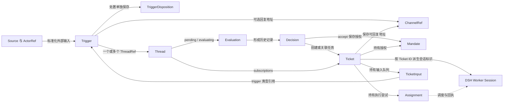
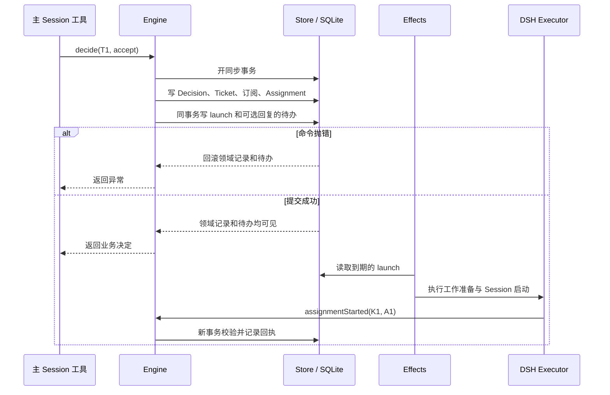

# 03 · 领域模型与 Engine 的事务边界

> 面试题　一个 GitHub 评论可以触发任务，也可以进入已有任务。同一个 Issue 能承载多项工作，同一个任务还能失败后重试。你如何建模，才能知道哪项工作获得了授权，哪次执行在跑，以及一条迟到的回执该算给谁？

**短答**　源码将接收的外部事实记为 Trigger，以 Thread 组织对话、评估队列和订阅。需要新判断时，Eval 用当前 Policy 处理一批 Trigger，最后写成 Decision。接受决定生成不可变的 Mandate，并创建持有授权、输入和执行历史的 Ticket。Assignment 代表一次执行尝试。DSH Session 则存放模型会话与工具执行的上下文。Engine 在同步事务内协调这些对象和待执行意图。数据库提交后才让执行器做会改变外部状态的工作，回执回来时再校验它属于哪个 Ticket 或 Assignment。 [领域模型](../dsh-superagent-prototype/src/core/model.ts) · [Engine](../dsh-superagent-prototype/src/core/engine.ts) · [领域端口](../dsh-superagent-prototype/src/core/ports.ts)

本文以 `7bd4741` 的原型源码为基线。继续使用虚构的 `example/portal` 仓库，维护者 Alice 在 Issue #42 请 Agent 把帮助页的「帐户设值」改回「帐户设置」，后续产物为 PR #57。正文的 `T1`、`E1`、`D1`、`K1`、`A1` 都是便于白板书写的别名，实际记录有各自的 ID。 [第 01 篇](01-what-is-a-superagent.md) · [第 02 篇](02-bundle-and-runtime-bootstrap.md) · [ID 实现](../dsh-superagent-prototype/src/core/ids.ts)

## 1. 从需求推导四种记录

想象一个最小实现只有一个 `Task` 对象，包含 Issue URL、用户输入、模型 Session ID 和一个 `status`。Alice 的错字请求跑起来后，Agent 开了 PR，模型暂时空闲，PR 在等待维护者。此时 `status` 写成 `ready`，到底代表模型回合正常结束、Worker 认为改动可审查、平台已经合并，还是相关人已经收到回复？如果下一条评论要求进一步修改，又该覆盖原来的 `userInput`，还是给原 Task 加一条消息？这些问题表面像状态命名问题，实质是不同来源产生的事实需要各自保留身份和时间。

可以把需求拆成四类事实。第一类是**发生了什么**，例如 GitHub 上出现评论或 PR 合并。第二类是**系统现在如何处理这件事**，例如评论已入队、某个 Thread 有一个活跃 Eval、Ticket 处于待审查。第三类是**凭什么做**，即当前版本的 Policy 下，哪位来源用户、哪条规则和哪项范围支持接受请求。第四类是**接下来要做的外部动作及其结果**，例如给 Worker 投递输入或向 Issue 发送回复，分别需要等待和回执。事件、当前状态、授权依据和副作用都可随时间变化，但变化方式不同。原始事件内容应保留，处置信息会更新，授权快照用于审计，动作意图需要在执行失败时还能找回。 [领域模型与概念表](../dsh-superagent-prototype/docs/001-domain.md) · [类型定义](../dsh-superagent-prototype/src/core/model.ts) · [Effects](../dsh-superagent-prototype/src/app/effects.ts)

| 面试时的问题 | 优先找哪条记录 | 可以回答什么 |
| --- | --- | --- |
| 当时收到什么，作者是谁 | Trigger | 来源、原文、时间、关联 Thread、可用回复地址 |
| 这条消息目前到过哪里 | TriggerDisposition、Thread | 是否被过滤、进入哪个 Eval、曾发给哪些 Ticket |
| 为什么开始这项工作 | Decision、Mandate | 依据哪个策略版本，授权强度、来源身份和任务范围 |
| 工作是否进行中，要人做什么 | Ticket、Assignment、`ticketStage` | 履历、最近报告、未投递项、等待人工的原因 |
| Worker 实际看到什么 | Input、Session 事件与历史 | 哪些输入已送达，哪些已进入模型回合 |
| 对外回复发成功了吗 | Outbox receipt | 仍待发、已发或目标不可达等处置结果 |

这样的拆法让一条任务链可以回溯。从 PR #57 可以查它绑定到哪张 Ticket，从 Ticket 的 `origin` 查到原 Issue 与 Trigger，从 `decisionId` 查接受依据，最后从 Assignment 和 Worker Session 找到执行证据。也能沿相反方向排障。先确认 Issue 是否入库，再确认是否被准入、路由或已有任务接管，最后查执行与外发。每一步都有独立可见的状态。 [Thread 与 Ticket 视图](../dsh-superagent-prototype/src/app/views/tickets.ts) · [记录视图](../dsh-superagent-prototype/src/app/views/records.ts)

## 2. 从 Trigger 到 Channel，读懂对象关系



图中是对象之间的引用关系。例如 `Thread` 通过订阅指向 Ticket，`Ticket.follows` 又可记录它跟踪的 PR Thread，双向出现各有用途。 `Evaluation` 是活跃状态字段，主要随 Thread 持久化，`Decision` 单独保存，通过 `threadKey` 查询历史。实际类型的可选字段、历史兼容项和状态约束见源码。 [模型](../dsh-superagent-prototype/src/core/model.ts) · [SQLite 仓储](../dsh-superagent-prototype/src/app/store.ts)

### 2.1 Trigger 保存收到的事实，Disposition 保存处理轨迹

Trigger 的 `id`、`source`、`actor`、`human`、`at`、`text`、`threads` 和可选的 `channel` 给出处理外部输入所需的最小信息。 `actor` 由 `{ source, id }` 组成，账号身份来自相应 Source。比如 GitHub 的 `alice` 和飞书的某个 `open_id` 处在不同身份空间。 `human` 与 `addressed` 也是 Source 声明的事实，正文中的自我介绍或引用不能替代身份与提及判断。 `meta` 保留来源原生字段，供来源适配器与策略处理，领域核心不需要知道 GitHub 评论和飞书消息的原始 JSON 结构。 [Trigger 类型](../dsh-superagent-prototype/src/core/model.ts) · [GitHub Trigger 转换](../dsh-superagent-prototype/src/sources/github-trigger.ts) · [飞书 Trigger 转换](../dsh-superagent-prototype/src/sources/feishu-trigger.ts)

Trigger 和 TriggerDisposition 以同一 Trigger ID 关联。Trigger 保留输入本身。Disposition 用 `filtered`、`evalId`、`decisionId`、`fanout`、`context`、`handbacks`、`requeued`、`acked` 解释输入进系统后走到了哪里。假设 Alice 的评论被先存、后排队、再附到已有任务。变化发生在处置记录、Thread 和 Ticket，原评论仍能按原 ID 读出。 `fanout` 说明消息到达过哪些 Ticket，实际还有谁负责判断则要看后续退回、context-only、手工重排、评估是否正在持有以及 Ticket 是否仍可处理。 [TriggerDisposition 与 followupOwners](../dsh-superagent-prototype/src/core/model.ts) · [摄取](../dsh-superagent-prototype/src/core/intake.ts)

这里有两处实现上的精确边界。第一，Trigger 的不可变性由正常摄取路径的重复检测和使用约定体现，Store 的底层 `triggers.save` 实际是 upsert，并会更新索引。第二，`isoTime` 会把可解析时间转成统一的 ISO 格式，非法时间字符串按当前实现原样返回。Source 仍有责任构造可用数据。可以在面试中把「域内约定」「数据访问能力」「外部输入校验」分别说清。 [Intake.receive](../dsh-superagent-prototype/src/core/intake.ts) · [isoTime](../dsh-superagent-prototype/src/core/model.ts) · [Trigger 保存](../dsh-superagent-prototype/src/app/store.ts)

### 2.2 Thread 保存讨论与评估的局部秩序

Thread 的稳定键来自 `threadKey(ref)`，形式是 `${source}:${id}`。哪个事件属于哪个 Thread，由来源决定。原型面向一个 GitHub 仓库，所以教学案例可写 `github:42`。一个 Trigger 可以同时关联多个 Thread，其第一个 Thread 承载该 Trigger 的待评估状态，其他 Thread 可以互相留下 `correlated`。这让评估看到相关讨论，同时只给这个输入一个主要排队位置。如果一条虚构的跨线程事件同时携带 `X` 和 `Y` 两个 Thread，`X.pending` 可以包含它，`Y` 仍只留下关联；如果两条 Thread 各有订阅，则另按订阅计算扇出。 [threadKey 与主 Thread](../dsh-superagent-prototype/src/core/model.ts) · [Intake 的 correlation 和 fan-out](../dsh-superagent-prototype/src/core/intake.ts) · [多 Thread 测试](../dsh-superagent-prototype/tests/core-engine.spec.ts)

Thread 的 `pending` 为新事件缓冲，`evaluating` 只保存一个活跃 Eval。在先前候选仍由主 Session 处理时，后续事件进入下一批。这个边界允许不同 Thread 有各自待处理记录，也为同一 Thread 的消息提供批处理、政策版本和结果跟踪位置。与此同时，Thread 上能有多个订阅 Ticket。例如一段讨论里分出文案与页面布局两件工作，两项任务不必在同一个 Ticket 内竞争单一授权范围。 `Thread.context` 记录只供特定 Ticket 阅读上下文的订阅。源 Thread 只是一条输入的主要协调位置，其存在本身无法推出新的任务数。 [Thread 聚合](../dsh-superagent-prototype/src/core/model.ts) · [Evals.start](../dsh-superagent-prototype/src/core/evals.ts) · [领域模型说明](../dsh-superagent-prototype/docs/001-domain.md)

### 2.3 Channel 是写回地址

Thread 告诉系统「这属于哪段对话」，Channel 告诉发送器「通过哪个来源、以什么地址写回」。 `ChannelRef` 持有 `source`、`thread` 和字符串键值组成的 `address`，由 Source 的 Channel 实现解释。并非每种 Trigger 都需要可回复地址。例如默认分支 CI Trigger 没有可直接回复的人，构造函数也不放 `channel`。Ticket 收集接受批次关联的 Channel，具体发往何处取决于回复目的。对某位用户的回答可回到提问处，任务结果倾向原始会话，向人提问会尽量找到引发该问题的消息位置。 [ChannelRef](../dsh-superagent-prototype/src/core/model.ts) · [CI Trigger](../dsh-superagent-prototype/src/sources/github-trigger.ts) · [Ticket Channel 收集](../dsh-superagent-prototype/src/core/tickets.ts) · [回复地址选择](../dsh-superagent-prototype/src/core/replies.ts)

如果只在 Ticket 保存一个 URL，后续问答甚至跨来源回复会依赖模型猜地址。保存结构化地址后，目的校验和实际写回可放在代码路径内。GitHub 和飞书适配器能用它做各自的消息或评论发送，也能在目标删除、来源未装载或范围改变时返回不同处置。领域层依赖 Outbox 端口来安排这些动作，避免把来源命令细节塞到 Ticket。 [Outbox 端口](../dsh-superagent-prototype/src/core/ports.ts) · [Outbox 实现](../dsh-superagent-prototype/src/app/outbox.ts) · [SourceRegistry.send](../dsh-superagent-prototype/src/sources/registry.ts)

## 3. Eval、Decision 和 Mandate 如何切分授权

### 3.1 Eval 是进行中的判断，Candidate 是外发给评估方的视图

摄取结束后，线程上的若干 Trigger 可能等待新的判断。 `Evals.start` 从主 Thread 的 pending 取一批，先处理已有 Worker 负责的跟进，排除已开启 Ticket 的历史 Trigger，再按当前 `Policy.gate` 逐条计算。只要有合格 Trigger，批次的强度、来源身份和授权依据取自其中最强的一条，同强度时选择时间更新的一条。Eval 保存批次、主要 Trigger、Policy 版本、开始时间、送达与超时等字段。 `Candidate` 携带 `evalId`、批次、Thread、授权强度、Policy 版本及相关 Ticket，用来支持语义判断和去重。返回的 outcome 还要进 Engine 校验。 [Eval 与 Candidate 类型](../dsh-superagent-prototype/src/core/model.ts) · [候选端口](../dsh-superagent-prototype/src/core/ports.ts) · [Evals.start 与 candidateOf](../dsh-superagent-prototype/src/core/evals.ts)

设一个批次有两个输入。 `T1` 是 Alice 在 Issue #42 提出的明确修复请求，`T2` 是同一 Thread 后到的讨论，提供截图链接但缺少委托资格。系统可以把两条放在一次评估里看。若 `T1` 给出本批最高的 `explicit` 强度，`T1` 的 actor 和 basis 进入 Eval；`T2` 即使时间更晚，也无法覆盖更强的准入。接受建单时原始 Trigger 会优先用 `Evaluation.primary`。 `origin.triggerIds` 留下批次成员。确认回复采用主 Trigger 的 Channel，需要其为人类发送且有可回复地址。这个设计给了模型充分上下文，同时把委托依据固定在能通过 gate 的输入上。 [主 Trigger 选择与创建](../dsh-superagent-prototype/src/core/evals.ts) · [Ticket.create](../dsh-superagent-prototype/src/core/tickets.ts) · [确认回复](../dsh-superagent-prototype/src/core/replies.ts) · [批次授权来源测试](../dsh-superagent-prototype/tests/core-engine.spec.ts#L1212)

同一 Thread 最多一个储存在 `evaluating` 的活跃批次。Engine 也有 `directEval` 路径，处理未被活跃 Eval 持有的单条 Trigger，例如允许的显式直接判断。它当场应用 gate 并形成 Decision，可以与 Thread 中另一个活跃批次共存。 `finish` 只有发现正在结束的 ID 等于 Thread 当前 Eval ID，才清除 `evaluating`。这能避免一句「同一 Thread 一次只评估一批」让人错误理解所有同步决定都必须等这个批结束。 [Evals.decide / directEval / finish](../dsh-superagent-prototype/src/core/evals.ts) · [直接决定测试](../dsh-superagent-prototype/tests/core-engine.spec.ts#L899)

### 3.2 Decision 保存判断结果，Mandate 固定被允许的工作范围

Decision 用结构化 `kind`、`reason`、`triggerIds`、`policyVersion` 和可选的 `audit` 记录结果。 `accept` 支持后续执行，`ignore` 可说明准入未通过或无需新任务，`unavailable` 可记录判断未完成或需重新评估，`stop` 可记录一次针对 Ticket 的停止决定。 `reopen` 仍在类型中，当前正常恢复路径可在原有 Mandate 下重新开放 Ticket，源码明确说明无需增加新的 Decision。UI 对不可用问题的 dismiss 也只是持久化 `dismissed`，原 Decision 仍能解释此前发生什么。 [Decision 与兼容输入](../dsh-superagent-prototype/src/core/model.ts) · [Evals.dismiss](../dsh-superagent-prototype/src/core/evals.ts) · [Tickets.wake](../dsh-superagent-prototype/src/core/tickets.ts)

Mandate 只在接受时由 `Evals.accept` 形成，主要由五项组成：

| 字段 | 在案例中用于回答什么 |
| --- | --- |
| `actor` | 哪个来源上的 Alice 发出了实际委托 |
| `strength` | 今天用显式委托路径，还是按团队规则接受了推断候选 |
| `policyVersion` | 当时是哪一版 Policy 生效 |
| `basis` | 哪种准入路径、接收范围和匹配规则支持接受 |
| `scope` | 本次授权允许执行哪项工作 |

Decision 和 Ticket 都保存这份 Mandate。Decision 能回顾历史为何允许，Ticket 在执行、通知和恢复时可直接使用授权记录。现有 Ticket 的输入、报告和 Assignment 可以变化，授权范围按接受时形成的语义保留。对教学案例，原授权是修帮助页这一处文字。后来「顺手重做导航」需要重新判断范围。Worker 可以退回它，若新委托获准，则通过新 Decision 建立有独立 Mandate 的 Ticket。 [Mandate 类型](../dsh-superagent-prototype/src/core/model.ts) · [Evals.accept](../dsh-superagent-prototype/src/core/evals.ts) · [退回入口](../dsh-superagent-prototype/src/core/engine.ts)

策略变化时，可以同时保留「过去是怎样接受」「现在有哪几项规则变了」两个事实。设置侧计算哪些变更影响打开的 Ticket，Engine 将相应变化作为 `policy-changed` Input。活跃中的旧版本 Eval 会重新排队。结束后的 Ticket 若要重开，则以当前 Policy 对原 Mandate 做 `revalidate`。如果旧授权无法继续使用，保留原 Mandate 的历史也能解释为什么之前执行过。要立即停止一个已经运行的 Ticket，有人的停止命令和 Engine 接口可用。 [Engine.policyChanged](../dsh-superagent-prototype/src/core/engine.ts) · [Evals.policyChanged](../dsh-superagent-prototype/src/core/evals.ts) · [Policy 与 revalidate](../dsh-superagent-prototype/src/policy.ts) · [Tickets.policyChanged / wake](../dsh-superagent-prototype/src/core/tickets.ts)

## 4. Ticket、Assignment、Input 与 Session 各有生命周期

### 4.1 Ticket 保存被授权的工作，Assignment 保存一次尝试

Ticket 持有 title、来源、Decision 引用、Mandate、执行目录、回复地址、输入、Assignment 历史以及当前待人处理情况。它的结束状态用可选的 `ended` 表达，内容含时间、结束方与结果。Assignment 在 Ticket 中记录 pending、running、ended，也记录最近报告、输入送达时间和回合结束时间。二者的生命周期可以交叉。比如 `A1` 已结束后，`A2` 在同一 `K1` 里排队，`K1` 仍是 open。新任务第一次接受时，从空 Assignment 历史变成一个 pending 记录。Worker 刚刚被创建还需回写 started，面板才有据可按相应阶段显示。 [Ticket / Assignment 类型](../dsh-superagent-prototype/src/core/model.ts) · [Tickets.create / retry](../dsh-superagent-prototype/src/core/tickets.ts) · [Assignments.started](../dsh-superagent-prototype/src/core/assignments.ts)

案例中假设 Worker 的输入投递连续失败，Ticket 显示 `delivery` 问题。人修好环境后请求重试，`Tickets.retry` 检查当前 Ticket 可重试，将上一 Assignment 结束，对需要再投递的输入重新排队，创建下一 Assignment，保存原 Ticket，再安排停止旧执行与启动新执行。 `ticket.id`、`decisionId`、`mandate` 和已记录的事件都可以沿用。尝试 ID 变化后，来自旧 `A1` 的启动、投递或错误回执仍能被识别为旧尝试。`Assignments.started` 忽略已结束的尝试，`delivered`、`deliveryFailed` 通过 `running(ticketId, assignmentId)` 校验当前运行归属。 [Tickets.retry](../dsh-superagent-prototype/src/core/tickets.ts) · [Assignment 回执校验](../dsh-superagent-prototype/src/core/assignments.ts) · [迟到开始回执测试](../dsh-superagent-prototype/tests/core-engine.spec.ts#L1241)

Worker Session ID 则由 `workerSessionId(ticketId)` 派生。只要 Ticket 相同，应用寻找的是同一个会话标识。DSH 可以解析已经存在的 Session，找不到时由 `Sessions.ensure` 创建。这解释了为什么失败重试后可以同时成立两句话：这是新的执行尝试，仍然是同一项工作和原来的会话标识。具体会话历史能找回多少，还要看相应 DSH 持久化记录是否保留。 [Worker Session ID](../dsh-superagent-prototype/src/executor/dsh.ts) · [Sessions.ensure](../dsh-superagent-prototype/src/app/sessions.ts)

值得留意的是，内部方法有不同的归属参数。 `inputsDelivered` 带 Assignment ID，Worker 的 `report(ticketId, report)` 按 Ticket 找到当前 running 或最近 Assignment。后者的安全性还依赖工具绑定、执行器对旧工作的取消以及投递时序。面试时可以用源码签名说明「部分回执显式以 Assignment ID 校验」，再追问如果未来把 Worker 移到远端，需要给报告接口补什么归属字段。例如可以在生产设计中为报告增加执行令牌，拒绝旧尝试对新尝试写事实。 [Engine Executor 接口](../dsh-superagent-prototype/src/core/engine.ts) · [Assignments.report](../dsh-superagent-prototype/src/core/assignments.ts) · [Worker 报告绑定](../dsh-superagent-prototype/src/app/tools/executor.ts)

### 4.2 Input 的入队、送达、已读和接纳

Ticket Input 是从业务状态到模型 Session 的交接记录。最常见的 `kind: 'trigger'` 直接引用外部 Trigger，还可以带路由 note、是否人工与是否 context-only。 `policy-changed` 告诉 Worker 登记在案的授权环境发生什么变化，`resumed` 交代哪条人工消息恢复了 Ticket，`text` 可用于恢复说明和状态请求一类内部输入，`note` 表示来自其他工作的补充事实。 `inputs` 留下输入履历，`undelivered` 存待交接的 ID。Worker 明确等人时，自动输入可以写入履历而不加入待投递队列。 [TicketInput](../dsh-superagent-prototype/src/core/model.ts) · [Tickets.addInput / requestStatus](../dsh-superagent-prototype/src/core/tickets.ts)

可以用 Alice 的一条 PR 评论拆成四个可观察阶段：

1. **入队**。Intake 找到订阅了 PR Thread 的 Ticket，构造确定性的 Input ID，写入 `inputs`，满足条件时把 ID 放进 `undelivered`。
2. **送达**。Executor 把消息交给当前 Worker Session，`inputsDelivered` 从待投递队列移除该 ID，为 Trigger Input 记录 `deliveredTo`，初次尚未被回合纳入时 `readAt` 为 `null`。
3. **已读记录**。Session 产生对应的 `user/message` 事件时，应用报告 `inputsRead`，写入模型收到这条输入的时间，供结束或恢复判断使用。旧版本输入也有兼容的时间字段。
4. **接纳处理**。Worker 确认或回答一条后续消息时，领域侧可以在处置记录中留下接纳依据。输入一度可见、进入模型历史、Worker 表示负责处理，分别回答可见性、消费时序和实际归属。 [Intake 输入生成](../dsh-superagent-prototype/src/core/intake.ts) · [送达与已读](../dsh-superagent-prototype/src/core/assignments.ts) · [Session 事件桥接](../dsh-superagent-prototype/src/executor/dsh.ts) · [takeUp](../dsh-superagent-prototype/src/core/part.ts)

重试时，`requeueUntaken` 会找前次尝试送达、`readAt === null`、还没有在待投递清单中的 Trigger Input，再把它们排到待办前面。要求 `deliveredTo` 匹配被替换的 Assignment，是为了保留执行代际边界。假如 `A1` 前更早一趟尝试碰过另一条消息，且原工作结束时已让出，它不能因为当前 `A1` 失败又被自动捞回来。模型 Session 那边有另一套投递去重和交接，读这个规则首先应确认领域层如何决定哪条 Input 需要再安排。 [Tickets.requeueUntaken](../dsh-superagent-prototype/src/core/tickets.ts) · [投递记录](../dsh-superagent-prototype/src/app/delivery.ts) · [重试与未读消息测试](../dsh-superagent-prototype/tests/core-engine.spec.ts#L1555)

### 4.3 一个页面状态如何从多个事实派生

`ticketStage` 以顺序规则生成面板阶段。优先判断 `ended`，其次是投递失败与需人工回答的问题，再看最近 Assignment 的 `ready`、`blocked`、`failed`，随后确定排队、空闲或工作中。比如「Worker ready，跟踪的 PR 仍开放」通常显示等待评审，`ready` 仅反映报告。「最新 Assignment pending」通常显示工作中或排队，不过如果之前仍有更高优先级的人工处理问题，按函数的先匹配顺序得出阶段。 `canRetry` 则单独看 Ticket 开放且具有投递问题或符合 `waitsForPerson`。这让显示、可执行命令与原始存储事实各有明确的职责。 [ticketStage 和 canRetry](../dsh-superagent-prototype/src/core/stage.ts) · [阶段测试](../dsh-superagent-prototype/tests/stage.spec.ts)

| 时点 | Ticket | Assignment | Worker Session 或外部资源 |
| --- | --- | --- | --- |
| 接受后还没运行 | open | A1 pending | Worker 尚可未创建 |
| 第一次执行失败 | open，可能待人处理 | A1 报 failed | 对应会话保留此前记录 |
| 操作者重试 | 同一个 open Ticket | A1 ended，A2 pending | 仍按同一 Worker Session ID 寻找 |
| PR 可审查 | open，待 review | A2 记录 ready | PR #57 开放，等待人处理 |
| PR 合并且工作已收尾 | ended，结果 merged | 当前未结束尝试被收尾 | 平台有合并事实，会话历史可留存 |

`Tickets.followsDone` 说明如何用外部结果结束任务。有自己开的 PR 时，优先以这些 own Thread 判断。没有 own Thread 时按所有 follows 判断。选中集合都关闭后，采用其中最后相关关闭的时间与结果。实际 `threadClosed` 在结束前还要检查工作是否未完，例如有该 Worker 已接纳的人类后续消息需要处理，或某次恢复发生在相关关闭事实之后。 `ready` 和关闭事实可以先后到达，持有结构化状态才能按同一套业务语义解释。 [Tickets.threadClosed / followsDone / unfinished](../dsh-superagent-prototype/src/core/tickets.ts) · [Assignments.report](../dsh-superagent-prototype/src/core/assignments.ts) · [完成条件测试](../dsh-superagent-prototype/tests/core-engine.spec.ts#L1053)

### 4.4 用同一份授权区分重试、恢复和重新接单

设 `D1` 是接受 Alice 请求的决定，`K1` 是对应 Ticket，`M1` 仅授权修帮助页错字。以下推演从同一组记录出发，每条分支的初始运行状态按表理解。

| 新动作 | 此前事实 | 检查与写入 | 稳定的业务身份 |
| --- | --- | --- | --- |
| 人工重试 | K1 仍开放，A1 已报告 failed，或当前有投递故障 | 结束旧 Assignment、吊销其继续更新当前交付的资格、追加 pending 的 A2 | K1、M1、D1 保留 |
| 人类评论恢复 | K1 因执行结果结束，订阅的正式 Thread 到达一条人类消息 | 当前 Policy 复核 M1，条件满足时移除 ended，写 resumed 输入，追加新的 Assignment | K1、M1、D1 保留 |
| 在原讨论处理新需求 | 新请求已脱离 K1 的范围，且通过新的评估 | 在新 Eval 的接受结果中产生 Decision、新 Mandate、Ticket 和首个 Assignment | 新工作的身份与授权单独建立 |
| 重播已建单的 T1 | D1 已记录 T1 属于接受批次 | 接受查询找回原 Decision，避免从同一 Trigger 再建任务 | 仍指向 K1 与 D1 |

重试和恢复都有「产生新的 Assignment」的情形，触发条件不同。重试发生在开放状态，重点是旧尝试失败与接管。恢复发生在任务先前已经结束之后，重点是当前消息能不能沿着既有订阅重新使用原授权。两者都能在不扩大范围的前提下重新给同一件事安排执行。人工停止则退出这条恢复路径。 `Tickets.wake` 遇到 `ended.by === 'human'` 就返回，原记录仍解释这项工作过去从何获得授权。 [重试、恢复和停止](../dsh-superagent-prototype/src/core/tickets.ts) · [恢复测试](../dsh-superagent-prototype/tests/core-engine.spec.ts#L296) · [重复接受检查](../dsh-superagent-prototype/src/core/evals.ts)

Assignment ID 的生成也对应这套语义。 `newAssignment` 将 `ticket.id` 和当前 `assignments.length` 交给确定性 `key`。记住「第几次」比用 Worker Session ID 表示尝试更精确。回到白板可以写成 `A1 = key('assignment', K1, '0')`，`A2 = key('assignment', K1, '1')`，两者均在 `workerSessionId(K1)` 所指的工作会话中运行。 `ticket.id` 则来自首次接受使用的 Eval ID。若接受命令重放，Engine 会查询历史接受记录，避免仅因现在计算出了新的 Eval ID 就生成另一张任务单。 [Assignment ID 生成](../dsh-superagent-prototype/src/core/tickets.ts) · [Ticket ID 与历史接受](../dsh-superagent-prototype/src/core/evals.ts) · [稳定键](../dsh-superagent-prototype/src/core/ids.ts)

## 5. Engine 的角色接口如何约束调用

Engine 是业务状态变更的协调入口。构造函数创建 `Intake`、`Evals`、`Tickets`、`Assignments` 与 `Replies`。这些对象分工清楚，但很少独立完成一项业务命令。接受 Eval 要调用 Tickets 创建任务，记录 Worker 报告可能撤回旧提问并结束 Ticket，摄取根据订阅添加 Input 并尝试唤醒。Engine 为外部调用组织同步事务，内部组件共享仓储与当前操作边界。若内部每修改一张表就提交一次，调用方看到的将是中间对象的变化，无法把它解释为一次完整接单或一次完整转派。 [Engine 构造与入口](../dsh-superagent-prototype/src/core/engine.ts) · [EngineOptions 与 EnginePart](../dsh-superagent-prototype/src/core/part.ts)

| 调用角色 | 代表入口 | 这类调用需要表达的事实或意图 |
| --- | --- | --- |
| Source | `receive`、`bindThread`、`threadClosed` | 收到事件、某 PR 归属此 Ticket、远端 Thread 在某时关闭 |
| 主 Session | `candidate`、`decide`、`attach`、`reply`、`note`、`requestStatus` | 读取候选、提交路由、安排回复、向既有任务补事实 |
| 评估送达回执 | `candidateDelivered` | 候选已抵达主 Session，开始按交付时间计超时 |
| Worker 及 Executor | `assignmentStarted`、`inputsDelivered`、`inputsRead`、`deliveryFailed`、`report`、`handback`、`followForContext` | 执行、输入、报告和后续消息归属发生改变 |
| 人工管理 | `stopTicket`、`retryTicket`、`reevaluate`、`unsubscribe`、`dismiss` | 终止、重试、重评、调整订阅或处理面板问题 |
| 应用设置与时钟 | `policyChanged`、`evaluateDue` | 推进受影响的策略版本、活动 Eval、排队输入和自动恢复 |

文件尾部用 `EngineForSources`、`EngineForMainSession`、`EngineForPeople`、`EngineForSettings` 与 `EngineForExecutor` 等 `Pick<Engine, ...>` 说明角色边界。Runtime 的部分宿主对象还会缩窄依赖。这里的 TypeScript 类型帮助代码约束调用面。真正的运行时拒绝要看 SourceContext 映射、Session 工具注册、管理路由和 Engine 中的条件。例如 Source 提交 PR 事实可以走 `bindThread`，单凭这个入口无法让 Agent 获得新 Mandate。模型是否能提交工具调用又有一层 role-specific tool 定义及工具参数校验。 [角色接口](../dsh-superagent-prototype/src/core/engine.ts) · [SourceContext](../dsh-superagent-prototype/src/app/source-context.ts) · [主工具](../dsh-superagent-prototype/src/app/tools/main.ts) · [Worker 工具](../dsh-superagent-prototype/src/app/tools/executor.ts) · [管理 API](../dsh-superagent-prototype/src/app/http.ts)

### 5.1 场景一，接收一条 Trigger

`Engine.receive` 进入 `repo.atomic`，由 Intake 检查输入有 Thread、做时间标准化和 ID 去重。若 Source Scope 拒绝，则原始 Trigger 仍保存，处置记为过滤，之后返回 `filtered`。若允许监听，则保存 Trigger，更新相关 Thread 的最近时间和关联，查各 Thread 的订阅，按 Ticket ID 合并命中的扇出。一个 Ticket 被多路命中时，只要其中一路是它的正式订阅，输入就按正式来源处理。最后记录处置，决定是否进入主 Thread 的 Eval 队列，并尝试唤醒符合条件的 Ticket。整个过程一起提交。 [Engine.receive](../dsh-superagent-prototype/src/core/engine.ts) · [Intake.receive](../dsh-superagent-prototype/src/core/intake.ts) · [摄取测试](../dsh-superagent-prototype/tests/core-engine.spec.ts#L75)

用白板算一次扇出。假设 Trigger 同时属于 `H1`、`H2`，`H1` 的订阅有 `K1` 与 `K2`，`H2` 的订阅只有 `K1`。 `K1` 在 `H1` 仅供参考，在 `H2` 为正式订阅，`K2` 在 `H1` 仅供参考。若两个 Ticket 当前都开放，得到两条 Input 而非三条。处置的 fanout 包含两个 Ticket，context 只含 `K2`。如果这是人类消息且没有其他例外，`followupOwners` 会把 `K1` 当作负责的 Worker，主 Thread 上不再因这条消息起新 Eval。如果 `K1` 后来 handback，且没有其他所有者，此消息才有机会回到 `H1.pending`。 [扇出合并](../dsh-superagent-prototype/src/core/intake.ts) · [followupOwners](../dsh-superagent-prototype/src/core/model.ts) · [EnginePart.handBack](../dsh-superagent-prototype/src/core/part.ts)

这比仅在消息上保存 `consumed: true` 更精确。后者分不出是谁看过、谁有权判断、是否只作背景信息，以及是否已经退回。来源接入、评估与执行并存时，扇出记录和动态归属可以让系统在继续处理原工作和重新评估之间作出可解释的选择。多 Ticket 持有时，某一个 Worker 退回不代表其他 Worker 也放弃。 [后续归属与退回](../dsh-superagent-prototype/src/core/model.ts) · [退回业务入口](../dsh-superagent-prototype/src/core/evals.ts) · [后续消息测试](../dsh-superagent-prototype/tests/followups.spec.ts)

### 5.2 场景二，接受 Eval 并建立 Ticket

`Engine.decide` 在一次事务内调用 `Evals.decide`。后者核对 Trigger 是否存在，传入的 Eval ID 是否仍有效，是否有 Worker 负责这条跟进，及当前 Policy 是否允许相应的接受。已被接受的 Trigger 可以通过 Thread 的 Decision 历史被识别，重复 accept 返回原决定。对有效的新接受，`Evals.accept` 得到 Mandate 和 Ticket ID，写 Decision 并更新批次各 Trigger 的处置，结束对应活跃 Eval，然后调用 `Tickets.create`。 [Evals.decide / accept / finish](../dsh-superagent-prototype/src/core/evals.ts)

`Tickets.create` 从批次生成 origin 和 Channel 集合，使用 `prepareTicket` 计算执行元数据，生成首个 pending Assignment，保存 Ticket，更新涉及 Thread 的订阅，并在满足条件时记录接单确认。同步的 `DshExecutor.prepare` 补目录、短名与执行文字。真实的文件目录准备分到 launch 路径以后运行。最终相同的状态事务内会安排启动 Effect。这样提交后的记录能解释「接单成功，模型执行尚未开始」。 [Tickets.create](../dsh-superagent-prototype/src/core/tickets.ts) · [Executor.prepare 与 start](../dsh-superagent-prototype/src/executor/dsh.ts) · [确认与 Outbox](../dsh-superagent-prototype/src/core/replies.ts)

最值得在白板上画的是异常分支。设 `E1` 正要接受并建立 `K1`，保存 Decision 后，`prepareTicket` 同步抛错。如果事务只覆盖 Ticket 保存，系统可能留下 `D1` 表示已接受，Thread 也已清除 E1，但 `K1` 还不存在。原型把整个接受命令包在同一事务，核心用例注入抛错的 prepareTicket，断言 Decision 列表和 Ticket 列表为空、仍有原来 Eval、订阅为空、确认未安排。这里验证的是同步元数据构造阶段的回滚。真实 Worker prepare 命令在事务外启动失败，已经接受的任务会留下失败证据供重试。两个错误名字相近，发生边界和处理后果不同。 [核心接受回滚测试](../dsh-superagent-prototype/tests/core-engine.spec.ts#L136) · [Executor.prepareDirectory / launchQueued](../dsh-superagent-prototype/src/executor/dsh.ts)

### 5.3 场景三，改变已有消息的归属

设 Alice 在一个另开的讨论中贴出 PR #57，并明确要求把这条消息交给已有 Ticket K1。消息 `T4` 与另一条无关消息 `T5` 已在同一活跃 Eval。 `Engine.attach` 将读取 Trigger、核对目的 Ticket 与现有跟进归属、检查是否已经被该 Ticket 退回，然后撤下待评估输入、订阅新 Thread、更新分发事实和添加 Input。若活跃 Eval 正持有 `T4`，则根据批次是否还有其他事件结束或重新排队。以两条消息的批次为例，旧批标记为 unavailable、原因是 routed，`T5` 单独回到队列，`T4` 则交给 K1 的 Worker。在合法情况下还可以尝试恢复已经结束的 Ticket。 [Engine.attach](../dsh-superagent-prototype/src/core/engine.ts) · [Tickets.attachable 与 attach](../dsh-superagent-prototype/src/core/tickets.ts) · [Evals.routed](../dsh-superagent-prototype/src/core/evals.ts) · [批次拆分测试](../dsh-superagent-prototype/tests/core-engine.spec.ts#L881)

转派值得单独做命令，是因为它必须同时改动两类边界。原来的判断队列不应继续把已转走的 Trigger 作为建单对象，新 Ticket 也应真正接到输入。若先转派但忘了结束或重排旧 Eval，主 Session 后续可能交回相同请求的接受结果。若先从旧 Eval 删除而未添加到 Ticket，消息则可能永远没有接手方。事务与旧 Eval ID 校验一起维持清晰的交接。 [Evals.decide](../dsh-superagent-prototype/src/core/evals.ts) · [Engine.attach](../dsh-superagent-prototype/src/core/engine.ts)

### 5.4 有些操作按对象推进，有些操作以外层命令组合

`candidate` 是快照读取，Engine 直接交给 Evals。 `evaluateDue` 会扫描活跃 Thread 与 Ticket，但对每个需要推进的 Eval 或 Ticket 单独进事务。它先检查活动 Eval 的期限，暂停时在这一阶段停下。其后可以唤醒有输入在等待的已结束 Ticket，再开始具备条件的 Thread Eval。这样一次时钟 tick 可以推进多个对象，每个对象的状态变更遵循自己的命令边界。若后面的对象处理出异常，已经提交的前面对象依然有效。 [Engine.evaluateDue](../dsh-superagent-prototype/src/core/engine.ts) · [Passes.pump](../dsh-superagent-prototype/src/app/passes.ts)

真实应用也能用外层 Store 事务组合多个领域动作。例如 Worker 上报 PR 时先在事务之外读取外部 PR，再在一次 Store 事务中验证和登记 PR 归属、写报告、排队内部中继。中间的 Engine 命令可以有自己的 savepoint。报告无效导致外层回滚时，绑定与报告的一组状态可一起撤回。模型工具还有另一种批处理形式， `orchestrator_route` 接受多个路由条目，按条执行，各条获得自己的结果，某条被拒绝时其他条仍可成功。批量接口有必要明确「全部原子」还是「每项原子」。 [Worker 报告工具](../dsh-superagent-prototype/src/app/tools/executor.ts) · [逐项路由](../dsh-superagent-prototype/src/app/tools/main.ts) · [Store.atomic](../dsh-superagent-prototype/src/app/store.ts)

## 6. 事务里写什么，提交后做什么



图中的领域记录与 Effect 意图写入同一个 SQLite 数据库。真正的外部调用在后续调度，结果经另一个应用命令写回。这样接受不必将数据库事务悬挂在模型调用或工具执行期间，也能在进程重启后发现当时已经承诺的启动动作。下述三个层次在源码里都有可核对的实现。 [Engine](../dsh-superagent-prototype/src/core/engine.ts) · [Store](../dsh-superagent-prototype/src/app/store.ts) · [Effects](../dsh-superagent-prototype/src/app/effects.ts)

### 6.1 同步事务和嵌套 SAVEPOINT

`Repositories.atomic(work)` 的契约要求工作同步完成。Store 用 SQLite SAVEPOINT 搭建外层和内层的操作边界。成功时 RELEASE，抛错时回滚到对应 savepoint 再释放。 `Store.triggers.save` 自身也进事务，因为写原始记录和更新 `trigger_thread` 索引要一起发生。被 `Engine.receive` 调用时，它嵌入更外层的业务事务。内层完成后，还要等外层成功才算整个接收命令提交。这样仓储能独立保护自身多表更新，又可以和业务状态合成更大操作。 [Store.atomic、triggers.save 与 indexThreads](../dsh-superagent-prototype/src/app/store.ts)

要能给面试官解释同步的意义。若把异步用法写成 `atomic(async () => ...)`，现有实现只会看到立即返回的 Promise，随后释放 savepoint。后续 await 之后的写入与异常，便无法纳入同一事务。即使一段代码在类型系统中能推导出 Promise 返回值，应用的同步调用约定仍要遵守。真实代码先等待外部 I/O，再带着返回的事实进短事务核验，或者先写可恢复的待办，由下一段异步处理。 [Repositories 同步约定](../dsh-superagent-prototype/src/core/ports.ts) · [Store.atomic](../dsh-superagent-prototype/src/app/store.ts) · [报告工具读 PR 与保存的顺序](../dsh-superagent-prototype/src/app/tools/executor.ts)

### 6.2 Effects 持久化未来动作

端口 `Assessor.request`、`Executor.start / deliver` 和 `Outbox.send` 看起来像立即去做外部工作，其实现依赖同步写入待办。实际会安排 assessment、launch、delivery、reply 等 Effects。 `Effects.enqueue` 在调用方事务中更新表，按 `kind + key` 合并同类待办，并通过 `queueMicrotask` 安排后续派发。同步事务先结束，派发才有机会读库。比如 launch 以 Assignment ID 为键，delivery 以 Ticket ID 为键。这个区别来自数据语义，一次启动对应某次尝试，交付则按 Ticket 重新读取真正待交付列表。 [端口契约](../dsh-superagent-prototype/src/core/ports.ts) · [Effects.enqueue / kick](../dsh-superagent-prototype/src/app/effects.ts) · [Executor Effect 键](../dsh-superagent-prototype/src/executor/dsh.ts)

接单回复也有两份记录。Outbox 记业务侧发送回执，以稳定消息 ID 标识第一次入队。Effect 记待派发工作和重试信息。 `Outbox.send` 让回执新增与对应 reply Effect 同时发生。远端发送完成后才会将回执处理为相应的 sent 或 dropped 等状态。一次远端写完、回执尚未更新的进程故障，仍需要接口幂等或对账处理。本地状态事务和稳定键提供的是可恢复与去重基础。 [Outbox.send / deliver](../dsh-superagent-prototype/src/app/outbox.ts) · [回执仓储](../dsh-superagent-prototype/src/app/store.ts) · [Effects 提交测试](../dsh-superagent-prototype/tests/effects.spec.ts#L29)

### 6.3 afterCommit 适合本进程的收尾与取消

有些动作要等数据库提交，但无需另加持久队列。例如一次 Ticket 停止应取消当前进程里的模型回合。若 Engine 尚未提交 ended 状态就调用 `agent.cancel()`，随后外层事务回滚，会出现业务记录还开放但执行已被取消，两个事实无法原样恢复。 `DshExecutor.stop` 将与当前运行相关的取消、后台清理等操作放进 `store.afterCommit`。外层成功后才执行回调，回滚时回调不运行。事务结束、回调执行和进程发生意外，仍然是三个边界，`afterCommit` 回调本身存在内存中。 [DshExecutor.stop](../dsh-superagent-prototype/src/executor/dsh.ts) · [Store.afterCommit](../dsh-superagent-prototype/src/app/store.ts)

测试直接构造这个分支。先创建一张 open Ticket 与 Worker，在外层 Store.atomic 调用 `stopTicket` 后抛错，断言 Ticket 没有 ended，Worker 的 cancel 未调用。再单独调用一次成功的 stop，断言 cancel 发生一次。这比只确认数据库记录回滚更接近真实问题。测试还覆盖内层 afterCommit 延后到最外层提交，以及一个提交后动作失败时其余动作继续处理、已提交数据仍在。 [停止回滚测试](../dsh-superagent-prototype/tests/runtime-concurrency.spec.ts#L842) · [嵌套提交测试](../dsh-superagent-prototype/tests/store.spec.ts#L147) · [提交后异常测试](../dsh-superagent-prototype/tests/store.spec.ts#L164)

Engine 同时有 `emit` 端口用于产生结构化领域事件。当前实现的 `EnginePart.emit` 在操作时同步调用注入回调。Runtime 消费这些事件，按条件写 Session notice、relay 或 PR 结束回复等应用待办。由调用时机可知，直接在自定义 emit 内做不可撤销的外部写入会超出本地事务保护。应用构造函数用的回调主要写持久意图。已经存在的 `Assessor.release` 会清理进程内 Eval 缓存，`DshExecutor.stop` 也先处理自己的临时重试计数，说明这一边界要按各个副作用具体核对。 [EnginePart.emit](../dsh-superagent-prototype/src/core/part.ts) · [Runtime 事件回调](../dsh-superagent-prototype/src/app/runtime.ts) · [Assessor.release](../dsh-superagent-prototype/src/app/assessment.ts) · [Executor.stop](../dsh-superagent-prototype/src/executor/dsh.ts)

| 要执行的事 | 适合放在哪里 | 失败后查看什么 |
| --- | --- | --- |
| 接受结果、Ticket 和首个 Assignment | Engine 的同步事务 | 是否局部回滚，是否存在完整 Decision 和 Ticket |
| 将来需要启动 Worker 或发送回复 | 同事务写持久 Effects，再由 handler 执行 | 队列、尝试次数、当前 Assignment 或外发回执 |
| 停当前进程里的 Worker 或刷新健康 | 约定在提交后执行的 `afterCommit` | 对应业务是否已提交，回调是否报错 |
| 远端 PR 情况、Session 投递结果 | 异步获取事实，再通过专门命令写回 | 当时的工作 ID、事件发生时间和仍有效的当前状态 |

## 7. 内存仓储与 SQLite 仓储提供什么保证

Engine 依赖的是同步 `Repositories` 接口。它要求读取、保存 Trigger、Thread、Ticket 和 Decision，以及查询活动工作集合。接口把业务命令与 SQL 访问分开。构造 Engine 时可以注入 `MemoryRepositories` 和很小的假 Assessor、Executor、Outbox，不必准备 DSH profile、真实模型、GitHub 或飞书。测试也注入时钟函数，能精确推进触发时间、Eval 期限和交付先后。优点是容易单独断言业务不变量，每次操作后的状态可直接比较。 [Repositories](../dsh-superagent-prototype/src/core/ports.ts) · [MemoryRepositories](../dsh-superagent-prototype/src/core/memory.ts) · [核心测试夹具](../dsh-superagent-prototype/tests/core-engine.spec.ts)

内存仓储用 Map 保存记录，每次读和写都用 `structuredClone`。读出来的对象被修改后，测试代码仍需显式 save 才能影响存储。这和 SQLite 每次 JSON 读写得到独立对象有相近的调用语义。 `atomic` 建立 Map 快照，异常时恢复之前的条目。因为存储项在读写边界隔离，快照无需对每个 value 再逐层深拷贝。它适合小规模测试和临时实例，进程结束后数据消失，测试中的独立 fake 队列与回调也各自有生命周期。内存接受回滚用例中的异常发生在确认入队前，若要证明真实 Effect 已入队再遇到回滚也不会运行，需要 SQLite Effects 测试。 [内存仓储](../dsh-superagent-prototype/src/core/memory.ts) · [核心回滚用例](../dsh-superagent-prototype/tests/core-engine.spec.ts#L136) · [SQLite Effects 回滚测试](../dsh-superagent-prototype/tests/effects.spec.ts#L29)

SQLite Store 将 Thread 和 Ticket 等聚合值作为 JSON 持久化，配合可用于查询的关系表、生成列及索引。它能把业务状态与 Effect、Outbox 回执放在同一数据库。 `tickets.open()` 关注未结束任务，`tickets.active()` 还要找有待投递输入或最新 Assignment 为 pending/running 的任务。一个已结束 Ticket 仍可能因人工消息在暂停期间排队，进入 active 集合并等待后续尝试唤醒。这居读模型直接利用领域状态，避免把文件中每条历史记录都当成工作对象。仓库将同一组数据同时写入两个实现，核对 active/open 的集合和顺序。 [Store 生成列与查询](../dsh-superagent-prototype/src/app/store.ts) · [Engine.evaluateDue](../dsh-superagent-prototype/src/core/engine.ts) · [仓储对照测试](../dsh-superagent-prototype/tests/store.spec.ts#L48)

| 能力 | MemoryRepositories | SQLite Store |
| --- | --- | --- |
| 运行位置 | 当前进程中的 Map | 状态目录下的数据库 |
| 读写语义 | 对进入和离开仓储的值克隆 | 序列化写入，读取时反序列化 |
| 回滚 | 还原 Map 快照 | SAVEPOINT 与数据库回滚 |
| 活跃查询 | 基于领域字段过滤 | 生成列与索引 |
| 能用来复查什么 | 核心命令、领域不变量和可控时钟 | 提交顺序、持久化查询、生产适配器与恢复 |
| 真实外部能力证据 | 依靠假端口检查调用意图 | 测试可核对本地副作用边界，实际服务还需部署验证 |

生产设计常被问到「未来要换数据库，能否直接换一个 Repositories 实现」。接口提供了接缝，但当前的同步事务、Effect 同库操作和单状态目录接管仍是具体架构约束。若只是换同进程同步存储，保留命令语义比较直接。若改成异步数据库并允许多个 Runtime 同时接同一批工作，需要重新定义事务执行模式、队列消费者如何认领、Assignment 代际校验和外部写入幂等。把这些约束一起说明，比单说「依赖接口所以容易扩展」更准确。 [EngineOptions](../dsh-superagent-prototype/src/core/part.ts) · [Runtime 状态锁](../dsh-superagent-prototype/src/app/runtime.ts) · [Effects 派发](../dsh-superagent-prototype/src/app/effects.ts)

### 7.1 为什么有事件，还要持久化当前状态

原型保存 Trigger 与 Decision 等历史记录，Engine 也能产生 `ticket.created`、`assignment.started` 等结构化领域事件。恢复时，代码以仓储中的当前状态为输入。例如 `DshExecutor.resume` 直接扫描 open Ticket 查找运行中或待启动的 Assignment，调度 pass 直接查询 active Thread。读库时便能知道某任务最新的报告、还在等待的输入和当前授权，而无需把外部事件重放一遍。对于「Alice 昨天为什么能发起工作」这样的问题，沿 Decision 与 Mandate 回溯。对于「现在恢复哪些 Worker」，以 Ticket 快照和待办为准。对于「远端实际发生了什么」，还要查对应 PR 或消息回执。状态快照、历史证据和外部查询解决三个不同的问题。 [领域事件类型](../dsh-superagent-prototype/src/core/ports.ts) · [Store](../dsh-superagent-prototype/src/app/store.ts) · [Executor.resume](../dsh-superagent-prototype/src/executor/dsh.ts)

把应用改成基于事件溯源的设计，会新增事件版本、顺序、重复消费与投影一致性等问题。假设将来团队明确要求重建任意时刻的 Ticket 视图，才需要确定哪些事件必须完整记录，是否要求可从头重演，哪些外部事实要在重放时冻结，哪些动作只在真实消费时触发。当前原型支持从持久状态恢复并追溯关键授权依据。这个范围对于单个仓库已能覆盖常见排障，同时保留了未来为审计或多实例协作加入更多历史记录的空间。 [仓储契约](../dsh-superagent-prototype/src/core/ports.ts) · [架构和持久化说明](../dsh-superagent-prototype/docs/007-architecture.md)

## 8. 测试证据与可以复现的检查

| 值得依次核对的行为 | 现有测试具体断言 |
| --- | --- |
| 接受决定具有一致的任务记录 | 检查同一接受生成 Mandate、Ticket、订阅、确认与首个 Assignment。 [接受测试](../dsh-superagent-prototype/tests/core-engine.spec.ts#L115) |
| 拒绝已经过期的 Eval 结果 | 政策变化重新排队并创建新 Eval，旧 Eval ID 被拒绝，新 ID 可以完成决定。 [旧 Eval 测试](../dsh-superagent-prototype/tests/core-engine.spec.ts#L127) |
| 接受命令同步失败可回滚 | 让 prepareTicket 抛错，核对原 Eval 还在，Decision、Ticket、订阅、确认均未产生。 [聚合回滚测试](../dsh-superagent-prototype/tests/core-engine.spec.ts#L136) |
| 只接收当前 Assignment 的送达回执 | 错误尝试的送达和失败回执无法清除当前状态，正确尝试回执更新，停止后的迟到回执忽略。 [投递回执测试](../dsh-superagent-prototype/tests/core-engine.spec.ts#L243) |
| 多消息 Eval 可以干净转派 | 一条消息留给目标 Ticket，余下输入重新评估，另一 Ticket 的再次 attach 被拒绝。 [转派测试](../dsh-superagent-prototype/tests/core-engine.spec.ts#L881) |
| 提交与副作用顺序 | 只有已提交的 Effect 才运行，一次外部停止动作也只在最外层事务成功后发生。 [Effects 回滚测试](../dsh-superagent-prototype/tests/effects.spec.ts#L29) · [取消 Worker 测试](../dsh-superagent-prototype/tests/runtime-concurrency.spec.ts#L842) |

在依赖已按锁文件安装的原型目录可以重跑：

```bash
pnpm test tests/core-engine.spec.ts tests/store.spec.ts tests/effects.spec.ts \
  tests/stage.spec.ts tests/followups.spec.ts tests/outbox.spec.ts \
  tests/runtime-concurrency.spec.ts
```

本次在临时检出中运行了上述命令，**7 个测试文件、248 个用例全部通过**。这些用例覆盖内存仓储、真实本地 SQLite、Effect 与 Outbox，以及由夹具模拟的 DSH 运行时和来源服务。证据支持的是本文列出的领域状态与本地事务行为。真实模型对自然语言范围的理解，以及真实 GitHub 或飞书侧的送达结果，需要在对应环境观察。 [核心测试](../dsh-superagent-prototype/tests/core-engine.spec.ts) · [运行时夹具](../dsh-superagent-prototype/tests/fixtures/host.ts)

## 9. 面试总结

### 60–90 秒口述版

> 我会把这个 Agent 建模成事件、授权和执行三个互相引用的部分。外部输入先进 Trigger，Thread 维护对话、订阅和同一批次的 Eval。对于可能的新工作，Policy 与模型共同决定是否接受，结果写成 Decision。accept 时还会生成 Mandate，保存委托人、范围、策略版本和依据。
>
> Ticket 是被授权的工作，Assignment 是一次执行尝试，Worker Session 是模型上下文。一次失败可结束 A1 并为原 Ticket 创建 A2，仍按相同 Ticket ID 找 Worker Session。旧尝试的投递回执带自己的 Assignment ID，Engine 可以判断它是否仍有效。
>
> Engine 用同步事务协调这些对象。接单时 Decision、Ticket、订阅、首个 Assignment 和持久待办一起提交。模型执行与外部回复由后续 Effects 处理，回执另开事务。遇到停止，取消 Worker 也等最外层提交，这样回滚的停止不会实际中断执行。

### 追问一　为什么不直接以 Issue ID 作为任务 ID？

Issue 是协作线程，一段讨论可以发起多项独立的工作。同一项工作还可能跨 Issue 与 PR。区分 Thread 和 Ticket 后，线程负责评估排队与订阅，Ticket 持有一个受控的授权范围和进度。任务是否已有接手方可通过订阅、扇出和处置计算，新事项仍能经过独立的授权判断。 [Thread 与 Ticket](../dsh-superagent-prototype/src/core/model.ts) · [Intake](../dsh-superagent-prototype/src/core/intake.ts)

### 追问二　一次失败重试为什么要创建新 Assignment？

重试开始的是新尝试，旧尝试的失败、起止时刻、报告与迟到回执需要保留独立身份。继续沿用 Ticket 则保留已确认的 Mandate、来源、订阅和执行目录。若 A1 正等待一个异步送达回执，A2 已接管任务，A1 的迟到回执不能把 A2 的待投递输入删掉。可以用 `running(ticketId, assignmentId)` 和相应测试证明这个判断。 [重试](../dsh-superagent-prototype/src/core/tickets.ts) · [Assignment 回执校验](../dsh-superagent-prototype/src/core/assignments.ts) · [当前尝试回执测试](../dsh-superagent-prototype/tests/core-engine.spec.ts#L243)

### 追问三　为什么接受时要同时存 Decision 和 Ticket？

Decision 用于解释这个批次为什么在特定策略版本下被接受。Ticket 用于承载授权后持续发生的业务状态。如果决定和任务单各自提交，可能出现审计说已接受但没有可执行对象，或执行对象没有可追溯的接受记录。源码在一次事务内写两者及关联状态。失败重试会更新 Ticket 的执行尝试，仍能读到开始这项工作的 Decision。 [接受决定](../dsh-superagent-prototype/src/core/evals.ts) · [Ticket 创建](../dsh-superagent-prototype/src/core/tickets.ts) · [回滚用例](../dsh-superagent-prototype/tests/core-engine.spec.ts#L136)

### 追问四　数据库已经提交，为什么 Worker 或外部回复仍可能失败？

数据库提交表示业务记录和外部动作意图已经保存。实际执行要经过子进程、Session 或第三方服务。任一个执行环节都可能超时、无权限或在成功后尚未来得及写回。希望跨重启重试的动作写 Effects，本进程动作可以放在 afterCommit，外部结果再独立记录。排查时可分别看业务状态、队列、端口回执与外部平台。 [Effects](../dsh-superagent-prototype/src/app/effects.ts) · [Outbox](../dsh-superagent-prototype/src/app/outbox.ts) · [Store.afterCommit](../dsh-superagent-prototype/src/app/store.ts)

### 追问五　如果有两个 Worker 看到同一句话，怎么防止再次建单？

先检查这句话是不是人类消息，再看 fanout 中正式订阅的 Ticket、已退回记录、是否在人工重评和可处理状态。只要仍有一个 Worker 负责，主 Session 的普通接受或附加会被拒绝，明确停止走自己的判断。最后一个所有者退回后才有新的评估机会。已创建 Ticket 的历史 Trigger 也会在接受路径被识别。两条不同 Trigger 表达完全相同的目标时，还需要候选相关任务与语义判断来识别重复。 [followupOwners](../dsh-superagent-prototype/src/core/model.ts) · [退回和排队](../dsh-superagent-prototype/src/core/part.ts) · [Evals.decide](../dsh-superagent-prototype/src/core/evals.ts)

---

[返回连载目录](README.md) · [上一篇《Cordis 插件、DSH bundle 与运行时装配》](02-bundle-and-runtime-bootstrap.md) · 下一篇《一条 Issue 请求的端到端执行轨迹》
