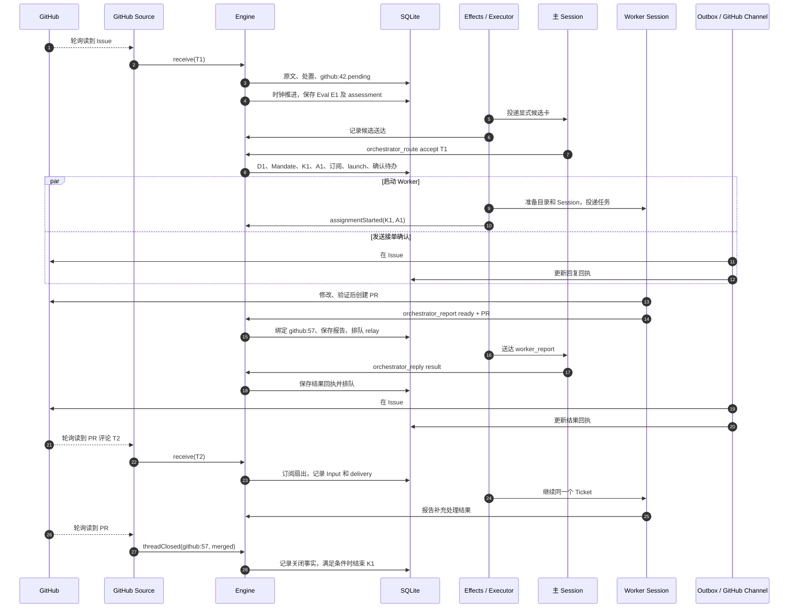

# 04 · 一条 Issue 请求的端到端执行轨迹

> 面试题　维护者在 GitHub Issue 里提到 Agent。请按源码走一遍，说明它怎样被看见、被授权、启动 Worker、交付 PR 并结束。每一步分别产生什么证据？如果用户只看到一句「收到」，你怎样查它卡在哪里？

**短答**　GitHub Source 先通过通知轮询读取 Issue，把其内容和作者转换成 Trigger。Engine 事务性记下输入、Thread 和处置，再由 Passes 推进 Eval。Policy 将允许成员的提及判为 `explicit`，候选异步送到主 Session，由 `orchestrator_route` 提交接受。接受事务写 Decision、Mandate、Ticket、首个 Assignment、订阅和待执行效果。Executor 之后才准备工作区并向专属 Worker Session 投递任务。Worker 通过宿主工具修改代码和打开 PR，并向 Engine 报告 `ready`。主 Session 将结果经 Outbox 发回 Issue。后续 PR 评论循订阅进入同一个 Ticket，GitHub 的合并事实再被观察并用于结束任务。 [GitHub Source](../dsh-superagent-prototype/src/sources/github.ts) · [Engine](../dsh-superagent-prototype/src/core/engine.ts) · [Executor](../dsh-superagent-prototype/src/executor/dsh.ts) · [Outbox](../dsh-superagent-prototype/src/app/outbox.ts)

本文沿用连载中的虚构仓库 `example/portal`，以提交 `7bd4741` 中的实现为基线。维护者 Alice 在 Issue #42 的正文中写下「@portal-agent，请把帮助页的‘帐户设值’改回‘帐户设置’」。Worker 后来打开 PR #57。Alice 在 PR 中补充「只修改帮助页，登录页先不动」，最后由维护者完成合并。例子里的仓库、账号、编号与示意文字用于讲解。实际验证使用仓库的本地测试夹具。 [第 01 篇](01-what-is-a-superagent.md) · [第 03 篇](03-domain-model-and-engine.md) · [现有运行时测试](../dsh-superagent-prototype/tests/runtime.spec.ts)

## 1. 先在白板画出正常路径

这里设定 Runtime 已完成 setup，GitHub watcher 启用，Alice 的 GitHub ID 在允许名单中，Issue 是新建的，Webhook 与全仓观察均无需参与这次通知路径。 `T1` 是 Issue Trigger，`E1` 是 Eval，`D1` 是接受 Decision，`K1` 是 Ticket，`A1` 是首个 Assignment，后续评论是 `T2`。这些是讲解别名。真实 ID 在建模处通过 `key` 等函数计算，有需要时应从已存记录读取。 [GitHub watcher](../dsh-superagent-prototype/src/sources/github.ts) · [GitHub Trigger](../dsh-superagent-prototype/src/sources/github-trigger.ts) · [标识生成](../dsh-superagent-prototype/src/core/ids.ts)



泳道图的时序是教学用正常路径。现实中确认与启动由不同 handler 推动，先后可能变化。PR 也可能由来源轮询发现并提前绑定。主 Session 的接受、交付措辞和 Worker 的代码动作都需要实际的模型或操作者选择，箭头中的工具调用展示的是应用如何接住这些选择。后文逐段列出写入、异步交接和核验点。 [Runtime 装配](../dsh-superagent-prototype/src/app/runtime.ts) · [Effects 派发](../dsh-superagent-prototype/src/app/effects.ts) · [GitHub PR 观察](../dsh-superagent-prototype/src/sources/github-pull.ts)

## 2. 第一跳，从 GitHub 通知到 Trigger

### 2.1 watcher 找到 Issue，通知本身只是读取线索

GitHub 插件的 watch 在初始化完成后按轮询设置调用 `pollRound`。一轮会处理通知、配置开启的仓库级事件、开放 Ticket 关联的 PR、订阅 Thread。对 Issue #42，从 `pollNotifications` 入口看最清楚。它用存储中的 `KV.github.since` 获取通知，只处理目标仓库的记录，并从 `notification.subject.url` 解出 Issue 或 PR 编号。失败需要重读的条目与新通知合并，同一编号在这轮通知读取中只处理一次。此时只有「这个编号值得去看」的线索。通知里的网络形状和 reason 仍需要解析和回读，不能用通知代替 Issue 内容或委托人的身份。 [watch、pollRound 与 pollNotifications](../dsh-superagent-prototype/src/sources/github.ts) · [GitHub 地址解析](../dsh-superagent-prototype/src/sources/github-trigger.ts) · [来源游标](../dsh-superagent-prototype/src/kv.ts)

`readNotified` 进一步读 `issues/42`。GitHub 的 Issue API 也可能返回 PR，源码根据 `pull_request` 字段判断是否要进入 PR 路径。确认是普通 Issue 后，只有创建时间达到该次读取下界且作者并非 Agent 自己，才将 Issue 标题和正文带入 Trigger。之后还能继续读取这个 Issue 的评论。案例里将提及写在新 Issue 正文，而不是事后编辑旧 Issue。因为 Issue 启动路径以创建时间和原作者为事实，后补提及应结合入口实际读法判断。已有 Issue 上另发一条新评论，是不同对象与不同 Trigger。 [readNotified](../dsh-superagent-prototype/src/sources/github.ts) · [新 Issue 测试](../dsh-superagent-prototype/tests/runtime.spec.ts#L474)

### 2.2 记录平台给出的身份和正文

`issueTrigger(issue, login)` 用 `key('github-issue', '42')` 构造 ID。Thread 引用是 `{ source: 'github', id: '42' }`，进入领域后键为 `github:42`。文本是标题和正文拼接，日期取创建时间。Actor 来自 GitHub user，`human` 由作者类型和是否 Agent 自己判定。提及检测对正文检查 Agent 账号，命中则写 `addressed: 'mention'`。传给 Channel 的是 Issue 的回复地址，足以让后续发送器知道要对哪个编号写评论。

| 字段 | 本案例的值或构造方式 | 下一步为什么需要 |
| --- | --- | --- |
| `id` | `key('github-issue', '42')` | 让不同摄取入口识别同一个 Issue Trigger |
| `actor` | `{ source: 'github', id: 'alice' }` | Policy 用它查询 GitHub 来源允许名单 |
| `human` 与 `addressed` | `true` 和 `mention` | 区分人、机器事件和明确指向 Agent 的消息 |
| `threads[0]` | GitHub #42 对应的 ThreadRef | 确定该输入的评估队列 |
| `text` 与 `url` | Issue 标题、正文、平台链接 | 给模型和操作者定位原始请求 |
| `channel` | 指向 Issue #42 的 GitHub 回复地址 | 确认与交付能回到这个对话 |
| `meta` | `number: 42`、`isPr: false`、`kind: 'issue'` | Source 和 Policy 能判断观察范围和类别 |

同一 Issue 即使后来由仓库级观察流读取，也会走同一个转换器。通知和全仓读取可以提供覆盖互补，稳定的事件 ID 让两条路径共用摄取去重。这依赖本原型面向单仓库的作用域。多仓库共享状态时应为所有原生编号补上仓库或租户维度。后续评论的 ID 构成不同，包含评论 ID、链接或 Thread 信息及版本时间，可将一次评论修订与同一版本的重复读取区分开。 [Issue 和评论 ID](../dsh-superagent-prototype/src/sources/github-trigger.ts) · [仓库级读取](../dsh-superagent-prototype/src/sources/github.ts)

### 2.3 Intake 一起提交原文、Thread 和记账信息

SourceContext 的 `receive` 经过 Passes 转给 `Engine.receive`。Engine 通过 `repo.atomic` 调用 `Intake.receive`。Intake 规范时间、检查至少有一个 Thread、按 ID 识别重复，然后读 Source Scope。若被来源过滤，仍可保存原 Trigger 与 `filtered` 处置，但这条输入不会进入正常的评估队列。对案例中有效的新 Issue，Intake 保存 Trigger，更新 Thread 的 `lastAt`，查订阅并记录处置。假定此时没有 Ticket 订阅，fanout 为空，没有现有 Worker 拥有这个请求，`T1` 进入 `github:42.pending`。 [来源上下文](../dsh-superagent-prototype/src/app/source-context.ts) · [Passes.receive](../dsh-superagent-prototype/src/app/passes.ts) · [Intake](../dsh-superagent-prototype/src/core/intake.ts) · [保存与索引](../dsh-superagent-prototype/src/app/store.ts)

触发器落库后，Passes 在收到 `stored` 时请求一次推进。后台每两秒的周期也可以推进到期工作。并发请求会合并为跟进 pass，所以从轮询读入到 Eval 并不保证在同一个函数栈完成。对故障排查来说，已经存了 Trigger 但还没有 Decision 是正常的过渡状态。此时可以查处置是 filtered、已有 fanout，还是在 Thread.pending 等待评估。看到前端还没有任务时，应先判断系统处在这个链路的哪一段。 [Passes.pump](../dsh-superagent-prototype/src/app/passes.ts) · [Engine.evaluateDue](../dsh-superagent-prototype/src/core/engine.ts) · [Trigger 和 Thread 视图](../dsh-superagent-prototype/src/app/views/records.ts)

## 3. 第二跳，从 Thread.pending 到显式候选

### 3.1 Evals.start 先应用准入，再组织一批输入

`Engine.evaluateDue` 在推进到开始评估的阶段时，查 pending 非空且当前没有活跃 Eval 的 Thread，并调用 `Evals.start`。Evals 先排除仍由 Worker 负责的跟进，也会识别已开过任务的历史 Trigger。尚需评估的每条 Trigger 由 `Policy.gate(trigger, thread, tickets)` 判断。案例中 GitHub 来源已经收到 Alice 的 Issue，她在 allowlist 中，正文也提到了 Agent，所以得到 `explicit`，basis 提供 `via: 'addressed'`、提及方式与来源范围等信息。设置中的 `observe` 模式影响推断候选的接受，案例的明确委托仍可进入显式路由。 [Evals.start](../dsh-superagent-prototype/src/core/evals.ts) · [Policy gate](../dsh-superagent-prototype/src/policy.ts) · [授权说明](../dsh-superagent-prototype/docs/002-authorization.md)

源码会为这一批写 `thread.evaluating`，保存 Eval ID、Trigger 列表、最强的授权依据、Policy 版本和初始时间。它清空已经转入 Eval 的 pending 列表，把 Eval ID 写进各 Trigger 的处置，再调用 `assessor.request` 安排 `assessment` Effect。如果之后同一 Thread 又来了消息，在当下 Eval 仍持有原批次的情况下，新输入等下一批。这样过几秒回来一个模型结果时，应用也能知道它原本评估了哪些消息。 [当前 Eval 和处置写入](../dsh-superagent-prototype/src/core/evals.ts) · [Assessor.request](../dsh-superagent-prototype/src/app/assessment.ts)

在这个单 Trigger 案例中，T1 既是主要授权来源，也是候选卡显示的消息。若是多 Trigger 批次，面试中需要讲精确。 `Evaluation.primary` 从 gate 的强度和时间比较选出，接受后的 actor、basis 与原始 Trigger 依赖它。 `candidateCard` 当前用 `candidate.triggers.at(-1)` 选择卡片显示的主体，其余消息作为 batch。显示最新讨论和决定谁提供授权是两处逻辑。用单条 Issue 建立正常路径，再逐渐扩大到多条输入，比较容易看清这两个位置。 [Eval 主 Trigger 选择](../dsh-superagent-prototype/src/core/evals.ts) · [候选卡装配](../dsh-superagent-prototype/src/app/links.ts) · [批次授权来源测试](../dsh-superagent-prototype/tests/core-engine.spec.ts#L1212)

### 3.2 入队、送达和模型决定是三个时点

MasterAssessor 注册的 assessment handler 会按 Trigger 查当前候选，并比对 Eval ID。若待办对应的评估已被取代，handler 结束本次动作。仍有效时，它构造含来源链接、会话标识、`strength` 和 `next_action` 的候选卡，调用 `Sessions.prompt(..., 'steer')` 送往主 Session。随后 Engine 通过 `candidateDelivered` 记录送达时间，并根据当时的超时配置更新 deadline。把超时从实际送达开始计算，给了投递等待与真正作出评估各自的时间。 [MasterAssessor handler](../dsh-superagent-prototype/src/app/assessment.ts) · [Runtime 的候选投递](../dsh-superagent-prototype/src/app/runtime.ts) · [Evals.delivered 与 due](../dsh-superagent-prototype/src/core/evals.ts)

这一步与下一步有重要差别。候选卡显示 `explicit` 表示准入达到了显式强度，主 Session 仍需理解用户是在明确提出新工作、引用已有任务、请求停止，还是只在对话中展示信息。这里的问题是一个明确的目标，且假定没有相关任务，所以主 Session 选择 accept。如果只是另一张 Ticket 的明确跟进，则可能由 attach 接管。代码将这些选择接在受约束的工具之后。对于 inferred 候选，接受还要通过评估提交与模式规则检查，后续章节再详细展开。 [显式候选提示](../dsh-superagent-prototype/src/app/links.ts) · [dispatch 提示词](../dsh-superagent-prototype/prompts/dispatch.md) · [主工具](../dsh-superagent-prototype/src/app/tools/main.ts)

## 4. 第三跳，由 orchestrator_route 事务性建单

### 4.1 主 Session 带着真实 Trigger ID 提交决定

主工具的 `orchestrator_route` 支持多个独立路由条目。下方是本案例的参数形状。运行时要用实际卡片中出现的 Trigger ID。工作区名是受 schema 约束的短名，具体目录和最终分支命名后续执行时再从 Ticket 读取。

```json
{
  "decisions": [
    {
      "kind": "accept",
      "trigger_id": "<候选卡中的实际 Trigger ID>",
      "title": "修复帮助页错字",
      "worktree_name": "fix-help-copy",
      "acknowledgement": "收到，会把帮助页的错字改回‘帐户设置’。"
    }
  ]
}
```

工具检查必需字段和长度，然后调用 `engine.decide` 提交 `kind: 'accept'`。当前显式工具以标题作为 scope 字段，原始用户措辞通过 Trigger 另行交给 Worker。路由 note 可以保留必要的背景或人说过的约束。业务上应让模型查看原文，避免一个短标题变成对任务范围的二次扩写。若路由条目无法通过校验，会得到该条目的拒绝，不需要撤回同次调用已经成功的其他条目。 [路由参数与 route](../dsh-superagent-prototype/src/app/tools/main.ts) · [Worker 原始请求提示](../dsh-superagent-prototype/prompts/dispatch.md) · [执行元数据](../dsh-superagent-prototype/src/executor/dsh.ts)

### 4.2 接受事务同时写下哪些东西

在 `Engine.decide → Evals.decide → accept` 中，Engine 确认 Trigger 仍有效、批次归属及 Policy 版本可用。 `Evals.accept` 形成 Mandate，记录 actor、strength、policyVersion、basis 与 scope，并生成 Ticket ID。 `Evals.finish` 写 Decision，把 Eval ID、Decision ID 写回 TriggerDisposition，并按条件清空活跃 Eval。 `Tickets.create` 创建 K1 和首个 pending Assignment A1，记录 origin、回复 Channel 和执行元数据，在相应 Thread 建订阅。对当前人工消息，它也将接单确认排入 Outbox。最后 Executor 的 `start` 在库里登记 launch Effect。 [接受逻辑](../dsh-superagent-prototype/src/core/evals.ts) · [Ticket.create](../dsh-superagent-prototype/src/core/tickets.ts) · [接单确认](../dsh-superagent-prototype/src/core/replies.ts) · [Executor.start](../dsh-superagent-prototype/src/executor/dsh.ts)

把一次接受前后的记录摊开，对比更清楚：

| 读哪处 | 提交前 | 提交成功后 |
| --- | --- | --- |
| `github:42` 的活跃 Eval | E1 等待决定 | 若 E1 是本次活跃批次，执行 finish 后清除 |
| TriggerDisposition | T1 关联 E1 | T1 关联 E1 和 D1 |
| Decision | 当前接受尚未写 | `D1.kind = accept`，关联 K1 和 Mandate |
| Ticket | K1 尚无 | 保存原始 T1、D1、执行名、初次 Assignment 和回复地址 |
| Thread 订阅 | 此处假设为空 | `github:42.subscriptions` 包含 K1 |
| Worker 派发 | 还无 A1 | A1 pending，存在 `launch/A1` 持久待办 |
| 接单回执 | 还无确认 | `key('ack', T1)` 回执 pending，并有相应的发送待办 |

表格中的 pending 描述事务提交时留下的状态。实际观察可能晚到一个事件循环，A1 可能已经 running，确认也可能已经发出。若同步的 `prepareTicket` 元数据生成或接受事务本身失败，已有测试断言原 Eval、无 Ticket 和无确认等状态被保留。外部目录准备属于提交之后，失败会留下可排查的已接单任务。 `Effects.enqueue` 通过微任务安排派发，以免外部动作在同一次同步事务提交前启动。 [提交与回滚](../dsh-superagent-prototype/src/app/store.ts) · [Effects.enqueue](../dsh-superagent-prototype/src/app/effects.ts) · [接受回滚测试](../dsh-superagent-prototype/tests/core-engine.spec.ts#L136)

### 4.3 重复摄取和重复接受各解决一次问题

重轮询时，摄取以 T1 的 ID 去重，返回 `duplicate`。另一种重复发生在本地，主 Session 因重试或再次主动路由同一条记录提交第二个 accept。 `Evals.decide` 查该主 Thread 的历史接受记录，已由这条 Trigger 开过 Ticket 时返回原 Decision。这样两层都处理了重复，但它们处理的是不同入口。在面试中可以问对方是「平台事件重复」还是「应用命令结果重试」，分别说清去重位置。如果两条不同评论表达同一个目标，它们有不同 Trigger ID，候选和主 Session 仍需基于相关 Ticket 和指向性处理语义重复。 [Intake 去重](../dsh-superagent-prototype/src/core/intake.ts) · [已接受历史](../dsh-superagent-prototype/src/core/evals.ts) · [主工具原结果复用](../dsh-superagent-prototype/src/app/tools/main.ts) · [重复接受测试](../dsh-superagent-prototype/tests/core-engine.spec.ts#L899)

## 5. 第四跳，持久队列推动 Worker 启动

### 5.1 为什么建单后还会看见排队

launch handler 从 Effects 取到期项。此时它重新读取 K1 和最新 Assignment，确认 Ticket 还开放、A1 仍为当前 pending 尝试，然后预约槽位。若处理暂停，handler 的可用并发限制为零。若当前没有可用槽位，待启动项会等待。这是建单后显示 queued 的典型原因。建单侧已经产生可靠的任务记录，Worker 无须等待主 Session 再发一次开始命令。状态恢复时 Executor 也会检查仍 pending 的尝试。 [Effects 到期派发](../dsh-superagent-prototype/src/app/effects.ts) · [WorkerSlots 和 launchQueued](../dsh-superagent-prototype/src/executor/dsh.ts) · [ticketStage](../dsh-superagent-prototype/src/core/stage.ts)

如果请求接受时把 Worker 准备放进同一个事务，目录、网络和模型服务延迟都可能将持久化边界拉长。现在按职责拆成两个不同的可观察结果。先提交「可以做，也已安排」，再由异步执行器推进「实际开始」。这个顺序还让暂停、停止和重试能作用于待派发记录。比如工单已被人停止时，尚未执行的 launch 被取出来也会因状态不再满足条件而退出。 [Engine 接受事务](../dsh-superagent-prototype/src/core/engine.ts) · [Executor 启动时检查](../dsh-superagent-prototype/src/executor/dsh.ts) · [Runtime 并发测试](../dsh-superagent-prototype/tests/runtime-concurrency.spec.ts)

### 5.2 工作目录、会话和任务消息

接受阶段计算短名 `fix-help-copy-<Ticket ID 的前 12 字符>`、目录和执行说明。到 launch 阶段，若目录不存在，Executor 根据当前执行配置运行 prepare 命令，检查目录适合 Worker 使用。若未配置 prepare，代码可创建空业务目录。因此教学案例假定团队为实际仓库配好了工作区准备，真实 worktree 来自部署配置。目录已存在时走复用口径，恢复执行能沿用已有文件。启动期间在多个异步边界之后再次读取当前状态，避免最终把过时任务交给 Session。 [ticketExecution / prepareDirectory / launch](../dsh-superagent-prototype/src/executor/dsh.ts) · [执行变量](../dsh-superagent-prototype/src/app/execution-environment.ts) · [执行文档](../dsh-superagent-prototype/docs/003-execution.md)

`Sessions.ensure` 用 `worker-${ticket.id}` 查找 DSH Agent。若 Session 不存在，就创建对应 Workspace 与 Worker preset 的 Session，再绑定模型角色、应用工具和提示词。初次派发把 K1、标题和 T1 的原始请求卡送到 Worker。长文字可以截断为带引用的预览，Worker 依提示和工具读取需要的完整内容。首次任务投递用 `assignment:${ticket.id}` 作为请求身份，后续尝试用包含 Assignment ID 的身份，代码还会检查 Session 是否已持有首次任务信息。 [Sessions.ensure](../dsh-superagent-prototype/src/app/sessions.ts) · [Worker 任务消息构造](../dsh-superagent-prototype/src/executor/dsh.ts) · [AgentDelivery](../dsh-superagent-prototype/src/app/delivery.ts)

任务消息通过 `'queue'` 进入 Session，启动回执由 Executor 调用 `engine.assignmentStarted(K1, A1)`。源码在投递的 accepted 回调和 prompt 完成之后各有调用点。 `Assignments.started` 用 `startedAt ??=` 保留首次启动时间，并忽略已经 ended 的尝试。这个状态表示该 Assignment 已按应用协议启动。后续还需独立查看模型是否已实际执行某个工具、是否有改动以及报告写了什么。模型刚接到任务时，GitHub 也可能只收到确认，PR 会晚一些。 [Executor.launch](../dsh-superagent-prototype/src/executor/dsh.ts) · [AgentDelivery.send](../dsh-superagent-prototype/src/app/delivery.ts) · [Assignments.started](../dsh-superagent-prototype/src/core/assignments.ts)

### 5.3 在白板上推演一次停止与启动竞争

设 A1 已被 Effects 取出，Executor 完成准备，正在等待宿主解析 Worker Session。此时维护者从管理面板选择停止。Engine 可以先提交 `K1.ended` 和 Assignment 结束事实，提交后取消已有的会话工作。Session 解析完成之后，launch 还有一次 `current()` 检查。如果已经关闭，就不会继续投递任务。即使状态在稍后才发生变化，实际向 inbox 写入之前还有授权回调。已开始的外部准备操作可能留下目录，这个局部效果需要按环境处理。 [Engine.stopTicket](../dsh-superagent-prototype/src/core/engine.ts) · [Ticket 结束](../dsh-superagent-prototype/src/core/tickets.ts) · [Executor.launch 与 stop](../dsh-superagent-prototype/src/executor/dsh.ts) · [投递授权回调](../dsh-superagent-prototype/src/app/delivery.ts)

这个分支能说明为什么入队时的合法性不足以覆盖实际执行。取到数据库记录与真正写入 Session 中间有多个 await，操作者可能修改状态。若同一 Ticket 通过重试让 A2 接管，单查 Ticket 是否开放也不够，必须确认最新 Assignment 仍为 A1。相关竞态测试还有另一种构造，给已经运行的 Worker 发送后一条 Input 时卡在 Session 创建或解析，期间人工停止。之后放开等待，用例断言不再向已停止任务发送输入。这个保证落在最后的状态重查，而不是依赖执行速度够快。 [Executor.deliverQueued 与 deliverInput](../dsh-superagent-prototype/src/executor/dsh.ts) · [等待 Session 时停止的测试](../dsh-superagent-prototype/tests/runtime-concurrency.spec.ts#L69)

## 6. 第五跳，Worker 执行、创建 PR 并提交报告

### 6.1 模型的代码工作与应用的职责

到这一步，Worker 有自己的 DSH Session 和工作目录。教学案例里，Worker 读取帮助页文案，定位「帐户设值」所在位置，按原要求改词，检查 diff 和适用测试，然后在对应分支打开 PR #57。工具选择和实际改动由 Worker 的回合决定。应用负责交付上下文、提供工具控制、安排执行并记录任务状态。PR 是否真的创建、变更是否符合要求，需要看 GitHub 对象和可核对的证据。源码里的 `orchestrator_report` 接受已经存在的 PR 编号，负责记录与交接。 [Worker 执行约定](../dsh-superagent-prototype/prompts/work.md) · [会话工具绑定](../dsh-superagent-prototype/src/app/sessions.ts) · [报告工具](../dsh-superagent-prototype/src/app/tools/executor.ts)

本例假定 Agent 账号可以在配置仓库中打开 PR。打开后，GitHub 可显示 PR 及其分支，即使 Worker 还没有上报。远端存在 PR 和本地 Ticket 已登记这条 PR 是两条事实。Worker 可以在报告中提供 `pr_number: 57`。GitHub Source 也可自动发现满足条件的 PR，例如来源的某次读取观测到 Agent 在唯一匹配的任务分支上打开了 PR。两条路径共用归属校验，自动发现还需要检查原来跟踪的开放 PR 和重开条件。 [claimPull / observePull](../dsh-superagent-prototype/src/sources/github-pull.ts)

### 6.2 PR 绑定与报告要一起提交

Worker 可用这组参数报告产物。摘要中的核查结果应来自该次执行，示例文本只展示形状。

```json
{
  "state": "ready",
  "summary": "帮助页文案已改为‘帐户设置’，已核对改动范围，PR #57 可审查。",
  "pr_number": 57
}
```

工具先读取 Ticket 的开放状态，再在事务之外读取 PR，拿到平台事实后进入外层 `store.atomic`。 `claimPull` 支持「原始请求就是该 PR」和「本次由 Agent 账号开出 PR」两类归属。后者要求作者与配置账号一致、head 所属仓库正确、分支最后一段等于 Ticket 执行短名。它还检查该 PR 是否已经被另一张开放 Ticket 跟踪。本例最初来自 Issue，PR 分支可以是 `agent/<执行短名>`，由第二种规则关联。 [执行短名](../dsh-superagent-prototype/src/executor/dsh.ts) · [读取与归属校验](../dsh-superagent-prototype/src/sources/github-pull.ts) · [报告事务](../dsh-superagent-prototype/src/app/tools/executor.ts)

归属检查通过且 PR 开放时，绑定更新两处关系。 `github:57.subscriptions` 包含 K1，使后续评论能够投递。 `K1.follows` 记录这条 PR Thread，本例 `own: true`，供关闭和完成条件使用。Source 同时补齐 Thread 的 GitHub 属性。工具随后调用 `engine.report` 记下报告，并选择适当 relay 给主 Session。若绑定后报告校验抛错，外层事务能把绑定、报告和待发中继一起回滚。先前已创建的远端 PR 仍可独立读取，后续报告、来源扫描或人工核对可以继续解决本地登记。 [PR 绑定](../dsh-superagent-prototype/src/sources/github-pull.ts) · [SourceContext](../dsh-superagent-prototype/src/app/source-context.ts) · [报告处理](../dsh-superagent-prototype/src/core/assignments.ts) · [报告回滚用例](../dsh-superagent-prototype/tests/runtime.spec.ts#L1327)

一个排查思路是从 GitHub 把 PR 作者、仓库和 head ref 读出来，对照 Ticket 的 `execution.name`。假如 Worker 意外打开了两个 PR，仅凭「都是 Agent 发的」只能说明作者相同。若它用另一项任务的分支，归属检查就会拒绝；若 PR 已被其他开放 Ticket 持有，即使 Worker 报告了编号也不能抢占。由平台读回归属所需事实，可以将错误限制在报告操作，避免让错误的 PR 评论继续进入当前 Ticket。 [claimPull](../dsh-superagent-prototype/src/sources/github-pull.ts)

### 6.3 ready 状态把下一步交给谁

`ready` 被持久化为 Assignment 的报告，并可成为待人工审查的依据。因为 K1 跟踪一条开放 PR，`Assignments.report` 计算当前结束条件时还得不到完成结果。此时保持 Ticket 开放，后续评审、人工补充意见和平台检查还有承接处。如果 Worker 没有跟踪任何 Thread，ready 则可以结束为 completed。用这两个分支能解释为什么复用同一个状态词却有不同后果。阶段是从报告、跟踪关系、人工问题和结束事实共同推导出来的。 [Assignments.report](../dsh-superagent-prototype/src/core/assignments.ts) · [ticketStage](../dsh-superagent-prototype/src/core/stage.ts) · [报告与待审测试](../dsh-superagent-prototype/tests/runtime.spec.ts#L320)

报告后的 relay 是内部交接，`reportRelay` 能为 ready 组织 `worker_report`，带简要结果、Ticket 和原 Trigger 引用。普通进度通常留在内部，有明确人工问题时则可以生成 `worker_attention`。主 Session 据此安排对话交付。若只把 PR URL 放在 Worker 对话，Issue 用户仍可能只看得到接受确认。把 Worker 的执行结果转成对原请求的可见回应，需要下一步明确的回复动作。 [报告中继](../dsh-superagent-prototype/src/app/notices.ts) · [Sessions.relay](../dsh-superagent-prototype/src/app/sessions.ts) · [交接提示词](../dsh-superagent-prototype/prompts/dispatch.md)

## 7. 第六跳，Outbox 把确认与结果送回 Issue

### 7.1 同一 Channel 上两条消息的来源

**接单确认**由接受路径触发。 `Replies.acknowledgeAccepted` 从主 Trigger 取得 Channel，用 `key('ack', trigger.id)` 生成消息 ID，然后排队。Alice 在 GitHub 看见「收到，会把帮助页的错字改回‘帐户设置’」就能发现意图是否被正确理解。此时无需等 Worker 执行完，甚至还可以在等待槽位。 **交付结果**则由主 Session 收到 Worker 报告后，经 `orchestrator_reply` 提交 `purpose: 'result'`，文字附上可审查 PR。Replies 检查报告或结束结果是否满足要求，再选源 Channel。 [接单与结果回复规则](../dsh-superagent-prototype/src/core/replies.ts) · [回复工具](../dsh-superagent-prototype/src/app/tools/main.ts)

结果发回原 Issue #42。PR #57 虽然也关联 K1，它主要是评审和跟进的位置。如果要回答 PR 上具体的人类追问，`purpose: 'answer'` 会按那条 Trigger 的 Channel 和答复条件处理；向人提问的 `purpose: 'attention'` 还要匹配 Ticket 当前问题，并尽量回到引发问题的位置。这个区别使团队知道该去哪里行动。将回复地址放在原 Trigger 和 Ticket 里，应用才可以复查目标，而无需主 Session 每次在自由文本中猜 URL。 [Replies.answer](../dsh-superagent-prototype/src/core/replies.ts) · [回复约定](../dsh-superagent-prototype/prompts/replies.md)

### 7.2 pending、sent 和 dropped 分别意味着什么

`Outbox.send` 将回执和 reply Effect 一起写入 SQLite。排队后可先处于 pending。handler 取到待办时，检查 Source 是否可用、目标 Channel 是否还允许，以及同一 Ticket 同一会话是否有未处理的前序消息，再交给 `SourceRegistry.send`。来源未装载时可以等待；目标永久失效则按相应代码结算为 dropped；发送成功时记为 sent。 `orchestrator_reply` 等当前能运行的外发到 idle 后读取回执。仍有待退避或受暂停影响的任务时，它可以返回 pending。 [Outbox](../dsh-superagent-prototype/src/app/outbox.ts) · [Effects.idle](../dsh-superagent-prototype/src/app/effects.ts) · [回复工具](../dsh-superagent-prototype/src/app/tools/main.ts)

当前序确认失败，系统通常先等它，以免用户先看到「交付」后看到「开始」。这个约束作用于同一 Ticket 与对话，重复失败达到阈值后可放行后续消息。本地测试检查第一次失败后保持顺序、连续失败后结果释放，以及不同 Ticket 或会话可以继续。面试官问「怎样对付队首阻塞」时，可以先说明系统实际上排序到哪一级，再解释错误阈值和重试退避分别负责什么。 [外发与失败阈值](../dsh-superagent-prototype/src/app/outbox.ts) · [回执排序](../dsh-superagent-prototype/src/app/store.ts) · [消息顺序测试](../dsh-superagent-prototype/tests/runtime.spec.ts#L1182)

### 7.3 GitHub 写入的重复窗口

Issue #42 的 Channel 走普通 GitHub 评论。适配器为评论附上用本次消息 ID 构造的 HTML 标记。处理同一发送重试时，会先查目标评论中是否已有同一账号发表的同标记消息。命中就报告已发送，Outbox 可以补回本地回执。这专门缓解了「远端发了，本地还没记」的窗口。它依赖能读到原评论、读写使用相应账号、以及重试仍使用稳定消息 ID。确认的消息 ID 可按 T1 找到，而结果消息若换正文，生成的 ID 可能不同。产品若希望把同一语义结果当成更新，仍需要明确相应的身份及覆盖协议。 [GitHub Channel](../dsh-superagent-prototype/src/sources/github-channel.ts) · [回复 ID 生成](../dsh-superagent-prototype/src/core/replies.ts)

| 要区分的事实 | 可以查到的记录 | 下一步仍需核对 |
| --- | --- | --- |
| 接受成功 | Decision、Mandate、Ticket | Worker 是否真正开始 |
| 启动成功 | 当前 Assignment 的 started 和 Session 中的任务 | 工具调用和修改 |
| Worker 报告 ready | Report 与跟踪 PR | 用户是否已收到，PR 是否审查或合并 |
| 回复送达 | Outbox 回执 sent | 用户是否已读或认可结果 |
| 已合并 | GitHub 合并事实和本地 `Follow.closed` | Ticket 是否仍有已接纳的后续工作 |
| Ticket 完结 | `Ticket.ended` | 后续评论是否可能恢复工作 |

回复确认、产物和交付可能出现在不同时间。对于「我已经收到确认所以任务应已执行」这种故障反馈，先把用户观察翻译为表中的事实，再往下一跳找证据，会比按主观印象判断进度更可靠。 [业务记录类型](../dsh-superagent-prototype/src/core/model.ts) · [外发状态](../dsh-superagent-prototype/src/app/outbox.ts)

## 8. 第七跳，PR 评论续接原任务，合并结束工作

### 8.1 原来的 Ticket 接到后续输入

Alice 在 PR #57 写下「只修改帮助页，登录页先不动」，这次是在补充原任务。 `github:57` 已订阅 K1。订阅 Thread 的轮询按游标可以访问 PR 的会话评论、行内评论和评审，通知路径也能取得相关讨论。上述普通评论通过 `commentTrigger` 写成 T2。与初始 Issue 不同，评论的版本时间参与 ID；评审状态有时能生成文本，即使没有普通评论正文。 [订阅 Thread 轮询](../dsh-superagent-prototype/src/sources/github.ts) · [评论转换](../dsh-superagent-prototype/src/sources/github-trigger.ts)

Intake 通过订阅生成 K1 的 Trigger Input。 `followupOwners` 综合人类事件、fanout、context-only、手动重评、handback 和 Ticket 活跃状态，得出 K1 的 Worker 当下负责判断。在这组条件下，Alice 即使没再提一次 Agent，消息也能进入已有任务，继续在 K1 的授权下处理。主 Session 可以收到 follow_up 通知，用于了解谁已接手及处理明确停止，应用无须再从它那里转发同一输入。若 Alice 在同一位置提出导航重做，Worker 则可按原范围退回，待所有者让出后重新进入评估。 [Intake](../dsh-superagent-prototype/src/core/intake.ts) · [followupOwners](../dsh-superagent-prototype/src/core/model.ts) · [后续通知](../dsh-superagent-prototype/src/app/notices.ts) · [后续消息测试](../dsh-superagent-prototype/tests/followups.spec.ts#L14)

Executor 消费 delivery Effect 时重新读取 Ticket 与运行中的 Assignment。需要唤醒空闲 Worker 时，它按槽位条件预约，必要时重新确保 Session 存在。实际投递前仍会重验目标，避免取消旧工作或重试更换 Assignment 后出现迟到交付。 `Sessions.prompt(..., 'steer')` 把输入交给 Worker。送达后 `inputsDelivered` 更新投递状态，Session 产生相应 `user/message` 事件时，应用推进 `inputsRead`。这两个观测点可以分别回答「已送进会话」和「已经被纳入模型步骤」。 [Executor.deliverQueued / deliverInput / install](../dsh-superagent-prototype/src/executor/dsh.ts) · [投递与已读](../dsh-superagent-prototype/src/core/assignments.ts) · [停止与投递竞态](../dsh-superagent-prototype/tests/runtime-concurrency.spec.ts#L69)

### 8.2 合并先是外部事实，随后用于应用收尾

Alice 审查完成后在 GitHub 合并 PR #57。开放 Ticket 的 PR 轮询、通知或订阅读取会在抓取 PR 后调用 `observePull`。 `closePull` 找到仍跟踪此开放 PR 的任务，用 GitHub 的 `merged_at` 或 `closed_at` 等时间调用 `threadClosed`。Engine 在本地事务更新 `Follow.closed`，再检查还有没有其他应完成的关联 Thread，以及已接纳的跟进是否尚未处理。当前例子只有一个 own PR，Worker 已经收尾，因而 K1 结束为 `merged`。历史的 Ticket、Decision、Session 和订阅仍可用于定位工作。 [GitHub pull 与 pollTicketPulls](../dsh-superagent-prototype/src/sources/github.ts) · [observePull / closePull](../dsh-superagent-prototype/src/sources/github-pull.ts) · [Tickets.threadClosed / followsDone](../dsh-superagent-prototype/src/core/tickets.ts)

在 GitHub 上，合并已有可见的平台记录。 `pullEndNotices` 为关联的非 GitHub Channel 生成简短终态通知。仅由 Issue 发起的案例已经有确认和交付，合并时正常不会新增一条 GitHub 终态评论。保留订阅也有实际作用。合并后，正式 Thread 上较晚的人类评论仍可能经过原 Mandate 和当前 Policy 的检查恢复 Ticket。明确被人停止的任务则走独立的限制，状态图应能说明不同结束来源的后续行为。 [终态通知](../dsh-superagent-prototype/src/sources/github-pull.ts) · [Runtime 结束事件处理](../dsh-superagent-prototype/src/app/runtime.ts) · [恢复限制](../dsh-superagent-prototype/src/core/tickets.ts)

### 8.3 合并和补充意见同时到达怎么办

一种典型竞态是 Worker 已提交可审的 PR，Alice 又发来范围内的跟进，Worker 确认接下并在后台运行检查，GitHub 同时观察到 PR 合并。直接结束 Ticket 会取消仍属于原工作的后续执行。因此 `unfinished` 会结合是否已接纳、相关输入是否在报告或回合结束之前读到、恢复尝试与关闭的时间关系，决定先记关闭还是同时结束 Ticket。并发测试让 Worker 确认跟进并启动后台任务，然后提交 merge 事实，断言 Ticket 仍开放、后台任务未被取消。这里具体的守卫比「只要有最新评论就延迟」更有区分度，能把尚未接手的消息与已经承诺处理的工作分开看。 [Tickets.unfinished](../dsh-superagent-prototype/src/core/tickets.ts) · [合并与跟进并发测试](../dsh-superagent-prototype/tests/runtime-concurrency.spec.ts#L414)

相反，若一条新输入还没有被 Worker 纳入相关回合，Ticket 也可能结束，系统根据 `Tickets.end` 对尚未接手的输入作后续安排。用户只会在 GitHub 看见合并，面板却有条件展示两条不同的记录。面试时若要证明「合并后一切结束」，还应打开 Ticket 的最后报告、输入记录与状态，核对实际任务已收尾。 [结束与未接手输入](../dsh-superagent-prototype/src/core/tickets.ts) · [合并时晚到消息测试](../dsh-superagent-prototype/tests/runtime-concurrency.spec.ts#L747)

## 9. 从现有记录定位故障

### 9.1 从一个外部编号找到相关 ID

排查可以从管理面板搜索 `#42`、`#57` 或链接。GitHub Source 会把可识别的引用转成 Thread 键，搜索视图利用标题、订阅和跟踪关系返回 Ticket。Thread 详情能看到 Trigger 时间线、Decision 与订阅 Ticket。再打开 Ticket 详情核对来源、执行阶段、输入和 Session。在同一系统里既可能查到历史结束的 Ticket，也可能查到还在进行的工作，查询时要同时看当前状态。 [GitHub 搜索解析](../dsh-superagent-prototype/src/sources/github.ts) · [搜索和时间线](../dsh-superagent-prototype/src/app/views/threads.ts) · [Ticket 视图](../dsh-superagent-prototype/src/app/views/tickets.ts)

| 有什么线索 | 先到哪里看 | 找到下一跳所需的字段 |
| --- | --- | --- |
| Issue #42 或 URL | GitHub 搜索解析、Thread 时间线 | `github:42` 和原始 Trigger ID |
| Trigger ID | 处置记录和 Thread 的 Decision | Eval、Decision 或曾分发到的 Ticket |
| Decision ID | Decision 记录 | Ticket ID、策略版本、授权依据 |
| Ticket ID | Ticket 详情和 Execution | 当前 Assignment、报告、未投递输入、PR Follow |
| PR #57 | 跟踪关系和订阅 | 属于哪个 Ticket，是否见到了合并 |
| Worker 会话 | Execution/详情中的会话入口或宿主列表 | `worker-${ticket.id}` |
| 只看到「收到」 | Ticket 的执行进度与外发问题 | A1 是否 queued，结果报告是否已生成，回执是否待发 |

同一 Issue 上若同时开了两项独立工作，搜索结果可能有多个 Ticket。此时应由用户提供的具体评论或需求定位原 Trigger，再对照接受 Decision 的 `triggerIds`、各 Ticket 的 `origin.triggerId` 及授权范围。也可以从每张 Ticket 跟踪的 PR 反查当前交付。只按更新时间取最新 Ticket，可能误把另一项任务的 ready 报告当成原请求的结果。Thread 提供候选范围，最终的追踪单元仍是一次有明确来源和 Decision 的工作。 [Ticket 与 Decision 类型](../dsh-superagent-prototype/src/core/model.ts) · [Thread 详情](../dsh-superagent-prototype/src/app/views/threads.ts)

当前管理 API 提供 `GET /orchestrator/api/search?q=...`、`GET /orchestrator/api/threads/:key` 及 `GET /orchestrator/api/tickets/:id` 等入口，应用状态和健康情况也可从状态视图读到。请求仍遵循面板同源和请求头约定。它们提供的读模型适合排查「接收、评估、执行、送达」哪一步未推进。若需要查看 SQLite 的原始处置与待办，应明确这是同一份运行状态的更底层视角，面板并没有把每个表字段原样暴露。 [HTTP API](../dsh-superagent-prototype/src/app/http.ts) · [Store](../dsh-superagent-prototype/src/app/store.ts) · [状态视图](../dsh-superagent-prototype/src/app/views/overview.ts)

### 9.2 让现象指向下一位负责推进的人或组件

| 用户看到什么 | 检查点 | 谁负责下一步 |
| --- | --- | --- |
| Issue 发了，系统找不到 | 账号、通知、Scope、Source health 和游标 | watcher 或操作者修配置 |
| 有 Trigger，无候选 | 是否被过滤、已有 Worker 拥有，还是仍在 pending | Intake 确定的归属及后续 Pass |
| 有候选，无 Decision | Eval 送达时间、deadline 和主 Session | assessment handler、主 Session 或超时重排 |
| 收到确认，Worker 未启动 | Assignment pending、暂停、槽位、launch Effect | Effects、Executor |
| Worker 回报失败 | prepare 输出、报告、投递错、会话状态 | 重试路径或人工修复 |
| GitHub 已有 PR，Ticket 未登记 | 作者、仓库、分支和报告是否合法 | Worker 报告或 Source 观察 |
| Ticket 待审，用户还没收到结果 | worker_report、主 Session 的回复调用、Outbox | 内部 relay、主 Session 或外发队列 |
| GitHub 已合并，Ticket 仍开放 | Source 是否读到关闭、其他 own PR、未完成跟进 | Source 看见事实，或 Worker 完成后续 |

有些表现相同，原因却处在不同层。比如「没有创建任务」可能是 CLI 未按预期读取 Issue，也可能是内容已经存入但 gate 拒绝，或者设置在观察模式下没有自动接受推断候选。检查时应先找刚收到的 Trigger，再看展示的 reason 与 Decision。又比如「显示已发送但用户说没看到」，需要核对那条回执属于接单确认还是结果交付，目标是否是原 Issue 或本次问题的对话，然后用 GitHub 的评论事实或会话位置继续核查。 [通知与游标](../dsh-superagent-prototype/src/sources/github.ts) · [准入与模式](../dsh-superagent-prototype/src/policy.ts) · [回执和地址](../dsh-superagent-prototype/src/app/outbox.ts)

### 9.3 三个故障窗口各要回头查什么

**窗口一，摄取成功，游标更新之前停止。** 轮询过程中先将有效内容交给 Intake，再按处理进度调整 Source 游标。进程可能恰好在 T1 已经入库、游标还未推进时退出。下次读取旧边界再次遇到同一 Issue，T1 的确定性 ID 识别为重复。即便重复跨入口出现，后续仍有 accept 历史检查。若相邻事件由于读取失败还没有入库，则要看通知重试映射是否保留了该编号，以及相应读取下界怎样恢复。稳定 ID 处理的是重复，游标和重试记录处理的是读到哪个位置。 [通知重试与游标](../dsh-superagent-prototype/src/sources/github.ts) · [Trigger 去重](../dsh-superagent-prototype/src/core/intake.ts) · [失败通知重读测试](../dsh-superagent-prototype/tests/sources.spec.ts#L575)

**窗口二，接受已提交，启动还没结束。** 若接受事务提交前崩溃，Decision、Ticket 与 launch 待办都不会以半套出现，原输入由此前已提交状态继续推进。若已提交而尚未 dispatch，重启后 Effect 仍可处理，Executor 也会复核 pending Assignment。若已经开始准备目录或已经创建 Session，重启恢复要结合现有目录、Session 历史和 Assignment 状态。同一个 Ticket 的执行元数据有稳定身份，应用可以检查是否已送过首条任务。遇到 prepare 报错可能留有目录内容，当前实现在这类错误时让 Ticket 进入失败处置，由后续人类输入或明确重试继续。单靠重复 accept 只会得到原决定。 [Runtime 恢复顺序](../dsh-superagent-prototype/src/app/runtime.ts) · [Executor.launch / resume](../dsh-superagent-prototype/src/executor/dsh.ts) · [会话投递判重](../dsh-superagent-prototype/src/app/delivery.ts) · [准备失败测试](../dsh-superagent-prototype/tests/runtime.spec.ts#L1079)

**窗口三，GitHub 已写回，Outbox 尚未记 sent。** 要先确认这条回复已经排队，后续重试使用同一个消息 ID。若评论可读取，GitHub Channel 可以用标记和账号查到旧写入，收到 sent 后补本地回执。假如旧评论被删除，或外部读失败，重试会遵照当前平台返回和本地重试逻辑处理。读取标记的办法让这个原型能在常见条件下对账，生产部署依然需要明确异常窗口、平台读写权限、重试预算和观察结果。 [GitHub Channel](../dsh-superagent-prototype/src/sources/github-channel.ts) · [Outbox 结算](../dsh-superagent-prototype/src/app/outbox.ts) · [Effects 重试](../dsh-superagent-prototype/src/app/effects.ts)

用白板总结这三段，分别画出平台游标与 Trigger 表、SQLite 接受事务与 launch 队列、外部评论与本地回执之间的边界。这样面试官可以清楚看到问题没有被一条「可重试」掩盖。每个重试都有标识，每次副作用都要检查当前状态，每个外部效果都有自己能得到的完成证据。

### 9.4 端到端延迟如何分段

假设一次演练里，Issue 产生后 35 秒被轮询到，从入库到候选进主 Session 用 1 秒，主 Session 用 5 秒决定接受，接受后等待 Worker 15 秒，修改与验证用 4 分钟，ready 到结果送达又用 6 秒。把这组串行段相加，用户约 302 秒后看到可审查结果。若人工评审又等 2 小时，合并时刻就远晚于初次交付。这个算例用于说明分解方法，与真实运行统计独立。实际可用的时间源包括 Trigger 发生时间、处置时间、Eval 开始与送达、Decision、Assignment.startedAt、Report.at 以及平台事件。某些阶段需要日志或新增埋点获取更精确的时刻。 [领域时间字段](../dsh-superagent-prototype/src/core/model.ts) · [状态视图](../dsh-superagent-prototype/src/app/views/overview.ts)

当面试官要求降低任务延迟，可以先指出哪一段是主要瓶颈。如果慢在感知，检查轮询间隔、GitHub 请求与速率限制。如果慢在派发，核对槽位和 prepare。如果主要在等审查，提升模型速度对合并时间帮助有限。再把目标拆成「第一次让人知道已接」「第一次有可审产物」「工作最终完结」三个指标，面试答案才能把产品体验和运行约束联系起来。

另外要区分延迟本身和测量上的错位。候选有创建时间和实际送达时间，超时只应按应用的阶段语义读。候选如果还因 Effect 等待未送达，Thread 上虽已有 E1，`Evals.due` 仍不会仅凭初始 deadline 就将它判超时。任务从 ready 到用户收到结果也穿过了内部 relay、主 Session 工具调用与外发，只有 `Report.at` 无法区分这几段。将来若要做线上 SLO，可以在这些交接点分别采集队列时间与处理时间，并将人工等待单列。指标应按同一 Ticket 串联，否则比较不同阶段的总体均值会遮住少数持续失败的工作。 [候选超时逻辑](../dsh-superagent-prototype/src/core/evals.ts) · [候选投递](../dsh-superagent-prototype/src/app/assessment.ts) · [结果中继](../dsh-superagent-prototype/src/app/notices.ts)

面试举例时可给出两项明确的检查。第一，统计已接受但长时间无 started 的任务，需要先标出暂停、等待并发和真实启动失败。第二，统计已报告 ready 且应交付但长时间没有结果回执的任务，需要确认内部 relay 是否生成、主 Session 是否提交了结果，以及出站回执究竟是 pending 还是 dropped。两项都能从案例提炼出可解释的告警，分别落到执行和对话交付负责人。 [Executor 启动](../dsh-superagent-prototype/src/executor/dsh.ts) · [外发回执](../dsh-superagent-prototype/src/app/outbox.ts) · [Overview](../dsh-superagent-prototype/src/app/views/overview.ts)

## 10. 本地用例覆盖与整条链路验证

| 检查段 | 仓库用例观察到了什么 |
| --- | --- |
| 从通知读取新 Issue | 模拟通知和 Issue，`pollRound` 后主 Session 收到显式候选。 [通知测试](../dsh-superagent-prototype/tests/runtime.spec.ts#L474) |
| 对比身份和提及 | 一组用例比较未提及的成员与提及的陌生人，检查忽略原因与无候选。 [准入反例](../dsh-superagent-prototype/tests/runtime.spec.ts#L489) |
| 接受和启动 | 检查 Mandate、Worker Session、订阅和接单回执，现有用例使用飞书夹具来走共同领域链路。 [显式接单测试](../dsh-superagent-prototype/tests/runtime.spec.ts#L219) |
| 工作区准备 | 新 Ticket 运行配置的 prepare，失败记录输出。 [prepare 用例](../dsh-superagent-prototype/tests/runtime.spec.ts#L1079) |
| PR 绑定和报告事务 | 非法 PR 归属或报告导致剩余本地变更一起回滚。 [报告回滚](../dsh-superagent-prototype/tests/runtime.spec.ts#L1327) |
| 合并时仍有跟进 | merge 到时已接手的跟进还在后台处理，Ticket 保持开放。 [并发合并](../dsh-superagent-prototype/tests/runtime-concurrency.spec.ts#L414) |

在依赖已按锁文件安装的原型目录可运行：

```bash
pnpm test tests/runtime.spec.ts tests/sources.spec.ts tests/followups.spec.ts \
  tests/outbox.spec.ts tests/runtime-concurrency.spec.ts
```

本次在临时检出目录运行，**5 个测试文件、236 个现有用例全部通过**。同时在另一份临时检出中加入一条文档验证用例，复用运行时夹具和本地 SQLite，模拟 GitHub 通知、Issue、PR 元数据、检查结果与评论接口。测试主动向主 Session 和 Worker 工具提交参数，相当于把模型动作换成可重复的输入。它检查了以下六个结果。

1. Issue #42 经通知入口入库，并在主 Session 产生 `explicit` 候选。
2. 接受后形成含 GitHub actor 的 Mandate，A1 为 running，Worker 收到原 Trigger，确认回执为 sent。
3. Worker 报 `ready` 后关联 `github:57` 为 own，Ticket 保持开放，主 Session 得到结果中继。
4. 调用结果工具后回执为 sent，确认与结果共两次写入原 Issue #42，均带 GitHub 重试标记。
5. 后续 PR 评论进入同一 Worker 的输入，PR Thread 上没有新 Decision。
6. 下次轮询看见合并，Ticket 的结束结果为 merged，PR 订阅保留，GitHub 评论总数仍是两条。

这条临时用例最终通过。它验证了上述状态和消息目的地可以在同一条模拟链路上对齐。真实模型是否能修对错字、真实仓库的分支与权限能否支持执行、用户实际是否收到了通知，仍要由对应环境的证据确认。 [运行时夹具](../dsh-superagent-prototype/tests/runtime.spec.ts) · [来源测试](../dsh-superagent-prototype/tests/sources.spec.ts)

## 11. 面试怎么讲

### 60–90 秒口述版

> GitHub watcher 从通知找到 Issue，再回读原始对象，将作者、正文、Thread 和回复地址转成 Trigger。Engine 先事务性接收，Passes 推进 Eval。允许名单里的维护者明确提及 Agent，得到显式候选。主 Session 用路由工具接受后，同一 SQLite 事务保存 Decision、Mandate、Ticket、首个 Assignment、订阅和待执行效果。
>
> Effects 负责实际派发。Executor 检查任务状态和槽位，准备目录，在这张 Ticket 的 Worker Session 里交付原请求。Worker 创建 PR 后报告 ready，应用查归属并绑定 PR。主 Session 将可交付结果从 Outbox 发回原 Issue。后续 PR 评论可以沿订阅进入同一 Ticket，平台的合并事实由 Source 读取，在没有未完成跟进时结束任务。
>
> 排故时，我会从 Issue 找 Trigger、Eval 和 Ticket，再核对 Assignment、Worker 报告和回复回执。如果已经收到确认但 Worker 未启动，下一步查槽位、启动 Effect 和目录准备。

### 追问一　为什么不用 GitHub 通知的 reason 直接授权？

通知提供回读对象的线索。原始委托要结合回读的作者、正文、实际提及和 Policy，一条通知的 reason 无法证明该作者在允许范围。系统先摄取成 Trigger 再做准入，出问题时能区分平台读不到、来源过滤、未达授权和仍待处理。 [通知读取](../dsh-superagent-prototype/src/sources/github.ts) · [Policy gate](../dsh-superagent-prototype/src/policy.ts)

### 追问二　接受已经提交但 Worker 没启动，谁负责？

接受事务已写 pending Assignment 和 launch Effect。Effects 到期派发，Executor 检查它仍是最新有效 Assignment 且槽位允许，再准备工作区和 Session。恢复时也会复核 pending 工作。主 Session 已完成这次授权，重复接受会复用原决定。可进一步查是否暂停、等待槽位、准备时间过长或已记录失败。 [Effects](../dsh-superagent-prototype/src/app/effects.ts) · [Executor.launchQueued / resume](../dsh-superagent-prototype/src/executor/dsh.ts) · [重复接受](../dsh-superagent-prototype/src/core/evals.ts)

### 追问三　为什么有了 PR 链接还需要结构化报告和回复？

PR 链接说明外部对象存在，报告会把对象与 Ticket 关联，记录当前结果可审查，并安排向主 Session 交接。主 Session 通过回复工具向原委托会话交付。一个步骤判断归属，一个步骤持久化结果，一个步骤向用户送达。按这三处核对，才能确定「有 PR，但 Issue 的用户仍看不到结果」卡在哪里。 [归属](../dsh-superagent-prototype/src/sources/github-pull.ts) · [报告](../dsh-superagent-prototype/src/app/tools/executor.ts) · [回复](../dsh-superagent-prototype/src/core/replies.ts)

### 追问四　重复事件和重复回复分别如何处理？

Trigger ID 解决重复摄取，历史 accept 检查解决同一 Trigger 的重复建单，Outbox ID 和 GitHub 评论标记处理发送重试。可举两个场景。一轮游标没提交导致 Issue 重读，摄取层按 T1 去重。GitHub 已发表评论但本地回执没写，外发层按稳定 ID 找到原标记，用已发布事实补回执。重复来自哪个边界，就在哪个边界说明校验条件。 [Intake](../dsh-superagent-prototype/src/core/intake.ts) · [Evals.decide](../dsh-superagent-prototype/src/core/evals.ts) · [GitHub Channel](../dsh-superagent-prototype/src/sources/github-channel.ts)

### 追问五　PR 已合并，Ticket 为何还开放或又恢复？

可能是 Source 暂时没读到合并，也可能是还有其他必须结束的 own PR，或者 Worker 已接手一条后续意见但仍在处理。读到关闭事实后，Engine 根据跟踪关系和未完成条件判定。正常完成后订阅仍可能保留，新的合格人类跟进可以在当前 Policy 允许原 Mandate 时恢复 Ticket。人工主动停止的恢复限制不同。 [PR 关闭观察与跟踪](../dsh-superagent-prototype/src/sources/github-pull.ts) · [Tickets.threadClosed / wake](../dsh-superagent-prototype/src/core/tickets.ts) · [合并并发测试](../dsh-superagent-prototype/tests/runtime-concurrency.spec.ts#L414)

---

[返回连载目录](README.md) · [上一篇《领域模型与 Engine 的事务边界》](03-domain-model-and-engine.md) · 下一篇《Source 插件协议与统一事件模型》
