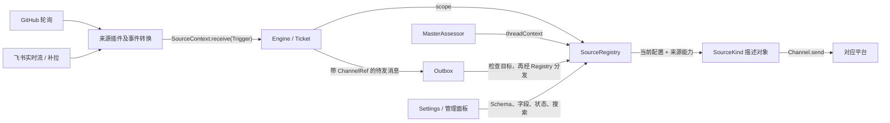

# 05 · Source 插件协议与统一事件模型

> 面试题　Superagent 已经接入 GitHub 和飞书。现在给它接入一套工单系统，哪些代码能够复用？为什么不能直接把三个平台响应里的 `message_id` 和 `conversation_id` 拼成一个通用对象？

**短答**　Source 插件把平台事件翻译成领域 Trigger，并通过 Registry 提供来源特有的配置、接收范围、上下文读取和回复能力。Engine 统一处理摄取、评估和 Ticket，不需要逐个平台解析评论、消息、根帖或游标。统一模型仍保留三类地址。Trigger ID 表示哪个事件版本，ThreadRef 表示应在哪段讨论排队或承接，ChannelRef 表示通过哪里写回。它们在 GitHub Issue 中看上去相近，在飞书话题和 PR 行内讨论中会明显分开。接一个新来源，先把这三类标识和来源身份定义清楚，才能复用授权、调度和交付链路。 [SourceKind](../dsh-superagent-prototype/src/sources/kind.ts) · [SourceRegistry](../dsh-superagent-prototype/src/sources/registry.ts) · [Trigger 与 ChannelRef](../dsh-superagent-prototype/src/core/model.ts)

本文以工作区提交 `7bd4741` 的源码为基线。继续用虚构的 `example/portal`、Issue #42 与 PR #57 举例，另外对照一条同主题的飞书话题消息。上一篇主要追踪一次任务的时间线，本篇从接口角度解释哪些事情由来源负责，哪些交给运行时。 [第 04 篇](04-end-to-end-issue-to-pr.md) · [原型扩展手册](../dsh-superagent-prototype/docs/008-cookbook.md)

## 1. 为什么要在平台 API 和 Engine 之间放一个 Source

GitHub 可以通过 Issue、PR、评论、评审和检查状态表达工作。飞书有私聊、群聊、根消息、话题回复、消息链接和机器人发送者。它们的事件来源、分页方式、时间精度与回复规则差别很大。若把这些条件写入 Engine，新增平台就会改动领域判断，例如「先确定飞书群和根消息，再在一个通用函数中判断 GitHub 评审是行内回复还是普通评论」。这样既难测试，也会让授权和平台路由变成同一团逻辑。

Source 负责把平台事实翻译成一套可共享的业务词汇。Engine 消费 Trigger，用通用的 Thread 和 Ticket 处理归属。发送回复时，Engine 给出目的、文本与结构化 Channel，真正的 API 调用交还来源适配器。即使 Worker 后来在 GitHub 上产出 PR，原始委托也可能在飞书，因此输入来源、执行产物和结果会话能够独立定位。新增来源可以沿用这些领域规则，同时让自己的平台差异集中在适配器。 [领域类型](../dsh-superagent-prototype/src/core/model.ts) · [Engine 角色端口](../dsh-superagent-prototype/src/core/engine.ts) · [回复位置](../dsh-superagent-prototype/src/core/replies.ts)



图中有两个主要方向。摄取是来源发起的，由 watcher 调用 `SourceContext.receive`。上下文读取、Scope 检查、回复发送和查链接，则是应用按来源 ID 查询 Registry 后调用能力。 `SourceKind` 是能力描述对象，GitHub 与飞书的 `apply` 才管理长时间工作的 watcher。把这两处区分开，便能解释为何可以测试「注册成功但不启动真实轮询」，也可以展示已保存但当前插件未装载的配置。 [GitHub.apply](../dsh-superagent-prototype/src/sources/github.ts) · [飞书.apply](../dsh-superagent-prototype/src/sources/feishu.ts) · [SourceRegistry](../dsh-superagent-prototype/src/sources/registry.ts)

## 2. SourceKind、SourceHost、SourceContext 和 Registry

| 对象 | 在代码中的角色 | 最容易答错的地方 |
| --- | --- | --- |
| `SourceKind<C>` | 一类来源能力的描述。含 ID、文案、配置 Schema、表单、健康项和可选扩展 | 它的 `scope` 是判断函数，具体后台循环在插件入口和实现中 |
| `SourceInstance<C>` | 读取当前设置后解析出的实例状态。含 id、kind、enabled、config | 当前 Registry 用 kind 作为实例 ID，同 kind 注册一次 |
| `SourceHost` | 经 Cordis 可注入的 orchestrator 接口，暴露 Registry 与获取 Context 的方法 | 来源拿到的业务面比整个 Runtime 小 |
| `SourceContext` | watcher 接入应用的操作接口。提供配置、游标、接收、会话元数据与健康报告等 | 类型上的操作面便于维护，运行插件仍在应用信任边界内 |
| `SourceRegistry` | 保存已注册 kinds，解释配置，按来源分发 Scope、Channel、上下文与搜索 | 已存配置、插件注册、云端账号可用各有状态 |

这些接口为什么不合成一个类？描述对象主要回答「可以做什么」，可以在 Settings、面板、Outbox 和 Assessor 中重复使用。运行中的 watcher 还掌握循环、取消信号和外部读取位置，生命周期与描述对象不同。Registry 则让消费者用来源 ID 查能力，不必提前知道具体实现。新增一个 SourceKind 时，选择提供哪些扩展能力也有明确位置。例如只需要将受控系统事件交给评估的来源可以省去消息回复；有交付要求的话，才实现 Channel 的发送和链接。 [类型契约](../dsh-superagent-prototype/src/sources/kind.ts) · [Host 契约](../dsh-superagent-prototype/src/sources/host.ts) · [Registry 分发](../dsh-superagent-prototype/src/sources/registry.ts)

### 2.1 注册、运行与卸载

以 GitHub 插件为例，`inject = ['orchestrator']` 取得 SourceHost。第一个 effect 调用 `ctx.orchestrator.sources.register(githubKind)`，注册方法返回 disposer。第二个 effect 获取本 kind 的 SourceContext，创建 AbortController 并运行 watch，卸载时 abort 并等待循环收尾。飞书做法相近，`runFeishu` 管理实时、历史补拉和群名刷新等任务。来源等待 `ctx.ready`，再检查必要 setup 和自身配置。应用在设置层关闭一个来源时，已注册的描述对象可以继续供面板查看，实际读取根据循环取到的当前配置停止或等待。 [GitHub 注册与 watch](../dsh-superagent-prototype/src/sources/github.ts) · [飞书注册](../dsh-superagent-prototype/src/sources/feishu.ts) · [飞书循环](../dsh-superagent-prototype/src/sources/feishu-loops.ts)

Registry 拒绝重复 kind，也保护健康项名称不被不同来源抢占。 `sync:` 由 Settings 的名单同步保留，来源自己的运行状态需要声明其他健康项。注册后每个健康项从 `starting` 开始。SourceContext 持有该次注册的 HealthEntry，旧插件退出时晚到的 health 更新在释放后被忽略，即使同 kind 已重新注册。用例模拟旧 Context 在注销后报错误，随后重新注册，断言新对象仍是 `starting`，用新的 Context 报告才会改变状态。这可以解释为什么「同名字」还需要区分注册代际。 [register / healthEntries](../dsh-superagent-prototype/src/sources/registry.ts) · [HealthBoard](../dsh-superagent-prototype/src/infra/health.ts) · [注册与迟到健康更新测试](../dsh-superagent-prototype/tests/registry.spec.ts#L76)

### 2.2 SourceContext 给 watcher 哪些能力

`config(kind)` 按当前设置返回已启用实例的解析配置，禁用或未装载时返回空。 `state` 读写有类型的 KV，适合游标、标签与记录基线，写 `undefined` 表示删除。 `threads.describe` 和 `threads.patch` 分别用于人可读的标签、状态事实与来源元数据。 `tickets.bindThread` 和 `threadClosed` 则经过 Engine，表示外部观察能够触发生命周期变化。假如 GitHub 枚举到 PR #57 合并，Source 提交的是所见事实，何时结束工单仍由 Engine 检查。 `notify` 会把要发的来源消息交给 Outbox。 [SourceContext 类型](../dsh-superagent-prototype/src/sources/host.ts) · [构造与转发](../dsh-superagent-prototype/src/app/source-context.ts)

接口的职责约束不等同于多租户访问控制。比如 `state` 包装仍通过 Store 的通用 KV 操作，来源应使用自己的 key 前缀和规定的仓储词汇；`config` 方法也接收传入的 kind。将第三方不可托管代码直接加载进同一进程会改变安全模型。当前可以明确验证的是健康项归属、业务调用接口、来源设置与 Engine 守卫。外部工单接入若需要独立权限或进程隔离，应在宿主和部署层另行设计。 [SourceContext 的实际封装](../dsh-superagent-prototype/src/app/source-context.ts) · [KV](../dsh-superagent-prototype/src/kv.ts) · [部署权限说明](../dsh-superagent-prototype/docs/006-deployment.md)

## 3. 配置如何从 Schema 走到运行态

SourceKind 的 `schema` 负责验证存储和提交的配置、补默认值，`fields` 则描述面板如何展示布尔开关、下拉、数字、文本、重复行和只读事实。比如 GitHub 的轮询间隔和仓库观察开关、飞书的群聊设置和分页上限，都出现在描述对象。浏览器字段提供编辑与提示，服务端 schema 提供真实解析。 `facts(deployment)` 可显示当前账号的身份信息，表示 setup 解析得到的状态。GitHub 的配置输入是 CLI，而事实可显示解析出的 GitHub 登录名。 [SourceKind 与 FieldSpec](../dsh-superagent-prototype/src/sources/kind.ts) · [GitHub 描述](../dsh-superagent-prototype/src/sources/github.ts) · [飞书描述](../dsh-superagent-prototype/src/sources/feishu.ts) · [Settings 视图](../dsh-superagent-prototype/src/app/views/settings.ts)

Registry 在读取时 `safeParse(stored?.config ?? {})`。有效配置且保存的 enabled 允许时启用；无存储时用该 kind 的默认配置。已有存储配置无法解析时，已安装实例解析为禁用并返回 schema 的默认配置，避免 watcher 在错误配置下运行。提交新配置则通过 `validate`，校验失败直接拒绝；未知 kind 也拒绝。列表 `instances()` 先返回已安装种类，再附上已保存但未安装的实例，后者保留存储中的 enabled 和 config 供界面诊断。所以如果一个未安装来源显示 `enabled: true`，还要同时看 `installed: false`，它仍没有正在解析配置的插件。 [resolve / validate / instances](../dsh-superagent-prototype/src/sources/registry.ts) · [默认值与未安装实例测试](../dsh-superagent-prototype/tests/registry.spec.ts#L23) · [校验提交测试](../dsh-superagent-prototype/tests/registry.spec.ts#L34)

要解释「飞书怎么没消息」，当前至少检查四个问题。Cordis 是否装载飞书 watcher，Registry 是否有该 kind，实例配置是否启用，以及 `deployment.feishu` 是否已经解析出 bot。Bundle 默认禁用飞书插件，即使 SQLite 有过去的群配置，它也需要先装载。成功注册后还可能因为 CLI 缺失或验证失败停在等待。运行时状态应按 setup、Source 实例和 Source health 一起读。这个区分也能处理「卸载后重新安装是否要重填群列表」的问题：已保存的 Settings 与描述对象注册是不同状态。 [bundle 默认设置](../dsh-superagent-prototype/cordis.patch.yml) · [飞书 setup 检查](../dsh-superagent-prototype/src/sources/feishu-loops.ts) · [来源状态视图](../dsh-superagent-prototype/src/app/views/sources.ts)

## 4. Trigger、ThreadRef 和 ChannelRef 三类标识

### 4.1 Trigger 记录摄取的一条事件

Trigger 至少携带 ID、来源、Thread 引用列表、actor、human、时间、文本和 meta，还可以带 `addressed`、Channel 和 URL。Source 决定各字段怎么从平台事实构造。 `actor.source` 与 `actor.id` 应来自来源身份。GitHub 的 login 和飞书的 open_id 分别在各自来源查准入名单。 `human` 表示来源将作者归为人类还是机器，按 GitHub 返回用户类型或机器人名、飞书的 `sender_type` 等判断。成员资格由来源允许名单与 Policy 判断。账号类型也有局限，例如 GitHub 上使用普通用户账号运行的外部自动化可能被识别为 human。 `addressed` 表示指向性，可能是按 Agent 登录名匹配的 GitHub 提及，也可能来自飞书结构化提及或私聊。是否接受委托，仍要看 Policy 和任务归属。 [Trigger 类型](../dsh-superagent-prototype/src/core/model.ts) · [GitHub 作者与提及](../dsh-superagent-prototype/src/sources/github-trigger.ts) · [飞书映射](../dsh-superagent-prototype/src/sources/feishu-trigger.ts)

`meta` 保存来源需要的上下文信息。例如 GitHub 的 `number`、`isPr`、`kind`、`commentId` 和行内评审位置，可用于 Scope、回复地址和 PR 关联。飞书保存 `chatId`、`messageId`、`direct`、`mentioned` 与 root/parent 等信息，可用于群配置匹配、消息读取与引用关系。Engine 以 `source` 和通用字段处理事件，查询来源的 Scope 时再把 meta 交给相应适配器。新增来源应尽量在自己的元数据里表达平台特性，先检查是否真需要改变所有来源都理解的领域字段。 [GitHub 转换函数](../dsh-superagent-prototype/src/sources/github-trigger.ts) · [飞书转换函数](../dsh-superagent-prototype/src/sources/feishu-trigger.ts) · [SourceScope 端口](../dsh-superagent-prototype/src/core/ports.ts)

### 4.2 稳定 ID 用来承受多路摄取与重试

新 GitHub Issue 用 `key('github-issue', String(number))`。被仓库级流和通知轮询分别读到时仍能产生同一 ID，Intake 可以识别为重复。PR 的标题正文复用这种 ID 构造，GitHub 的 Issue 和 PR 编号在同仓库内共享编号空间。GitHub 评论的 ID 纳入评论 ID、链接或 Thread fallback、更新时间或评审提交时间，可以让同一版本重复读取收敛，也允许部分编辑以新版本出现。来源契约要先决定「一条输入」的单位是原消息、某次版本还是某个状态转换。 [GitHub Trigger ID](../dsh-superagent-prototype/src/sources/github-trigger.ts) · [GitHub 多入口读取](../dsh-superagent-prototype/src/sources/github.ts)

飞书实时、历史和话题轮询先适配到统一事件形状，再以 `key('feishu', messageId)` 建 ID。不同入口的页码、被读取时间和序列都不进入这个 ID。若同一条 `om_2` 实时送达一次，之后又被补拉读取，业务只需摄取一次。观察飞书和 GitHub 的差别，能看出 ID 设计应跟产品事件语义走。例如需要把编辑作为新事件处理，得像 GitHub 评论那样有明确的版本因子。多租户扩展时还要给可能碰撞的原生 ID 补作用域，默认单仓库的 Issue 编号不能直接当全局编号。 [飞书 ID 与事件适配](../dsh-superagent-prototype/src/sources/feishu-trigger.ts) · [实时和轮询对照测试](../dsh-superagent-prototype/tests/sources.spec.ts#L151) · [摄取去重](../dsh-superagent-prototype/src/core/intake.ts)

### 4.3 Thread 是讨论和任务归属，Channel 是实际写回目标

| 一个输入 | Trigger 的单位 | 领域 Thread 键 | Channel 地址承载什么 |
| --- | --- | --- | --- |
| GitHub Issue #42 正文 | 这张 Issue 的标题和正文 | `github:42` | Issue 编号与可用链接 |
| PR #57 行内评审评论 | 指定评论及其版本 | `github:57` | PR 编号与评论 URL，适配器可解析行内讨论的回复目标 |
| 飞书群 `oc_team` 中话题回复 `om_2`，根消息 `om_1` | 消息 `om_2` | `feishu:oc_team:om_1` | `chatId`、具体 `messageId`，Channel 的 thread 为 `feishu:oc_team` |
| 飞书私聊消息 | 该私聊消息 | 根据 chat 和 root/message ID 构造 | 同样有 chatId 和 messageId，并显式保留 direct 标记 |
| GitHub 默认分支 CI 变化 | 一次观测到的状态变化版本 | `github:ci:<branch>` | 无需要回复的独立消息地址 |

特别看飞书一行。Agent 为某个话题决定要不要开 Ticket，要以群和根帖构成的 Thread 区分其他话题。回复首先要找到目标消息，飞书发送 API 用它决定回复到哪条消息所在的话题。 `ChannelRef.thread` 还可参与相同 Ticket 和对话的出站排序，它的值可以比领域 Thread 粗。由此同一群的多个话题不会被误放进同一评估队列，回复又不必从话题 ID 逆推发给哪条具体消息。GitHub 行内评审也体现类似做法：潜在 Ticket 仍订阅整个 PR，而实际回复能依据 URL 定位原评审讨论。 [飞书 feishuThreadId / feishuChannel](../dsh-superagent-prototype/src/sources/feishu-trigger.ts) · [GitHub githubChannel](../dsh-superagent-prototype/src/sources/github-trigger.ts) · [GitHub 行内回复](../dsh-superagent-prototype/src/sources/github-channel.ts) · [回复回执排序](../dsh-superagent-prototype/src/app/store.ts)

一个 Trigger 可以关联多个 Thread，原型用第一个作为评估排队位置。其他关联和订阅可以为已有任务扇出信息。建模新来源前可以问四个问题。哪个 ID 用来拒绝重复摄取，哪段 Thread 聚合讨论，哪些 Ticket 已订阅它，用户会去哪个具体位置看回复。拿一种平台的编号直接充当这四个答案，会在另一种平台暴露设计限制。 [ThreadRef 与主 Thread](../dsh-superagent-prototype/src/core/model.ts) · [摄取扇出](../dsh-superagent-prototype/src/core/intake.ts)

用同一群中的两个话题再算一遍。根消息 `om_1` 在谈帮助页错字，根消息 `om_9` 在谈登录页文案。回复 `om_2` 归到 `om_1`，回复 `om_10` 归到 `om_9`。即使四条消息的群 ID 相同，两个 Thread 键仍不同，`om_2` 重读也只命中自己的 Trigger ID。如果系统要答复 `om_10`，Channel 持有的是这条回复的具体消息 ID。将 Channel 的 thread 字段直接当成 Eval 分组键会把两个话题合并，将根帖 ID 直接作为每次回复目标则会失去对某条输入的精确定位。 [飞书 Thread 和 Channel 构造](../dsh-superagent-prototype/src/sources/feishu-trigger.ts) · [发送目标](../dsh-superagent-prototype/src/sources/feishu-channel.ts)

## 5. Scope、Policy 和来源自己的读取范围

### 5.1 先问读到了什么，再问接收范围与授权

实际有三次判断。watcher 决定调用哪些平台接口，因而决定哪些事件有机会进入本地。 `SourceRegistry.scope` 根据已安装 kind、当前配置和 meta 说明送来的 Trigger 是否在接收范围。 `Policy.gate` 使用该来源的身份、指向性、接收分类和已有 Ticket 等信息，判断是否可以起新工作以及授权强度。即便来源支持接收仓库所有评论，普通聊天也需要通过领域判断。反过来，若 watcher 没能读取某条评论，允许列表里有这个人仍不能让本地凭空产生 Trigger。 [SourceScope](../dsh-superagent-prototype/src/core/ports.ts) · [Registry.scope](../dsh-superagent-prototype/src/sources/registry.ts) · [Policy gate](../dsh-superagent-prototype/src/policy.ts)

`ScopeResult` 的成功分支有 `listened: true`、`observed` 与可选 `row`。 `listened` 供接收阶段判定是否过滤。 `observed` 表示该范围允许把未明确指向 Agent 的内容纳入对应判断。 `row` 将来源范围映射到准入表，例如 GitHub 的 `issues`、`pulls`、`comments`、`ci` 或飞书的某个群 ID。失败分支带 reason，Intake 会记录该 Trigger 的过滤处置。SourceKind 没有提供 scope 时，已启用实例默认 `listened: true, observed: false`。已经存在存储配置而插件缺失时，Registry 给出 `source_not_installed`。若插件和存储配置都没有，通用作用域回退到 `listened: true, observed: false`，仍要满足后续准入条件。 [ScopeResult](../dsh-superagent-prototype/src/core/ports.ts) · [Registry.scope](../dsh-superagent-prototype/src/sources/registry.ts) · [Intake.receive](../dsh-superagent-prototype/src/core/intake.ts)

用飞书群的 `mentions` 模式举例。对符合范围的群，`feishuKind.scope` 返回 listened 为 true，observed 为 false；它不靠比较正文是否含有 `@` 来计算这两个值。一条从读取层到达的未提及消息仍可进入接收路径，例如通过订阅交给已有 Ticket，是否可以作为新的推断候选另看 Policy。 `all` 模式则为该群打开 observed，未提及的消息可按准入表判断。私聊单独受 `directMessages` 控制，可以有 listened 为 true、observed 为 false，而私聊自己的 `addressed: 'direct'` 仍由 Trigger 表达。 [飞书 scope](../dsh-superagent-prototype/src/sources/feishu.ts) · [addressed 构造](../dsh-superagent-prototype/src/sources/feishu-trigger.ts) · [Policy 的未提及路径](../dsh-superagent-prototype/src/policy.ts)

### 5.2 Policy 片段由 Source 定义，组合由应用负责

SourceKind 可以注册 `policy` 描述。来源的 schema 验证成员和 bot 标识，`fields` 与 `explicit` 给设置界面提供展示信息，`rows` 可以声明哪些接收范围参与准入表。GitHub 接受来源自己的账号形式，飞书使用 `ou_` 等来源原生身份。Registry 校验保存时把共享的 `admission` 单独解析，将其余字段交给来源 schema，避免各插件独立实现准入表结构。Policy 版本、推断模式和能否真正建立 Ticket 由应用与 Engine 处理。 [SourcePolicyPart](../dsh-superagent-prototype/src/sources/kind.ts) · [Registry.validatePolicy](../dsh-superagent-prototype/src/sources/registry.ts) · [策略模型](../dsh-superagent-prototype/src/policy.ts)

飞书还实现了可选的 `policy.sync`。配置同步来源群后，可以从群成员读取名单，保留现有成员顺序、更新名字、删去离群者并追加新成员。实现会拒绝不完整的列表，以免一次截断读被误认为所有缺失的成员都已离群。Settings 在同步时还检查 Policy revision，防止网络等待期间有人修改策略，最后被旧响应覆盖。这里平台侧负责获取正确数据，应用侧负责版本冲突、持久化、本地策略影响和健康。 [飞书名单同步](../dsh-superagent-prototype/src/sources/feishu.ts) · [Settings.sync](../dsh-superagent-prototype/src/app/settings.ts) · [同步测试](../dsh-superagent-prototype/tests/sources.spec.ts#L310)

## 6. 读取上下文和发送回复分走两条契约

### 6.1 读取上下文需要绑定 Trigger 和分页范围

在当前原型，评估方通过 `SourceRegistry.threadContext(trigger)` 查到来源 reader。Registry 用 Trigger 与该来源解析配置装配 `TriggerContext`，使后续只需提供 `thread`、`root` 或 `parent` 以及可选 cursor。输出使用 `ContextMessage` 统一作者、时间、正文和消息引用，但保留文件与位置等可选字段。GitHub 可把行内评论的位置呈给评估，飞书可提供消息、会话关系和进一步读取图片的能力。能够读一个名字叫 thread 的资源，仍要由来源验证其真正属于相应话题或评论范围。 [ThreadContext 与 TriggerContext](../dsh-superagent-prototype/src/sources/kind.ts) · [Registry.threadContext](../dsh-superagent-prototype/src/sources/registry.ts) · [GitHub 上下文](../dsh-superagent-prototype/src/sources/github-read.ts) · [飞书上下文](../dsh-superagent-prototype/src/sources/feishu-read.ts)

来源实现返回可分页的数据，应用决定给模型多大的证据窗口。 `admissionContext` 限制页数，按消息 ID 去重，检测重复 cursor，选择开头和源消息附近的窗口。 `MasterAssessor` 的评估读取把已返回的引用作为约束，模型继续索取消息或图片时要使用相应的消息 ID、图片 ID 或页游标。没有上下文 reader 的来源仍可提供原始 Trigger 和批次，扩展读取相应缺失。 `Registry.threadContext` 检查 kind 和 reader 是否存在，并把配置传下去，调用方与 reader 仍负责上下文有效性和范围检查。 [入场上下文窗口](../dsh-superagent-prototype/src/sources/admission-context.ts) · [MasterAssessor.read](../dsh-superagent-prototype/src/app/assessment.ts) · [读取边界测试](../dsh-superagent-prototype/tests/feishu-read.spec.ts#L35)

链接与评估读取也属于不同场景。 `channel.link` 主要提供面向人的显示标签和 URL。飞书可以从消息 ID 得到 Trigger ID，以便界面优先使用已保存的消息深链接，在缺失时回退到群聊链接。 `find` 可把外部引用变成 Thread 或 Trigger 搜索词，飞书的 `repliesTo` 能从 parentId 算出父消息 Trigger 的 ID。它们给排查和引用展示增加定位信息。即使要用到同一个消息 ID，每项能力也有自己的输出契约。 [SourceKind 的搜索和链接](../dsh-superagent-prototype/src/sources/kind.ts) · [查找实现](../dsh-superagent-prototype/src/sources/registry.ts) · [飞书 Channel 链接](../dsh-superagent-prototype/src/sources/feishu-channel.ts)

### 6.2 Channel 适配器解释写回目标并实现重试语义

`SourceChannel` 提供必需的 `send` 和 `link`，并可提供 `allowed`。Outbox 执行时先查来源是否已装载并启用、Channel 是否仍被允许，再经 Registry 分发。 `SourceRegistry.send` 负责查找 adapter 和转发调用。领域选择要不要发及发到哪个 Channel，Outbox 管持久回执、排序和重试，来源送出具体 API 请求。 [SourceChannel](../dsh-superagent-prototype/src/sources/kind.ts) · [Registry.send / channelAllowed](../dsh-superagent-prototype/src/sources/registry.ts) · [Outbox.deliver](../dsh-superagent-prototype/src/app/outbox.ts)

GitHub 可按普通 Issue/PR 或行内评审讨论选择发送目标。它将稳定 Outbox ID 写进 GitHub 评论的 HTML 标记，发送前先找同账号在目标上下文中的同标记评论。飞书则把 Outbox ID 传给消息回复的 `--idempotency-key`，目标为 Channel 地址中的 messageId。两个实现对「永久不能送达」也有各自判定。GitHub 识别永久删除或锁定等情况，飞书识别某些消息撤回、缺失等平台错误，返回 `gone`。临时失败继续按队列处理。若 kind 未装载，Registry 可返回等待；若 kind 已装载却没有 Channel 实现，则返回 gone，摄取能力本身可以继续使用。 [GitHub 发送](../dsh-superagent-prototype/src/sources/github-channel.ts) · [飞书发送](../dsh-superagent-prototype/src/sources/feishu-channel.ts) · [可选能力测试](../dsh-superagent-prototype/tests/registry.spec.ts#L41)

想象一条飞书结果已排队，操作者随后关闭目标群。若该 Source 仍启用，但 Channel 判断不再接收这个群，Outbox 会结算为 `channelIgnored`。若只是整个来源实例关了，适用的是等待恢复路径，回执可先保持 pending。接收和发送也需要分别检查。曾经合法收到某消息，并不代表将来始终允许对它回复。这个边界在私聊尤其明显，群和私聊 ID 可能用同一前缀，所以 Channel 要明确保留 `direct` 供回写校验。 [飞书 Channel.allowed](../dsh-superagent-prototype/src/sources/feishu.ts) · [飞书私聊标识](../dsh-superagent-prototype/src/sources/feishu-trigger.ts) · [送达范围用例](../dsh-superagent-prototype/tests/registry.spec.ts#L137)

## 7. Source 提供执行变量，但凭据留在适当的执行环境

`SourceKind.environment` 包含变量声明及值的计算方法。GitHub 可以给出当前目标仓库、执行账号和来源 PR 编号等，飞书可以提供 bot 名称和启动任务的群 ID。原始任务从 GitHub 触发时，飞书群变量可为空；任务从飞书发起时，也仍可能需要目标 GitHub 仓库来交付代码。应用通过 origin Trigger、解析后的 Deployment 和当前 Settings 计算值，并与 Executor 所有的工作目录、Ticket ID 等变量组合。它们既能进入 prepare 的环境，也能以带说明的形式出现在角色提示词中。 [变量契约](../dsh-superagent-prototype/src/sources/kind.ts) · [GitHub 环境变量](../dsh-superagent-prototype/src/sources/github.ts) · [飞书环境变量](../dsh-superagent-prototype/src/sources/feishu.ts) · [执行环境汇总](../dsh-superagent-prototype/src/app/execution-environment.ts)

`declarations()` 列出所有已装载 kind 的变量声明，`environments()` 只提供当前实例启用的实现和值计算。这样面板能展示关闭来源的变量声明，Worker 实际构造环境时则按启用实例取值。由于这些变量的说明和数值可能进入模型上下文，适合提供定位信息，账号凭据应通过部署约定的 CLI 与工具访问。它们的权限来源可从 setup、执行环境和真实平台判定。新增 Source 时宜把「Worker 需要知道的资源编号」与「授权调用平台的凭据」分开定义。 [Registry.declarations / environments](../dsh-superagent-prototype/src/sources/registry.ts) · [执行环境](../dsh-superagent-prototype/src/infra/environment.ts) · [Settings 视图](../dsh-superagent-prototype/src/app/views/settings.ts)

## 8. 白板练习，接入一套工单系统

假设一家团队有明确的工单平台，任务编号是 `HELP-42`，评论 ID 是 `C7`。需求是让人给 Agent 指派后处理，并把可交付结果写回该工单。下面是设计示例，当前仓库中已有 GitHub 和飞书实现，工单来源用于说明接入时的决策。

| 设计点 | 这个例子怎么选 | 可复用的部分 |
| --- | --- | --- |
| 事件去重 | 使用工单平台、项目、评论 ID；若处理编辑，再纳入版本 | Trigger ID 的摄取幂等 |
| 讨论位置 | 用项目与工单号定义 Thread，所有同工单评论可作为相关输入 | Eval 排队、Ticket 订阅 |
| 回复定位 | 用工单号和具体评论地址构造 ChannelRef，按平台是否支持线程回复决定写法 | 目的校验、Outbox 回执 |
| 自动与人工 | 从平台身份字段判断 actor 和 human；用平台结构化指派或事件提供 addressed 依据 | 允许名单、Policy、候选评估 |
| 分页和恢复 | 记录可持久化游标，成功摄取覆盖的输入后再推进 | SourceContext.state、receive、Health |
| 命令环境 | 只提供必要的工单号或项目名等定位值 | 变量声明和 Worker 环境装配 |

最低可运行版本需要一个有默认值的 Schema 和 SourceKind 描述、一段遵循插件生命周期的事件循环、稳定转换与 `receive`、游标及健康。若只做只读评估，可省去 Channel、图片等可选项；本例要求把交付发回工单，因此还需要实现 Channel 的地址、发送、链接及失败语义。若要按该平台身份发起工作，需定义可审核的成员或机器人准入，实际要用外部 roster 才增加 `sync`。上下文分页和执行变量按任务的信息需求逐步加入。 [扩展手册](../dsh-superagent-prototype/docs/008-cookbook.md) · [可选能力声明](../dsh-superagent-prototype/src/sources/kind.ts)

模块实现后还要使宿主能装载。仓库的手册示例为 watcher 增加 tsdown 入口、包导出、bundle 的默认禁用行，然后在具体 profile 启用。原型 `Deployment` 当前解析 GitHub 与可选飞书，若新平台要做独立凭据发现或 setup readiness，应明确把客户端与配置桥接放在哪，而非假定注册 SourceKind 就会自动生成新平台的账号探测。另一个容易遗漏的点是当前 `SourceInstance.id` 以 kind 为 ID。若用户要求同时接三个独立 Helpdesk 实例，需先设计实例命名、事件与 Channel 命名空间、配置查询，以及出站路由如何知道用哪个账号。 [构建入口](../dsh-superagent-prototype/tsdown.config.ts) · [包清单](../dsh-superagent-prototype/package.json) · [Deployment](../dsh-superagent-prototype/src/deployment.ts) · [Registry.resolve](../dsh-superagent-prototype/src/sources/registry.ts)

离线测试可选三组输入。第一组从实时和补拉模拟同一条评论，检查 ID 和 Thread 一致。第二组以有权/无权账号及工作范围外项目为对照，检查 Trigger 的指向性、Scope 与 Decision。第三组模拟外发已完成后重试和目标永久删除，分别观察 sent、gone 与回执行为。运行中还要模拟插件关闭或重装，检查游标恢复与旧 Context 的迟到健康消息。这个测试范围能验证接入契约，不必把真实 API 成功等同于整套领域链已经正确。 [内置来源测试](../dsh-superagent-prototype/tests/sources.spec.ts) · [Registry 测试](../dsh-superagent-prototype/tests/registry.spec.ts) · [Outbox 测试](../dsh-superagent-prototype/tests/outbox.spec.ts)

## 9. 现有测试和复现入口

| 要验证的接口 | 现有测试具体检查什么 |
| --- | --- |
| 注册与校验 | 系统为已装载种类解析默认配置，保留未装载的配置，拒绝非法提交。 [实例和 Schema 测试](../dsh-superagent-prototype/tests/registry.spec.ts#L23) |
| 健康归属 | 同名/保留名冲突，旧 Context 在注销和再次注册后不会写入新健康记录。 [健康测试](../dsh-superagent-prototype/tests/registry.spec.ts#L76) |
| GitHub 模型 | 评论评审映射为 Trigger，分辨自动化作者与评审线程地址。 [转换测试](../dsh-superagent-prototype/tests/sources.spec.ts#L328) |
| 飞书统一 ID | 话题轮询和实时消费转换到同一个 Trigger 形状。 [实时与补拉对照](../dsh-superagent-prototype/tests/sources.spec.ts#L151) |
| 来源回复范围 | 目标群、其他群和被关闭的私聊各按 Channel 权限处理。 [回复范围测试](../dsh-superagent-prototype/tests/registry.spec.ts#L137) |
| 可选能力 | 无 Channel 或 Context 时按 Registry 契约退化。 [能力分发测试](../dsh-superagent-prototype/tests/registry.spec.ts#L41) |

从依赖已按锁文件安装的原型目录运行：

```bash
pnpm test tests/registry.spec.ts tests/sources.spec.ts tests/github-read.spec.ts \
  tests/feishu-read.spec.ts tests/policy.spec.ts tests/outbox.spec.ts
```

本次在临时检出运行上述命令，**6 个测试文件、426 个用例全部通过**。这些用例覆盖本地配置、平台事件转换、模拟接口读取和发送等契约。部署新的来源时，CLI、账号权限、实际 API 分页及返回数据仍需在目标环境核验。 [来源测试](../dsh-superagent-prototype/tests/sources.spec.ts) · [Registry 测试](../dsh-superagent-prototype/tests/registry.spec.ts)

## 10. 面试怎么讲

### 60–90 秒口述版

> Source 把平台输入和业务编排隔开。以 GitHub 为例，watcher 轮询通知和讨论，通过 SourceContext 把事件变成 Trigger。飞书的实时、历史和话题输入也会转成统一形状。Trigger ID 用来去重，ThreadRef 决定在哪段讨论里排队和续接 Ticket，ChannelRef 指回具体的消息或评论。三个标识可以不同，例如飞书 Thread 包含群和根帖，回消息依赖具体 messageId。
>
> SourceKind 声明配置、Scope、Channel 和可选上下文。Registry 负责注册、校验配置和按来源分发。Scope 说明哪些范围接收和观察，Policy 用来源身份判断谁能委托。外发经 Outbox 排队，平台适配器负责实际发送与重试语义。接新工单系统时，我会先定义身份、事件 ID、讨论和写回目标，再实现 watcher、游标与健康，按需求增加回复、上下文和执行变量。

### 追问一　新接一个工单系统，最少要写什么？

写 SourceKind 描述、配置 schema、可中止的摄取循环、稳定 Trigger 转换，使用 SourceContext 记录读取进度、接收路径和健康。要给使用者发回结果，还需要 Channel。若平台身份要影响新任务授权，应给出自己的身份校验和准入片段。扩展 reader 和列表同步由具体应用场景决定。 [SourceKind](../dsh-superagent-prototype/src/sources/kind.ts) · [扩展手册](../dsh-superagent-prototype/docs/008-cookbook.md)

### 追问二　为什么消息、Thread 和回复地址各有身份？

消息用于去重和追踪事实，Thread 用来聚合讨论、安排评估和订阅，Channel 用于回写具体目标。可用飞书举例：同群两个话题，可以用不同 Thread 串起不同工作；话题里的每条消息仍有独立 Trigger ID 与回复地址。统一成一个群 ID 会使多个话题混入同一队列，也无法精确回应具体消息。 [飞书标识映射](../dsh-superagent-prototype/src/sources/feishu-trigger.ts) · [领域类型](../dsh-superagent-prototype/src/core/model.ts)

### 追问三　打开接收全部评论，是否就允许 Agent 自己接任务？

接收全部评论改变来源能读到的输入范围，也能改变未提及评论是否具备观察资格。实际能否创建新 Ticket 还看来源身份、准入表、现有任务归属及推断路径的规则和模式。实际面试可用同群里的授权成员提到 Agent、陌生人提到 Agent、未指定目标的日常讨论三条消息来验证不同层次。 [GitHub Scope](../dsh-superagent-prototype/src/sources/github.ts) · [Policy](../dsh-superagent-prototype/src/policy.ts)

### 追问四　同一消息实时到达又被历史补拉，为什么只处理一次？

将两路原生形状映射成同一个域内事件，并用跨入口稳定的消息 ID 做 Trigger key。飞书用原消息 ID 计算，摄取时已有 Trigger 就返回 duplicate。游标用于续读，稳定 ID 则处理重复，两者可共同承受提交与读取进度之间的故障窗口。 [飞书转换](../dsh-superagent-prototype/src/sources/feishu-trigger.ts) · [Intake](../dsh-superagent-prototype/src/core/intake.ts)

### 追问五　来源卸载后，历史消息和待发回复如何处理？

历史与配置已在应用存储中，可保留显示。来源能力随 Registry 注册释放，Outbox 遇到未装载或暂时关闭的实例可以保持等待，恢复时再检查地址。已安装来源若明确禁止某个 Channel，则可将该消息结算为 dropped。这样管理侧能说明是等待组件回来，还是目标已经不再可用。 [Registry.instances / send](../dsh-superagent-prototype/src/sources/registry.ts) · [Outbox.deliver](../dsh-superagent-prototype/src/app/outbox.ts)

---

[返回连载目录](README.md) · [上一篇《一条 Issue 请求的端到端执行轨迹》](04-end-to-end-issue-to-pr.md) · 下一篇《GitHub 轮询、游标与重复事件》
