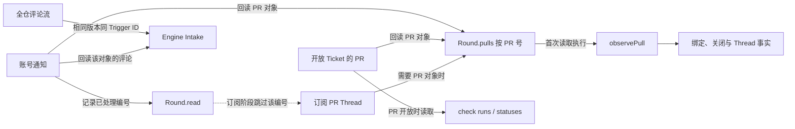

# 06 · GitHub 轮询、游标与重复事件

> 面试题　一个 Agent 同时读取 GitHub 通知、仓库评论和已订阅 PR。如果同一条评论被读到三次，怎么防止重复建单？如果某个 Issue 的下一页读失败，整轮轮询的读取进度还能推进吗？

**短答**　原型把 GitHub 输入分为账号通知、可选的仓库级观察、开放 Ticket 所跟踪的 PR 与 CI、已订阅 Thread 四路。它们共享单轮中的部分读取结果，分别保存通知游标、逐 Thread 游标、仓库观察流状态和 CI 基线。通知列表可以在保留逐项重试的前提下向前走，单个失败对象仍按原下界重读。仓库流仅在窗口未变时复用 ETag。时间游标通常回退五秒，重叠区域由 Trigger ID 去重。通知分页和仓库流的一页读取有不同覆盖边界。系统能否在失败后继续，要看出错的流、对象与尚未提交的读取位置。 [GitHub Source](../dsh-superagent-prototype/src/sources/github.ts) · [轮询辅助](../dsh-superagent-prototype/src/sources/poll.ts) · [Trigger ID](../dsh-superagent-prototype/src/sources/github-trigger.ts)

本文使用提交 `7bd4741` 的本地源码。沿用虚构的 `example/portal`、Issue #42 和 PR #57。示例时间统一按 UTC 解释，只用于推演源码中的边界。下文的 webhook 方案属于面试扩展设计。 [第 04 篇](04-end-to-end-issue-to-pr.md) · [第 05 篇](05-source-contract-and-trigger.md) · [项目架构](../dsh-superagent-prototype/docs/007-architecture.md)

## 1. 为什么一个 GitHub Source 要读四路

账号收到通知，意味着某条对话有值得再读的线索。它适合发现明确提及，也给先前未跟踪的 Issue 或 PR 提供入口。只靠这条路径，Agent 要依赖账号通知状态和别人是否提及。团队若希望它观察新 Issue、PR 或某类评论，可以开启仓库级流。已经建立 Ticket 后，关注点转向任务正在跟踪的 PR 与讨论。开着的 PR 需要核对合并和 CI 状态，已订阅 Thread 的评论也必须继续更新，即使评论没有再次提到 Agent。四路服务于不同覆盖目标。 [GitHub 配置及轮询](../dsh-superagent-prototype/src/sources/github.ts)

| `pollRound` 内的阶段 | 想得到什么 | 状态或检查点 | 可能生成的外部事实 |
| --- | --- | --- | --- |
| `pollNotifications` | 该账号相关通知指向的 Issue 或 PR | `KV.github.since`、`retries`、逐编号 cursor | Issue/PR 正文、会话评论、评审等 |
| `pollRepository` | 按开关观察的新 Issue、新 PR、仓库评论与默认分支 CI | 各流的 `since / started / etag`，默认分支基线 | 新正文、普通及行内评论、默认分支 CI 变化 |
| `pollTicketPulls` | 开放 Ticket 正在跟踪的开放 PR、自动合并属性与 CI | PR 级 CI 指纹及版本，加上本地 Follow 关系 | PR 关闭事实、Thread 展示事实、CI Trigger |
| `pollThreads` | 已订阅 Issue/PR 的后续讨论 | 逐编号 cursor、最近活动与订阅关系 | 跟进评论和评审，补充 PR 关闭等外部事实 |

四路不是四条并发拉取线程。当前 `pollRound` 按表中顺序 await，具体失败在阶段或对象边界收集。就算拉通知列表失败，还是会继续跑后面的仓库观察、PR 与订阅路径，最后再按聚合结果报告整轮是否出错。读取成功的一路可以留下有效的输入与状态。这个思路适合「一条外部流失败但其他流仍有价值」的场景，代价是监控不能只看一个全局成功位。需要继续打开哪个 Thread 或何种来源状态去查。 [pollRound](../dsh-superagent-prototype/src/sources/github.ts) · [通知失败仍轮询其他路径测试](../dsh-superagent-prototype/tests/sources.spec.ts#L683)

### 1.1 周期从一轮完成后开始等待

watcher 等 `ctx.ready`，必要 setup 不成立时报等待。进入循环后取当前 GitHub 设置，已启用则 `await pollRound`，关闭则上报 `sourceOff`。每轮结束后等待 `max(interval, pollSeconds)`，其中 interval 来自上一次成功返回的通知结果，应用至少按 60 秒看待。假设配置是 90 秒，CLI 响应的 `X-Poll-Interval` 为 120，成功一轮用了 8 秒，则下一轮约在上一轮开始后的 128 秒启动。失败的轮次没有返回新的 interval，原来的值继续参与这次等待。不能把 60 秒当成固定端到端延迟，也不能把它当成每轮重叠启动的定时器。 [watch 与通知间隔](../dsh-superagent-prototype/src/sources/github.ts) · [可中止等待](../dsh-superagent-prototype/src/sources/poll.ts) · [间隔测试](../dsh-superagent-prototype/tests/sources.spec.ts#L636)

连续失败计数达到设置阈值后，watch 才让 GitHub Source 报 error。默认阈值为 3。后续成功轮次可以更新健康并重置计数。另一方面，单个坏条目即使不足以立即把 Source 置为 error，也可在已有 Thread 的 `pollError` 留下错误。列表结构不合法、整个请求失败，以及数组中一个条目 schema 不合法，是不同层级。通用 `validItems` 支持逐条跳过并累计 skipped，对不可用的整体返回则由外层处理错误。这种设计让轻微噪声可诊断，同时不会因单次波动就向使用者报故障。 [watch / failed](../dsh-superagent-prototype/src/sources/github.ts) · [validItems](../dsh-superagent-prototype/src/infra/commands.ts) · [健康阈值测试](../dsh-superagent-prototype/tests/sources.spec.ts#L1021)

### 1.2 全局读取位置为何不能代表每个 Issue 的完成度

想象 #42 读得很快，#43 当前访问失败，而 #57 已经可看到合并。若用同一个全局「处理到 10:00」表示三件事，推进时可能抛掉 #43，也可能为了等 #43 把已处理的其他事项都卡住。原型分别持久化的是通知扫描下界、失败对象的读取进度、每条 Thread 的回复时间下界、仓库观察流的条件请求状态和 CI 变化基线。各个字段对应不同的「已经看到了哪里」。面试中应先命名游标属于哪条读取路径，再解释何时可推进，以及失败时哪段范围会重读。 [GitHub KV 项](../dsh-superagent-prototype/src/kv.ts) · [GitHub Source](../dsh-superagent-prototype/src/sources/github.ts)

## 2. 通知路径，从一条提示到逐对象重试

### 2.1 通知列表先展开，再定位 Issue 与 PR

`pollNotifications` 从 `KV.github.since` 取得下界，若还没有，则先保存本轮开始时刻作为起点。随后请求项目代码包装的通知入口，带 `all=true`、`per_page=50` 和 since。第一请求保留 HTTP 头，用于读取轮询间隔和判断 `rel="next"`。如果看到下一页，代码通过 `Commands.pages` 重新按同一个查询做分页读取。它使用 CLI 的 `--paginate --slurp`，将返回的页数组合并，然后对元素逐一做 schema 校验。没看到下一页时，则直接解析第一份响应的 body。 [通知查询与分页](../dsh-superagent-prototype/src/sources/github.ts) · [Commands.api / pages](../dsh-superagent-prototype/src/infra/commands.ts) · [多页通知测试](../dsh-superagent-prototype/tests/sources.spec.ts#L636)

`notification.repository.full_name` 要匹配部署的仓库。随后用 `githubAddress` 从 subject URL 解出编号以及 Issue/PR 分类。原型只处理能解析且符合当前仓库的对象。失败映射先进入一个按编号组织的 Map，随后遍历反转的通知列表，避免同一编号重复进队。新通知使用全局 since 和该编号逐 Thread cursor 的较晚值。已经在重试映射中的对象保留自己的 `since`。这样一个失败对象就能保住之前的读取起点，下一轮不再依赖得到同一条通知。 [pollNotifications 的合并](../dsh-superagent-prototype/src/sources/github.ts) · [GitHub 地址解析](../dsh-superagent-prototype/src/sources/github-trigger.ts)

回读时，如果原地址看起来是 Issue，`readNotified` 仍检查响应是否含有 `pull_request`，需要时进入 PR 分支。新 Issue 正文以创建时间达到读取下界为条件。普通 PR 正文也看创建时间。Agent 自己创建的正文不送入这条摄取逻辑。旧 Issue 日后有新评论时，评论仍能成为输入，旧正文不因为这次讨论就反复作为新的委托。事件事实区分得越清楚，后面判断哪个发送者和哪段原文给了授权就越准确。 [readNotified](../dsh-superagent-prototype/src/sources/github.ts) · [旧正文和新评论测试](../dsh-superagent-prototype/tests/sources.spec.ts#L852) · [编辑后仍按创建时间测试](../dsh-superagent-prototype/tests/sources.spec.ts#L903)

### 2.2 「列表游标推进，某对象留在旧位置」可以同时成立

用一组时间推演：

| 时点或结果 | 记录的值 |
| --- | --- |
| 通知原下界 | `09:50:00` |
| 本轮开始 | `10:00:00` |
| #42 的本地 cursor | `09:54:00` |
| #42 成功读了通知、正文与评论 | 逐编号 cursor 更新为 `09:59:55` |
| #43 回读失败，原读取下界为 `09:52:00` | retry 保存 `since: 09:52:00`、PR 标识、首次失败时间和次数 |
| 通知阶段收尾 | 全局下界更新为 `09:59:55`，同时写重试映射 |
| 下一轮无 #43 新通知 | 依失败记录仍从 `09:52:00` 读 #43 |

全局通知游标和重试映射用 `ctx.atomic` 一起更新。否则可能发生全局下界已移动，失败记录还未落盘，进程突然退出后便没有依据再找故障对象。逐对象成功读入的 Trigger 和 cursor 有各自的写点。即使最后写全局事务失败，已经入库的输入还在，下一轮可依游标与 Trigger 判重继续。这里的原子性保护的是「通知扫过哪些范围，与哪些对象仍欠读」这一对状态。它没有把整轮网络读取都包进一个数据库事务。 [通知事务与失败状态](../dsh-superagent-prototype/src/sources/github.ts) · [SourceContext.atomic](../dsh-superagent-prototype/src/app/source-context.ts) · [逐项重试测试](../dsh-superagent-prototype/tests/sources.spec.ts#L575)

程序在单个通知对象失败时分情况。返回 410 会记录并移出通知重试。404 仍可能表示暂时的可见性或权限问题，继续保存重试并计入失败。持续失败满 24 小时，放弃这条通知重试，并保留已经存在的逐线程游标；被放弃的对象可出现在健康细节和已有 Thread 的错误记录里。24 小时依据首次失败时间，重试次数很大但未到时间仍可继续。之后对象可能因新通知或已有订阅被再次发现。能否回补故障期间的内容，还得看后续入口的下界、权限与读取保留。 [deleted / failed / RETRY_WINDOW_MS](../dsh-superagent-prototype/src/sources/github.ts) · [410 与 404 对照](../dsh-superagent-prototype/tests/sources.spec.ts#L602) · [24 小时重试测试](../dsh-superagent-prototype/tests/sources.spec.ts#L658)

一个容易过度概括的细节是「重试会用原下界读」。它准确适用于保留的 retry 条目。条目移除后，如果只有一条新通知，则回到 `max(全局通知 since, 逐编号 cursor)` 计算；如果从订阅 Thread 读，起点是自己的 cursor 或创建时间。也就是说，「留下旧 cursor」保留了独立补拉的可能性，随后每条入口是否实际覆盖整个故障区间还须具体判断。 [通知与订阅起点](../dsh-superagent-prototype/src/sources/github.ts)

这个差别可以用一个恢复案例讲透。设 #43 因权限暂时丢失，自周一 09:52 起无法读，周二 10:00 取回访问权限。若重试仍在，回读请求使用重试对象保存的 09:52。若上一轮已按 24 小时规则移除重试，此时一条新通知先到，且全局游标已到周二 09:59，通知路径会取周二的较晚下界。若没有新通知，但 #43 仍被一个开放 Ticket 订阅，订阅路径可以按自己的旧边界尝试补读。因此排查恢复后的覆盖范围要先查「哪条入口先成功」，随后核对实际请求携带的 since。仅凭健康恢复为 ready，很难还原这段历史。 [通知与订阅读取起点](../dsh-superagent-prototype/src/sources/github.ts) · [订阅视界](../dsh-superagent-prototype/src/sources/poll.ts)

### 2.3 分页失败要先看它出现在什么层

如果是通知列表的分页 CLI 在第二页失败，`Commands.pages` 的 Promise 整体失败。在当前实现中，通知阶段先拿到完整的页数组，再展开成本轮待读对象。故这一页失败会让通知列表扫描的提交无法发生，已经设置的首次起点仍可能存在。随后仍能执行其他三段。若反过来是列表全部读完，而 #43 的评论分页调用失败，那么已经读完的 #42 可独立成功，#43 进入重试集合并保留原回读位置。这两类失败站在不同处理边界。 [分页命令](../dsh-superagent-prototype/src/infra/commands.ts) · [pollNotifications 与 pollRound](../dsh-superagent-prototype/src/sources/github.ts)

还要区分「同一评论列表的第二页失败」和「前一个评论列表成功，下一个类型失败」。以 PR #57 为例，普通会话评论、行内评论、review 分三个 `Commands.pages` 调用。普通列表已经接受了数条 Trigger，稍后行内列表失败，本地已接受的普通评论不会回滚。逐 PR 游标在三个类别都结束后才推进，下次读到已收的普通评论会用稳定 ID 判重。重放适合让小范围状态收敛，代价是重新发起先前成功的 API 请求。 [intakeComments](../dsh-superagent-prototype/src/sources/github.ts) · [Intake 去重](../dsh-superagent-prototype/src/core/intake.ts)

## 3. 仓库级观察，增量窗口和 ETag 怎样配合

### 3.1 四个开关如何映射到三条列表流

`observeIssues` 与 `observePulls` 共用 `issues?state=all` 这条流，因为这个列表可以包含 Issue 和 PR。 `observeComments` 影响普通会话评论 `issues/comments` 和行内评审评论 `pulls/comments` 两条流。 `observeCi` 则启用另一个默认分支 CI 观测路径。三条列表流默认不开，由观察配置决定是否发起读取。不开全仓观察时，通知与已订阅 Thread 仍能产生相关输入。 [GitHub 配置与 STREAMS](../dsh-superagent-prototype/src/sources/github.ts)

某条列表流保存 `{ since, started, etag? }`。 `since` 是下一次查询的下界，`started` 为各输入类别记录启用时间，二者分别决定「平台要返回什么」和「本地此类输入什么时候开始算新」。Issue 与 PR 虽共用列表，两个类别的起点可以不同。设昨天开始观察 Issue，今天开始观察 PR。一条昨天打开、今天被更新的 PR，可能进入按 `updated` 排序的返回页，但代码还会比较 `created_at` 与 PR started，只有满足「开始观察后打开」的才生成正文 Trigger。关闭整个流会清掉对应状态；只启用其中一类时，成功读后写入的 started 会相应保留当前启用类别。 [readStream 的 kinds / started / fresh](../dsh-superagent-prototype/src/sources/github.ts) · [独立启用时间测试](../dsh-superagent-prototype/tests/sources.spec.ts#L1320)

### 3.2 观察流的下界来自返回页内容

代码用大约两周的观测范围，将最早允许时间向下对齐到整点，再取它与保存 since 中较晚的一个。对齐整点让相邻轮在视界未跨整点时使用同一查询，也让旧游标不至于触发无限回扫。第一轮无既有 since 时，当前是从本轮开始时刻起读。请求按 `updated` 升序，带 `per_page=100`。成功解析后，读到的最新 `updated_at` 减五秒得到候选下一下界，再用 `max(本次实际 since, 候选下界)` 防止该流位置回退。没有有效时间就保持本次下界。 [readStream 的 horizon、排序和 next](../dsh-superagent-prototype/src/sources/github.ts) · [五秒保留与整点测试](../dsh-superagent-prototype/tests/sources.spec.ts#L1337)

这里的「最新」指当前返回页里成功通过用于列表的条目 schema，且带有效 `updated_at` 的项目。它可能包含因为旧正文、类型开关或 Agent 自己发出而未生成 Trigger 的记录。列表下界跟踪的是平台列表扫描进度，已经生成几条业务输入是另一个计数。举例来说，最后一条是自己发的新评论，读取仍可能推进，但没有因此给自己创建 Trigger。看测试或日志时，不能假设收到 N 个条目就应有 N 个候选。 [readStream 过滤与 newest](../dsh-superagent-prototype/src/sources/github.ts) · [自发与旧正文过滤测试](../dsh-superagent-prototype/tests/sources.spec.ts#L1216)

### 3.3 ETag 是同一查询结果的缓存凭据

ETag 降低重复返回同一页的网络与解析成本。一轮保存 ETag 需要 `next === since`，表示下次仍会发同一范围的查询。下次实际使用它，还要满足保存的 `stored.since` 与计算出的 since 完全相同。否则游标或时间视界已经改变，原 ETag 不应被用于新窗口。代码通过 `If-None-Match` 传值，`Commands` 将 CLI 报出的 HTTP 304 解析为 `CliError`，`readStream` 捕获它后直接返回，复用已经保存的扫描位置。 [readStream 条件请求](../dsh-superagent-prototype/src/sources/github.ts) · [CLI 错误映射](../dsh-superagent-prototype/src/infra/commands.ts)

以列表初始 `since=10:00:00` 为例，返回页最新更新时间为 `10:00:20`：

| 轮次 | 实际查询下界 | 返回与状态 |
| --- | --- | --- |
| 第 1 次 | 10:00:00 | 返回页带 ETag A。下一下界为 10:00:15，因此保存新 since，A 不随新范围保存 |
| 第 2 次 | 10:00:15 | 重叠区域可能再次看见旧项。若最新仍为 10:00:20，下界不动，保存这次页的 ETag B |
| 第 3 次 | 10:00:15 | 带 `If-None-Match: B`，若返回 304 则不重放该页，不生成新 Trigger |
| 之后 | 视窗口决定 | 若实际 since 变了，则会用新查询读取并重新建立条件请求状态 |

这张表还能解释为什么 ETag 不替代幂等。首次切到新 since 时没有可用 ETag，而且为了容纳边界延迟会主动读一部分已经看过的项。即使返回是 200，Trigger ID 也可以识别重复。304 仅表示本次条件读取可以复用已知结果，所有请求单元有没有覆盖、接受逻辑有没有重复，仍交给各自层处理。 [仓库观察 ETag 测试](../dsh-superagent-prototype/tests/sources.spec.ts#L1216) · [Intake 去重](../dsh-superagent-prototype/src/core/intake.ts)

### 3.4 单页读取是当前实现的覆盖边界

通知列表显式检测下一页，而 `readStream` 请求用 `--include`，解析返回的单页，没有在该函数检测 Link 并调用 `Commands.pages`。由于按更新时间升序，正常流量下下一轮推进 since 可能读到更晚数据。若一个窄时间窗口塞满整页，尤其许多条目时间相同，固定五秒重叠可能使第一页反复返回同一批条目，后续页迟迟不可见。即使不出现这种卡住，原型依然缺乏对「本轮已经检查所有页」的证据。 [readStream 当前页请求与解析](../dsh-superagent-prototype/src/sources/github.ts) · [通知分页对照](../dsh-superagent-prototype/src/sources/github.ts)

这里值得展示一个可复核的压力用例。构造 101 条相同更新时间的 Issue，请求第一页得到 100 条以及下一页 Link，第二页留第 101 条。当原型成功执行一轮时，应检查实际发出的请求数、存了几个 Trigger 和 since 如何变化。在下一轮，若服务器在重叠下界下仍把同一批 100 条放前面，下一轮固定点就可能成立。测试夹具可验证一轮行为，高吞吐和实际排序仍需在目标环境验证。 [仓库级列表读取](../dsh-superagent-prototype/src/sources/github.ts) · [现有仓库观察测试](../dsh-superagent-prototype/tests/sources.spec.ts)

修这类覆盖问题时，需要同时设计分页记录和条件请求策略。例如同一轮按平台的下一页链接读到尾，成功后再提交经过确认的下界。倘若内存不值得缓存全部页，可以每页逐项入库，但要区分「若干输入已持久化」和「这个窗口整体读完」，失败后按约定重放或从稳定的页 cursor 续读。对 ETag 也要明确它代表哪一页或哪个查询。第一页响应不变时仍可能有后续页变化，直接把第一页的 304 当成整个窗口没有变化，会继续留下覆盖问题。若平台能提供跨页的一致快照或明确的分页进度，可以围绕该契约定义检查点。这里是可选的演进设计，当前生产代码的具体行为仍以上一段用例为准。 [当前查询实现](../dsh-superagent-prototype/src/sources/github.ts) · [现有分页封装](../dsh-superagent-prototype/src/infra/commands.ts)

## 4. 已订阅 Thread 与关联 PR，哪些请求能复用

### 4.1 只轮询仍有关注价值的 Thread

`SourceContext.threads.subscribed('github')` 返回有订阅的 GitHub Thread，通用 `polled` 再检查是否需要继续轮询。只要有一个对应 Ticket 仍开放，Thread 就可继续被读。全都结束时，从 Thread 最后 Trigger 时间或创建时间、各相关 Ticket 结束时间取最新有效时间，距它不足 14 天才继续。这个界限控制长期历史的请求成本，也给最近完成的任务留出接收人类跟进的机会。过期表示不由订阅轮询持续跟进，账号通知或仓库级流若覆盖同一内容，仍可能经那些入口重新发现。 [SourceContext 的订阅查询](../dsh-superagent-prototype/src/app/source-context.ts) · [polled](../dsh-superagent-prototype/src/sources/poll.ts) · [最近完成的订阅测试](../dsh-superagent-prototype/tests/sources.spec.ts#L497)

例如 K1 在周一的 12:00 因 PR #57 合并而结束。若最近一次讨论是上周五，轮询窗口仍以周一这次结束为较新的锚点。这个时间窗口内的人类跟进可以被读取。但 Thread 正在被轮询只表示 Source 还会看它，是否恢复需要 Engine 根据订阅归属、当前 Mandate 与停止状态判断。用 14 天解释可读性时，应避免把它讲成授权有效期或数据保留期限。 [轮询视界](../dsh-superagent-prototype/src/sources/poll.ts) · [Ticket 恢复](../dsh-superagent-prototype/src/core/tickets.ts)

`pollThread` 对普通数字 Thread 先补需要的 GitHub 元数据，比如还不知道是否 PR 或缺标题时，会从 Issue 入口回读并判断。给出 `ci:<branch>` 的 Thread 直接跳过 Issue/PR 查询，由默认分支 CI 路径产生输入。正常订阅读取使用 `KV.github.cursor(number)`，缺失时从 Thread 创建时间开始。它把评论及评审交给 Intake 后，再以本轮开始时间减五秒写游标。通用轮询清除成功对象的 `pollError`，捕获出错并记在相应 Thread。一个 Thread 出错不必阻止继续读其他订阅。 [pollThread](../dsh-superagent-prototype/src/sources/github.ts) · [轮询逐 Thread 异常处理](../dsh-superagent-prototype/src/sources/poll.ts) · [CI Thread 跳过读取的测试](../dsh-superagent-prototype/tests/sources.spec.ts#L717)

对 PR #57 来说，普通讨论、行内评论和整份 reviewer 决定分别来自不同的列表。普通评论和行内评论的请求带 `since`，review 请求获取分页结果后再在本地按更新时间、提交时间或创建时间过滤。即使范围最终相同，这个差别也会影响请求成本。已批准或要求修改的评审可生成包含评审状态和提交标识的文本，即使正文为空也有用。只有空的普通评论或无有效信息的评审，才可能因转换出的文本为空被丢弃。这样等审批的 Worker 可以从结构化评审得到进展，又不会为每条空记录增加转发。 [intakeComments](../dsh-superagent-prototype/src/sources/github.ts) · [评论与评审文本](../dsh-superagent-prototype/src/sources/github-trigger.ts) · [无正文评审测试](../dsh-superagent-prototype/tests/sources.spec.ts#L534)

删除或锁定一类状态还要看操作方向。此处的读取按 `deleted(error)` 将 410 归入已删除，订阅记录符合轮询条件时后续仍可能再查一次。读取路径保留 Source 和 Thread 的诊断。已排队的外发消息由 GitHub Channel 与 Outbox 按自己的可写条件结算。面试时应分别说明「还能否观察这个话题」和「它还能否接收回复」。 [读取错误分类](../dsh-superagent-prototype/src/sources/github.ts) · [GitHub 写回错误分类](../dsh-superagent-prototype/src/sources/github-channel.ts)

### 4.2 单轮共享的有两个不同结构

`Round.read` 是已经由通知或订阅路径着手处理的编号集合。通知路径在访问对象前就登记，后面的订阅阶段据此跳过本轮同编号的读取。即便通知对该编号失败，也不会马上在同一轮再从订阅入口重复读一遍。重试记录能在下一轮接续。这主要用于减少对同一讨论的重复拉取，仓库级评论列表仍可能产生相同的 Trigger。

`Round.pulls` 则存编号到 `Promise<Pull>` 的映射。通知、开放工单 PR 轮询和订阅路径需要 PR 详情时，可以共同调用 `pull(ctx, round, number)`。第一次发起 `readPull` 并在成功后调用 `observePull`，其余使用这次 Promise。失败的 PR Promise 也会在本轮被复用，下一轮新建 Round 再取。若已经拿到 PR 详情之后，另一路还要读评论或 CI，它会发起相应列表查询。共享的是 PR 对象读取与观察结果，不包含全轮所有 GitHub 请求。 [Round.read 与 pulls](../dsh-superagent-prototype/src/sources/github.ts) · [单轮 PR 读取测试](../dsh-superagent-prototype/tests/sources.spec.ts#L548)



同一场景可以由两种去重解释。通知和订阅都打算访问 PR #57 时，Round 结构能省掉本轮的部分请求。通知和全仓观察流都把同一评论作为输入送交 Engine 时，Trigger 去重决定只存一条。第一种降低读负载，第二种保障业务接收的一致性。允许跨多个轮次与多个入口的重复观察，才能解释为什么各游标可以独立推进。 [单轮读缓存](../dsh-superagent-prototype/src/sources/github.ts) · [Trigger 重复处理](../dsh-superagent-prototype/src/core/intake.ts)

### 4.3 关联 PR 正在跟踪的是哪些事实

`pollTicketPulls` 取所有开放 Ticket 当前跟踪的开放 PR 编号并去重，尝试读取详情。 `observePull` 可对仍开放、由 Agent 打开的 PR 进行分支关联。能够自动绑定还要有唯一候选 Ticket 等条件。如果看见 PR 已关闭或合并，则调用领域入口记录 `threadClosed`；自动合并属性也可作为 Thread facts 展示。对还开放的 PR，`pollTicketPulls` 继续检查 CI。这里「PR 已合并」走专门的 Thread 关闭事实，而「检查结果变化」走 Trigger。二者由不同信息驱动不同领域入口。 [pollTicketPulls](../dsh-superagent-prototype/src/sources/github.ts) · [observePull 与 closePull](../dsh-superagent-prototype/src/sources/github-pull.ts) · [Ticket 结束判断](../dsh-superagent-prototype/src/core/tickets.ts)

例如 PR #57 从开放变为已合并，可能仍存在一条 Worker 已接纳的任务跟进。Source 的职责是报告它读到了合并；Engine 根据跟踪的 PR 和当前 Ticket 工作情况决定何时 ended。若下一轮仍读取到同样的 PR 状态，领域侧可通过已有 Follow 及其关闭状态保护重复处理。不要把单轮 PR 读取缓存视为跨进程的关闭去重机制。 [PR 关闭](../dsh-superagent-prototype/src/sources/github-pull.ts) · [Tickets.threadClosed / unfinished](../dsh-superagent-prototype/src/core/tickets.ts) · [PR 关闭测试](../dsh-superagent-prototype/tests/sources.spec.ts#L403)

## 5. CI 为什么也需要自己的检查点

### 5.1 先把接口输出归一为可对比快照

`pullChecks` 对某个 commit SHA 读取 check runs 和 commit statuses。check runs 使用 `--paginate --slurp`，两组数据按各自 schema 验证。statuses 根据 `context` 保留返回顺序中最先出现的一个状态，再对快照各部分排序。想比较「检查结果有没有变化」时，若原 API 仅改变返回顺序，不应因此生成新的业务事件。归一快照包含 head SHA、检查的名称与状态、statuses 的 context 与状态。还可以用它计算失败项与运行中项，并为评估或界面提供短摘要和更细资源入口。 [pullChecks 与 CI 摘要](../dsh-superagent-prototype/src/sources/github-read.ts) · [检查分页与 canonicalize 测试](../dsh-superagent-prototype/tests/github-read.spec.ts#L23)

### 5.2 跟踪中的 PR 用快照指纹判断变化

开放 PR 的 `pollChecks` 对归一化快照计算指纹，存入 `KV.github.ci(number)`，并带 revision。第一次读到只建立基线，通常可更新已有 Thread 的展示事实。之后相同指纹直接返回。不同指纹才增加 revision，把 `ciTrigger` 提交给该 PR 的 Thread。由于 head 在快照里，提交本身变化也可能改变指纹。事件 ID 用 PR 编号和 revision，允许同一 PR 在不同时间多次失败或恢复，这些观察结果可按原 Ticket 的订阅进入执行上下文。 [pollChecks](../dsh-superagent-prototype/src/sources/github.ts) · [ciTrigger](../dsh-superagent-prototype/src/sources/github-trigger.ts) · [PR 基线与变化测试](../dsh-superagent-prototype/tests/sources.spec.ts#L548)

### 5.3 默认分支以失败项变化判断何时打扰系统

默认分支路径在 `observeCi` 开启时查询默认分支名，对当前 head SHA 读取同样的快照，却用失败名称列表比较是否变化。第一次看到这个分支、默认分支改名或关闭后重新建立基线，先保存观察结果。已有失败时，重新跑检查但结果仍在运行，代码保留此前失败列表，避免把「暂无结论」当恢复。失败列表变化才增加 revision，并生成挂在 `github:ci:<branch>` 的 Trigger。关闭观察会清除基线但保留 revision，后续重开可以从新的基线继续编号。 [pollBranchCi](../dsh-superagent-prototype/src/sources/github.ts) · [默认分支 CI Trigger](../dsh-superagent-prototype/src/sources/github-trigger.ts) · [改默认分支测试](../dsh-superagent-prototype/tests/sources.spec.ts#L1308)

| 实验轮次 | 默认分支的检查观察 | 持久基线与 Trigger |
| --- | --- | --- |
| 首轮 | lint 通过，e2e 通过 | 保存空失败列表，建立基线 |
| 第二轮 | lint 失败，e2e 仍在跑 | failure 列表变化，产生一次新 Trigger |
| 第三轮 | lint 仍失败，e2e 通过 | failure 列表相同，维持该基线 |
| 第四轮 | 检查重新运行，暂时没有新的失败结论 | 保留之前的失败列表 |
| 第五轮 | 两项检查完成且通过 | failure 回到空，产生恢复 Trigger |

默认分支的 CI Trigger 无人类发送者，无 Channel，可按 `ci` 行策略进入推断路径。PR CI 的 Scope 则没有默认分支观察行。现有测试明确区分了两种准入情况，PR CI 在关联工作中有价值，不能因此单独取得新工作授权。默认分支即使生成 Trigger，也仍要看部署范围、admission 与当前模式。这个设计将「检测到状态变化」与「允不允许 Agent 主动修」分开。 [GitHub scopeOf](../dsh-superagent-prototype/src/sources/github.ts) · [Policy machineGate](../dsh-superagent-prototype/src/policy.ts) · [CI 状态变化测试](../dsh-superagent-prototype/tests/sources.spec.ts#L1382) · [CI 准入测试](../dsh-superagent-prototype/tests/policy.spec.ts#L442)

### 5.4 为什么序号不能换成 SHA 或快照哈希

用 PR #57 的同一个 head 做算例。先看到通过，持久化基线 `revision=0`。随后检查变成失败，revision 变 1。再跑得到通过，revision 变 2；第三次又失败，revision 变 3。同一个 SHA 下，第一次失败和第二次失败的归一化快照可以相同。如果把失败快照的哈希直接作为 Trigger ID，第二次失败可能被第一次历史记录消重。原型把哈希用来比较相邻两次观测，再用递增 revision 给每次变化单独标识。这和评论版本的设计类似，事件 ID 需要标识发生的那次变化。 [PR CI 指纹和 revision](../dsh-superagent-prototype/src/sources/github.ts) · [CI ID](../dsh-superagent-prototype/src/sources/github-trigger.ts) · [同一提交反复变化测试](../dsh-superagent-prototype/tests/sources.spec.ts#L1357)

CI Trigger 与对应基线在代码中是先 receive 后保存基线。如果进程在它们之间退出，而重启先重新看到同一变化，旧基线会计算出相同的下一 revision，摄取层可以识别重放。检查状态轮询有采样限制。若停机期间先失败又恢复，恢复时首个可读快照与旧快照一致，应用没有足够信息重建中间发生过的变化。面试如果要求保留每一次检查状态转换，应考虑可重放的状态事件或外部审计，单靠提高轮询频率只能缩小观察间隔。 [CI 更新顺序](../dsh-superagent-prototype/src/sources/github.ts) · [Intake 判重](../dsh-superagent-prototype/src/core/intake.ts)

## 6. 三个失败与重复案例，从游标推演到结果

### 6.1 同一评论从多个入口抵达

Alice 在 Issue #42 发出评论 C7，`id=4242`，地址指向这条 GitHub 评论，`updated_at=10:10:04`。通知路先回读 #42 的普通评论列表，随后全仓 `issues/comments` 也包含 C7。两者使用 `commentTrigger`，ID 由 `key('github-comment', html_url 或 Thread fallback, comment.id, version)` 算出，其中 version 优先 updated_at，再看 submitted_at。假设所见 URL、ID、版本相同，两个输入交给 Engine 会得到相同 Trigger ID。第一次存储，第二次返回 duplicate。第二次摄取不会再次建立 Thread 输入或重排评估。 [commentTrigger](../dsh-superagent-prototype/src/sources/github-trigger.ts) · [Intake.receive](../dsh-superagent-prototype/src/core/intake.ts)

这个例子的「同一」还依赖归一规则。若某路径省略 URL 而另一路有 URL，ID 的该分量不同；如果评论编辑且更新时间改变，转换出来的 domain ID 也可能不同。面试时用「同一版本且身份字段经一致归一」描述去重更可核对。处理新平台时应检查不同 API 形状能否得到一致 ID，并明确编辑是否应视为新的输入。相同目标也可能被两个人分别评论，技术判重不会自动合并这两条业务请求，归属与语义要在之后处理。 [ID 分量](../dsh-superagent-prototype/src/sources/github-trigger.ts) · [已有任务归属](../dsh-superagent-prototype/src/core/model.ts) · [直接重复接受测试](../dsh-superagent-prototype/tests/core-engine.spec.ts#L899)

### 6.2 某一页中断时保留哪段进度

假设一轮在 `10:20:00` 开始，从 `10:15:00` 读已订阅的 PR #57。普通评论已经读完并存入 C1、C2。之后行内评论的分页请求在第二页失败。 `Commands.pages` 当次调用拿不到完整结果，行内评论这组尚未开始逐条转换；已写入的 C1、C2 属于成功的普通列表。逐 PR 的 cursor 保持 `10:15:00`，对应 Thread 可以记 `pollError`。下轮正常时，普通 C1/C2 被重读但会去重，行内组仍有机会完整读取。若 #57 此轮是从通知进入，通知阶段还会按对象重试记录原读取边界。 [intakeComments 和订阅 cursor](../dsh-superagent-prototype/src/sources/github.ts) · [Commands.pages](../dsh-superagent-prototype/src/infra/commands.ts) · [Thread 错误记录](../dsh-superagent-prototype/src/sources/poll.ts)

若失败发生在各条流彼此之间，例如仓库级 Issue list 返回 502，但普通评论 list 成功，在当前实现的成功/失败范围是各自的流。Issue 游标保持，评论流可推进，整轮最终再报读取错误。为了诊断根因，可以先判断「全轮失败」是哪一部分产生，再检查同一轮有多少成功摄取和各流游标有没有正常提交。停止的处理也类似，轮询检查到关闭或中止会停在已有检查点，后续保留完成的 Trigger。当前保障需按检测位置理解，代码在若干循环入口、处理项目之前检查状态，实际晚到的配置变化要看落在何处。 [独立流失败处理](../dsh-superagent-prototype/src/sources/github.ts) · [部分成功测试](../dsh-superagent-prototype/tests/sources.spec.ts#L1269) · [轮询中关闭测试](../dsh-superagent-prototype/tests/sources.spec.ts#L928)

### 6.3 晚到事件，五秒重叠能覆盖什么

设一轮读某个 PR 的评论，开始时间 `12:00:00`，结束于 `12:00:06`。成功后写 `cursorAt(12:00:00)=11:59:55`。现在有一条 `11:59:58` 的评论，平台第一次列表查询时尚未可见，下一轮才出现在结果中。若查询结果覆盖该条目，`11:59:58` 落在下一轮的范围内，可以读到。若用结束时间 `12:00:06` 直接推进，同一条事件会落到游标之前。使用轮次开始时间给轮内并发写入留出了重扫区间，五秒再为边界附近的提交时序提供余量。 [cursorAt](../dsh-superagent-prototype/src/sources/poll.ts) · [评论读取下界](../dsh-superagent-prototype/src/sources/github.ts)

也可以看反例。一条带 `11:59:40` 更新时间的旧记录到下一轮才可见，当前下界已到 `11:59:55`。这时固定重叠余量无法从该路径覆盖它。另一个失败窗口是本轮已读某个对象但重试映射被放弃，下一次通知按更晚的全局下界读取。是否有另一路发现它，要看仓库观察配置、已订阅 Thread 的旧 cursor 和平台可读取范围。固定重叠提高了常见边界的容错，严格的历史完整性还需要外部可重放事件、可证明的扫描水位或定期补账。 [通知起点与重试](../dsh-superagent-prototype/src/sources/github.ts) · [订阅轮询视界](../dsh-superagent-prototype/src/sources/poll.ts)

游标过快使短暂不可见的事件落在旧窗口，或者把还没读完的页当成完成。游标过慢会反复请求旧内容，增加请求与去重负载。重叠窗口把这两类代价变成可调节的取舍。若流量高，窗口内存在大量同时间戳项，必须有不依赖时间单字段的继续方式。当前单页流的限制就在这里。一个面试回答可以先推演低流量、小延迟情形，再主动加上「密集同时间戳」「通知第二页中断」「历史记录晚于重叠窗口」三个输入，验证这个方案的边界。

### 6.4 实际怎么确定漏在哪个环节

以「#57 的一条评论超过两轮仍没到 Worker」为例，先确认是通知、全仓评论或订阅 Thread 哪条路径应该读到，检查配置开关、订阅是否过期、作者是否为 Agent 自己，以及实际 since 是否早于评论的版本时间。接着看当前 Source 健康和 Thread 的 `pollError`，必要时核对读取命令返回的页与解析是否成功。最后回到已存 Trigger 按评论链接、ID 或 Thread 查。找到了 Trigger 却没有 Worker Input，问题已经越过 GitHub 拉取，需要检查过滤、订阅扇出、工单结束状态和应用投递。 [GitHub Source](../dsh-superagent-prototype/src/sources/github.ts) · [Thread 查看与搜索](../dsh-superagent-prototype/src/app/views/threads.ts) · [摄取扇出](../dsh-superagent-prototype/src/core/intake.ts)

健康报告的「N notifications」使用当轮返回的通知条目数，并非触发数、全部线程评论数或新建 Ticket 数。整轮聚合 error 也可能同时存在成功摄取。例如通知失败却成功读了开放 PR，已有用例验证了这种部分成功。若后来给这套实现补指标，适合分别记录平台返回条数、无效条数、`stored`、`duplicate`、`filtered`、发生错误的读取阶段和旧游标保留时间。这样才能从「读了很多」和「真正少漏」得出各自的证据，并根据重复请求开销选择重叠长度。 [健康报告](../dsh-superagent-prototype/src/sources/github.ts) · [部分成功](../dsh-superagent-prototype/tests/sources.spec.ts#L683) · [摄取结果类型](../dsh-superagent-prototype/src/core/intake.ts)

## 7. 如果换成 webhook，如何保留补拉与同一业务键

这里讨论面试设计。假设部署可接收可信的 GitHub 投递，并能按仓库和独立凭据调用历史 API。可以让 webhook 提供低延迟入口，定期扫描承担故障补拉与对账。两条入口共享事件转换层和统一 Intake。平台投递 ID 可给接收队列去重，业务 Trigger ID 仍按对象、版本和仓库范围统一计算。否则 webhook 的 delivery ID 和补拉的评论 ID 会各生成一条任务，丢掉目前跨入口消重的性质。 [当前 Trigger ID 设计](../dsh-superagent-prototype/src/sources/github-trigger.ts) · [统一摄取](../dsh-superagent-prototype/src/core/intake.ts)

| 设计节点 | 可以怎么做 | 为什么需要 |
| --- | --- | --- |
| 入站接收 | 校验来源与仓库归属，结构化持久化成功后确认收到 | 避免短暂处理失败导致事件只保存在进程内 |
| 归一化 | 无论推送还是轮询，按统一业务对象和版本映射 Trigger | 处理补拉重复与某次 webhook 重送 |
| 归属 | 同一仓库和 Thread 按应用当前语义路由 | 保留 Ticket 订阅与现有 Policy 机制 |
| 补拉 | 为真正扫描完的范围记水位，单对象失败有待重读记录 | webhook 丢失、晚到或停机时补历史 |
| 观察 | 统计 webhook 迟到、跨入口重复、分页未完成、游标积压 | 区分供应端延迟、本地拥塞与恢复缺口 |

这个设计中，webhook 的到达时间不会单独推动历史扫描水位。假设收到 10:09 的即时事件，补拉仍在验证 10:03 的一段数据。如果直接把水位改为 10:09，便可能漏掉未通过 webhook 送达的旧项。可以让推送事件进入统一接收，同时以补拉是否完成分页和相关重试状态决定扫描进度。两处状态需要关联，但推进条件不同。对于高密度同时间戳，若 API 支持下一页 cursor，就按其规则读完全轮；若必须用时间区间，可以借时间与稳定次序做边界校验，或保存更适合该接口的条目覆盖标记。具体兼容性要以目标 API 的返回语义验证。

方案代价是部署要维护两套路由、持久化投递和安全配置，补拉也仍消耗平台请求。上限较低、通常只跟踪少数 Ticket 的团队可以接受当前轮询语义；当吞吐、突发流量或事件延迟是主要约束，才需要明确列出哪些投递由 webhook 改善，哪些仍要由补拉保护。验证时可模拟停机、重复推送、同秒条目溢出一页、一个仓库持续报错和设置变更。指标优先看遗漏、重复建单及恢复时延。这个讨论延续当前源码最关键的两件事：读取进度与接受状态分开持久化，跨入口需要统一 ID。

## 8. 用本地测试核对结论

| 测试关注点 | 仓库已有断言 |
| --- | --- |
| 通知看到下一页 | 初次请求读头，发现 Link 后分页获取，多页中的对象均被读取，轮询间隔从响应头取得。 [多页通知](../dsh-superagent-prototype/tests/sources.spec.ts#L636) |
| 一个通知对象失败 | 全局游标更新且保存失败对象旧 since，其他对象成功入库，下轮无新通知也会重试。 [逐对象重试](../dsh-superagent-prototype/tests/sources.spec.ts#L575) |
| 24 小时失败 | 判定看已过时间；放弃后保留逐 Thread 的 cursor，健康 detail 说明对象被放弃。 [重试窗口](../dsh-superagent-prototype/tests/sources.spec.ts#L658) |
| 观察流和 ETag | 同下界时发送 ETag，304 后不重新提交 Trigger；关闭开关会清理观察流状态。 [ETag](../dsh-superagent-prototype/tests/sources.spec.ts#L1216) |
| PR 单轮复用 | 通知、开放 Ticket 和订阅相关路径共享 PR 详情，CI 首轮基线后才发变化。 [单轮复用](../dsh-superagent-prototype/tests/sources.spec.ts#L548) |
| 默认分支反复失败 | 同一 SHA 可以先失败、恢复再失败，每次有不同 revision 和 Trigger ID。 [CI 变化 ID](../dsh-superagent-prototype/tests/sources.spec.ts#L1357) |

从已按锁文件安装依赖的原型目录运行：

```bash
pnpm test tests/sources.spec.ts tests/github-read.spec.ts tests/commands.spec.ts \
  tests/runtime.spec.ts tests/policy.spec.ts tests/core-engine.spec.ts
```

本次在临时检出中运行上述命令，**6 个测试文件、629 个现有用例全部通过**。另在同一临时检出追加两条文档验证用例，一并通过：

1. 让通知路径与全仓评论流返回同一个版本的 C7。两个 `receive` 调用的 ID 相同，依次返回 `stored`、`duplicate`，Issue Thread 只有一个已存 Trigger。
2. 给全仓 Issue 流第一返回页 100 条同一时间的 Issue，并明确提供下一页 Link，另有一条只给第二页。成功的一轮只发一次该列表请求，摄取 100 条，未出现第 101 条，since 仍按当前页的最新时间减五秒更新。

验证使用 GitHub CLI 响应夹具与本地 SQLite，用例断言原型发送了哪些请求以及域内如何判重。真实高流量下第二页是否最终被扫到，还要按服务器排序、查询窗口、响应页形态和运行配置分析。 [来源测试夹具](../dsh-superagent-prototype/tests/sources.spec.ts) · [仓库级流实现](../dsh-superagent-prototype/src/sources/github.ts)

## 9. 面试怎么讲

### 60–90 秒口述版

> 我会先画四条轮询路径。账号通知负责发现需要回读的 Issue 或 PR，全仓观察按配置扩大输入，开放 Ticket 的 PR 轮询看合并和 CI，已订阅 Thread 继续读跟进。它们会共享同轮 PR 详情，但保存各自的读取位置。
>
> 通知列表能分页，某个对象失败时会把它的旧读取下界留在重试映射里，和全局通知游标一起提交，因此其他对象能前进。评论与通知常以本轮开始减五秒留重叠，仓库流以当前页最新更新时间减五秒作为候选推进点。查询范围不变时才能复用 ETag。重复观察最终按稳定 Trigger ID 在 Engine 去重。
>
> 原型的全仓流每轮只读一页，密集同时间戳和晚到超出窗口需要额外覆盖。若改用 webhook，我会让推送与补拉共用归一化和 Trigger ID，历史扫描水位仍由补拉实际覆盖情况判断。

### 追问一　游标为什么不是轮询结束时间？

一轮开始后可能发生新的评论或状态变化，已经读过的对象不一定看见稍后的修改。用结束时间推进可能把轮内并发更新直接越过去。源码让通知和逐 Thread 的成功游标回到开始前五秒，使这一带有再次被读取的机会。仓库流使用返回页最新时间决定推进，另有观察起点与 horizon 约束。 [游标辅助](../dsh-superagent-prototype/src/sources/poll.ts) · [流与对象推进](../dsh-superagent-prototype/src/sources/github.ts)

### 追问二　为什么通知失败还能看到一个 PR 被正确结束？

整轮顺序执行多个阶段，通知结果作为成功或失败保存，后面仍可以轮询开放 Ticket 对应的 PR、观察它的合并，再更新 Ticket。轮询最后才报告聚合错误。这个观察由哪条路径取得，可以通过对应领域变化、Source health 和 Thread 错误分别核对。 [pollRound / pollTicketPulls](../dsh-superagent-prototype/src/sources/github.ts) · [部分成功测试](../dsh-superagent-prototype/tests/sources.spec.ts#L683)

### 追问三　有 ETag 以后为什么还需要 Trigger 去重？

ETag 只能复用某个查询窗口返回的数据，游标推进、不同入口以及不支持复用的读取仍可以重复发回对象。比如通知从 Issue 详情读到了 C7，全仓评论列表也读到了同一版本，不同请求之间不能共享 ETag。Trigger ID 使业务只摄取一次。 [ETag](../dsh-superagent-prototype/src/sources/github.ts) · [评论 ID](../dsh-superagent-prototype/src/sources/github-trigger.ts) · [Intake](../dsh-superagent-prototype/src/core/intake.ts)

### 追问四　有 101 条同时间戳事件，固定重叠会怎样？

如果查询只返回 100 条，下一轮仍落在同一组时间戳之前，服务端可能重复把相同 100 条放在第一页。去重使已见输入不重复起作用，但第二页可能未被看到。要完整覆盖这类情况，需要使用平台分页语义，推进水位时纳入实际扫描范围，必要时针对同时间戳设计稳定次序或补拉方案。 [单页仓库观察](../dsh-superagent-prototype/src/sources/github.ts)

### 追问五　webhook 与补拉一起用，怎样防止乱序推送推进错水位？

推送接收记录用于重试和追踪，历史扫描水位只在扫描实际完成的范围推进。用相同的业务 ID 消重，并为失败对象保留可继续读取的位置。即使先收到一个更新的推送，扫描也继续补更早的数据。这个分工能处理跨入口重复和不同到达顺序。 [逐项重读机制](../dsh-superagent-prototype/src/sources/github.ts) · [唯一输入键](../dsh-superagent-prototype/src/sources/github-trigger.ts)

---

[返回连载目录](README.md) · [上一篇《Source 插件协议与统一事件模型》](05-source-contract-and-trigger.md) · 下一篇《飞书的实时流、历史补拉与话题线程》
