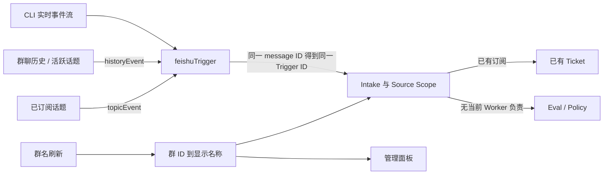

# 07 · 飞书的实时流、历史补拉与话题线程

> 面试题　飞书机器人断线两分钟，群里有人在原任务的话题下补充了一条要求。恢复后，系统怎样找回这条消息？如果实时流和补拉同时读到它，会不会执行两次？

**短答**　飞书 Source 有三条后台循环。实时循环常驻消费机器人事件，历史循环按群聊或已知私聊的时间游标补拉，并补读活跃话题及已订阅 Thread，群名循环单独维护运营界面的群名。实时、历史和已订阅话题读取都经过 `feishuTrigger`，以原生 message ID 生成同一个 Trigger ID。实时收到是平台可见性，Source 的接收范围、Policy 和 Ticket 归属还会决定它能否成为任务。恢复也有边界，例如首次初始化群聊游标、机器人尚不知道的私聊和话题分页提前停止。 [飞书循环](../dsh-superagent-prototype/src/sources/feishu-loops.ts) · [事件转换](../dsh-superagent-prototype/src/sources/feishu-trigger.ts) · [Feishu Source](../dsh-superagent-prototype/src/sources/feishu.ts)

本文以提交 `7bd4741` 的本地源码为准。沿用帮助页错字任务，设 Alice 在飞书群 `oc_team` 发根消息 `om_root` 提请修改，之后用 `om_more` 补充「只改帮助页，登录页先不动」。实际产物仍可能是 GitHub PR #57。消息和话题 ID 是教学别名，下面关注它们如何被接入同一项工作。 [第 05 篇](05-source-contract-and-trigger.md) · [第 06 篇](06-github-polling-and-checkpoints.md)

## 1. 为什么需要多条路径

如果只等待实时事件，网络断开、CLI 重启或进程停机期间，系统无法仅靠再次连接证明中间已处理完整。若只做历史轮询，所有交互都要等下一次拉取，群多或某轮读得慢时尾延迟更高。飞书适配器选择实时和补拉并行，并为已有 Ticket 加上按订阅读取的通道。三种输入共用去重键。群名只是展示元数据，因此另起独立循环，避免某群补拉耗时长时，操作者连新加入的群名都看不到。 [飞书运行循环](../dsh-superagent-prototype/src/sources/feishu-loops.ts)



章中的「活跃话题补拉」和「订阅话题轮询」容易混淆。前者属于按 chat 的时间窗口，先扫群聊，再把已知话题带入同一窗口补读。后者以领域 Thread 订阅为入口，用原始消息定位飞书原生话题，再按已见消息 ID 控制读取。它们都能读话题回复，却有各自的选择条件和进度证据。 [backfillChat 与 pollThreads](../dsh-superagent-prototype/src/sources/feishu-loops.ts) · [持久化键](../dsh-superagent-prototype/src/kv.ts)

| 路径 | 触发与职责 | 当前进度 |
| --- | --- | --- |
| 实时 `watch` | 常驻 CLI 连接，尽快接收机器人消息事件 | 当前进程、连接状态、已登记的 chat 类型 |
| 时间窗口补拉 `backfillLoop / backfillChat` | 顺序扫描配置群和已知私聊，同窗口补读仍活跃的话题 | 每个 chat 的历史 cursor、已知话题及其最后观察时刻 |
| 已订阅话题 `pollThreads / pollThread` | 补充特定 Ticket 正在或曾经关注的话题 | 每个领域 Thread 的 `seen` 与 `initialized` |
| 群名刷新 `chatNamesLoop` | 更新机器人所在群的显示标签 | `chatId → name` 缓存 |

飞书插件的 `apply` 先向 Registry 注册 kind，再创建 AbortController 并启动 `runFeishu`。后者用 `Promise.allSettled` 并行等待三个长期循环。 `pollThreads` 被历史循环调用，和它共用这一轮的时序。卸载时用同一个外部信号请求停止并等收尾。启动前等 Runtime 的 ready，并判断部署是否已解析出飞书 bot。这个约束解释了面板可以出现飞书配置项，但循环仍因 setup 暂停。 [飞书插件入口](../dsh-superagent-prototype/src/sources/feishu.ts) · [runFeishu 与 available](../dsh-superagent-prototype/src/sources/feishu-loops.ts) · [无 bot 的注册测试](../dsh-superagent-prototype/tests/sources.spec.ts#L93)

## 2. 实时事件消费，连接状态和数据处理是两件事

### 2.1 使用已解析的机器人身份运行事件子进程

setup 通过配置的 `lark-cli` 检查 bot 身份与 strict mode，并解析 app ID、bot open ID 和 Feishu/Lark 品牌，供来源运行。 `consume` 通过 Node 的 `spawn` 运行对应 CLI，参数选择 `im.message.receive_v1` 事件和 bot 身份。进程的标准输出、标准错误分别用 `readline` 消费。标准错误中的 `[event] ready` 将实时源健康置为 ready；若 45 秒内没有就绪标志，定时器终止进程，退出诊断说明就绪超时。读到警告、drop 或错误样式的诊断时，健康也可能先显示 error，而子进程仍存在。 [bot setup](../dsh-superagent-prototype/src/deployment.ts) · [consume](../dsh-superagent-prototype/src/sources/feishu-loops.ts) · [就绪超时测试](../dsh-superagent-prototype/tests/sources.spec.ts#L1146)

实时连接异常退出后由 `watch` 重新尝试。第一次等待 1 秒。短时间内重复退出会指数增加等待，最多 60 秒；某次连续运行至少一分钟后，下一次等待回到 1 秒。这里重试的是事件进程，不会在内存里重造断掉期间的事件。恢复后的数据覆盖仍依赖后面的时间窗口补拉和话题读取。来源整体关闭时，watch 每五秒检查当前设置，可以中止正在运行的子进程。即使子进程尚未退出，已经排到 stdout 处理队列的事件也会重新检查 Source enabled。 [watch 与 consumerRetry](../dsh-superagent-prototype/src/sources/feishu-loops.ts) · [退避用例](../dsh-superagent-prototype/tests/sources.spec.ts#L304) · [关闭后迟到行测试](../dsh-superagent-prototype/tests/sources.spec.ts#L1100)

### 2.2 stdout 逐行处理，坏行不会丢掉后续正常行

每一行会进入一个 Promise 链，依序执行长度检查、JSON 解析、`feishuTrigger` 转换和 `await receive`。源码拒绝超过 1,048,576 个 JS 字符单位的行。单行转换异常通过 catch 报告健康，之后的链仍可继续。一条包含损坏内容的行可能因此没有 Trigger，但随后的有效行仍入库。收到有效事件且 Source 启用时，先更新 `KV.feishu.chats` 的 chat 类型，再交给领域摄取。私聊在这里登记为 true，后续补拉才能知道有哪些已知私聊。这个 KV 更新在应用 Scope 检查前发生，因此「登记过 chat」表示曾在实时路径见过这种会话类型。 [实时处理链](../dsh-superagent-prototype/src/sources/feishu-loops.ts) · [畸形行与私聊登记测试](../dsh-superagent-prototype/tests/sources.spec.ts#L1089)

异步链确保已进入处理的行按链接顺序完成，但源码没有用平台确认与应用游标做一笔跨系统事务。只看 ready 说明事件消费者曾达到监听状态。若某条消息已经由 CLI 打印但进程在接收前退出，之后是否补齐，要看相应群或 Thread 是否落在补拉范围。运行时关闭时还会等待进程清理和已形成的处理链，这与断电等强制终止的证据不同。 [consume 的清理和 Promise 链](../dsh-superagent-prototype/src/sources/feishu-loops.ts) · [场景恢复测试](../dsh-superagent-prototype/tests/sources.spec.ts)

## 3. 三种输入怎样得到同一个 Trigger

飞书把事件流本身、历史接口和话题列表的原始形状统一到 `EventSchema`。实时流直接提供这个形状，历史条目经 `historyEvent`，话题列表经 `topicEvent`。各自的原始内容包裹方式、sender 字段、根消息字段可能不同，`feishuTrigger` 负责统一 actor、`human`、`addressed`、时间、Thread 与回复地址。 `historyText` 会从 JSON 包裹里取 text，或保留可解析的内容形态。 `topicEvent` 优先使用话题消息的 `open_bot_id`，缺失 root 时用领域引用提供的根消息补齐，以便 polled 回复和 live 回复落到同一 Thread。 [EventSchema、historyEvent 和 topicEvent](../dsh-superagent-prototype/src/sources/feishu-trigger.ts)

| 一条输入的事实 | 字段怎么写 | 为什么重要 |
| --- | --- | --- |
| `om_more` 的消息身份 | `key('feishu', 'om_more')` | 实时重收、历史补拉、话题轮询共享去重键 |
| 发信人 Alice | `actor: { source: 'feishu', id: 'ou_alice' }` | 使用该来源的允许列表，不和 GitHub login 混用 |
| 是否人发 | 在归一事件中看 `sender_type === 'user'` | 为 Policy 和人类后续消息归属提供事实 |
| 群聊明确提及 | 在结构化 `mentions` 中匹配 bot ID 或 app ID | 生成 `addressed: 'mention'` |
| 私聊 | `chat_type === 'p2p'`，`addressed: 'direct'` | Policy 可用私聊路径判断，Channel 保留 direct 标记 |
| 话题位置 | 根消息省略时用本消息 ID，否则用 `root_id` | 得到 `feishu:oc_team:om_root` 这样的领域 Thread |
| 写回位置 | 本条具体 `chatId` 与 `messageId` | 以该消息定位回复所在话题 |
| 引用关系 | 在 meta 中保留 `parentId` 等 | 给 Reader 和 `repliesTo` 定位消息 |

飞书原生 thread ID 例如 `omt_1`，是调用话题 API 的地址。领域 Thread 用群和根消息构成，负责挂订阅、排 Eval 和组织 Ticket。Channel 的 `thread` 用群区分会话，实际发送还要用具体 message ID。 `parent_id` 表示直接回复哪条消息，与用来聚合话题的根消息也不同。举例说，`om_more` 可以回复中间的 `om_check`，二者仍都属于根 `om_root` 的 Thread。 [标识映射](../dsh-superagent-prototype/src/sources/feishu-trigger.ts) · [飞书话题读取](../dsh-superagent-prototype/src/sources/feishu-read.ts) · [Source 的 repliesTo](../dsh-superagent-prototype/src/sources/feishu.ts)

时间也需要归一。纯数字字符串按毫秒时间处理，其他格式用 `Date.parse`，有效值输出 ISO 字符串。对于没有时区的本地字符串，解析依赖运行环境时区。历史请求的 start/end 参数又用了秒级整数，因此当相邻窗口重叠，同一条记录可能被读到多次。业务去重键不依赖接收时间，也不依赖展示名称或 CLI 读取路径。对于已存同一 ID 的 Trigger，Intake 保留第一次摄取，后来的正文版本不会因同一个 message ID 自动成为新 Trigger。读历史或上下文时，平台当前返回的内容仍可能与已存快照有差异。 [feishuTime 与 feishuTriggerId](../dsh-superagent-prototype/src/sources/feishu-trigger.ts) · [Intake.receive](../dsh-superagent-prototype/src/core/intake.ts) · [时间解析测试](../dsh-superagent-prototype/tests/sources.spec.ts#L179)

当发送者等于本 bot ID 或 app ID，转换返回空，防止机器人给自己的确认和结果再次触发工作。话题轮询与 live 的对照测试让话题列表里的回复缺少 root，并用 app ID 表示机器人自己的消息。适配后，实际送出的回复 Trigger 和等价 live 事件相同，自己的消息也被过滤。这里测试的是字段与身份的归一，而「回复可以做的工作范围」由领域模型决定。 [自身消息过滤](../dsh-superagent-prototype/src/sources/feishu-trigger.ts) · [实时与话题轮询一致性测试](../dsh-superagent-prototype/tests/sources.spec.ts#L151)

## 4. 时间窗口补拉，按群和已知私聊恢复

### 4.1 哪些 chat 会进入补拉清单

历史循环收集当前配置中列明的群，并加入 `KV.feishu.chats` 中已经观察到的私聊，私聊还需 `directMessages` 打开。此前从实时读到的其他群即使登记在 KV，也不会单凭这个事实进入按群补拉。群名列表同样独立。机器人新加入群后，`refreshChatNames` 可在后续成功轮次读到它，面板可显示这个选项。将群加入 Source 配置后，才会进入这一类时间窗口扫描。若该 chat 没有既有历史游标，首次遇到只保存当时的时间作为起点并跳过读取。已有游标的 chat 从已存位置继续。 [backfillLoop / chatNamesLoop](../dsh-superagent-prototype/src/sources/feishu-loops.ts) · [私聊开关与失败游标测试](../dsh-superagent-prototype/tests/sources.spec.ts#L1112)

这意味着「首次联系的私聊恰好发生在实时断开期间」有明确缺口。程序没有既往的实时记录，甚至还不知道要查询哪个私聊 ID。恢复后如果能先接收到该私聊一个新事件，它会变成已知聊天，建立后续补拉所用范围。首次游标又采用当前时间，该机制本身不承诺回扫这个会话全部历史。面试里可以先讲稳态下已知 chat 如何恢复，再说明发现会话与恢复已知会话是两个问题。 [实时登记与历史清单](../dsh-superagent-prototype/src/sources/feishu-loops.ts) · [Feishu KV 定义](../dsh-superagent-prototype/src/kv.ts)

群名刷新独立执行 `+chat-list`，取有名称的群，保存 `chat_id → name`。调用失败会让旧映射仍然可用。循环通常在工作后等待一分钟，所以「大约每分钟刷新」受外部响应延迟影响。它也能通过设置界面手动触发。这个列表适合选择要监听的群，取得群名本身并不改变 Source Scope，也不会把新群自动加入 Policy 允许范围。 [refreshChatNames 与 chatNamesLoop](../dsh-superagent-prototype/src/sources/feishu-loops.ts) · [Settings.refreshLabels](../dsh-superagent-prototype/src/app/settings.ts) · [Source Scope](../dsh-superagent-prototype/src/sources/feishu.ts)

例如机器人 10:00 加入新群，10:01 的查名循环成功返回它，10:03 操作者把它加入 `chats`。历史循环第一次读到这项新配置时若已经是 10:04，会先把该群的时钟设为 10:04。10:02 的消息是否有留存，取决于当时的实时路径及 `otherChats` 等配置；仅靠这次新增群的历史扫描，无法按配置时点之前的内容复盘。排查时可以按「刚加入」「界面有名称」「已保存接收配置」「已建立历史游标」四个事实记录时间。这样能够区分是权限尚未配置，还是读窗已经从未来的实时工作开始。 [群名、群配置与初始化](../dsh-superagent-prototype/src/sources/feishu-loops.ts) · [其他群接收设置](../dsh-superagent-prototype/src/sources/feishu.ts)

### 4.2 用一个窗口读 chat 和活动 topic

每个 chat 单独取扫描开始时刻 `started`。 `backfillChat(ctx, chatId, direct, since, started, ...)` 用起止时间查询。`container_id_type=chat` 的页面先读，下游以创建时间升序。请求每页 50 条，后续使用服务器返回的 page token。解析后的消息要匹配 chat ID，读取 topic 时还要匹配当前 thread_id。不同 chat 或话题的数据被拒绝；服务器表示有下一页但缺 token 或重复 token 时，本次扫描也会失败。页面里不符合单条 schema 的项目被计入 skipped，有效项目可以继续。明确 deleted 的条目跳过摄取。 [backfillChat.scan](../dsh-superagent-prototype/src/sources/feishu-loops.ts) · [历史 schema](../dsh-superagent-prototype/src/sources/feishu-trigger.ts) · [越界和分页停滞测试](../dsh-superagent-prototype/tests/sources.spec.ts#L217)

读群聊时从有原生 thread_id 的消息更新话题表，记录每个话题最后看到的时间。扫描后，活动时间早于视界的话题会被清理，但仍被有效订阅关注的旧话题可以保留。判断订阅有效时复用 `polled`，如果 Ticket 开放则继续关注，结束后还按最近 Trigger 或 Ticket 结束时刻保留一段时间。接着对保留的话题用 `container_id_type=thread` 补读相同窗口中的回复。此处话题表是「还要扫哪些旧话题」的集合。拿最近两周作为清理话题的视界，并不表示每次补拉必定重读最近两周所有消息。实际消息范围取决于传入的 since 和 until。 [活跃话题筛选与二次扫描](../dsh-superagent-prototype/src/sources/feishu-loops.ts) · [共享轮询视界](../dsh-superagent-prototype/src/sources/poll.ts) · [旧订阅话题保留测试](../dsh-superagent-prototype/tests/sources.spec.ts#L200)

### 4.3 拉取成功才推进时间游标

群聊以及所选话题都完成这一轮扫描后，调用方把该 chat 的游标更新为 `cursorAt(started)`，即本轮该 chat 开始时刻减五秒。假如群聊页都已入库，话题第二页此时失败，失败会退出当前 chat，外层保留旧时间游标。最近话题表可能已经保存，早先入库的 Trigger 也会保留。下一轮重放范围后再用稳定的消息 ID 去重。某一个群失败时，外层收集该群错误，继续跑其他群；成功的群正常推进自己的游标。这个设计保护的是**一个 chat 的时间窗口完成度**。 [backfillLoop 调用与更新](../dsh-superagent-prototype/src/sources/feishu-loops.ts) · [游标回退](../dsh-superagent-prototype/src/sources/poll.ts) · [逐群失败测试](../dsh-superagent-prototype/tests/sources.spec.ts#L1112)

沿用案例，`oc_team` 上次游标是 10:05:55，实时在 10:06:30 断开，Alice 10:07:02 发 `om_more`。10:08:00 开始的补拉，只要对应平台结果可读、来源范围允许且该消息包含在 chat 或被补读的话题中，就会摄取 `om_more`。成功后该 chat 的游标到 10:07:55。实时重连又收到同一消息时，Intake 按 message ID 判重。这能解释恢复是由哪些路径重叠协作，无法保证任何未见的对话或所有晚到条目都被扫到。 [消息转换与判重](../dsh-superagent-prototype/src/sources/feishu-trigger.ts) · [Intake](../dsh-superagent-prototype/src/core/intake.ts)

## 5. 已订阅话题读取，用已见消息控制翻页

### 5.1 先找原始消息，再找平台话题

在历史循环末尾，`pollThreads` 读取飞书 Source 的订阅 Thread，使用共享的 `polled` 条件筛选仍有活跃 Ticket 或最近活动的条目。每个 Thread 可用 `threadRef` 从 meta 找回保留的 `sourceTriggerId`、chatId 与 messageId。若缺这些字段，会尝试用该 Thread 最新 Trigger 恢复引用。它随后调用 `readFeishu`，先用源消息定位平台返回的 topic/thread_id，再取相应话题列表。读取源消息和响应里的 chat、thread 都要与预期一致。源消息没有话题时，`readFeishu` 返回空页面及 `no_thread`。评估工具另有按 chat 邻近消息回退的逻辑，订阅补拉用的是实际话题读取。 [threadRef / pollThread](../dsh-superagent-prototype/src/sources/feishu-loops.ts) · [readFeishu / feishuThreadContext](../dsh-superagent-prototype/src/sources/feishu-read.ts)

从原消息找话题可以应对本地一开始没有拿到原生 thread ID 的情况。比如 Alice 先在一条普通消息里提及 bot，之后用户把后续讨论放进这个根对应的话题。下次源消息查询返回了原生 topic ID，读取成功后还可将它写入本地 Thread meta。后续历史补拉也能用这个字段识别已有订阅关注的话题。采用来源原生地址前先锚定已存 Trigger，可以避免仅靠模型给出的消息 ID 决定去哪里访问。 [源消息定位](../dsh-superagent-prototype/src/sources/feishu-read.ts) · [Thread meta 更新与话题筛选](../dsh-superagent-prototype/src/sources/feishu-loops.ts)

### 5.2 首轮与后续轮次有不同的既读规则

每个领域 Thread 对应两个 KV。 `KV.feishu.seen(thread.key)` 是所见飞书原生消息 ID 列表，`KV.feishu.initialized(thread.key)` 说明是否成功完成过首次轮询。首次会读取 root 和 parent，并把查到的 ID 作为已知上下文存入 seen。随后按降序翻页，从较新页往较旧页走，每页条数取当前的 `readPageSize`，默认 20。按 chat 的历史扫描则使用固定的 50 条。首次处理时过滤早于 `thread.createdAt` 的输入，并在本轮没有初始化标志时继续翻至结束。若 Thread 先存在后才被某张 Ticket 订阅，源码这里取的仍是领域 Thread 的创建时间。 [pollThread 首次读取](../dsh-superagent-prototype/src/sources/feishu-loops.ts) · [页大小配置](../dsh-superagent-prototype/src/sources/feishu.ts) · [首轮过滤与标记测试](../dsh-superagent-prototype/tests/sources.spec.ts#L125)

对已初始化的 Thread，每页先检查是否含有已见 ID，再把该页未见且未删除的有效消息倒序处理，使页内较旧的输入先送进 Engine。这是页内次序。跨页仍从较新的页向较旧的页读。处理后将该页返回的有效消息 ID 都记入 seen，包括没有被消费的已删除或本 bot 消息；若本页碰到了轮次开始处理该页前已经知道的某个 ID，则不再继续翻更旧的页。于是「碰到旧消息就停」准确说是**当前页处理完后停止继续分页**。 [pollThread 的 encounteredKnown 和 reverse](../dsh-superagent-prototype/src/sources/feishu-loops.ts) · [后续轮次提前停止用例](../dsh-superagent-prototype/tests/sources.spec.ts#L239)

例如第一页从新到旧返回 `[om_16, om_15, om_14]`，其中 `om_15` 已知。如果 initialized 为 true，读取仍会按页内规则处理未见的 `om_14` 与 `om_16`，然后结束这轮，不查后续页。这个行为效率高，也假定越过相交页再往旧处的内容已由先前扫描或别的路径覆盖。seen 表示「订阅轮询见过」，可以包含跳过的消息。已存 Trigger 表示「领域摄取保存了输入」，用途不同。实时或历史已摄取某条消息时，话题轮询也可能需要先知道它的 ID，最后仍由 Intake 识别 duplicate。 [seen 更新与退出条件](../dsh-superagent-prototype/src/sources/feishu-loops.ts) · [Intake 去重](../dsh-superagent-prototype/src/core/intake.ts)

### 5.3 第二页失败时，两套检查点可以给出不同结果

设一个已初始化的话题此前只见过 `om_previous`。断流后新的第一页含 `om_new`，它被处理并存入 seen。程序去读第二页时失败，尚未读到夹在两者之间的 `om_lost`。下一轮第一页仍是 `om_new`，此时它已在 seen。当前逻辑在这一页结束后便停止，第二页即使已经恢复也没有被再次请求。 `pollError` 可以在这轮正常返回后清除，而遗失的消息仍未由这条路径补到。这个现象来自**每页写入 seen**与**遇到已知页即停止**的组合，区别于按完成整个 chat 时间窗口才更新时间游标。 [页级 seen 与停止条件](../dsh-superagent-prototype/src/sources/feishu-loops.ts) · [错误状态更新](../dsh-superagent-prototype/src/sources/poll.ts)

本次在临时检出中构造了这条路径，把首次第二页调用设为失败，并在下一轮把第二页改为可用。用例确认首次已写入 `om_new`，下一轮只读第一页，`om_lost` 未生成 Trigger，Thread 的 `pollError` 清除。相应 chat 和 topic 时间窗口若还覆盖这个范围，历史补拉仍可补救；实时重送也可能让它出现。这个验证只观察订阅读取本身，补拉三路能否最终都拿到消息仍要按具体条件判断。 [订阅逻辑](../dsh-superagent-prototype/src/sources/feishu-loops.ts) · [来源测试夹具](../dsh-superagent-prototype/tests/sources.spec.ts)

如果面试要求为订阅路径提供更强的覆盖，可以给出两种改法。其一，区分「某个 ID 已经入库」和「扫描已成功到达旧边界」。前者允许各页已提交，后者仅在本轮到达完整边界后替换。失败时从原边界重扫，Trigger ID 消重。其二，若平台对 page token 的恢复有明确承诺，记录未完成的页或范围，下次显式补读再更新完整边界。后者节省重复请求，但依赖 token 稳定性和结果变化语义。应用还应区分 `当前 HTTP 成功` 与 `上一次扫描缺口已关闭`，因此不会用一轮无错覆盖未解决的恢复状态。 [现有页读取与幂等入口](../dsh-superagent-prototype/src/sources/feishu-read.ts) · [Intake](../dsh-superagent-prototype/src/core/intake.ts)

## 6. 收到、获准与可回复需要分别检查

### 6.1 群聊和私聊先看 Scope，再看身份与业务意图

| 场景 | 当前 Source Scope 怎么看 | 后续怎么判断 |
| --- | --- | --- |
| 配置群 `listen=mentions`，Alice 有准入资格且提及 bot | listened 为 true，observed 为 false，归到该群的 row | 有条件得到显式强度，接单仍需业务路由 |
| 同一群的普通讨论已被平台返回 | listened 仍可为 true，observed 为 false | 可能成为已有 Ticket 输入。仅凭可见性无法按全量观察授予新委托 |
| 配置群 `listen=all` | listened 和 observed 都为 true | 未提及也可按准入表与推断模式评估，不保证建单 |
| 其他群 | 按 `otherChats` 选择不接收或仅提及模式 | 即使平台读到，有无资格仍由 Scope 和 Policy 共同处理 |
| 已开启的私聊 | listened 为 true，observed 为 false，row 为 direct | 事件自带 direct；允许名单与准入条件仍适用 |

三段检查各有来源。平台决定机器人能看到什么，`feishuKind.scope` 把群或私聊与应用设置配对，`Policy.gate` 使用 actor、direct/mention、是否 observed 和已有领域关系判断工作资格。飞书一个陌生人在私聊给送达消息，生成 direct 是输入事实。若采用默认准入且人不在允许列表，仍不能由见到私信就推导有新工作。另一方面，正式订阅下的人工跟进可交给已有 Worker 按原 Mandate 判断，无须每条都重新 @。 [Feishu Scope](../dsh-superagent-prototype/src/sources/feishu.ts) · [准入策略](../dsh-superagent-prototype/src/policy.ts) · [直私聊准入测试](../dsh-superagent-prototype/tests/policy.spec.ts#L81)

### 6.2 失去权限时观察层、授权层和出站各有结果

如果 bot 被移出群，`chat-list` 在一次成功刷新后可能不再展示该群；这不会修改操作者保存的 `chats` 或允许列表。历史扫描调用可能按平台错误失败，留下相应 chat 没有推进的游标。代码中 `Commands.lark` 针对某个机器人不在群的错误映射可读原因，便于定位权限故障。若应用删除该群配置并关闭其他群接收，后续入站在 Scope 层被过滤。若只是从 Policy 的允许列表移除 Alice，摄取仍可以进行，但新委托和恢复时会根据当前条件重新判断。两个改变分别作用于输入范围和授权。 [群名与历史循环](../dsh-superagent-prototype/src/sources/feishu-loops.ts) · [成员错误处理](../dsh-superagent-prototype/src/infra/commands.ts) · [Policy.revalidate](../dsh-superagent-prototype/src/policy.ts)

对于已排队的回复，Outbox 会重查来源启用和 Channel 允许条件。若目标会话不在当前接收范围，可以将其结算为 `channelIgnored`。若来源禁用或未装载，消息可先等待。平台层读权限失败与本地拒绝写回也会留下不同线索。这样能说明「曾经收到一条消息」和「现在能回同一条消息」如何随时间分开判断。 [Feishu Channel.allowed](../dsh-superagent-prototype/src/sources/feishu.ts) · [Outbox.deliver](../dsh-superagent-prototype/src/app/outbox.ts) · [目标范围测试](../dsh-superagent-prototype/tests/registry.spec.ts#L137)

### 6.3 撤回发生在不同阶段会留下什么

如果消息在历史读取前被撤回，历史处理明确跳过 `deleted`，订阅生成输入时也排除 deleted 消息。若它已经从实时路径入库，补拉中的跳过不会删除原 Trigger。Anchor 被撤回后，`readFeishu` 重新定位来源消息可能失败，但应用保留的原 Trigger 文本仍可读。另有上下文接口能返回明确的 deleted 状态。若某条回复已排队，发送遇到特定撤回、找不到消息的错误，Channel 返回 gone，Outbox 可结算为 `channelGone`。超时等暂时错误继续按重试处理。恢复链路因此应分别检查「是否已经接收」「远端是否还可读」「当前是否还能回复」。 [历史与话题删除处理](../dsh-superagent-prototype/src/sources/feishu-loops.ts) · [来源消息读取](../dsh-superagent-prototype/src/sources/feishu-read.ts) · [飞书发送错误分类](../dsh-superagent-prototype/src/sources/feishu-channel.ts) · [撤回回执测试](../dsh-superagent-prototype/tests/commands.spec.ts#L72)

## 7. 如何验证一条飞书跟进卡在哪

从应用搜索 `om_more` 可找相关 Trigger。若未入库，先看实时健康与定位信息，确认最初是否有事件和 bot 是否可读，再检查 chat 是否在补拉清单、游标窗口和话题关系是否覆盖。如果已经入库，查 Trigger 的处置记录、Thread 订阅和相应 Ticket，区分被过滤、进入待评估或已投递给 Worker。若用户说没有收到回答，要再查回复回执和原消息目标，留意撤回与 Scope 变化。群名显示正常只能说明查名路径曾成功。尤其在已订阅 Thread 读报错时，要查看该 Thread 的 `pollError`。历史循环的全局 `history` 状态主要用它收集到的 chat 补拉错误，订阅读取的错误通过通用 `pollEach` 按 Thread 记账。 [引用搜索](../dsh-superagent-prototype/src/sources/feishu.ts) · [循环状态与错误](../dsh-superagent-prototype/src/sources/feishu-loops.ts) · [pollEach](../dsh-superagent-prototype/src/sources/poll.ts)

| 要验证的机制 | 现有用例看到了什么 |
| --- | --- |
| 实时消费能继续 | 坏 JSON 被报告，后续消息仍入库，私聊与群类型分别记录。 [坏行测试](../dsh-superagent-prototype/tests/sources.spec.ts#L1089) |
| 短时断线与恢复 | 事件进程退出后启动下一个消费者，重新就绪能更新健康。 [重连测试](../dsh-superagent-prototype/tests/sources.spec.ts#L1176) |
| 单群历史失败 | 有权限或请求错误的群保留时间游标，成功群会推进，关闭私聊补拉后其游标保持。 [历史恢复测试](../dsh-superagent-prototype/tests/sources.spec.ts#L1112) |
| 分页与范围 | 历史返回跨 chat 或 topic、下一页 token 卡住时拒绝继续。 [分页边界测试](../dsh-superagent-prototype/tests/sources.spec.ts#L217) |
| 多路径的消息标识 | 把话题轮询所得回复和等价实时事件比较，Trigger 形状一致。 [归一化测试](../dsh-superagent-prototype/tests/sources.spec.ts#L151) |
| 可见性和写回 | 私聊与群的接收配置生效，消息撤回和临时超时采用不同外发处置。 [Scope 测试](../dsh-superagent-prototype/tests/policy.spec.ts#L32) · [回复错误用例](../dsh-superagent-prototype/tests/commands.spec.ts#L86) |

在已安装锁文件依赖的原型目录运行：

```bash
pnpm test tests/sources.spec.ts tests/feishu-read.spec.ts tests/commands.spec.ts \
  tests/registry.spec.ts tests/policy.spec.ts tests/outbox.spec.ts
```

本次在临时检出运行，**6 个测试文件、438 个现有用例全部通过**。另有一项临时验证通过，复现了 §5.3 的分页恢复窗口。原型用例用本地仓储、CLI 夹具或模拟响应验证应用行为。真实飞书权限、事件是否重送和历史可见范围仍应以对应部署的观测为准。 [来源测试](../dsh-superagent-prototype/tests/sources.spec.ts) · [飞书读取测试](../dsh-superagent-prototype/tests/feishu-read.spec.ts)

## 8. 面试怎么讲

### 60–90 秒口述版

> 飞书接入把实时、按聊天恢复和按订阅话题补读结合起来。实时由机器人 CLI 输出事件，能尽快接收新消息，连接失败会退避重启。历史循环只扫配置群与已知私聊，记录每个 chat 的时间窗口，通过已知话题再补回复。每个窗口完整读完才推进该 chat 游标。
>
> 订阅话题使用另一套 seen 消息 ID 与初始化标志。第一次会记录根和父消息，后续由新到旧读，处理完遇到旧 ID 的页面后停止翻页。实时、历史和话题适配都以 message ID 构造同一个 Trigger，交给 Engine 去重。机器人看见消息后还要看本地 Scope、发送人资格和已有 Ticket 归属，才能决定是建单、跟进还是忽略。
>
> 我会讲清恢复边界。首次缺游标的聊天仅建立起点，未发现的私聊不在补拉清单；订阅路径每页保存 seen 后若下一页失败，下一轮可能提前停止，要靠时间窗口补救或改进扫描水位。

### 追问一　为什么既有实时消费，还要补拉？

实时路径解决低延迟，断线和停机期间可能缺事件。按 chat 的时间窗口从旧进度恢复，已订阅话题再针对需要继续工作的讨论补读。重叠输入由稳定 Trigger ID 去重。要解释失联之后能恢复哪部分，先看 chat 或话题是否已进入相应扫描集合。 [实时、历史和订阅](../dsh-superagent-prototype/src/sources/feishu-loops.ts)

### 追问二　机器人在群里看到消息，为什么可能接不到任务？

平台权限决定可见性，Source Scope 决定消息是否可接收或观察，Policy 决定发件人能否发起工作。已有 Ticket 的正式 Thread 还可能直接处理范围内跟进。比如一个未列名的人私聊 bot，可产生 direct Trigger，但默认准入仍可拒绝。 [Source Scope](../dsh-superagent-prototype/src/sources/feishu.ts) · [Policy](../dsh-superagent-prototype/src/policy.ts)

### 追问三　root、parent、thread_id 和 message_id 各管什么？

root 将多条同话题消息归入一个领域 Thread，parent 说明直接回复对象，thread_id 为平台查询话题的地址，message_id 让这条消息可去重并能成为写回目标。话题读取给回复补根消息时，必须保持实时与轮询映射一致。 [Trigger 映射](../dsh-superagent-prototype/src/sources/feishu-trigger.ts) · [话题读取](../dsh-superagent-prototype/src/sources/feishu-read.ts)

### 追问四　某个话题第二页失败，为什么重试可能直接停在第一页？

因为当前按页提交 seen。若第一页已经从未见变成已见，下一轮就在这页满足「碰到已知」的退出条件。可将逐条入库和确认扫描范围拆开，成功到达原来的旧边界后才更新确认水位。其他补拉路径也可在覆盖窗口内拾回缺口。 [pollThread 检查点](../dsh-superagent-prototype/src/sources/feishu-loops.ts)

### 追问五　消息撤回后，系统会自动删除已存任务吗？

源码把补拉时跳过已删消息、重新读取时报告不可用、对外发送遇到目标消失作为独立事实。已存 Trigger 和 Ticket 需要按各自领域条件处理。若团队另有撤回后停止或数据删除要求，应在产品规则中定义其授权、保留和状态变化。 [补拉与撤回](../dsh-superagent-prototype/src/sources/feishu-loops.ts) · [读侧可见性](../dsh-superagent-prototype/src/sources/feishu-read.ts) · [发送结果](../dsh-superagent-prototype/src/sources/feishu-channel.ts)

---

[返回连载目录](README.md) · [上一篇《GitHub 轮询、游标与重复事件》](06-github-polling-and-checkpoints.md) · 下一篇《Trigger 落库、Thread 关联与订阅扇出》
