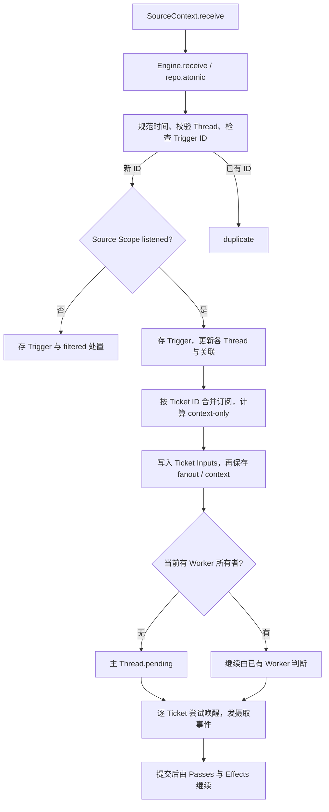

# 08 · Trigger 落库、Thread 关联与订阅扇出

> 面试题　一条消息同时属于两个 Thread，两个 Thread 都被同一张 Ticket 订阅，其中一条订阅只供参考。系统应写几条 Input？这条消息还要不要提交给主 Session 做新任务评估？

**短答**　`Engine.receive` 在一次事务中调用 `Intake.receive`。Intake 先统一事件时间并按 Trigger ID 去重，再检查 Source Scope。通过范围的事件更新各个 Thread，并以 Ticket ID 合并订阅命中。只要该 Ticket 从任一正式订阅命中，它就得到一条正式 Input。若所有命中均是 context-only，仍可向开放 Ticket 投递参考信息。之后系统根据 `followupOwners` 判断由哪些 Worker 负责这条人工跟进。没有所有者时才在 Trigger 的主 Thread 排入 Eval。一次输入可以同时送上下文和进入评估，订阅、授权和投递成功分别有自己的记录。 [摄取实现](../dsh-superagent-prototype/src/core/intake.ts) · [归属判断](../dsh-superagent-prototype/src/core/model.ts) · [Engine](../dsh-superagent-prototype/src/core/engine.ts)

本篇以提交 `7bd4741` 为基线。继续用虚构的帮助页错字任务解释代码。同一条多 Thread Trigger 是用于验证领域契约的输入。内置的常见 GitHub 评论和飞书话题消息通常由各自转换器放进一个原生 Thread，本篇额外构造双 Thread 场景，展示核心如何对待多个 ThreadRef。 [第 03 篇](03-domain-model-and-engine.md) · [第 07 篇](07-feishu-live-backfill-and-threads.md) · [Trigger 类型](../dsh-superagent-prototype/src/core/model.ts) · [多 Thread 用例](../dsh-superagent-prototype/tests/core-engine.spec.ts#L83)

## 1. 先把四个问题分开

此前的章节分别讨论轮询、实时流与补拉。它们提供多个读取入口。应用收到已经标准化的 Trigger 后，仍要按相同规则解释以下事实。

| 问题 | 决定它的记录或代码 | 能推导到哪一步 |
| --- | --- | --- |
| 这次事件是否已存，为什么保留 | Trigger ID、原始事件和 filtered 处置 | 建立接收与审计证据 |
| 这个事件属于哪些对话 | Trigger 的 `threads`、索引及 Thread 的 `correlated` | 查时间线、关联讨论及主评估位置 |
| 这次应给哪些已有工单建 Input | Thread 的订阅、Ticket 状态、context-only 合并 | 计算接收后要写入哪些工单 |
| 谁负责判断内容，是否还需要 Eval | `followupOwners`、处置、当前 Ticket 与 Eval | 判断 Worker 负责范围内跟进，或让评估路径接手新工作 |

Thread 之间有相关性，只说明出现过同一个事件。Ticket 对某段 Thread 有订阅，说明将来这里的输入可能到达这项工作。某个 Worker 已经得到 Input，也只能先说明计划交接或已经收到。是否确实由它判断，受事件是人还是机器、订阅性质、退回记录、评估状态和 Ticket 生命周期约束。进一步接单还需要 Policy 和 Decision。把这些概念压成一个 `handled` 字段，就会丢失信息。遇到「另一个 Worker 只想看评论作为背景，但当前消息应该评估」时，这个单字段很难表达正确结果。 [领域类型与归属](../dsh-superagent-prototype/src/core/model.ts) · [订阅与授权说明](../dsh-superagent-prototype/docs/002-authorization.md)



图里「有所有者」使用的是写入初始处置后那一刻的结论。后面的 wake 可能因当前授权失效而撤销那项接管，并让事件重新取得评估机会。摄取返回 `stored` 表示原始事件被领域接收并完成本次同步写入。后续是否真的送达、Worker 会不会继续处理、什么时候收到结果，各有不同回执。 [Intake.receive](../dsh-superagent-prototype/src/core/intake.ts) · [Tickets.wake / refuse](../dsh-superagent-prototype/src/core/tickets.ts)

## 2. 接收入口、时间标准化和 ID 幂等

### 2.1 谁调用事务，谁请求下一轮推进

源适配器拿到 `SourceContext`，调用 `receive(trigger)`。应用实现将它转给 Runtime 的 Passes，再调用 `Engine.receive`。如果运行时正在关闭，`Passes.receive` 会在调用 Engine 前拒绝；正常情况下 Engine 通过 `repo.atomic(() => this.intake.receive(trigger))` 开启同步操作边界。 `Passes.receive` 看到结果为 stored 时才主动请求一个 pass。相同 Trigger 的重复与 Scope 过滤没有走这一条即时调度逻辑，应用的周期调度仍各自运行。把「已存和投递意图」及时提交，再让 pass 推进，避免等待外部模型或命令拖住本地摄取。 [SourceContext 适配](../dsh-superagent-prototype/src/app/source-context.ts) · [Runtime 装配](../dsh-superagent-prototype/src/app/runtime.ts) · [Passes.receive](../dsh-superagent-prototype/src/app/passes.ts) · [Engine.receive](../dsh-superagent-prototype/src/core/engine.ts)

输入落库、关系变更、工单输入和评估排队共同发生在这次 Engine 事务里。SQLite 的 `triggers.save` 自身使用 savepoint，使保存 Trigger 与重建 `trigger_thread` 索引一同回滚。在常规 Runtime 中，`Tickets.addInput` 触发的 launch 或 delivery 意图也进入 SQLite 的 Effect 队列，随后由 handler 执行。如果应用只写「Trigger 已收到」而没有可靠地安排 Input 和任务推进，就会出现重启后去重认为已存，实际任务却没有收到的空档。 [Store.atomic 与 Trigger 仓储](../dsh-superagent-prototype/src/app/store.ts) · [Executor 的入队端口](../dsh-superagent-prototype/src/executor/dsh.ts) · [Effects.enqueue](../dsh-superagent-prototype/src/app/effects.ts)

### 2.2 `at` 不是一个字段走遍全链路

`Intake.receive` 创建一个浅复制，将 `trigger.at` 交给 `isoTime`。遇到合法的时间值，例如 `2026-09-09T10:00:00Z`，会变成 `2026-09-09T10:00:00.000Z`。这使代码在同一格式下按字符串比较时能对应实际时序，也便于 SQLite 按时间查最近记录。无效字符串则按现有函数返回原值，因此 Source 仍须校验或构造可用时间，不能把 Intake 当作平台时间的严格验证器。 [Intake 时间处理](../dsh-superagent-prototype/src/core/intake.ts) · [isoTime](../dsh-superagent-prototype/src/core/model.ts)

本次命令另取一次领域时钟 `const at = this.now()`，用于初始 Input 的接收时间及 TriggerDisposition 的处置时间。假设外部评论发生于 10:00:00，由于轮询延迟，在 10:02:00 入库。时间线上的 Trigger 按 10:00 排序，工单 Input 的初始记账时间则是 10:02。Thread.lastAt 用的是 Trigger 的事件时间并按最大值更新。晚来的旧消息仍能入库、扇出和进入 pending，却不把 Thread 的最近外部活动推回过去。 `Thread.createdAt` 是领域对象建立时的应用时间。把这些时间混在一起，会把轮询延迟误认为用户突然在当前时刻改变了需求。 [Intake 的两个时间](../dsh-superagent-prototype/src/core/intake.ts) · [Thread 初始状态](../dsh-superagent-prototype/src/core/part.ts) · [Thread 字段](../dsh-superagent-prototype/src/core/model.ts)

还有一个面试里的细节。存储层的时间线对相同 `at` 增加 `id` 作为次序，用二元组翻页，解决平台可能在同一秒产生多个事件的问题。该次序便于稳定展示；`queueForEval` 的 pending 是应用收到时追加的列表，和时间线的查询排序语义不同。同一个对象的「事件发生时间」「本地接收时间」「查阅展示的排序」分别用在不同地方。 [threadTriggers 键式分页](../dsh-superagent-prototype/src/app/store-read.ts) · [Thread 详情](../dsh-superagent-prototype/src/app/views/threads.ts) · [queueForEval](../dsh-superagent-prototype/src/core/part.ts)

可以把一次晚到跟进细化为三行。10:00:10，Alice 提交更正。10:01:00，Worker 报 blocked。10:02:00，轮询才把更正交给 Intake。只要它命中正式订阅，人工 Input 的时间用 10:02:00，这与阻塞后的可用输入有关。时间线仍将这条消息放在外部事件的 10:00:10。若一条 context-only 输入同样在 10:02:00 抵达，`waitsForPerson` 会排除它，工单不会仅凭这条背景资料解除正等待人的状态。两个结果共同说明，为何外部原始时间和域内观察时间都要保留。 [Intake 的两处时钟](../dsh-superagent-prototype/src/core/intake.ts) · [等待人工条件](../dsh-superagent-prototype/src/core/model.ts)

### 2.3 重复判断为什么在 Scope 之前

规范时间后，Intake 先要求至少有一个 Thread，然后按 Trigger ID 查已有记录。如果查到，直接返回 duplicate。这项幂等把 Source 的晚到重放与业务重新判断分开。如果 Alice 的消息曾因 Scope 被过滤而保存，设置调整后重新拉到同一 ID 仍会判为重复。它不会用新的正文覆盖旧记录，也不会绕过历史处置再次扇出。若运营需要重评已有记录，应用提供另一个 `reevaluate` 命令，走评估队列的归属和准入规则。重评是有意改变后续处置，传输重试则只重送原输入。 [Intake 去重路径](../dsh-superagent-prototype/src/core/intake.ts) · [Evals.reevaluate](../dsh-superagent-prototype/src/core/evals.ts) · [重复与过滤测试](../dsh-superagent-prototype/tests/core-engine.spec.ts#L75)

原型把 ID 的业务定义交给 Source。飞书实时和历史都以 message ID 得到一个 Trigger ID。GitHub 评论还纳入版本时间，因此编辑后的新版本可能是另一条 Trigger。内核只对实际收到的 ID 判断，无法替来源决定两份不同版本算不算一条授权消息。ID 的作用域若设计失败，多租户两个不同对象也可能被误判为重复。新增 Source 时要验证主键在预期仓库、项目和版本范围内能稳定区分输入。 [飞书事件 ID](../dsh-superagent-prototype/src/sources/feishu-trigger.ts) · [GitHub 事件 ID](../dsh-superagent-prototype/src/sources/github-trigger.ts) · [稳定 key](../dsh-superagent-prototype/src/core/ids.ts)

用一条路径表示细微差别。若 Source 持有未提交的游标，进程在收到 `stored` 后退出，它会从旧进度再次读到原消息，Intake 返回 duplicate，之前事务中的订阅和 Input 已经记录。若上一轮摄取本身抛错并回滚，下一轮仍能看到这是新 Trigger 并重新计算当前范围。前提是 Source 没在业务接收成功之前把游标提前越过该段。幂等只能化解重复，需结合读取机制处理遗漏。 [SourceContext.receive 的游标约定](../dsh-superagent-prototype/src/sources/host.ts) · [Intake](../dsh-superagent-prototype/src/core/intake.ts) · [飞书历史推进](../dsh-superagent-prototype/src/sources/feishu-loops.ts)

### 2.4 接收命令如何处理部分失败

假设同一个 X 要交给 K1 和 K2。若实现把它改成先提交 Trigger、再分两次持久化 Input，会出现这样的故障窗口。10:02:00 写入 Trigger，10:02:01 给 K1 入队，接着进程终止。重启后 Source 重放 X，Trigger 已存在，于是同一次动作中的 K2 永远失去输入。源码以 Engine 的外层事务打包这段变更，SQLite 和正常 Executor 待办又在同一库，让原始接收与本地扇出意图成为一组事实。后续 Worker 实际交付可能独立失败，继续以 delivery effect 和相应 Assignment 回执承担重试。 [Engine.receive](../dsh-superagent-prototype/src/core/engine.ts) · [Store.atomic](../dsh-superagent-prototype/src/app/store.ts) · [Executor 状态检查](../dsh-superagent-prototype/src/executor/dsh.ts)

若要向多个外部服务分发，最好先确定谁能以同一事务完成写入。此处既有内存仓储用于领域测试，也有 SQLite 仓储和安排异步工作用的 Effects。内存仓储可回滚自己的 Map，注入的外部 mock 队列不由 Map 快照控制。线上则必须遵守端口约定，在同步命令内安排或记录副作用，由后续环节实际执行。直接把外部写入放进 Engine 事务，数据库回滚时无法撤销已发消息。一个测试验证的是领域原子性，一个测试验证的是持久待办与 commit 的先后，应分别理解这两种证据。 [领域仓储契约](../dsh-superagent-prototype/src/core/ports.ts) · [MemoryRepositories](../dsh-superagent-prototype/src/core/memory.ts) · [Effects 回滚测试](../dsh-superagent-prototype/tests/effects.spec.ts#L29)

## 3. 过滤留痕，为什么要同时保存原文与处置

### 3.1 filtered 分支实际写了什么

`scope.scope(trigger)` 返回 `listened: false` 时，Intake 保存 Trigger 和 `{ filtered: { code: filter.reason }, fanout: [], at }`，然后返回 filtered。到此提前退出。它不会创建本次输入对应的领域 Thread、维护 correlation、由订阅写入 Ticket Input、加入 Eval pending 或发出正常的 `trigger.received` 领域事件。如果同名 Thread 原来已存在，摄取也不更新它的聚合状态。保留事件本身可供排查，保留处置能解释为什么这条消息没有产生工作。 [过滤早返回](../dsh-superagent-prototype/src/core/intake.ts) · [ScopeResult](../dsh-superagent-prototype/src/core/ports.ts)

例如 Alice 在飞书群 `oc_outside` 发 `om_outside`，即使她在 Feishu 允许名单且结构化 mentions 有 bot ID，若该群未配置且 `otherChats` 不允许，Scope 会返回 `chat_not_allowed`。面板可以在来源记录或搜索中显示那条事件和过滤原因。故事讲到这里应停止推导 worker，正常摄取链上还有一系列阶段未发生。反过来，若范围允许但 Alice 身份或请求性质未通过 Policy，通常会在后续评估阶段出现原因与 Decision。两个分支都会让用户觉得「Agent 没接」，已有证据与处理位置不同。 [飞书 Scope](../dsh-superagent-prototype/src/sources/feishu.ts) · [Policy gate](../dsh-superagent-prototype/src/policy.ts) · [来源视图](../dsh-superagent-prototype/src/app/views/sources.ts)

### 3.2 SQLite 的索引行与领域 Thread 是两类东西

`Store.triggers.save` 写 `trigger` 表时调用 `indexThreads`，按 Trigger 自己的 `threads` 维护关联表 `trigger_thread`。每行含 Thread key、Trigger ID、事件时间和 human 标记，主键是 `(thread, id)`。这个索引说明「这条已存事件带有哪个 ThreadRef」，便于按 Thread 查本地事件原文。过滤分支也用 `triggers.save`，因此可以有 `trigger_thread` 行，却没有相应的 `thread` 聚合行。看到这个关系不代表有订阅、活跃 Eval 或已经授权。只有走过正常分支，或走其他创建 Thread 的业务命令，才有对应的 Thread aggregate。 [Store.indexThreads 和 triggers.save](../dsh-superagent-prototype/src/app/store.ts) · [按 Thread 查 Trigger](../dsh-superagent-prototype/src/app/store-read.ts)

本次的临时 SQLite 验证用例给出 `oc_outside` 的事件，观察到接收返回 filtered，原 Trigger 与 reason 被保留，底层按 Thread key 查询可以找到它。`store.threads.get(key)` 仍为空，无 Decision，重发同一 ID 返回 duplicate。这个实验把三种记录明确区分开。它既说明原型愿意为问题追踪保留未参与业务的输入，也说明只从索引聚合统计「多少对话已处理」会高估真正有领域状态的 Thread。 [查询实现](../dsh-superagent-prototype/src/app/store-read.ts) · [过滤统计用例](../dsh-superagent-prototype/tests/store.spec.ts#L99) · [正常摄取分支](../dsh-superagent-prototype/src/core/intake.ts)

管理视图需要还原这一点。查 `threadDetail` 首先找领域 Thread，缺失就返回空。查来源 Trigger 列表则可通过 disposition 的 filtered 字段筛选。 `search` 也会在找不到主 Thread 聚合时尝试携带过滤原因。面试可以把「为什么搜到一条文本却没有 Thread 详情」当成故障定位练习。真正的答案在读取契约。一个是事件记录搜索，另一个是当前讨论聚合读取。 [搜索与 Thread 详情](../dsh-superagent-prototype/src/app/views/threads.ts) · [Trigger 筛选](../dsh-superagent-prototype/src/app/store-read.ts)

如果要设计事件日志的查询模型，可以用三项断言验证它。查 Scope 拒绝时要拿得到 `reason.code`；按来源和时间扫描仍能统计收到过这个输入；正式的活跃 Thread 或待评估列表保持原样。这也解释了为什么原生 `trigger_thread` 关联行可先于领域 Thread 存在，记录层是按照输入宣告的关联建立。后续若同一个平台 Thread 收到一条范围内的新事件并创建聚合，按关系查询也可能读出历史的过滤事件。查看来源时间线时需要结合每条处置，避免把可查到的历史与当前订阅处理范围混同。 [Trigger 写入索引](../dsh-superagent-prototype/src/app/store.ts) · [时间线关联读取](../dsh-superagent-prototype/src/app/store-read.ts) · [触发视图处置](../dsh-superagent-prototype/src/app/views/records.ts)

对「人工重评会不会把原始 filtering 去掉」这个问题，可以直接读 `Evals.requeue`。它先确认没有活跃 Eval 在持有该 Trigger，再排进主 Thread，并在已有处置上追加 `requeued: true`。原处置字段通过对象展开保留，摄取时的过滤记录仍能解释历史。至于重评后是否能够采取行动，应检查重新评估当时的 gate 与 Engine 结果。人工命令调用的是另一个领域入口，不能从 `Intake.receive` 的 `filtered` 分支推断重评会重跑完全相同的摄取流程。 [Evals.requeue](../dsh-superagent-prototype/src/core/evals.ts) · [面板动作与处置](../dsh-superagent-prototype/src/app/views/records.ts) · [Policy gate](../dsh-superagent-prototype/src/policy.ts)

### 3.3 审计计数应按状态阶段来定

如果团队看报表，`received`、`filtered`、`judged` 和 `accepted` 都是有意定义的指标。源码 `triggerStats` 从事件及处置统计各来源接收和过滤。 `flow` 中 judged 计算通过过滤且进入相关 Decision 的不同 Trigger，accepted 按 accept 或历史 reopen Decision 的不同 ID 计数。一个批次有多条 Trigger 时，一次接受也可以关联它们，所以这些数字的单位不同。大量已经被 Worker 接管的跟进可以没有新的 Eval Decision，因而不能用 judged/received 当作所有消息的处理成功率。 [Store 统计](../dsh-superagent-prototype/src/app/store-read.ts) · [Overview](../dsh-superagent-prototype/src/app/views/overview.ts)

需要进一步讨论留存代价时，可以提出在生产环境给外部原文做适当的保留期限和最小披露控制。原型现状是在接收过滤时仍保存事件和值。以后如果要删除原文但保留接收证据，需要另外决定 dedupe 键、处置码和索引还能保留什么，避免一次归档让 Source 重放的旧消息变成新工作。这是面试扩展，现有实现可核对的事实仍是 Trigger 与 disposition 分表，以及初次 Scope 的早返回。 [Store schema](../dsh-superagent-prototype/src/app/store.ts) · [原型持久化说明](../dsh-superagent-prototype/docs/007-architecture.md)

## 4. Thread 关联只记录共同出现，订阅决定向谁传播输入

### 4.1 关系表、correlated 和 subscriptions 分别怎么长

对通过 Scope 的 Trigger，Intake 先保存事件，再取得它列出的所有 Thread keys。每个 Thread 如不存在就初始化，若新的 Trigger 时间更新则写 lastAt。随后将其他 key 合入该 Thread 的 `correlated`，跳过自身并经 Set 去重。同一事件含有 A 与 B 时，两边都会记录关联。以后又有一条 B 与 C 共现，B 与 C 会关联，A 并不会直接增加 C。代码仅处理当前 Trigger 的 keys。这是由共同事件建出的直接边。 [Intake 的关联逻辑](../dsh-superagent-prototype/src/core/intake.ts) · [Thread 聚合](../dsh-superagent-prototype/src/core/model.ts) · [多 Thread 测试](../dsh-superagent-prototype/tests/core-engine.spec.ts#L83)

三处关系在不同时间发挥作用。 `trigger_thread` 支持把同一 Trigger 作为多段时间线输入，不会为了出现两次而复制正文。 `Thread.correlated` 支持在面板展示「与哪段讨论共同出现」。 `Thread.subscriptions` 才是当前事件要交给哪些 Ticket 的直接关系。假设 A 和 B 过去因事件 X 相关联，后来单独收到指定 A 的 Y，本次只遍历 Y 自己的 refs，不沿 `A.correlated` 去 B 为 Y 创建 Input。这样讨论相关性不会变成传递式业务权限。 [关系索引](../dsh-superagent-prototype/src/app/store.ts) · [Intake 的遍历范围](../dsh-superagent-prototype/src/core/intake.ts) · [相关 Thread 视图](../dsh-superagent-prototype/src/app/views/threads.ts)

举个简单的图。X 同时属于 `github:42` 与 `github:57`，造成双向的关联。K1 订阅 `github:42`，K2 订阅 `github:57`。若 Y 只列出 `github:42`，接收时会命中 K1。若 Z 的输入 refs 明确同时列出两个 Thread，才可能同时到达 K1、K2。把 correlation 当作图遍历会让已有的一条关联持续扩大传播范围，最后两个不同任务的上下文被混入。当前源码的表述清楚地保留了事件成员与订阅关系的边界。 [Trigger 和 Thread 注释](../dsh-superagent-prototype/src/core/model.ts) · [摄取](../dsh-superagent-prototype/src/core/intake.ts)

对新适配器还可以追问「正文出现链接，是否就应增加一个 ThreadRef」。本文的双 Thread X 假定 Source 已确认真实成员关系。现实中一条飞书消息贴出 PR 链接，链接首先可作为定位已有 Ticket 的证据，当前源码在生成候选卡时就会从正文找 `referenced_tickets`。这条路径只是辅助路由，并不会将链接自动追加到原始 refs。若操作者或主 Session 确认它明确属于既有工作，再通过 attach 等命令更新订阅。这比让每个出现的链接变成扇出入口更容易判断传播范围，也保留了谁作出附加决定的证据。 [候选卡的引用查找](../dsh-superagent-prototype/src/app/links.ts) · [Engine.attach](../dsh-superagent-prototype/src/core/engine.ts) · [来源转换](../dsh-superagent-prototype/src/sources/feishu-trigger.ts)

因此扩展到允许跨来源或跨仓库 refs 的部署时，Source 如何取得这些引用属于实际的信任边界。当前 `scope` 按该 Trigger 的 source 与 meta 求接收范围，随后遍历它声明的每个 ThreadRef，没有一轮逐 ref 重新计算来源准入。来源实现应先校验租户、仓库和平台身份，经过确认的关系才进入 refs。正文或模型输出提供的外部引用可以留给搜索与显式路由。这个结论来自本地调用顺序。生产扩展若引入多租户，还应补充端到端的混合 scope 回归用例。 [SourceRegistry.scope](../dsh-superagent-prototype/src/sources/registry.ts) · [Intake 调用顺序](../dsh-superagent-prototype/src/core/intake.ts)

### 4.2 订阅从哪里来，context 标记表示什么

接受一批 Trigger 生成 Ticket 时，`Tickets.create` 会为批次中的各 Thread 建订阅。后续主 Session 确定新消息明确指向已有 Ticket，可以通过 attach 补 Thread 和 Input。GitHub 来源确认 PR 归属后，`bindThread` 除了写订阅，还在 Ticket 上留下 `follows` 事实，用来处理该 PR 的关闭。Worker 另外可以通过 `followForContext` 把某段相关讨论设为参考，表示它希望看后续背景。这个路径在同一个 Thread 的 `subscriptions` 中增加 Ticket，同时在 `Thread.context` 记录该 Ticket。 [订阅创建、附加与绑定](../dsh-superagent-prototype/src/core/tickets.ts) · [PR 归属](../dsh-superagent-prototype/src/sources/github-pull.ts) · [Worker 工具](../dsh-superagent-prototype/src/app/tools/executor.ts)

正式订阅和 `Follow.own` 也容易混淆。正式订阅是本篇对「当前 Ticket 没有列在该 Thread 的 context 中」的称呼，用来说明输入归属的潜力。 `Follow.own` 表示该 Ticket 自己开出的 PR 等跟踪事实，关系到哪些关闭可以结束 Ticket。原始 Issue 可以是正式订阅，未必是 own PR；context-only 可以让开放 Ticket 看消息，却不因此获得停止追踪或决定新工作的权力。讲命名时，把输入路线和 PR 完成条件分开。 [Intake 的 context 检查](../dsh-superagent-prototype/src/core/intake.ts) · [Follow 模型](../dsh-superagent-prototype/src/core/model.ts) · [followsDone](../dsh-superagent-prototype/src/core/tickets.ts)

在代码中，`followForContext` 只对未跟随该 Thread 的开放 Ticket 生效。若 Ticket 已正式订阅，该方法返回 false，不会把正式订阅降级为参考。相反，正常 `subscribe` 在建立或调整正式订阅时会清掉对应的 context 标记。这些由明确的命令维护，历史 Trigger 的处置仍记录接收时得到的效果。后来调整订阅，不能仅凭今天看到的 subscriptions 反推昨天的一条输入是谁接手。需要读该 Trigger 的 fanout、上下文标记和后续退回等记录。 [followForContext / subscribe](../dsh-superagent-prototype/src/core/tickets.ts) · [当时分发与当前归属](../dsh-superagent-prototype/src/core/model.ts)

## 5. 按 Ticket 合并扇出，手算两段 Thread 和四个工单

### 5.1 先过滤不能接收本次输入的工单

在每个 Thread 中遍历 subscriptions，Intake 用 Ticket ID 找实际记录。如果 Ticket 不存在，这一项跳过。对于开放的 Ticket，正式订阅与 context-only 都可以成为候选命中。对于已经结束的 Ticket，只有事件是人类消息、结束方非 human、且本条订阅为正式订阅时，才允许本次命中进入候选。这样关闭后的 context-only 关系不会因参考消息恢复任务，CI 或 bot 也不会因命中结束工单而开始新一轮执行。能不能最终恢复还要由 `Tickets.wake` 检查授权和暂停状态。 [Intake 的 resumes 条件](../dsh-superagent-prototype/src/core/intake.ts) · [bot 来到结束任务用例](../dsh-superagent-prototype/tests/core-engine.spec.ts) · [恢复实现](../dsh-superagent-prototype/src/core/tickets.ts)

这一步先看订阅命中和 Ticket 状态，没有针对每个开放 Ticket 调用一次 `Policy.gate`。原型的语义是已有工单可以看见其讨论，输入仍受原 Mandate 范围和后面的所有者判断。比如一名非允许列表成员在 PR 给出故障重现步骤，Worker 可以读取它作为既有工作资料。若这条消息明示了新的目标，Worker 需要判断是否超范围。能读取相关评论就可以让老任务利用背景，不会因此自动为留言者颁发新的 Mandate。这也是单仓库协作里减少重复判断的设计成本。 [后续消息的领域语义](../dsh-superagent-prototype/docs/002-authorization.md) · [followupOwners](../dsh-superagent-prototype/src/core/model.ts)

### 5.2 Map 的归并规则，把 context 看成「所有命中都只供参考」

Intake 的 `reached` 是 `Map<ticketId, { ticket, context }>`。每次命中同一 ID 时，新 context 是 `followed && (reached.get(ticketId)?.context ?? true)`。这里的 `followed` 表示当前 Thread 将该 Ticket 标为 context-only。这等于对所有有效命中的 context 值求逻辑与。第一次看到时默认与 true 相与；只要有一条正式订阅，归并结果就为 false。把已获的正式命中保留下来，可以避免 later context-only 订阅覆盖第一次命中。反过来，先参考后正式也得到同样结果。算法在收集结束后才按 Ticket 写 Input，因此重复命中也没有多条记录。 [reached Map 与合并代码](../dsh-superagent-prototype/src/core/intake.ts)

沿用帮助页案例。用 `A = github:42` 表示原 Issue，`B = github:57` 表示后续讨论。给出一个人工的域测试事件 X，`threads = [A, B]`，作者是 Alice。假设 K1 修帮助页，K2 做类似文案仅参考 B，K3 已被人显式停止，K4 此前正常完成且仍跟正式讨论。各 Ticket 的命中为：

| Ticket | 在 A | 在 B | 当前状态 | 收集合并结果 |
| --- | --- | --- | --- | --- |
| K1 | 正式订阅 | context-only | open | 一条正式 Input |
| K2 | 无 | context-only | open | 一条参考 Input |
| K3 | 正式订阅 | 无 | ended by human | 本次跳过 |
| K4 | 无 | 正式订阅 | ended by executor | 一条正式 Input，随后尝试恢复 |

在这些假设下，初次 `fanout` 包含 K1、K2、K4，`context` 只有 K2。K1 不因为订阅了 A 和 B 获得两条 Input。K3 最初就在状态过滤时被去掉。如果此时 Policy 对 K4 仍有效且处理未暂停，后续 wake 可以恢复 K4；若 Mandate 已失效，wake 则会让 K4 释放这次消息。本案例有 K1 的开放正式订阅，即使 K4 无法恢复，X 仍由至少一个 Worker 判断。换成没有 K1 的变体，K4 释放后可能只剩参考命中，X 可以回到 Eval。 [Intake 的扇出](../dsh-superagent-prototype/src/core/intake.ts) · [Ticket wake 与 letGo](../dsh-superagent-prototype/src/core/tickets.ts)

Map 保有收集到的 Ticket 项，结果的遍历顺序仍可随原 refs 或订阅顺序变化。对 K1 来说，`[A, B]` 与 `[B, A]` 都得到一个正式 Input，所有者集合不变。若移除所有正式订阅，调换顺序会改变哪一个 Thread 成为 X 的主 Thread，所以可能影响入哪个待评估队列。需要区分「按 Ticket 聚合结果与次序无关」和「Trigger refs 数组的第一个元素有意义」。对多路线系统，这个顺序应由 Source 明确选择。 [主 Thread 契约](../dsh-superagent-prototype/src/core/model.ts) · [聚合代码](../dsh-superagent-prototype/src/core/intake.ts) · [主 Thread 排队](../dsh-superagent-prototype/src/core/part.ts)

### 5.3 Trigger 已存、Input 已写与送达是不同阶段

`Tickets.addInput` 收到 `key('input', ticketId, 'trigger', trigger.id)` 构造的输入 ID。若已存在这个 ID，则不再存一条。如果是人发的 Trigger Input，来源 facts 存成 `human: true`。若按合并结果只有参考路径，额外带 `context: true`。它引用 Trigger ID，正文依赖原始事件，方便去重与以后重建 Worker 卡片。这个 idempotency 在 Ticket 级起作用，在不同 Ticket 上同一 Trigger 会有不同的 Input ID。后续有意 attach 或添加路由说明，可以按 attach 的分支生成有区别的 Input ID，因此不宜把「一个 Trigger 在该 Ticket 一定只有一条历史记录」讲成全时段约束。 [摄取 Input ID](../dsh-superagent-prototype/src/core/intake.ts) · [addInput 与 attach](../dsh-superagent-prototype/src/core/tickets.ts) · [Worker 输入呈现](../dsh-superagent-prototype/src/executor/dsh.ts)

写入 Input 后，`undelivered` 记录待交接项。对于已经运行的 Assignment，代码安排 delivery；如果最新尝试 pending 且不再等人，可尝试安排 launch。如果是自动输入，且这个开放任务当前明确在等人，输入可存档而不加入待投递列表。人类 context-only 输入和自动输入的判定是两处逻辑。`automatic` 看 note 或非人 Trigger；`waitsForPerson` 则要求一条新的、非 context-only 的人工 Input 才能解除最新 blocked/failed 报告的等待条件。因而不能只从有一条人发参考输入就推断工单已恢复为可执行。 [automatic / addInput](../dsh-superagent-prototype/src/core/tickets.ts) · [waitsForPerson](../dsh-superagent-prototype/src/core/model.ts) · [参考消息与阻塞测试](../dsh-superagent-prototype/tests/core-engine.spec.ts#L458)

面试时还可以用分层指标解释为什么 fanout 不等于实际送达。fanout 是接收事务所知的目标，Input 未必已进入 Worker；`inputsDelivered` 标记采用有效 Assignment 的交付；`inputsRead` 标记会话事件；Worker 明确接手某请求时，又有 acked 等记录。使用多个回执能够复盘一个 Worker 在进程停止、暂停或重新排队之前究竟看到哪一条。最新 Ticket history 有输入却没读到时，不应责怪模型忽略一个从未出现于其回合的通知。 [Assignment Delivery 与 read](../dsh-superagent-prototype/src/core/assignments.ts) · [Worker 投递](../dsh-superagent-prototype/src/executor/dsh.ts) · [接手标记](../dsh-superagent-prototype/src/core/part.ts)

## 6. 从 fanout 到 followupOwners，为什么参考输入还能进 Eval

### 6.1 实际的判断顺序

Intake 先写入 fanout 与 context 处置后，调用 `owners(trigger)`。这个 helper 转到 `followupOwners`。它只为人的 Trigger 计算 Worker 所有者。没有 disposition、人工重新排队的 `requeued` 标记已设置，或有效集合为空时，直接返回空。若主 Thread 的活跃 Eval 已持有 Trigger，Worker 所有者也返回空，以免同一条记录同时处于评估和正常跟进归属。对于尚可进入 Worker 所有者集合的 Ticket，还排除本次参考命中与已经 handback 的 Ticket。最后读取 Ticket 当前状态，开放者可以判断，或者是并非由人结束、且它仍有这条 Trigger 的 Input 在 undelivered，从而等待恢复。 [followupOwners](../dsh-superagent-prototype/src/core/model.ts) · [EnginePart.owners](../dsh-superagent-prototype/src/core/part.ts)

这使以下几种情况可以同时表达：

| 输入 | fanout | owners | 当下排队结果 |
| --- | --- | --- | --- |
| 人在 K1 的正式 PR 讨论补充原需求 | K1 | K1 | 正常交给已有工作 |
| 人在另一个仅供 K2 查看背景的讨论提出请求 | K2 | 空 | K2 获得参考 Input，同时在请求主 Thread 排 Eval |
| bot 评论命中已开放 Ticket | 可能有 | 空 | 可向已有工单提供上下文，但仍进入常规准入路径 |
| 人在 K4 正式订阅讨论发消息，K4 正常结束 | 初次含 K4 | 等待着的 K4 | 先尝试恢复，是否需要 Eval 取决于后续状态 |
| 人的消息由人工命令重排 | 可保留历史目标 | 空 | 显式进入评估路径 |

从表中可看出，fanout 和 owners 的数量可以不同，也会随生命周期变化。比如 bot 评论先在工单留 Input，之后 Policy 仍可能以机器条件记录忽略，Worker 不取得人的续接归属。又比如 Worker 只跟随某 Thread 作参考，`context: true` 输入不排除独立评估。followups 测试验证了一个 Trigger 同时产生参考 Worker 卡和主 Session 候选。 [参考路由测试](../dsh-superagent-prototype/tests/followups.spec.ts#L235) · [人类跟进与 bot 路径测试](../dsh-superagent-prototype/tests/core-engine.spec.ts#L187) · [策略机器分支](../dsh-superagent-prototype/src/policy.ts)

在 Runtime 中，这里还影响主 Session 收到的消息种类。人类输入刚收到时，`trigger.received` 经回调尝试生成 `followupNotice`。它以当前所有者为进入条件，用存储的通用卡片格式说明已经有哪些 Ticket 收到，并让主 Session 在明确停止时协助协调。它会把开放命中按需要附上 context 提示。若目标先处于已结束等待状态，恢复时的 `ticket.resumed` 事件还可触发相应通知。若只有 context-only 命中，正常路径是候选评估，Worker 看它作为背景，不属于这类已有工作接手的提示。 [Runtime 事件装配](../dsh-superagent-prototype/src/app/runtime.ts) · [followupNotice](../dsh-superagent-prototype/src/app/notices.ts) · [恢复与中继测试](../dsh-superagent-prototype/tests/followups.spec.ts#L190)

### 6.2 归属基于到达时的处置，可以在后来改变

`followupOwners` 根据该事件的 fanout、context 和 handbacks 计算候选，再结合现状态修正。它没有拿当前的所有 Thread 订阅重新生成该历史事件的扇出。这解释了为什么取消订阅一般只改变未来接收。同一个 Worker 收到过去的人工跟进并负责处理后，操作者解除 Thread 订阅，历史消息仍可能由它判断。另一方面，`markUnrelated` 除了针对该 Ticket 去掉订阅，还可能把已经收到并由其负责的相关人类消息退回，这是显式处理旧归属的业务操作。 [followupOwners 与处置](../dsh-superagent-prototype/src/core/model.ts) · [取消订阅与标记无关](../dsh-superagent-prototype/src/core/tickets.ts) · [取消后历史归属测试](../dsh-superagent-prototype/tests/followups.spec.ts#L284)

设 X 同时命中 K1、K4 的正式订阅。K1 确定 X 超范围并手动 handback，系统保留 K1 的 reason，但若 K4 仍负责，X 不排新 Eval。只有当最后的所有者也让出，`EnginePart.handBack` 才因现在 owners 为空尝试入队。主 Session 的 `decide` 对 Worker 仍负责的跟进拒绝非 stop 路由，attach 也要过该检查。明确停止走独立 Policy 校验和工单结束入口。这个设计保留了回收工作和重路由的出口，同时降低一条人类消息被三处各自处理的风险。 [handBack 合并](../dsh-superagent-prototype/src/core/part.ts) · [Evals.decide / handback](../dsh-superagent-prototype/src/core/evals.ts) · [主 Session 对后续消息的限制](../dsh-superagent-prototype/tests/followups.spec.ts#L47)

「当前由谁判断」也与「这个对象今天能通过哪些读取或动作接口」是两个问题。源码中的 `reached(...)` 可根据 origin、现订阅或 Input 判断某 Ticket 是否接触过 Trigger。回复等调用会使用传入的 context 条件和其他目的校验。 `followupOwners` 则使用历史处置和现在的 Eval/Ticket 状态控制新工单路由。阅读两者时要看传参和具体调用者。单一参考 Thread 的用例覆盖了不能确认或发起相应提问的场景，多 Thread、后来取消订阅及历史 Input 的细节应有单独测试。仅从面板标了「参考」不宜推导所有用途都按同一个函数决策。 [reached / followupOwners](../dsh-superagent-prototype/src/core/model.ts) · [确认回复守卫](../dsh-superagent-prototype/src/core/replies.ts) · [参考线程用例](../dsh-superagent-prototype/tests/core-engine.spec.ts#L1349)

### 6.3 wake 在摄取事务中怎么收尾

Intake 在写初始处置并按当下所有者决定是否排队后，对 fanout 中的每个 Ticket 调用 `wake`。对原本开放的 Ticket，wake 立即返回，对已结束工单才有机会恢复。它重新读取 Ticket，要求不是人主动结束、还有待交接项，检查是否暂停，再用当前 Policy 的 `revalidate` 验证原 Mandate。当等待项有合适的人类 Trigger 时，会移除 ended、建 pending Assignment，添加 `resumed` 标记并放在待交接队列前面，让 Worker 先知道这次运行是恢复而非全新授权。 [Tickets.wake](../dsh-superagent-prototype/src/core/tickets.ts) · [恢复无新 Decision 的测试](../dsh-superagent-prototype/tests/core-engine.spec.ts#L296)

有两种重要分支。处理暂停时，人工消息可以先留在工单未投递队列，`followupOwners` 仍能表示候选工单会在有条件时处理。解除暂停后，`Engine.evaluateDue` 可在开始新的 Eval 前先唤醒这些 Ticket，使用那时的 Policy。如果 `revalidate` 失败，`refuse` 清待交接项，`letGo` 释放未接手消息的分发关系。符合条件且已无其他所有者、无有效处置的消息再去 Eval。这地方的状态变化在接收结束时就可能被重新计算，因而不能只看摄取分支旧的 fanout 结论。 [Engine.evaluateDue](../dsh-superagent-prototype/src/core/engine.ts) · [Tickets.refuse / letGo](../dsh-superagent-prototype/src/core/tickets.ts) · [暂停后按当前 Policy 恢复测试](../dsh-superagent-prototype/tests/runtime-concurrency.spec.ts#L813)

可在白板用两个相反顺序检验。第一种，用户在暂停中给已经正常结束的 K4 发消息，原 Mandate 仍有效。恢复处理先唤醒 K4，就可以在原工单使用该 Input。第二种，消息抵达后仍暂停，这段时间维护者关闭了它所凭的授权。解除暂停前 Ticket 依然是 ended；恢复评估时会按变化后的 Policy 拒绝恢复，并重新处理这条尚未接手的消息。这里没有「收到时获得不可撤销的续接」。系统为整个工作保留原始授权，等真正要再次执行时核验有效性。 [唤醒与拒绝](../dsh-superagent-prototype/src/core/tickets.ts) · [当前 Policy 校验](../dsh-superagent-prototype/src/policy.ts) · [等待暂停结束后不能恢复的测试](../dsh-superagent-prototype/tests/core-engine.spec.ts#L1201)

## 7. 为什么仅在主 Thread 排 Eval

`queueForEval` 取 `trigger.threads[0]`，查该 Thread 的 pending 与 evaluating 中是否已经有同一个 Trigger，缺失才追加。一个多 Thread 事件的其他 refs 仍能展示同一输入、分发给各自的订阅，却不会各开一个新评估。主 Thread 可以已有活跃 Eval，新事件先进入 pending，等线程空出来再成下一批。这样遇到以同一输入为起点的接受时，排队、活动候选与 Decision 历史有稳定位置可查。 [Trigger 主 Thread](../dsh-superagent-prototype/src/core/model.ts) · [queueForEval](../dsh-superagent-prototype/src/core/part.ts) · [Evals.start](../dsh-superagent-prototype/src/core/evals.ts)

为了演算，把前文两段 Thread 中所有正式命中暂时拿掉，保留 K2 对 B 的 context-only。 X 的 refs 顺序为 `[A, B]` 时，K2 获得一条参考 Input，A.pending 获得 X，B.pending 不进这条消息。若 refs 改成 `[B, A]`，K2 仍获一条参考 Input，但等待评估跑在 B。这两轮应看作两个替代测试输入。真实事件已经用同一个 ID 存储后再交换 refs 送入，只会作为重复返回，不会移动主线程。若业务上要改变归属，可以用后续的 attach、重排与持久记录表达理由。 [Intake 去重](../dsh-superagent-prototype/src/core/intake.ts) · [Engine.attach](../dsh-superagent-prototype/src/core/engine.ts)

还应区分 pending 和 Candidate。Evals.start 在真正启动批次时再次检查是否仍有 Worker 负责某条消息，处理过往版本留下的重复排队；它也会查看此前是否已起过 Ticket 与 gate 判定。被已有 Worker 负责的条目可能从 pending 移除，已开过任务的 Trigger 可能留下忽略原因，候选只在需要模型判断时送达。原型中的 Eval 缓冲因此可以包含尚待决定的输入，接收时的快照允许被后续状态重新解释。 [Evals.start 与 accepted](../dsh-superagent-prototype/src/core/evals.ts) · [历史队列清理测试](../dsh-superagent-prototype/tests/core-engine.spec.ts#L360)

批次启动后还会给相关处置写 `evalId`。主 Session 的候选卡可以把此前的分发、退回理由和相关工单带进去，使重新评估知道「以前有人看过，为什么又交过来」。这些背景是判断证据。当前会话中哪条消息能提供授权，仍由 gate 对该批事件逐条计算。遇到「加入历史上下文会不会顺便放宽权限」这类追问，可以从候选展示与批次授权来源的两个函数入手。 [候选卡与 handback 记录](../dsh-superagent-prototype/src/app/links.ts) · [批次准入](../dsh-superagent-prototype/src/core/evals.ts)

## 8. 用状态数据调试，而不只看面板标签

设运营在 Trigger 时间线看到「delivered」。 `triggerView` 当前用 `view.owners(trigger).length > 0` 派生这个布尔值，它说明当前有 Worker 负责某条人类跟进。要判断 Worker 真正收到了没有，要查看 Ticket Input 的待投递状态或会话实际事件。 `queued` 来自主 Thread pending 并排除已应由 Worker 判断的情况，`evaluating` 来自活跃批次成员，Decision 和 handbacks 则来自处置及关联记录。理解这些投影，能解释同一条消息在 Trigger 页和 Execution 页展示的是不同问题。 [triggerView](../dsh-superagent-prototype/src/app/views/records.ts) · [输入交付与已读](../dsh-superagent-prototype/src/core/assignments.ts)

| 要查的现象 | 应读取的证据 | 怎么理解 |
| --- | --- | --- |
| 搜到一条消息却没有 Thread 详情 | 原始 Trigger、filtered 与 domain Thread | 可能保留了过滤历史和索引，但没有创建聚合 |
| 某 Ticket 在两条 Thread 上都关注这件事 | 输入 ID、fanout 与 context | 同一摄取按 Ticket 合并，正式命中优先 |
| Worker 看到了内容，主 Session 也有候选 | 检查看到的是 context-only、机器事件还是正式后续 | 参考或自动事件可能进入两条后续路径 |
| 出现多个 Worker 负责同一个人类跟进 | 查看每个命中的正式订阅与当前 handbacks | 是否退回由每个所有者单独更新 |
| 工单已结束，后续消息让它恢复又等待 | 检查结束原因、未交接项、暂停与当前 Mandate | 同一个工单可在有条件时新建一次 Assignment |
| 已写入 pending，面板没有模型调用 | 查同 Thread 的活跃 Eval、所属 Ticket 与 gate | 正式评估启动前可能再次检查归属 |

如果面试时间有限，可以选第一行与第三行。第一行突出「存储输入」和「接受处理」的边界，第三行说明「Worker 可以知道上下文」与「谁应做决定」的边界。能把这两者说清楚，就能解释这套设计为何允许记录得多、减少不必要的模型接单，又不让正常的人类跟进丢失。

还有一个扩展问题是多线程事件的成本。若单个 Trigger 有 m 个 refs，Intake 将其他 key 分别加入每个 Thread，成本随 m 增大；订阅遍历也由各 Thread 的订阅总量决定，然后才归并为不同 Ticket。本原型的常见 Source 输入规模小。若新增来源能从一条汇总事件引用数百段讨论，生产设计就需要明确哪些引用仅是文本证据、哪些是真正的成员关系，并考虑关系表、宽度限制、扇出执行预算及指标。默认把所有链接都放进 refs，除了成本，还会实际扩大预定输入的覆盖范围。 [相关性与扇出实现](../dsh-superagent-prototype/src/core/intake.ts) · [Source 职责](../dsh-superagent-prototype/src/sources/kind.ts)

### 8.1 如果要给这段流程建立回归指标

假设一天收到 400 条不同 Trigger，40 条被 Scope 过滤，其他输入中有 120 条进入已有任务的正式分发，另外一些只给参考或进 Eval。每个正式事件平均命中两个 Ticket 时，可以产生约 240 条 Input，但仍只有 120 条对应的原始 Trigger。来源回放把这组数据都再提交一次时，接收次数可能增加，已存事件与输入数量应该保持。这个算例也容易根据代码写成监控或测试。统计接收尝试、有效入库、过滤、重复与 Input 写入，观察各自转移，而不要用 Input 总量作为来源流量。 [摄取返回值](../dsh-superagent-prototype/src/core/intake.ts) · [领域统计读模型](../dsh-superagent-prototype/src/app/store-read.ts)

如果团队要判断过度扇出，可以按每个 Trigger 的有效命中数、合并后的 Ticket 数、参考输入比例和进入 Eval 的条件计量。某天来源改成多 Thread 提取后发现有效命中数大幅上升，但原请求数无变化，应该查看这是有用的上下文传播还是文本链接误当成员关系。还可以统计接收入库到送达以及会话实际已读的两个间隔，把 queue 积压和 Worker 正在执行别的工作区别开。该原型中已有事件时间、处置、Assignment 与部分送达字段，精确监控可按这些交接点再增埋点。 [域内时间与处置字段](../dsh-superagent-prototype/src/core/model.ts) · [Assignment 送达](../dsh-superagent-prototype/src/core/assignments.ts)

回归样例应覆盖不同维度而非只换标题。用同一条事件重放两次验证 ID 幂等，用正式和参考互换次序验证归并结果，再用两个同秒事件验证索引翻页。随后给有正式接收的 Ticket 注入「已结束但可尝试恢复」「人工停止」「暂停间撤权」，检查 fanout、undelivered 和 owners 是否有预期变化。这样每项故障都可定位到一个阶段。有明确触发数据、可观测输出和预期状态转换，便于让新同事复核设计约束。 [领域测试](../dsh-superagent-prototype/tests/core-engine.spec.ts) · [时间线测试](../dsh-superagent-prototype/tests/timeline.spec.ts) · [暂停与恢复测试](../dsh-superagent-prototype/tests/runtime-concurrency.spec.ts)

## 9. 现有测试和可复现验证

| 机制 | 仓库测试的观测点 |
| --- | --- |
| 重复与 Scope | 第一次存储，第二次 duplicate，超范围记录 filtered，正常 Thread 只留通过范围的排队项。 [接收测试](../dsh-superagent-prototype/tests/core-engine.spec.ts#L75) |
| 多 Thread 归属 | 关联双向建立，仅第一段 Thread 有 pending。 [关联和主队列](../dsh-superagent-prototype/tests/core-engine.spec.ts#L83) |
| 同一时间翻页 | 某页边界上出现相同秒时间，用 ID 辅助后仍能找到下一项。 [时间线分页](../dsh-superagent-prototype/tests/timeline.spec.ts#L33) |
| 参考输入同时评估 | Worker 看到 `context: true`，主 Session 也收到候选。 [参考跟进](../dsh-superagent-prototype/tests/followups.spec.ts#L235) |
| 待恢复人类消息 | 已结束 Ticket 可以在暂停解除后按当前 Policy 决定能否恢复。 [暂停恢复](../dsh-superagent-prototype/tests/runtime-concurrency.spec.ts#L813) |
| 取消订阅的历史效应 | 之前已达的人工跟进仍由原 Worker 判断。 [历史归属](../dsh-superagent-prototype/tests/followups.spec.ts#L284) |

在已按锁文件安装依赖的原型目录运行：

```bash
pnpm test tests/core-engine.spec.ts tests/store.spec.ts tests/followups.spec.ts \
  tests/timeline.spec.ts tests/runtime-concurrency.spec.ts tests/passes.spec.ts
```

本次在临时检出运行，**6 个测试文件、210 个现有用例全部通过**。另加两条临时验证用例，也通过了。第一条用内存仓储为同一 Ticket 建正式订阅和 context-only 订阅，调换 Trigger 的两个 Thread 顺序，核对它始终只有一条正式 Input，另一个 Ticket 只收到参考 Input。第二条用 SQLite 跑真实飞书 Scope 与接收，核对 filtered 原文、索引、处置存在，领域 Thread 与 Decision 尚未创建。这两项观测描述的是本地业务规则，对平台是否送达消息与模型如何理解内容应另行取证。 [核心夹具](../dsh-superagent-prototype/tests/core-engine.spec.ts) · [来源夹具](../dsh-superagent-prototype/tests/sources.spec.ts)

## 10. 面试怎么讲

### 60–90 秒口述版

> 我会把摄取拆成存事件、连 Thread、给工单发输入和确定谁负责。Engine 在事务中调用 Intake。先规范外部时间并按 Trigger ID 去重，再检查来源 Scope。超范围仍保存原文和过滤原因，不建立它的领域 Thread 和任务关系。
>
> 通过范围后，Intake 更新每个实际 Thread。共享事件建立直接关联，但输入按这些 Thread 的订阅传播。多个命中用 Ticket ID 合并，只有全部命中都只供参考，才把该 Ticket 的 Input 标为 context-only。
>
> 然后按处置与当前任务计算人类跟进所有者。有 Worker 负责时由它按原 Mandate 处理；只给背景或无所有者时，原 Trigger 仍可进首个 Thread 的 Eval。终止与恢复会重新检查当前状态。查问题时要区分发给了谁、谁负责和实际已送达。三者对应不同的证据。

### 追问一　为什么保留已经被过滤的 Trigger？

原文可以回答「系统是否收到以及当时收到什么」，过滤处置说明「为什么没有走正常任务」。默认按相同 ID 重放会消重，运营想重评可走明确命令。原型还会建查询索引，帮助定位事件，领域 Thread 仍需由业务命令建立。将来若要做隐私最小化或归档，应分别设计去重和审计字段的保留。 [过滤分支](../dsh-superagent-prototype/src/core/intake.ts) · [仓储索引](../dsh-superagent-prototype/src/app/store.ts)

### 追问二　两个 Thread 都命中一个 Ticket，为什么只入一条 Input？

Intake 先用 Ticket ID 合并命中，再用 Ticket 和 Trigger ID 生成输入身份。正式订阅命中一次即为正式，全为参考才标 context-only。这个规则与两个 refs 的顺序无关。若还有另一个 Ticket，只要状态满足则可以得到自己独立的一条 Input。 [扇出合并](../dsh-superagent-prototype/src/core/intake.ts)

### 追问三　为什么关联 Thread 不能直接用来路由？

correlated 记录哪些讨论曾由同一 Trigger 同时引用。当前输入实际在哪些 Thread，仍看自己的 refs。若用历史相关性传播输入，两条讨论一次有交集就会互相收到未来事件。订阅保留了明确的接入关系，特别是正式与只供参考的区分。 [关联与扇出](../dsh-superagent-prototype/src/core/intake.ts) · [Thread 模型](../dsh-superagent-prototype/src/core/model.ts)

### 追问四　为什么收到一条 context-only 消息，系统还会送给主 Session？

Worker 能得到参考材料，但在只有上下文命中时不承担这条人的新请求。 `followupOwners` 排除这种命中。没有别的 Worker 负责，主 Thread 可同时把事件放进 Eval，按 Policy 决定。这仍只有一条原始 Trigger 和一处主评估队列。 [归属计算](../dsh-superagent-prototype/src/core/model.ts) · [参考输入测试](../dsh-superagent-prototype/tests/followups.spec.ts#L235)

### 追问五　同一人工输入命中多个 Worker，一个退回会马上评估吗？

系统记录该 Ticket 为何 handback，然后计算是否仍有其他所有者。只要有人负责，通常不再起新评估。最后一个所有者也退回时，才按该次归属变化尝试进入主 Thread 的队列。这里通过处置里的 handbacks 保留解释，也通过 Engine 检查防止主 Session 与仍负责的 Worker 同时接管。 [退回实现](../dsh-superagent-prototype/src/core/part.ts) · [Evals.handback](../dsh-superagent-prototype/src/core/evals.ts)

---

[返回连载目录](README.md) · [上一篇《飞书的实时流、历史补拉与话题线程》](07-feishu-live-backfill-and-threads.md) · 下一篇《按需读取上下文与模型可见信息》
