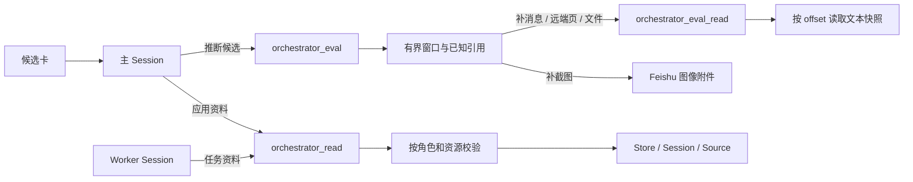

# 09 · 按需读取上下文与模型可见信息

> 面试题　一条飞书消息只写了「就按图里的改」，线程很长，真正的需求在前文和截图中。Superagent 怎样找到证据、控制模型输入大小，并保证不同 Worker 看到的信息符合各自任务范围？

**短答**　主 Session 先收到带来源和路由提示的候选卡。对于推断候选，`orchestrator_eval` 按页加载有限的会话历史，用开头与 Trigger 附近的窗口呈现正文，其他已加载消息提供短预览和 ID。模型可以用 `orchestrator_eval_read` 读取指定消息、图片、下一页或与范围判断有关的仓库文件。日常任务资料由 `orchestrator_read` 提供，应用按角色检查资源归属。远端分页和返回文本分页各有 continuation；部分读结果保存在内存快照，后续 offset 读取同一份内容。证据缺失、资源过期和真实意图不满足须分别说明。 [MasterAssessor](../dsh-superagent-prototype/src/app/assessment.ts) · [评估窗口](../dsh-superagent-prototype/src/sources/admission-context.ts) · [应用资源](../dsh-superagent-prototype/src/app/resources.ts)

本文以提交 `7bd4741` 为基线，沿用帮助页文案案例。设维护者 Alice 在已开启观察的飞书群讨论「帐户设置」文案，最后一条消息只说「按图里的改」，具体位置与改法分布在线程和图片。GitHub 仓库仍是准备交付代码的地方。示意 ID 和路径用于讲解，后文列出了本地可复现的用例。 [第 07 篇](07-feishu-live-backfill-and-threads.md) · [第 08 篇](08-intake-thread-correlation-and-fanout.md) · [准入提示词](../dsh-superagent-prototype/prompts/admission.md)

## 1. 候选卡、评估读取和通用读取各回答什么

如果系统每收到一条候选，便把整个话题、仓库文件和历史会话放进模型上下文，会使每次便宜的路由判断都变成一次昂贵的取证。不相关的旧对话也会增加误判。原型用小卡片说明「什么事件刚到、现有任务在哪里、下一步该做什么」，遇到缺失证据再按需读取。上下文来自不同信任边界：用户对话用于证明意图，仓库内容用于核实对象和范围，Policy 与 Mandate 决定是否有资格执行。把全部来源合并成一段自然语言会削弱这种可追溯性。 [候选卡装配](../dsh-superagent-prototype/src/app/links.ts) · [准入提示词](../dsh-superagent-prototype/prompts/admission.md) · [Policy 与域内接受](../dsh-superagent-prototype/src/policy.ts)

| 入口 | 主要供谁使用 | 回答的问题 | 当前源码中的限制 |
| --- | --- | --- | --- |
| 候选卡 | 主 Session | 是什么消息，走显式路由还是继续评估 | 主消息带截断和引用，相关 Ticket、批次摘要与路由信息 |
| `orchestrator_eval` | 主 Session | 当前推断候选有哪些证据与关联工作 | 活跃 Eval，按页数、时限与展示窗口限制初始上下文 |
| `orchestrator_eval_read` | 主 Session | 补读具体原文、上下文页、图片或仓库文件 | 指定当前 Trigger 和资源类型，受已发现引用及各资源约束 |
| `orchestrator_read` | 主 Session 与 Worker | 查看任务、输入、版本、讨论或对应来源资源 | 路由的角色守卫、边界检查和分页 |

显式候选在 Eval 工具的入口被识别，返回引导去 `orchestrator_route` 的错误。显式请求需要补查任务或来源资料时，可以走通用资源。也就是说，领域内部存在 Eval 对象，不代表每个候选都要调用推断评估工具。本文的 Alice 案例假定消息已取得 inferred 候选资格，`orchestrator_eval` 才是合适入口。 [evalFor](../dsh-superagent-prototype/src/app/assessment.ts) · [主 Session 工具注册](../dsh-superagent-prototype/src/app/tools/main.ts) · [显式候选用例](../dsh-superagent-prototype/tests/assessment.spec.ts#L114)



候选卡目前用批次末尾的 Trigger 作为主要展示，其他事件作为附带卡片。它还可以列出已有相关 Ticket、从正文引用推得的工单以及 handback 理由。主卡正文走 `triggerMessage`，长内容被裁到前 600 个 UTF-16 代码单元并加省略号，同时附原长度和可读引用。把长正文放到工具页里，使常见的路由只需读提示和必要的原消息。候选主展示与授权主 Trigger 的选择分别由卡片代码和 Eval gate 计算，批次里可能不同。 [candidateCard](../dsh-superagent-prototype/src/app/links.ts) · [triggerMessage](../dsh-superagent-prototype/src/executor/dsh.ts) · [Evals.start](../dsh-superagent-prototype/src/core/evals.ts)

## 2. 初始评估窗口怎样加载和压缩

### 2.1 先在网络层设限，再缩减模型可见长度

`MasterAssessor.context(triggerId)` 确认对应的是仍活跃的推断 Eval，再执行 `seed`。Registry 将该 Trigger 绑定到来源的 `TriggerContext`，Reader 可以按 thread/root/parent 读取。 `admissionContext` 按次序从 `thread` 读取远端页，按消息 ID 去重，记下下一个 cursor，并检测重复 cursor。初始加载受 Machine 配置限制。当前 schema 默认最多 10 页，初始读取通道有 15 秒的默认超时；飞书 Reader 的单页大小受 Source 设置控制，默认 20。它们分别限制初始网络扫描、允许等待的时间和单页条目数。增加条目数会影响初始覆盖与返回成本，不能直接把它等同于模型输入的 token 数。 [seed](../dsh-superagent-prototype/src/app/assessment.ts) · [admissionContext](../dsh-superagent-prototype/src/sources/admission-context.ts) · [Machine 默认值](../dsh-superagent-prototype/src/deployment.ts) · [飞书分页配置](../dsh-superagent-prototype/src/sources/feishu.ts)

Reader 会保留平台类型区别。GitHub 普通 Issue 会从对话页读取内容，PR 行内评论可走相应评审线程，默认分支 CI 可用自身事件作上下文。飞书有原生话题时读取该话题。无话题时，其评估适配器可以退回到源消息前的聊天邻近材料。测试中的无话题返回包含源消息和前五条，并标为 `chat_neighbours`。这个 status 是 Reader 层可观察的值；初始模型工具结果对线程主要显示 complete、loaded_messages、source_found 与相应消息。若要判断使用了何种回退，应看 reader 路径和源数据，避免只依赖一个 complete。 [GitHub ThreadContext](../dsh-superagent-prototype/src/sources/github-read.ts) · [飞书回退](../dsh-superagent-prototype/src/sources/feishu-read.ts) · [无话题回退测试](../dsh-superagent-prototype/tests/admission-context.spec.ts#L38)

### 2.2 窗口的计算有三个精确数字

`threadWindow` 从已读去重后的消息顺序取前 5 条，并在找到源消息时取它前后各 5 条和它本身。两个范围有重叠时自然去重，最多是两个互不相交的窗口共 16 个位置。函数还计算每段窗口之前和末尾的遗漏数量。 `MasterAssessor.context` 再按窗口生成模型页。源 Trigger 正文在顶层给一次，最多 4,000 个 UTF-16 代码单元；在线程中对应位置只放 trigger 标记和元数据。对于正文窗口里距离源消息绝对位置差不超过 2 的邻居，代码用 1,200 的截断额度，即左右最多各两条；其余窗口正文用 400。窗口外已读到的消息用 50 长度的 stub 预览。删除项走 deleted 分支，不呈现正常正文。 [threadWindow](../dsh-superagent-prototype/src/sources/admission-context.ts) · [窗口裁剪](../dsh-superagent-prototype/src/app/assessment.ts) · [窗口展示测试](../dsh-superagent-prototype/tests/assessment.spec.ts#L134)

截断响应中的 `chars` 表示该段原文的 JS 字符串长度，模型可借它判断当前看到几成。批次其他 Trigger 也有截断说明，长的可以用 `trigger/<id>` 读取。源码用字符串 `.length` 和 `.slice` 计算 UTF-16 长度，截断后追加省略号。包含 emoji 等字符时，单个可见字符可能占两个代码单元。模型的实际 token 开销还受到作者、ID、预览、JSON 字段与图片信息的影响。 [context 的 batch 与 cut](../dsh-superagent-prototype/src/app/assessment.ts) · [公共 textPage](../dsh-superagent-prototype/src/app/cards.ts)

### 2.3 飞书长话题算一次

假定某个话题返回历史 260 条，头十页每页 20 个唯一条目，初始化一共读了 200 条，未删消息也没有重复。若 Alice 的触发消息位于第 176 条，初始正文窗口是第 1–5 条和第 171–181 条，其中第 176 条只在顶层放完整或截断后的原请求。第 174、175、177、178 条拥有较长正文额度，其余窗口正文按 400 截断。其他 184 条已加载消息至少有短预览或相应标识。第 201–260 条这个时候还没有读到。工具标记 `complete: false`，并给下一页的 `next_cursor`。 [窗口位置](../dsh-superagent-prototype/src/sources/admission-context.ts) · [续页引用测试](../dsh-superagent-prototype/tests/assessment.spec.ts#L160)

如果源消息在第 221 条，初始 200 条里就找不到它。 `source_found: false` 只说明当前 reader 的初始快照没有命中该 ID，不能说明远端已经删除。顶部仍可保留摄取时的 Trigger 文本，初始窗口有开头五条，其他是预览。此时定位原话的方式包括沿 next cursor 继续读、检查 root/parent，或读取已经知道的原 Trigger 资料。在超过窗口以前，某个关键截图和解释可能从未被返回。评估应将「尚未看到」与「看过后发现没有」区分开。 [Reader completeness](../dsh-superagent-prototype/src/sources/admission-context.ts) · [未找到来源的测试](../dsh-superagent-prototype/tests/admission-context.spec.ts#L26)

| 初始结果字段 | 可以确定的事实 | 仍需确认的地方 |
| --- | --- | --- |
| `loaded_messages: 200` | 初始 Reader 汇总了 200 条去重后的记录 | 完整线程总量与未载入历史 |
| `source_found: false` | 当前加载结果未包含源消息 ID | 分页未到、回退阅读、远端可见性或源引用 |
| `complete: false` 带 cursor | 初始抓取停下时还有 continuation | 下一页是否可读与是否包含关键证据 |
| `complete: false` 带 error | Reader 缺失或加载遇到障碍 | 按需读取还有无其他可用证据 |
| `complete: true` | 所选 Reader 这次返回没有 continuation | Reader 是否只是有界的 chat 邻近回退 |

## 3. 两种分页是两条不同的坐标轴

### 3.1 cursor 切远端页，offset 切返回的字符串

`EvalReadSchema` 对 `resource` 列出 `message / root / parent / thread / file / directory / image`，还检查哪些附加字段合法。例如 file 或 directory 要有 path，cursor 只用于 thread，读 image 必须提供 image_id。 `cursor` 是来源继续读取的 token。它可以是 GitHub 的页码，也可以是飞书不透明 token，模型应复制已返回的候选值。 `MasterAssessor.read` 检查非空 cursor 是否列在已知集合里。下一页的 `next_read` 由来源读结果封装，再交给模型。 [EvalReadSchema 与 read](../dsh-superagent-prototype/src/app/assessment.ts) · [飞书继续页](../dsh-superagent-prototype/src/sources/feishu-read.ts)

`offset` 则是已取得的文本的切片位置。首次以 offset 0 取文件或一页远端消息，按需读取并缓存字符串。 `offset > 0` 从相同 key 的快照取第二段。线程页内容会被序列化为 JSON 文本，其中可能含图片引用和 `next_read`。如果一页的字符串很长，调用可以先保留同一个 cursor、按 `next_offset` 拼完这页，然后依据拼好的内容选择是否去下一远端页。尝试用 `next_offset` 当飞书 cursor 会改变远端数据范围；把下一页 cursor 与上一页非零 offset 混在同一次调用，会查询另一个快照 key。 [Eval 快照 key 与 textPage](../dsh-superagent-prototype/src/app/assessment.ts) · [文本切片](../dsh-superagent-prototype/src/app/cards.ts)

举个有限的工具序列。假定当前已经返回 continuation `page-2-token`，下一页 JSON 序列化长 6,500 个代码单元：

```text
orchestrator_eval_read(trigger_id=T, resource=thread, cursor=page-2-token, offset=0)
  -> next_offset=4000，取得该页前一段

orchestrator_eval_read(trigger_id=T, resource=thread, cursor=page-2-token, offset=4000)
  -> next_offset=null，取得同页后一段

如果两段拼合后的下一远端地址是 page-3-token，下一次用它并把 offset 归零。
```

同样地，在通用读取工具中，GitHub 讨论继续页可能通过 `next_resource` 返回，飞书话题下一页也有自己的资源路径。资源名称变了，语义上就在取另一份 Source 响应。 `orchestrator_read` 的 offset 也可用于列表，计数单位是条目。列表默认 20，最大 50；字符串默认 4,000，工具 schema 的 limit 最大 8,000。某些资源另有自己的默认条目数，比如 Ticket 的 Inputs 与 Assignments。 [通用读取 schema](../dsh-superagent-prototype/src/app/tools/tool.ts) · [资源分页实现](../dsh-superagent-prototype/src/app/resources.ts) · [GitHub 原始讨论页](../dsh-superagent-prototype/src/sources/github-read.ts)

### 3.2 长文件快照验证

假设评估确实需要查帮助页的静态文案是否对应当前仓库，并选择 `resource: 'file', path: 'src/labels.ts'`。当前实现用 `readRepositoryPath` 请求配置仓库默认分支的内容。路径有资源类型和相对路径限制。源内容适合用于确认范围和目标，准入提示词要求只在存在具体范围疑问时做这种读取，把定位实现和编辑留给 Worker。通用 `github/…` 资源语法当前涵盖 Issue、PR、评论、评审与 CI；评估文件由这一条独立的 file/directory 入口读取。 [仓库读取](../dsh-superagent-prototype/src/sources/github-read.ts) · [评估读取调用](../dsh-superagent-prototype/src/app/assessment.ts) · [准入读取约定](../dsh-superagent-prototype/prompts/admission.md)

若文件响应为 4,005 个代码单元，offset 0 可返回前 4,000，next_offset 为 4,000。随后保持 `trigger_id / resource / path` 偏移读取，能得到原版本的末尾五字，即使远端在两次工具调用之间变了。同一个参数组合重新 offset 0 会发起读取，并覆盖这组快照。换 path 直接请求 offset 4,000 会触发「先从 0 读」。以此可以说明一致性是**一个已缓存资源响应的分页一致性**，范围比默认分支所有文件在某个 commit 锁住更小。初读不同文件、换远端页或重新 offset 0，都可能见到更新后的数据。 [read 的 snapshots](../dsh-superagent-prototype/src/app/assessment.ts) · [textPage](../dsh-superagent-prototype/src/app/cards.ts)

本次在临时用例中为同一文件安排原版和更新版两份模拟返回。第一次从 0 读，再按偏移拼起来，重建了原文件，外部读取只调用一次。换路径直接请求非零偏移被拒绝。再次从 0 读同一路径后，非零偏移返回的是更新版尾段；当 Eval 决定完毕后，再用旧引用读也被拒绝。这个用例同时验证了快照命中的结果、失配时的协议以及 Eval 的入口时效。 [评估夹具](../dsh-superagent-prototype/tests/assessment.spec.ts) · [继续读取约定](../dsh-superagent-prototype/src/app/assessment.ts)

## 4. 评估期内的缓存怎样工作

`MasterAssessor` 用 `evalId` 保存一组 `EvalReads`。初始化时就把保留的 Trigger 文本及可提取的图片键加入缓存。 `seed` 再按来源读取初始窗口，保存成功结果或错误，并将已取得、未删除的消息正文和图片引用登记起来。对正在加载的 Eval，其他调用等待同一个 `loading` Promise。它能减少模型反复调用初始工具带来的重复读取，也避免同时构造两份起始窗口。没有 reader 的来源仍可按 message 读进来时保留的 Trigger，拓展 thread 读取会返回明确缺失。 [reads / seed](../dsh-superagent-prototype/src/app/assessment.ts) · [缺少上下文时读取原文的用例](../dsh-superagent-prototype/tests/assessment.spec.ts#L96)

| 缓存项 | 存的是什么 | 约束了什么 |
| --- | --- | --- |
| `messages` | 已知消息 ID 和正文 | 读窗口外 stub 的全文也要命中已登记消息 |
| `images` | `messageId/imageKey` 到来源消息与文本 | 图片必须能对应已经登记的来源材料 |
| `cursors` | 初始化和补读发现的 continuation | 继续远端线程读取使用已返回的值 |
| `snapshots` | 资源类型、路径、cursor、message ID 对应的字符串 | 正偏移只从相同参数形状的响应继续 |
| `context / loading / error` | 初始加载结果、在途 Promise 或障碍 | 同一 Eval 的初始上下文可以复用 |

工具请求以 Trigger ID 查找活跃 Eval，进程内缓存真正按 `evalId` 保存。一个 Eval 可以持有一个批次，因此这里的存储粒度和 Eval 生命周期对应，不能描述成每条 Trigger 都有完全独立的缓存。初始的 seed 结果和后续 offset 快照也不是同一份响应。同一 Eval 多次调用 `orchestrator_eval` 可复用种子；`orchestrator_eval_read` 从 offset 0 可以重新取得对应的远端页，再生成新的快照。若初始 fetch 失败，seed 会记录错误，后续针对具体资源的单次读取仍可尝试。 [EvalReads 与缓存生命周期](../dsh-superagent-prototype/src/app/assessment.ts) · [批次与当前候选](../dsh-superagent-prototype/src/core/evals.ts)

Eval 被决定、替换或超时释放后，`release` 删除其记录。初始加载可能还在 await 远端结果；`seed` 在写入结果前检查是否仍是该 Eval 的在途加载，等待结束还会重新检查候选是否有效。已有用例让初始化读先挂起、然后决定 Eval、最后放回结果，断言读调用失败且未重建缓存。理解边界时要区分初始加载、已经开始的具体资源 I/O 和新的工具请求。`evalFor` 检查新的请求，初始 seed 有完成前后的状态保护，宿主停止会给相关读传递 AbortSignal。这样的规则不能直接外推为各类已启动的远端 I/O 都在 Eval 结束瞬间取消。 [release / seed / stop](../dsh-superagent-prototype/src/app/assessment.ts) · [在途初读用例](../dsh-superagent-prototype/tests/assessment.spec.ts#L84)

内存缓存还意味着重启后要重建在途 Eval 读取的运行时证据。历史的 Trigger、Eval 状态和 Decision 有各自的持久化位置，模型曾读过的文件页不是另一个持久化审计表。若需要让第三方事后复核一次审批用到了哪个 commit 或哪张原图，可以在设计中明确记录已读引用、版本、摘要和判断证据。原型接受的评估会保存结构化审计数据和提交的意图依据，但不能据此假定任何工具页都能事后按原样复现。 [审计结果](../dsh-superagent-prototype/src/policy.ts) · [Decision 保存](../dsh-superagent-prototype/src/core/evals.ts) · [Store](../dsh-superagent-prototype/src/app/store.ts)

## 5. 截图怎样进入模型，它证明了什么

在飞书话题中，如果 `om_174` 写「这是现在的界面」并附一张图，预览中可能看到已识别的图片引用。代码从来源消息文本提取 `img_` 键，给出 `messageId/imageKey` 形式的 image_id。 `orchestrator_eval_read` 要求资源为 image、offset 为 0 且引用已登记，不能随便把一个平台文件编号当这条消息的截图。并且在真正读取时还会用该消息的正文验证图片键。若图片只存在于 stub 对应的消息，可以通过读取来源页等已提供的入口获取明确的图片引用。 [评估图片引用](../dsh-superagent-prototype/src/app/assessment.ts) · [Feishu 评估图片实现](../dsh-superagent-prototype/src/sources/feishu-image.ts)

`readAdmissionImage` 先检查当前 Session 的实际模型路由是否支持 image modality，并查 attachment 服务。准备好后用飞书 bot 在临时目录下载对应消息的图片。代码验证返回路径落在临时目录内、是普通文件、扩展名支持，并按附件服务的单图与单消息字节上限取较小值检查。随后保存为 attachment，工具注册层在 JSON 文本外增加一个模型可见的 image 输出块。finally 会清理下载临时目录。用例验证了不支持图片的模型在下载前就被拒绝、附件保存失败会清理文件，以及路径、文件类型和体积的保护。 [图片读与保存](../dsh-superagent-prototype/src/sources/feishu-image.ts) · [工具结果渲染](../dsh-superagent-prototype/src/app/sessions.ts) · [图片用例](../dsh-superagent-prototype/tests/feishu-image.spec.ts#L39)

截图内容可以帮助判断现在显示的文案是什么、对方指的是哪一部分、变更方向是否已经讨论清楚。它与讨论中的明确实施意图各提供一部分证据。若截图看不见，不应假设用户已经指定要改成什么。准入提示词要求模型在必要时先实际尝试读取，然后针对证据不足的原因给出结果。模型不支持图片、权限拒绝或工具失败等问题，可以记录为 unavailable。已阅读的讨论没有形成合格变更请求，则走 ignore。这个区分由提示词和提交的结构化证据表达，读取工具的报错本身不会自动替模型生成业务 Decision。 [评估 prompt](../dsh-superagent-prototype/prompts/admission.md) · [评估输出校验](../dsh-superagent-prototype/src/app/assessment.ts)

将这一步加回案例，可以画一条最短取证链。触发消息「按图里的改」表明有转述的目标，却没有在本条说明改成什么。先查父消息或相邻已知消息，确认 `om_174` 的截图说的是帮助页而非登录页。接着读取返回的 image_id，核对截图中的当前状态。最后再看讨论里是否有人明确确认目标文案。截图有当前文字，目标文案却无人确认时，模型需要按真正缺失的事实回答。这样保存 `direction.evidence` 时，能够指出哪条消息证明位置，哪条消息证明实际目标和实施意图。 [可读资源](../dsh-superagent-prototype/src/app/assessment.ts) · [方向和证据要求](../dsh-superagent-prototype/prompts/admission.md)

## 6. 主 Session 和 Worker 的通用资源范围

`orchestrator_read` 在两个角色都有注册，实际包装会将 Worker 所属 ticketId 带入，主 Session 则由自己的 host 读取。 `RESOURCES` 用于生成提供给模型的资源语法提示，后端 `readResource` 再做具体分发。两者的关系与表单提示和服务器校验相近。提示告诉模型应该请求哪种资源，安全范围由具体 handler 的规则决定。 [资源表与路由](../dsh-superagent-prototype/src/app/resources.ts) · [主工具注册](../dsh-superagent-prototype/src/app/tools/main.ts) · [Worker 工具注册](../dsh-superagent-prototype/src/app/tools/executor.ts)

| 资源类别 | 主 Session | Worker |
| --- | --- | --- |
| 总体列表和配置 | `tickets`、`threads`、`triggers`、`decisions`、Settings、模型和 Prompt 管理 | `main(read)` 拒绝相应入口 |
| `ticket/<id>` 与子资源 | 可看应用任务及其历次报告、输入、会话资料 | ticketId 必须等于此 Worker 的 Ticket |
| `thread/<key>` | 可查看 Thread、工单与最近 Decision | 需自有任务订阅或跟踪，返回省去其他工单和 Decision |
| `trigger/<id>` | 可读取应用保留的 Trigger | 依已接触消息、原始批次或 follows 等判断，相关输出有删减 |
| 飞书原文 | 用 `feishu/<trigger-id>/…` 读指定来源资源 | 先检查 Worker 可读该 Trigger，再由来源验证 chat 或 thread |
| GitHub 原文 | 可查配置仓库允许的 Issue、PR、评论、评审和 CI 资源 | 同样提供仓库内的 GitHub 原文语法，具体 handler 走仓库解析 |
| `prompts/<revision>` | 可查版本与构成 | 限该 Session 正在使用或此前运行过的版本 |

Worker 读取共享讨论时，可以看讨论内容而不需要其他 Ticket 的内部判断和 ID。 `thread/<key>` 先检查订阅或 follows，之后删去适用于主 Session 的任务、决策信息。 `trigger/<id>` 对 Worker 裁掉别的 Ticket 去向和 Decision ID，并筛掉不可达邻居。票据详情也按角色投影。理解可见性时要看三层：资源列表对模型显示什么，具体 handler 允许读取什么，响应内部又隐藏了哪些字段。 [资源角色守卫及投影](../dsh-superagent-prototype/src/app/resources.ts) · [Prompt 版本检查](../dsh-superagent-prototype/src/app/sessions.ts) · [Worker 输出范围用例](../dsh-superagent-prototype/tests/tools.spec.ts#L445)

飞书原文在入口就以已存 Trigger 定位，因此要重新使用相同已知来源，用对应 reader 核查 native chat 与话题。通用 GitHub 原文是另一种范围。当前源码限制在部署仓库、固定资源语法，并没有沿这条 handler 对每个 Issue 或 PR 号做 Ticket 订阅检查。同一个 Worker 可以通过允许的 GitHub 资源读取配置仓库内的相关事实。面试中描述成「应用内部配置与 Ticket 做角色隔离，平台原文依来源资源各自设边界」比较准确。若未来把不同仓库或租户放到一个部署中，需要将平台原文授权和连接上下文扩展成那种架构下的明确边界。 [Feishu 路由与 GitHub 路由](../dsh-superagent-prototype/src/app/resources.ts) · [GitHub 语法](../dsh-superagent-prototype/src/sources/github-read.ts) · [Commands 仓库范围](../dsh-superagent-prototype/src/infra/commands.ts)

### 文本快照与普通列表读取的差别

通用工具的 `sourcePage` 为 Feishu 和 GitHub 原文使用 `sessionId:resource` 缓存。首次请求整份响应并序列化，非零 offset 命中已缓存响应。 `TextCache` 按使用情况调整顺序并按 UTF-16 总长度尽量淘汰旧记录。Runtime 为资源页配额 4,000,000，为来源消息链接另设 200,000，保存在独立 cache。最新插入项即使单独超过设定值也会暂时保留。这个上限是淘汰策略，并不意味着所有读取都能在单次工具内严格保持同一内存阈值。淘汰或重启后，继续页可要求重新从 0 读。 [sourcePage](../dsh-superagent-prototype/src/app/resources.ts) · [TextCache](../dsh-superagent-prototype/src/app/cache.ts) · [Runtime 设置](../dsh-superagent-prototype/src/app/runtime.ts) · [淘汰测试](../dsh-superagent-prototype/tests/cache.spec.ts#L4)

普通的列表、Ticket 输入列表和原始消息等要按各自 handler 看。列表按 offset 重新查询或对当前聚合切片，一般不是跟在一份固定的跨页响应后面。调用间有新消息到达时，后页位置可能不同。不同类型的 `next_offset` 共用字段名，必须同时说明页单位和一致性范围。评估单例的文件快照、通用 Source 响应缓存及普通列表的偏移查询，在读法上长得相似，更新时序各有语义。 [list / sourcePage 与 Ticket 子资源](../dsh-superagent-prototype/src/app/resources.ts) · [Ticket 输入分页测试](../dsh-superagent-prototype/tests/tools.spec.ts#L320)

在实践中还要把响应上限和抓取代价分开看。一个 file 响应只回 4,000 个代码单元，并不意味着只向远端请求了这段。当前读取先取得文件正文，缓存后才切片。一次长话题初读也会拉多页，再用窗口压缩模型输出，远端 I/O 和进程内存仍需承担原始数据。若面试官问如何继续降低成本，可以分别度量远端页数、读回字节、缓存占用与模型输入长度，再决定优化提前停止、来源请求粒度或输出裁剪。 [文件响应与缓存](../dsh-superagent-prototype/src/app/assessment.ts) · [远端文件读取](../dsh-superagent-prototype/src/sources/github-read.ts) · [初始话题读取](../dsh-superagent-prototype/src/sources/admission-context.ts)

## 7. 用测试解释故障边界

| 要验证的结论 | 现有用例的观测点 |
| --- | --- |
| 不夸大初始历史覆盖 | 分页数受限，显示 loaded count、未找到来源与续页。 [初读限制](../dsh-superagent-prototype/tests/admission-context.spec.ts#L26) |
| 裁剪不丢失引用 | 原 Trigger 不在窗口内重复，近处有长段，远处有 stub，stub 可以按 ID 取原文。 [窗口正文裁剪](../dsh-superagent-prototype/tests/assessment.spec.ts#L134) |
| 初始缓存随 Eval 结束释放 | 决策、超时与迟到初读不会留下对应缓存。 [缓存结束用例](../dsh-superagent-prototype/tests/assessment.spec.ts#L66) · [迟到读](../dsh-superagent-prototype/tests/assessment.spec.ts#L84) |
| Worker 只读自己适用的应用管理信息 | 主列表与配置被拒绝，共享讨论的结果隐藏其他 Ticket 和 Decision。 [主资源隔离](../dsh-superagent-prototype/tests/tools.spec.ts#L94) · [响应字段](../dsh-superagent-prototype/tests/tools.spec.ts#L445) |
| 图片先检查模型支持 | 模型仅支持文字时，图片下载和附件保存均不调用。 [模型模态测试](../dsh-superagent-prototype/tests/feishu-image.spec.ts#L46) |

在原型目录安装锁文件依赖后运行：

```bash
pnpm test tests/admission-context.spec.ts tests/assessment.spec.ts \
  tests/feishu-image.spec.ts tests/feishu-read.spec.ts tests/github-read.spec.ts \
  tests/cache.spec.ts tests/tools.spec.ts tests/runtime.spec.ts tests/model-surface.spec.ts
```

本次在临时检出运行，**9 个测试文件、155 个现有用例全部通过**。此外，一项临时长文件验证通过，观察到续读使用原快照、重新从 0 开始才取得更新，并在评估结束后拒绝旧请求。这里的网络内容、模型路由和附件能力由用例夹具提供，支持的是应用边界及数据组合逻辑。 [评估夹具](../dsh-superagent-prototype/tests/assessment.spec.ts) · [图片夹具](../dsh-superagent-prototype/tests/feishu-image.spec.ts)

## 8. 面试怎么讲

### 60–90 秒口述版

> 我会将上下文分成候选摘要、推断评估窗口和任务资料。候选卡先提供原消息、来源、相关 Ticket 和下一步。需要评估时，主 Session 才加载有限页数，取线程前五条及 Trigger 前后各五条，其余已经读到的消息显示预览。
>
> 要补证据时，按已发现的消息或图片引用继续。远端 cursor 表示下一批数据，offset 表示同一份已缓存文本的字符位置。文件、线程页都是先取再切，这保证同页的多段来自同一个当前快照。Eval 结束会释放缓存和读取资格。
>
> 主 Session 与 Worker 的通用工具按资源执行角色校验。Worker 能看本工单需要的 Trigger、讨论和运行记录，共享讨论会过滤别的 Ticket 和 Decision。某段讨论没读到或截图不受模型支持时，应交代缺了什么，并区分证据不可用和已读内容不构成委托。

### 追问一　为什么先给摘要，再让模型取原文？

候选卡足以完成很多直接路由。在模糊请求中，原文仍可按引用获取，还能给出作者、原始时间和所属话题。分阶段能控制重复输入与无关上下文。代价是读取 I/O 和模型工具回合可能增加，应从候选命中率、关键证据漏读和到达 Decision 的延迟一起观察。 [候选卡](../dsh-superagent-prototype/src/app/links.ts) · [评估工具](../dsh-superagent-prototype/src/app/assessment.ts)

### 追问二　如何解释 complete 为 true 却不保证读完群聊？

字段描述的是所选 Reader 有没有再给 continuation。飞书无话题时 Reader 可返回一小段邻近消息，作为一个已结束的有界结果。只要知道真实读取模式以及 loaded_messages，就能判断当前结论在什么范围内有效。 [Feishu 回退](../dsh-superagent-prototype/src/sources/feishu-read.ts) · [完整性定义](../dsh-superagent-prototype/src/sources/admission-context.ts)

### 追问三　cursor 和 offset 为什么不能混用？

cursor 改变远端取到的数据页。offset 改变当前字符串或列表的起始位置。对有快照的线程页，应先把同一页按 offset 拼完，才能据完整响应判断是否继续到下一远端页。 [评估读取分页](../dsh-superagent-prototype/src/app/assessment.ts)

### 追问四　缓存过期或模型看不了图，应该如何解释结果？

遇到缓存淘汰或重启而需要继续已知资源，从 offset 0 重读。如果活跃 Eval 已结束，不能继续拿原工具引用完成这次判断。截图决定了准入所需的事实且模型或工具不可读时，保留具体的不可用原因；只有可见讨论本身确实不满足请求条件时，才按合适的规则记录被忽略。 [快照恢复](../dsh-superagent-prototype/src/app/resources.ts) · [评估意图约定](../dsh-superagent-prototype/prompts/admission.md)

### 追问五　同一 Thread 有两张 Ticket，Worker 可看什么？

Worker 可以在本 Ticket 订阅或跟踪的 Thread 看相关事件，线程视图省去其他 Ticket 和 Decision。读取触发详情时也会过滤不应看到的邻近 Trigger 与内部去向。进一步读飞书原文由 Trigger 的可见性约束，GitHub 资源则按照配置仓库和各自语法检查。逐个资源说明调用边界，能避免把角色说明当成一个概括所有数据面的承诺。 [角色资源](../dsh-superagent-prototype/src/app/resources.ts) · [Worker 输出测试](../dsh-superagent-prototype/tests/tools.spec.ts#L445)

---

[返回连载目录](README.md) · [上一篇《Trigger 落库、Thread 关联与订阅扇出》](08-intake-thread-correlation-and-fanout.md) · 下一篇《Policy 准入矩阵与授权强度》
