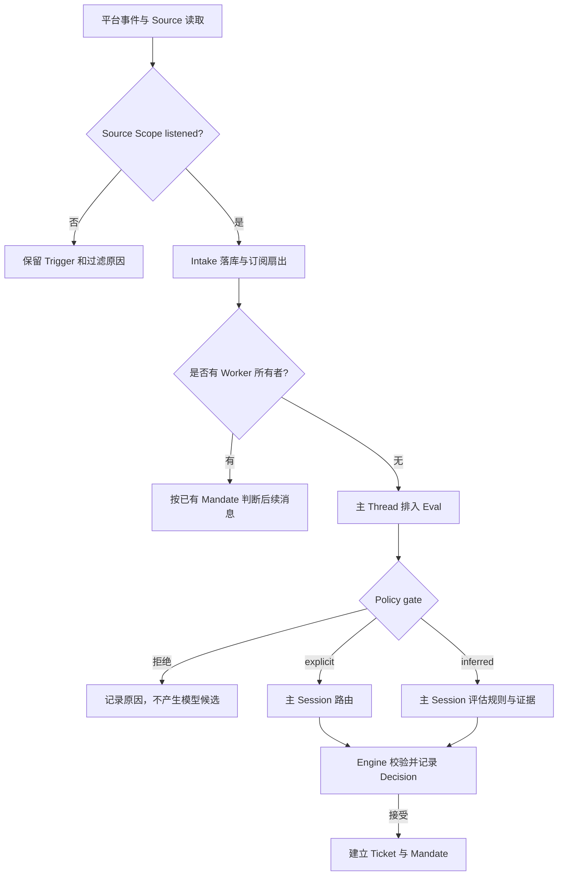

# 10 · Policy 准入矩阵与授权强度

> 面试题　一个维护者、一个陌生用户和一个机器人都在 PR 下写了「@Agent，修一下」。默认分支又刚好报了 CI 失败。哪些消息能成为候选，哪些能授权新任务，哪些只能作为已有工单的背景？

**短答**　先确定来源有没有读取到事件，以及 Source Scope 是否接收。随后看这条人工消息是否已经归某个 Worker 判断。对进入 gate 的输入，`settingsPolicy` 按来源身份、是否指向 Agent、接收范围的准入单元格、已有 Thread 关系和模式求 `explicit`、`inferred` 或拒绝。登记 bot 最多成为推断候选，无发送者的默认分支 CI 还要单独启用那一行。进入候选后仍需要路由或规则评估。接受才写下 Mandate，说明这张 Ticket 由谁、依据什么、允许做多大范围。 [准入实现](../dsh-superagent-prototype/src/policy.ts) · [矩阵默认值](../dsh-superagent-prototype/src/admission.ts) · [授权说明](../dsh-superagent-prototype/docs/002-authorization.md)

本文以提交 `7bd4741` 为基线，继续用虚构仓库 `example/portal` 的帮助页错字任务。维护者 Alice 在本部署的 GitHub 名单中，她的飞书 open ID 是否获准由飞书的名单独立决定。陌生用户、质量机器人和默认分支 CI 下文会使用同一任务做对照。示例中的 Source 设置和准入开关按各场景写明。 [第 08 篇](08-intake-thread-correlation-and-fanout.md) · [第 09 篇](09-bounded-context-and-resource-reads.md)

## 1. 先把接收、归属、准入和接受分开

一条消息从外部到实际执行，至少经过四种判断。第一是**平台可见性和 Source Scope**。消息需要被来源读取，Intake 才能按 `listened` 判定过滤，并保留接收记录。第二是**任务归属**。已有订阅可把消息作为 Input 送给多个 Ticket，再计算人类跟进的当前所有者。第三是**新判断的准入强度**。需要评估时，gate 计算候选资格和授权依据。第四是**是否真的采取动作**。主 Session 路由显式候选或对推断候选作规则评估，Engine 校验并记录 Decision。不同阶段拒绝时，能看到的证据也不一样。 [Intake](../dsh-superagent-prototype/src/core/intake.ts) · [followupOwners](../dsh-superagent-prototype/src/core/model.ts) · [Evals.start / decide](../dsh-superagent-prototype/src/core/evals.ts)

| 现在问什么 | 该查哪一层 | 可能得到的证据 |
| --- | --- | --- |
| 平台上有消息，本地有没有看到 | Source watcher 和接收记录 | 通知、群历史、Trigger 或来源健康 |
| 本地有 Trigger，为什么没继续 | Intake 与来源 Scope | `filtered`、原因码、Thread 是否建出 |
| 为什么没有新候选但 Worker 收到 | fanout、`followupOwners` | 正式跟进或参考输入、已有 Ticket |
| 为什么模型拿到了显式或推断候选 | Policy gate | strength、basis 与所属范围 |
| 为什么出现 `would_accept` 但目录没有新工单 | `assessmentOutcome`、当前模式和 Decision | 观察记录，等待人工复核和配置变化 |
| 为什么原工单确实可以开始执行 | 接受的 Decision 和 Mandate | 发送者、策略版本、规则、工作范围 |



图展示收到新事件时的主要路径。Worker 所有者仍可以把超范围消息 handback，授权的人也可以通过适当路径停止任务。当前 Ticket 的运行与恢复是对既有 Mandate 的使用。把「有一条 Input」直接翻译为「一个新任务获准」，会混淆同一范围里继续处理和获得新范围。 [退回与停止入口](../dsh-superagent-prototype/src/core/engine.ts) · [授权文档](../dsh-superagent-prototype/docs/002-authorization.md)

## 2. 先读 gate 的输入，避免被自然语言误导

### 2.1 actor、human、addressed 各代表一类事实

`actor = { source, id }` 由来源转换得到，使用平台原生 ID。 `allowedSender` 先查 `settings.policy.sources[actor.source]`，再比较名单条目 id。实现用 `sameName` 做大小写无关的比较；显示名主要用在 basis 里给人读，不能自动关联两个来源。如果 GitHub 名单里写的是 Alice，只要平台 login 对应即可。她在飞书的 `ou_alice` 要另外出现在飞书 part。跨来源的人名相同，也不能因此取得授权。 [allowedSender 与 listedBot](../dsh-superagent-prototype/src/policy.ts) · [sameName](../dsh-superagent-prototype/src/infra/text.ts) · [来源身份隔离测试](../dsh-superagent-prototype/tests/policy.spec.ts#L60)

`human` 是来源给出的分类。GitHub 转换根据平台用户类型和账号形式识别 GitHub App 或常见 bot，Source 自己帐户的事件常在读取时跳过。飞书使用结构化的 sender_type 类别，并跳过该 bot 自己的 ID 或 app ID。正文写着「我是管理员」或显示昵称叫 Agent，不会修改这些字段。也有识别边界，使用普通用户账号发消息的自动评审可能被 GitHub 转换当作人。原型文档将进一步识别这样的评审者交给团队提示词，部署方如果要求严格的人机区分，需要把这种身份纳入接入策略。 [GitHub 人类识别](../dsh-superagent-prototype/src/sources/github-trigger.ts) · [飞书人类识别](../dsh-superagent-prototype/src/sources/feishu-trigger.ts) · [自动评审说明](../dsh-superagent-prototype/docs/002-authorization.md)

`addressed` 在当前模型里是可选的 `mention` 或 `direct`。GitHub 在相应正文查 Agent 登录名的提及，飞书群消息用结构化 mentions 与 bot ID 或 app ID 匹配，私聊来自 `chat_type=p2p`。它回答文本的方向，帮助确定「向谁说」。真正要执行什么，还由模型路由或评估看原文与上下文。例如「@Agent 这是我们之前你帮忙看过的记录」可以被判为 addressed，含义只是在传材料。一条明确请求和仅提到 Agent 的讨论，在 gate 之前可能具有同样的 actor 与 addressed。后续路由需要读语义。 [指向性映射](../dsh-superagent-prototype/src/sources/feishu-trigger.ts) · [GitHub 提及函数](../dsh-superagent-prototype/src/sources/github-trigger.ts) · [显式路由提示](../dsh-superagent-prototype/prompts/dispatch.md)

### 2.2 接收范围有 listened、observed 和 row

`SourceRegistry.scope` 返回接收与观察结果。 `listened` 为 false 时，正常摄取在 Scope 停下，可以记录具体来源原因。 `observed` 反映范围能否把没有指向 Agent 的输入送进普通矩阵条件。 `row` 是这组范围的准入表 ID，例如 GitHub 的 `issues`、`pulls`、`comments`，或飞书某个群。它们提供给 Policy 作为来源事实，角色本身不能通过自由文本改写。 [SourceScope](../dsh-superagent-prototype/src/core/ports.ts) · [Registry.scope](../dsh-superagent-prototype/src/sources/registry.ts) · [摄取过滤](../dsh-superagent-prototype/src/core/intake.ts)

| 来源范围 | 典型 Scope 结果 | 哪些输入进入正常矩阵 |
| --- | --- | --- |
| GitHub 新 Issue 开启全仓观察 | `listened: true, observed: true, row: 'issues'` | 提及和收到的未提及输入都可按条件判断 |
| GitHub 评论关闭全量观察 | `listened: true, observed: false, row: 'comments'` | 提及仍可通过正常矩阵条件，由其他入口读到的评论也可能是跟进 |
| 飞书某配置群设「仅 @」 | `listened: true, observed: false`，row 为该群 | 提及可进对应格，正式跟进可按已有 Ticket 处理 |
| 飞书某配置群设「全部消息」 | `listened: true, observed: true`，row 为该群 | 未指向 bot 的输入也可用准入格 |
| 飞书其他群设不接收 | `listened: false, reason: chat_not_allowed` | 正常 Intake 过滤 |
| 飞书私聊开启 | `listened: true, observed: false, row: 'direct'` | 原生私聊 Trigger 带 `addressed: 'direct'` |

一条消息是否读得到需要结合来源循环。配置 GitHub 评论全量观察后，平台仍可能因为可见性或扫描窗口读不到某项。反过来，在关闭仓库全量观察时，订阅轮询或通知仍可以读取该评论。 `githubKind.scope` 这时用 `observed: false` 表达普通观察资格。飞书在「仅 @」模式下的 listened 也不等同于每条未提及消息在 Intake 被丢弃。来源可已经从具体线程读到它，正式跟进的判断逻辑需要接续已存在的讨论。 [GitHub scopeOf / scope](../dsh-superagent-prototype/src/sources/github.ts) · [飞书 scope](../dsh-superagent-prototype/src/sources/feishu.ts) · [Source 范围测试](../dsh-superagent-prototype/tests/policy.spec.ts#L32)

读代码要沿正常链路定位检查。人类 gate 会用 Scope 读 row 和观察状态，允许名单且明确指向 Agent 的快速分支独立返回。Source 是否接收新事件的直接检查在 Intake 早期。进行接口审查时应分别验证正常摄取、来源状态变化前后的重新判断，以及人工处理历史输入，不能把一个调用点的 gate 当成完整的来源接收流程。 [人类 gate](../dsh-superagent-prototype/src/policy.ts) · [Intake 原始检查](../dsh-superagent-prototype/src/core/intake.ts) · [重新评估命令](../dsh-superagent-prototype/src/core/evals.ts)

## 3. 准入矩阵的三格与优先级

### 3.1 第四象限为何不在表里

矩阵使用「在名单吗」和「指向 Agent 吗」两个维度。一共有四种组合。其中「名单内且已指向」在 gate 有固定显式路径，不进入通用三格表。其余三格在 `ADMISSION_OPTIONS` 和 `AdmissionRowSchema` 里都能看到。缺格时，`admissionOf` 回到默认值。它按当前匹配的 row 查该值，另一个群设置为显式不会自动应用到本群。 [admission.ts](../dsh-superagent-prototype/src/admission.ts) · [AdmissionRowSchema 与 admissionOf](../dsh-superagent-prototype/src/policy.ts)

| 名单与指向 | 实现入口 | 可配置值 | 默认结果（本格读取时） |
| --- | --- | --- | --- |
| 名单内并指向 | `via: 'addressed'` | 直接显式，无表格单元 | `explicit` |
| 名单内且未指向 | `listedUnaddressed` | inferred、ignore | inferred |
| 名单外且指向 | `unlistedAddressed` | explicit、inferred、ignore | ignore |
| 名单外且未指向 | `unlistedUnaddressed` | inferred、ignore | ignore |

这个表有两个容易误读的地方。第一，未指向的普通矩阵格通常要有 observed 才参与；默认 `listedUnaddressed=inferred` 不能使整个仓库所有闲聊自动成为候选。第二，矩阵未指向格不能配置 explicit，只针对矩阵值。Thread 本身的参与关系可能让一个名单成员的跟进得到显式强度，走的是 `via: 'followup'`。同样叫 explicit，业务理由不同，Mandate basis 也要准确区分。 [人类 gate 与 Schema](../dsh-superagent-prototype/src/policy.ts) · [未指向格拒绝配置显式的测试](../dsh-superagent-prototype/tests/policy.spec.ts#L306) · [跟进测试](../dsh-superagent-prototype/tests/policy.spec.ts#L67)

### 3.2 一张决策表写出人类输入的判断顺序

下表以正常通过 Scope、且确实走到 gate 的消息为前提。先按上到下匹配：

| 顺序 | 条件 | gate 结果 | basis 或理由 |
| --- | --- | --- | --- |
| 1 | 允许名单命中，且有 `addressed` | explicit | `via: 'addressed'` |
| 2 | 已指向或来源观察未指向的消息，当前准入格值为 explicit | explicit | `via: 'admission'`，记录 cell |
| 3 | 有正式 Thread 参与关系，且不属于陌生私聊的跟进推断，名单内 | explicit | `via: 'followup'` |
| 4 | 同有正式参与关系，名单外，且 mode 非 off，排除不具名单资格的私聊跟进 | inferred | `via: 'followup'` |
| 5 | 普通矩阵可用，格值为 inferred，且 mode 非 off | inferred | `via: 'admission'`，带 observation |
| 6 | 都不满足 | 拒绝 | 名单外为 `not_a_member`，其他按条件用 `admission_ignored` 或 `no_mention` |

实现的第 3、4 项写成一个分支。它算 `participating(thread, tickets)`，通过当前 Thread 订阅或传入 Ticket 的 ID，排除 `thread.context` 中只供参考的关联。参与关系不要求那张 Ticket 一定开放。因此「Thread 有历史任务」可能给 gate 提供 follow-up 语境，和「本次 Trigger 正由一个 Worker 判断」仍是两套条件。当前任务真正需要接手，要在 Intake 与 `followupOwners` 查当前状态。 [participating 与 gate](../dsh-superagent-prototype/src/policy.ts) · [followupOwners](../dsh-superagent-prototype/src/core/model.ts)

例如一条陌生人的群消息在专用支持群中提及 Agent，`unlistedAddressed='explicit'`。即使 Thread 有既有工作，若这条消息已交回新判断，它也会在 follow-up 分支前获得显式强度。将显式格放在前面是有意维持范围已批准的入口语义。反之，若格为 ignore，普通矩阵不会给它资格，但它仍可能符合特定 Thread 的跟进条件。这样设计意味着「默认 ignore」通常不是对任何同 Thread 情况的全局禁令。 [显式优先于 follow-up 的测试](../dsh-superagent-prototype/tests/policy.spec.ts#L137) · [跟进不走普通格的测试](../dsh-superagent-prototype/tests/policy.spec.ts#L148)

### 3.3 私聊的例外需要按优先级讲

飞书私聊发给 bot 时会写 `addressed: 'direct'`，Source 映射到 direct row。默认未列名用户不通过。人类 gate 还显式禁止这类陌生私聊借 Thread 参与关系得到 follow-up 强度。若部署者在 direct row 明确把 `unlistedAddressed` 设置为 explicit，代码在进入 follow-up 之前检查该格，当前允许得到 `explicit/admission`。如果这个格设置成 inferred 且模式可评估，则可在普通矩阵的推断分支有资格。这些是明确选择的范围规则。面试中应说清默认、follow-up 特例和允许部署修改的入口。 [direct row](../dsh-superagent-prototype/src/sources/feishu.ts) · [默认陌生私聊拒绝](../dsh-superagent-prototype/tests/policy.spec.ts#L81) · [按 row 显式开放的测试](../dsh-superagent-prototype/tests/policy.spec.ts#L109)

设置界面渲染时也会按来源能力标出哪些格有效。例如私聊原生 Trigger 都有 direct，只需对应已指向格；「仅 @」的群没有用来观察未指向消息的普通格；默认分支 CI 既没有普通发送者也未提及 Agent，只展示 `unlistedUnaddressed`。Schema 描述允许的单元值，来源的 UI rows 和运行时 receivable 检查共同确定一个已保存的格对当前输入是否适用。 [飞书 admission rows](../dsh-superagent-prototype/src/sources/feishu.ts) · [GitHub admission rows](../dsh-superagent-prototype/src/sources/github.ts) · [Registry.validatePolicy](../dsh-superagent-prototype/src/sources/registry.ts)

### 3.4 为什么适用范围由来源解析

假设部署有 `oc_support` 和 `oc_dev` 两个群。操作者只想让支持群里的陌生提及获得显式强度，于是先在 `settings.sources.feishu.config.chats` 定义支持群，再在 `settings.policy.sources.feishu.admission.oc_support` 配置一个 `unlistedAddressed` 单元。来自开发群的 Trigger 携带自己的 chatId，来源根据配置取得开发群的 row，所以支持群单元不会应用到开发群。正文要求「请把我按支持群处理」也不会改变 Source 提供的 chatId。这个设计让操作者能事先掌握哪个讨论范围允许明确委托。 [飞书范围定义](../dsh-superagent-prototype/src/sources/feishu.ts) · [admissionOf](../dsh-superagent-prototype/src/policy.ts)

若某来源没有给当前输入返回 row，`admissionOf` 使用默认格。若返回有效 row 但未保存相应格，也回到同一默认。配置表的含义是**按范围覆盖默认值**。比如使用默认设置时，名单内未指向、来源已观察且模式允许的输入可成为 inferred。与此同时，`SourceRegistry.validatePolicy` 把来源 schema 和公共表 schema 分开校验。飞书负责标识格式和成员配置，公共 Schema 保证两个未指向格无法配置 explicit。新增来源也能沿用域内同一套资格强度。 [默认值](../dsh-superagent-prototype/src/admission.ts) · [服务端准入值验证](../dsh-superagent-prototype/src/policy.ts) · [Registry 校验](../dsh-superagent-prototype/src/sources/registry.ts)

## 4. 四类输入走一次源码

### 4.1 维护者 Alice，明确提及与普通观察

Alice 在 `github:42` 发「@portal-agent，把帮助页的‘帐户设值’改回‘帐户设置’」。当来源接收后，GitHub 登录名命中，`human` 与 `addressed: 'mention'` 来自来源转换。到人类 gate 的第一分支，得到显式强度，basis 记录 `via: 'addressed'`、GitHub 范围与发送者。它不依赖 observe 开关或 `eval.mode` 是否为 off。主 Session 还要检查语义与工单关联，随后可提交接受、附加、忽略或停止等适用操作。表中的 explicit 是路由资格与授权强度。真正建立 Ticket 需要实际接受决定。 [允许名单提及测试](../dsh-superagent-prototype/tests/policy.spec.ts#L54) · [显式接受在不同模式](../dsh-superagent-prototype/tests/policy.spec.ts#L315) · [route 工具](../dsh-superagent-prototype/src/app/tools/main.ts)

去掉 `@portal-agent`，并假定 #42 没有已有任务。若 `observeIssues` 已开启，收到的这个输入就能读 `listedUnaddressed`，默认 inferred。在 observe 模式可产生推断候选，后续模型还要判断这一句话、上下文和已启用规则是否足够。若关闭 `observeIssues`，即使通过通知或其他方式读到没有提及的正文，普通矩阵的 receivable 条件也不成立，在无正式 follow-up 时会拒绝。若继续开观察但把 eval.mode 切到 off，同一格值仍可解析为 inferred，gate 不再承认这种资格。 [GitHub 范围](../dsh-superagent-prototype/src/sources/github.ts) · [允许名单未指向测试](../dsh-superagent-prototype/tests/policy.spec.ts#L76)

### 4.2 陌生用户，提及、支持群和正式跟进

陌生用户用同一句话，Text 并未改变，但 actor 没命中名单。正常新 Issue 的 `unlistedAddressed` 默认 ignore，因此拒绝，原因 `not_a_member`。允许旁听或接收仓库评论不改变此默认。若团队在专用范围显式开放陌生用户的提及，例如飞书支持群一个 row 的 `unlistedAddressed='explicit'`，则是团队托付该范围的直接入口。其他 row 仍按自己的配置。若改为 inferred，则只得到进入规则评估的可能。 [默认接收矩阵](../dsh-superagent-prototype/src/admission.ts) · [跨范围单元格测试](../dsh-superagent-prototype/tests/policy.spec.ts#L109)

换成已绑定的 PR #57，陌生用户补充「这里只修帮助页」，它可能已经直接进入现有 Worker 的 Input，不走新候选。如果 Worker 判断某条后续意见是新的独立工作而退回，且别的 Worker 都没有接手，那么到 gate 时仍处于有正式任务的 Thread。在非 off 模式，名单外人的普通 follow-up 可成为 inferred。Worker 接收资料与新建 Ticket 分别依现有 Mandate 和新评估规则。 [跟进所有者](../dsh-superagent-prototype/src/core/model.ts) · [人类跟进准入](../dsh-superagent-prototype/src/policy.ts) · [退回后的路由](../dsh-superagent-prototype/tests/followups.spec.ts#L47)

### 4.3 登记 bot，用自己的名单与机器分支

假设质量机器人 `quality-bot[bot]` 在 PR #57 下发出提示，Source 将它标为 `human: false`，actor.id 非空。gate 第一条就去 `machineGate`。它查的是当前来源的 bots 列表，和 Alice 的允许名单分别配置。未登记的非空机器 ID 会得到 `not_human`。登记机器人的消息还必须来自可接收范围，且已经指向 Agent 或 Source 观察这个范围。如果 eval.mode 为 off，则在这条路径得到 `admission_ignored`。满足这些条件时返回 `inferred`，basis 为 `via: 'bot'`，还能留下 bot 名称、相关 row、addressed 和观察模式。 [machineGate](../dsh-superagent-prototype/src/policy.ts) · [登记机器人条件测试](../dsh-superagent-prototype/tests/policy.spec.ts#L420)

这里有两处常用对照。第一，哪怕 bot 的文本表达得像一个显式命令，或所在 PR 已有 Ticket，机器路径的最高强度仍是 inferred。人类的 `unlistedAddressed='explicit'` 单元格和人类 follow-up 不给该 bot 授权。第二，bot 有时会发给一个已经开放的 Ticket。例如已订阅 PR 的质量报告可以到 Worker 用作诊断。摄取的 fanout 与对新任务的资格不同。 `followupOwners` 对机器返回空，所以它会独立进入评估路径，再按机器 gate 决定拒绝或候选。 [机器路径测试](../dsh-superagent-prototype/tests/policy.spec.ts#L326) · [摄取与归属](../dsh-superagent-prototype/src/core/intake.ts) · [followupOwners](../dsh-superagent-prototype/src/core/model.ts)

bot 列表给的是成为推断候选的身份资格。比如机器人报「登录页接口异常」，而系统只启用了目标明确的文案规则和局部视觉规则。即使机器人在名单、模式为 auto 并且告警被读到，仍要评估意图、范围与规则命中。本例的告警无法仅凭这几个准入条件就产生接口修改任务。来源名单判断哪些机器输入可以进入评估，团队规则控制系统主动接哪些类别的工作。 [默认启用规则](../dsh-superagent-prototype/src/policy.ts) · [准入评估要求](../dsh-superagent-prototype/prompts/admission.md)

### 4.4 无发送者的 CI，接收配置与矩阵缺一不可

GitHub 默认分支 CI 的转换生成 `human: false`、空 actor.id、`meta.ci: true` 和 branch。它没有直接向某个人回复的 Channel。 `scopeOf` 识别带 branch 的 CI 为 `ci` row。若 `observeCi` 已开启，该范围才有 observed。进入 machineGate 后，空 ID 跳过 bot 名单要求，随后使用 `unlistedUnaddressed`。默认这一格为 ignore，就算观察到失败，仍会得到 `admission_ignored`。明确改成 inferred，且 mode 非 off，才获得推断候选强度。 [CI Trigger](../dsh-superagent-prototype/src/sources/github-trigger.ts) · [GitHub CI row](../dsh-superagent-prototype/src/sources/github.ts) · [CI 准入测试](../dsh-superagent-prototype/tests/policy.spec.ts#L442)

PR #57 的 CI 没有默认分支的 branch 标记，在当前 GitHub Scope 不返回 `ci` row，也不继承 `observeCi` 的 observed 值。它可以作为跟踪 PR 的 Input，帮助 Worker 继续已有工作。正常该类型 Trigger 也没有 addressed，因此无法满足机器 gate 的指向或观察要求，准入失败。默认分支故障可以经单独配置获得评估机会，PR 检查结果则主要给已有任务做反馈，这可以减少机器状态变化扩大成新委托的次数。 [PR CI 构造](../dsh-superagent-prototype/src/sources/github-trigger.ts) · [Scope 与 pollChecks](../dsh-superagent-prototype/src/sources/github.ts) · [CI 对照断言](../dsh-superagent-prototype/tests/policy.spec.ts#L442)

可以在白板上将机器事件的顺序记成三问。**谁发的**决定是否查 bots。**从哪里来且是否指向**决定当前范围可用。**是登记机器还是无发送者**决定最终使用 bot basis 或矩阵 cell。接着问模式是否允许推断候选。外部事件本身没有改变文件的权限，后续评估与接受校验都满足才产生新 Ticket。 [机器分支](../dsh-superagent-prototype/src/policy.ts) · [Evals.accept](../dsh-superagent-prototype/src/core/evals.ts)

### 4.5 对照结果放在一张表复算

下表中的「拒绝」是 gate 判定。其前提是事件已通过适用的接收步骤，且该条消息确实到达 gate。正式所有者接管、Source 过滤等路径需独立判断。改变配置做对照时，应固定事件内容和线程状态，只修改要验证的条件。

| 输入 | 如下设置或额外条件 | 结果 |
| --- | --- | --- |
| Alice 在 Issue @ Agent | 名单内，即使 off | explicit/addressed |
| Alice 在 Issue 无 @ | observeIssues 打开，无参与 Ticket，模式 observe | inferred/admission |
| Alice 在 Issue 无 @ | observeIssues 关闭，无参与 Ticket | 拒绝，no_mention |
| 陌生用户在 Issue @ Agent | 本范围单元格用默认 | 拒绝，not_a_member |
| 陌生用户在 Issue @ Agent | 本范围 `unlistedAddressed=explicit`，有既有 Thread 关系，模式 off | explicit/admission |
| Alice 发既有 Thread 的跟进，无 @ | 正式订阅，交由 gate 判断，模式 off | explicit/followup |
| Alice 发仅参考的 Thread，无 @ | 全量观察关闭，模式 off | 拒绝，no_mention |
| 陌生用户私聊 | 私聊开启，默认 direct row，已有 Thread 关系 | 拒绝，not_a_member |
| 陌生用户私聊 | 私聊开启，direct row 显式开放，模式 off | explicit/admission |
| 登记 bot @ Agent | 名单命中，Scope 接收，模式 observe | inferred/bot |
| 未登记 bot @ Agent | 即使 Thread 有 Ticket | 拒绝，not_human |
| 默认分支 CI | observeCi 开，ci row 未设置 | 拒绝，admission_ignored |
| 默认分支 CI | observeCi 开，ci row 配为 inferred，模式 observe | inferred/admission |
| PR CI | observeCi 开，ci row 配为 inferred | 拒绝，not_human |

特别注意「维护者报告 CI 失败」与「平台的无发送者事件」是两种 Trigger。前者走人类身份和指向性，后者才走空 Actor 的机器路径。相同的失败图标或描述不改变它们的 actor 与 human 数据合同。这个区别可以用两个来源输入对照，不必让面试官假定所有带 CI 字样的消息都走 CI Scope。 [gate 与结果类型](../dsh-superagent-prototype/src/policy.ts) · [GateResult](../dsh-superagent-prototype/src/core/ports.ts) · [机器与 CI 用例](../dsh-superagent-prototype/tests/policy.spec.ts)

## 5. 三种模式作用在候选和接受的不同位置

### 5.1 off、observe、auto 在哪一层被检查

off 的第一个效果是在 gate 不承认 inferred，从源头减少推断候选。它保留符合条件的显式候选和相应接受能力。observe 与 auto 都可以让合格 inferred 成为候选。两者主要区别在模型给出积极评估之后。 `assessmentOutcome` 对非 auto 的 inferred 接受提议，转成 `ignore`，保留 `would_accept: true` 和 proposal 及证据。只有满足条件且 mode 为 auto 的积极评估，才可能进入 Engine 的实际接受。 [EvalConfigSchema 与 assessmentOutcome](../dsh-superagent-prototype/src/policy.ts) · [观察与自动接受运行时用例](../dsh-superagent-prototype/tests/runtime.spec.ts#L265)

| 模式 | 显式候选 | 推断候选 | 对合格的推断接受提议 |
| --- | --- | --- | --- |
| off | 正常按显式路由 | gate 不会新准入 | 常规路径在 gate 停下 |
| observe（默认） | 正常按显式路由 | 可被评估 | 记录 ignore 和 would_accept |
| auto | 正常按显式路由 | 可被评估 | 经规则与 Engine 校验，可能建立 Ticket |

off 与系统 `paused` 各有作用。off 是推断接单策略，符合条件的人类显式任务仍能推进。在系统暂停中，进入新的评估、派发和常规外发的动作会被持有，已启用的 Source 可以继续记录输入。「临时只允许团队明确委托」与「暂时停止调度」需要不同开关。面试中应说明判断层、评估层与运行调度层各自在哪里读设置。 [设置 Schema](../dsh-superagent-prototype/src/policy.ts) · [Runtime.paused](../dsh-superagent-prototype/src/app/runtime.ts) · [Engine.evaluateDue](../dsh-superagent-prototype/src/core/engine.ts)

### 5.2 inferred 为什么还需要模型证据和后端复核

对推断候选，模型判断应包含已启用规则的逐条评估、变更方向与意图证据。 `assessmentOutcome` 校验规则集合，要求每条当前启用规则恰好出现一次。提交 accept 时，如果方向未定，转换为 `directionUnsettled` 的 ignore；没有命中规则则为 `noRuleMatched`；满足这些但缺意图证据会抛出校验错误。通过后还看当前模式。定向字段检查包括是否要求实施、目标是明确指定或可依据现有标准、还有没有悬而未决的设计决定。代码验证这些字段及组合，模型是否正确引用了真实讨论仍取决于输入与判断。 [方向 Schema 与结构化评估](../dsh-superagent-prototype/src/policy.ts) · [评估工具 Schema](../dsh-superagent-prototype/src/app/assessment.ts) · [规则覆盖测试](../dsh-superagent-prototype/tests/policy.spec.ts#L335)

到 Engine，`Policy.admitsInferred` 再检查 mode 必须为 auto、匹配规则列表不能为空，且每个声明匹配的 ID 必须当前启用。主 Session 直接用显式工具提交 inferred accept 时，没有所需规则依据，应用会拒绝。接受也要比较正在评估的 Policy version 与当前版本，处理旧判断。模型给出语义结论，工具绑定与 Engine 限制授权如何记账。因此解释时可以对照矩阵允许、方向明确、规则命中、版本有效四项。出现 accept 代表下游操作通过了应用的这些检查，真实需求是否理解正确还需结合提交的 evidence 和原文。 [admitsInferred](../dsh-superagent-prototype/src/policy.ts) · [Evals.decide / decideEval](../dsh-superagent-prototype/src/core/evals.ts) · [直接路由拒绝用例](../dsh-superagent-prototype/tests/runtime.spec.ts#L619)

对于 help 页案例，可以比较三个不同的积极语气。Alice 说「这行错字很显眼」，可能缺少实施要求。她说「把页面改顺眼些」，目标和设计决策未定。她说「把 帐户设值 改回 帐户设置」，且上下文清楚指向当前项目，则可提供明确方向，再验证相应规则。三个候选可能有相同 inferred 准入强度，后端允许模型提交的理由却不同。日常的 `copy` 和局部 `visual` 规则也有范围差异，Worker 在已授权的范围内才做具体实现。 [默认规则和方向结构](../dsh-superagent-prototype/src/policy.ts) · [准入提示](../dsh-superagent-prototype/prompts/admission.md)

### 5.3 用 observe 看什么，如何判断可以切换

假设团队想开放配置群的主动文案维护，可以在已开全量观察的小范围内先使用 observe。把 `would_accept` 样本对照原文，检查是否确有人要求实施、是否明确新文案、规则是否将影响范围控制在帮助页。再抽查没有产生候选的输入，发现遗漏是发生在读取、Scope、身份还是矩阵。切换到 auto 前，团队要能按同样的输入口径解释假阳性和假阴性。若之后临时只允许显式工作，off 可保留 Alice 合格的直接委托。 [模式与观察审计](../dsh-superagent-prototype/src/policy.ts) · [配置历史](../dsh-superagent-prototype/tests/runtime.spec.ts#L662)

举个数字化的演练。审计 60 条有原文与预期结果的讨论，其中 15 条应允许进入规则评估，8 条最终具有明确小修改方向。若 observe 中本该考虑的输入只有 10 条进候选，需要从 Scope 或 gate 找另外 5 条，而不是改模型提示。若 10 条候选中出现 7 个 would_accept，但其中 4 个欠缺明确方向，主要问题落在语义评估或规则定义。这个示例的计数用于设计验证，当前实现没有自动产生人工标注。它说明只看一项「接受率」会把读取、准入与业务意图三类误差合并。 [候选和评估转换](../dsh-superagent-prototype/src/policy.ts) · [应用统计查询](../dsh-superagent-prototype/src/app/store-read.ts)

如果图里的截图或上游线程读失败，也不能把它与规则未命中混成同一个失败率。模型工具允许提交 unavailable，记录一条无法完成评估的事实。模型已看到充分资料但语义没有形成可执行小修改，才按忽略语义归类。审计观察场景时，可以把「没有准入资格」「语义判断不满足」「证据暂不可用」「本来会接单」分开复核。进入 auto 后的真实工单仍有另一个证据层，能检查 Worker 是否成功执行、实际改动有没有超出原 scope。如此可以保留 observe 的实验价值，又避免把潜在接受方案当成完成工作。 [评估结果](../dsh-superagent-prototype/src/app/assessment.ts) · [准入判断要求](../dsh-superagent-prototype/prompts/admission.md) · [接受审计](../dsh-superagent-prototype/src/policy.ts)

## 6. 授权来历如何被记录，变更后如何核验

### 6.1 Mandate 固定当时的工作范围与准入依据

新任务一旦被接受，`Evals.accept` 将候选的 actor、strength、policyVersion 和 basis 及获准 scope 写进 Mandate。basis 记录的是此次为什么有资格。例如 Alice 明确提及时是 addressed，陌生支持群请求是 admission 且写下相应 cell，已经有正式参与关系的人类跟进可能来自 followup，登记机器人对应 bot。若接受依匹配规则，规则 ID 也会被记录。将来看到同样 explicit 的两张任务，应能解释一张基于成员身份，另一张基于团队对特定范围开放的显式入口。 [MandateBasis 与 Mandate](../dsh-superagent-prototype/src/core/model.ts) · [接受记录](../dsh-superagent-prototype/src/core/evals.ts)

具体地说，Alice 发的是「改一处错字」，scope 应能追到工作本身。即使她拥有显式入口，同一 Ticket 也需要按明确范围判断任何后续消息。Worker 收到「另把整个导航重做」，仍可指出这是独立请求并退回。借用在先的权限完成新任务会让审计说不清哪条消息授权了那次扩大。 `strength` 表示此次授权的路径和强度，`scope` 表示接受的那项工作允许做到哪里。两者写在一起，恢复后理解历史任务时也无需仅靠聊天摘要。 [工作授权模型](../dsh-superagent-prototype/src/core/model.ts) · [Worker 范围要求](../dsh-superagent-prototype/prompts/work.md) · [跟进与退回](../dsh-superagent-prototype/docs/002-authorization.md)

批量 Eval 中也可以区分证据和授权来源。当多个 Trigger 等待在同一 Thread，`Evals.start` 会用当前 Policy 对每条分别运行 gate。只要有合格项，Eval 记录其中强度最高的来源，相同强度时偏向时间较晚者。后续 `Evals.accept` 从 Eval 的 actor、strength 与 basis 构造 Mandate。其他批次消息可以说明是哪处文案、为什么先前方案没有通过，但普通发言的信息量再大也不会自动变成最强授权。反过来，时间更新的低强度信息仍有作为上下文的价值。审核一项任务可以沿 `Decision.triggerIds` 查批次，再沿 `Evaluation.primary` 的生成规则和 `Ticket.origin.triggerId` 查决定的来源。 [批次强度与主 Trigger](../dsh-superagent-prototype/src/core/evals.ts) · [Ticket origin](../dsh-superagent-prototype/src/core/tickets.ts) · [最强项选择用例](../dsh-superagent-prototype/tests/core-engine.spec.ts#L1224)

### 6.2 策略版本和来源范围是两类配置信号

`policyVersion(settings)` 用版本常量与规则列表、eval.mode、每个来源的 Policy part 算 hash。改准入单元、allowlist、bots 或规则会改变版号。决定内容进入 hash 的是包含这些字段的序列化值，不是 Policy 中每一项的抽象语义。暂停、模型、并发、轮询间隔与 Source 的读取配置本身不直接进入这个 hash。Source 的开关仍会影响可接收事件、下一步读地址、回复位置，以及 Mandate 恢复时的 Scope。 `settings.sources` 和 `settings.policy.sources` 在配置对象里位置相近，排查时要读准。 [版本实现](../dsh-superagent-prototype/src/policy.ts) · [版本覆盖测试](../dsh-superagent-prototype/tests/policy.spec.ts#L224) · [设置保存](../dsh-superagent-prototype/src/app/settings.ts)

| 修改项 | 影响范围 | 会怎样体现在接收或授权上 |
| --- | --- | --- |
| 将飞书群的「仅 @」改为「全部消息」 | Source instance 的观察范围 | 新收到的未指向输入可参与普通矩阵条件，原来的 row 值仍按策略读取 |
| 将某群的陌生提及从 ignore 改成 inferred | Source Policy part 的 admission | 当前 row 的合格陌生提及可在非 off 模式送评估 |
| 从允许名单移出 Alice | 原生身份资格 | 适用的后续请求要从其他准入路径重新计算；在途 Eval 可能重排 |
| 停用全局推断接单 | Eval mode | inferred 路径关闭，显式候选照常判断 |
| 使用全局 pause | 应用流程节奏 | 运行调度持有相关工作，设置记录仍区分暂停与 Policy 版本 |
| 降低 Worker 并发 | 执行端 | 活跃槽位与待派发数量可能改变，已有准入判断无需因此重算 |

设置保存发现版本变化后，`Engine.policyChanged` 会结束并排队重评旧在途 Eval。对已开放的 Ticket，`policyEffects` 计算与当前工单相关的变化，如原规则内容修改、规则删除、申请人不能再发起或推断模式降级，相应的 Ticket 可以得到 policy-changed Input。应用维持待评估结论和已经执行的授权边界。团队若打算立即停止一个运行中的任务，可以使用停止命令。若收到的只是旧版本模型结果，Engine 比对版本后选择拒绝或重评，不因结果形式看起来有效就沿用旧策略。 [policyEffects](../dsh-superagent-prototype/src/policy.ts) · [Engine.policyChanged](../dsh-superagent-prototype/src/core/engine.ts) · [旧评估版本检查](../dsh-superagent-prototype/src/core/evals.ts) · [运行时变更验证](../dsh-superagent-prototype/tests/runtime.spec.ts#L408)

这里还要避免用「Policy version 变了就代表 Scope 变了」「没有变就是权限全部一样」概括。比如改了飞书群读取模式，Schema 和 Scope 可以返回新的 observed。由于它是 Source instance 配置，Policy hash 本身没有包含。应用会在相关读取点用当前配置决策。反过来，即使允许名单只变化显示名称，也可能改变序列化数据。飞书的名单同步特意保留已有成员的次序，以免平台返回顺序变化无端推动版本变化。用这个例子可以回答面试官的「版本 hash 的稳定性取决于什么」。 [Policy version](../dsh-superagent-prototype/src/policy.ts) · [飞书列表同步](../dsh-superagent-prototype/src/sources/feishu.ts) · [名单排序的运行时验证](../dsh-superagent-prototype/tests/runtime.spec.ts#L634)

### 6.3 首次准入与恢复时的再验证分别问什么

新的 gate 用当前 Trigger、来源 Scope 和 Thread 关系计算可能的强度。恢复既有 Ticket 时，用它保存的 Mandate 问「当前条件是否仍支持原来的授权」。源码先按记录下来的 `source / scope` 核对 listened，再按 origin basis 执行不同规则。常见情况包括：

- 由名单用户明确指向接受的 Mandate 要看该用户是否仍在允许名单。
- 矩阵接受的 Mandate 看当前适用 cell 提供的强度是否不低于原强度。例如名单内未指向的授权、陌生人在开放行取得的显式授权有不同的再验证路线。
- 使用 bot basis 接受后需要该 bot 仍登记。记录了观察的 inferred 接受通常还要求 auto 模式与匹配规则继续有效。
- `via: 'followup'` 有独立规则。通过最初的 Scope 检查后，explicit follow-up 按此分支返回，inferred follow-up 再看 auto 和规则。复核时应按记录选择分支。 [revalidate](../dsh-superagent-prototype/src/policy.ts) · [矩阵强度下降的测试](../dsh-superagent-prototype/tests/policy.spec.ts#L153) · [推断跟进再验证](../dsh-superagent-prototype/tests/policy.spec.ts#L379)

例如陌生用户曾在专用支持群依据 `unlistedAddressed='explicit'` 得到显式委托，之后该格降为 inferred。新请求进 gate 的可能强度已经改变。如果旧 Ticket 正常结束，后续人发消息试图恢复，原 Mandate 要求的强度仍为 explicit，当前格较弱，`Tickets.wake` 的继续动作会被拒绝。同一时间，如果一个旧 Ticket 由 Alice 名单内提及直接创建，则看它自己的 basis 和 Scope。把今日全局 `mode` 或某个群的格单独拿出来，无法解释所有原授权是否仍保持。 [强度比较与当前恢复](../dsh-superagent-prototype/src/policy.ts) · [Tickets.wake](../dsh-superagent-prototype/src/core/tickets.ts)

另一个容易被「权限变了」掩盖的场景是来源仍听这个 Thread，但从全量观察改为仅 @。初次准入阶段，未指向消息参与普通矩阵的机会可能消失。恢复分支首先核对的是原来的 Scope 是否还 listened，并根据 basis 另外检查当前值。源码的再验证没有用「observed 仍为 true」作为所有 Mandate 的通用前置条件。这个设计允许历史已批准的工作在范围仍可接收时按自己的条件继续。面试时可以明确分别说「新谈话入口收缩」「已有授权恢复条件变动」的可观测效果。 [人类 gate 与 revalidate](../dsh-superagent-prototype/src/policy.ts) · [授权恢复说明](../dsh-superagent-prototype/docs/002-authorization.md)

### 6.4 自然语言停止和面板停止的区别

当已有 Worker 负责跟进时，主 Session 仍可以处理用户要求停止的动作。 `Evals.decideEval` 要求目标 Ticket 有效且相关 Evaluation 的 strength 是 explicit，否则以相应 reason 判忽略。普通机器人或只取得 inferred 的人类输入缺少这个强度。显式 follow-up 说明它有这种路由资格，具体句子是否确实要求停、所指哪张 Ticket，需要读语义与候选关系。面板是另一种操作者命令，有直接的 `stopTicket` 边界。操作显式结束后，自动恢复也受该结束来源约束。 [stop 判定](../dsh-superagent-prototype/src/core/evals.ts) · [Engine 直接停止](../dsh-superagent-prototype/src/core/engine.ts) · [停止强度测试](../dsh-superagent-prototype/tests/core-engine.spec.ts#L346)

工作本身的执行限制也另有位置。例如团队审批需要谁审 PR、何时可以自动合并，属于交付要求与平台权限。Policy gate 的通过说明源输入能让系统走到何种候选判断，无法替代这些执行约束。对于「有人具有显式准入，那是否可以自行修改所有文件」的追问，应明确承接当次委托的 Mandate、Worker 角色及外部平台的访问控制。即使 model 路由错误地把说明写得过宽，工程上也应能依原始 Trigger 和接受记录审查这一差异。 [工作约束](../dsh-superagent-prototype/prompts/work.md) · [交付说明](../dsh-superagent-prototype/prompts/team/delivery.md) · [Mandate](../dsh-superagent-prototype/src/core/model.ts)

把这个区别应用到支持群运营，需求通常是让更多人报告明确的小问题，同时让维护者保有任务控制。如果只讨论「放开陌生提及」，还应问这个群的消息是否可能指向其他团队的 Ticket，谁能提交有效停止请求，记录如何解释。当前显式路由会把接受、附加、停止和忽略作为不同动作，业务校验在各操作上还有自己的条件。生产设计若需要「可提交工单，但只有负责人可停止」，应为停止建立可测试的单独授权条件，结合工单身份和操作者角色验证。这个例子用来区分来源准入与动作授权的粒度。 [显式路由](../dsh-superagent-prototype/src/app/tools/main.ts) · [域内命令](../dsh-superagent-prototype/src/core/engine.ts) · [停止处理](../dsh-superagent-prototype/src/core/evals.ts)

## 7. 运营验证如何定位「为什么没有开单」

### 7.1 先定位最近一次进入哪一层

若 Alice 的请求没有任何动作，先确认原始事件有没有被 watcher 读取。GitHub 未开启全仓读取时，还可能有通知或既有订阅入口。飞书名字出现在面板也只能说明群名单被刷新。然后看 Trigger 自带的 actor、human 和 addressed。CLI 用的账户与设置中的 ID 是否一致，比只看用户在群里显示的名字更可靠。 [GitHub 接收入口](../dsh-superagent-prototype/src/sources/github.ts) · [飞书来源](../dsh-superagent-prototype/src/sources/feishu.ts) · [Actor 与强度](../dsh-superagent-prototype/src/policy.ts)

本地有 Trigger 时，看 Source Scope 的过滤原因，以及是否已经出现在有所有者的跟进路径。若已收到 Worker Input，检查现有任务的 Mandate、Worker 最新报告与投递回执，避免将正常续接误当作漏建单。若没有所有者而需要 Eval，则看主 Thread、当前 scope row、observed 与指向性、矩阵值及模式。已有候选却没有 Ticket 时，读取 Decision，看看是被忽略、暂时不可用，还是 observe 上保存了拟接提议。 [Trigger 读模型](../dsh-superagent-prototype/src/app/views/records.ts) · [Evals.start / record](../dsh-superagent-prototype/src/core/evals.ts) · [接受模式和评估](../dsh-superagent-prototype/src/policy.ts)

| 观测到的记录 | 可以判断的阶段 | 下一步读取什么 |
| --- | --- | --- |
| 找不到 Trigger | 本地尚无事件事实 | watcher、CLI 权限、通知/补拉与启用范围 |
| `filtered: chat_not_allowed` | 收到但在 Source Scope 停下 | 群 ID 与其他群接收策略 |
| fanout 和 Worker owner | 已有任务承接 | Task 范围、Input 状态、Worker 报告 |
| ignore 与 `not_a_member` | 走到人的 gate，未拿到适当强度 | 对应来源名单、适用单元格与调度模式 |
| ignore 与 `would_accept` | 有合格推断建议，观察模式记账 | 原文 evidence、匹配规则与模式变更 |
| 有 accept，Ticket 已结束后未恢复 | 原先接受过，本次恢复没有推进 | 当前 Scope、原 basis、暂停与结束来源 |

这些原因码提供线索，需要结合实际分支。 `no_mention` 在部分关闭推断的名单成员未指向输入上也可出现。 `not_a_member` 可能由仍处于默认、或缺少合适配置的名单外输入得到。 `not_human` 可对应未列名 bot，或机器事件不具备接收、观察和提及条件。可解释性来自输入、Scope、配置、分支证据的组合。若团队需要面板支持更快速诊断，可以补充可读的 row 与当前模式，同时保留具体原因，避免把外部权限细节直接暴露给无关来源。 [原因分支](../dsh-superagent-prototype/src/policy.ts) · [来源状态视图](../dsh-superagent-prototype/src/app/views/sources.ts)

### 7.2 什么样的回归表才会覆盖优先级

只测「名单 Alice 提及通过，陌生提及拒绝」能验证基础路径，却无法捕捉顺序被调换的问题。更完整的方案是在同一条输入上只切一个条件，再看哪一列变化。例如固定一条陌生提及，同时让 Thread 有已存在的正式参与，分别把 row 设置成 explicit 与 inferred，再切 off 与 observe。如果显式格应该先被处理，那么 off 下的 explicit 用例必须保持。若某次重构把 follow-up 先行，可能把此输入弱化为 inferred 或拒绝，测试就会看见改变。 [人类 gate](../dsh-superagent-prototype/src/policy.ts) · [显式优先验证](../dsh-superagent-prototype/tests/policy.spec.ts#L137)

同样的方法也能覆盖特殊授权。把一个 bot 的名字放在 bots 与仅放在 allowed 做对照，使用正常来源给出的 `human: false` 分类，检查前者具有推断资格而后者不走人类名单。再给同一个讨论构造「正式订阅」「context-only」两种记录，验证没有提及时的 gate 权限差异。最后将步骤移到 Engine 测试，观察有 Worker owner 的消息即使可能通过 gate，也不会正常起新 Eval。这组分层检查说明测试的输入构造和被验证的阶段是同一件事。 [bots 和人类名单](../dsh-superagent-prototype/src/policy.ts) · [来源角色转换](../dsh-superagent-prototype/src/sources/github-trigger.ts) · [已接手跟进测试](../dsh-superagent-prototype/tests/followups.spec.ts#L47)

继续向后补一个状态迁移检查。让已登记的 bot 的候选在 auto 下获准进入评估，进入 in-flight 状态后调整该来源的名单，确保 Policy 版本变更后旧 Eval 不会直接提交接受。另一组从原来的已结束 Ticket 出发，模拟改变单元格或模式，再给出人类跟进，核对 Mandate 能否恢复。只测新触发会漏掉长期运行系统的重要风险，策略变化经常介于消息被看见与任务真正启动之间。 [旧评估版本检查](../dsh-superagent-prototype/src/core/evals.ts) · [bot 再验证](../dsh-superagent-prototype/tests/policy.spec.ts#L433) · [暂停恢复的当前策略测试](../dsh-superagent-prototype/tests/runtime-concurrency.spec.ts#L813)

## 8. 本地测试与矩阵验证

| 机制 | 现有用例检查什么 |
| --- | --- |
| 来源身份独立 | GitHub login 与飞书 ID 分别查询。 [身份测试](../dsh-superagent-prototype/tests/policy.spec.ts#L60) |
| 显式格优先 | 名单外用户命中显式格，即使已有 Ticket 且 off 仍有显式强度。 [优先级测试](../dsh-superagent-prototype/tests/policy.spec.ts#L137) |
| 跟进和参考 | 正式 Thread 的跟进可改变强度，仅参考的关系使用普通准入。 [跟进测试](../dsh-superagent-prototype/tests/policy.spec.ts#L67) |
| 机器人和 CI | 登记 bot 最多推断。默认分支 CI 需观察和 row，PR CI 走不同路径。 [bot](../dsh-superagent-prototype/tests/policy.spec.ts#L420) · [CI](../dsh-superagent-prototype/tests/policy.spec.ts#L442) |
| 观察与自动 | 正向评估在 observe 留审计，auto 可产生实际 Ticket。 [运行时对照](../dsh-superagent-prototype/tests/runtime.spec.ts#L265) |
| 版本影响 | 矩阵修改变更 Policy 版本，源配置与角色模型本身不计入。 [矩阵版本](../dsh-superagent-prototype/tests/policy.spec.ts#L162) · [覆盖范围](../dsh-superagent-prototype/tests/policy.spec.ts#L224) |

在安装锁定依赖的原型目录可运行：

```bash
pnpm test tests/policy.spec.ts tests/core-engine.spec.ts tests/followups.spec.ts \
  tests/runtime.spec.ts tests/tools.spec.ts tests/settings.spec.ts
```

本次在临时检出运行，**6 个测试文件、578 个现有用例全部通过**。另在临时 `policy.spec.ts` 加入 §4.5 的 14 项矩阵对照，每项先检查 Source Scope 接收，再核对 gate 的 strength/basis 或拒绝 reason，全部通过。矩阵验证直接调用 gate，真实账号和模型行为由不同类型的测试或部署观察验证。对已有 Worker 的消息，系统是否实际发起评估也应按 Intake 和 Engine 通路检查。 [策略测试](../dsh-superagent-prototype/tests/policy.spec.ts) · [Runtime 夹具](../dsh-superagent-prototype/tests/fixtures/host.ts)

## 9. 面试怎么讲

### 60–90 秒口述版

> 我会先看 Source 有没有收到，以及来源范围是否接收。已有工单的正式人类跟进先交给对应 Worker，按原 Mandate 判断。需要新判断时进入 Policy gate。人类路径先看名单加提及或私聊，再看来源 row 的显式单元、正式 Thread 参与关系，最后看普通的推断格和模式。
>
> 登记 bot 的最高强度是 inferred，需要指向 Agent 或位于观察范围。默认分支 CI 没有发送者，要单开 CI 观察和对应推断格。PR 的检查结果通常已经是旧工作的反馈。推断候选还要看规则和方向。observe 可记录本来会接受什么，auto 满足条件才会建 Ticket。
>
> 接受时写 Mandate，保存 actor、strength、basis、策略版本与 scope。继续已有工作、查历史来历或者恢复结束任务，都能找到各自的证据。

### 追问一　为什么提到机器人不足以授权？

提及说明这句话指向 Agent，授权还要看 Source 规则、身份和线程归属。陌生提及在默认矩阵中会拒绝，团队可为特定范围显式配置例外。已列名的作者提到 Agent 时获得显式路由强度，是否接受仍由主 Session 的语义判断与 Engine 校验决定。 [Scope 与 gate](../dsh-superagent-prototype/src/policy.ts) · [显式路由规则](../dsh-superagent-prototype/prompts/dispatch.md)

### 追问二　没有提及为什么也可能是 explicit？

未指向的普通格只能 inferred 或 ignore。正式 Thread 的已知人类跟进另有 `via: 'followup'` 分支，当前消息到达 gate 且 Thread 有正式参与关系时，名单内用户可以获得显式强度。如果始终由 Worker 接管，按照既有 Mandate 处理，就无需新 Eval。 [跟进强度](../dsh-superagent-prototype/src/policy.ts) · [跟进归属](../dsh-superagent-prototype/src/core/model.ts)

### 追问三　为什么同样是非人类，登记 bot 和 CI 要分别走规则？

bot 有来源身份，团队可以逐账号登记。默认分支 CI 没有发送者，需要观察开关和相应准入格允许这种系统事件成为候选。两类输入都还需要规则评估，因此可以提供不同机器来源的证据。默认分支的 row 无法赋予 PR CI 同样的独立资格。 [机器 gate](../dsh-superagent-prototype/src/policy.ts) · [GitHub Scope](../dsh-superagent-prototype/src/sources/github.ts)

### 追问四　observe 的 would_accept 证明什么？

它说明本次推断评估满足转换条件并提出了潜在接受方案，应用按观察模式把它保存在带 proposal 的忽略 Decision 中。团队可根据原始 Trigger 复核误接或漏接。真正接单还需在 auto 下符合当前版本、规则与 Engine 校验。 [结果转换](../dsh-superagent-prototype/src/policy.ts) · [observe 用例](../dsh-superagent-prototype/tests/runtime.spec.ts#L265)

### 追问五　变更策略后，为什么旧任务有时仍会继续？

在途 Eval 与开放 Ticket 的处理不同。前者基于旧策略的判断可以重新排队，后者按影响收到变更 Input，明确停止另有命令。自然结束的工单要再次执行时，检查当前 Scope、原 Mandate 的 basis 和相关终止状态。把这三个时间点分开，就能解释同一次策略变化为何产生不同的行为。 [策略变化](../dsh-superagent-prototype/src/core/engine.ts) · [Ticket 恢复](../dsh-superagent-prototype/src/core/tickets.ts) · [Mandate 再验证](../dsh-superagent-prototype/src/policy.ts)

---

[返回连载目录](README.md) · [上一篇《按需读取上下文与模型可见信息》](09-bounded-context-and-resource-reads.md) · 下一篇《显式路由与推断评估的双路径》
