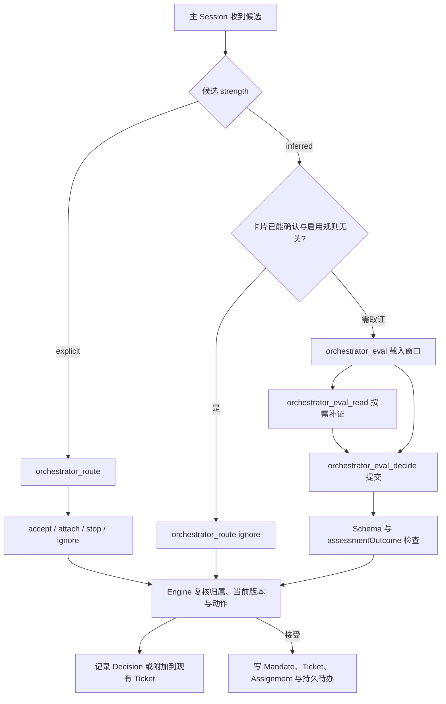

# 11 · 显式路由与推断评估的双路径

> 面试题　同样一句「把帮助页的错字改回去」，授权成员直接 @ Agent 时可以用一个路由工具建单。她只在一个受观察的群里说这句话时，为什么要先读上下文、判断规则，再由 Engine 接受？观察模式的 `would_accept` 又代表哪一步已经完成？

**短答**　显式候选有直接委托或相应范围的显式授权依据，主 Session 负责识别是否是新工作、已有工作、停止或普通讨论，用 `orchestrator_route` 提交。推断候选还需要根据原文和补充证据评估每一条启用规则，由 `orchestrator_eval_decide` 提交方向、范围、匹配依据。应用检查字段和业务条件，Engine 再核对活跃 Eval、当前版本以及推断允许条件，实际接受才生成 Mandate 和 Ticket。observe 保存满足条件的推断建议，auto 才能把这类建议提交为新工作。 [主 Session 工具](../dsh-superagent-prototype/src/app/tools/main.ts) · [评估工具](../dsh-superagent-prototype/src/app/assessment.ts) · [Policy 转换](../dsh-superagent-prototype/src/policy.ts) · [Engine 决定](../dsh-superagent-prototype/src/core/evals.ts)

本文以提交 `7bd4741` 为基线，使用此前的帮助页错字作为同一语义的请求。假设 Alice 的飞书身份处于允许名单，所在群可接收，且没有其他 Worker 已接手这个请求。测试里会分别用提及与未提及构造显式和推断输入。前一篇讲候选怎样获得强度，这篇从候选卡之后开始，追踪判断、工具与持久化。 [第 10 篇](10-policy-admission-matrix.md) · [授权说明](../dsh-superagent-prototype/docs/002-authorization.md)

## 1. 同一个请求穿过两条不同的契约

Alice 发出「把帮助页的‘帐户设值’改回‘帐户设置’」。如果正文 @ 了 Agent 且来源身份合格，通常取得 `explicit`。如果同一句话没有 @，但讨论位于已观察范围，名单与准入格提供了推断入口，就可能成为 `inferred`。两条输入表达的修改可以一样，系统授予的下一步行动资格不同。显式路径主要判断任务归属。推断路径要额外回答「从人类讨论推导出的工作，是否属于团队事先允许自动处理的类型」。 [准入与强度实现](../dsh-superagent-prototype/src/policy.ts) · [第 10 篇的准入矩阵](10-policy-admission-matrix.md)



`MasterAssessor` 统一承担候选投递。它的名字虽然有 Assessor，显式候选经过它构建并送达卡片后，仍是 `orchestrator_route` 处理。三只 Eval 工具通过 `evalFor` 查对应正在进行的评估，并将 explicit 候选指向 route。候选卡中的 `next_action` 告诉主 Session 用哪一种工具。相同的领域 Eval 记录可以承载等待路由或等待规则评估的状态。阅读时要把 Eval 这个领域对象和三个以 `orchestrator_eval` 开头的工具区别开。 [候选投递和 evalFor](../dsh-superagent-prototype/src/app/assessment.ts) · [候选卡](../dsh-superagent-prototype/src/app/links.ts) · [工具分支测试](../dsh-superagent-prototype/tests/assessment.spec.ts#L114)

| 问题 | 显式路由 | 推断评估 |
| --- | --- | --- |
| 谁判断 | 主 Session，看请求意图与目标 Ticket | 同一个主 Session，看来源证据与启用规则 |
| 主要输出 | accept、attach、stop、ignore 路由条目 | accept、ignore、unavailable 评估结果 |
| 新建任务需要提供什么 | 原 Trigger ID、标题、工作区短名和确认等使用字段 | 还要有所有启用规则的判断、方向、任务范围、意图证据 |
| 和模式的关系 | off 下仍能接受符合条件的显式请求 | off 的 gate 不新准入，observe 可记建议，auto 才能按规则实际接受 |
| 如何审计 | 原请求、路由原因、来源 basis、实际动作 | 额外保留规则覆盖、方向、证据及可选 would_accept/proposal |

两路的共同目标是把用户意图交给恰当的 Worker，在接受时生成可查的授权边界。模型输出成为命令参数以后，继续经过 Schema、语义到业务动作的转换或验收，及事务内的 Engine 判断。每一层看到的输入都不完全相同。下一节先从显式路由的接口形状看这种分工。 [领域结果和授权](../dsh-superagent-prototype/src/core/ports.ts) · [Evals.accept](../dsh-superagent-prototype/src/core/evals.ts)

## 2. 显式路由按条目处理，先识别动作再验证字段

### 2.1 四个动作如何选

对来自 Alice 的明确委托，主 Session 首先确认原消息确实在请求执行。即使提及 Agent，也可能是在致谢、同步结论或引用背景。若是在请求工作，再核对有没有明确指向既有工单。如果她发了昨天 PR 的链接，并要求在该 PR 的同一处继续改，`attach` 可以把输入和新 Thread 交给已有 Ticket。只因两条消息都提到「帮助页」而作关联，容易把两个独立任务串在一起。dispatch 提示要求附加依据明确，例如链接、明确引用或唯一匹配刚完成的修改。 [dispatch 提示词](../dsh-superagent-prototype/prompts/dispatch.md) · [候选中的 referenced_tickets](../dsh-superagent-prototype/src/app/links.ts)

| 动作 | 什么情形适合 | 领域调用 |
| --- | --- | --- |
| `accept` | 有明确新工作，应有独立范围 | `engine.decide(..., kind: 'accept')`，生成新的授权与 Ticket |
| `attach` | 已清楚指向一个既有 Ticket，原工作能承接 | `engine.attach`，写关联、Input，并处理原 Eval |
| `stop` | 人明确要求停止对应工作 | `engine.decide(..., kind: 'stop')`，核对目标和强度 |
| `ignore` | 普通讨论、无新工作，或卡片能确认不触及已启用推断规则 | `engine.decide(..., kind: 'ignore')`，记录适用理由 |

当消息已经被 Worker 负责，主 Session 得到的是 follow_up 提示。正常做法是让 Worker 判断原授权内的后续请求。明确停止另有路由通道。Engine 的非 stop 决定以及 attach 会检查这一类正在被负责的消息。已经被某个 Ticket 退回的 Trigger，也不能直接附回同一 Ticket 再循环。提示词提出「相似话题不要附加」「保留人明确给出的暂缓条件」，程序则校验存在性、归属、任务状态和迁移规则。语义选对动作与动作能合法写入都必要。 [Evals.decide](../dsh-superagent-prototype/src/core/evals.ts) · [Engine.attach](../dsh-superagent-prototype/src/core/engine.ts) · [Worker 提交 handback 的测试](../dsh-superagent-prototype/tests/followups.spec.ts#L47)

### 2.2 外层 Schema 和逐条校验分别检查什么

路由工具外层需要一个 `decisions` 数组，数量 1–20。每条必须有合法 `kind` 和字符串 `trigger_id`，形状严格，通用字段多为可空或可选。到执行阶段才由 `FIELDS` 按动作查具体必需字段和内容长度。accept 需要 title、worktree_name、acknowledgement。attach 和 stop 需要目标 ticket_id。ignore 必须写 reason。note 是 accept 与 attach 的可选路由背景，最长 30 个按分词计的词。accept 的 title 最长 200 个 JS 字符串单位，确认需非空且最长 100 词，worktree_name 最多 32 字符、由 1 至 4 个符合定义的英文短词段组成。stop 的 reason 可省略，适用 reason 的最大长度为 500。 [RouteItemSchema / FIELDS](../dsh-superagent-prototype/src/app/tools/main.ts) · [WorktreeNameSchema](../dsh-superagent-prototype/src/app/assessment.ts) · [词数约束](../dsh-superagent-prototype/src/infra/text.ts)

举例，假定卡片的 `trigger_id` 已从系统返回。主 Session 可以按以下形状提交接受：

```json
{
  "decisions": [
    {
      "kind": "accept",
      "trigger_id": "<候选卡返回的实际 ID>",
      "title": "修复帮助页错字",
      "worktree_name": "fix-help-copy",
      "acknowledgement": "收到，会把帮助页文案改回‘帐户设置’。"
    }
  ]
}
```

在实现中，显式 accept 将 title 同时交给 Engine 作为 scope，短名送到执行元数据生成。这个简短 scope 还需要结合原 Trigger 与任务提示看。路由提示词要求让 Worker 自己读原始请求，并避免把 Router 认为合理的实现步骤变成额外要求。可选 note 可写「只动帮助页」等人已给出的约束或路由背景。若人要求暂缓工作，应保留暂缓条件，等明确解除后再授权执行。 [显式 accept 映射](../dsh-superagent-prototype/src/app/tools/main.ts) · [路由 note 提示](../dsh-superagent-prototype/prompts/dispatch.md) · [执行元数据](../dsh-superagent-prototype/src/executor/dsh.ts)

### 2.3 一个调用包含多条命令，原子性在每条内部

例如工具数组有五项，第一项合理地忽略致谢，第二项 stop 缺 ticket_id，第三项合法地接受工作，第四项 attach 无效 Ticket，第五项本地仓储意外报错。执行映射按数组次序处理，每条在自己的 Engine 命令内写事务。缺少某种动作的必需字段会有该项 refused，业务错误给出相应原因，意外异常记日志并提示该项未记录可重试。前后合法项仍可完成。反过来，如果外层结构本身不合规，例如某个 kind 未在枚举内，工具的 Schema 解析可能在 execute 之前就拒绝整个调用。 [routeTool](../dsh-superagent-prototype/src/app/tools/main.ts) · [Session 工具参数验证](../dsh-superagent-prototype/src/app/sessions.ts) · [部分成功测试](../dsh-superagent-prototype/tests/tools.spec.ts#L136)

分两层的成本收益也容易白板说明。批量提交可以减少主 Session 对每个候选分别调用工具的往返。逐项提交保留独立的成功与失败，不会让一条缺字段的 stop 撤销其他正确工作。代价是调用方必须读回每条结果并确认相应动作到底成功、业务上被拒绝，还是已记录一次 ignore。回复外观大体统一，可能包含 decision、reason、ticket 卡，也可能只给 refused。attach 成功通常返回 Ticket 与原因，本身无需生成一种叫 attach 的 DecisionKind。 [逐项校验测试](../dsh-superagent-prototype/tests/tools.spec.ts#L166) · [四种路由返回用例](../dsh-superagent-prototype/tests/tools.spec.ts#L107) · [DecisionKind](../dsh-superagent-prototype/src/core/model.ts)

### 2.4 路由数组和领域 Eval 批次是两个维度

工具数组可以含不同 Thread 的多项路由。领域 Eval 批次则是同一个主 Thread 缓冲后一起被持有的多个 Trigger。某条工具项成功接受了一个 Eval，Decision 可能覆盖那个批的全部 Trigger ID。同一调用中的第二次 accept 即使给了新的 title，也会依据已有 Decision 回到原 Ticket，保留标题与确认。同时工具用 `decided` 记录本调用中被 Decision 覆盖的各 Trigger。如果后续再用 ignore 去矛盾覆盖当前批次已决定的成员，工具会拒绝该项。 [Evals.accepted 检索](../dsh-superagent-prototype/src/core/evals.ts) · [route 的 decided](../dsh-superagent-prototype/src/app/tools/main.ts) · [批复用例](../dsh-superagent-prototype/tests/tools.spec.ts#L190)

把批次看成「同一请求的上下文包」很有用。例如第一条指出帮助页，第二条说正确的名字，Gate 根据批内的最强依据组织授权。卡片的显示消息、真实主 Trigger 和传给 `Engine.decide` 的 `trigger_id` 都需要从当前状态解释。相同请求的重复 accept 一致性由接受记录检查保护；两个不同 Trigger 只是语义类似时，仍要由归属和主 Session 判断是否明确指向已有工作。同样，一个人的停止请求可能到达不止一张工单，当前批工具仍允许按目标分别提交 stop，由 Engine 决定每个动作。 [批内授权来源](../dsh-superagent-prototype/src/core/evals.ts) · [原始 Trigger 选择测试](../dsh-superagent-prototype/tests/core-engine.spec.ts#L1212) · [逐 Ticket 停止测试](../dsh-superagent-prototype/tests/tools.spec.ts#L219)

### 2.5 已有工作上的 attach 与新建任务保留的记录不同

若 `attach` 目标仍开放，Engine 会把相应 Thread 变成该 Ticket 的正式订阅，并写新的 Trigger Input 或更新适用的 note。若目标已自然结束，则有当前 Mandate 的再验证和恢复条件。人工停止的工单会拒绝 attach，同一 Ticket 曾把该消息退回时也会拒绝附回。在活跃 Eval 持有这条消息时，attach 还需要处理原批次，有其他待判断消息则排队重评。这样附加一个请求不会顺手把其他批次消息也认作已有授权。 [Engine.attach](../dsh-superagent-prototype/src/core/engine.ts) · [Tickets.attachable 与 attach](../dsh-superagent-prototype/src/core/tickets.ts) · [批次重评用例](../dsh-superagent-prototype/tests/core-engine.spec.ts#L881)

面试可用「附错一条消息」说明为什么路由要查上下文。新建重复任务会消耗一个 worker、目录和审核流程，当然也要避免。误附加则可能持续改变某 Thread 的订阅关系，让后续讨论被错误地纳入工单。当前 dispatch 提示让主 Session 在没有唯一指向时查看更多相关 Ticket，避免凭相似主题附加。程序验证已知 ID、归属与状态；它无法由短标题判断两条自然语言需求是否真指同一项工作。 [附加语义](../dsh-superagent-prototype/prompts/dispatch.md) · [现有 Ticket 查找](../dsh-superagent-prototype/src/app/resources.ts) · [Worker 中止重路由](../dsh-superagent-prototype/src/core/part.ts)

## 3. 推断评估要先建立证据，再提交结构化结果

### 3.1 判断有三项事实，规则在它们之后应用

在推断路径里，初始消息可能只是「就改成这个」，真正的提案出现在原线程几条消息之前，目标对象也可能只在一张截图中。 `orchestrator_eval` 按 Trigger 载入有界窗口、同批输入、相关 Ticket 和当前候选的 Policy 版本。未来需要看到原文或图片时，再经 `orchestrator_eval_read` 追消息、根帖、父消息、后续页和必要的仓库证据。启用规则从主 Session 的 Policy prompt 段取得。工具上下文本身返回版本与候选资料，而规则正文由系统提示供应。这个机制能让候选资料与审计时应引用的版本对上。 [评估上下文](../dsh-superagent-prototype/src/app/assessment.ts) · [规则 prompt 测试](../dsh-superagent-prototype/tests/runtime.spec.ts#L1762) · [第 09 篇](09-bounded-context-and-resource-reads.md)

准入提示要求先确认三件事。讨论指向当前部署的项目，相关参与者表达了要实施具体变更，方向已经明确到能够做局部修改。比如在原 Thread 找到了要把帮助页文字改回「帐户设置」，后面一条「同意这个」可以确认具体提案。引用另一产品的文档或一段命令文字则可能只是背景，不能替这个项目的新任务提供许可。规则含有“明确请求”要求时，需要核实讨论表达的实施意图，最新一条消息可以是有明确指代的回应。 [准入推断提示词](../dsh-superagent-prototype/prompts/admission.md)

举三个例子。看到了「帮助页错字，具体改为 帐户设置」，项目、实施意图和可执行目标都有可能成立。看到了「帮助页很难用，照另外一个产品弄一下」，虽然有项目与不满，产品或设计选择仍未满足。只看见「按截图改」，截图或上文实际读失败，就缺了能够判断方向的证据。第二种若已读充分且要求未定，适合记录 ignore。第三种如果工具、权限或模型能力使关键证据不可用，可以记录 unavailable 并说明原因。两类记录对规则审计和运营排障的意义不同。 [方向要求](../dsh-superagent-prototype/src/policy.ts) · [缺失证据的判断](../dsh-superagent-prototype/prompts/admission.md)

### 3.2 `orchestrator_eval` 与 `orchestrator_eval_read` 给判断补什么

初始窗口只展示已加载上下文的一部分，模型可以按已返回引用补读。比如源消息只说「就这样改」，可读 parent 确认它指哪条建议，再读相应话题页找目标。画面上是否确有错字要用可见截图或对应文字作证，文件读取只在要确认具体范围疑义时使用。评估 prompt 让主 Session 保持这一步为取证，将实施计划、广泛仓库调查与修改留到 Worker。有些能力约束来自提示词，工具仍有硬性参数校验与活跃 Eval 检查。 [按需取证入口](../dsh-superagent-prototype/src/app/assessment.ts) · [EvalReadSchema](../dsh-superagent-prototype/src/app/assessment.ts) · [评估与执行分工](../dsh-superagent-prototype/prompts/admission.md)

`orchestrator_eval_decide` 会通过 `evalFor(triggerId)` 查活跃 inferred Eval，并把当前匹配的 evalId 提交给 Engine。提示词要求先用 eval 加载窗口，并在同一个候选下完成取证。服务端决定入口的有效性检查针对活跃候选与提交结构，需要在源码层面分别核对。它不会审阅提示词是否要求的每个阅读动作全部发生，也不会自动证明模型写下的引用语义正确。正因为语义和权限都有各自的证据来源，模型输出中可以提供明确引文，应用还能额外核对范围、规则和版本。 [评估决定实现](../dsh-superagent-prototype/src/app/assessment.ts) · [业务校验](../dsh-superagent-prototype/src/policy.ts) · [当前 Eval 检查](../dsh-superagent-prototype/src/core/evals.ts)

### 3.3 评估提交的形状与含义

`AssessmentSchema` 将 decision 限定为 accept、ignore 或 unavailable。结构中包括 `rule_assessments`、`direction`、title、scope、reason，可选短名、意图证据和确认文案，具体必需条件由后续检查补齐。title 最长 160 个字符串单位，scope 最长 1,500，reason 最长 500。方向对象要求实现意图、目标依据、是否还需设计决定、证据。工作区短名与显式工具共用一份 Schema。对具有明确方向且声明命中规则的 accept 提议，Schema 要求提供短名。注意短名始终受命名格式约束，不能用自然语言理由替代。 [AssessmentSchema 与 WorktreeNameSchema](../dsh-superagent-prototype/src/app/assessment.ts) · [AdmissionDirectionSchema](../dsh-superagent-prototype/src/policy.ts)

假设当前启用了默认的 copy 和 visual 两条规则，且上下文确认这是帮助页一个具体错字。下面是教学输入结构，实际要用候选返回的 ID 与可核对的原文。

```json
{
  "trigger_id": "<候选卡返回的实际 ID>",
  "decision": "accept",
  "title": "修复帮助页错字",
  "worktree_name": "fix-help-copy",
  "scope": "只把帮助页这一处‘帐户设值’改回‘帐户设置’",
  "reason": "讨论已经给出要更改的具体页面和替换文字",
  "intent_evidence": "Alice 在当前项目的讨论中说：请把帮助页的帐户设值改回帐户设置。",
  "acknowledgement": "收到，会修正帮助页这一处文案。",
  "rule_assessments": [
    {"rule_id": "copy", "matched": true, "reason": "明确指定了局部错字与替换文字"},
    {"rule_id": "visual", "matched": false, "reason": "请求没有涉及样式调整"}
  ],
  "direction": {
    "implementation_requested": true,
    "target_basis": "specified",
    "requires_design_decision": false,
    "evidence": "当前项目的帮助页与替换文案都已给出"
  }
}
```

这个输入有两类证据文字。direction.evidence 解释为何方向已确定或仍未解决。intent_evidence 对接受尤其重要，它要求交代工作意图的来源。即使模型选择 ignore 或 unavailable，AssessmentSchema 仍要求方向对象，用来说明为什么不能当作授权变更。所有启用规则也仍需判断。另一方面，主 Session 从卡片直接走 route 的 ignore 时无需交规则表。它来自不同的审计路径。 [评估与卡片忽略](../dsh-superagent-prototype/src/app/assessment.ts) · [结果转换](../dsh-superagent-prototype/src/policy.ts) · [直接忽略测试](../dsh-superagent-prototype/tests/tools.spec.ts#L233)

## 4. 为什么 JSON 合法仍不意味着可以执行

### 4.1 第一层，工具参数的形状与条件约束

工具由 Session 注册为带 Schema 的参数。调用时先解析，错误类型、超限内容或未知字段在这里就可能失败。orchestrator_eval_decide 对外用 candidate ID 加评估字段组成工具 Schema，执行时再用完整的 `AssessmentSchema.parse(result)` 解析，应用方向、匹配条件与短名的联合约束。结构正确说明系统可以明确读到数据。它尚未检查数组里的每个 rule ID 是否来自**当前启用**的集合。 [工具输入解析](../dsh-superagent-prototype/src/app/sessions.ts) · [评估工具组装](../dsh-superagent-prototype/src/app/tools/main.ts) · [联合条件](../dsh-superagent-prototype/src/app/assessment.ts)

假如某次调用把 copy 标成匹配，却忘记 visual，它仍然可能拥有符合形状的数组。模型也可能在输出里包含一个已停用的规则。应用需要从当时的设置找到真实启用集合再检查。这个信息来自可信配置，JSON 的表示本身无法证明它。对于结构化输出，面试回答可以明确区分「输入验证」「依状态判定」「真实世界证据」。 [RuleAssessmentSchema 与默认规则](../dsh-superagent-prototype/src/policy.ts)

### 4.2 第二层，assessmentOutcome 转换与审计

`assessmentOutcome` 首先比较启用规则和已判断规则集合。长度要相同，ID 不能重复，每个现启用 ID 都要出现。漏评、重复、过时停用或未知项均会被拒绝。它从 `matched: true` 派生正向匹配，保留匹配的 rule ID 与理由，同时把全量判断、方向和可选意图证据写入 audit。没有命中的规则也有意义，后来能看出是确实检查并拒绝，还是遗漏。提示词要求写事实性理由，应用会校验格式和必需字段，理由的语义仍可通过原始证据复核。 [结果转换](../dsh-superagent-prototype/src/policy.ts) · [评估理由约束](../dsh-superagent-prototype/prompts/admission.md)

| 输入条件 | 转换结果 | 观察点 |
| --- | --- | --- |
| 启用规则没有全部恰好判断一次 | 校验异常 | 尚未形成该次有效 Decision |
| 模型提交 ignore 或 unavailable，规则覆盖合格 | 保留相应判断与 audit | 可区分规则不匹配与证据问题 |
| 模型提议接受，方向字段组合不能确立工作 | ignore，directionUnsettled | 留下原方向与匹配判断 |
| 方向合格，但无正向匹配 | ignore，noRuleMatched | 已有方向还需匹配规则 |
| 方向和规则合格，但缺少必需意图证据 | 校验异常 | 需要提供意图证据 |
| 条件合格，但 inferred 处于 observe | ignore，observed 与 would_accept/proposal | 记录可能的接受结果 |
| 条件合格且模式允许 | 生成 accept outcome，待 Engine 核验 | 正向规则与完整审计随结果写入 |

有些评估理由是合格的字符串，却没有事实支撑。例如模型可以给 `implementation_requested: true`，并引用一句只说明现状的话。代码能检查布尔组合、目标依据和规则集合，却需要模型真实使用源消息，审计人员也要能复核。结构化守卫约束的是**语义判断写入系统的条件**。因此出现误接时，先定位是参数遗漏、模式判断还是内容与原文不一致，三类故障需要不同修复。 [directionAllowed](../dsh-superagent-prototype/src/policy.ts) · [方向提示词](../dsh-superagent-prototype/prompts/admission.md)

### 4.3 第三层，Engine 以当前状态复核

转换之后，`MasterAssessor.decide` 将 evalId 与 outcome 送给 Engine。Evals.decide 查 Trigger 和该 ID 当前是否仍由这次 Eval 持有。若已完成或由另一批替换，旧 ID 不能把结果写进去。它还会检查接受是否已有原 Decision，以及非 stop 动作是否属于已有 Worker。接受 inferred 需要 `Policy.admitsInferred`，也就是当前模式为 auto、传入至少一个规则 ID，且全部当前启用。之后 decideEval 比对 Evaluation 的 Policy 版本和当前版本。模型给出的 accept 在写入授权前须经过这些检查。 [MasterAssessor.decide](../dsh-superagent-prototype/src/app/assessment.ts) · [Evals.decide / decideEval](../dsh-superagent-prototype/src/core/evals.ts) · [推断许可](../dsh-superagent-prototype/src/policy.ts)

显式路由的 accept 也进入 Engine。它传 title 作为 scope，加简短确认、工作区短名与 explicitRouted 理由，参数中不携带规则匹配结果。当候选为 inferred 时，空规则列表不足以让 Engine 接受。拿 explicit 候选调用 Eval 工具则会在 evalFor 阶段提示使用显式路由。两个入口的职责写进了工具约定及程序实际条件，调试不能只看 prompt 有无要求。 [route 参数映射](../dsh-superagent-prototype/src/app/tools/main.ts) · [evalFor](../dsh-superagent-prototype/src/app/assessment.ts) · [推断直接接受拒绝测试](../dsh-superagent-prototype/tests/runtime.spec.ts#L619)

### 4.4 通过接受后有哪些共同副作用

接受在同步事务中写 Decision、Mandate 和 Ticket。Evals.accept 用 active Evaluation 的 actor、strength、basis 和 policyVersion，再接上获准 scope。若 outcome 有规则，写入 basis.rules。Ticket 持有来源与订阅，保留执行名和初次 Assignment，确认在适用条件下由 Outbox 追加。Executor 的实际工作后续才运行。这样 audit 可以指向同一原始事实，Worker 也能拿到受约束的运行上下文。 [接受与 Mandate](../dsh-superagent-prototype/src/core/evals.ts) · [Ticket 创建](../dsh-superagent-prototype/src/core/tickets.ts) · [持久队列](../dsh-superagent-prototype/src/app/effects.ts)

推断 Ticket 的执行说明带匹配规则的流程与交流要求。比如某条启用规则要求「先做最小复现且静默接受」，推断提交可以省略 acknowledgement。工具允许此字段可空，程序只有在有确认且来源符合条件时才入队。模型应按匹配规则决定是否静默，程序不会从整段规则文本重新推断这个语义。若多条规则冲突，提示词要求在范围不明时忽略。团队可以检查 Decision 的匹配依据以及最终是否写了接单回执，验证模型是否按设定处理。 [确认发送条件](../dsh-superagent-prototype/src/core/replies.ts) · [执行说明组装](../dsh-superagent-prototype/src/executor/dsh.ts) · [静默接受用例](../dsh-superagent-prototype/tests/runtime.spec.ts#L295)

## 5. 同样一句请求，按 off、observe 和 auto 演算

假定所有步骤使用同样的「请把帮助页的帐户设值改回帐户设置」，且未提及 Agent。Alice 名单内，在全量观察的群里发言。每轮用独立的 Trigger ID 与新 root，排除传输去重和旧 Worker 归属。没有其他既有任务时，名单内未指向的默认格是 inferred。改变 eval.mode 可以看见各阶段的差异。 [默认矩阵](../dsh-superagent-prototype/src/admission.ts) · [Policy gate](../dsh-superagent-prototype/src/policy.ts) · [Thread 归属](../dsh-superagent-prototype/src/core/model.ts)

| 模式与输入 | gate 和可用工具 | 结果记录 | 对外或执行效果 |
| --- | --- | --- | --- |
| off，未指向 | 不产生推断候选 | 无模型评估的 gate 拒绝，例如该例 no_mention | 无新 Ticket 或 ACK |
| observe，未指向 | 有 inferred，完成取证与提交 | 方向和规则均合格时 ignore，带 observed、would_accept 与 proposal | 无新 Ticket 或 ACK |
| auto，未指向 | 进入 inferred 评估 | 条件有效时 accept，保存匹配规则与 Mandate | 建 Ticket，安排执行与适用确认 |
| off，名单内成员追加 @ | 得到 explicit，走 route | 语义路由选择 accept 后有接受 Decision | 建 Ticket，安排执行及确认 |

off 关闭推断准入，Engine 仍可能对被 gate 拒绝的消息记录一次 ignore。observe 允许判断，并保存合格推断方案，即使提交了 `decision: 'accept'`，原型也按 ignore 表示 runtime 本次没有接单。要看模型是否建议接该请求，应读 `audit.would_accept`、proposal 和完成评估时的规则。auto 才在相应结构、语义与状态约束下推进到新 Ticket。 [Evals 的 gate 拒绝与记录](../dsh-superagent-prototype/src/core/evals.ts) · [观察分支](../dsh-superagent-prototype/src/policy.ts) · [模式对照用例](../dsh-superagent-prototype/tests/runtime.spec.ts#L265)

观察 proposal 能告诉人此次可能批准的标题、工作范围和工作区短名，可以复查这些值是否把局部请求扩大。它不代表已经存在 launch 记录。若模式改变，Policy version 随之变化。后来出现的候选按当前配置判断；若要重评历史 Trigger，也需要现行的资格和规则。这样灰度从看见建议转向实际部署时，不会自动把以前的所有建议送给 Worker。 [would_accept 生成](../dsh-superagent-prototype/src/policy.ts) · [策略重评](../dsh-superagent-prototype/src/core/evals.ts) · [保护历史审批的提示](../dsh-superagent-prototype/prompts/admission.md)

另一条分支是从卡片快速忽略。例如午饭讨论出现在受观察群，卡片已经能确认与项目或启用规则无关，主 Session 可提交 route.ignore。Engine 处理 inferred 的无 audit ignore 时附上 ignoredFromCard。若一句话的指代需要历史才能明白，则应先加载上下文。完整评估可能因 noRuleMatched 或 directionUnsettled 留下不同原因。统计主动性时应区分这些路径，以免把快速忽略当成每条规则均做过模型判断。 [快速忽略实现](../dsh-superagent-prototype/src/core/evals.ts) · [快捷处理条件](../dsh-superagent-prototype/prompts/admission.md) · [工具用例](../dsh-superagent-prototype/tests/tools.spec.ts#L233)

## 6. 版本变化、已接手和重试场景

### 6.1 同一个候选什么时候失效

成员、规则或模式变化可能改变 Policy version，设置保存时会通知 Engine 处理在途 Eval。对受影响的活跃 Eval，系统记录不可用并排入新一轮。原 evalId 已经不存在时，后续提交需要以新候选为准。假设 10:00 模型加载了启用的 copy 规则，10:00:03 这条规则被停用，10:00:05 模型才给出结构合格的接受。应用仍须核对当前启用规则、Eval ID 和策略版本。它要处理的是判断依据已经改变，而不只是请求的 JSON 格式有效。 [Policy version](../dsh-superagent-prototype/src/policy.ts) · [Eval 版本检查](../dsh-superagent-prototype/src/core/evals.ts) · [规则变化运行时](../dsh-superagent-prototype/tests/runtime.spec.ts#L408)

结构正确却过期的输出、真实的规则未命中、工作已经被另一个 Ticket 接手，是三类独立结果。第一种应重新获取候选与当前规则，第二种在可用证据下记录语义原因，第三种要遵循现有 Worker 的职责。不能给这些情况用同一段「刚才模型回应太慢」解释。原因与字段如果保留得当，就能复盘是读取超时、规则版本变化还是路由对象变了。 [Evals 的检查顺序](../dsh-superagent-prototype/src/core/evals.ts) · [当前所有者](../dsh-superagent-prototype/src/core/model.ts)

严格说，模型工具提交的是 trigger_id，`MasterAssessor.decide` 从该 ID 查找提交时的活跃 Eval，再把查到的 evalId 交给 Engine。这能对齐提交时的后端状态。工具参数没有携带模型最初读取的窗口版本令牌，因此「拒绝过期 evalId」和「证明模型一定重新读过每份证据」是两项不同的保证。源码中的规则覆盖与版本校验负责前一类状态问题，提示词要求主 Session 重查当前候选并避免使用过期批准。 [工具参数](../dsh-superagent-prototype/src/app/tools/main.ts) · [提交时读取当前 Eval](../dsh-superagent-prototype/src/app/assessment.ts) · [历史批准守则](../dsh-superagent-prototype/prompts/admission.md)

### 6.2 已有 Worker 负责时，如何回到主 Session

PR 上已经有一张开放 Ticket 时，维护者的范围内跟进通常直接交给 Worker，使用原 Mandate。若说明是独立需求，Worker 可以 handback，其他所有者也让出后才进入新的候选。此时主 Session 仍根据新得到的 strength 选择显式路由或推断评估。Engine 对当前 Worker 负责的输入调用 leftToWorkers 检查，限制它另起一张工单或换归属。判断「这句话是在继续以前的修改，还是给一个独立的目标下委托」不能只由两个 Ticket 的标题相似度决定。 [跟进所有者](../dsh-superagent-prototype/src/core/model.ts) · [handback](../dsh-superagent-prototype/src/core/part.ts) · [Worker 归属测试](../dsh-superagent-prototype/tests/followups.spec.ts#L47)

自然语言的停止有自己的规则。人说「这一项先停」仍来自某个 Trigger，Engine 根据适用 Evaluation 判断 strength 是否 explicit，验证目标 Ticket 仍开放，再记录 stop。一个 Worker 报 blocked 只是运行事实，路由提示明确要求继续在人真实授意的范围内处理。面板直接停止另有命令入口。如果一条消息同时说「先停旧工作」和「把另一项错字修完」，需要准确识别哪个分句针对哪个任务，选择分别处理的业务动作。 [stop 判定](../dsh-superagent-prototype/src/core/evals.ts) · [显式路由提示](../dsh-superagent-prototype/prompts/dispatch.md) · [停止强度测试](../dsh-superagent-prototype/tests/core-engine.spec.ts#L346)

### 6.3 调用失败时查哪类记录

| 看到什么 | 大致说明 | 接下来查什么 |
| --- | --- | --- |
| 外层参数失败或某项 refused | 这次调用或条目没有执行有效命令 | 参数形状、必需字段、候选 ID 与活动状态 |
| ignore，附 noRuleMatched | 已记录业务判断，评估没有规则适合 | 审核规则匹配与原文 |
| ignore，附 ignoredFromCard | 通过候选摘要做直接忽略 | 卡片是否已足以做这个结论 |
| ignore，附 observed 和 would_accept | 推断评估有潜在接受方案，观察模式落审计 | proposal、范围、证据与模式 |
| unavailable | 适用评估没完成或依据失效 | 取证失败、时限、Policy 版本 |
| accept，有 Ticket 卡 | 当前任务已经接受 | 持久的执行范围、Assignment 和后续交付 |

严格来说，某些 refused 也可能是在 Engine 写了一次非接受 Decision 之后由工具翻译而来。例如显式 accept 调用在内部得到因为策略变化等原因没有建立 Ticket 的结果，工具用 refused 说明实际未建单。诊断时能区分「工具未成功」与「库里完全没有处理记录」。即使只排查一个拒绝场景，也应读取 Trigger 对应的处置与 Decision，避开只凭某一个可见字符串推断整个事务。 [route 的拒绝分支](../dsh-superagent-prototype/src/app/tools/main.ts) · [Evals.decideEval](../dsh-superagent-prototype/src/core/evals.ts) · [Trigger 读模型](../dsh-superagent-prototype/src/app/views/records.ts)

## 7. 把同一条讨论做成可复核的面试样例

### 7.1 先排除现实中会让对比失真的因素

设 Alice 已授权，群话题先出现「帮助页写成了帐户设值」，然后作者给出「这里改回帐户设置」，最后 Alice 说「就这样改」。在这组例子里，可以分别选择 `@Agent 请改回帐户设置` 作为显式请求，或将未提及的原话放入已观察范围。两种输入的身份、项目、语义目标与最终范围要尽量一致，唯一重点差异是委托路径。若采用测试 fixture，每模式给事件新的 ID，并用隔离话题避免一条已经被 Worker 接管的正式跟进留在背景里。真实模式里能否进入候选，则从实际配置与 Trigger 判断。 [域模型与身份](../dsh-superagent-prototype/src/core/model.ts) · [候选 gate](../dsh-superagent-prototype/src/policy.ts)

这些隔离有原因。若重复使用同一个 Trigger，接收去重会让后一轮看不见任何模式效果。若同一个 Topic 已有 Ticket，后一条人类消息也可能先由 Worker 处理。若把两个来自不同人或不同文件的需求拿来并排，模型证据难度会干扰通路比较。好的面试实验会固定无关变量，分别看候选、Decision 和真实副作用。在本文的实际用例中，未提及的三轮文本完全相同，显式分支只追加了可识别的 bot 指向。 [Intake 去重与归属](../dsh-superagent-prototype/src/core/intake.ts) · [测试输入夹具](../dsh-superagent-prototype/tests/runtime.spec.ts)

### 7.2 批次里哪个字段可以作为授权来源

如果前三条消息同时落到一个 Eval，工具看到的候选卡可能主要展示最后的「就这样改」，并用附加摘要带上前文。Policy 对每条 Trigger 应用 gate，使用可提供的最高强度与来源作为批次 basis，时间较新的同强度输入可作为优先项。候选卡展示何处以及底层记录的 `Evaluation.primary` 分别由代码选择。接受用这个 Eval 的 authority 生成 Mandate。这样评估可以用多条对话证明实际改法，同时能说明哪位用户、哪条来源条件支持这项工作。 [Evals.start 与 accept](../dsh-superagent-prototype/src/core/evals.ts) · [候选卡显示](../dsh-superagent-prototype/src/app/links.ts) · [批次来源测试](../dsh-superagent-prototype/tests/core-engine.spec.ts#L1212)

加入一条同时谈两个问题的混合讨论，可以看到证据边界。已明确的需求是替换错字，旁边有人希望全面改页面布局。推断评估如果保留接受，应让 scope 只含独立授权且有确定目标的文案部分，每条规则的理由也要按这组证据写。无法分离，或者规则对目标互相冲突时，准入提示要求安静忽略。显式路由的输入虽不交推断规则评估，Worker 也应读取原始需求并保留人已说的限制。路由不能把未确定的布局提议写成隐式实现说明。 [混合讨论的评估要求](../dsh-superagent-prototype/prompts/admission.md) · [路由边界](../dsh-superagent-prototype/prompts/dispatch.md)

在复盘时，可以让面试官看到三份实际证据。首先是 candidate.strength 和关联来源，解释走哪边。其次是一次提交的完整动作或结构化判断，解释主 Session 做了什么。最后是 Decision 的 reason、audit、Mandate 和是否已经排好了 Assignment。一天后若有人询问为何改了别处，可以从原始 Trigger、scope、规则和 PR 逐项对比。模型当时的长推理文本并非主要审计依赖。最值得保留的是哪条原文支持哪个决策、谁在何时通过何种权限建立了工单。 [Decision 与 Mandate 类型](../dsh-superagent-prototype/src/core/model.ts) · [执行报告与测试](../dsh-superagent-prototype/tests/runtime.spec.ts#L320)

## 8. 灰度扩大主动处理，怎样量化误接和漏接

### 8.1 先为事件和判断定义分母

一个团队要决定能否开放自动接文案任务，可以先从一个已配置范围、少量启用规则与可核对的需求类别开始。使用 observe，让系统生成建议并记录审计。抽样时应保留原始讨论、来源状态、当前规则版本、最终 Decision 和是否有旧任务接手。如果只查看模型已经显示 would_accept 的讨论，能发现部分误接，却看不到没有候选或被快速忽略的漏接。人工抽样范围应覆盖普通讨论、已经成立的请求、指代含糊、证据暂不可读和旧任务的续接。 [source 与 gate](../dsh-superagent-prototype/src/policy.ts) · [候选路由](../dsh-superagent-prototype/src/core/model.ts) · [读模型统计](../dsh-superagent-prototype/src/app/store-read.ts)

一个可操作的设计是把人工标签给到「同一工作意图」和对应原证据。先标是否属于来源/授权允许范围，再标是否有明确目标且匹配规则，最后标应该新开 Ticket、交已有 Worker 或忽略。在生成日志侧保存 Trigger 和 Decision 的关系。Eval 批次可能有多个 Trigger，只按触发条数打分会把一句话拆成两个错误。相反，轮询重复读到同一 ID 不应被计成两个独立授权结果。把计算单位明确成业务请求或一次候选判断，再在统计表组织相应分母。 [批次决策关联](../dsh-superagent-prototype/src/core/evals.ts) · [稳定摄取](../dsh-superagent-prototype/src/core/intake.ts)

| 指标 | 分子与分母的一种定义 | 能帮助回答什么 |
| --- | --- | --- |
| 准入漏接率 | 未进入正确候选路径的合格新请求数，除以按来源和授权标为应评估的请求数 | 是不是卡在 Source、Scope、名单或归属 |
| 主动误接率 | 实际接受中未经有效授权、目标未定或超出规则的工单数，除以实际主动接受总数 | 放到 auto 后造成多少错误工作 |
| 潜在误接率 | observe 的建议接受里人工判为不应接受的条数，除以建议接受条数 | 估计当前设置下错派 Worker 的风险 |
| 评估漏接率 | 已进新评估且有明确定向、规则合格却没获应有建议的请求数，除以这类已进评估的请求数 | 补读、规则判断和模型语义有没有遗漏 |
| 证据不可用率 | 关键证据因来源读或模型能力导致不可评估的判断数，除以尝试完整评估数 | 排查读取、上下文预算或所用模型 |

这些定义是面试评估方案，当前源码提供组成部分的记录。它没有替团队决定评估单位、人工标注和可接受阈值。一个准确报告需要同时列每项样本数与来源。比如只有三个 would_accept，即使无误，它对未来大量混合讨论也只提供有限证据。观察样本甚至可能来自较窄规则，若后来加了多条规则或打开了另一个群，应以更新后配置校验，而非直接沿用同一个平均值。 [审计字段](../dsh-superagent-prototype/src/policy.ts) · [Policy 版本](../dsh-superagent-prototype/src/policy.ts)

### 8.2 用数字算一轮，再决定要调整哪一层

假设人工从一个范围标了 100 条去重的真实讨论，其中 25 条应进入新工作判断，10 条最终满足当前启用规则，且应建新 Ticket。观察结果里有 20 条进入正确的评估，其中 8 条确实适合接受。系统建议接收 9 条，经逐条复核只有 6 条正确。这时准入漏接率为 5/25，潜在误接率为 3/9。在已正确进入且应接受的 8 条中还有 2 条漏接，评估漏接率为 2/8。其余两条本可接受但没进入评估，与已进后误判的两条应分开定位。这个算例表明，即使两层都表现为「没开单」，修复方式也会不同。

先找那五条为何未进入候选。若是群不在 Scope、Source 未读到或用户未列入允许入口，单调模型提示无法覆盖。如果已进但仍漏接，读模型看语义证据和 `rule_assessments`。可能是补读没有追到前面的具体替换文字，也可能启用规则对这个场景定义得过窄。若给了方向明确的积极判断，却出现错误接受，要核对目标范围和 evidence 是否匹配原文。这样按阶段看分母，可以针对一个实际问题做改动，然后在同一批或独立样本验证是否改善。 [事件处置读模型](../dsh-superagent-prototype/src/app/views/records.ts) · [评估读取](../dsh-superagent-prototype/src/app/assessment.ts) · [规则审计](../dsh-superagent-prototype/src/policy.ts)

### 8.3 怎样从观察状态过渡到有限的执行

可从观察结果稳定、任务可逆且审查简单的范围逐步开启 auto，例如只启用已明确限定的错字与固定文案规则。先保留正常的显式入口，给这类自动任务单独查 Mandate 强度、规则与 scope。样本中发现越权或重要下游失败时，可以降为 observe 保留判断记录，或用 off 关闭新推断准入。需要停止个别正在运行的工单时，回到 Ticket 的人工停止命令。这样模式的调整与正在执行的任务治理都有依据，也不会把一般暂停当成重新分配权限。 [模式定义](../dsh-superagent-prototype/src/policy.ts) · [对开放任务的策略通知](../dsh-superagent-prototype/src/core/engine.ts) · [停止行为](../dsh-superagent-prototype/src/core/tickets.ts)

范围收窄也需要注意 mode 是全局 Eval 选择。团队想只对某个群灰度时，可以同时控制来源读取与 per-scope admission，确认其他范围有无可产生推断候选的入口，并选择窄规则。若维持众多开放候选却仅要求某一个群 auto，产品层可能需要额外设计每个范围的策略版本或允许模式。当前源码提供的是全局模式配合范围资格与启用规则，部署答法应明确这一点。 [全局模式 Schema](../dsh-superagent-prototype/src/policy.ts) · [各来源的矩阵范围](../dsh-superagent-prototype/src/sources/feishu.ts) · [Policy version](../dsh-superagent-prototype/src/policy.ts)

## 9. 本地测试与实际观察范围

| 机制 | 仓库测试的断言 |
| --- | --- |
| 显式候选只用路由 | 对显式候选调用三个 Eval 相关工具会收到指向 route 的提示。 [显式分支](../dsh-superagent-prototype/tests/assessment.spec.ts#L114) |
| 批量路由逐项处理 | 含缺字段、未知 Ticket 与意外错误时，其他合法项仍写入。 [批量测试](../dsh-superagent-prototype/tests/tools.spec.ts#L136) |
| 同批接受保持原决定 | 一项覆盖整个领域批次，第二项接受复用原题目和 Ticket，矛盾忽略被挡住。 [重复接受](../dsh-superagent-prototype/tests/tools.spec.ts#L190) |
| 无审计快捷忽略有标记 | 一次调用可以混合显式忽略、推断卡片忽略，推断直接接受被拒绝。 [快捷路由](../dsh-superagent-prototype/tests/tools.spec.ts#L233) |
| 完整启用规则的要求 | 重复一条已启用规则而遗漏另一条时，转换拒绝。 [规则覆盖](../dsh-superagent-prototype/tests/policy.spec.ts#L335) |
| 观察与实际建单 | observe 留下 would_accept，auto 的积极评估结果有新 Ticket 和规则 basis。 [运行时两模式](../dsh-superagent-prototype/tests/runtime.spec.ts#L265) |
| 静默方案 | 具有适用规则的评估可创建 Ticket 而不排确认，Worker 能读取匹配规则过程。 [静默接受](../dsh-superagent-prototype/tests/runtime.spec.ts#L295) |

在原型目录安装锁定依赖后运行：

```bash
pnpm test tests/tools.spec.ts tests/assessment.spec.ts tests/policy.spec.ts \
  tests/core-engine.spec.ts tests/runtime.spec.ts tests/followups.spec.ts
```

本次在临时检出运行，**6 个测试文件、581 个现有用例全部通过**。另外一项模式对照在同一部署夹具里保留未提及的实际文案，给每个 mode 分配一个独立的话题与 Trigger ID。off 时没有候选且无 Ticket，observe 的 accept 提议记录为带 would_accept 的 ignore 且不发确认，auto 成功创建带 copy basis 的 Ticket。再切回 off 时，新的明确提及仍能通过 route 建单。这项临时验证通过。它由测试主动提交路由或评估数据，验证的是业务转换、Model 工具边界和持久记录。模型是否真的能阅读讨论并给出正确分析，需要使用实际模型和人工样本另看。 [运行时测试](../dsh-superagent-prototype/tests/runtime.spec.ts) · [评估 fixture](../dsh-superagent-prototype/tests/assessment.spec.ts)

## 10. 面试怎么讲

### 60–90 秒口述版

> 两个入口共享领域 Engine 和同一个主 Session，但判断依据不同。显式候选已经有符合 Policy 的直接委托或范围授权，主 Session 读取原请求，决定是 accept、attach、stop 还是 ignore。工具可以批量提交，每项命令独立提交，已有同一 Trigger 的接受记录可复用。
>
> 推断候选使用 eval 读有界上下文，必要时补原文或图片。它要提供明确目标、实施意图、范围和每条启用规则的判断。Schema 校验结构，转换检查规则是否完整、方向及证据，Engine 再校验当前 Eval、Policy 版本和模式。observe 留潜在方案，auto 满足条件后才生成 Mandate、Ticket 和 Assignment。
>
> 灰度时我会把来源准入、模型取证和实际接受分别度量。这样既能知道损失哪些请求，也能知道候选中潜在误接和越界的工作。

### 追问一　为什么不能让一个通用 accept 兼顾两条路？

显式请求的授权来自原作者和指向性，直接路由主要解决归属与动作。推断路径要把语义判断、规则覆盖和接受模式留下审计。两个入口汇合到 Engine 可以共享状态约束，同时保持各自所需的证据和参数。这样可以让主 Session 快速处理清楚的委托，也让自动扩大工作时有独立的防线。 [主工具](../dsh-superagent-prototype/src/app/tools/main.ts) · [Engine 状态判断](../dsh-superagent-prototype/src/core/evals.ts)

### 追问二　结构化输出还需要怎样的校验？

先验证结构与必需字段，再查当前启用规则是否恰好被评估一次，方向是否明确、有没有意图证据。提交时还要确认活跃 Eval、Policy version、当前模式与工单归属。JSON 可以帮助规范记录，实际判断的源证据需要复核。 [结果转换](../dsh-superagent-prototype/src/policy.ts) · [Engine 校验](../dsh-superagent-prototype/src/core/evals.ts)

### 追问三　为什么把快速 ignore 和完整评估的 ignore 分开？

有些候选从卡片已能排除，无需额外网络和模型工具回合。完整评估中的 ignore 有启用规则覆盖与方向依据。将两种情况保留不同 reason，可以知道模型是读了原句即判定普通讨论，还是基于规则和上下文做了结论。 [卡片忽略标记](../dsh-superagent-prototype/src/core/evals.ts) · [真实工具用例](../dsh-superagent-prototype/tests/tools.spec.ts#L233)

### 追问四　观察模式能否证明上 auto 一定安全？

观察结果提供潜在建议及其证据，适合人工抽查。评估目标还要包含漏接、误接、证据不可用、策略变化和执行时是否超范围。部署可以先在有人工监督的小范围内启动；随着范围变动继续复核新的实际 Ticket 与相应规则依据。 [观察审计](../dsh-superagent-prototype/src/policy.ts) · [接受记录](../dsh-superagent-prototype/src/core/evals.ts)

### 追问五　同一个路由批工具中某一条失败，应该重发全部吗？

应先看每条工具结果。某项缺字段或出现临时错误时，只需将仍适用的失败项修复后再提交。其他成功条目已经有结果，同一接受可复用，但批内某项再次提交也可能因为所有者、策略或时间点变化而需要重新获取候选。逐项记录让调用方能够理解部分成功。 [routeTool](../dsh-superagent-prototype/src/app/tools/main.ts) · [批处理失败测试](../dsh-superagent-prototype/tests/tools.spec.ts#L136)

---

[返回连载目录](README.md) · [上一篇《Policy 准入矩阵与授权强度》](10-policy-admission-matrix.md) · 下一篇《Thread 级批处理、超时与评估重排》
