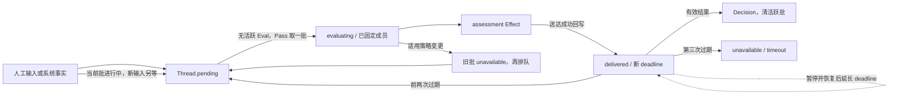

# 12 · Thread 级批处理、超时与评估重排

> 面试题　同一段飞书讨论接连来了三条消息，第一张候选卡还在等来源链接。后两条应该加入当前 Eval，还是进入下一批？如果系统暂停两分钟，原来的 deadline 早已过去，用户回来时第一批会不会立即超时？

**短答**　原型让每个主 Thread 有一个等待队列 `pending` 和一个活跃批次 `evaluating`。当前批次建立后，新到输入由下一批处理，哪怕第一张卡还未送到主 Session。创建批次时先记初始 deadline，Engine 只有看到 delivered 才允许过期；成功送达回写后按当时的超时时间重新起算。暂停期间留存暂停标记，恢复时延长 deadline。连续超时前两次重排，第三次留下 unavailable。新旧 Eval 用 ID、Policy version 和当前工作归属对齐，由此区分重排、替换与实际接受。 [Evals](../dsh-superagent-prototype/src/core/evals.ts) · [Engine.evaluateDue](../dsh-superagent-prototype/src/core/engine.ts) · [候选交付](../dsh-superagent-prototype/src/app/assessment.ts)

本文以提交 `7bd4741` 为基线。继续用帮助页文案任务，假定飞书某话题的三条输入分别指出错字、给出目标文字、补充限制。示意的时间参数用于推演，不表示生产计时数据。前一篇介绍主 Session 拿到候选后如何决定，这篇聚焦批次形成、送达、等待、失效和再排队。 [第 11 篇](11-explicit-routing-and-inferred-eval.md) · [授权文档](../dsh-superagent-prototype/docs/002-authorization.md)

## 1. 一个 Thread 的两种等待状态

如果收到消息就立即各起一次模型评估，十秒内连续到达的「这个文案不对」「具体改某处」「只改帮助页」会各自缺少重要语境。若要求模型评估期间可以把新消息继续写进同一个批次，模型回来的决定又可能只覆盖旧输入，但存储层把它理解成同时覆盖了新增内容。原型用明确的批边界处理这两个问题。**在当前批取走之前可以合并，取走后新消息留给下一批。** 同一 Thread 有一个活动批次，但不同 Thread 可以分别形成 Eval。 [Thread 模型](../dsh-superagent-prototype/src/core/model.ts) · [Evals.start](../dsh-superagent-prototype/src/core/evals.ts)

| 状态字段 | 具体存什么 | 适合回答的问题 |
| --- | --- | --- |
| `thread.pending` | 等待下一批的 Trigger ID | 哪些新输入还没被当前评估持有 |
| `thread.evaluating.triggerIds` | 当前批已固定的输入集合 | 此次路由或评估覆盖哪几条 |
| `primary / actor / strength / basis` | 本批当前可采用的最强准入来源 | 哪条输入贡献了委托资格 |
| `startedAt / delivered / deadline / pausedAt` | 批次开始、发生送达回执、业务截止与暂停标记 | 正等待投递还是已进入可超时状态 |
| `thread.expired` | 连续过期并被重排的批次数 | 后续过期是否达到停止重试的阈值 |
| `policyVersion` 和 `evalId` | 这次评估基于的条件和身份 | 提交的结果还属于当前判断吗 |

这些信息大部分在同一 Thread 聚合里，与 Task 执行不是一套计时。Eval 不负责限制某个 Worker 执行多久。它管理的对象是「主 Session 要不要创建、停止或迁移这项工作」。接受完成后属于 Ticket 和 Assignment 的事情继续由 Executor 处理。因而用户说「它超时了」，第一步应确认是候选无决定、Worker 未启动，还是外部工作失败。 [Evaluation 与 Thread](../dsh-superagent-prototype/src/core/model.ts) · [执行器](../dsh-superagent-prototype/src/executor/dsh.ts)



图省略了 Thread 跟进归属、普通 gate 拒绝与 attach 等分支。它强调一个时序。建立活跃批次的时候，它的业务身份已经成立。即使列入队列的 assessment 尚未启动，pending 和 evaluating 也分开管理。 [摄取排队](../dsh-superagent-prototype/src/core/intake.ts) · [queueForEval](../dsh-superagent-prototype/src/core/part.ts) · [评估代码](../dsh-superagent-prototype/src/core/evals.ts)

## 2. Passes 如何推动批次，为什么不需要全局串行等模型

### 2.1 摄取触发、周期推进和事务划分

正常的 Source 接收经 `Passes.receive` 调用 Engine，返回 stored 就请求一次推进。Runtime 另设约两秒一次的周期。 `Passes.pump` 同时有两件事，kick Effects、运行 `Engine.evaluateDue`。并发请求如果遇到一个已在执行的 pump，可合并成后面的一次。周期和立即请求都只是推进点，并不表示所有消息固定等满两秒再批处理。 [Passes](../dsh-superagent-prototype/src/app/passes.ts) · [Runtime 调度](../dsh-superagent-prototype/src/app/runtime.ts)

在 `Engine.evaluateDue` 中，先查已有活动 Eval 并逐一执行 due。如果暂停，这一步仍可记录计时标记，随后返回。其余情形下，先尝试唤醒有等待 Input 的适用已结束 Ticket，再为 pending 非空、无正在评估批次的 Thread 启动 Eval。不同 Thread 启动各用一次同步事务。多个 Thread 可在同一个 pump 各自成为评估对象，无需等第一个模型完成才能为第二个建活动槽。实际投递再由 Effects 的 handler 限额控制。assessment handler 的并发上限目前为四，暂停时限额为零。 [Engine.evaluateDue](../dsh-superagent-prototype/src/core/engine.ts) · [assessment handler](../dsh-superagent-prototype/src/app/assessment.ts) · [多 Thread 同步启动测试](../dsh-superagent-prototype/tests/core-engine.spec.ts#L154)

这里的 debounce 是自然形成的批组。第一条到达且没有阻碍时，可以立刻启一批。若第一批已活跃，而其它输入连续到达，他们留在 pending，下一次可获处理时合到一批。实现没有为每个 Thread 新建一个「再等 N 秒把更多消息凑齐」的固定 timer。影响批次大小的是摄取、状态推进和前批次占据 active 槽的先后。如果候选卡一直等不到交付，后面的同 Thread pending 也会等待，即使其他 Thread 可能已获得响应。 [摄取排队](../dsh-superagent-prototype/src/core/part.ts) · [Evals 启动条件](../dsh-superagent-prototype/src/core/engine.ts) · [同 Thread 合批用例](../dsh-superagent-prototype/tests/core-engine.spec.ts#L104)

### 2.2 启动批次前会清掉哪些输入

`Evals.start` 并不直接用队列的第一条建候选。它先移出当前仍由某个 Worker 负责的人工跟进。这类条目可能来自旧版本曾多排一次，迁移或恢复后的状态要重新核对。接着用当前 Thread 的接受 Decision 历史生成索引，找已经在某个接受批次里开启过 Ticket 的 Trigger。它们被从 pending 移出并留下相应忽略记录，避免旧请求再为新评估提供授权或造成重复工作。剩下的输入才逐条调用 Policy.gate。 [Evals.start 和 accepted](../dsh-superagent-prototype/src/core/evals.ts) · [历史队列去重](../dsh-superagent-prototype/tests/core-engine.spec.ts#L360) · [已有 Ticket 的 Trigger 排除](../dsh-superagent-prototype/tests/core-engine.spec.ts#L940)

若没有任何合格 Trigger，就直接写 ignore 与拒绝原因，整批无需真正发出候选。若有合格项，建立 `evaluating`，转移本批 pending 里的 ID，清空 pending，并记录各 Trigger 的 evalId。原型不是只保留通过 gate 的那几条作为语义上下文。批次仍可含不提供授权的其他背景，例如一条解释旧术语的公开评论。受可靠 gate 约束的是本批强度、actor 和 basis，配合模型决策及 Engine 校验求接受。应把「模型可读的证据」和「哪个输入可以提供最高授权」明确分开。 [Evals.start](../dsh-superagent-prototype/src/core/evals.ts) · [无可用候选用例](../dsh-superagent-prototype/tests/core-engine.spec.ts#L91)

### 2.3 为什么要指定批内主 Trigger

源码中 `stronger` 将 explicit 排在 inferred 之前。相同强度时，代码比较标准化后的 Trigger 时间，较新者可成为 primary，同时间的后遍历项也可被选。假设 A1 是一条名单内带 @ 的清晰委托，A2 是稍晚但只具有 inferred 资格的补充。若两者一起进入可评估批，primary 仍为 A1。模型可以从 A2 得到信息，但 basis 和 actor 由 A1 提供。真正接受时，`Evals.accept` 从这份 Evaluation 拼出 Mandate，Ticket.origin 与确认消息也依赖适用的主 Trigger。 [强度比较与接受](../dsh-superagent-prototype/src/core/evals.ts) · [Ticket.create](../dsh-superagent-prototype/src/core/tickets.ts) · [强度与起源测试](../dsh-superagent-prototype/tests/core-engine.spec.ts#L1212)

候选卡的主要显示消息与这里仍可能不同。 `candidateCard` 用当前 batch 的末项作为卡片主体，挂同批其它输入的摘要。选择显示哪条消息有产品语义，让用户与路由方更容易看到最新讨论。授权主 Trigger 则看 gate 的结果。面试时可打开双方的代码各找一次 primary，说明它们共同引用同一批而具有不同职责。将两个概念合并，容易误判较新的非授权消息在替最初的维护者授意。 [candidateCard](../dsh-superagent-prototype/src/app/links.ts) · [Evals.primary](../dsh-superagent-prototype/src/core/evals.ts) · [混合批次断言](../dsh-superagent-prototype/tests/core-engine.spec.ts#L1224)

## 3. 场景一，候选卡还在等链接

### 3.1 批次持有与送达之间经过了什么

`Evals.start` 在成功时先写活跃批次，同时调用 Assessor.request。 `MasterAssessor.request` 按 evalId 写一条持久 `assessment` Effect，带本批第一条 Trigger ID 作为查找入口。handler 运行时用该 Trigger 查询当前 candidate，如果当前 evalId 已不同，则结束旧 Effect 的工作。如果仍匹配，就异步装配 candidateCard 及来源引用，再调用主 Session 的送达函数。飞书某条 Trigger 还没有 AppLink 时，卡片构造可能访问原消息链接，在限时内尝试，失败后可以提供读取原消息的引用。 [批次写入](../dsh-superagent-prototype/src/core/evals.ts) · [MasterAssessor.request](../dsh-superagent-prototype/src/app/assessment.ts) · [sourceLink](../dsh-superagent-prototype/src/app/links.ts)

Runtime 将候选送入主 Session 的 steering 通道，request 名用 `candidate:<evalId>`。Session 投递层将它映射为稳定的消息 ID，检查 inbox 或已知历史是否持有过，并通过 Session 持久化接口 flush。Assessor 看到这个送达函数完成后调用 `candidateDelivered(evalId)`。**当前代码以送达调用成功完成为阶段分界。** 它不是模型已分析完候选，也不保证在主 Session 下一次收到它时没有别的等待。计时要根据应用能观察到的交接点解释。 [Runtime 的 deliver 回调](../dsh-superagent-prototype/src/app/runtime.ts) · [Sessions.prompt](../dsh-superagent-prototype/src/app/sessions.ts) · [AgentDelivery.send](../dsh-superagent-prototype/src/app/delivery.ts)

### 3.2 初始 deadline 为什么不能当作当前可过期时间

创建 Evaluation 时写 `startedAt = now`，还会初始化 `deadline = now + timeout`。当时 `delivered` 尚无值。 `Evals.due` 的过期条件同时要求 delivered 存在且 deadline 已过。第一次合法送达回执取得当前仍活跃的 Eval，写入 `delivered = now`，以当时的 `policy.evalTimeoutMs` 计算新 deadline。若重复上报同一个 Eval，看到已有 delivered 便返回，不靠重复投递让这段时间无限延长。若给已完成的旧 ID 回执，找不到活跃匹配项，不动下一批。 [Evals.start / delivered / due](../dsh-superagent-prototype/src/core/evals.ts) · [重复送达用例](../dsh-superagent-prototype/tests/core-engine.spec.ts#L1300)

默认配置是 120 秒，Schema 范围在 30–600 秒内。下面使用 120 秒算一次：

| 时点 | 观察 | 原型状态 |
| --- | --- | --- |
| 10:00:00 | 开始 E1 | startedAt 为 10:00:00，初始 deadline 为 10:02:00 |
| 10:02:01 | 候选仍未送达，发生一次 pass | delivered 为空，E1 保持活跃 |
| 10:02:10 | 卡片交接成功 | delivered 写 10:02:10，deadline 才变为 10:04:10 |
| 10:02:20 | 同 evalId 再报到达 | 原 deadline 保留 |
| 10:04:10 或之后 | pass 再查，且还无决定 | 当前批满足过期检查条件 |

最后一行由 pass 触发。如果主 Session 在过期检查实际发生前提交了合法结果，`Evals.decide` 以是否仍持有当前 Eval 为入口并做自己的校验。`deadline` 主要由 `evaluateDue` 的时钟调用消费。配置中的期限和系统实际何时发现已过期，会受 pass 时刻影响。面试可以将它表述为一个软调度截止和实际批次身份的双重控制。 [超时配置](../dsh-superagent-prototype/src/policy.ts) · [范围限制](../dsh-superagent-prototype/src/limits.ts) · [Evals.decide / due](../dsh-superagent-prototype/src/core/evals.ts)

### 3.3 面板的 overdue 与真实的过期要看不同条件

当前 Overview 的 `eval-overdue` 筛选以活动 Eval 的 `deadline < now` 显示问题。它在这里没有把 delivered 或 pausedAt 纳入这个派生条件。因此未送达的 E1 若初始 deadline 已过，面板可能显示 overdue，Engine 仍因 delivered 为空而保留原 Eval。可以用这个差异回答「面板上看到红色，为何还没有重试」。先查看 active Eval ID 和已交付时间，再查 assessment Effect 的等待或异常，不能直接把面板问题当成已执行过期。 [Overview](../dsh-superagent-prototype/src/app/views/overview.ts) · [domain 条件](../dsh-superagent-prototype/src/core/evals.ts)

长时间未送达也不能靠评估期限自己收场。此时可能遇到 assessment handler 待运行、来源链接未取到、主 Session 投递失败或状态不匹配。一些失败能由 Effect 自己重试，来源链接也有超时回退。别的 Thread 还可能继续运行。若需要为生产部署定义端到端超时，适合独立测「入队到候选送达」和「送达后到决定」；可再按业务设计候选等待超时，而不能只把现有 Eval deadline 改小来涵盖所有阶段。 [Effects 重试](../dsh-superagent-prototype/src/app/effects.ts) · [sourceLink 限时回退](../dsh-superagent-prototype/src/app/links.ts) · [评估后等待处理](../dsh-superagent-prototype/src/app/assessment.ts)

## 4. 场景二，同一 Thread 的补充何时进入下一批

设 B1 是飞书 Thread B 的第一条话，B2 与 B3 在它等待决定期间到达：

| 事件 | 活跃批次 | Thread.pending | 说明 |
| --- | --- | --- | --- |
| B1 摄取成功，pass 建批 | E1 持有 B1 | 空 | E1 的成员已经固定 |
| 链接查询尚未返回时 B2 抵达 | E1 仍持有 B1 | B2 | 是否送达不改变活跃批边界 |
| 主 Session 仍在判断时 B3 抵达 | E1 仍持有 B1 | B2、B3 | 两条后续等待同一轮取走 |
| E1 被忽略且该 Thread 无其它接手变化 | E1 清空 | B2、B3 | 下次已有合格输入才开始新 Eval |
| 新 pass 处理 | E2 持有有效的待评估批次 | 本批转移后为空 | 重新用当前 gate 计算强度与主来源 |

资料的实际效果还取决于前一批是怎样结束。若 E1 接受为 Ticket，旧 Thread 现在可能关联了新的 Worker。下次 `Evals.start` 会按当前处置与已建立 Ticket 的历史重查，应该继续的新工作仍要经过 gate，主 Session 也可看相关工单辅助去重。若某后续已由 Worker 取得（例如它抵达时正式订阅已经存在），它很可能走跟进路径，无需成为新的待评估消息。不能把所有后续意见都机械地数进下一批。 [Evals.start](../dsh-superagent-prototype/src/core/evals.ts) · [Intake 与归属](../dsh-superagent-prototype/src/core/intake.ts) · [候选 Ticket 信息](../dsh-superagent-prototype/src/app/links.ts)

两个不同 Thread 的关系则更松。运行时并发测试先排队 A1 和 B1，故意让 A1 的链接读取等待。在此期间 B2 抵达 Thread B。释放等待后，证据显示 B1 的候选可先于 A1 完成，B 自己还是 B1 活跃、B2 等候。给 B1 一次正常决定后，B2 才进入 B 的下次 Eval。这个用例共同观察了跨 Thread 的交付并行和 Thread 内的成员隔离。四个 assessment 槽位耗尽时，独立 Thread 仍可能排队，而非无限并发。 [来源链接并发用例](../dsh-superagent-prototype/tests/runtime-concurrency.spec.ts#L31) · [assessment 并发](../dsh-superagent-prototype/src/app/assessment.ts)

## 5. 场景三，暂停跨越原截止时间

### 5.1 暂停记录发生在时钟推进中

`Settings.pause` 将设置更新独立保存，并请求应用 pass。 `Engine.evaluateDue` 先为已有评估执行 due，即使当前暂停也进入这一步。 `Evals.due` 在看到 policy.paused 且没有标记时，写 `pausedAt = now`。之后若仍暂停且已有 pausedAt，则不再改它。第一次看到已恢复时，加上从 pausedAt 到本次观察时刻的时长，并删除暂停字段。这条延长分支先存状态，后续适用的 pass 再继续处理期限。 [Settings.pause](../dsh-superagent-prototype/src/app/settings.ts) · [Engine.evaluateDue](../dsh-superagent-prototype/src/core/engine.ts) · [Evals.due](../dsh-superagent-prototype/src/core/evals.ts)

暂停控制的是应用推进动作。已启用 Source 可以继续记录事件，pending 可能继续增长，域内时钟暂不启动新 Eval。assessment handler 的限额置零会持有等待执行的项。已经启动的异步动作需要看各自是否有中止信号，动态限额不能倒回正在发生的工作。Settings.pause 这一字段也不影响策略 hash。停机或停止一张具体 Ticket 又走其他入口。对「暂停后还能看到记录吗」的提问，应说清数据目前在哪一层。 [暂停与队列控制](../dsh-superagent-prototype/src/app/runtime.ts) · [assessment 限额](../dsh-superagent-prototype/src/app/assessment.ts) · [不启动 Eval 的测试](../dsh-superagent-prototype/tests/core-engine.spec.ts#L771)

### 5.2 用绝对时间算一次

下面假定 timeout 是 120 秒，暂停与恢复的两次观察都恰好在标明的 pass 时刻。

| 时点 | 状态 | 意义 |
| --- | --- | --- |
| 10:00:00 | E1 已送达，deadline 为 10:02:00 | 预计可用 120 秒 |
| 10:00:30 | pass 看到暂停，写 pausedAt | 已消耗 30 秒 |
| 10:03:00 | 仍在暂停 | 原 deadline 在墙钟上已过，Engine 不过期 |
| 10:04:30 | pass 看到恢复，暂停四分钟 | deadline 从 10:02:00 加 240 秒，变为 10:06:00 |
| 10:06:00 | 恢复后的 pass 评估 E1 | 若还无决定，才可能按新期限超时 |

这相当于恢复时还剩 90 秒。代码量取的是 pass 观察时钟，UI 发起设置修改到时钟观察之间可能还有通知、事件回调或调度延迟。连续多次暂停也可由每次独立的 pausedAt 衍生。已有测试用受控时钟让 Eval 跨过原期限并继续存在，恢复后按新的时限触发。 [期限延长](../dsh-superagent-prototype/src/core/evals.ts) · [暂停用例](../dsh-superagent-prototype/tests/core-engine.spec.ts#L735)

还可以推导一个交界点。已经开始准备的候选可能在第一次暂停观察之后才完成送达。当前 delivered 函数直接按回执时刻记新 deadline，恢复逻辑再把从 pausedAt 到恢复的整段时间加上。在这个场景，暂停和送达后实际重叠的时间比加进去的时间短。这是根据两条函数的组合推导，已有暂停用例测试的是候选先送达再暂停。如果系统要求精确扣除重叠区间，可以为该场景明确定义时钟并单独验证。 [送达与暂停的写入](../dsh-superagent-prototype/src/core/evals.ts)

### 5.3 修改评估超时时间，活动批会不会立即改期

评估设置的 timeoutSeconds 会在创建 Evaluation 的初始计算，以及第一次候选送达回写时读取。Policy hash 包含 mode、规则和各 Source Policy part，timeoutSeconds 不在其中。假设 E1 启动时使用 120 秒，在交付前改成 180 秒。第一次送达会按当时读取的 180 秒设 deadline。若它已经在旧配置下完成送达，则已有 deadline 仍是之前写入的绝对时刻，重复送达保护也会维持该时间。普通 pass 只比较既有字段，在遇到暂停记录时才根据暂停差值延长。 [Eval 配置与 Policy version](../dsh-superagent-prototype/src/policy.ts) · [起批、送达与期限判断](../dsh-superagent-prototype/src/core/evals.ts)

这可以作为运营侧的验证练习。记录两个 Thread 的 Eval ID，其中一个已交付，另一个仍在 assessment 队列。保持模式与规则不变，只调期限。确认设置成功以后，再放行待交付项，分别核对两个 deadline。应该将「没触发版本换代」「首次交付采纳新设置」「已经持久化的截止保持原值」分成三条断言。若目的是延长某一个已开始的判断，需要由产品定义对在途项的更新语义，保护原来已交付的审计记录。 [设置保存与版本影响](../dsh-superagent-prototype/src/app/settings.ts) · [同一 Eval 的重复回执断言](../dsh-superagent-prototype/tests/core-engine.spec.ts#L1300)

## 6. 普通超时如何重排，为什么可以让新消息一同进入

### 6.1 前两次和第三次留下的记录不同

`expire(thread)` 从 Thread.expired 算本次连续过期次数。前两次取走旧 evaluating，增加计数，把旧批的 Trigger ID 插入 pending 开头，再拼此前不重复的等待项。它释放旧 ID 下的评估缓存，没有为这两次过期各写一个 unavailable Decision。接下来同一轮或后续 pass 可以重新建立 Eval。第三次过期才调用 finish，记录 unavailable 与 timeout 原因，清除当前批和连续计数。最终失败有终态可供用户或管理员跟进。 [expire 与 finish](../dsh-superagent-prototype/src/core/evals.ts) · [三次过期的用例](../dsh-superagent-prototype/tests/core-engine.spec.ts#L161)

这个阈值是 Thread 上的连续过期次数。源码没有为每条新到 Trigger 独立重置预算。有效完成一次决定、某些失效重评或 gate 对待处理集合生成 ignore 时，会清相关计数。相反，超时过程中普通新输入到达，只追加等待。因而若面试要求「每条输入都有三次独立尝试」，必须表达新的状态和失败策略，单调 REQUEUES 无法把 Thread 计数变成事件计数。 [过期计数](../dsh-superagent-prototype/src/core/evals.ts) · [gate 拒绝清计数](../dsh-superagent-prototype/tests/core-engine.spec.ts#L1330)

### 6.2 跟新输入一起评估的算例

设 E1 只有 B1，尚未决定时 B2 已在 pending。若 E1 第一次超时，等待队列的顺序变成 B1、B2。再跑当前 gate 后，新 E2 可以同时持有这两条。若 B3 后来进入队列且 E2 再超时，下一轮 E3 可包含 B1、B2、B3。第三次过期时，终结 Decision 覆盖 E3 实际持有的成员。不同时间点的批并不要求成员或强度完全一样。重新开始时按现有策略和可处理输入计算。 [过期重排顺序](../dsh-superagent-prototype/src/core/evals.ts) · [新到消息跟随过期批的测试](../dsh-superagent-prototype/tests/core-engine.spec.ts#L1300)

合批让模型可以读到更多信息。B1 只报告文案不对，B2 刚好给出明确替换值时，可以判断目标是否已成立。这个设计的代价是新到的 B3 可能跟着一个将要触及连续阈值的批失败，而它此前没有被单独评估。当前主要关心整段 Thread 继续向前。若业务有严格单条事件时限或公平性，应该加独立审计和回退机制，再考虑是否将新消息合回旧批。 [Thread 的计数](../dsh-superagent-prototype/src/core/model.ts) · [Evals.start / expire](../dsh-superagent-prototype/src/core/evals.ts)

### 6.3 超时后还要确认为什么没有结束

排查一条输入时，可以拆成入库等待、Eval 开始到卡片交付、卡片送达到 Decision、以及中间暂停。原型保留部分相关字段，外部 Trigger.at 和该次处置的接收时间也不同。若模型实际想了多久或哪次上屏之后才消费 inbox，需看 Session 事件或新增遥测。比较各段耗时，能区分收到后的同 Thread 等待、外部链接迟缓和模型未提交结果。不能只凭用户看到了长时间 pending 就断言模型评估不够快。 [域内时间字段](../dsh-superagent-prototype/src/core/model.ts) · [Effect 重试](../dsh-superagent-prototype/src/app/effects.ts) · [Session 消息](../dsh-superagent-prototype/src/app/sessions.ts)

## 7. 场景四，旧结果和旧候选迟到时会怎样

### 7.1 策略变更与普通超时有不同记录

设置更新后若 policyVersion 变动，Engine 通知 Evals。该入口找 active Thread 中的 evaluating 并执行 reassess。它先记旧 Eval 的 unavailable 和 policyChanged reason，再将适用成员前置到 pending，之后按新版本重启。前两次普通超时只重排。两种路径都保留旧 Trigger，但报表和排查中能得出不同结论。 [策略变化入口](../dsh-superagent-prototype/src/core/engine.ts) · [reassess 与 expire](../dsh-superagent-prototype/src/core/evals.ts) · [策略重排用例](../dsh-superagent-prototype/tests/core-engine.spec.ts#L755)

有时仍活动的 Eval 保留了旧版判断，例如升级改变版本而没有实时发送 policyChanged。域内 decideEval 在写本次结果前比较当前版本与 Evaluation.policyVersion。若对应旧 Eval 仍在当前活动槽，版本不一致就按条件重评。即便模型给出形式合规的接受建议，也要重新检查准入。若原 Eval 早已被另一个 ID 替换且请求带旧 ID，则在更早的身份检查处就会拒绝。 [版本校验](../dsh-superagent-prototype/src/core/evals.ts) · [旧策略未获通知的用例](../dsh-superagent-prototype/tests/core-engine.spec.ts#L1180)

### 7.2 三个迟到点的保障不同

| 迟到的事实 | 代码检查的位置 | 观察结果 |
| --- | --- | --- |
| 旧 Eval 的送达记账 | candidateDelivered 查 current active ID，重复回执也跳过 | 旧回执不改新批的期限 |
| 旧 ID 对应领域决定 | outcome.evalId 与当前持有该 Trigger 的 Eval 匹配 | 旧 ID 不能替新批记决定 |
| 旧版策略但仍为当前活动批 | decideEval 比较 Policy version | 不将旧判断记为当前接受，按条件重新评估 |

模型工具只提交 trigger_id，由 MasterAssessor 在调用发生时查当前 Eval，把当时查到的 ID 给 Engine。Engine 对显式带入的 ID 进行匹配。这能保护提交所绑定的后端状态。工具参数没有携带模型初次读取时的 Eval 版本令牌，因此「拒绝携带过期 ID 的请求」和「证明模型用的上下文来自当前一批」是不同条件。评估 prompt 要求查当前候选并避免重用旧批准。如果生产需要强绑定，可以在阅读、卡片和提交之间显式携带代际引用。 [评估工具参数](../dsh-superagent-prototype/src/app/tools/main.ts) · [查当前 Eval](../dsh-superagent-prototype/src/app/assessment.ts) · [领域检查](../dsh-superagent-prototype/src/core/evals.ts) · [历史批准提示](../dsh-superagent-prototype/prompts/admission.md)

交付侧也有在途边界。assessment handler 在准备 source link 前检查候选 ID，随后异步构造并发送。若中间刚好替换批次，旧卡可能仍完成送达，旧 candidateDelivered 回执不会触及新 deadline。这是从本地检查位置得到的条件推导。忽略旧回执、发送前防止旧卡、以及使用新证据完成决定，是三个不同的动作。增强第一层之后仍应检查后两层是否需要独立约束。 [assessment handler](../dsh-superagent-prototype/src/app/assessment.ts) · [评估送达记账](../dsh-superagent-prototype/src/core/evals.ts)

读取缓存也按 Eval ID 释放。旧 seed 可能已经 await 外部响应，代码在保存初读结果前确认仍对应正在加载的 Eval，并在等待结束后检查该批是否有效。测试覆盖了补读尚未结束时先写 Decision、使晚返内容失去资格。它验证缓存不会由这次初读晚返而复活。这个机制与候选卡是否已发进主 Session 是独立的。 [评估释放与 seed](../dsh-superagent-prototype/src/app/assessment.ts) · [初读在途结束测试](../dsh-superagent-prototype/tests/assessment.spec.ts#L84)

### 7.3 其他重排入口也有不同的审计语义

| 发起原因 | 代码动作 | 对旧批和队列的处理 |
| --- | --- | --- |
| 普通前两次过期 | expire | 删除旧活动批，无本次超时 Decision，旧成员前置 |
| Policy 变化 | policyChanged → reassess | 旧批 unavailable，成员前置后重新 gate |
| 附加到既有 Ticket | Engine.attach → Evals.routed | 单条活动批以 routed 忽略结束，多条时将剩余成员重排 |
| 人工重评 | reevaluate | 活跃批持有时拒绝，否则请求重新判断并留 requeued |
| Worker 退回超范围跟进 | handback | 保留退回原因，所有者均让出后可入主队列 |
| 已开启过 Ticket 的 Trigger 被回放 | accepted 历史查询 | 起批时排除旧接受项，重复接受可复用原 Decision |

attach 场景适合说明「选择性重排」。如果活跃批只持有一条，成功附加后，以 ignore 携带 routed 原因结束这一批。如果同批还有别的事件，旧批先保留不可用和路由原因，再将其余事件排回队列，排除已交给 Ticket 的那条。它防止附加一项工作时顺手认领了其他尚需评估的输入。人工重评与 Worker 退回虽然都可能进入 Eval，也各有自己的记录语义。 [routed / requeue / handback](../dsh-superagent-prototype/src/core/evals.ts) · [多消息附加重排测试](../dsh-superagent-prototype/tests/core-engine.spec.ts#L881)

还有 gate-only 例外。某条独立停止请求或可直接判断的 Trigger 未被当前批持有时，Evals.directEval 可以对单条即时使用 gate。它不占用 Thread 的 evaluating 字段，finish 也只有在结束 ID 等于该活动槽时才清除。这样「每个 Thread 一个活跃 Eval」主要约束需要异步排队的评估，紧急人类停止有自己的命令通道。 [directEval 与 finish](../dsh-superagent-prototype/src/core/evals.ts) · [活动批旁处理直接判断](../dsh-superagent-prototype/tests/core-engine.spec.ts#L372)

### 7.4 进程重启后可以找回哪些评估状态

Eval 的活动槽、pending、过期计数与送达时间都和 Thread 聚合一起持久化。assessment Effect 也存在 SQLite。Runtime 重启会重新装配 Assessor，启动 Effects 和时钟，正常等待项不能仅凭重启就假设已被重新创建。一个待发送的旧 Effect 可在恢复派发时查询当前 candidate。只要领域批次仍匹配，就继续安排交付；不匹配则结束这条待办。已送达的批在初始状态恢复后仍有自己先前写入的绝对 deadline，可以在后续 pass 根据真实时钟推进。 [Store 中的 Thread 和 Effect](../dsh-superagent-prototype/src/app/store.ts) · [Runtime 初始化](../dsh-superagent-prototype/src/app/runtime.ts) · [交付前查 active Eval](../dsh-superagent-prototype/src/app/assessment.ts)

这也解释了停机和显式 pause 的区别。普通重启未必有已记录的 pausedAt 来抵扣停机时间。若活动批此前送达且重启时 deadline 已过，后续可触发正常的过期逻辑。短时间内导致后台进程停止的故障，不一定给主 Session 更多判断时间。模型侧的候选投递按稳定 request ID 用 inbox 和历史识别。同一活跃 Eval 的缓存文本则随进程重建，后续需要重新读取。理解恢复要把域记录、待办、会话事件和进程内缓存按实际层次核对。 [绝对时间的过期检查](../dsh-superagent-prototype/src/core/evals.ts) · [队列退出保留](../dsh-superagent-prototype/src/app/effects.ts) · [会话投递历史](../dsh-superagent-prototype/src/app/delivery.ts)

## 8. 怎么从状态和健康记录定位卡住的批次

### 8.1 四个状态都可能让人感觉「没有做决定」

用户容易把「我还没看到 Ticket」统一理解成超时。系统里的停顿分布在不同阶段。若事件刚出现，应先查本地 Trigger 是否已存和当前来源处理结果。若已存但正式 Worker 还在接手，缺少新 Eval 是正常的路由输出。若 pending 中有这条消息，查主 Thread 是不是还有另一个 active Eval。若本身已经属于 active，检查 delivered 记录，区分评估还没到 Session 还是主 Session 尚无结果。最后再读 Decision 及 reason，确认是活动、正常忽略、重排，还是不可用。 [Trigger 读模型](../dsh-superagent-prototype/src/app/views/records.ts) · [Evals 生命周期](../dsh-superagent-prototype/src/core/evals.ts)

| 观察到的状态 | 最可能的下一步 | 可以核对的字段 |
| --- | --- | --- |
| Trigger 在 pending，同 Thread 已有不同活动批 | 等当前批完成或被重排 | 两处 Trigger ID 列表与当前归属 |
| evaluating 已建，delivered 缺失 | 检查候选 Effect 或 Session 投递 | assessment 的 kind/key/tries 与来源链接 |
| delivered 有值，pausedAt 有值 | 等恢复处理并延长期限 | 暂停记录、期限与当前设置 |
| active ID 已变，新批有原成员 | 查是普通超时、策略变化还是人工路径 | Decision 的 reason、连续过期计数 |
| 新 Decision 为 unavailable/timeout | 自动重排预算已走完本次路径 | Thread 是否还有后续批、是否有处置需要重评 |
| 正式 Worker 已处理这句话 | 沿原 Ticket 看 input 与报告 | fanout、owners、运行 Assignment |

这里还有视图字段的命名差异。Trigger 详情的 delivered 根据是否有 Worker Owner 计算，更接近「已有任务接手」，不能直接当作主 Session 已收到候选的时间。Evaluation.delivered 是候选送达标记。诊断同一段讨论时，两个 delivered 问的是不同对象。读表要同时看所属结构和阶段。 [Trigger 层投影](../dsh-superagent-prototype/src/app/views/records.ts) · [Evaluation 字段](../dsh-superagent-prototype/src/core/model.ts)

在非常短的观察间隔里，还可能看到 Trigger 的 disposition 里留有旧 evalId，而 Thread 已将旧批清掉、正准备开始新批。第一次或第二次 expire 的写入重点是 Thread 状态和待处理顺序。重新起批时才会把新的 evalId 写回相应处置。因此判断一个旧 ID 是否可继续提交，要看主 Thread 的 `evaluating.triggerIds` 与 current ID。把日志或历史 disposition 上的最后一个 ID 当作当前状态，容易把真正重排当成旧任务未处理，或者让模型继续引用已释放的批次。 [expire 和 start 的写入顺序](../dsh-superagent-prototype/src/core/evals.ts) · [视图如何取当前批](../dsh-superagent-prototype/src/app/views/records.ts)

若某条消息只因普通话题的首次 gate 被忽略，Decision 的 `reason` 中可带该 Trigger 的具体条件，比如没有明确指向或来源身份不允许。和第三次过期时的 timeout 相比，此时主 Session 可能根本没有拿到这条候选。要做重新评估的值班流程，可以先把「需要补来源权限或范围」「需要给模型更多时间」「需要调整规则或补真实证据」三个原因分开。它们即使都表现为未建 Ticket，也要用不同信号判断是否已经恢复。 [Gate 拒绝与过期](../dsh-superagent-prototype/src/core/evals.ts) · [角色准入](../dsh-superagent-prototype/src/policy.ts)

### 8.2 Overview 与短期健康提示如何解释

Overview 可能显示活跃批 overdue，也可以单独显示等待人工跟进的 unavailable。后一类需要 Decision 在 24 小时内，是所选 Thread 的最新决定，且没有更新的活动或实际等待 Eval，也未被 dismiss。运行态 evals health 使用类似筛选，但只看最近一小时。实现首先从最近一组 unavailable 记录筛选，面板用它来指出当前值得跟进的问题。它和完整历史面板的治理目的不同。如果某一次不可用已重排并进入新判断，它可以继续留在历史记录；正在重试时，Overview 无需继续当成未被处理的死信。 [unjudged / evalsHealth / overview](../dsh-superagent-prototype/src/app/views/overview.ts) · [不可用及 dismiss 用例](../dsh-superagent-prototype/tests/runtime.spec.ts#L670)

你可以用一次简单的排查问答比较。一个用户截图显示 overdue，管理员看活动批同一个 ID，未送达。此时应该先确认链接、排队和主 Session 投递，暂时不能说域内正在重排。第二种，看到最近一次 Decision 为 unavailable/timeout，历史上前两次 Eval ID 已替换，这时检查自动重排已发生、现在是否允许人工重评，并核对来源消息有无新补充。第三种，Policy 刚调整，旧 Decision 也写 unavailable，但 reason 是 policyChanged，pending 或当前 Eval 是工作还在重新判断的证据。相同的终结词展示不同原因，以 reason 和活跃状态定位更准确。 [原因与重排](../dsh-superagent-prototype/src/core/evals.ts) · [人工重排测试](../dsh-superagent-prototype/tests/runtime.spec.ts#L745)

### 8.3 把投递失败与判断超时的重试分开

assessment effect 还没完成时，Effects 自己有重试退避、队列错误和 attempts。一次发送错误会按 Effect 规则安排下一次。只有送达回执被 Eval 接受后，才会走完成判断的超时算式。因此问题可能是同一 evalId 发了多次仍失败，也可能是先送达成功，后来多次因期限被重新包装成新 evalId。前者找 Source、Session 或队列异常，后者检查主 Session 有没有处理投递的候选，或定向上下文是否因证据不足而迟迟未给决定。两处错误可同时聚集成背压，但调参目标应该分别确定。 [Effects 队列实现](../dsh-superagent-prototype/src/app/effects.ts) · [Assessor 交付](../dsh-superagent-prototype/src/app/assessment.ts) · [过期条件](../dsh-superagent-prototype/src/core/evals.ts)

比如四个 assessment 插槽都在等外部链接，此时第五个 Thread 的 Evaluation 仍能在 SQLite 中建立。只要它还没有开始交付，就保持初始字段，其候选超时预算还没消耗。当前 handler 按到期任务和可用槽位工作，失败项退避后未达到 next due 时，其他就绪项仍可能跑。这个逻辑解释了为何只提高同一 Thread 的模型处理速度，不能解决所有候选延迟。原型之上若需要分层告警，可以分别记创建时刻、Effect 首次启动、交付成功、提交决定以及失败原因。 [Effect 到期派发](../dsh-superagent-prototype/src/app/effects.ts) · [MasterAssessor 限额](../dsh-superagent-prototype/src/app/assessment.ts)

## 9. 批处理如何权衡信息完整性、尾延迟与重复建单

### 9.1 固定批边界是一个语义决定

系统希望模型回答「就对这项工作做决定」，因此有必要让消息集合可核对。如果 E1 形成后允许任意旁路修改成员，模型从卡片已看见 A，然后 B 被写入同一记录，最后写的 Decision 是否也接受 B 将不清楚。当前活跃批绑定成员 ID，必要变更通过重排、新 Eval 或 attach 等带有明确记录的动作完成。模型可以通过来源 reader 获取新的讨论上下文，但保存 Decision 所引用的本批成员仍以存储中的 Eval 为准。因此「网络读到了新讨论」与「它自动成了这个批的 ID 成员」仍需区分。 [Evaluation 与 Candidate](../dsh-superagent-prototype/src/core/model.ts) · [写批与 Decision](../dsh-superagent-prototype/src/core/evals.ts) · [上下文读取](../dsh-superagent-prototype/src/app/assessment.ts)

信息越丰富，越容易把简短后续看成明确意见。例如两条消息连着说「旧页面文字变长了」「此前正确样式在帮助页」。一起给主 Session 有机会得出应按已有标准恢复的结论。代价是只有等前一批释放后，它们才会被当前 Thread 处理。若一条关键限制到得晚，已有 Ticket 可能已经从第一张卡得到了初次授权。此时应由工单的后续输入或普通新工作路由调整，明确的「先不要执行」需要独立解释。队列策略与人的撤回、补充语义都要明确。 [现有 Ticket 的承接](../dsh-superagent-prototype/src/core/intake.ts) · [主 Session 暂缓约定](../dsh-superagent-prototype/prompts/dispatch.md)

### 9.2 用数字比较三种策略

假设工程群在 10:00:00 发送 B1，10:00:01 和 10:00:03 连续补充 B2 与 B3。先固定只考察这个 Thread。再假定每批送达后的语义判断耗时 6 秒，链接不阻塞，调度及时。以下是教学算例，真实系统受其它候选、远端查询、模型和中断影响。

| 策略 | 第一次形成决定 | 后续完成 | 主要取舍 |
| --- | --- | --- | --- |
| 每条独立进串行评估 | B1 大约 10:00:06 | B2 约 10:00:12，B3 约 10:00:18 | 简单但重复判断，后续尾部更长 |
| 当前 Thread 级合批 | B1 大约 10:00:06 | B2 与 B3 同批约 10:00:12 | 早回复首条并减少后续次数 |
| 入口固定等待 4 秒 | 三条合批后约 10:00:10 | 一次判断处理三条 | 初条额外等待，换来更完整的起始上下文 |

当 B1 是一句无目标的提醒，第三种可能更容易第一轮形成完整需求，但让急切的明确任务额外延迟。当 B1 本身是一条明确委托且后面只是少量反馈，当前策略先响应顶层请求比较合适。首批接受后，是否还有 B2/B3 需要单独判断，会受当时归属变化影响。上表固定它们是需评估的新项来比较队列影响，真实数据要根据接收时是否已有 owner 和开始评估时的状态分类。 [线程排队与评估](../dsh-superagent-prototype/src/core/evals.ts) · [跟进归属](../dsh-superagent-prototype/src/core/model.ts)

换个压力环境。有 12 个独立 Thread 同时建立活动批，assessment 的并发槽为 4，每个候选准备与交付耗时 3 秒。仅按准备阶段的理想值，前四条约 3 秒得到交付，第二组约 6 秒，第三组约 9 秒。每条 Thread 各有活动批，不表示主 Session 真存在 12 个模型并行判断。多个候选后面还要进入同一个管理者会话。提高 assessment 并发能改善交付 I/O 并行度，也可能让主 Session 积累更多待处理事件。评估端到端吞吐应观察真正的 Decision 速度。 [候选并发](../dsh-superagent-prototype/src/app/assessment.ts) · [主 Session 搭建](../dsh-superagent-prototype/src/app/runtime.ts)

### 9.3 如何量化重复和信息丢失

批量处理评估时应先确定统计单位。Trigger 是原始事件，Eval 是某轮以这些事件作判断，Ticket 是实际接受的一项工作。三个数量会不同。一个 Eval 可吸收该 Thread 的多个证据项，超时之后同一 Trigger 可经过若干 Eval，仍只允许一次真正的重复接受保护。另一边，两个不同 Trigger 相同语义，代码只能查已有历史和相关工单作为证据，最后仍由模型或明确关系判断是否重复。 [重复接受及历史索引](../dsh-superagent-prototype/src/core/evals.ts) · [相关工作卡片](../dsh-superagent-prototype/src/app/links.ts)

若要比较系统效果，可以采集每批成员数量、同 Thread 的等待时间、入队到候选送达分布、成功决策耗时、超时重排比率与重复建单比率。针对信息完整性，人工抽样检查确定目标需要的证据是在该批内，还是至少被模型从相关资源读到。若候选大多已可直接判断，却看到了 P95 等候增加，可能需要优化主 Session 的处理节奏。若许多请求因「缺方向」被拒而下一条正好提供关键细节，考虑扩大合理批窗或允许稍后重新评估也有价值。示例测量可以沿储存字段取部分数据，细分的资源证据需要额外留存测试或工具事件。 [Eval 和 Decision 时间](../dsh-superagent-prototype/src/core/model.ts) · [评估窗口](../dsh-superagent-prototype/src/app/assessment.ts) · [聚合统计](../dsh-superagent-prototype/src/app/store-read.ts)

### 9.4 面试中的负载实验可以怎样设计

给定一批连续输入，要对「同主题突发」和「跨主题突发」分别跑测试。同主题突发用同一个 Thread，在前批活跃时注入后续消息，观察第二批的等待长度与合并比例。跨主题突发用不同 Thread，分别给一个候选缓慢的链接、一个已知相关任务的跟进和一个可直接显式路由的请求，观察是否都被额外等待拖住。两个实验分别考察 Thread 内排队和跨 Thread 的处理容量。最后让同一份语义通过两条不同 ID 抵达，检查数据判重和模型在相关工单参照下的判断有没有共同起作用。 [现有同 Thread 测试](../dsh-superagent-prototype/tests/core-engine.spec.ts#L104) · [跨 Thread 来源链接测试](../dsh-superagent-prototype/tests/runtime-concurrency.spec.ts#L31) · [相关 Ticket 卡片](../dsh-superagent-prototype/src/app/links.ts)

处理性能也应带着成功条件衡量。若通过调短 deadline 提高每小时重排次数，留下更多 unavailable，表面上 active 槽更快释放，实际交付却下降。可以同时看最终决定成功率、跨 Thread 的 P95 等待和重试生成的新 Eval 数。对于少数长尾任务，额外查交付 Effect 的失败次数与来源错误。如果主要慢在进入评估前，延长送达后期限只会给完成阶段更多时间。分步指标能避免一次调参掩盖另一种故障。 [期限起算](../dsh-superagent-prototype/src/core/evals.ts) · [Effect 异常与重试](../dsh-superagent-prototype/src/app/effects.ts)

## 10. 本地测试与临时验证

| 机制 | 仓库用例具体断言 |
| --- | --- |
| 同 Thread 串行 | E1 存在时后两条只在 pending，完结后形成 E2。 [同 Thread 合批](../dsh-superagent-prototype/tests/core-engine.spec.ts#L104) |
| 不同 Thread 可推动 | 连续 pump 也不会让两个 Thread 的 Eval 各重复出现。 [跨 Thread 启动](../dsh-superagent-prototype/tests/core-engine.spec.ts#L154) |
| 链接等待 | 一个 Thread 的链接等待不阻塞另一 Thread 的候选，同一 Thread 第二条保持 pending。 [链接并发](../dsh-superagent-prototype/tests/runtime-concurrency.spec.ts#L31) |
| 送达后期限与重排 | 未送达超过初始期限也不超时，送达后前两次重排，第三次留 unavailable。 [超时用例](../dsh-superagent-prototype/tests/core-engine.spec.ts#L161) |
| 重复回执和重放 | 重复 delivered 保持 deadline，持有的 Trigger 不再重排，过期时旧成员前置。 [回执幂等](../dsh-superagent-prototype/tests/core-engine.spec.ts#L1300) |
| 暂停跨旧时限 | 活跃批继续存在，恢复后增加完整暂停差值，按新时限过期。 [暂停用例](../dsh-superagent-prototype/tests/core-engine.spec.ts#L735) |
| 旧结果拒绝 | 策略换代后的旧 evalId 被拒，当前有效 Eval 可决定。 [过期 ID 测试](../dsh-superagent-prototype/tests/core-engine.spec.ts#L127) |
| 取消初读 | 在途初读在 Eval 结束后返回，不继续留下旧缓存。 [评估资源测试](../dsh-superagent-prototype/tests/assessment.spec.ts#L84) |

在原型目录安装锁定依赖后运行：

```bash
pnpm test tests/core-engine.spec.ts tests/runtime-concurrency.spec.ts \
  tests/assessment.spec.ts tests/passes.spec.ts tests/effects.spec.ts \
  tests/views.spec.ts tests/runtime.spec.ts
```

本次在临时检出运行，**7 个测试文件、299 个现有用例全部通过**。另在同一临时检出加了一项测试，挂起候选的链接读取并用虚拟时钟推进十分钟。它观察到活动 Eval ID 保持、delivered 为空，而 Overview 包含 eval-overdue。放开链接返回后，原 Eval 完成送达，deadline 和 delivered 的差正是配置的评估期限，overdue 提示消失。此处用假的远端响应和日期控制来产生状态差别，没有等待真实平台链接十分钟。该临时验证通过。 [候选装配](../dsh-superagent-prototype/src/app/assessment.ts) · [Overview 过期派生](../dsh-superagent-prototype/src/app/views/overview.ts) · [运行时夹具](../dsh-superagent-prototype/tests/fixtures/host.ts)

## 11. 面试怎么讲

### 60–90 秒口述版

> 我会让每个主 Thread 有 pending 和一个活跃 Eval。开始一批时固定成员、主体授权和策略版本，新消息在 pending 等下一批。不同 Thread 能同时建立评估，交付受 Effect 并发预算控制。
>
> Eval 创建时先记录初始 deadline，真正过期要有送达回执。候选成功送进主 Session 并完成投递后，按此时的设置重算期限。暂停时记录 pausedAt，恢复按暂停长度延长期限。前两次过期把旧批移回队首，和新的适用内容一起重评，第三次写 unavailable。
>
> 旧结果、旧送达回执和新策略分别用 evalId 与 policyVersion 判断。调试时我会先查 pending、活动 ID、delivered 和真实 Decision，也会看同 Thread 是否已有 Worker 负责。能把这些阶段表示清楚，就知道延迟来自哪里。

### 追问一　为什么从候选实际送达才计时？

候选可能正在等待来源链接、Effect 预算和 Session 投递。计时从成功交接后开始，给模型真正可用的决策时间。长时间未交付是独立的队列或来源问题。可以考虑给候选交付定义单独的运行指标，必要时加相应的等待上限。 [送达回执](../dsh-superagent-prototype/src/app/assessment.ts) · [domain deadline](../dsh-superagent-prototype/src/core/evals.ts)

### 追问二　评估期间能把同 Thread 的新消息直接塞进活跃批吗？

现有 Eval 形成时固定了成员和状态。新消息排队，当前判断能明确对应同一份输入。如果需让其重新考虑，可以用失效后的重排、新批或工作上的 follow-up。这样可同时给模型补充上下文，又保留接受范围的审计关系。 [Thread 状态](../dsh-superagent-prototype/src/core/model.ts) · [Evals.start](../dsh-superagent-prototype/src/core/evals.ts)

### 追问三　为什么第一、二次超时不都写 unavailable？

前两次是正常的容错重排，系统明确还准备再给机会。第三次才记录当前评估在这段 Thread 达到重试边界。审计或监控仍可通过活动批的 ID、计数与队列状态观察重排。策略变更要说明旧依据明确失效，所以走另一个会记录 unavailable 的入口。 [普通超时与策略变化](../dsh-superagent-prototype/src/core/evals.ts)

### 追问四　暂停前剩一分钟，暂停三分钟后怎么办？

在暂停观察后保存 pausedAt，恢复时按这两个读取时刻之间的实际墙钟差加到 deadline。若候选已交付，且没有其他状态变更，理论上恢复仍有约一分钟可判断。实际执行由 pass 观察时间决定，可用公式与可控时钟测试核对。 [暂停逻辑](../dsh-superagent-prototype/src/core/evals.ts) · [受控时钟测试](../dsh-superagent-prototype/tests/core-engine.spec.ts#L735)

### 追问五　批处理能完全避免重复建单吗？

它有助于让相关证据一起判断。Engine 还专门检查同 Trigger 在历史接受中的关系，重复接受可复用原 Ticket。两条不同 ID 的请求若表达同一个目标，仍要结合已有任务、线程引用和主 Session 意图判断。数据幂等、批上下文和语义去重应放进独立测试。 [接受历史](../dsh-superagent-prototype/src/core/evals.ts) · [候选工单信息](../dsh-superagent-prototype/src/app/links.ts)

---

[返回连载目录](README.md) · [上一篇《显式路由与推断评估的双路径》](11-explicit-routing-and-inferred-eval.md) · 下一篇《Decision、Mandate 与策略变更后的再验证》
