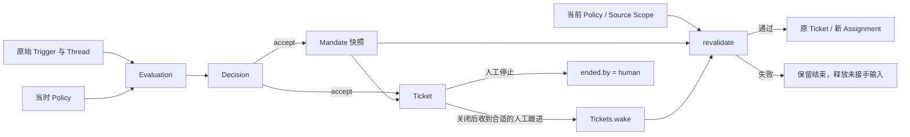

# 13 · Decision、Mandate 与策略变更后的再验证

> 面试题　Alice 提出一个文案修改请求，系统已经接受，运行途中她被移出允许名单。Eval 要重算吗？Worker 要立刻停止吗？如果 Ticket 已自然结束，后来有人在原 Thread 上追问，还能用原来的授权恢复吗？

**短答**　Decision 记录当时怎样判断，Mandate 保留接受时的来源、身份、强度、范围和规则。策略版本变化后，活动 Eval 按新版本重排，相关开放 Ticket 获得变更 Input，原型仍保留其既有业务状态。自然结束的 Ticket 若要恢复，才沿原 Mandate 的 basis 和当前 Source Scope 重新核验。人工明确停止的 Ticket 由 ended 状态阻止自动恢复。只改变 Source 实例的接收范围还可能改变现在能看见什么，而不改变 Policy version。把这些阶段拆开，才知道是作废旧判断、通知正在执行的工作，还是拒绝这次恢复。 [领域记录](../dsh-superagent-prototype/src/core/model.ts) · [Policy](../dsh-superagent-prototype/src/policy.ts) · [Engine](../dsh-superagent-prototype/src/core/engine.ts) · [Ticket 恢复](../dsh-superagent-prototype/src/core/tickets.ts)

本文以提交 `7bd4741` 为基线。继续用虚构的帮助页错字任务。Alice 在飞书群指向 Agent，授权把「帐户设值」改回「帐户设置」。同一项目还可以有一张由观察规则主动接受的工单，用来比较 copy 规则、来源范围或模式改变后的差异。前两篇已经介绍了工具入口与 Eval 的队列时序，本篇固定在历史授权与当前执行之间的关系。 [第 11 篇](11-explicit-routing-and-inferred-eval.md) · [第 12 篇](12-eval-batching-timeouts-and-requeue.md) · [授权文档](../dsh-superagent-prototype/docs/002-authorization.md)

## 1. 为什么要同时持有 Decision、Mandate 与 Ticket

一个只保存 `approved: true` 的系统能回答「曾经同意过」，却很难解释这次同意从哪里来、作用到哪件事，以及许可改变后是否还有效。如果让模型每轮都重新从全部聊天和最新配置计算授权，又会失去历史事实。比如一张 Ticket 是上周接受的，今天 Alice 已退出团队，重新读今天的名单后不能从中还原上周她的身份。当工作还在执行、已结束、或者只是一个未完成的评估时，这几个时间事实各有自己的用途。 [Decision / Mandate 类型](../dsh-superagent-prototype/src/core/model.ts)

| 对象 | 保存的事实 | 最常用于什么 |
| --- | --- | --- |
| Evaluation | 某个 Thread 的活跃评估、当前批成员、basis 和 Policy version | 判断是否可以提交本轮结果 |
| Decision | 一次评估怎样结束、理由、涉及哪些 Trigger、可选的 audit 与业务关联 | 查拒绝、观察、超时、接受或停止的历史 |
| Mandate | 接受时的 actor、strength、policyVersion、basis 和 scope | 告诉 Worker 允许做什么，恢复时核对原授权 |
| Ticket | 被获准的工作及其输入、执行、跟踪、结束事实 | 区分正在执行、自然结束与人工停止 |
| Policy 与 Source 设置 | 当前允许的身份、规则、模式和接收范围等 | 对新事件和恢复动作作当前判断 |

决定记录与授权快照有因果关系。一次 accept 可以生成两者，之后 Ticket 可以多次启动不同的 Assignment，保持原授权来历。后续如果团队要停止，这张 Ticket 的生命周期出现明确的人工终止。若自然结束并回到原范围继续，使用当前配置检查原授权是否可用。一次成功复查没有必要造一张新的历史接受记录，也无需把旧 basis 改成新版本来掩盖当时发生的事实。 [Evals.accept](../dsh-superagent-prototype/src/core/evals.ts) · [Ticket 创建与恢复](../dsh-superagent-prototype/src/core/tickets.ts)



图中的 revalidate 是一次当下判断，结果影响本次业务动作。当前结构没有用一个全局授权表覆盖所有历史快照。理解这点后，面试时可以用一张工单的原始 Decision、原 Mandate 和当前输入解释为何某次停住，同时仍展示它之前曾经合法执行。 [revalidate 实现](../dsh-superagent-prototype/src/policy.ts) · [停止与恢复](../dsh-superagent-prototype/src/core/tickets.ts)

## 2. 五种 DecisionKind 分别记录什么

### 2.1 领域记录和工具输出先分开

`DecisionKind` 包含 accept、ignore、reopen、stop、unavailable。这里是存储支持的决定词汇。主 Session 的评估工具和显式路由工具，各自只接受自身动作。 `orchestrator_eval_decide` 接收 accept、ignore、unavailable。 `orchestrator_route` 可以给 accept、attach、stop、ignore，而 attach 是操作，新一条 Decision 未必有名为 attach 的 kind。Worker 的 report 也另行处理进度和完成。不能仅看 UI 或模型返回名推断它必定是哪种数据库状态。 [Decision 类型](../dsh-superagent-prototype/src/core/model.ts) · [主工具](../dsh-superagent-prototype/src/app/tools/main.ts) · [评估 Schema](../dsh-superagent-prototype/src/app/assessment.ts)

| Kind | 常见的触发方式 | 结果与审计意义 |
| --- | --- | --- |
| accept | 活跃 Eval 或直接判断符合接受条件 | 产生 Mandate、Ticket 和执行意图 |
| ignore | gate 不合格、正常忽略、观察模式积极提议或被无效停止拒绝等 | 按 reason 与 audit 解释本次为何未建立新工作 |
| reopen | 历史数据中的恢复决定类型 | 当前常见的自然恢复保留历史读取兼容 |
| stop | 指向开放 Ticket 的显式停止成功 | 写停止决定，目标 Ticket 以 human 来源结束 |
| unavailable | 评估未完成或已有依据失效 | 保留具体失败原因，后续可能已进入重新评估 |

accept 路径给 `Decision` 增加 ticketId 和 mandate。其 ID 由 Evaluation ID 派生。正常接受还为同一 Thread 的批次成员保存处置关联。一次接受本来可以覆盖多个 Trigger，而批内用于授权的 primary 仍可单独追到 Ticket.origin。找重复 ticket 的依据时，可以比较 Decision 的 triggerIds 或查询已接受历史。不能因为一批有五条消息就按五项业务工作计。 [Evals.accept / record 与 accepted](../dsh-superagent-prototype/src/core/evals.ts) · [批次 Ticket origin](../dsh-superagent-prototype/src/core/tickets.ts)

### 2.2 ignore、unavailable 和 wouldAccept 的边界

ignore 可以来自不同阶段。未通过 gate 的队列项可能直接得到相应的理由。主 Session 如果只凭候选卡判断 inferred 明显不相关，会记录 `ignoredFromCard`。完整评估遇到方向不确定或规则不匹配，也可能最后写 ignore。观察模式中，一个合格的推断接受建议另含 `would_accept` 和 proposal，存储的 kind 仍是 ignore，面板通过 `outcomeOf` 显示 `wouldAccept`。要审查系统到底为何没有执行，应看实际 kind、reason 与 audit，而不是把页面标签当成另一种新权限。 [忽略与不可用逻辑](../dsh-superagent-prototype/src/core/evals.ts) · [评估转换](../dsh-superagent-prototype/src/policy.ts) · [面板 outcome](../dsh-superagent-prototype/src/app/views/records.ts)

unavailable 常对应没有在当前条件下完成有效判断。例如连续超时后来没有结果，或旧 Policy 下的活动批在变更后重新排队。证据缺失的评估也可以由模型提交这个判断。及时复核要确认失败是否已被映射到新 Eval 或新的 Decision。比如显示「Policy changed during assessment」，同一 Thread 现在已重新进入 evaluating，在途状态仍在推进。用户可以在适用的活跃问题上重评或 dismiss。dismiss 影响面板呈现，历史 Decision 仍保留。 [重评、超时与 dismiss](../dsh-superagent-prototype/src/core/evals.ts) · [Overview](../dsh-superagent-prototype/src/app/views/overview.ts)

### 2.3 现行的恢复不会再造一条 reopen Decision

当前 `Tickets.wake` 对符合条件的已结束工单，删除 ended、创建新 Assignment、写 `resumed` Input，保留原 Mandate。它不调用 `Evals.accept`，也不需要写一条新 reopen 授权。 `DecisionKind` 与读模型里的 reopen 是历史可读性的一部分。源码的 `TicketInput.kind='reopen'` 注释也说明旧版本曾记录，迁移可将某些仍待交付的旧 reopen Input 转成 text。面试里如果从加载的历史数据看到 reopen，应在版本和记录语义上定位，再判断当前实现发生相同情况时会怎样。 [Ticket 中旧 reopen 与 resumed](../dsh-superagent-prototype/src/core/model.ts) · [Tickets.wake](../dsh-superagent-prototype/src/core/tickets.ts) · [迁移逻辑](../dsh-superagent-prototype/src/app/migration.ts)

例如工单 W1 自然结束后，用户说「同一处还有漏字」。当前策略允许原 Mandate 时，旧 Ticket 可以有第二条 Assignment，并留 resumed marker。事件记录可以显示它仍由原任务承接，Thread 的 Decision 历史不需要新 accept。另一个场景是用户要求「把帮助页布局完全重写」，超出了原范围。即使此时恢复了原任务，Worker 仍应依据原 Mandate 判断新要求，超出的由适用路径重新评估。一条输入促成恢复，与获得新的工作范围之间仍有界线。 [恢复域行为](../dsh-superagent-prototype/src/core/tickets.ts) · [原授权下恢复用例](../dsh-superagent-prototype/tests/core-engine.spec.ts#L296) · [Worker 范围](../dsh-superagent-prototype/prompts/work.md)

## 3. Mandate 的每个字段为何值得保存

接受时的字段来自具体 Eval 与评估结果。 `Evals.accept` 先拿 `evaluation.basis`，如果接受 outcome 提供正向规则 ID，追加到 basis.rules。再用活动 Evaluation 的 actor、strength 和 policyVersion 搭配 outcome.scope 构造 Mandate。Ticket 也保存 decisionId 和 origin，因而追查原始授权不需要重新计算历史 gate。只要知道来源范围和现在发生的变化，就能找旧记录对比。 [Evals.accept](../dsh-superagent-prototype/src/core/evals.ts) · [Tickets.create](../dsh-superagent-prototype/src/core/tickets.ts)

| 字段 | 本例可读出什么 | 当前恢复怎么用 |
| --- | --- | --- |
| actor | 哪个来源的 Alice 或 bot 提供了委托依据 | 在适用分支重新查原生身份 |
| strength | 显式或推断 | admission 分支比较现资格是否至少达到原等级 |
| policyVersion | 接受时的历史版本 | 回顾原设置，不以 hash 相等作为唯一恢复条件 |
| basis | addressed、followup、admission、bot 或历史 listed，加来源范围、row、cell 等 | 选择当前需要核对的规则路线 |
| basis.rules | 在接受时匹配的规则 ID | 给 Worker 提供规则指令，也可在恢复时查当前规则是否仍启用 |
| scope | 这一次获准做的具体事 | 告诉 Worker 交付范围与后续是否越界 |

要注意两个都叫 scope 的位置。`mandate.scope` 是工作范围，例如「把帮助页这一处错字改回正确文案」。`mandate.basis.scope` 记录来源入场的原生范围数据，例如 chatId、direct 或 GitHub meta。revalidate 用后者重建 `SourceScope`，并按 `kind` 与配置求现在能否接收。原先评估针对的是哪件事，仍从工作 scope 和 Trigger 查。撤掉群范围和改变修改内容是不同类变化，授权对象会分别体现。 [MandateBasis 的 Received](../dsh-superagent-prototype/src/core/model.ts) · [revalidate 的范围检查](../dsh-superagent-prototype/src/policy.ts)

同一有效行为可以通过不同依据获得。Alice 在名单中 @ Agent，会走 via addressed。未指向但符合开放准入的 copy 任务，可能走 via admission，保留观察与规则。已经有正式参与关系且到达 gate 的输入可能走 via followup。bot 用自己的 bots 名单与推断资格。旧数据库还可以保留 listed 或某些不完整的记录，迁移以 basisOf 尽可能识别历史来源。这个联合类型在以后验证时相当于一个开关，避免把所有历史批准硬套在一张最新允许名单上。 [依据联合类型](../dsh-superagent-prototype/src/core/model.ts) · [恢复分支](../dsh-superagent-prototype/src/policy.ts) · [basisOf](../dsh-superagent-prototype/src/app/migration.ts)

迁移还有一个具体例子。某些旧版飞书记录把 chatId 和 direct 放在 basis 顶层，迁移可用这些字段补成 Feishu 的来源与 scope。带旧 admission 格或明确 followup 标记的记录，可转成同名的带标签依据。找不到更具体来源时会保留 listed 的旧判断方式。如果审计系统要跨版本追踪，应区分结构转换与原本就没有记录的环境。将所有旧记录默认重写成当前 addressed 会丢掉曾采用的矩阵条件，再验证结论也可能偏离历史。 [依据的迁移定义](../dsh-superagent-prototype/src/app/migration.ts) · [多类旧记录迁移](../dsh-superagent-prototype/tests/migration.spec.ts#L212)

## 4. Policy version 变更从设置写入走到任务

### 4.1 版本号表示一门「评估规则」的快照

`policyVersion(settings)` 用版本常量加 JSON 值生成 key，其中包括 rules、eval.mode 和 settings.policy.sources。启用规则、成员名单、各来源 admission 表或 bots 的变化可改变版本。当前哈希不包含所有运行参数。暂停、并发、评估超时时间、角色模型和 Source 实例配置自身都不会直接进入这份版本。某个配置仍能改变系统的可读输入或时序，这和 Policy version 是否变化是两个需要同时检查的信号。 [策略版本实现](../dsh-superagent-prototype/src/policy.ts) · [版本覆盖用例](../dsh-superagent-prototype/tests/policy.spec.ts#L224)

需要注意当前序列化的层次。规则改说明可能让语义评估结果不同，版本必须有变化。列表顺序或名称作为实际保存的数据也可能影响序列化结果。飞书名单同步会保留已有成员顺序，更新名称和增删变动项，减少平台返回顺序本身带来的虚假版本变化。面试里把它描述为「基于选定配置集合的版本标识」，比说「每次等价语义都会得到完全同一个值」更准确。 [Source 同步](../dsh-superagent-prototype/src/sources/feishu.ts) · [同步顺序测试](../dsh-superagent-prototype/tests/runtime.spec.ts#L634)

### 4.2 一次保存怎样把受影响的对象找出来

`Settings.save` 先校验配置块 revision、来源类型与待写内容。若要异步验证新账号或模型，完成后检查该块有没有又被别人保存。然后从当前旧配置与候选配置算 `before` 和 `after` 版本。只有版本不同，才取开放 Ticket 计算 policyEffects，得到哪些 Ticket 有实际变化与通知内容。最后在同一个应用事务里保存设置、视需要排队主会话通知、触发 Engine.policyChanged，并记录设置历史上的通知对象。事务提交后由后续队列和 pass 推进。 [Settings.save](../dsh-superagent-prototype/src/app/settings.ts) · [Engine.policyChanged](../dsh-superagent-prototype/src/core/engine.ts) · [保存冲突测试](../dsh-superagent-prototype/tests/settings.spec.ts#L18)

同一次写入对 Eval 和 Ticket 的粒度也不同。Engine 将 `Evals.policyChanged` 用在所有 active evaluating 上，当前 Eval 的版本已经过时，按旧决定失效再重排。对 open Ticket，则只有 effects map 命中的目标得到 Input。比如只删除了一条和本 Ticket 没有关系的规则，活动 Eval 可能重新开始，正在执行的原显式 Ticket 仍不必因这次变更收到 Worker 通知。版本代表该轮判断所依据的规则集合，受影响通知则进一步看它已经凭哪项条件接受。 [策略变化的两段处理](../dsh-superagent-prototype/src/core/engine.ts) · [Evals.policyChanged](../dsh-superagent-prototype/src/core/evals.ts) · [Ticket 的影响计算](../dsh-superagent-prototype/src/policy.ts) · [不相关规则测试](../dsh-superagent-prototype/tests/runtime.spec.ts#L408)

### 4.3 如何解释给开放 Ticket 生成的三类提示

`policyEffects` 首先看本次 Mandate 记录的规则 ID。若原已启用的规则现在关闭或消失，记录 disabled。仍启用但定义变动时，记录 changed 与当前指令。然后判断旧配置下原 Mandate 通过、新配置下失败的情况。为了把原因分开，代码在新范围与来源策略下临时保留旧模式、旧规则做一次复查。若这样仍不通过，便记 requesterAllowed: false 和原 requester。若暂时保留旧模式/规则后可通过，且 inferred 从 auto 切走，则可记 proactive: false。规则差异和权限原因可以留在同一个 effect 上。 [policyEffects 实现](../dsh-superagent-prototype/src/policy.ts)

| 提示信息 | 典型来源 | Worker 上实际看到的动作含义 |
| --- | --- | --- |
| `rules: [...changed/disabled]` | 工单原匹配规则被改或关闭 | 核对剩余工作是否仍符合相应条件，适用时就结束或报告 dropped |
| `requesterAllowed: false` | 当前发送者身份、相应范围或准入条件无法支撑原授权 | 继续检查原工作范围，限制接纳该人新的请求 |
| `proactive: false` | inferred 工作原来能在 auto 下继续，当前模式退回 | 控制在正在执行的原范围，不接新的推断扩展 |

这个 effect 不是把整份设置广播给所有 Worker。`Tickets.policyChanged` 按开放工单查 map，写 `policy-changed` Input，带 from、to、时间和影响。Input ID 含时间，所以重复切换回同一组版本时，可以有各次记录。执行器将 Input 渲染为可读消息，再按当前状态交付。它仍然是事件和工作约束说明，并非在通知阶段直接取消整个 Worker Session。 [Ticket 变更 Input](../dsh-superagent-prototype/src/core/tickets.ts) · [worker 输入渲染](../dsh-superagent-prototype/src/executor/dsh.ts) · [重复版本过渡的测试](../dsh-superagent-prototype/tests/core-engine.spec.ts#L1340)

另一个细节是这段逻辑关注「先前可再验证，到现在失败」的变化点。如果某 Mandate 在旧版本已经不能恢复，这不一定会因随后某次配置保存再次收到一条身份丧失通知，规则定义差异仍各自计算。管理历史中的 notified 是生成通知的工单集合，不应被用来推断「从未通知的所有工单都可运行」。确认现状时还要看目标 Ticket 是否开放、当前范围和实际输入。 [old 与 now 对照](../dsh-superagent-prototype/src/policy.ts) · [Settings 历史记录](../dsh-superagent-prototype/src/app/settings.ts)

可以算一个同时变化的例子。若一次配置更新中，原有的 inferred 工单既失去原账号资格，又碰到 auto 被降为 observe，代码会在新身份状态下暂用旧模式复查。如果改回原模式仍不具备资格，生成 requesterAllowed: false 的分支，而无需把失败归因为仅仅暂停推断性工作。原规则的 changed 或 disabled 仍可另外显示。这个比较的价值在于帮助接手人知道为什么变更影响此单。实际开放任务如何继续，仍要按 Ticket、当前工具和外部结果核对。 [变更原因分类](../dsh-superagent-prototype/src/policy.ts) · [时间点和可读提示](../dsh-superagent-prototype/src/executor/dsh.ts)

## 5. 再验证怎样沿原 Mandate 走到今天的条件

### 5.1 第一步核对原接收范围

settingsPolicy.revalidate 先读取 basis.source 与 basis.scope。两者存在时，用当前 Source Registry 计算这份原始范围是否仍 listened。如果已不接收，立即失败。调用输入是原授权时记录的范围。即使新的人工后续来自另一段正式订阅，例如从 GitHub PR 追问一张飞书起源 Ticket，也要核对这张 Ticket 的原授权起点。后续所在 Thread 决定消息可否送到它，原授权时的来源范围决定能否恢复。 [revalidate 起始范围检查](../dsh-superagent-prototype/src/policy.ts) · [Trigger 与 Ticket 来源](../dsh-superagent-prototype/src/core/model.ts)

当 Source 仍 listened、只是把全量观察换成「仅 @」，恢复检查没有把 observed 作为统一前提。曾经接受时允许的材料、当前能否接收该范围、如今能否让同类新消息自动建单，分别有各自条件。历史 basis 如果缺少 source 或 scope，代码中的 current 可能没有值，此时依后续分支与可用字段继续校验。迁移可以整理旧形状，无法从不存在的字段生成真实的接收历史。新增强制的范围快照，需要考虑已有数据如何兼容。 [当前位置校验](../dsh-superagent-prototype/src/policy.ts) · [basisOf 迁移](../dsh-superagent-prototype/src/app/migration.ts)

### 5.2 按原来的依据进入不同分支

| 原 basis | 通过原 Scope 检查后主要还看什么 | 常见失效原因 |
| --- | --- | --- |
| addressed | 仍属于该来源允许名单 | 按原 ID 移除了成员 |
| followup，explicit | 该分支直接通过 | 原接收范围不再 listened |
| followup，inferred | 当前 mode 是 auto，且所记录规则全部启用 | 切到 observe/off，规则关闭或被删 |
| admission | 当前适用 cell 要提供至少原强度；带 observation 的有关分支再看 auto 与规则 | 单元格弱化，名单或模式变化 |
| bot | 原始 bot 仍登记；有观察依据的正规记录还会检查模式和规则 | bot 被移除，规则关闭或 auto 收紧 |
| listed，历史兼容 | 仍在名单；若记录了 observation，再按相应模式与规则判断 | 旧批准无法满足今天的成员身份 |

表先约定最初的 Scope 检查通过。特别是 explicit followup 通过 Source 后在此分支返回，无法由「已移出成员」普遍推导每一份显式 Mandate 都不成立。为了不说错默认策略，应按 via 区分 addressed 与 followup。rulesOn 用记录的规则 ID 当前是否仍启用。真实推断接受经 Engine 校验通常有非空的正向匹配集，旧记录仍按它自身字段解释。 [完整 revalidate](../dsh-superagent-prototype/src/policy.ts) · [显式恢复对照](../dsh-superagent-prototype/tests/policy.spec.ts#L206) · [followup 测试](../dsh-superagent-prototype/tests/policy.spec.ts#L379)

admission 还处理成员状态变化。原先走 unlistedAddressed，且此人现已加入名单时，代码沿当前更强的明确指向资格在该分支直接通过。原先 unlistedUnaddressed 的人后来进入名单，则转到 listedUnaddressed，再比较适用格。原来从 listedUnaddressed 获得权限的人失去名单资格，会在相应检查中拒绝。恢复使用当前 Scope 给出的 row，历史 basis.row 则记当时的接收条件。用三条身份变化来推演，比仅拿旧表的格值预测恢复结果更准确。 [admission 再验证](../dsh-superagent-prototype/src/policy.ts) · [准入默认项](../dsh-superagent-prototype/src/admission.ts)

「规则改了」也有数种可能。从列表移除某个匹配 ID，或将其关闭，会让需要该规则的恢复失败。如果只编辑已启用规则的名称或指令，该 ID 仍开启，rulesOn 不会因为文字不同就失败。相应 open Ticket 可收到 changed Input，把新说明带给 Worker。当前设计分别保存历史接受范围与规则 ID 是否现行。生产若要求规则正文变化就强制重新签核，也应定义单独的内容版本条件。 [规则检查与变更比较](../dsh-superagent-prototype/src/policy.ts) · [规则变更测试](../dsh-superagent-prototype/tests/policy.spec.ts#L354)

### 5.3 恢复用当前判断，保留原始记录

Intake 可把适用的正式 Thread 人类跟进交给自然结束的任务。Tickets.wake 重读目标，要求有等待输入、结束方非 human、当前未暂停，再调用 revalidate。找到合适的人类 Trigger 且授权通过后，才删除 ended、创建下一 Assignment、写 resumed 标记并安排启动。原 Ticket ID、Mandate 和来源关联继续保持。因此恢复可能由另一位人类触发，这条跟进能作为既有工作输入，原 Mandate 的 actor 仍是初始委托者。 [Intake 交付](../dsh-superagent-prototype/src/core/intake.ts) · [Tickets.wake](../dsh-superagent-prototype/src/core/tickets.ts) · [其他人触发的恢复](../dsh-superagent-prototype/tests/runtime.spec.ts#L379)

若 revalidate 失败，Tickets.refuse 清待交接队列，再调用 letGo 更新有关 Trigger 的 fanout。Ticket 保持结束，已经失败的这次输入没有继续送入 Worker。符合要求且尚未接手的人类消息，在没有其他有效所有者、确认或定案情况下可回到新 Eval，按现在的条件重新判断。若仍有其他 Worker 负责，则保持其处理路径。这个条件保护了两个结果，原授权失败不会强行启动 Worker，尚没人处理的输入也有可以重新判断的位置。 [refuse / letGo](../dsh-superagent-prototype/src/core/tickets.ts) · [恢复失败的测试](../dsh-superagent-prototype/tests/core-engine.spec.ts#L1191)

源码没有在 refuse 写入会永久封存 Mandate 的标志。原授权与结束状态仍然保存。只要目标没有人工停止，如果后来配置恢复，新的合格消息可以再次触发复查。本次临时运行时用例验证了这一点。移除原委托者后，第一条跟进未能恢复，原 Mandate 与已完成状态保持。恢复名单并发送一条新的同 Thread 人类跟进后，同一工单获得第二个 Assignment，Mandate 内容没有变化。被拒那次的输入已经从待交接与处置关系释放，不应假定恢复会重送此前所有旧输入。 [拒绝与下一次 wake](../dsh-superagent-prototype/src/core/tickets.ts) · [有效性复查](../dsh-superagent-prototype/src/policy.ts)

### 5.4 人工停止、attach 与 retry 各有检查点

人工停止记为 ended.by = human，后续摄取与 wake 会跳过自动恢复。普通配置恢复不会删掉该字段。尝试 attach，Tickets.attachable 也拒绝人工停止目标。目标自然结束但当前旧 Mandate 不成立时，attach 同样拒绝。针对开放工单，attach 更多检查消息归属和输入条件。拒绝本次继续与明确人工终止，后续语义可以通过这些入口直接观察。 [stop 与 attachable](../dsh-superagent-prototype/src/core/tickets.ts) · [人工停止后的测试](../dsh-superagent-prototype/tests/core-engine.spec.ts#L331)

「手动停止」针对的是仍在运行或等候的开放 Ticket。Tickets.end 在发现目标已经结束时直接返回，面板也根据 liveTicket 派生是否给出 stop 操作。因此把一张已经正常完成的 Ticket 选作停止目标，不能据此认为它的旧结束原因被改写成人工停止。若产品需要提前封存历史任务、禁止将来再唤醒，应定义单独的封存状态和授权动作，再检查后续消息与 attach 的行为。这个差异可用 ended.by 和是否允许下一次恢复来做回归断言。 [Ticket.end 的前置条件](../dsh-superagent-prototype/src/core/tickets.ts) · [面板操作投影](../dsh-superagent-prototype/src/app/views/records.ts)

retryTicket 更换的是仍开放且可重试的 Assignment。Tickets.retry 用 canRetry 检查开放和等待人或投递故障，再结束旧尝试、重排适用输入、启动新的尝试。这是开放工单的执行恢复通道。结束工单的 wake 有单独的 revalidate。两条路径都会创建 Assignment，但授权复查的时点不同。 [retry](../dsh-superagent-prototype/src/core/tickets.ts) · [canRetry](../dsh-superagent-prototype/src/core/stage.ts) · [失败重试验证](../dsh-superagent-prototype/tests/core-engine.spec.ts#L1118)

### 5.5 处理暂停时要看哪一刻的 Policy

自然结束后，若跟进在暂停中抵达，Intake 仍可记下 Trigger 与等待交付的关系，wake 看到 paused 先返回。假设 10:01 跟进到来，此时 Alice 仍是成员；10:02 将她移出名单；10:03 解开暂停。解开后 Engine 在活动 Ticket 中找待输入，以现在的状态尝试 wake，原授权应按 10:03 的配置决定。10:01 的待交接记录只保存等待意图，没有提前消耗或保存一个旧的复查结果。 [wake 的暂停顺序](../dsh-superagent-prototype/src/core/tickets.ts) · [evaluateDue](../dsh-superagent-prototype/src/core/engine.ts)

已有并发测试分别构造「暂停等待后资格未变」与「等待期间成员移出」。第一条可以回到开放状态并得到下一 Assignment，第二条保持结束并清掉等待项。这个测试说明在配置可能异步变化的系统中，复查时间点必须贴近真正的业务动作。否则有两种错误，收到输入时先准许以后不再检查，或已经启动的工作每遇到无关设置变更都被中断。当前原型把这些影响分别放在暂停恢复与开放任务通知的路径里。 [当前权限恢复测试](../dsh-superagent-prototype/tests/runtime-concurrency.spec.ts#L813) · [开放任务的变更通知](../dsh-superagent-prototype/src/core/tickets.ts)

## 6. 四种策略变更，分别推演三种状态

以下同时看三个对象。一条新讨论的 Eval E 还在等待判定，开放 Ticket W 已在执行，另一张 Ticket R 已自然结束。表里的通知以保存进入 Policy version 变更处理、且旧到新的差异与该 Mandate 相关为前提。E 尚无工单授权，W 有历史接受，R 再执行前要通过当前条件。 [版本生效点](../dsh-superagent-prototype/src/app/settings.ts) · [状态与恢复](../dsh-superagent-prototype/src/core/tickets.ts)

| 改动 | 在途 Eval E | 开放 Ticket W | 已自然结束 Ticket R |
| --- | --- | --- | --- |
| 从名单移除 Alice，原 basis 是 addressed | 旧评估按版本重排，按今日身份再 gate | 受影响时收到 requesterAllowed 提示 | 恢复查原 Alice 资格，该旧 basis 会失败 |
| 禁用已匹配 copy 规则 | 版本变化后按新集合评估 | 对相关工单给原规则 disabled 通知 | 对需要开启规则的 inferred 基础失败 |
| 撤掉原来源接收群 | 仅改这一块不统一触发 Policy 版本重排 | 保持开放状态，无 per-Ticket Policy Input | 复查时原接收范围不再 listened，恢复失败 |
| auto 改为 observe | 旧评估重排，之后可评价拟接受 | 受影响的 inferred 工单得到 proactive:false | 对要求 auto 的原授权不能恢复 |

### 6.1 名单变更的完整时间线

10:00，Alice 用飞书 @ 请求帮助页具体修改，系统接受工单 W。10:03，另一条独立话题的 E 仍活跃。10:05，运营将 Alice 移出该来源名单。E 的旧评估按版本失效重排。若没有其他符合条件的准入配置或现有任务归属，Alice 的新请求不再有之前的直接资格。W 已拥有原 addressed Mandate，差分通知使用 W 原本的 actor 与依据计算，Worker 得到该人不能再发起工作的说明，W 仍开放。 [版本与 Worker 通知](../dsh-superagent-prototype/src/core/engine.ts) · [移除发送者用例](../dsh-superagent-prototype/tests/runtime.spec.ts#L408)

如果 W 10:06 自然完成，10:10 另一位成员在原 Thread 追问，正式订阅可以把它交给 wake。对 Alice 的 addressed basis，复查查的是原 Alice 当前是否仍在名单。即使新追问者有资格，旧批准的主体条件失效也会让这次恢复失败。若需由新的授权主体开始工作，合适的后续可进入评估，取得自己的批准记录。这样把「谁触发继续」与「原先谁赋权」分开。 [原 actor 的再验证](../dsh-superagent-prototype/src/policy.ts) · [失败释放](../dsh-superagent-prototype/src/core/tickets.ts)

### 6.2 禁用规则和改规则文字

假定 inferred 工单按 copy 接受，另有显式工单没有记录规则命中。关 copy 时，旧 Eval 按新集合重排，inferred 工单收到原规则 disabled。对不基于 copy 的工单，可能无需发任务通知。恢复时若原 basis 要求匹配规则启用，copy 已关闭就失败。若只是改变说明但 ID 仍启用，系统可向受影响的开放 Worker 推送最新说明，后续复查看的是当前已启用的规则 ID。面试讲「规则变了」时应指出禁用、删除、内容更改各影响哪个阶段。 [规则差异](../dsh-superagent-prototype/src/policy.ts) · [通知渲染](../dsh-superagent-prototype/src/executor/dsh.ts) · [规则删除用例](../dsh-superagent-prototype/tests/policy.spec.ts#L391)

### 6.3 只改 Source Scope 的差异

移除飞书群时，Registry 可返回 chat_not_allowed。正常摄取的新同群输入会过滤，或因新的读取范围压根没被拉到。修改落在 settings.sources 而非 settings.policy.sources 时，且其他版本相关字段不动，before 和 after 可以相同。此时设置正常保存，通常也有设置级通知，但 per-Ticket PolicyEffect 与所有活动 Eval 重排受版本门控制。临时用例确认，Scope 返回拒绝且保存结果 policy_changed 为 false，原 active Eval ID 与开放 Ticket 状态保持。该用例验证保存后状态，旧候选最终如何处理仍要在具体命令处核对。 [飞书 Scope](../dsh-superagent-prototype/src/sources/feishu.ts) · [Settings 的版本门](../dsh-superagent-prototype/src/app/settings.ts) · [policyVersion](../dsh-superagent-prototype/src/policy.ts)

恢复时另有 Scope 检查。设飞书起源的 Ticket 已绑定 GitHub PR。运营撤掉原接收群，PR 上的新人工跟进仍可能由 GitHub Source 接收并触发复查。这里原 basis 的 listened 由当前飞书设置求值，可能直接失败。若只是从全量观察改成仅提及，且 listened 保持，则继续查其它条件。用户回复的 Channel 也会有独立作用域，Outbox 可以在发送之前重新检查。 [初始 Scope 条件](../dsh-superagent-prototype/src/policy.ts) · [恢复输入](../dsh-superagent-prototype/src/core/tickets.ts) · [Outbox 重新检查](../dsh-superagent-prototype/src/app/outbox.ts)

### 6.4 auto 切到 observe

在 auto 下，评估通过可生成含匹配规则的 inferred Mandate。切到 observe 时，活动 Eval 用新版本再判断，合格的推断建议可留 would_accept。开放的受影响推断工单可收到 proactive:false，默认路径仍保留已执行任务。自然结束的旧 Ticket 若要求 auto，再恢复时会失败。显式接受不依赖推断模式，显式历史任务仍按自己的 basis 核验。要回答「切模式能否停下所有工作」，需分别说明开放执行、后续推断、新显式以及暂停。 [mode 和规则](../dsh-superagent-prototype/src/policy.ts) · [评估决定](../dsh-superagent-prototype/src/core/evals.ts) · [模式通知测试](../dsh-superagent-prototype/tests/policy.spec.ts#L366)

## 7. 怎样读审计记录，不把历史证据和当前投影混在一起

### 7.1 先区分设置 revision、Policy version 与实际工作版本

设置系统保存每次有效修改的 revision 和完整 settings 快照。每个配置块另有自己的 block revision，用于保存时的乐观并发检查。Policy version 则由影响判断的字段计算，用于模型评估与当前配置的关联。如果从设置 A 切到 B，稍后又恢复完全相同的版本内容，两个相同的 Policy version 可以出现在不同的 settings revision 中。想知道是原来那套规则重新生效，还是历史上从未变过，需要看保存顺序与 savedAt。 [SettingsVersion 和 blockRevision](../dsh-superagent-prototype/src/app/store.ts) · [policyVersion](../dsh-superagent-prototype/src/policy.ts) · [Settings.save](../dsh-superagent-prototype/src/app/settings.ts)

这也说明不能用 Policy version 相等代替所有环境对账。例如运行时关闭某项 Source 观察，hash 可能仍匹配。Settings snapshot 中的 Source 块和当时的接收记录才能解释那个范围是否读到了输入。对原来的接受记录，读相同 policyVersion 所对应的历史设置与实际评估时间，必要时还要看 origin Trigger 的 Scope。只拿今天的配置同一规则名作回顾，可能把后来更名或修改指令后的含义加给上一次批准。 [版本覆盖](../dsh-superagent-prototype/src/policy.ts) · [来源和 Policy 的历史差分](../dsh-superagent-prototype/src/app/settings-history.ts)

### 7.2 从一次告警还原是否有实际授权变化

若操作者看到「受影响工单 3 项」，应把它理解为这一版本过渡中计算到三项 per-Ticket effect。设置历史记录 notified 的 Ticket ID，投影视图可附当前标题。Case 里的某项可能仍等待交付，另一个 Worker 已经在运行。要确认变更跨越了哪段生命周期，需要读 Ticket 的 inputs 是否写了 policy-changed，随后看对应 Assignment 的送达状态或 Worker 报告。通知意图、成功交付与执行途中采纳了哪些限制，能用两三个不同的证据点查。 [变更记录](../dsh-superagent-prototype/src/app/settings-history.ts) · [输入交付](../dsh-superagent-prototype/src/core/assignments.ts) · [运行时历史测试](../dsh-superagent-prototype/tests/runtime.spec.ts#L600)

| 运营问题 | 优先找的记录 | 能解释什么 |
| --- | --- | --- |
| 为什么昨天接了这项工作 | 原 accept Decision、Mandate 与 origin Trigger | 历史身份、basis、原范围、匹配规则与当时版本 |
| 为什么今天没得到新候选 | Trigger 处置、当前 Scope 与 gate | 来源是否接收，是否已有 Worker 负责，资格有无变化 |
| 为什么 Worker 收到新约束 | 前后 settings revision、notified 与 policy-changed Input | 哪条规则、身份或模式变化与该工单有关 |
| 为什么旧任务保持结束 | ended、待交付队列、当前 revalidate | 人工停止、当前 Scope 拒绝、原 Mandate 失效等 |
| 有个新 Assignment，是人工重试还是自然恢复 | 原来的 ended 变化、Input 与执行历史 | 是否存在 resumed，还是开放尝试被替换 |

面板的 decisionView 会从当前规则映射取易读名称，历史中已删除的 ID 可退回显示 ID。它还兼容老记录只有 matches、没有每条规则的完整判断。工具 decisionDetails 保留更详细的审计字段供有访问范围的主 Session 使用。稳定回溯要优先看规则 ID、原 audit 及历史配置，不要把今天的渲染名称当作当时做决策的规则内容。阅读一张旧 Ticket 时，也要区分经历过迁移的 basis 与现在新建任务写入的完整字段。 [决策读模型](../dsh-superagent-prototype/src/app/views/records.ts) · [工具审计卡片](../dsh-superagent-prototype/src/app/cards.ts) · [历史 basis 迁移测试](../dsh-superagent-prototype/tests/migration.spec.ts#L212)

当需要精确核对 hash，工具卡片会在返回 Mandate 时有意裁去内部 policyVersion，完整对象由持久仓储保留。设置历史展示也有查询窗口，只返回最近的记录与可计算的相邻差分。如果某个旧版本无法按今天的 Source schema 解析，差分可以为空。面试排查要说明信息来自原始域记录、设置历史还是面板投影。看到界面省略某字段时，应检查读模型，而不是先判断授权链没有保存。 [卡片词汇](../dsh-superagent-prototype/src/app/cards.ts) · [历史版本视图](../dsh-superagent-prototype/src/app/settings-history.ts) · [历史配置兼容测试](../dsh-superagent-prototype/tests/runtime.spec.ts#L1642)

### 7.3 复查失败以后保留哪些痕迹

某张跨来源协作的 Ticket 已结束，新输入被交给该工单尝试恢复。若授权复查失败，可以从 Ticket 仍 ended、待投递清单被清空、TriggerDisposition.fanout 不再包含该 Ticket 看出本次未续接。后续若进入 Eval，还能查现在的 pending 或新的处置。源码没有为每一次失败恢复专门生成「revocation」DecisionKind。是否形成新的 ignore 或 unavailable，取决于之后的评估路径。审计「这一次为什么没醒」应按这些流程条件找证据。 [refuse / letGo](../dsh-superagent-prototype/src/core/tickets.ts) · [DecisionKind](../dsh-superagent-prototype/src/core/model.ts)

例如原先 Alice 委托，移出后同 Thread 上的 follow-up 来了。系统曾将该条 Trigger 记入 Ticket.inputs 的历史，这是接受摄取的轨迹。后来 refuse 已清掉这次交付与扇出。若只以「列表里还有 Input」断言已经授权，需要改查 undelivered、ended、所有者和 Worker 实际回执。保留过去看到的信息，仍可防止它变成当前执行的任务。下一篇会用更完整的所有者与退回时序展开这部分。 [输入生命周期](../dsh-superagent-prototype/src/core/tickets.ts) · [Trigger 与归属](../dsh-superagent-prototype/src/core/model.ts)

## 8. 面试延伸，如何处理更严格的撤销要求

### 8.1 原型选择保留已开始工作的边界

撤销策略经常包含两个产品要求。一是未来输入不再使用已经撤掉的资格。二是已经运行的任务能否执行下一项外部写入。当前原型对第一项用策略再评估和恢复检查处理，对开放的受影响任务写变更 Input，让 Worker 参考当前的约束。它还支持明确的停止命令。这个选择让一般规则调整不至于直接让每个处理中任务在中间突然终止。接受之后，Worker 可能已有 worktree、开了 PR 或等待审查，简单取消会留下需要人处理的外部结果。 [Policy 变化如何影响任务](../dsh-superagent-prototype/docs/002-authorization.md) · [通知渲染](../dsh-superagent-prototype/src/executor/dsh.ts) · [停止实现](../dsh-superagent-prototype/src/core/tickets.ts)

假如团队的另一条要求是某个账号失效后即刻禁止新的外部写入。这需要额外核对每项能力。可以设计在向平台写入前验证当前授权或执行租约，以 Action 与目标资源作为校验输入，明确已在途的动作如何停或对账。在后台执行阶段要能取消适用 Session 和 jobs，远端已经创建的资源可以进入待核查、人工收尾或定义明确的补偿流程。历史 Decision 与 Mandate 仍保留，另外记录正在发生的撤销、是否确认执行停止以及还剩什么外部结果。这样能将「以后不再准入」和「此刻写入控制」都落在可测的地方。 [应用命令与权限说明](../dsh-superagent-prototype/src/core/engine.ts) · [调度和取消](../dsh-superagent-prototype/src/executor/dsh.ts) · [部署鉴权](../dsh-superagent-prototype/docs/006-deployment.md)

这种设计要有清楚的失败策略。如果统一在每个 I/O 前远程询问授权服务，权限检查服务异常会拖慢正常工作，还需要决定哪些动作应持有等待、哪些可以降级。若仅在每个 Worker 启动时验证一次，异步工作期间的撤权仍有间隙。可以把高影响外部动作和本地只读取证区分，缩小强授权查验的范围。原型给出的证据系统已经能说明哪一次接受生成哪项授权，扩展要求则是为真正执行下一步外部动作决定新的边界和可观察写入。此处属于设计题，当前实现仍以开放工单收到差异、结束后恢复前复查为主。 [当前影响通知](../dsh-superagent-prototype/src/core/tickets.ts) · [再验证触发点](../dsh-superagent-prototype/src/policy.ts)

### 8.2 用一个业务场景判断应该调用哪个入口

如果只是某条规则的表达太宽，运营期望新的推断工作变少，可以先将模式退回 observe 或改规则内容，同时抽查受影响旧工单的消息。若一个已运行 Worker 正在准备修改出错文件，要使它停止当前 Ticket，则使用明确的人工停止。若平台凭据本身已经泄露或所属权限不再可用，平台侧与部署账号切换也各有步骤。改变 eval.mode 不会替代访问控制，停止某张 Ticket 也不会自动修改 GitHub/Feishu 权限。本原型的业务工单、来源配置和平台凭据应当从各自证据确认。 [Policy 范围与模式](../dsh-superagent-prototype/src/policy.ts) · [Settings 来源配置](../dsh-superagent-prototype/src/app/settings.ts) · [部署说明](../dsh-superagent-prototype/docs/006-deployment.md)

这里可以提出一个紧凑的验证计划。先在模拟环境写入人工停止与普通 Policy 调整，检查后者只有相关的通知，前者把 ended 变为 by human 并清收尾状态。再模拟一个已读到 PR 的晚到回执，验证已结束 Ticket 不应该重新变成开放。最后恢复组织规则而不人为新授权，检验人工停止没有复活，正常结束且原依据恢复的任务则仅在合格新跟进下继续。这样能让两类撤销的差异落在业务不变量上。 [Ticket.end 和 wake](../dsh-superagent-prototype/src/core/tickets.ts) · [停止路径](../dsh-superagent-prototype/src/core/engine.ts) · [执行器晚到输入测试](../dsh-superagent-prototype/tests/runtime-concurrency.spec.ts#L69)

## 9. 测试怎么覆盖历史授权、变更与恢复

| 主题 | 仓库用例验证的行为 |
| --- | --- |
| 显式原授权 | 对来源和允许名单分别调整，原 addressed 与历史 listed 等依据按各自规则有效或失败。 [再验证测试](../dsh-superagent-prototype/tests/policy.spec.ts#L206) |
| 单元格弱化 | 以 explicit 准入的陌生用户，原格弱化为 inferred 时不再支持旧强度。 [强度测试](../dsh-superagent-prototype/tests/policy.spec.ts#L153) |
| 规则改变与名单变动 | 规则变动与撤下成员作为不同影响，只检查相关开放任务。 [影响比较](../dsh-superagent-prototype/tests/policy.spec.ts#L354) |
| 模式与 bot | 从 auto 改 observe 时通知相关推断任务，已登记 bot 被撤时再验证失败。 [模式](../dsh-superagent-prototype/tests/policy.spec.ts#L366) · [bot](../dsh-superagent-prototype/tests/policy.spec.ts#L433) |
| 旧 Eval 策略失效 | 活跃评估重新排队，相关开放 Ticket 收到通知，没被立即结束。 [运行时策略测试](../dsh-superagent-prototype/tests/runtime.spec.ts#L408) |
| 等待暂停后复查 | 暂停期间先写待交付输入，恢复后按当下 Policy 决定能不能唤醒。 [暂停恢复](../dsh-superagent-prototype/tests/runtime-concurrency.spec.ts#L813) |
| 再验证失败的事件流 | 原 Ticket 保持结束，适用新消息可回主 Eval，Worker 所有者清掉。 [恢复失败](../dsh-superagent-prototype/tests/core-engine.spec.ts#L1191) |
| 保留历史形状 | 将旧版 gate basis 迁移成现行的带标签类型。 [历史依据迁移](../dsh-superagent-prototype/tests/migration.spec.ts#L212) |

在安装锁定依赖的原型目录运行：

```bash
pnpm test tests/policy.spec.ts tests/core-engine.spec.ts tests/runtime.spec.ts \
  tests/runtime-concurrency.spec.ts tests/settings.spec.ts tests/migration.spec.ts tests/views.spec.ts
```

本次在临时检出运行，**7 个测试文件、626 个现有用例全部通过**。另外两项临时验证均通过：

1. 接受后自然结束的 Ticket 移除原发送者时，第一次跟进触发恢复失败。工单仍 completed、待交接清空、原 Mandate 内容保持、该 Trigger 的 fanout 为空。重新加回允许名单后，新的正式跟进唤醒同一 Ticket，取得第二个 Assignment，没有新增 Ticket。
2. 在有开放 Ticket 与活动 Eval 时只清除 Feishu 配置里的接收群。核对新的 Scope 拒绝，Policy version 相关保存输出没有变化，活动 Eval ID 与开放 Ticket 状态保持，没有逐 Ticket 的 Policy Input。

这些验证用本地 SQLite、模拟的来源和宿主，展示状态变更与记录。真正的第三方读写能否继续，还要看部署账号与外部平台。 [运行时夹具](../dsh-superagent-prototype/tests/fixtures/host.ts) · [Policy 与设置实现](../dsh-superagent-prototype/src/app/settings.ts) · [再验证入口](../dsh-superagent-prototype/src/policy.ts)

## 10. 面试怎么讲

### 60–90 秒口述版

> 我会把授权分成 Decision、Mandate 和执行状态。Decision 是这次如何判断，接受时 Mandate 保留谁授权、通过哪个来源分支、规则和工作范围。Ticket 可以有多次 Assignment，但恢复时仍使用原 Mandate。
>
> 改成员名单、启用规则或模式，Policy version 变，旧的活动 Eval 按当前版本重排。对于开放 Ticket 先按实际影响发 policy-changed Input。配置变动本身没有当成人工停止。自然结束的 Ticket 再启动时要查当前 Scope，用历史 basis 重查名单、规则或模式。通过就使用旧授权恢复，否则保留结束并把未接手的输入交给适用路径。
>
> 只缩小 Source 的接收设置也会改变未来输入和恢复条件，但原型的 version hash 不包含这部分。面试可以用设置版本、工单通知、实际恢复验证分别解释结果。

### 追问一　既然有 Policy version，为什么还要保存 basis？

hash 告诉你当时用的是哪套配置，basis 说明这条请求**凭哪种关系**进入。恢复时不能仅要求版本相同，也不能将旧快照丢掉。比如一个当年由 listed sender 明确提及创建的任务在许多无关设置改变后仍可恢复。反之，只关了来源读取范围，尽管 Policy hash 可能不变，原 Scope 也可能不能恢复。 [版本与 basis 分支](../dsh-superagent-prototype/src/policy.ts)

### 追问二　为什么不把所有状态变化都记成新的 Decision？

Decision 主要说明一次路由或评估的结束。正在执行的任务还能有报告、失败、重试和恢复，Mandate 与 Assignment 各自存放这些状态。自然恢复继续用旧授权，写 resumed 与新尝试即可。这样不会因为任务尝试执行两次就误读成两次不同委托。 [Decision 模型](../dsh-superagent-prototype/src/core/model.ts) · [自然恢复](../dsh-superagent-prototype/src/core/tickets.ts)

### 追问三　为什么移除成员不立刻终止所有该人的开放工作？

旧任务已经接受，可能正在产生外部修改，需要知道怎样收尾。原型按影响通知，允许操作者明确停止，恢复时再检查原授权。如果产品要求切断后续外部写入，就需要设计动作级检查和在途结果处理。介绍现有实现时应分别说清通知、恢复与真正的停止。 [Policy 影响](../dsh-superagent-prototype/src/policy.ts) · [停止与恢复](../dsh-superagent-prototype/src/core/tickets.ts)

### 追问四　一次恢复失败，资格恢复后还能继续原 Ticket 吗？

自然结束的 Ticket 在失败时仍保留历史 Mandate。配置重新允许后，新的人类跟进可以触发新一轮复查，通过后恢复同一工单。被拒绝的旧输入已经按条件释放。人工停止则另有明确的结束来源，不能通过普通自动恢复打开。 [wake、refuse 和 stop](../dsh-superagent-prototype/src/core/tickets.ts)

### 追问五　只撤掉飞书群，为什么对在途候选和恢复的作用不同？

Source 实例配置改变当前是否接收，Policy version 由规则、mode 与来源的 Policy part 等组成。只改 Source 实例不进入统一的旧版本重排分支。执行恢复时会用保存的原接收范围重新查 listened，因而可拒绝恢复。要从「接收范围变化」和「评估版本变化」两条证据分别核对。 [Source Scope](../dsh-superagent-prototype/src/sources/feishu.ts) · [策略版本和恢复](../dsh-superagent-prototype/src/policy.ts)

---

[返回连载目录](README.md) · [上一篇《Thread 级批处理、超时与评估重排》](12-eval-batching-timeouts-and-requeue.md) · 下一篇《后续消息的归属、转派与退回》
