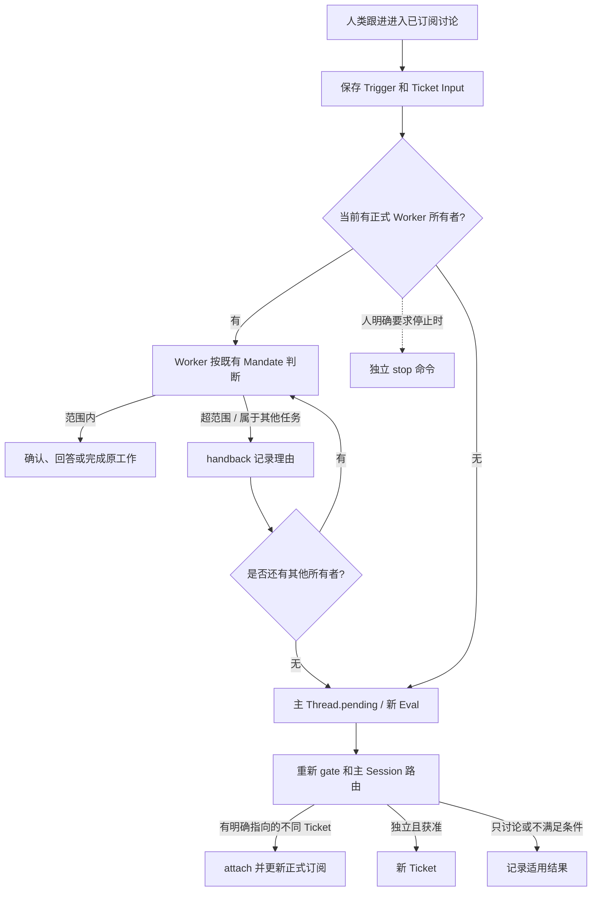

# 14 · 后续消息的归属、转派与退回

> 面试题　一个 PR 讨论有两张 Ticket 订阅。维护者说「另把导出按钮也改一下」。两个 Worker 都读到了这条消息，主 Session 也收到了通知。谁负责判断？一个 Worker 认为超出范围并退回后，主 Session 可以立刻建单吗？

**短答**　Intake 可以把同一事件扇出到多个工单。随后 `followupOwners` 基于人工输入、当时记录的分发、参考订阅、退回历史、Eval 与 Ticket 当前状态，算出由哪些 Worker 当前判断。只要仍有一个所有者，主 Session 的普通接受、附加或忽略会被挡住。Worker 逐个 handback 后，最后一个实际所有者让出才可能把消息放回主 Thread 的 Eval 队列。对曾退回这条消息的同一 Ticket，简单 attach 回去会被拒绝。人工明确停止、面板主动重评与 Ticket 结束时释放未接手信息，又各有自己的命令与条件。 [followupOwners](../dsh-superagent-prototype/src/core/model.ts) · [Engine](../dsh-superagent-prototype/src/core/engine.ts) · [handBack](../dsh-superagent-prototype/src/core/part.ts) · [Ticket 结束和释放](../dsh-superagent-prototype/src/core/tickets.ts)

本文以提交 `7bd4741` 为基线。继续用帮助页文案任务。设 Ticket A 修帮助页，Ticket B 处理同一 PR 讨论中的独立排版问题，Ticket C 跟踪另一项明确的导出改动。Alice 的输入 X 可能指向 C，却首先被 A、B 的订阅收到。A、B、C 和 X 都是讲解别名，真实运行用 Ticket ID、原 Trigger ID 与 Thread key。第 08 篇主要讲事件到达时如何扇出，本篇关注已经到达之后的责任和转移。 [第 08 篇](08-intake-thread-correlation-and-fanout.md) · [授权与订阅](../dsh-superagent-prototype/docs/002-authorization.md)

## 1. 从协作需求推导四种不同的记录

传统聊天 Agent 往往把每条消息直接作为新输入，模型自己记哪些需求已在做。对于长时间执行的团队任务，这会遇到两个问题。第一，人与人可以在同一个 PR 说多件事，一条跟进有时是补充原范围，有时应交给另一项任务。第二，Orchestrator 和 Worker 都看见相关讨论，如果双方都重新判断是否建单，容易给人重复确认或创建重复工作的印象。原型用已有 Ticket 的正式订阅承接跟进，并通过持久化的归属和退回证据决定何时返回主流程。 [领域设计](../dsh-superagent-prototype/docs/001-domain.md) · [订阅约定](../dsh-superagent-prototype/prompts/subscriptions.md)

| 想说明什么 | 主要记录 | 可以从中推导到哪一步 |
| --- | --- | --- |
| 将来的 Thread 输入会发给谁 | Thread.subscriptions 与 Thread.context | 得到时按配置计算扇出 |
| 过去这条消息到达了谁 | TriggerDisposition.fanout、context | 解释本次路由，数值还可能随释放更新 |
| 现在谁负责判断人的跟进 | followupOwners 对记录与当前状态的计算 | 是否由 Worker 按原 Mandate 判断 |
| Worker 是否确实接手、回复或退回 | acked、handbacks、Ticket 输入和报告 | 看实际操作，查看由哪张工单提交及何时变化 |

归属和执行是否完成也要分别判断。开放 Ticket 的 Worker 即使暂未收到 deliver Effect，也可能已被计算为 owner。已经送入 Session 的 Input 是否真的进入回合，从相应的读记录判断。它对人的要求是否在范围内，Worker 可以确认或回答。想处理某条消息要同时查这几层。只看到消息存在于执行器日志里，不足以说明结束时可把它标为处理完成。 [归属计算](../dsh-superagent-prototype/src/core/model.ts) · [Assignments 送达和已读](../dsh-superagent-prototype/src/core/assignments.ts) · [Replies.acknowledge](../dsh-superagent-prototype/src/core/replies.ts)



## 2. 人类跟进为什么有时直达 Worker

### 2.1 通过 Scope 后，已有订阅负责扇出

Source 首先要读取到这个事件，Intake 依配置进行 Scope 检查。通过后，看 Trigger 所属的 Thread 与订阅。接受任务时会给原 Thread 建立订阅，PR 关联后也可订阅 PR Thread。若 Alice 在原任务上补一条新说明，即使没有再 @，仍可生成同一 Ticket 的输入。即使是未列名的人提到一个能帮助排查的日志，已开放的任务也可能收到它。订阅在工作范围内提供上下文，启动另一项任务的资格仍由当前的 Policy 和对应 Decision 决定。 [Intake](../dsh-superagent-prototype/src/core/intake.ts) · [Ticket.create / bind](../dsh-superagent-prototype/src/core/tickets.ts) · [授权和订阅路径](../dsh-superagent-prototype/docs/002-authorization.md)

对于同一个人类触发，如果每条都会回到主 Session 咨询「该不该给原 Worker」，主 Session 会重复传递已知信息。直接交给 Worker 可以让持有原执行状态的一方先判断，这对追问测试结果、确认 PR 范围一类工作有用。代价是 Worker 必须明白原 Mandate 的界限，并在不属于自己时返回。当前明确的语义是「这条消息由 Worker 负责判断」，不是每条跟进都由同一 Worker 按新指令实施。 [Worker 工作与退回提示](../dsh-superagent-prototype/prompts/work.md) · [followupOwners](../dsh-superagent-prototype/src/core/model.ts)

### 2.2 归属计算使用分发事实与当前状态

`followupOwners` 首先只接受 `human: true`。再找 disposition，缺失或已被显式重排到 Eval 就不会有 owner。随后从 fanout 里排除这条消息的 context-only 工单以及已 handback 的工单。如果该 Trigger 正被主 Thread 的活跃 Eval 持有，它也不会同时交给某个 Worker 当正式跟进。最后核验目标存在，且工单仍开放，或虽自然结束但仍有该 Trigger 对应 Input 在 undelivered 中等待恢复。这个所有者集合可以有多项，也可能在后续动作中变为空。 [followupOwners 具体条件](../dsh-superagent-prototype/src/core/model.ts)

例如 Alice 在 PR #57 写「@Agent，那个错字还在」。如果其正式跟进目前属于 Ticket A，明确提及也不会让主 Session 立刻用显式入口建第二张 Ticket。归属判断发生在「需不需要新 Eval」之前。已有单元测试使用允许成员的 @ 输入，检查 Worker 收到，主 Session 听到 follow_up 并被拒绝接出新任务。等 Worker 判断范围后，可确认把这条要求留在原 Ticket，或说明超范围并退回。 [Intake 的分支](../dsh-superagent-prototype/src/core/intake.ts) · [允许成员的提及也先到已有工作](../dsh-superagent-prototype/tests/followups.spec.ts#L264)

这与普通资格判断中的 followup strength 也应分开。如果 Worker 已接手，正常就不发新候选。之后所有者让出，或操作者要求重评，才会重新调用 gate。此时已有正式参与 Thread 可以给名单成员提供 explicit 给定理由，陌生人可能 inferred，还要根据来源、模式和其它条件判断。采用原 Mandate 解释已有输入的问题，与给新候选计算资格的问题，分别用 owners 和 gate 求值。 [Policy.gate](../dsh-superagent-prototype/src/policy.ts) · [已获所有者的工单语义](../dsh-superagent-prototype/src/core/model.ts) · [第 10 篇](10-policy-admission-matrix.md)

### 2.3 主 Session 收到 follow_up 的作用

Runtime 在处理 trigger.received、ticket.resumed 或旧队列重路由产生的 trigger.followup 时，尝试构造 `followupNotice`。它先要求当前有人类 Worker owner，再从 fanout 取仍开放的 Ticket 放入 `delivered_to`。附带 context 标记的记录仍可能展示给主 Session，因为卡片想说明事件分发到谁。整个列表不是某一瞬间所有者集合的直接转储。它也没有声称全部目标已读完这个 Input。提示告诉主 Session 工单 Worker 会负责判断，遇到人的明确停止时可以介入。 [Runtime 的消息钩子](../dsh-superagent-prototype/src/app/runtime.ts) · [followupNotice / followupRelay](../dsh-superagent-prototype/src/app/notices.ts)

这个通知通过持久 relay，ID 由该 Trigger 算出，发送可重试。它和 candidate 消息不一样。前者不要求为每条消息新建一个 Eval，也未必没有模型调用成本。已有用例把多个 follow_up 交给模拟宿主，观察到存在可合并的实际调用情况。对团队吞吐来讲，减少的是不必要的重新评估和重复派发，不宜把「没有 candidate」直接换算成「主 Session 从未消耗推理」。 [通知的持久化交付测试](../dsh-superagent-prototype/tests/followups.spec.ts#L118) · [一组后续消息的调用计算](../dsh-superagent-prototype/tests/followups.spec.ts#L103)

## 3. 第一张状态表，正式、参考和其他进入路径

下表从一次正常摄取开始，假定输入已通过适用来源范围。同一条消息可以命中多个 Thread。若同一张 Ticket 有一次正式命中和一次参考命中，Intake 合并成一条正式 Input。自然结束、人工停止、已重排和机器事件还分别进入后续判断。 [Intake 扇出](../dsh-superagent-prototype/src/core/intake.ts) · [归属](../dsh-superagent-prototype/src/core/model.ts)

| 当时场景 | 此次能写什么 Input | 是否有 followup owner | 新 Eval 方向 |
| --- | --- | --- | --- |
| 人类消息命中开放 Ticket 的正式订阅 | 正式 Trigger Input | 有 | 原 Worker 判断 |
| 人类消息仅命中开放 Ticket 的 context-only | 带 context:true 的参考输入 | 该 Ticket 无此责任 | 没有其它 owner 时进 Eval |
| 人类消息命中自然结束 Ticket 的正式订阅 | 写等待输入，可能恢复 | 等待恢复时可暂时有，随后重查 | 若不允许恢复且未被别人接手，可重新走 Eval |
| 人类消息只命中人工停止 Ticket | 不写其 Input | 无 | 适用时由当前 Policy 判断新工作 |
| bot/CI 消息命中开放 Ticket | 可留资料，交付也看工单当前状态 | 无人类所有者 | 仍进独立 gate |
| 操作者把已拥有的 Trigger 明确重排 | 原输入可留历史 | requeued 后为空 | 按当前 gate 或路由重新判断 |
| 旧版本已有在途 Eval 持有这条 Trigger | 历史上可能还有输入 | 活跃 Eval 下不会同时推给 owner 判定 | 让当前活动判断统一结束 |

context-only 的作用是让 Ticket 了解一个相关 Thread，但保持正常接收、恢复和决定的边界。例如 B 正追踪排版，只关注 `github:42` 里关于帮助页的参考讨论。X 来时，B 可看到 context:true 的背景资料。若没有其他正式所有者，X 仍能被主 Session 评估，二者不会因为同一份原文而重复赋权。单一参考 Thread 的测试还检查这类消息不能作为 Worker 确认或提问的依据。实际可见性和回复入口有各自的守卫，应分别看已到达条件与工作归属。 [参考订阅用例](../dsh-superagent-prototype/tests/followups.spec.ts#L235) · [参考输入写回限制](../dsh-superagent-prototype/tests/core-engine.spec.ts#L1349) · [Replies](../dsh-superagent-prototype/src/core/replies.ts)

正式订阅的「本任务线程」包括创建任务时原始请求的 Thread，以及后来随显式附加或平台 PR 绑定扩展的正式关系。`Follow.own` 关注的是 PR 本身由这张 Ticket 发起等外部跟踪事实，关系到结束条件；判断后续 owner 核对的是该命中是否 context-only、历史分发和任务状态。也因为这套区别，团队可以让同一段社交讨论为多个任务提供有用材料，而由不同生命周期推进各项工作。 [Thread 与 Follow 字段](../dsh-superagent-prototype/src/core/model.ts) · [Ticket.bind](../dsh-superagent-prototype/src/core/tickets.ts)

## 4. Worker 如何确认接手，handoff 之前要核对什么

原输入进入 Worker 时，应先从 Ticket 的工作范围、来源引用和当前状态判断这条补充是否属于原任务。比如修改帮助页某个字，用户随后给清楚的目标写法，Worker 可以认领为原工作的具体约束。若只是普通讨论，同样可以没有外部回复。新的大范围要求或明显属于另一个 Ticket 的消息，可以说明理由退回。判断依据应来自原 Trigger 和已存在的授权，不能通过含有更大承诺的确认文案重新定义 Mandate。 [Worker 执行约定](../dsh-superagent-prototype/prompts/work.md) · [Mandate](../dsh-superagent-prototype/src/core/model.ts)

### 4.1 acked 是接手证据，和 send 状态分开

Worker 可通过 `orchestrator_ack` 对允许的人工 Trigger 提交确认。Replies 检查 Ticket 开放、Trigger 真实存在、已有相应联系及回复 Channel 条件，再按 `key('ack', trigger.id)` 给这条消息建立确认 ID。如果已排过同 ID，复用第一次的记录与文本。 `takeUp` 同时会在 TriggerDisposition 的 acked 中记接手的 Ticket。Worker 通过结构化 report 表示已回答人的问题，亦能留下相应接手事实。Outbox 的 pending、sent 或 dropped 阐述外部投递，acked 则用于理解任务是否认领。 [确认与 takeUp](../dsh-superagent-prototype/src/core/replies.ts) · [报告中的 answers](../dsh-superagent-prototype/src/core/assignments.ts) · [接手记录](../dsh-superagent-prototype/src/core/part.ts)

多个 Worker 都遇到 X 时，两个确认动作可以引用同一个 ACK ID。先创建的回复保留，后来的调用可能返回 reused，同时另一个 Ticket 也作为已接手记录进入 acked。本文用内存仓储从同一 Thread 的两张 Ticket 模拟这个分支，核对两次共享 ID，外发意图保留先到的一条，acked 中有两个 Ticket，owners 当时仍为两项。这个机制避免重复排相同确认。它并不会用先发 ACK 的 Worker 排他地赢得权利。是否需要业务上唯一分配，应在路由策略更早处设计。 [确认 ID 与复用](../dsh-superagent-prototype/src/core/replies.ts) · [followupOwners](../dsh-superagent-prototype/src/core/model.ts)

### 4.2 为什么 read、acked 和 handback 要分别保存

收到输入、模型进入一个回合、已经对它给出明确接手承诺、主动交还给系统，是不同事实。想象 Worker 正在准备一个结束报告，同时一条新消息刚好进 inbox。若只看「给了 Worker」，工单结束时可能把这条从未到模型步骤的输入当成已完成。相反，Worker 已确认承担的一项范围内细节，不应因后来出现运行回执的延迟又随意转给别的工单。归属与释放规则使用相应的 readAt、时间窗口、acked 与 handbacks，避免这些情况被一个布尔值盖住。 [输入读取回执](../dsh-superagent-prototype/src/core/assignments.ts) · [已接手与结束逻辑](../dsh-superagent-prototype/src/core/tickets.ts)

## 5. Handback 如何把一条跟进送回主 Thread

### 5.1 请求对象是「某张 Ticket 收到的某条 Trigger」

执行器工具从会话范围取得 Ticket ID。Worker 提供 trigger_id 和 reason，工具调用 Engine.handback，Engine 打开仓储事务，Evals 检查本 Ticket 的 inputs 是否曾包含这一 Trigger。别人知道一个 Trigger ID，不能代表另一张 Ticket 把它交回。若此前已经有相同的 Ticket 与 Trigger 对，就报 handedBack，原时间和理由保留。用 Ticket ID 和 Trigger ID 标记，也意味着换 Assignment 或重启 Worker 时，历史退回事实依然有效。 [Worker 工具](../dsh-superagent-prototype/src/app/tools/executor.ts) · [Engine 事务](../dsh-superagent-prototype/src/core/engine.ts) · [Evals.handback](../dsh-superagent-prototype/src/core/evals.ts#L183)

通过上述检查后，先记下调用者当时是否在 owners 中，再保存退回理由，然后重算。假设打开的 A、B 都收到了 X，A 提交「这是导出工作，超出帮助页范围」。虽然 B 还在判断，A 的退回记录已经写入。返回 queued:false 代表这次命令没让 X 新进入 Eval 队列。B 此时一旦拿到更清楚的业务证据，仍可以按它的 Mandate 确认接手，或留下自己的理由。如果 B 也退回，最后一个 owner 消失，系统才尝试把 X 写入主 Thread 的 pending。写入的是原 Trigger ID，作者、来源和正文都还是那次请求的事实。 [Handback 顺序和排队去重](../dsh-superagent-prototype/src/core/part.ts#L42) · [双所有者测试](../dsh-superagent-prototype/tests/core-engine.spec.ts#L671)

一个容易忽略的分支是退回某个非所有者的输入。测试让 Worker 退回机器消息、已经由人手动重排的消息，以及参考输入中的适用情况。只要已有 Trigger Input，退回依然可记录，返回 false。当前队列由它原来的路径推进，不会因为一个旁观者说「这不是我的任务」而重新发起一次。此后即使这张 Ticket 曾只以参考方式看过原消息，已有 handback 也会限制 Engine.attach。工程上读到 queued:false 时，先查是否产生 handback，再看 owners、pending 和 evaluating，三个信号回答不同问题。 [非所有者退回用例](../dsh-superagent-prototype/tests/core-engine.spec.ts#L412) · [参考输入并行评估](../dsh-superagent-prototype/tests/followups.spec.ts#L235)

### 5.2 第二张状态表，从两个所有者到第三张 Ticket

设 Alice 在会话 T 写 X「给导出的 CSV 增加列名」，A、B 已正式订阅 T，C 已经以原有授权在处理 CSV 导出，但暂时没有订阅 T。流程停在每一步检查同一个 Trigger。表中的待处理表示逻辑变化，Runtime 可在本次命令后很快推进扫描。另一个消息 Y 始终有自己的 Trigger ID。 [Handback 与 Attach](../dsh-superagent-prototype/src/core/part.ts#L42) · [Engine.attach](../dsh-superagent-prototype/src/core/engine.ts#L109)

| 步骤 | Trigger X 的 handbacks | 当前 owners | X 在主 Thread 上的状态 | 当前动作与结果 |
| --- | --- | --- | --- | --- |
| 1. Alice 发 X | 空 | A、B | 无新 Eval | 两张工单有独立的 Input |
| 2. A 说明超出帮助页范围 | A | B | 无新 Eval | A 的调用返回 queued:false |
| 3. A 再提交同一理由，或主 Session 此时试图转到 C | A | B | 同前 | 重复 handback 或提前 attach 均被拒绝 |
| 4. B 说明导出列名和排版无关 | A、B | 空 | pending 增加 X 一次 | B 的调用返回 queued:true |
| 5. 调度开始当前 Eval | A、B | 空 | evaluating 持有 X | 主 Session 从候选读到两条退回理由 |
| 6. 主 Session 试图把 X 附加回 A 或 B | A、B | 空 | 仍被当前 Eval 持有 | 由 handedBackHere 拒绝，不产生新的路由事实 |
| 7. 主 Session 根据 CSV 线索附加到 C | A、B | C | 当前 Eval 按已有批次结案规则收口 | C 拿到有路由说明的 Input，并正式订阅 T |
| 8. Alice 继续发 Y | X 仍保留 A、B，Y 初始独立 | Y 的默认 owner 包含 A、B、C，前提是仍开放 | 查看 Y 自己的分发 | 退回 X 本身未退订 T |

第 4 步只保证 X 已有位置等待下一次评估，当前策略可能过滤它，也可能把它和同 Thread 的其它匹配消息并入一个批次。有没有可用的规则、引用能否定位 C、是否应建独立工单，都由会话和业务证据继续判断。退回理由解释了「为何现有 Worker 认为不在其职责」。拒绝理由不会提升请求者在策略中的权限，也不会把「跟 C 有关」变成已证明的关联。第 7 步后 fanout 里可同时看到 A、B、C，与 owners 只剩 C 一致，因为 A、B 是历史分发且被 handbacks 排除。 [Evals.start](../dsh-superagent-prototype/src/core/evals.ts) · [候选卡片](../dsh-superagent-prototype/src/app/links.ts#L67) · [范围与规则](../dsh-superagent-prototype/src/policy.ts)

面试中可以把转派依据落到三个工单的范围和引用上。A 的工单范围是帮助页术语，B 的范围是 #57 的 CSS 排版，C 的范围来自另一个已接受的 CSV 工单。X 中的列名与 C 当前修改的 schema 一致，讨论还引用 C 的原工单。这样当主 Session 用已有 Ticket ID 转派时，有可以在日志中复核的对应关系。若原话只有「也改一下刚才那个」，同时存在两张导出相关 Ticket，就不能仅靠两条退回理由选择一个。此时更重要的问题是缺哪个可定位对象的引用。 [候选路由说明](../dsh-superagent-prototype/prompts/orchestrator.md) · [主 Session 路由工具](../dsh-superagent-prototype/src/app/tools/main.ts)

### 5.3 为什么必须拦截回环

假设允许将 X 附回 A，但保留 A 当时的 handback，A 在 X 的 fanout 里仍会被排除出 owners。Worker 收到新 Input，却无法再次退回同一对，主 Session 也可能已把 Eval 标为 routed。要是为了避开这个矛盾，附加时总清除旧 handback，则很容易形成「A 退回、主 Session 按相近标题又附给 A」的循环，理由和时间也会消失。当前将一次退回视作这对身份上的持久事实，在入口显式拒绝，保留可解释的退回历史。 [回环守卫](../dsh-superagent-prototype/src/core/engine.ts#L109) · [重复退回守卫](../dsh-superagent-prototype/src/core/evals.ts#L183) · [候选显示与拒绝回送用例](../dsh-superagent-prototype/tests/followups.spec.ts#L135)

这个约束只覆盖同一对身份。原型不会将随后每一条内容近似的消息归并为同一个业务请求。同一 Ticket 收到 Y 时，仍可按 Y 的原文与范围作判断。已有业务工作若无法仅凭事件 ID 识别重复，便要在路由时使用 Thread、PR、工单、已有 Decision 及状态做消歧。相应地，收到一次明确 handedBackHere 错误后，换个 note 重试也不会增加任何新证据。

## 6. Attach 怎样把已有 Ticket 变成接收方

### 6.1 四层动作在一个仓储事务内发生

Engine.attach 首先查该对 handback，确认 Trigger 已存在且没有别的 Worker 还在判断，然后检查目标 Ticket。人工停止的 Ticket 拒绝安装这条输入。自然结束时额外调用当前 Policy.revalidate 检查原 Mandate。至于仍开放的目标，工具协议要求会话判断这条消息指向哪张 Ticket，并把有关操作留在已有范围。领域函数收到的是确定的 ID，不自行给文本做语义匹配。这个分工让语义选择能够变动，而对手里的任务归属、已停止状态和退回历史保持确定性。 [Engine.attach](../dsh-superagent-prototype/src/core/engine.ts#L109) · [Tickets.attachable](../dsh-superagent-prototype/src/core/tickets.ts#L106) · [已结束任务的授权检查](../dsh-superagent-prototype/src/policy.ts)

守卫通过后，先从 X 的主 Thread.pending 抽掉这个 Trigger，随后在 X 的每个引用 Thread 上为 C 安装正式订阅。已有 context-only 订阅可以随该调用升级为正式订阅。接着修改 X 自身的 disposition，把 C 加到 fanout，清除 requeued，取掉 C 在 context 的标记，保留 A 和 B 的退回理由。最后写或更新 C 的 Input，收口持有 X 的 Eval，并调用 wake。读这些操作时要同时跟踪「以后 Thread 的配置」和「这条消息的历史」。只更新一个，会导致新消息流向和旧消息归属不一致。 [Tickets.attach](../dsh-superagent-prototype/src/core/tickets.ts#L121) · [Evals.withdraw 与 routed](../dsh-superagent-prototype/src/core/evals.ts#L200)

附加也会长期扩展目标 Ticket 在哪些 Thread 收到任务内输入。它保留 C 原来的 origin 与 Mandate。PR bind 中的 follows、own 等字段有不同用途，例如跟踪 PR 生命周期以及决定完成何时成立。把别人 PR 上的一条消息附给 C 时，C 虽已订阅讨论，却不会单凭 attach 就获得该 PR 的所有权，应用状态也不能据此把 C 判定为待合入。看源码时用 Thread 的 subscriptions 查后续摄取，用 Ticket.follows 和相应阶段规则查外部协作对象。 [Ticket 绑定与附加](../dsh-superagent-prototype/src/core/tickets.ts) · [Ticket 阶段](../dsh-superagent-prototype/src/core/stage.ts)

### 6.2 旧 Input 可能复用，也可能产生新的交付

附加新 Trigger 时，用 Ticket ID、trigger 类型和 Trigger ID 计算基础 Input ID。若已存在且仍在 undelivered，带 note 的调用可以更新那条输入的 note。对于已经交付过的消息，如果它刚才被人重排、原目标已释放过它、原来只参考过或目标已自然结束，记录一个带 attached 和时间的 Input ID，使 Assignment 可以把它重新送入工作回合。普通的已送达消息如果只补充一个新 note，可通过另一种带 note 的 Input ID 表示这次交付。没有需要补充时则复用已有 Input。无论走哪个返送分支，Trigger 自身身份没有改变。 [输入生成与重新交付分支](../dsh-superagent-prototype/src/core/tickets.ts#L121)

这个设计处理了两类幂等问题。事件级别的去重保存「平台上原来的那条话」，Ticket 里的 Input 身份管理「这张工单应当重新看到哪一次交付」。设 C 曾以参考方式读过 X，一度把它理解为排版背景。后来经过授权有效的路由，X 正式归属到 C。复用原文有助于保留引用，重新交付则告诉正在运行的 Worker 这个消息已从背景变成任务内输入。如果只有 Trigger 去重，C 可能永远只保留第一次的上下文；如果复制出新的 Trigger，则审计时会出现貌似两次不同用户请求的记录。 [参考升级和恢复测试](../dsh-superagent-prototype/tests/core-engine.spec.ts#L440) · [人工重排后重新交付](../dsh-superagent-prototype/tests/core-engine.spec.ts#L1433)

### 6.3 从单条和批次 Eval 退出后有什么差异

若 X 只在 pending，附加完成后该队列不再持有它。若一个正在运行的 Eval 只评 X，routed 会写一条带 routed 原因的 ignore，表示该次评估已结束，后面由工单 Worker 判断。若该 Eval 同时持有 X、Y、Z，Engine 精确拿走 X，旧批次记录 unavailable 与 routed 原因，把 Y、Z 排回后续 Eval。原批次的判断已拿到 X 的内容和当时的候选。将其原样继续用作 Y、Z 的决策，容易把对 X 的判断混进其他 Trigger 的结果。重组之后的模型输入与当前实际待判断集合重新对齐。 [Evals.routed / reassess](../dsh-superagent-prototype/src/core/evals.ts#L211) · [活动批次中附加测试](../dsh-superagent-prototype/tests/core-engine.spec.ts#L881)

C 若自然结束且原 Mandate 仍有效，人的正式 waiting Input 可以唤醒旧 Ticket，恢复沿用原 Mandate，包括原来的范围。没有新建 accept Decision。有临时暂停时，等处理恢复再让 wake 继续。bot 消息不会独自成为恢复人的工作的条件。主 Session 通过自己的路由工具做 attach 时使用 quietly，避免把由它刚刚转派的输入再回送成一条跟进通知。对人而言动作应当一次完成，Worker 仍会收到自己负责的输入。 [Ticket.wake](../dsh-superagent-prototype/src/core/tickets.ts) · [恢复测试](../dsh-superagent-prototype/tests/followups.spec.ts#L190) · [静默附加测试](../dsh-superagent-prototype/tests/followups.spec.ts#L207)

在日志上解释附加时，最好能回答三项具体问题。原 X 是从哪个 Thread 挪出的，C 接收的是已有任务的哪一段工作，X 与其它候选是否曾属于同一 Eval。查不到后两项时，单看 IO 上出现一次「Attached」无法推断它对整个 Thread 的后续影响。把这三项变成示例中可陈述的事实，能说明这个动作同时涉及 Ticket、Thread、TriggerDisposition 与 Eval。

## 7. 显式停止、结束时的释放，以及「收到但还没有处理」

### 7.1 人明确叫停为什么可以跳过普通归属限制

假设 Alice 看到了 A 正准备提交帮助页 PR，直接说「停止帮助页修复，不要再推进这张 Ticket」。如果只能等 A 自己把这条消息退回，系统就会让需要被叫停的一方掌握停止时机。Evals.decide 给 stop 做了专门例外，人在已有工单 Thread 明确要求停止时，主 Session 可以提交目标 Ticket 的停止动作，即使该消息仍是 Worker 的跟进。accept、ignore、attach 等正常路径仍要先考虑归属。由此形成两条职责并存的路径。工单内的内容由 Worker 判断，满足条件的人类停止通过主 Session 生效。 [归属守卫与 stop 例外](../dsh-superagent-prototype/src/core/evals.ts#L148) · [已有 Worker 时允许停止的入口测试](../dsh-superagent-prototype/tests/followups.spec.ts#L47)

这里有两个层次的「明确」。工具应从话里的动作和对象判断是否是停止，例如「暂停发布这一张 PR」和「我这边先等等再看」通常需要区别。领域层拿到 stop 命令后检查的是 gate 产生的 explicit 强度及目标仍开放。对于不在名单的人，默认路径可能只有 inferred 或直接被拒绝，普通推断不能停现有 Ticket。Policy 也支持由 admission 配置给出 explicit 强度，所以精确地说，硬检查是「通过 gate 且得到 explicit」，发送者名单和规则配置是强度的依据。在本地集成例子里，通常由列名协作者发出清楚指令。 [Policy.gate](../dsh-superagent-prototype/src/policy.ts#L191) · [stop 守卫](../dsh-superagent-prototype/src/core/evals.ts#L286) · [路由判读指南](../dsh-superagent-prototype/prompts/dispatch.md)

当触发消息没有被活跃 Eval 持有时，Evals.directEval 先跑当前 gate，即时记录一个只含这条 Trigger 的 Evaluation，再应用结果。如果同一个 Thread 正在评估其他消息，这个直接决策不会抹掉那个活动 Eval。直接 Eval 的标识含 Trigger、命令类型、时间，stop 还带目标 Ticket ID。Alice 同一句「两个帮助页任务都停」在目标明确且权限足够的情况下可分别停 A、B。同一时间两次 stop 有两个 Decision，各记实际目标。另一个例子是「停 A，再把导出另立任务」。停止和接受可以有独立决策记录，新的接受仍需经过适用检查，不能从 A 的停止自动继承权限。 [直接 Eval 与 stop](../dsh-superagent-prototype/src/core/evals.ts#L271) · [两目标停止的 Engine 用例](../dsh-superagent-prototype/tests/core-engine.spec.ts#L1473) · [一次工具调用内的两次停止](../dsh-superagent-prototype/tests/tools.spec.ts#L219)

找不到目标或目标已结束时，stop 路径会记录带 stopUnknown 的 ignore。若目标开放但强度不足，会记录 stopNotExplicit。它们说明这次停止请求没有对目标生效。核心 settled 判定不会把这些 ignore 当作整条消息已处理。这有实际后果。假设原话夹带另一个请求，或由于不明确而无法完成暂停，后续释放条件成立时，消息仍可能到 Eval。若从类型上把一切 ignore 当作最终完成，就会漏掉这些情况。实际应用正常结束 A 后写 ticket.ended，停止对应的运行 Assignment。运行时测试还验证了取消内存会话的动作需要等存储事务提交后执行，防止事务失败却把 worker 回合提前杀掉。 [settled 判定](../dsh-superagent-prototype/src/core/model.ts#L90) · [停止失败后仍可释放](../dsh-superagent-prototype/tests/core-engine.spec.ts#L633) · [提交后才取消回合](../dsh-superagent-prototype/tests/runtime-concurrency.spec.ts#L842)

### 7.2 Ticket 结束时，是怎样选出需要让回的 Input 的

设已经处理了原请求的 A 在最后一步写「文档已更新」。Alice 的新跟进 X 在该步中进入任务。底层发送确认到得很快，日志的 deliveredAt 甚至早于 ready 报告，但模型构造该步输入时 X 还没进入。只根据 deliveredAt 认定 Worker 已经处理，会在 A 结束时遗失这条话。Assignments 通过 Session 的读取回执建立 readAt。Tickets.end 选出尚未交付的 waiting，并以最近一个有报告的 Assignment 的报告时间和各 Assignment 的回合结束时间中的最大值作为 readUntil，找到没有在该时间前进入 Worker 步骤，或仍在 undelivered 的 Trigger Input。最后从中取出自己当前拥有且未认领的那部分作为 left。 [readUntil](../dsh-superagent-prototype/src/core/model.ts#L341) · [Ticket.end](../dsh-superagent-prototype/src/core/tickets.ts#L345) · [送达后仍要检查的输入](../dsh-superagent-prototype/tests/core-engine.spec.ts#L529)

当前格式中 null 明确表示还没有读到，存在 readAt 时用小于边界的时间表示发生在之前。与最后报告或者回合结束处于同一个时间值不被视为此前，新一步若可能与报告同时发生，应留在复查范围。对于旧格式的 readAt 字段缺失，代码退回以 input.at 和 deliveredAt（如存在）较晚者与边界比较，历史分支可接受相等。这为旧数据提供已有的推断方法。追查兼容性问题时，最好直接区分未记录和明确未读，否则容易把旧数据上的判断误用为新合同。 [readBefore 源码](../dsh-superagent-prototype/src/core/tickets.ts#L19) · [Assignment 输入跟踪](../dsh-superagent-prototype/src/core/assignments.ts)

waiting 与 left 的区别也影响下一步。系统会把这个结束 Ticket 从两组触发的 fanout 中移除，让该 Ticket 不再像仍握着相关输入。对 left 中每条人类触发，它再判断还有没有其他 owner、是否有任意 Ticket 的 acked，以及现存 Decision 是否已解决。只有这些条件都允许才入 Eval。因 revalidate 失败无法恢复时，refuse 也用同一个让出逻辑，原来等着 Worker 的未接手请求仍可以走主路径。业务处理中可能出现同一 Trigger 同时在 waiting 与 left。它会被检查两次分发记录，但移除及排队操作受现有集合和单次 pending 判断保护。 [letGo / refuse](../dsh-superagent-prototype/src/core/tickets.ts#L294) · [结束回收测试](../dsh-superagent-prototype/tests/core-engine.spec.ts#L516)

接手的证据还有兼容分支。takenUp 会看 acked 里是否记了本 Ticket，没有 acked 字段时，兼容路径会查该 Trigger 的 ACK 是否已存在于 Outbox。Worker 在最终 report 里明确回答这条问题时，结构化结果也先形成接手事实，引用该输入的回答与工单结束可以随后被看到。若只要看到「工单结束后未读」就重排，整合里会出现已经有回答、同时新候选又询问是否接受同一条问题。该回收规则把已接手和因故未消费的状态分别使用。 [takenUp 与 untaken](../dsh-superagent-prototype/src/core/tickets.ts#L280) · [在结束报告回答以后不会返回](../dsh-superagent-prototype/tests/core-engine.spec.ts#L594)

### 7.3 一条消息要求停止本工单时，还有两个细节

第一，如果触发 X 本身就是在 A 上成功发出的 stop，正常释放特判不让它仅因 A 停止自动重排。作出停止的主 Session 已看到原文，还可以按规则单独决定 X 中其他明确的独立工作。也因此，不能看某条 X 因 stop 有了一张结束 Ticket，就认为该 X 的其它请求都已结案。正常释放判断结合 stop 的目标和 handbacks，settled 从全局判断角度也不会把 stop 当作所有工作都已解决。 [特判](../dsh-superagent-prototype/src/core/tickets.ts#L294) · [停止和随后接受](../dsh-superagent-prototype/tests/core-engine.spec.ts#L504)

第二，如果 B 已经 handback 了 X，A 是当时最后的 owner，而以 X 发起的合法 stop 刚好结束 A，只要 X 符合未接手的释放条件，就能回到 Eval。B 曾说明这条消息可能需要由其它任务处理，停止 A 不应让这一轮 handback 无法得到处置。此外，若 X 曾用于停止 A，而 B 后续另行结束时也从未接手，B 根据自身结束状态释放 X，仍可以排入 Eval。代码中的 stopped 条件只针对当前正结束的同一目标并且没有 handbacks 的组合。 [先退回、后停止最后一项](../dsh-superagent-prototype/tests/core-engine.spec.ts#L1423) · [另一张工单结束后释放](../dsh-superagent-prototype/tests/core-engine.spec.ts#L645)

在排查时先分清两类停止入口。通过 Orchestrator 根据消息提交 stop，要关心 Trigger 的权限、候选强度和明确目标。通过管理面板对指定 Ticket 发出 stop，通常是操作者直接调用 Engine.stopTicket，事务走 Ticket 的结束逻辑，未必由某条讨论消息产生 stop Decision。两条路径都可能释放别的未接手消息，但原因与审计链不同。本文的特殊 stop 分支说的是消息级的那条路径。 [Engine 与操作入口](../dsh-superagent-prototype/src/core/engine.ts) · [HTTP 操作](../dsh-superagent-prototype/src/app/http.ts)

## 8. 四种看起来像「让出」的动作有不同作用范围

### 8.1 Handback 一条消息，保留继续听这个 Thread

继续用帮助页例子，A 手上的 X 是导出需求，但 Y 可能紧接着问「帮助页文案是否发给设计看了」。A 能交回 X，并正常收到 Y。这是 handback 留着 subscriptions 的理由。人的对话主题可以切换，Worker 确认一条越界，不等于原渠道不再相关。站在运维侧，看到 X 的 handbacks 增加，不应预期整个线程的未来分发随之关闭。 [Evals.handback 约定](../dsh-superagent-prototype/src/core/evals.ts#L176) · [保持订阅的覆盖用例](../dsh-superagent-prototype/tests/core-engine.spec.ts#L395)

### 8.2 Worker 标记 Thread unrelated，只撤自己并交回当前工作

如果 C 当初附加时顺手关注了一段通用支持讨论，后来发现大部分消息都不是这张开发 Ticket，可以对允许的 Thread 调用 orchestrator_thread_unrelated。目标必须是这张 Ticket 已订阅的 Thread，且不是原请求的 Thread 或源码已通过 follows 绑定的 Thread。调用移除本 Ticket 的订阅，然后遍历相关 Trigger Input，给该 Thread 上自己当前拥有的消息留下 handback 与理由。其他 Ticket 的订阅与归属有独立的判断。若 A 也持有同一消息，它继续判断。若 C 退回的是最后一项，排队规则仍与单条 handback 相同。 [Worker unrelated 工具](../dsh-superagent-prototype/src/app/tools/executor.ts) · [Tickets.markUnrelated](../dsh-superagent-prototype/src/core/tickets.ts#L184) · [相关测试](../dsh-superagent-prototype/tests/core-engine.spec.ts#L655)

守卫排除 origin 与绑定 Thread，是因为「我可选跟随某段背景」和「任务从这段原始请求来，或得跟踪这个 PR」承担不同职责。允许 Worker 无条件移除后者，会影响协作人如何补充要求，也可能影响状态机继续接到 PR 的事实。在面试中可用权限边界拆开说明。Worker 可以指出哪条消息越界，也能结束自己的可选订阅。对整个来源线程的订阅进行清理是管理动作。 [Worker 工具](../dsh-superagent-prototype/src/app/tools/executor.ts) · [订阅约定](../dsh-superagent-prototype/prompts/subscriptions.md)

### 8.3 管理退订影响后续分发，不搬走已归属的消息

主 Session 或面板执行 Thread unsubscribe 时，目标是一整个 Thread 的订阅列表，会根据适用条件去除对应工单上的 follows 关系，使这段外部 Thread 的关闭不再作为该工单的结束依据。此前收到的 X 在 TriggerDisposition 里的分发事实仍在，归属计算也没有查当前 subscriptions。因此只要 A 仍活跃且没有自行让出，X 仍归 A 判断。新的 Y 则不会沿已撤掉的订阅送到它。若同时需要处理存量，可另看受影响的 Trigger 以及是否需要明确的人工重评。该拆分避免一次管理动作把这段历史中每一条已处理、正在处理的消息全送回主 Session。 [Tickets.dropSubscriptions](../dsh-superagent-prototype/src/core/tickets.ts#L214) · [退订后仍归原 Worker 的用例](../dsh-superagent-prototype/tests/followups.spec.ts#L284) · [后续停止扇出](../dsh-superagent-prototype/tests/core-engine.spec.ts#L262)

一个边界是退订可以改变某张 Ticket 的完成条件，例如去掉对应的 PR 跟踪后，已有结果满足结束条件。若工单其后满足完成条件而结束，普通 end 与释放规则仍会跑，上述「X 仍属 A」的前提应当重新计算。观察到退订之后 X 又成候选时，要查退订后的工单状态有无变化，以及是否由结束路径释放未接手的 X。对照 ticket.ended 和当时的 disposition 可以指出真实因果顺序。 [退订及状态检查](../dsh-superagent-prototype/src/core/tickets.ts#L214) · [归属与释放](../dsh-superagent-prototype/src/core/tickets.ts#L294)

### 8.4 面板主动重新评估可以让消息脱离当前所有者

操作人员明确点击某条 Trigger 的重新评估，HTTP 调用 Engine.reevaluate。若正在被活跃 Eval 持有，Evals 返回 false。如果没有，则确保它出现在 pending，并设置 requeued。这个标记立即让 followupOwners 对该 Trigger 返回空，原 Worker Input 仍可供追踪。之后 attach 回还活跃的原 Ticket 有可能通过，只要这张 Ticket 没有退回过它，同时满足其他守卫。已收到的情况下，因为曾 requeued，Worker 会再拿到一次输入。这和主动 handback 的禁止 Attach 回同一 Ticket 构成有意的行为区别。 [重评 HTTP](../dsh-superagent-prototype/src/app/http.ts#L177) · [Evals.reevaluate / requeue](../dsh-superagent-prototype/src/core/evals.ts#L161) · [重排后仍可路由回原任务](../dsh-superagent-prototype/tests/core-engine.spec.ts#L1433)

还需区别两个 queued 的返回含义。handback 最后一个 owner 会返回「这一命令有无新加入 pending」。人工重评在没被活跃 Eval 持有时，即使队列先前已有同一 ID，设置 requeued 仍可返回 true。主 Session 自己的 requeue 工具有当前 owner 的检查，避免以另一种名字绕过普通路由职责，而管理 API 可承担人的主动纠偏。如果运营数据要统计新增评估，直接累加两种调用的 queued:true 就不能精确描述新队列项数量。 [队列去重](../dsh-superagent-prototype/src/core/part.ts#L57) · [主 Session 对重评的限定](../dsh-superagent-prototype/src/app/tools/main.ts) · [人与主 Session 的 Engine 接口](../dsh-superagent-prototype/src/core/engine.ts)

## 9. 排查一个迟迟没有变成候选的后续请求

### 9.1 先固定 Trigger ID，再按链路看记录

只用用户原话搜索，很容易把聊天平台重放的同一事件、用户编辑后再发的另一条消息，以及 Worker 输入里的转述混起来。先定位原始 Trigger ID、作者和引用 Thread，再看 disposition。假如 fanout 有 A、B，证据表示两张工单曾被分发该输入。下一步取当时记录的 context、handbacks 和 requeued，同时取 Ticket 是否仍开放，以及主 Thread 的 pending 和 evaluating。若看到 B 仍是 owner，就能解释为何 A 退回后尚无候选。此时如果 B 只是通知未读，错误也可留在交付诊断，避免把同一条信息重复派作新任务。 [Trigger 归属](../dsh-superagent-prototype/src/core/model.ts#L75) · [Tickets 与输入](../dsh-superagent-prototype/src/core/tickets.ts)

如果 owners 已空，排查转到 Eval。先看 X 是否已进入主 Thread 的 pending 或正在被某一批次持有，再看有无 Decision 和原因。X 也可能已经 attach，或 gate 对它保存忽略结果。卡片的 delivered_to 反映显示层保留的分发目标，相关工单与 referenced_tickets 前提也不同。要定位「为什么接下来由 C 做」，查看工单输入的 note、原文引用以及同一 Trigger 的 Decision 原因。要解释「这次操作是否给人发了消息」，继续读 Outbox 记录与 Channel，内部分配和外部送达沿两条不同的状态路径推进。 [候选摘要及引用](../dsh-superagent-prototype/src/app/links.ts) · [Decision 记录](../dsh-superagent-prototype/src/core/evals.ts) · [回执与推送](../dsh-superagent-prototype/src/core/replies.ts)

一个日志样例是「收到两份 Input，主 Session 收到一条 follow_up，有 A 的退回理由，没有 candidate」。先检查 B 是否为正式 owner。若 B 其实 context-only，则看实际的 pending 和 evaluating 有没有 X，检查 gate 是否在入队后忽略，或是否先被人工重评或别的路由抢先处理。日志的事件出现顺序不总等于应用决定的边界，特别是数据库事务成功后才执行的动作，以及可以重试的 relay。把建议中的每一步对应到持久字段，才能说清楚观察差异来自哪层。 [Runtime relay 钩子](../dsh-superagent-prototype/src/app/runtime.ts) · [Store 事务与提交后边界](../dsh-superagent-prototype/src/app/store.ts)

### 9.2 面试中怎样讲“一次”的保证

这里最小的保证来自三处。退回使用 Ticket 与 Trigger 这对身份，同一对只接受第一次理由。主 Thread 在保存 pending 时，如果该 Trigger 已在 pending 或活动 Eval 中，则不创建第二个待处理项。单条 Trigger 的确认用同一个 ACK ID。域级去重与外部平台可观察到的发送效果处于不同链路。多个 Worker 可能都认领同一件事，一个输入也可能经过不同 Eval 批次，附加后会再产生交付。把这些都说成严格执行一次，会超出当前实现。 [手动退回检查](../dsh-superagent-prototype/src/core/evals.ts#L183) · [排队幂等](../dsh-superagent-prototype/src/core/part.ts#L57) · [ACK 记录](../dsh-superagent-prototype/src/core/replies.ts)

两次退回在同一运行时很接近时，方案依赖持久化事务里依次读当前 owners、写 handback、重查以及更新 pending。用表中的 A、B 推演，谁先提交谁不会排新 Eval，后提交者若确为最后一项才排。这段代码没有先发一个“请重评”的外部消息再补写归属。SQLite Store 对事务开启保存点，内层成功的提交后动作延到外层提交，失败则回滚相应的记录和回调。本文的源码分析和测试依据覆盖该运行时与存储实现。若进一步改成多进程各读自己的状态副本，脑中的「最后一个」需要重新落到共用存储的并发控制上。 [Engine.handback](../dsh-superagent-prototype/src/core/engine.ts#L227) · [Store.atomic](../dsh-superagent-prototype/src/app/store.ts#L132) · [多所有者退回测试](../dsh-superagent-prototype/tests/core-engine.spec.ts#L671)

## 10. 和源码一起运行的验证案例

| 想验证的行为 | 看测试的哪个断言 |
| --- | --- |
| 工单内的人的跟进直达，主 Session 获知而无 Eval | [通知与 Worker 分发](../dsh-superagent-prototype/tests/followups.spec.ts#L14) 验证两方看到消息和 Eval 的缺席 |
| 参考输入可送 Worker，原消息仍接受独立判断 | [上下文输入](../dsh-superagent-prototype/tests/followups.spec.ts#L235) · [参考输入的写操作边界](../dsh-superagent-prototype/tests/core-engine.spec.ts#L1349) |
| 第一个 owner 退回后仍无法正常路由，最后一个退回才进入主评估 | [多所有者](../dsh-superagent-prototype/tests/core-engine.spec.ts#L671) |
| 回到主候选时携带 Worker 理由，拒绝回送此前退回的同一 Ticket | [手动退回的候选](../dsh-superagent-prototype/tests/followups.spec.ts#L135) |
| 附加一个正在活动批次中的 Trigger，让其它成员刷新评估 | [批次取出一个成员](../dsh-superagent-prototype/tests/core-engine.spec.ts#L881) |
| 管理退订后旧消息仍由原 Worker 判断 | [同一 Trigger 跨越退订](../dsh-superagent-prototype/tests/followups.spec.ts#L284) |
| 结束或停止释放未接手消息且保留已接手结果 | [等待交付](../dsh-superagent-prototype/tests/core-engine.spec.ts#L516) · [最后报告和确认](../dsh-superagent-prototype/tests/core-engine.spec.ts#L529) · [报告回答](../dsh-superagent-prototype/tests/core-engine.spec.ts#L594) |
| 同一 Trigger 停止两个目标时，各自记录 Decision，回合取消等事务提交 | [二次停止](../dsh-superagent-prototype/tests/core-engine.spec.ts#L1473) · [提交后的运行回合取消](../dsh-superagent-prototype/tests/runtime-concurrency.spec.ts#L842) |

本篇用原型源码的临时副本执行了以下测试，六个文件的 304 个现有用例全部通过。临时副本中另跑了两个补充案例，分别验证 A、B 的退回、C 的接收及后续 Y 的新 owners，以及两个 Ticket 确认同一 Trigger 时复用确认 ID、各自落入 acked、原有两个 owner 继续存在。补充案例均通过。测试使用模拟的工具会话、调度或仓储场景验证分支，跨真实外部平台的生产送达率及推理开销需要不同的测量。 [测试执行入口](../dsh-superagent-prototype/package.json) · [应用跟进测试](../dsh-superagent-prototype/tests/followups.spec.ts) · [规则测试](../dsh-superagent-prototype/tests/core-engine.spec.ts)

```sh
corepack pnpm test tests/followups.spec.ts tests/core-engine.spec.ts tests/tools.spec.ts tests/runtime.spec.ts tests/runtime-concurrency.spec.ts tests/outbox.spec.ts
```

## 11. 面试复述与五个追问

### 11.1 一分钟到九十秒的项目讲法

> 人在已有任务的讨论补充一句时，系统先看 Thread 把原消息扇出给哪些 Ticket。正式订阅上的人类跟进，由当前 owner 的 Worker 按原授权判断。参考订阅提供给 Worker 材料，只有参考副本时主 Session 仍可评估。主 Session 可能收到跟进通知，这只是知道有哪些工单收到了消息。即使两张工单同时收到，第一张说超出范围并退回，第二张仍可以接手，最后一个所有者退回才把原 Trigger 放进主 Thread 的队列。退回理由进入候选，主 Session 有明确证据时可附给第三张 Ticket，曾退回同一条消息的 Ticket 会拒绝接回。人明确叫停走独立的 stop 检查，不用先等 Worker 退回。工单结束也会根据已读和接手记录归还漏看的跟进，避免刚到的请求被结束报告吞掉。

### 追问一　为什么主 Session 看到了消息，却不能直接接单？

收到通知代表有人类跟进分给现有工单。普通接单会先核对当前 owner，保持已有执行者的判断权。即使发言者明确 @Agent，开放 Ticket 的正式订阅也可以先承接。到具体的 X，只有正式 owner 都已让出、管理重评明确转移判断权，或其他释放条件满足，X 才适合回到主判断路径。主 Session 的可见性也允许它识别适用的叫停请求。 [跟进通知](../dsh-superagent-prototype/src/app/notices.ts) · [归属守卫](../dsh-superagent-prototype/src/core/part.ts#L32)

### 追问二　为什么允许两个 Worker 同时有 owner，哪个先确认就归哪个吗？

集合建模支持一个讨论涉及多张开放工单。原型保留每张 Ticket 对本范围的判断权，没有用确认速度选唯一所有者。ACK 对外去重落在 Trigger ID 上，内部 acked 保存哪些 Ticket 曾认领，归属另按分发和守卫计算。如果平台业务要求永远只有一张工单能执行，可在入口加入明确的选择规则，并保留未选中工单的参考信息。 [归属与接手](../dsh-superagent-prototype/src/core/model.ts) · [回复去重](../dsh-superagent-prototype/src/core/replies.ts)

### 追问三　Queued:false 是否表明这次退回失败？主 Session 该重试吗？

先查手里的情况。退回成功但别的 Ticket 仍有归属，常见返回就是 queued:false。参考消息或者已经被人重评的消息也可留下理由，却由现有路径决定后续。对同一对重复调用会报 handedBack。主 Session 应根据剩余 owner 和主 Thread 状态选择动作，不能把 false 当成必须重试的发送错误。 [handBack 返回值](../dsh-superagent-prototype/src/core/part.ts#L42) · [非所有者退回测试](../dsh-superagent-prototype/tests/core-engine.spec.ts#L412)

### 追问四　人只是要求停止，系统会丢掉同一条消息里的新工作吗？

stop Decision 只处理指定 Ticket 的停止。主 Session 可以继续依据原消息和 gate 判断明确的新工作。对同一工单留出的原停止消息，通常不会为了同一次 stop 自动再进队列。若另一张 Ticket 已退回或其他 Ticket 后来释放，仍有未接手部分进入 Eval 的情况。作答时先说清楚触发源、结束的是哪张 Ticket、其余所有者是否还在，以及对应 Decision 的范围。 [停止后可接受新工作](../dsh-superagent-prototype/tests/core-engine.spec.ts#L504) · [另一个所有者已退回](../dsh-superagent-prototype/tests/core-engine.spec.ts#L1423)

### 追问五　Worker 说“没看见那条话”，如何判断是否需要再评估？

查 Input 是否仍在 undelivered，即使已交付也要对照 readAt 与最后一次报告或回合结束时间。随后检查这张 Ticket 是否本来拥有它，以及是否已认领或在报告里回答过。Ticket 释放后，还要查别的 owner、已接手、已解决 Decision 和 stop 特判。开启新的 Eval 依赖这组事实，单从一行送达回执很难判断。 [Ticket.end](../dsh-superagent-prototype/src/core/tickets.ts#L345) · [readUntil](../dsh-superagent-prototype/src/core/model.ts#L341)

---

[返回连载目录](README.md) · [上一篇《Decision、Mandate 与策略变更后的再验证》](13-decisions-mandates-and-revalidation.md) · 下一篇《Ticket 生命周期、人工介入与完成语义》
