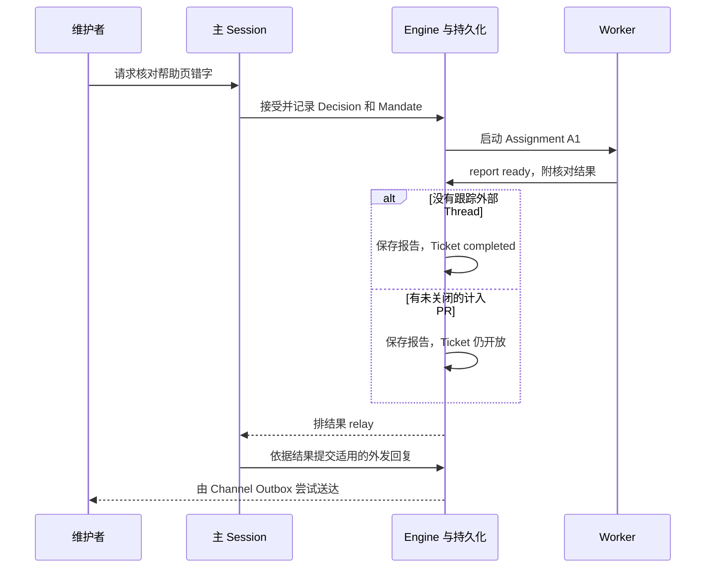

# 15 · Ticket 生命周期、人工介入与完成语义

> 面试题　Worker 提交了一个通过测试的 PR，并报告 `ready`。同一时刻，管理面板显示「待审」，运行器却已经释放了一个执行名额。几分钟后 PR 合入，Ticket 仍可能开放。三个观察怎样同时成立？人什么时候需要回复、重试或停止？

**短答**　Ticket 的 `ended` 保存任务的结束事实。Assignment 记录当前或过去的一次执行。Worker 报告描述它交出的结果、遇到的问题与下一步需要谁做。面板阶段根据这些记录和输入派生。没有跟踪外部 Thread 的任务，`ready` 可以直接结束为 `completed`。已绑定 PR 的任务会按它所跟踪的外部关闭事实判定，若仍有已接手的跟进，或关闭之后启动的工作没有收尾，就保留开放状态。Worker 交付给人之后，运行器按回合和输入状态调度资源。一次查看可能同时看到工单仍开放、最近报告是 ready、旧 Assignment 仍标为 running，以及工作名额已经可用。 [Ticket 与 Assignment](../dsh-superagent-prototype/src/core/model.ts) · [报告落库与结案](../dsh-superagent-prototype/src/core/assignments.ts#L100) · [阶段派生](../dsh-superagent-prototype/src/core/stage.ts) · [执行器回合](../dsh-superagent-prototype/src/executor/dsh.ts)

本文以工作区提交 `7bd4741` 的原型源码为基线。案例沿用维护者 Alice 请求修正文案错字的帮助页工单。假设有一张 Ticket T、一项首次派工 A1、一个源 Issue 和一个 PR #57。时间和编号为讲解用。不同分支里可以在提交前等人确认文案，或者在 #57 合入后解释改动。这些分支共用一组字段，可以对照它们理解恢复与新授权的关系。 [上篇的跟进责任](14-followup-ownership-and-handback.md) · [领域文档](../dsh-superagent-prototype/docs/001-domain.md) · [执行文档](../dsh-superagent-prototype/docs/003-execution.md)

## 1. 一个工单上，为什么要保存四个维度

### 1.1 开放或结束是业务事实

Eval 接受工作后，Engine 为其写入 Decision 与 Mandate，Tickets.create 保存工单的来源、渠道、授权与首次 Assignment，再排执行。Mandate 表达谁在什么范围内请求过这项工作。此后，无论执行会话在推理、准备工作区、等待一个事件，还是等待另一个维护者审阅，外部系统都可以用同一个 Ticket ID 关联这些活动。代码用 `!ticket.ended` 判断开放。结束时的 `ended` 有 `by`、`outcome`、`at` 和可选原因，面板能说明是已交付、合入、关闭、丢弃或人工停止。 [Tickets.create](../dsh-superagent-prototype/src/core/tickets.ts#L37) · [Ticket.outcome 和 liveTicket](../dsh-superagent-prototype/src/core/model.ts)

结果枚举回答「以什么事实结束」。`completed` 用于无需等待外部跟踪对象的完成，`merged` 或 `closed` 把相应 PR 事实带到工单，`dropped` 正常表示没有待交付的事情，`stopped` 对应人的停止。PR 路径的结案也写 `by: executor`。这里的 executor 是与人的显式停止相对的一侧，查看 `outcome` 和 follows 才能知道实际触发事实。把 by 单独解释成「最后执行过 merge 的账号」会误读这个字段。 [结束字段](../dsh-superagent-prototype/src/core/model.ts) · [PR 关闭处理](../dsh-superagent-prototype/src/core/tickets.ts#L77) · [工单结束](../dsh-superagent-prototype/src/core/tickets.ts#L345)

### 1.2 Assignment 记录执行的代次与回执

同一个 T 下可以有 A1、A2。初次接单建立 pending，执行器启动成功回写 running。重试、恢复中断、工单结束时，符合条件的 Assignment 记录结束，每次新派工在该 Ticket 的 assignments 尾部增加一项。当前实现按 Ticket ID 命名 Worker Session，故 A1 和 A2 可以关联同一个会话、目录与工作分支。重试后继续检查工作区和 Git 已存证据有现实意义，重走推理或执行并不保证此前的外部动作会撤销。 [派工模型](../dsh-superagent-prototype/src/core/model.ts) · [启动](../dsh-superagent-prototype/src/core/assignments.ts#L30) · [Tickets.retry](../dsh-superagent-prototype/src/core/tickets.ts#L168) · [详情里的共享 Session](../dsh-superagent-prototype/src/app/views/tickets.ts#L59)

正在占用模型或 Worker 调度名额的是运行时事实。Assignment.running 表示这次派工仍承担这个 Ticket，据此允许接收输入或者继续下一轮。Worker 完成一轮后可以继续用 A1 等人，也可以等被合入的 PR。看 `assignments[0].state` 会读到 running，看运行中的槽位数可能已经降了。应用通过运行器的活动数统计实际负载，通过 `ticketStage` 统计排队条目。这个区分能避免把长期等待审阅的工单计入持续模型执行成本。 [详情与负载统计](../dsh-superagent-prototype/src/app/views/tickets.ts#L47) · [概览](../dsh-superagent-prototype/src/app/views/overview.ts) · [Worker 交接](../dsh-superagent-prototype/src/executor/dsh.ts#L588)

### 1.3 报告是协作协议，有时间、有可执行的字段

Worker 工具接受 `progress`、`ready`、`blocked`、`failed`、`dropped`，并允许携带 summary、明确的提问、提问缘由 Trigger、已回答 Trigger 和 PR 号。执行器在当次回合安静结束等条件下写自己的 `waiting`。比起解析一句「已完成，等一下」，结构化报告能决定要不要建立 Attention、能不能发送结果，以及是否走结案候选。summary 保留证据和用户可读结果。默认工作提示要求把实际 PR 和测试结果说清楚，那些信息帮助审阅者核对，核心一般不从 summary 的自然语言内容中推导阶段。 [Worker 工具](../dsh-superagent-prototype/src/app/tools/executor.ts#L76) · [Worker 交付提示](../dsh-superagent-prototype/prompts/work.md) · [执行器写 waiting](../dsh-superagent-prototype/src/executor/dsh.ts#L600)

`Assignments.report` 在开放工单上选运行中的派工，缺省时尝试最近一项，拒绝已结束的 Assignment。随后更新最新报告，做提问和回答处理，再按本次状态与外部事实尝试结案。面板阶段读的是最近一项 Assignment 的 report。用于展示的 summary 则可取所有 Assignment 中最后一份已有报告。于是 A2 刚排队可显示 queued，同时详情留有来自 A1 的旧失败摘要。查看两者时先核对归属的 Assignment。 [报告写入](../dsh-superagent-prototype/src/core/assignments.ts#L100) · [latestAssignment 与 latestReport](../dsh-superagent-prototype/src/core/model.ts) · [面板摘要](../dsh-superagent-prototype/src/app/views/records.ts#L117)

## 2. 把字段放进同一张面板判定表

面板主要想回答「下一步在等谁」。`ticketStage` 依次判断，首个匹配行获胜。下表同列展示工单是否结束、派工、报告与面板结果，可以用来从左向右计算，也可以从面板结果倒查最早命中的持久条件。示例中的「已答」指有在报告之后进入的正式人工输入，对应 waitsForPerson 的时间和输入类型检查。一个标题或一段 summary 本身不会改变匹配次序。 [ticketStage](../dsh-superagent-prototype/src/core/stage.ts#L9) · [waitsForPerson](../dsh-superagent-prototype/src/core/model.ts) · [参数化用例](../dsh-superagent-prototype/tests/stage.spec.ts#L16)

| 优先级 | Ticket 结束事实及其他字段 | 最近 Assignment | 报告和输入 | 面板阶段 | 当前要看的证据 |
| --- | --- | --- | --- | --- | --- |
| 1 | 已有 ended | 任意历史值 | 可能有失败或最后结果 | ended | 结束来源、原因、结果和时间 |
| 2 | 开放，有 delivery | 通常仍 running | 某条 Input 投递失败，可与提问共存 | person / delivery | 错误、待交付输入、自动重试或手工重试 |
| 3 | 开放，有 attention | 通常 running | 可来自 progress 或 blocked | person / answer | 此次问题和向谁提问 |
| 4 | 开放，以上均未命中 | 通常 running，也兼容 ended 派工 | 最新报告 ready | person / review | 待审结果、PR 绑定及关闭记录 |
| 5 | 开放，以上均未命中 | 最近项存在 | blocked 或 failed，此后无合格人工跟进 | person / blocked 或 failed | 阻塞原因、适用时补信息或 retry |
| 6 | 开放，以上均未命中 | 缺失或 pending | A1 的旧报告可留历史，A2 仍排队 | working / queued | 工作名额、启动 Effect 或暂停状态 |
| 7 | 开放，以上均未命中 | 可 running，也可 ended | waiting 或 Assignment ended | idle | 等外部输入，或向正在等的 Worker 要进度 |
| 8 | 开放，以上均未命中 | 常为 running | progress、无报告或原阻塞后有合格人工输入 | working | 当前回合、准备交付的新输入与派工 |

### 2.1 先匹配的条件能解释多个同时存在的事实

假设 T 在等待 Alice 选择帮助页术语，Attention 已存在。Alice 回了一个词，Trigger 记录在 T，交付该 Input 时 Session 临时不可达。待答问题仍能留在 Ticket，面板先显示送达问题，因为恢复通路是下一步。交付成功清掉 delivery 后，若 Worker 尚未清除 Attention，就会重新看到待答。之后 Worker 报告说明选项已确认并清掉 Attention，且给出 ready，才可能看到待审或工单结束。每一帧都是对当时字段的投影。 [阶段优先级](../dsh-superagent-prototype/src/core/stage.ts) · [交付回写](../dsh-superagent-prototype/src/core/assignments.ts#L47) · [Attention 更新](../dsh-superagent-prototype/src/core/assignments.ts#L100)

canRetry 由另一条谓词计算，检查 Ticket 开放，并且 delivery 有错误或者 waitsForPerson 为真。于是一个 failed 且还附了 Attention 的 Ticket 可以显示 answer 且允许重试。只有问句的 progress 则没有相同资格。检查「页面是否给 retry 按钮」时要看 actions.retry。前端据此绘制按钮，真正提交会再由 Engine 和 Ticket 重新检查，避免运维者在另一个人的消息已经送进任务之后，仍用旧视图覆盖其运行。 [canRetry](../dsh-superagent-prototype/src/core/stage.ts#L22) · [重试资格测试](../dsh-superagent-prototype/tests/stage.spec.ts#L38) · [面板视图和操作](../dsh-superagent-prototype/src/app/views/records.ts#L117) · [HTTP 入口](../dsh-superagent-prototype/src/app/http.ts#L188)

### 2.2 面板显示的交付、后台事实与源码读取的事实

详情页从 Ticket 存储读取每项 Input，通过 ID 是否仍在 undelivered 派生 `delivered`。这个字段可用于提示还有哪些输入等投递，但判断 Worker 有没有在某一步消费正文要读 Trigger Input 的 `readAt`，并对照最近报告和回合边界。注意 blocked 或 failed 后一部分自动输入历史仍保存，可能被移出投递队列。因此「队列里没有」也可能表示本轮无需送交，面板通过这条布尔值不会重查模型步骤。 [输入详情投影](../dsh-superagent-prototype/src/app/views/tickets.ts#L59) · [投递与已读](../dsh-superagent-prototype/src/core/assignments.ts#L42) · [过滤自动输入](../dsh-superagent-prototype/src/core/assignments.ts#L126)

Ticket 列表可按 open、person、working、idle、ended 等查询，详情可展示 Mandate、接受它的 Decision、Input、派工及 Thread。面板可链接来源会话和 Worker Session。看到「可重试」或「待评审」时可用这些入口定位现场。比如审阅 PR 时，应查 PR 状态和工作分支。用户给了回答却仍看到阻塞时，应查回答实际落在哪个 Thread、是否只以 context 输入进入、是否写到同一张 Ticket。以读模型作入口、再从领域事实判因，能把展示问题和写入问题定位到具体模块。 [列表与详情](../dsh-superagent-prototype/src/app/views/tickets.ts#L35) · [待审的面板测试](../dsh-superagent-prototype/tests/panel-execution.spec.tsx#L111) · [状态投影测试](../dsh-superagent-prototype/tests/views.spec.ts#L115)

## 3. 无 PR 的 ready，怎样走完一次正常交付

### 3.1 从请求到已完成的时序

假设 Alice 让 Agent 核对帮助页错字是否还存在，并给出当前版本中的字样。Worker 在工作目录搜索、验证后写出依据。这个分支不需要 PR，Ticket 的 follows 为空。A1 报告 ready，Assignments 存报告后取 `completed`，紧接着调用 Tickets.end。事务提交后，面板读到 ended 与内含的 completed。它通常不会展示一帧短暂的 awaiting review，因为报告写入和结束处在同一次域操作之中。 [ready 的分支](../dsh-superagent-prototype/src/core/assignments.ts#L126) · [无 PR 时结案的集成测试](../dsh-superagent-prototype/tests/runtime.spec.ts#L372)



Accept 时的确认、结果 relay、用户最终看到的回复是三个事件。Worker 把可交付信息写进 report 后，工具把 relay 排入主 Session 所读的队列。结果回复由主 Session 按当前 Ticket 状态及 Channel 规则提交，由 Outbox 处理实际发送。若人在源会话没看到完整结论，可以查报告是否存好、relay 是否被主 Session 消费、是否已有 result 消息，以及 Outbox 的送达状态。已完成工单在适用结果允许的情况下仍可排结果消息。HTTP 失败等输出问题属于交付链路，面板读到的 completed 依然是当时的业务结果。 [报告 relay](../dsh-superagent-prototype/src/app/notices.ts#L107) · [结果回复检查](../dsh-superagent-prototype/src/core/replies.ts#L64) · [出站队列](../dsh-superagent-prototype/src/app/outbox.ts)

### 3.2 dropped 的语义也必须落到事件条件

如果这次请求经过验证属于误报，或现有任务已经让所需工作无实际交付，Worker 可以根据工作约定报告 dropped。Tickets 此时正常结束为 dropped。若先前关闭的 PR 已足以满足 followsDone，但收口曾因后续工作暂停，dropped 也可以选择该 PR 关闭结果，保留外部事实。prompts 约定普通 dropped 不额外发一遍结果，匹配规则另有要求时按规则处理。dropped 报告仍能出现在结构化内部通知中。排查无回复的掉落任务，应连着查看 Worker 结论、工单 outcome 与主 Session 使用的交付规则。 [报告收口分支](../dsh-superagent-prototype/src/core/assignments.ts#L126) · [Worker 对 dropped 的约定](../dsh-superagent-prototype/prompts/work.md) · [报告通知](../dsh-superagent-prototype/src/app/notices.ts#L117)

## 4. 有 PR 的 ready，工单为什么继续等

### 4.1 先弄清楚 PR 是怎样进 Ticket 的

帮助页任务真的需要改动时，A1 创建 #57。按 Worker 提示，应先用带实际 PR 号的 progress 记录绑定，结束自审和验证后再 ready。Worker 工具在事务外读取 PR 事实，接着事务内执行 claimPull、提交 report、排 relay。如果 PR 归属不符或报告触发守卫，事务回滚前面同一次的本地绑定。请求到 GitHub 读到的信息已有快照边界，下一次 Source 轮询会继续同步最新事实。 [Worker 调用流程](../dsh-superagent-prototype/src/app/tools/executor.ts#L76) · [读取与认领 PR](../dsh-superagent-prototype/src/sources/github-pull.ts#L16) · [工作提示](../dsh-superagent-prototype/prompts/work.md)

可绑定的开放 PR 包括工单的源 PR，以及 Agent 账号在配置仓库中用与 Ticket short name 匹配的分支开的 PR。GitHub Source 轮询也可在唯一开放 Ticket 与分支吻合等条件下自动绑定。认领还检查是否已有其他开放工单跟踪同一个未关闭 PR。Worker 仅在 summary 里写出 URL 可以给人提供线索，构成完成条件的是已保存的 `ticket.follows`。这意味着跟踪状态落库前就报 ready，有可能按无跟踪对象路径变成 completed。报告协议要求尽早登记，是为了让领域状态与上传产物按正确的次序同步。 [认领和自动绑定](../dsh-superagent-prototype/src/sources/github-pull.ts#L35) · [Ticket.bind](../dsh-superagent-prototype/src/core/tickets.ts#L60) · [ready 无外部跟踪对象](../dsh-superagent-prototype/src/core/assignments.ts#L126)

绑定 PR 写两处关系。Thread 的订阅决定消息是否来到工单，Ticket 的 follows 决定外部关闭是否参与结案。用 bind 记录时，被 Worker 为自身任务开出来的 PR 会标 `own: true`。若一项原有的 follow 被重新绑定，原有 own 可保留，旧 closed 可清掉。一般 attach 一条评论可以新增正式订阅，不能凭这一步获取 PR 的跟踪和关闭语义。知道谁订阅和谁跟踪是两个查询，排查合并后工单不结束时，先查 follows。 [绑定与附加](../dsh-superagent-prototype/src/core/tickets.ts) · [PR 观察流程](../dsh-superagent-prototype/src/sources/github-pull.ts#L54) · [上一章的转派场景](14-followup-ownership-and-handback.md)

### 4.2 followsDone 看口径和关闭时间

`followsDone` 先建一组计入的 Thread。存在 own 时，只看 own 集合。没有 own 时，取所有 follows。集合不为空且每项已有 closed，才从关闭事件中选时间最晚者，返回它的 merged 或 closed。假如源 PR #40 由别人创建，Worker 又开了自己的 #57，待自己的 #57 合入后，#40 可以继续开放。反过来如果 Worker 在 #40 的同一分支完成工作，自己没开 PR，那么 #40 的状态决定外部跟踪是否收口。使用 own 的意义是将交付物的完成条件与上游讨论的终点对应起来。 [followsDone 源码](../dsh-superagent-prototype/src/core/tickets.ts#L91) · [源 PR 和自有 PR 测试](../dsh-superagent-prototype/tests/core-engine.spec.ts#L1053)

有两张自有 PR 时，要都关闭，最后按事实的时间选结果。假设 #57 在 10:05 合入，#58 在 10:03 关闭未合，并且 #58 的事件后被本地读到。只有 #57 的事实时仍缺 #58，状态继续开放。读到 #58 后，两项齐备，取发生时间 10:05 的 merged。Ticket.ended.at 可使用该外部时间，Ticket.updatedAt 则由系统记录现在何时完成写入。这样的 outcome 也只说明计入集合里最后关闭的结果。业务审计还应展开两个 PR 的当前记录，不能从工单的 merged 推断每个 PR 都已合入。 [关闭事实的排序](../dsh-superagent-prototype/src/core/tickets.ts#L91) · [结束时间与更新时间](../dsh-superagent-prototype/src/core/tickets.ts#L345)

在 `threadClosed` 这种入口，系统为开放 Ticket 的匹配记录补写 at 与 outcome。相同 follow 已有 closed 时通常不会二次应用。关闭消息带平台时间，GitHub 观察路径优先取 merged_at，再取 closed_at，最后才用观察时间。完成函数取得的时间代表外部事实，关闭处理还用本次事件时间判断后续工作有没有开始。落库时候发现三种时间不重合属于正常情况，尤其是外部轮询先积压、任务重试后才恢复 GitHub 读取时。 [GitHub 关闭事实](../dsh-superagent-prototype/src/sources/github-pull.ts#L77) · [threadClosed](../dsh-superagent-prototype/src/core/tickets.ts#L77)

### 4.3 先 ready 和先 close 最终如何汇合

最常见的顺序是 A1 ready -> #57 等审 -> 人合入 -> GitHub Source 发现合并 -> Engine.threadClosed 记录事实并尝试结束。这时报告是交人的时机，合并是外部交付判定。如果 Source 在 Worker 最新一次 ready 之前先观测到关闭，而且没有 unfinished，工单可以在关闭入口结案，报告无需先齐备。若关闭已落库但当时仍有后续工作，Worker 后来提交 ready 或适用的 dropped，Assignments 会读取同一份 followsDone 决定结果。这样可以容纳人工审阅、Worker 回合与 Source 轮询的先后交叉。 [关闭与报告的共同规则](../dsh-superagent-prototype/src/core/tickets.ts#L77) · [报告收口](../dsh-superagent-prototype/src/core/assignments.ts#L126) · [未完工作测试](../dsh-superagent-prototype/tests/core-engine.spec.ts#L1087)

`ready` 报告也允许主 Session 发送面向人的 result，告诉人现在可审。PR 最终关闭时 Runtime 又可根据 Ticket 结束事实构造 IM 通知。后者跳过 GitHub 的同类 Channel，平台自身已经呈现合并或关闭。通知挑选最新关闭的自有 PR，无该项时选择最新的已关闭 GitHub follow，按 PR、Channel 与 outcome 构造去重键。因此「PR 已准备，请审阅」和「PR 已合入」可能在不同时点到达同一个人。会话中还可以因为源 Channel 无法送达而缺席这些文字，核对实际结果要回到 PR 与工单持久事实。 [结果发送守卫](../dsh-superagent-prototype/src/core/replies.ts) · [GitHub 终态通知](../dsh-superagent-prototype/src/sources/github-pull.ts#L90) · [通知挂接 Runtime](../dsh-superagent-prototype/src/app/runtime.ts#L147)

## 5. PR 已经合并，什么会让 Ticket 继续开放

### 5.1 第一条守卫检查已接手但还没过安全边界的跟进

设 10:00 A1 对 #57 报 ready。10:01 Alice 追问「也请说明移动端帮助页会不会受影响」。输入进入正式 Thread，Worker 可能通过 ACK 接下，或者把回答作为结构化报告提交。10:02 PR 合入。当时只要这条消息属于 T，已被 T 认领，但代码用当前报表窗口判断还没完成该次阅读及处理周期，followsDone 虽然满足，`unfinished` 仍为真。Source 先写 #57 的 closed，Ticket 仍开放，Worker 可以继续完成这段解释。接下来提交 ready，或已经无工作可做而提交 dropped，在符合分支时转为 merged。 [unfinished](../dsh-superagent-prototype/src/core/tickets.ts#L370) · [合入时已接手的跟进](../dsh-superagent-prototype/tests/core-engine.spec.ts#L541)

这里的输入时间有三个观察点。Trigger 或 Ticket Input 的时间表明输入形成，交付回执表明它进了会话，readAt 表明模型步骤把它纳入上下文。为了决定 PR close 时是否应该再给 Worker 时间，`unfinished` 使用 `readUntil(ticket, false)`。它看最近一份非 progress 报告或最近一次 idleAt，以较晚的边界为准。新格式里，readAt 严格早于边界才算已越过这个边界。ACK 或仅有 progress 更新可能表示工作刚进行到一半。这两个信号无法替代一次后续回合结束或适用报告。 [readUntil](../dsh-superagent-prototype/src/core/model.ts#L341) · [readBefore](../dsh-superagent-prototype/src/core/tickets.ts#L19) · [交付回执](../dsh-superagent-prototype/src/core/assignments.ts#L42)

同样时序下，如果 Worker 尚未确认或回答，它只拥有 X，此时生命周期可以因 #57 合入结束。如果输入也未在结束边界之前消费，Tickets.end 会把符合条件的未接手消息放回主 Thread 评估。对一个包含很多事件的 PR，所有的新评论都阻塞收口会拖长工单寿命，用户又失去判断「可交付了没有」的清晰信号。这条分支把领域上的接手承诺与机械的消息到达区分开。收口时释放 X 的具体多所有者条件见上一篇。 [merge 与未接手的对照](../dsh-superagent-prototype/tests/core-engine.spec.ts#L541) · [end 与 letGo](../dsh-superagent-prototype/src/core/tickets.ts#L294) · [后续消息归属](14-followup-ownership-and-handback.md)

### 5.2 第二条守卫检查关闭发生后才启动的工作

考虑 GitHub 在 10:05 已关闭 #57，原型到 10:09 才观测到。Ticket 此前在 10:06 因失败重试建了 A2。A2 还在准备或验证修复，最近报告可能没有 ready。此时只读「PR 已关闭」，会用过去 10:05 的事实结束后来启动的工作。源码用最新 Assignment 的 createdAt 与这次关闭的时间比较，并检查其是否已 ready、有无等待的输入、有无比 ready 更新的非 Policy 变更输入。若后续工作继续进行，就保留开放。若后续工作已经结束，关闭分支选择当前时间作为终止时间。PR 本身的关闭时间保存在 follow.closed 中供审计。 [迟到关闭的检查](../dsh-superagent-prototype/src/core/tickets.ts#L77) · [unfinished](../dsh-superagent-prototype/src/core/tickets.ts#L370) · [关闭后重试的测试](../dsh-superagent-prototype/tests/core-engine.spec.ts#L1087)

政策变更 Input 本身不会满足「ready 后有新要做的输入」这一项判断。仍在 undelivered 却是源码一起检查的另一项。判断具体样本时需要按各个条件分别验算，别从一条 Policy 通知的存在推出已经开展新工作。查看代码能看到这个守卫整体是针对一个已经晚于关闭时刻的 Assignment。对于普通在途任务，followsDone 并不会查询所有报告中的工作细节。 [unfinished 条件](../dsh-superagent-prototype/src/core/tickets.ts#L370)

### 5.3 几组足以区分行为的快照

| 场景 | 外部事实 | 当前 Assignment 或跟进 | 结果 |
| --- | --- | --- | --- |
| 文案核对无需 PR，Worker 报 ready | follows 为空 | A1 有可交付结果 | ended / completed |
| A1 已 ready，#57 仍开放 | own 中有未关闭的 PR | 可结束这一轮并把审阅交给人 | open / person review |
| #57 已合入，源 PR #40 仍开放 | own 集合全部关闭 | 无需继续的跟进 | ended / merged |
| #57 已合入，刚确认了自己的人工跟进 | followsDone 已满足 | 未越过非 progress 报告或回合结束边界 | 仍开放，后续 ready 可结束为 merged |
| #57 已合入，未读跟进仍未接手 | followsDone 已满足 | 关闭路径无其他守卫 | Ticket 可结束，消息按条件回 Eval |
| 外部关闭 10:05，A2 建于 10:06 | 当前才读到 10:05 的关闭 | A2 未 ready 或有仍要处理的输入 | 记录关闭，等待 A2 收口 |

面试有时会问「运维怎么证明等待是合理的」。以上述第四行为例，证据应包含 PR 的 closed.at、这条跟进的 Trigger ID、T 的归属、接手记录与当前回合时间。用「还有人发消息」不足以预测是否暂停结束。上述快照也展示了报告与外部事实不是按固定先后发生的两步。只写了 ready 但 #57 未合入是在等审阅。#57 已合入却按 unfinished 保留开放，则要查看哪条后续工作正在处理。

## 6. 人工介入有自己的协议

### 6.1 问一句具体的话，在人原来发言的地方等决定

再看帮助页改字分支。Worker 发现同一术语在旧稿和主分支分别叫「收起」和「折叠」，Alice 的请求在现有范围内，但只有负责人能确定该条文案的写法。如果按照写作约定确实需要这项决定，Worker 可附一个具体的 human_action，问哪一项为准。如果它还能合法验证文档链接，可以保留 state=progress。报告类型说明当前还在做什么，结构化 question 说明哪里在等人。描述详细依赖可以留在 summary，发到人面前的动作是可直接回答的一问。 [Worker 交接规范](../dsh-superagent-prototype/prompts/handoff-worker.md) · [工具 schema](../dsh-superagent-prototype/src/app/tools/executor.ts#L75)

能确定引出问题的原始消息时，填写 question_for_trigger_id。核心校验它确属人工消息，在允许写回的范围内，而且有用于投递的 Channel。通过后，Ticket.attention 保留该 Trigger 引用，Replies 对 attention 优先取该 Trigger 的 Channel。缺少该引用时，使用工单的源会话。举例来说，工单经飞书接受，在 GitHub PR 有一条正式评论引出问题，系统可以在 GitHub 找对应人回复，避免把不同 Source 的用户身份或会话误当成同一个。 [报告校验和 Attention](../dsh-superagent-prototype/src/core/assignments.ts#L100) · [Reply Channel](../dsh-superagent-prototype/src/core/replies.ts#L64) · [来源会话的验证](../dsh-superagent-prototype/tests/runtime.spec.ts#L754)

对于省略 human_action、传 null、重复同样的文本、给出另一条问题，源码有不同操作。省略保留旧问题，null 清除，重复同样文本保留现有 Attention 的 ID，变更问题创建带当前时间的新条目。ready 同时会清除之前未决的问题。若要同时报告 ready 和一个新的未决问题，或在同一报告里一边提问一边按 answers 回答旧问题，会遭到校验拒绝。新问题替换旧问题或显式清除时，系统尝试撤回旧条目尚未送出的 Outbox 项。对已经显示给人的消息，撤回内部待办不等于能消除原渠道的一切历史。 [报告约束](../dsh-superagent-prototype/src/core/assignments.ts#L100) · [问题变更测试](../dsh-superagent-prototype/tests/core-engine.spec.ts#L779) · [Outbox 撤回](../dsh-superagent-prototype/src/app/outbox.ts)

Worker 提问的报告会产生 worker_attention relay，其中包含查 Ticket 结果的路径。主 Session 根据提示读取结构化 request，用 orchestrator_reply 的 purpose=attention 提交，并原样传当前 human_action 做匹配，发送文案可简明表达真实问题。如果另一个报告已经换了问题，迟到的发送请求不能借用旧文本去问。普通 progress 不通知主 Session。正式回答某条人工问题时，reply_to_trigger_id 会建立对应的 answers 与接手事实，并触发 relay。主 Session 使用 purpose=answer 反馈原问题，匹配的回答权限可消费，重复相同的发送靠身份去重。 [报告 relay](../dsh-superagent-prototype/src/app/notices.ts#L117) · [主 Session 交接约定](../dsh-superagent-prototype/prompts/handoff-orchestrator.md) · [Replies](../dsh-superagent-prototype/src/core/replies.ts#L64) · [答复守卫测试](../dsh-superagent-prototype/tests/core-engine.spec.ts#L1278)

### 6.2 blocked 和 failed 降低自动唤醒，人的新输入优先

blocked 通常表示缺决策、权限或外部条件，failed 表示本次执行或启动遭遇适用的失败。领域的 `waitsForPerson` 对二者用同一个结构。看最新 Assignment 的报告类型，再检查随后有没有 at 严格大于 report.at 的正式人工 Trigger Input。CI 机器人、内部 note、context-only 的人工引用，以及早于报告的输入不会穿过这个时间条件。只要合格输入进入 T，就可能解除等待，哪怕会话尚未消化正文，甚至输入交付随后失败。此时仍可能有 attention 或 delivery 这种优先级更高的面板条件。 [waitsForPerson](../dsh-superagent-prototype/src/core/model.ts) · [人工输入后的视图](../dsh-superagent-prototype/tests/views.spec.ts#L115) · [context-only 不解阻](../dsh-superagent-prototype/tests/core-engine.spec.ts#L458)

报告为 blocked 或 failed 时，Assignments.report 从现有 undelivered 去掉自动输入，保留其输入记录。此后新的同类消息来到 T，在 waitsForPerson 仍为真时也只记为历史。实现中的 automatic 适用于 note 与非人工 Trigger。已排进去的历史 CI 输入不会因为 Alice 回一句而整批重放。交付恢复后，后续进来的机器输入可以正常送达。这个细节可以避免把积压的状态轮询反复解释成「有人给了决定」。允许人在会话里直接工作，也避免将全部工具一起停用导致无法诊断或恢复。 [automatic 与 addInput](../dsh-superagent-prototype/src/core/tickets.ts#L13) · [报告过滤](../dsh-superagent-prototype/src/core/assignments.ts#L126) · [自动输入测试](../dsh-superagent-prototype/tests/core-engine.spec.ts#L965)

假设 Worker 在 10:01 写 blocked 且带 Attention。10:02 机器人说 CI 全绿，面板仍可待答。10:03 Alice 正式回答「用折叠」，waitsForPerson 变假。如果问题仍在 attention，面板继续显示待答，直到报告清除或 ready。执行器可以在 Alice 的 Input 到达后继续做工作，老的 blocked report 仍在 A1 上，等待语义已变化。当 T 上没有 Attention 的分支，面板阶段会直接回到 working 或 working / queued。这种差异能解释运维截图中「同样是人回了，状态怎么不同」。 [问题的保留与清除](../dsh-superagent-prototype/src/core/assignments.ts#L100) · [阶段判定](../dsh-superagent-prototype/src/core/stage.ts#L9) · [解除等待和后续 waiting](../dsh-superagent-prototype/tests/runtime-concurrency.spec.ts#L800)

### 6.3 人接手之后，会话、槽位和后台命令如何处理

`workerIdle` 在会话结束当前回合时，先确认这张 Ticket 仍由同一 Assignment 运行。如果报告 ready 或当前有 Attention，并且还没有在报告之后送来新的输入，或者 waitsForPerson 仍为真，执行器将这一轮视为交给人。若报告之后有人直接在会话开了新轮，代码还会检查那次人工操作时间。成功交接后记录 turnEnded，停止该 Worker 的子代理，并把已经运行、适合留给人的 shell jobs 放进保留集合。例如供核对的预览服务可以继续运行，结束时由执行器收取结果，留给下一轮读取。工单终止才清理这类后台工作。 [执行器 handOff 与 workerIdle](../dsh-superagent-prototype/src/executor/dsh.ts#L588) · [交接释放槽位测试](../dsh-superagent-prototype/tests/runtime-concurrency.spec.ts#L352)

普通 Agent idle 可以伴随仍活跃的后台工作。执行器会对这部分等待，期间仍可能保留该任务的执行名额。安静后写 waiting。超出后台等待窗口则有对应任务清理和状态报告。与此同时，已经人类交接的 Ticket 可能在 Runtime 不占名额，却仍开放等人。对面板「待审太久」与「队列太久」做运营分析，应分别看人接手时长、PR 状态、后台活动与槽位限制。两个时长的优化方向不同，执行器的并发调大也无法直接减少审批等待。 [后台工作与运行负载](../dsh-superagent-prototype/src/executor/dsh.ts#L404) · [执行文档](../dsh-superagent-prototype/docs/003-execution.md) · [输入到了 ready 工单后仍保持忙碌的测试](../dsh-superagent-prototype/tests/runtime-concurrency.spec.ts#L432)

## 7. 一次送达失败，两种不同的重试

### 7.1 同一派工上的 Delivery Effect 自动重投

X 已挂在 T 的 undelivered，交付给 Agent 会话的调用失败。执行器确认 Ticket 仍开放且相同 Assignment 正运行，调用 Engine.deliveryFailed 写 `ticket.delivery` 的错误及时间，Effect 保留并按指数退避重新尝试，默认起步两秒、上限一分钟。此时面板是 person / delivery。只在等待执行槽位、暂停或内部交接尚未完成时会走适用的等待分支，Later 代表延后执行，不计作一次交付错误。处理器会重新读取当前状态，避免在旧 Assignment 结束后回写它的失败。 [deliverQueued 与 deliverInput](../dsh-superagent-prototype/src/executor/dsh.ts#L289) · [deliveryFailed](../dsh-superagent-prototype/src/core/assignments.ts#L72) · [Effects 退避](../dsh-superagent-prototype/src/app/effects.ts)

下一次送达成功，Assignments.delivered 移除那些 ID，更新对应派工送达时间，清除 delivery。Trigger Input 仍可能是 readAt=null，就等宿主会话真正把这条话放进模型步骤。对一批消息，原型逐条重新读取运行状态，在送达前做有效性检查，也能在新的派工取代旧派工后拒绝旧回执。测试专门检查第一个 Ticket 的交付等待时另一个被停止，后者不会继续送达。这个设计保存已经写入的输入事实，并避免简单把一次网络错误折算成「任务失败」或「用户没发过」。 [交付回写](../dsh-superagent-prototype/src/core/assignments.ts#L42) · [过期回执](../dsh-superagent-prototype/tests/core-engine.spec.ts#L243) · [等待投递期间的停止](../dsh-superagent-prototype/tests/runtime-concurrency.spec.ts#L51)

### 7.2 管理员点 retry，建立一个新的 Assignment

如果操作员判断旧执行已经卡住，面板 retry 会走 Engine.retryTicket。Ticket 必须仍开放且符合 canRetry，同时有可替换的 Assignment。Tickets.retry 写旧 Assignment endedReason=retried，重排符合条件的未读 Trigger，新增 pending 的 A2，清掉旧 delivery 标记，停止 A1 并安排 A2 启动。发起是同一工单里的新派工，工单 ID、原 Decision、Mandate 和工作目录还在。启动前，它会等前一份后台工作清理到可以继续送达的状态。 [Ticket.retry](../dsh-superagent-prototype/src/core/tickets.ts#L168) · [HTTP 重试入口](../dsh-superagent-prototype/src/app/http.ts#L188) · [执行器等待停工](../dsh-superagent-prototype/src/executor/dsh.ts) · [重试端到端](../dsh-superagent-prototype/tests/runtime.spec.ts#L670)

假设 X 已从 undelivered 移除，却还没有进入旧 Session 的模型步，表现为 readAt=null 且 deliveredTo=A1。A1 被换掉时，requeueUntaken 可以把 X 放回，随后跟着 A2 的输入送达。若 X 的 deliveredTo 指向更早的、已经被某次结束释放的 A0，本次手工 retry 不会从历史找回来。A2 启动还处理 Worker Session inbox 里可能残留的同一副本，避免启动时一份、重新交付时又一份。这样的接管把「系统确认已交给会话」与「切换派工时还能继续靠原会话送到模型」分开验证。 [重排未读](../dsh-superagent-prototype/src/core/tickets.ts#L329) · [启动前处理 inbox](../dsh-superagent-prototype/src/executor/dsh.ts#L438) · [未读重送验证](../dsh-superagent-prototype/tests/core-engine.spec.ts#L1555) · [限制在被替换的派工](../dsh-superagent-prototype/tests/core-engine.spec.ts#L1568)

当 Delivery Effect 自动重试成功，适用时 retry 按钮会消失。管理员的旧页面即使还显示它，领域端再校验也可拒绝。反之，如果人工消息刚让一张 failed 任务从等待回到 working，随后该消息投递失败，delivery 会重新赋予手工重试资格。判断这种变化时，看是否有 `delivery`，再看是否仍在等人。更新状态与读取面板之间有时间差，人的操作触发的是一次受限命令，命令成功之后再刷新状态。 [重试谓词](../dsh-superagent-prototype/src/core/stage.ts#L22) · [资格测试](../dsh-superagent-prototype/tests/stage.spec.ts#L38)

### 7.3 宿主重启为什么有时直接续用旧派工

宿主中断时，Assignments.interrupted 查看原 A1 的报告和最近送达时间。若 A1 已 waiting、ready、blocked 或 failed，且没有在报告时或之后送达新输入，代码保留该 Session 的派工状态，并在等待队列有内容时继续投递。正在忙或报告看似交付过但后来有输入的情形，会结束 A1，按原 T 创建新派工并先交付恢复说明。说明要求先检查工作目录、Git 历史与 GitHub 状态再继续，避免错误重复已有外部操作。把这种恢复也算作「又接受一个任务」会把原有授权和工作记录一分为二。 [Assignments.interrupted](../dsh-superagent-prototype/src/core/assignments.ts#L77) · [Tickets.restart](../dsh-superagent-prototype/src/core/tickets.ts#L318) · [运行时恢复测试](../dsh-superagent-prototype/tests/runtime.spec.ts#L801)

## 8. 人工停止与自然结束后的恢复

### 8.1 Stop 提交的是工单终止，不只取消当前回合

人在面板指定 T 点停止，经 HTTP 调 Engine.stopTicket，Tickets.end 保存 `ended.by = human` 和 `outcome = stopped`。讨论中的明确停止则由主 Session 提交针对某个 Ticket 的 stop，经当前 gate 或已有活动 Eval 的强度验证，并留下相应 Decision。两个入口最终都落到领域结束逻辑。直接在 Worker 会话结束一次对话，或运行器看到它 idle，则仍沿 Assignment 和回合状态处理。操作员要取消这项授权工作时，应在代码上找到 `ended` 的写入路径。 [人工入口](../dsh-superagent-prototype/src/app/http.ts#L188) · [消息级停止](../dsh-superagent-prototype/src/core/evals.ts#L286) · [结束方法](../dsh-superagent-prototype/src/core/tickets.ts#L345)

结束时 Ticket 清掉当前 Attention、delivery 和待交付队列，把仍有效的 Assignment 标为 ended，同时按归属与阅读边界处理所留消息。已经保存的报告、输入和外部引用继续供审计。运行器把停止具体回合和后台任务的操作挂到 Store.afterCommit。数据库事务失败时，这些回调被丢弃，避免 UI 仍显示 open、Worker 却已经被取消。事务成功后运行器会按当前报告和新输入情况决定是否取消该轮。若 Worker 刚自行以 ready 或 dropped 结束且未有新的送达，它可以自然收尾，后台工作仍会清理。这条实现也说明停止的是后续进展，已经推到 GitHub 的提交或发到 Channel 的结果是另一类外部事实。 [结束处理](../dsh-superagent-prototype/src/core/tickets.ts#L345) · [Executor.stop](../dsh-superagent-prototype/src/executor/dsh.ts#L358) · [事务中断测试](../dsh-superagent-prototype/tests/runtime-concurrency.spec.ts#L842)

读取 stop 的历史时，维护者可以对照 stopped 的原因、原 Decision 以及可能仍开放的 PR。如果显示先前有 A1 failed，新 stop 又来了，读状态优先使用 ended，然后再解释旧报告。人类停止会阻止以后通过订阅或正常 attach 恢复这张 Ticket。有人后来在同一 Thread 发出新的独立请求，可以评估为新的工作；原授权的停止语义不因为主题相似自动解除。 [人工停止后的恢复限制](../dsh-superagent-prototype/src/core/tickets.ts#L106) · [停止后的跟进测试](../dsh-superagent-prototype/tests/core-engine.spec.ts#L331) · [无人归属时进入 Eval](../dsh-superagent-prototype/tests/followups.spec.ts#L35)

### 8.2 为什么 merged、completed 或 dropped 以后还能出现 A2

自然结束保留订阅，适用 Source 仍能摄取正式人工跟进。比如 #57 已合入，Alice 在原 PR 问「在哪个页面能确认折叠后的文字」。Intake 为 T 写一条待交付 Trigger Input。wake 看到 Ticket 自然结束、有等待的输入，未暂停、当前 Policy 仍能重验证原 Mandate，找到适合唤醒的人的消息后删除 ended，创建下一 Assignment，并把一条 resumed 标记排在该消息之前。读取历史可以看到同一个 Ticket ID、旧 Assignment 已结束、新 Assignment 排队或运行，以及 resumed 指向哪条 Trigger。这个分支沿用原范围，还需要 Worker 判断新问题是否在授权内。 [摄取与恢复处理](../dsh-superagent-prototype/src/core/intake.ts) · [Tickets.wake](../dsh-superagent-prototype/src/core/tickets.ts#L252) · [同 Mandate 且无新 Decision 测试](../dsh-superagent-prototype/tests/core-engine.spec.ts#L296)

如果处理处于暂停，消息等在旧 Ticket 上，解除暂停时再以当时的策略判断。假如 Alice 原请求的授权在这段时间失效，refuse 把等待队列清走并释放符合条件的消息，T 保持结束。原型不需要改旧工单的授权来回应她。源消息若要作为新候选继续处理，需要接受当前策略的评估。context-only 的讨论和机器人事件通常不能自然唤醒该 Ticket。后续若有独立需求，人还可以用通常的入口提交新请求。 [恢复失败的释放](../dsh-superagent-prototype/src/core/tickets.ts#L311) · [暂停后重验证](../dsh-superagent-prototype/tests/runtime-concurrency.spec.ts#L813) · [Policy 的恢复逻辑](../dsh-superagent-prototype/src/policy.ts)

| 命令或事实 | Ticket 当时的变化 | Assignment 变化 | 是否产生新工作授权 |
| --- | --- | --- | --- |
| 自动重投 Input | 开放，待交付状态可能清除 | 继续当前派工 | 沿用原授权 |
| 面板 retry | 开放，重新派工 | 结束旧项，建立新 pending | 沿用原授权 |
| 普通回合结束 | 可以开放 idle、待答或待审 | 可继续保留 running 供下一轮 | 沿用原授权 |
| 人工停止 | ended / stopped，拒绝自动恢复 | 结束当前相关派工 | 撤回原工作授权 |
| 已结束 Ticket 被合格人工输入恢复 | 清除 ended，原范围内继续 | 新建派工，待送输入前加入 resumed 标记 | 当时复查原授权 |
| 新 Eval 接受另一项工作 | 产生新 Ticket 和 Decision | 新建首次派工 | 创建新的 Mandate |

## 9. 用哪些证据证明一张工单已经完成

从「Worker 说好了」到「维护者知道应该做什么」，依次抽查报告、结束事实、外部交付和通信。要回答工单是否已结束，优先查 Ticket.ended 和触发它的路径。要证明 #57 所承载的改动已进入主分支，查 GitHub 的合并事实，并核验 follows 记录的 PR 是否就是那个交付物。要证明一份人的答复被处理，核对 Trigger、Input、报告或 ACK。要证明人能看见结果，检查 Outbox。比如 report 中的测试结果是 Worker 提交的证据文本，审批通过与分支合并由 GitHub 记录。各自说明的事实可以拼在一条时间线上。 [工单领域字段](../dsh-superagent-prototype/src/core/model.ts) · [GitHub 关闭证明](../dsh-superagent-prototype/src/sources/github-pull.ts#L77) · [Outbox](../dsh-superagent-prototype/src/app/outbox.ts)

如果为团队度量完成时长，应先决定度量的是排队、模型处理、人工评审、业务结案还是送达人。以一个虚构的工单为例，10:01 派工启动，10:09 ready，10:50 PR 合入，10:55 系统观测并存了结束，10:56 消息发到飞书。ready 后的 41 分钟主要是人审阅或等待合入，合入后的 5 分钟是观察和处理外部事实的时延。拿同一个「完成时间」做容量和业务监控容易混淆。仓储能在对应路径中提供报告时间、PR 关闭时间和工单更新时间等数据。要进一步精确计算审阅时间，仍需接齐触发通知、实际审阅活动及来源平台时钟等证据。 [执行负载和阶段](../dsh-superagent-prototype/src/app/views/tickets.ts#L47) · [外部事实时间测试](../dsh-superagent-prototype/tests/core-engine.spec.ts#L1359)

以同一组字段回答三个常见排查问题。面板显示待审很久，先查 latest report、PR 绑定与外部状态。如果 PR 已关闭且 Ticket 开放，加入最后一次 Assignment 时间、接手输入及 unfinished 的检查。如果工单已结束而人没有收到消息，沿 report relay、主 Session 的 reply、目标 Channel、Outbox 尝试时间核对。从相同截图得出不同结论时，指出缺了哪项证据。用这套方法可以向面试官解释为什么一个看似简单的 completed 布尔值难以同时承担所有观测任务。


### 9.1 读详情中的三个时间时，先查字段从哪里来

从详情抓一份数据，可能同时出现 report.at、Assignment.idleAt，以及视图附加的 turnEndedAt。前者是报告写入时刻，idleAt 由执行器对回合边界回调写入。详情视图给仍 running 且已经有非 progress 报告、当前阶段又非 working 的 Assignment，使用报告时间派生 turnEndedAt。某份较晚的人类消息解了阻塞之后，原 blocked 报告还在，面板可以移除这个派生时间。用视图字段还原趋势时要知道其计算条件。调查某个具体输入是否赶得上结案，应按核心实际使用的 readUntil 去核对报告和 idleAt。 [面板视图时间](../dsh-superagent-prototype/src/app/views/tickets.ts#L59) · [回合结束写入](../dsh-superagent-prototype/src/core/assignments.ts#L65) · [人工输入后视图变化](../dsh-superagent-prototype/tests/views.spec.ts#L115)

同样，面板的 awaiting answer 说明工单持有一个问题。若外部消息仍在 Outbox 退避，用户可能还没收到它。用作业务指标时，可以单独记录问题首次产生到发送确认的时间、发送确认到下一条人工触发的时间，以及人工输入到 Worker 新报告的时间。这样一个「等待三小时」能进一步定位为平台投递故障、人尚未回复、会话唤醒排队或 Worker 尚未清除请求。原型已有各个阶段的事实，跨渠道串联时还要明确消息之间的关联规则。 [问题结构](../dsh-superagent-prototype/src/core/model.ts) · [回复和交付状态](../dsh-superagent-prototype/src/app/outbox.ts) · [汇总的待人任务](../dsh-superagent-prototype/src/app/views/overview.ts)

## 10. 可运行的测试证据

在原型的临时 Git 副本中离线同步锁定依赖并运行，八个文件共 **336 个现有用例通过**。另在临时测试文件里执行了两项补充情形。第一项让两张自有 PR 的关闭信息倒序到达，最后以发生时间较晚的事实结案，源 PR 可保持开放。第二项让答复进来后先送达失败，再恢复，确认阶段依次从 answer 到 delivery 再到 answer，直到新报告清除才转成 working。两项均通过。测试覆盖本地领域、模拟会话、存储和面板分支。 [项目测试入口](../dsh-superagent-prototype/package.json) · [领域测试](../dsh-superagent-prototype/tests/core-engine.spec.ts) · [面板测试](../dsh-superagent-prototype/tests/panel-execution.spec.tsx)

```sh
corepack pnpm test tests/stage.spec.ts tests/core-engine.spec.ts tests/runtime.spec.ts \
  tests/runtime-concurrency.spec.ts tests/views.spec.ts tests/panel-execution.spec.tsx \
  tests/followups.spec.ts tests/outbox.spec.ts
```

| 从哪个案例取证 | 实际观察点 |
| --- | --- |
| [阶段测试](../dsh-superagent-prototype/tests/stage.spec.ts#L16) | 同有 delivery、attention、ready 时先显示送达失败，已有结束状态优先于这些开放阶段 |
| [无 PR 立即完成](../dsh-superagent-prototype/tests/runtime.spec.ts#L372) | ready 后看 Ticket 是否已结束 |
| [等待 PR 审阅时释放名额](../dsh-superagent-prototype/tests/runtime-concurrency.spec.ts#L358) | 有 open PR 的 ready 仍开放，执行器可使用归还的槽位 |
| [合入时有已接手跟进](../dsh-superagent-prototype/tests/core-engine.spec.ts#L541) | 用是否确认接手的两条分支对照是否结束以及消息是否回 Eval |
| [问题的持久身份](../dsh-superagent-prototype/tests/core-engine.spec.ts#L779) | 旧问题可保留，换题与清除撤回未发送旧项 |
| [来源和目标 Channel](../dsh-superagent-prototype/tests/runtime.spec.ts#L754) | 问题回到引出它的人类消息所在 Channel |
| [停止提交后取消](../dsh-superagent-prototype/tests/runtime-concurrency.spec.ts#L842) | 模拟事务回滚，验证 Worker 回合未被提前停止 |
| [重启后只送一份](../dsh-superagent-prototype/tests/runtime-concurrency.spec.ts#L693) | 验证由新派工再投递，启动时已剔除旧 inbox 副本 |
| [自然结束后重验证](../dsh-superagent-prototype/tests/runtime-concurrency.spec.ts#L813) | 暂停期间保留等待输入，暂停解除时按当时策略继续或拒绝 |

### 10.1 手动设计最小对照组的方法

要解释为什么 PR 合入后 T 还活着，测试里先固定同一个 T、A1 和同一个有外部时间的 merge。两组都让人工输入 X 在 ready 之后到达，再选择一组做 acknowledgement。第一组应验证 follow.closed 已存在而 ended 缺席，后续提交 ready 便记录 merged。另一组维持 X 未读且未经确认，merge 能结束工单，X 重新进主 Thread.pending。固定外部事实之后，只改变接手证据，就能观察这两条路径的差异。如果同时改变是否已读、有没有 ACK 和何时合并，即使最终看到 ended，也很难确定是哪一个条件决定的。 [双分支用例](../dsh-superagent-prototype/tests/core-engine.spec.ts#L541)

另一类测试可以固定 Action 和 Ticket ID，改变异步回执到达顺序。先写错误再交付成功，要检查 delivery 清除。先人工替换为 A2，再模拟 A1 发回旧的启动或送达成功，要验证旧回执不会清掉 A2 的队列或标记。把断言同时落在已保存的 Ticket 和执行端的调用次数上，可以发现「UI 看起来对，但后台又启动了一次」的问题。若目标是验证暂停或容量，要另看调度项是否仍在队列中，和下一轮是否有机会恢复。 [过期送达](../dsh-superagent-prototype/tests/core-engine.spec.ts#L243) · [过期启动](../dsh-superagent-prototype/tests/core-engine.spec.ts#L1241) · [暂停后的启动](../dsh-superagent-prototype/tests/runtime-concurrency.spec.ts#L108)

## 11. 面试复述与追问

### 11.1 60–90 秒口述版

> 我会把 Ticket、Assignment、Worker 报告和面板阶段分开看。Ticket 说明任务是否结案，Assignment 说明当前由哪一次派工负责。Worker 报 ready 后，若没有绑定需要跟踪的 PR，工单可以直接完成。有一个自有 PR 仍开着，工单通常显示待审，执行器在交接后能释放槽位。PR 关闭时，系统优先看工单自己开的 PR 是否都关闭，没自己开 PR 才看所有跟踪对象。假如期间有人追问，Worker 已接手而这一轮还没收尾，合并事实会先保存，Ticket 留到后续报告再结案。卡住时，结构化 Attention 让问题回到人原来发言的频道。交付失败可自动重投同一派工，人工 retry 则替换 Assignment。自然结束后仍能按原 Mandate 恢复，人工停止会终止这条恢复路径。这些分支都能用报告、输入回执和外部关闭时间核对。

### 追问一　进度报告说「马上需要定稿」，系统会直接去问人吗？

提问需要通过 human_action 建立 Attention。普通 progress 可以留内部认知状态和检查结果。从 summary 的片段猜测谁需要拍板，无法确定问题是否仍当前、应该在哪个 Channel 发出，也会重复打扰。进度报告附上合法问题后，主 Session 才拿到结构化的交接。 [报告字段](../dsh-superagent-prototype/src/app/tools/executor.ts#L76) · [路由要求](../dsh-superagent-prototype/prompts/handoff-orchestrator.md)

### 追问二　面板的待审是不是一个 PR 状态？停止模型推理会让它消失吗？

面板待审来自开放 Ticket 最近 Assignment 的 ready，先通过 delivery 和 attention 的优先级检查。PR 是否关闭来自 follows 保存的外部事实。结束一个普通回合后，Worker 可以释放槽位，工单继续等审阅。看到待审时应展开所跟踪 PR 的状态和来源，随后才能判断哪一方在等谁。 [阶段规则](../dsh-superagent-prototype/src/core/stage.ts#L9) · [交接测试](../dsh-superagent-prototype/tests/runtime-concurrency.spec.ts#L358)

### 追问三　为什么同样是重试，有时 Assignment ID 变了，有时没变？

同一 Input 的 Effect 重投修复的是送达，当前 Assignment 仍承担处理责任。面板 retry 修复的是已卡住的执行，明确结束旧 Assignment 并新增一项。未读且确实交给旧 Assignment 的 Trigger 可以随新派工再送。选择哪条路径，先查 delivery、报告与最新派工。 [投递机制](../dsh-superagent-prototype/src/executor/dsh.ts#L289) · [替换派工](../dsh-superagent-prototype/src/core/tickets.ts#L168)

### 追问四　合入之后，怎样避免漏了最后一条用户输入？

检查 Trigger 是否仍归这张 Ticket、用户输入何时进入 Worker 步骤、是否确认或回答。已接手但没过工作边界的跟进能够推迟结案，未被接手并没消费的跟进则可在结束时按条件回主评估。面试时用同一时序下「已确认」与「还未确认」两个样本回答，比单看平台的合入状态更好区分行为。 [关闭时 unfinished](../dsh-superagent-prototype/src/core/tickets.ts#L370) · [双分支用例](../dsh-superagent-prototype/tests/core-engine.spec.ts#L541)

### 追问五　用户在合入后回一句，与人工停止后回一句，为什么处理不一样？

前者在正式订阅及策略仍允许时，可以产生携带 resumed 标记的新 Assignment，继续在原授权范围内工作。后者若要开展新工作，需按触发或人工入口获得新的决策，因为原 Ticket 的结束来源是 human。等待解除暂停时也要看当时的 Policy，收到消息本身不足以证明任务已经恢复。 [恢复路径](../dsh-superagent-prototype/src/core/tickets.ts#L252) · [停与恢复的对照测试](../dsh-superagent-prototype/tests/runtime.spec.ts#L379)

---

[返回连载目录](README.md) · [上一篇《后续消息的归属、转派与退回》](14-followup-ownership-and-handback.md) · 下一篇《Orchestrator 与 Worker 的 Session、模型与工具》
