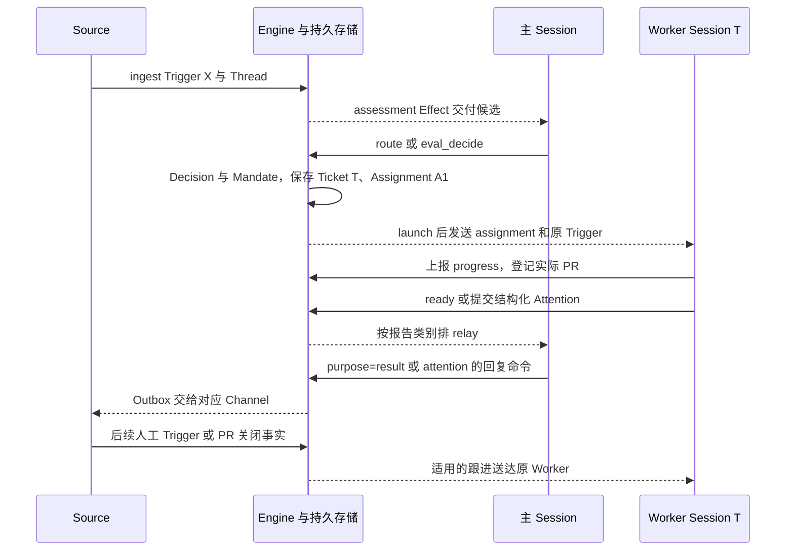

# 16 · Orchestrator 与 Worker 的 Session、模型与工具

> 面试题　一个维护者让 Agent 修帮助页错字，另一位同事同时提出导出需求。为什么这个系统保留一个主 Session，却为每张 Ticket 使用独立的 Worker Session？两个角色可以用不同模型时，怎样保证改配置、重启和重试后仍知道哪次请求用了哪个路由、看到哪些上下文、能提交哪些操作？

**短答**　主 Session 汇总候选、正在做的工作和执行回报，通过结构化工具做路由与评估。Worker Session 按 Ticket 复用，维护该工单的执行历史，并在其工作目录里处理授权范围内的工作。两者都由 DSH 管理会话与推理回合，本项目负责选择角色、初始化默认模型、在请求时装配 prompt 和技能、限制工具并把模型的输出重新交给领域校验。Decision、Mandate、派工和消息通过持久状态连接两个会话。主 Session 的判断需要跨任务信息，Worker 的历史则适合跟着任务本身走。 [运行时装配](../dsh-superagent-prototype/src/app/runtime.ts#L104) · [Sessions](../dsh-superagent-prototype/src/app/sessions.ts) · [角色工具](../dsh-superagent-prototype/src/app/tools/main.ts) · [领域边界](../dsh-superagent-prototype/docs/007-architecture.md)

本文基线为工作区提交 `7bd4741`。设维护者 Alice 在 GitHub Issue #41 提醒 Agent 修帮助页术语，任务被接受为 Ticket T，随后 Worker 开了 PR #57。Bob 同时提交一项独立的 CSV 导出候选。示例中的人名、编号和模型名称用于推演。第 15 篇的 Ticket 生命周期仍适用，本篇重点追踪「信息什么时候进入哪个 Session、由哪组模型工具解释、结果怎样回到领域状态」。 [上一篇](15-ticket-lifecycle-and-human-handoff.md) · [领域模型](../dsh-superagent-prototype/docs/001-domain.md)

## 1. 把全局路由与逐项执行拆成两个角色

### 1.1 主 Session 需要共享决策上下文

Alice 的请求到达时，主 Session 可能还在考虑 Bob 的候选。它要查这一条 Trigger 指向哪个 Thread，有没有已有 Ticket 可附加，当前策略允许什么，消息是否只是跟进或需要停止。维持一处主会话让这些请求使用相同的领域视图与路由协议。真正防重复的部分由 Engine 和仓储工作。比如一个已接单的 Trigger 对应已有 Decision，另一条正归 Worker 判断的消息有 followupOwners，模型猜到可以重复接受也会遇到守卫。主 Session 的历史有助于连贯判断，但历史摘要本身不能承担唯一索引或权限检查。 [Engine 的角色接口](../dsh-superagent-prototype/src/core/engine.ts) · [路由协议](../dsh-superagent-prototype/prompts/dispatch.md) · [主工具](../dsh-superagent-prototype/src/app/tools/main.ts#L126)

主 Session 从持久仓储取统一事实也有恢复价值。假设它重启后从会话里记得 #41 曾被受理，仍可以用资源工具读 Ticket 的状态，查看当前有没有新判断。反过来，即使历史上下文被压缩，旧授权、哪些输入已转派与已创建的任务也在 SQLite 中有引用。对一个可持续工作数小时或数天的 Agent，跨回合记忆应当能引用结构化的任务事实，才能区分人改变主意、系统恢复和消息重放。 [领域状态](../dsh-superagent-prototype/src/core/model.ts) · [资源目录](../dsh-superagent-prototype/src/app/resources.ts#L23) · [Store](../dsh-superagent-prototype/src/app/store.ts)

### 1.2 Worker 需要项目上下文与一个稳定的执行位置

Worker 要从请求原文、仓库规则和本任务授权出发检查文件、改动、跑测试和准备 PR。历史里可能有多个文件、失败输出、人工修改后新增的说明。将这些都放入主 Session，会让下一个候选在上下文中和过去的日志竞争空间。每张 Ticket 使用一个工作会话，也让工具、目录、报告与状态能够指向同一个对象。Alice 的文案工单与 Bob 的导出工单可以在各自回合继续，二者在启动、投递和执行上仍受共享运行器资源约束。 [Worker 的工作约定](../dsh-superagent-prototype/prompts/work.md) · [Executor](../dsh-superagent-prototype/src/executor/dsh.ts) · [执行状态](../dsh-superagent-prototype/docs/003-execution.md)

独立的 Worker Session 还能给同一工单跨多次 Assignment 保留连续性。比如 Alice 在 #57 补充「产品名称要保留英文」，T 仍在原范围，Worker 已经知道修改和测试过程，可以基于既有历史处理。若 A1 遇到失败，A2 重试仍使用同一 T 的 Session ID，在保留轨迹的基础上核对之前做了什么。另一个独立任务则创建自己的 Worker。运行名额限制适用于活跃执行，不以数据库中存了多少历史会话来计算。 [Worker Session ID](../dsh-superagent-prototype/src/executor/dsh.ts#L24) · [独立的 Assignment](../dsh-superagent-prototype/src/core/tickets.ts#L168) · [执行器活跃数](../dsh-superagent-prototype/src/executor/dsh.ts#L403)

| 对问题的回答 | 主 Session | 每张 Ticket 的 Worker |
| --- | --- | --- |
| 应根据什么做决定 | 候选、规则、原 Trigger、相关任务与报告 | 本任务 Mandate、原 Trigger、执行输入、仓库与工作目录 |
| 应提交什么状态变化 | accept、attach、stop、ignore、推断评估及适用的回复 | report、ack、follow、unrelated、handback |
| 由谁创建或恢复 | Runtime 初始化时 ensure 主 Session | 执行器在处理 launch 或必要时恢复交付目标 |
| 如何持续 | 安装级稳定 ID，统一接收候选、报告和通知 | Ticket 级稳定 ID，原任务后续消息继续在本会话处理 |
| 哪个持久记录判断任务结果 | Decision、Ticket、Assignment、Trigger、Outbox 等领域事实 | 报告通过 Engine 落到同一个 Ticket，再反馈给主 Session |

如果在面试设计里分析代价，核心是把上下文范围和协调成本同时讲清楚。一个全能 Session 上手简单，长期运行时要靠每一步重新辨别自己在审批、实现还是回复。分成主与 Worker 后，状态和上下文可以专业化，团队需要正确实现交付、异步状态和引用。它也保留某些全局串行瓶颈，所以拆角色同时要给路由回合剪短输入和等待。 [设计文档](../dsh-superagent-prototype/docs/004-prompts.md) · [会话投递](../dsh-superagent-prototype/src/app/delivery.ts)

## 2. Sessions.ensure 如何把领域任务变成一个 DSH Session

### 2.1 ID 让逻辑角色比进程实例活得更久

Runtime 先从 `KV.runtime.masterId` 读取旧 ID，缺失时以状态目录派生 `orchestrator-…` 并保存。完成安装配置等初始化后，可在状态目录上确保主会话，再恢复执行器、启动 Passes 与 Effects。Worker 会话由 ticketId 派生 `worker-<ticketId>`。新 Assignment 的出现不会因此变成另一个 Session ID。用户手动删除 Worker Session 的场景也有恢复分支。后续尝试送达时可再 ensure，工单数据还能提供标题、目录及可读的输入证据。被删除的宿主会话历史需要依宿主保留情况判断。 [主 Session 稳定 ID](../dsh-superagent-prototype/src/app/runtime.ts#L104) · [Runtime 初始化](../dsh-superagent-prototype/src/app/runtime.ts#L201) · [重新创建 Worker 的测试](../dsh-superagent-prototype/tests/runtime-concurrency.spec.ts#L128)

`ensure(id, cwd, title, role)` 先调用宿主 `sessionController.resolveAgent`。返回 `session/not-found` 时按 cwd 创建 Workspace，选择对应 bundle preset 创建 Session，再解析 Agent。其他解析错误直接抛出。成功后读取当前 Settings，尝试初始化对应角色模型，运行 decorate，设置宿主权限 preset，更新标题并返回 Agent。这个流程里，「存在一条域记录」与「取得可处理回合的 Agent」是两个条件。比如首次配置的模型路由不可用，Worker 行为可在启动处失败，保存的 Ticket 供面板诊断。 [Sessions.ensure](../dsh-superagent-prototype/src/app/sessions.ts#L137) · [创建与启动调用](../dsh-superagent-prototype/src/executor/dsh.ts#L429)

### 2.2 角色 preset 决定基础能力，装饰再安装业务协议

Patch 提供 `dsh-superagent-router` 和 `dsh-superagent-worker`。 Worker preset 装配 persona、项目指令、文件读写和搜索、Shell、任务管理、技能、压缩和可 spawn 的子代理等能力。Router 给主 Session 留下它在路由和有限诊断中用的那组基础工具。两个 preset 都把前台命令与显式等待后台任务的默认及最大窗口设为 5 秒，其中 Shell 需要继续执行的命令转入后台。具体事件怎样传入 inbox、何时进入模型、压缩如何运行，由 preset 配的 DSH 能力完成。业务规则随 Sessions 装饰添加。 [Bundle preset](../dsh-superagent-prototype/cordis.patch.yml) · [配置测试](../dsh-superagent-prototype/tests/bundle-patch.spec.ts#L29)

旧已有会话或刚被 Web 界面打开的空 Session 可能出现一个不同的 preset。Sessions.install 监听 `agent-preset/selected`。对自己的主 Session 或确有 Ticket 对应的 Worker，若宿主选了别的 preset，尝试恢复拥有的那个。宿主在第一轮开始后拒绝这类选择，调用的拒绝被按预期接纳。判断当前 Router 模式时，代码优先读宿主 registry 的已选项，在版本接口缺失时尝试投影，再回落 Session header。读不到时以更保守的旧会话约束处理。这里的 preset 和模型是两套独立设置，能分别被识别和持久化。 [preset 事件与读取](../dsh-superagent-prototype/src/app/sessions.ts#L108) · [兼容读取的测试](../dsh-superagent-prototype/tests/runtime.spec.ts#L1532) · [首轮前的 preset 还原](../dsh-superagent-prototype/tests/runtime.spec.ts#L1682)

### 2.3 decorate 跟着 Agent 实例，而 Ticket 跟着持久仓储

`agent/created` 会尝试装饰，ensure 拿到对象也会走同一入口。Sessions 使用以 Agent 对象为键的 bindings Map 避免同一个实例被重复装饰。主角色由 masterId 匹配，Worker 把 ID 还原到现存 Ticket。普通其他 Agent 不加入这两类，符合条件的子代理只继承相应工具范围。装饰期间安装系统 prompt section，接入技能子作用域，然后注册工具和 guard。技能服务的作用域安装需要异步等待，期间若 Agent 已释放，代码重新检查 binding 并停止登记后续工具。 [装饰和判断](../dsh-superagent-prototype/src/app/sessions.ts#L228) · [子代理](../dsh-superagent-prototype/src/app/sessions.ts#L303)

`agent/disposed` 触发 release，解绑已登记技能、工具和 prompt 等，故另一个 Ticket 上同名的工具仍然可用。Runtime 整体关闭时也统一释放。这个生命周期和数据库里的 Ticket 结束是两回事。即便 Worker Agent 仍在，为它绑定的 guard 可根据最新 Ticket 状态拒绝继续执行。反过来，Agent 对象没加载也不直接改变 Ticket 结案或原授权记录。 [释放实现](../dsh-superagent-prototype/src/app/sessions.ts#L341) · [工具解绑测试](../dsh-superagent-prototype/tests/tools.spec.ts#L293)

## 3. 用一张时序图定位消息、状态和回合



这条图里的箭头代表协议动作，不要求每根箭头恰好对应一次模型调用。候选送到主 Session 后可以通过工具读更多页，再在同一回合提交路由。有些候选稍后结合更多上下文才能判断。Worker 的一次派工可经过多轮。比如第一次实现和跑测试，第二次处理 GitHub 审阅意见，第三次回答用户短问。工单状态继续由报告、输入与外部 PR 事实决定。衡量是否自动化完整，应记录从 X 到结果回写的业务阶段，在需要定位延迟时再看具体 step、工具耗时与宿主事件。 [候选交付](../dsh-superagent-prototype/src/app/assessment.ts#L91) · [报告 relay](../dsh-superagent-prototype/src/app/notices.ts#L107) · [任务交接](15-ticket-lifecycle-and-human-handoff.md)

## 4. 角色模型什么时候生效，什么时候保持旧选择

### 4.1 模型目录、角色默认值和请求路由

角色配置是一个可空结构，包含 provider、model 和可选的 reasoningEffort。主 Session 取 `settings.eval.model`，Worker 取 `settings.executor.model`。null 代表由宿主选择。面板和资源可列出宿主模型目录、默认项、角色配置、目录读取失败等信息。保存改过的非空模型时，Settings 调 `resolveRoleModel`，它将配置提交给宿主 LLM 的 resolveCallConfig。可用性由当前路由解析得到，模型目录是给操作员查找和展示的，未被列出的有效路由也可通过。真正初始化尚无选择的 Session 时会再次解析，能够反映路由在存储配置以后发生的变化。 [模型配置类型](../dsh-superagent-prototype/src/policy.ts#L70) · [配置保存校验](../dsh-superagent-prototype/src/app/settings.ts#L153) · [模型资源](../dsh-superagent-prototype/src/app/resources.ts#L191) · [路由解析](../dsh-superagent-prototype/src/app/role-models.ts#L8)

用虚构的两个模型说明。配置将主角色设为 Router-Model，Worker 设为 Worker-Model-A。T 首次 ensure 时没有请求头和模型选择事件，走 Worker-Model-A 初始化。管理员后来把 Worker 默认值换为 Worker-Model-B。T 若从 A1 重试到 A2 且现有会话的选择记录仍在，继续遵循它已保存的 Session 选择。另一个新会话在同样的部署配置下按 B 解析。单独手动为 T 改模型，也走宿主的会话选择机制。由此排查「修改为什么没生效」时，应查配置是否写入、Session 是否已经有选择、实际请求头展示了什么。 [模型初始化](../dsh-superagent-prototype/src/app/role-models.ts#L15) · [已有请求头与模型记录测试](../dsh-superagent-prototype/tests/role-models.spec.ts#L49)

### 4.2 首次组装 prompt 和真正提交请求要用同一路由

`initializeRoleModel` 先以 null、现有 requestHeader 或 `model/selection` 防止重设。解析成功，向目标会话追加 `model/selection` 并为初始请求安装局部事件处理，再 flush 宿主 Session 存储。源码专门避免使用会改变宿主全局默认选择的那条 API。一次 Worker 启动改变的是该会话的选择记录。它不应把同一个 profile 下先前配置好的主路由改成 Worker 模型。 [单会话模型初始化](../dsh-superagent-prototype/src/app/role-models.ts#L15) · [首轮选择的测试](../dsh-superagent-prototype/tests/role-models.spec.ts#L24)

首轮 `system-prompt/assemble` 在调用链开始时捕获 selected，返回时把 prompt 变量中的 provider 和 model 对准到这一组路由，同时把这一选择记录为 assembled。之后 `agent/request` 取这次组装的选择覆盖请求配置，并移除原配置继承的 reasoningEffort。如果新选择明确包含自己的 reasoningEffort，则由新选择决定。这样同一步的 prompt 变量和模型请求不会一个用 Worker 路由、另一个保留宿主默认推理强度。设置中的「可选」有实际效果。它让没有配置推理强度的 role route 不夹带先前模型的强度。 [首轮事件处理](../dsh-superagent-prototype/src/app/role-models.ts#L23) · [首轮配置测试](../dsh-superagent-prototype/tests/role-models.spec.ts#L24)

当该 Session 出现后续 `request/header` 或 `model/selection` 事件，initial 变 false。此前已组装的 step 仍持有 assembled，所以同一个 step 因重试调用请求中间件时继续使用已组装路由。之后的新 assembly 接上宿主普通选择。这也解释了人中途选择模型时两个观察可能同时正确。新选择已经被记录，之前组装并开始的这个 step 仍在使用旧模型。相关测试构造了一次手动选择事件，验证重新 assemble 才看到它。 [请求头与选择事件](../dsh-superagent-prototype/src/app/role-models.ts#L25) · [手动选择的切换边界](../dsh-superagent-prototype/tests/role-models.spec.ts#L38)

| 变化发生的时点 | 代码读取的事实 | 下一次请求如何选择 |
| --- | --- | --- |
| 角色模型为 null | 交由 DSH 会话与 profile 选择 | 按宿主策略 |
| 存在角色配置，Session 无记录 | 现场解析 provider 与 model | 初始化并持久化角色选择 |
| Session 已有 header 或选择 | 继续使用已保存的 Session 状态 | 不重新应用新角色默认值 |
| 人在已组装 step 期间手动改模型 | 当次 step 已捕获 assembled | 当步保持原路由，新组装接新选择 |
| 现场解析角色配置失败 | 初始化异常发生在追加选择前 | 可从启动或配置错误诊断 |

一个适合实际排查的原则是把「配置面板写着什么」和「本次请求头是什么」同时拿出来。若主 Session 与 Worker 都继承 null，同用一个模型是正常设置。即便两个路由显式不同，角色差异仍主要来自 prompt、工具和任务数据。更换模型之前可先核对哪一段决策出错。如果 Worker 错把 scope 扩大，单靠换推理规格不能代替 Mandate、资源与命令入口的检查。 [角色转发](../dsh-superagent-prototype/src/app/sessions.ts#L137) · [预算与模型观测](../dsh-superagent-prototype/src/app/retry-health.ts)

### 4.3 模型等待如何暴露给管理面板

Sessions.install 监听受管理 Agent 的 Session 事件，排除只继承工具限额的子代理。RetryHealth 从结构化失败与重试信息，必要时从已知预算错误文本，判断当前是否等待模型预算，再更新 models health。重试开始本身不会清除此前的等待，恢复成功、回合结束或对象释放时按实际事件清理。资源卡片也可在相应会话名下展示 retry 信息。这里是把宿主观测到的状态投影出来。版本现有代码不会根据这个 health 自动改角色模型或修改宿主重试计划。 [重试状态投影](../dsh-superagent-prototype/src/app/retry-health.ts) · [Sessions 的健康字段](../dsh-superagent-prototype/src/app/sessions.ts#L218) · [资源中的会话重试信息](../dsh-superagent-prototype/src/app/resources.ts#L119)

## 5. 两个角色怎样装配同一版 prompt 与不同内容

### 5.1 共同的约定和角色特有的材料

Prompts 从版本化配置合成两种角色的文本。两者共享团队的沟通、任务范围、交付要求及 subscriptions、replies 等语义。主 Session 附 dispatch、admission、自己的 handoff 和当时根据 Settings 生成的 Policy 段。Worker 附 work、Worker handoff，再带当前 Ticket 的执行环境和 `mandateInstructions`。主 Session 在系统 Prompt section 上设置 complete，采用完整的路由 prompt。Worker Session 可继承宿主 prompt 和仓库指令。以明确请求修复帮助页为例，原始请求和环境可以指向同一个文件，但两端信息的作用不同。主 Session 解释「是否成立现有或新任务」，Worker 解释「如何在授权内验证和交付」。 [固定段与角色顺序](../dsh-superagent-prototype/src/app/prompts.ts#L108) · [请求时装饰](../dsh-superagent-prototype/src/app/sessions.ts#L242) · [Mandate 提示](../dsh-superagent-prototype/src/executor/dsh.ts#L91)

Policy 段列出当前启用规则、版本和 mode，属于生成内容。Work 指令可引用环境变量、仓库语言和交付要求，执行任务时仍要看自己的 Mandate。比如团队把文档测试证据从截图改为检查命令的输出，这类说明属于行为指导。若要决定一条消息能不能新建 Ticket，仍由 Policy、Engine 和来源角色共同校验。动态文本和守卫分离，避免把团队在描述里的每一次措辞修改等同于扩大操作权限。 [Policy 段生成](../dsh-superagent-prototype/src/app/prompts.ts#L95) · [Prompt 文档](../dsh-superagent-prototype/docs/004-prompts.md) · [运行域校验](../dsh-superagent-prototype/src/policy.ts)

### 5.2 版本绑定发生在真正组装模型请求时

Sessions 在 Agent 的系统 Prompt 上挂上 `dsh-superagent-policy` section，包含 revision 标记，并在生成 Worker 文本之前从 Store 重新读该 Ticket。section 设 interpolate:false，所以团队正文里的 GitHub Actions 插值等带花括号内容能以原样进入模型文本。保存新的 prompt revision 后，真正请求组装时 `promptFor` 读取当前版本。它以传入的 context.signal 为请求绑定标志，更新此 Agent 的运行期技能并记录已使用的版本。只预览文字时可以得到当前文本，不会因为预览动作本身给该会话添加已使用历史。 [Session prompt section](../dsh-superagent-prototype/src/app/sessions.ts#L232) · [绑定版本](../dsh-superagent-prototype/src/app/sessions.ts#L328) · [字面量保留测试](../dsh-superagent-prototype/tests/runtime.spec.ts#L1055)

假设 T 上一步在 revision 4 读到了旧交付策略。管理员保存 revision 5，现有 Agent 没因此被重启。若下一步真正发生请求，装配和版本记录可以更新为 5。中间如果 Worker 调 `prompts/current`，读的是它最后绑定使用的版本，有绑定时仍可读 4。允许读哪些旧版本以这个 Session 使用历史为准，跨进程可继续查。这个区分能解释当前面板最新和一次请求所见版本之间的时差。重放某一历史事件时还应核对生成的 Policy、环境是何时读出的，prompt revision 主要标识团队配置与本项目组合里的版本。 [版本授权](../dsh-superagent-prototype/src/app/sessions.ts#L197) · [版本资源](../dsh-superagent-prototype/src/app/resources.ts#L174) · [重启后授权测试](../dsh-superagent-prototype/tests/runtime.spec.ts#L1033)

### 5.3 技能作用域如何与版本一起更新

Prompts.skills 提供内置 GitHub 技能、已配置飞书机器人时的飞书技能，以及团队添加的技能。Sessions 通过 Agent 下的 skills scope 注册，统一以 `dsh-superagent-` 前缀暴露。内置技能可挂随 bundle 文件布局的 resourceBase，团队技能主要是配置的文本。注册时保留各自 disposer。绑定到另一个 revision 时先释放此前技能，再加载新版本。技能服务因重启得到空作用域时，Sessions 重置之前记忆的绑定状态再装载。这个设计让主端和 Worker 都拥有同一版操作指引，并可通过资源读取追查挂载条件。 [技能的来源](../dsh-superagent-prototype/src/app/prompts.ts#L149) · [运行期技能装载](../dsh-superagent-prototype/src/app/sessions.ts#L314) · [技能配置测试](../dsh-superagent-prototype/tests/prompts.spec.ts#L115)

对面试的 prompt 热更讨论，可以直接用三个字段说明。团队配置 revision 可以修改当前文字，角色模型选择跟着 Session 的持久记录，Policy version 处理生效策略与原有授权。假如运维人员只保存 prompt 中的交付说明，下次请求能按它写报告。要判断旧评估是否要重跑、之前授权的案件能否恢复，要另外看 Policy 和 Mandate。调试时核对各字段的更新入口，能够识别一个用户观察涉及的是文案、权限、模型还是运行宿主。 [Prompt 版本保存](../dsh-superagent-prototype/src/app/prompts.ts) · [模型会话](../dsh-superagent-prototype/src/app/role-models.ts) · [策略与再验证](13-decisions-mandates-and-revalidation.md)

## 6. 模型能看到什么工具，按哪些条件才能调用

### 6.1 宿主注册、模型参数和真正的业务校验

`Runtime` 根据是否有当前 Ticket 给 Sessions 返回 mainTools 或 executorTools。Sessions.registerTool 把 Zod schema 转为 JSON Schema 供模型选择参数，执行时再对实际参数运行 schema.parse，并把宿主的 AbortSignal 传入工具。成功返回渲染为 JSON 文本，约定带 image 时还附一个图像段。对 Agent 来说是一次工具调用，对应用来说，语法通过后还要检查范围、当前任务是否开放、输入是否存在、结果能否进入领域状态。比如知道 PR 号、填写一个符合正整数格式的参数并不等于那张 PR 真属于这个 Ticket。 [工具注册](../dsh-superagent-prototype/src/app/sessions.ts#L205) · [工具类型](../dsh-superagent-prototype/src/app/tools/tool.ts) · [Worker 报告事务](../dsh-superagent-prototype/src/app/tools/executor.ts#L75)

主路由工具允许一批最多 20 个 decisions，逐项检查和执行，某一项拒绝可以继续其它项。显式接单、attach、stop 或 ignore 有具体参数组合。推断候选的正向接单走 `orchestrator_eval`、`orchestrator_eval_read` 与 `orchestrator_eval_decide` 路径，使用在途 Eval 的受限上下文。Worker 没有这个评估命令集合，要指出某条信息属于别的任务，交回已送达的 Trigger 并给出理由。主 Session 用持久记录重判，Worker 也能用 report 更新自己的状态。这些命令让角色的自由文本有清楚的业务出口。 [主路由与评估工具](../dsh-superagent-prototype/src/app/tools/main.ts#L126) · [评估接口](../dsh-superagent-prototype/src/app/assessment.ts#L77) · [退回与报告](../dsh-superagent-prototype/src/app/tools/executor.ts#L65)

### 6.2 工具名称相同，资源主体由会话传入

两个角色都能调用 `orchestrator_read`。注册器会为主 Session 传主资源 host，Worker 则由闭包固定自己的 ticketId。模型只填 resource、offset、limit，无法用一个角色参数宣称自己是主 Session。Worker 翻页可以看本 Ticket 的派工、报告、输入和适用的来源上下文。读取其他 Ticket、全局 Decision 或配置需要主 Session 权限。即便模型知道一个别处的 ID，资源路由仍根据归属或 reachability 检查。对 Worker 返回 Trigger 信息时，还会按作用域处理其他 Ticket 和不可达邻居等元数据。 [读工具 schema](../dsh-superagent-prototype/src/app/tools/tool.ts) · [Worker 的闭包](../dsh-superagent-prototype/src/app/tools/executor.ts#L22) · [资源授权](../dsh-superagent-prototype/src/app/resources.ts#L82) · [无权引用的测试](../dsh-superagent-prototype/tests/tools.spec.ts#L445)

假如报告 relay 用摘要了结局，主 Session 需要核验 Worker 真跑了哪些测试，模型可按卡片上的 read 路径读取结果。资源工具对文本和列表用不同分页上限，给 next_offset 等指引。对主动评估时的上下文还有专门的 `orchestrator_eval_read`。它要求存在当前 Eval，并约束可访问的消息、图片、仓库路径和页游标。普通已存记录阅读与评估证据补读使用不同生命周期和参数，能让候选正文、长期历史和每一次实际查阅保持适合的体积。 [资源协议](../dsh-superagent-prototype/src/app/resources.ts#L23) · [评估读请求 schema](../dsh-superagent-prototype/src/app/assessment.ts#L67) · [第 09 篇的上下文展开](09-bounded-context-and-resource-reads.md)

### 6.3 主会话的限制着眼于较短的回合

主 Session 注册本项目工具后，框定继承工具中的 skill、bash、read、read_image 及几个 job 查询或停止操作。创建时的 Router preset 也不加载专用的写文件、搜索、web、subagent 等组。这样简单的来源读取、诊断和运行管理能继续用，复杂的实现被分配到 Worker。是否知道怎么做某项技术操作，与是否应由当前 Session 承担该操作分别由工具范围和角色协议控制。 [主会话工具 restrict](../dsh-superagent-prototype/src/app/sessions.ts#L260) · [Router preset](../dsh-superagent-prototype/cordis.patch.yml) · [工具测试](../dsh-superagent-prototype/tests/runtime.spec.ts#L1558)

另一个 guard 叫 noWait。主 Session 正在等某个 Worker 回报时，可以结束当前回合，新的报告会作为消息到达。guard 拒绝匹配到的 bash sleep，以及显式要求超过 30 秒的 bash timeout，限制 job_output 的同步等待为 5 秒。Router preset 自身的 Shell 等待更短，旧标准 preset 下缺参数的命令要显式限制 timeout 或改后台，旧会话的 job wait 也须给出上限。这就是同一个工具调用在旧主会话和新主会话中可能得到不同提示的原因。guard 针对回合阻塞，得到消息之后何时开始模型步仍取决于调度与服务可用性。 [noWait 规则](../dsh-superagent-prototype/src/app/sessions.ts#L72) · [阻塞命令测试](../dsh-superagent-prototype/tests/runtime.spec.ts#L1494)

不能把两个 timeout 读成同一个值。5 秒是在新 preset 下宿主工具的调用配置。30 秒是额外 guard 对显式 bash 参数做判断的界限，用于包括以旧 preset 开始的会话在内的防等待。举例来说，一条耗时的仓库只读查询在路由会话上长时间占住一个工具 step，就会延后正在 inbox 等候的候选。把需要等待的外部操作交给适用执行者，令下一步由状态通知驱动，能减少长调用对其他 Thread 的影响。 [两个 preset 和配置](../dsh-superagent-prototype/cordis.patch.yml) · [主 Session 行为约定](../dsh-superagent-prototype/prompts/orchestrator.md)

### 6.4 Worker 的 allowlist、子代理与结束守卫

Worker 的继承工具选自 WORK_TOOLS，再与父作用域实际已经登记的工具求交。宿主要求 restrict 列出的工具名在继承环境中可识别，直接使用全局工具目录会漏掉本 preset 已注册的工具，使用 Agent 自己完整视图又可能混入局部新增项。原型用 scopeParentOf 获取适合的可见性。然后为调用添加动态 guard，每次看 Store 中 Ticket 是否还开放。报告 blocked 或 failed 的工单仍可由人在原会话协助处理。只有 ended 或查不到该 Ticket 时，此处拒绝继续使用工具。 [WORK_TOOLS 与 workOnly](../dsh-superagent-prototype/src/app/sessions.ts#L282) · [结束守卫测试](../dsh-superagent-prototype/tests/runtime.spec.ts#L1558)

Worker preset 的 spawn 子代理走宿主 standard。子代理不会自动成为一张新的 Ticket。Sessions 读 child Session header 的 parentSession，沿已加载 Agent 的祖先寻找 Worker 归属，有明确的遍历深度上限。找到有效 Ticket 后给它装与该 Worker 类似的 workOnly 限制和结束守卫。普通无关 Agent 沿宿主原设置工作。这个分支只为 child 附工具限制，不会创建一整套主 Session 路由和业务工具，也不独立分配新的 Mandate。 [子代理绑定逻辑](../dsh-superagent-prototype/src/app/sessions.ts#L299) · [子代理测试](../dsh-superagent-prototype/tests/runtime.spec.ts#L1713) · [嵌套孙代理测试](../dsh-superagent-prototype/tests/runtime.spec.ts#L1732)

这里的 role 是在一个受信安装中组织工具与数据要做的事。ensure 对宿主会话设置的是 `danger-full-access`，工具列表的可调用范围和域授权守卫都处于应用层。工作目录和工具 preset 会改善协作，但自己的 OS 账号、文件系统可达性和外部凭证取决于宿主部署。要评价这个原型能否处理相互隔离的客户或仓库，需要另看部署身份和进程约束。跟面试官描述已有功能时，可以具体说明「Worker 调本项目资源工具会被限制到自己的 Ticket」「运行中的 Shell 权限走宿主配置」各自所指的范围。 [宿主权限设置](../dsh-superagent-prototype/src/app/sessions.ts#L137) · [部署与执行说明](../dsh-superagent-prototype/docs/003-execution.md)

## 7. 一次业务交付怎样跨多个回合，仍然能追溯

### 7.1 X 从候选到 Worker 第一条消息

维护者 Alice 提交「请修帮助页折叠的术语」。摄取、policy gate 和 Eval 确定候选。MasterAssessor 用 assessment Effect 交付一张可围绕原 Trigger 查证的 candidate，使用随 Eval ID 派生的稳定请求 ID，投递后通知 Engine 记交付。主 Session 当前忙着处理 Bob 的问题时，这张新卡可以由 Agent 的 steer 接入。回合拿到卡后会先根据 strength 走显式路由或推断评估工具。对于明确的工作，调用 route 的 accept，提交标题、范围的表达、worktree 名和确认文案等，Engine 将这次接受写成 Decision 和 Mandate。由此才有某个 Worker 在本仓库做这项工作的任务记录。 [候选 handler](../dsh-superagent-prototype/src/app/assessment.ts#L89) · [接受工具动作](../dsh-superagent-prototype/src/app/tools/main.ts#L93) · [授权决策](13-decisions-mandates-and-revalidation.md)

在 launch Effect 中，DshExecutor 汇拢工作目录和 Assignment 数据，确保 Worker Session 并检查该 Assignment 仍可启动。第一条消息会带 Ticket ID、标题、assignment 说明、源 Trigger 卡和适用批次摘要。assignment 过长会留资源引用，原始消息另有位置，路由建议也只占一部分输入。Worker 可查原文和仓库来验证范围。恢复时若已在这个 Session 的历史或 inbox 找到首次派工，后续 launch 可发精简的代次提示，避免重复完整内容。历史不在时走有上下文的消息。这些情况仍可能共用同一个 Ticket ID，但属于不同 Assignment 和请求。 [创建执行文本](../dsh-superagent-prototype/src/executor/dsh.ts#L96) · [launch 首次与后续消息](../dsh-superagent-prototype/src/executor/dsh.ts#L429)

T 的 Worker 在本回合确认确实属于帮助页错字，再落实改动。若持有 inferred 授权，附加的限制提示要求核验是单模块内部的小改动，遇到需要改公共接口或行为、作产品决定或澄清的情形则停止并报告 dropped。主 Session 的一句「处理一下」无法表示任务所有授权条件。源码把原始 Trigger、Mandate 所据规则、生成的环境、领域守卫留在各自位置供交叉核对。这也是单独传递原话的好处。Worker 能识别路由摘要和真实请求的差异。 [Mandate 执行提示](../dsh-superagent-prototype/src/executor/dsh.ts#L91) · [Worker 原文阅读约定](../dsh-superagent-prototype/prompts/work.md)

### 7.2 三类送入 Session 的消息方法

| 模式 | 宿主调用 | 此处常见输入 | 对回合的意义 |
| --- | --- | --- | --- |
| queue | agent.followup | 新派工与相应启动说明 | 放进后续回合队列，按宿主行为推进 |
| steer | agent.steer | 主端的候选或报告，Worker 的工单输入 | 在活跃回合接入下一步，或让空闲会话继续 |
| inject | agent.inject | 配置版本、状态变更等带标签通知 | 直接写到历史中，可读且无需因通知启动一轮 |

Sessions 的 ordered relay 和 notice 各有自己的处理器。主端报告常走 relay 对应的 steer，配置通知常用同名 notice 新值替换等待行，写进会话而不额外叫醒它。候选通过独立的 assessment Effect 构造和投递。因此看到数据库中有三个事件，不能推断模型立即运行三轮。也不能把各自按队列顺序误解为所有类型统一全局时序。定位「主 Session 是否有候选」时，至少先区分候选 Effect 是否送达、会话是否已有消息和它是否进入了实际模型 step。 [Sessions 送达和通知](../dsh-superagent-prototype/src/app/sessions.ts#L156) · [候选单独队列](../dsh-superagent-prototype/src/app/assessment.ts#L89)

`AgentDelivery` 通过 requestId 派生消息 ID。首次接触 Agent 时，先 flush，再分页从持久 Session 读取已有消息，同时监听实时的 user/message 事件，并检查 inbox 的 nextTurn 和 nextStep 中是否已经存在。只有历史和待处理队列均无该 ID 时才走实际送达。投递前要检查目标 Agent 仍然有效，必要时执行调用方的授权检查。发送消息打上 dsh-superagent 来源，即使角色显示为 user，后续事件也能区分它来自插件还是人直接操作。兼容读取还能识别旧插件的持久消息记录。 [宿主投递适配](../dsh-superagent-prototype/src/app/delivery.ts)

这里有三个重要动作。AgentDelivery 负责同请求消息的投递去重，DSH 决定何时消费输入，Engine 依 Assignment 记录某个 Input 已送达或已经进入模型步骤。只有看到函数返回还不能推断 Worker 看完了整个请求。输入到达时若 Ticket 正好停止，Executor 会在等待链接或找会话之后再次读当前记录，并在领域回写时忽略失效 Assignment。前篇的已读和结束边界建立在同一个事实区分上。 [Input 送达检查](../dsh-superagent-prototype/src/executor/dsh.ts#L289) · [回执与读取](../dsh-superagent-prototype/src/core/assignments.ts#L42) · [生命周期篇](15-ticket-lifecycle-and-human-handoff.md)

### 7.3 从 Worker 的结果回到外部人的下一步行动

Worker 开出 #57 后首次通常提交进度报告附 pr_number。它会从外部读取 PR，并在同一个本地事务中认领、写报告和排适用 relay。普通 progress 若无待答问题或回答，保留内部状态。需要人选用语时，使用 human_action 形成结构化 Attention。测试过且可审阅时，提交 ready，按角色提示写出真实 PR、变更和验证。主 Session 收到的 relay 含简短卡片、资源路径等。它可以查实际结果，再通过 orchestrator_reply 的 purpose=attention 或 result 交给 Channel。对内的回合协调和对外的回复，由不同适配处理，能分别观察发送是否发生。 [Worker 报告工具](../dsh-superagent-prototype/src/app/tools/executor.ts#L75) · [报告 relay](../dsh-superagent-prototype/src/app/notices.ts#L107) · [主端回复工具](../dsh-superagent-prototype/src/app/tools/main.ts#L223)

当 Alice 在 PR 审阅中再问一条已有任务内的确认，通常由原 Worker 处理。若超出范围，退回原 Trigger，主 Session 再获得一个有上下文的评估机会。Bob 的独立请求可同时在另一张 Ticket 推进，不必把两个会话的工具调用日志拼在同一个 prompt。团队需要跨任务共享一条事实时，可让主 Session 发一个 note，让各自 Worker 按原授权使用。这种通信在模型可见范围内传递经过明确指向的事实，避免由两个 Worker 随意共享所有历史。 [后续消息归属](14-followup-ownership-and-handback.md) · [主 Session note 工具](../dsh-superagent-prototype/src/app/tools/main.ts#L176) · [会话协调原则](../dsh-superagent-prototype/docs/004-prompts.md)


### 7.4 主 Session 暂时离线时，怎样继续审计一次交付

设 A1 已将 ready 与 PR #57 写入 Store，主 Session 在接收报告时暂时不可达。先查 Worker 的工具调用及 Assignment.report 是否写入，再看 relay 行是否还在。前者说明业务记录已生效，后者承载重复尝试的请求。发送尝试可能在会话写入成功后、返回给生产者前出现错误。再次处理同一请求时，AgentDelivery 会查宿主历史与两个 inbox，因此应该继续投递缺失项，而对已存在的消息复用其身份。若主 Session 已做出外发回复，还需要另行核对对应 Outbox。这个案例能把「工单可审」「主 Session 已拿到结果」和「人已收到结果」放到不同的观察位置。 [报告写入测试](../dsh-superagent-prototype/tests/runtime.spec.ts#L1327) · [消息去重和 flush](../dsh-superagent-prototype/src/app/delivery.ts) · [Outbox](../dsh-superagent-prototype/src/app/outbox.ts)

宿主正常关闭时，Runtime 先停止继续推进，取消已加载的受管理会话回合并保留 inbox，等待现有 Effect 与 Agent 收尾。随后让执行器清理后台工作，释放 Session 装饰，最后 flush Session 持久化。将这些操作按顺序安排有实际作用。如果先解绑工具和守卫，工作回调唤起的尾部回合可能以意外的工具集合运行。进程异常退出没有相同的优雅收尾，可以从恢复路径核对存储中残留的 Effect、宿主 inbox 与待交付 Input。上一回合的发出记录、下一回合能够读取的正文，以及之前已提交的外部副作用仍需分别确认。 [Runtime.shutdown](../dsh-superagent-prototype/src/app/runtime.ts#L227) · [停后台再释放限制的测试](../dsh-superagent-prototype/tests/runtime-concurrency.spec.ts#L573) · [重建会话时复查待交付](../dsh-superagent-prototype/src/executor/dsh.ts#L429)

如果发现一条报告在 Worker 历史里有、应用库里却没有，也要解释它的形态。它可能是模型最后说的自由文本，而非成功调用 report。报告本身被拒绝时则查看工具的参数与当前任务状态。识别原始工具事件可以核对是对同一次报告的重试，还是产生了新的业务动作。当前实现让接单与报告都经应用工具落库，才能在历史被压缩或模型重新组织文字时继续用相同 ID 查到状态。 [报告协议](../dsh-superagent-prototype/src/app/tools/executor.ts#L75) · [模型可见表面测试](../dsh-superagent-prototype/tests/model-surface.spec.ts#L350)

## 8. 主 Session 成为瓶颈时，代码允许并行到哪里

### 8.1 会话、Effect、Eval 的并发单位各自独立

当前模型侧是一处主 Session 做路由。消息从不同 Source 来，Runtime 与 Source 按各自的调度入口推进。MasterAssessor 的 assessment handler 可以并发构建和交付候选卡，并行上限为四项。Engine 的 Eval 在每个 Thread 上有活跃窗口，同一 Thread 的其它消息进入待评估队列。某个线程等待补读与另一个线程开始收集候选可以重叠。跨 Thread 读取证据、构造候选与逐 Ticket 执行都有并发空间。完成一张卡片也可以先把它送入主 Session，由同处的模型再按上下文作出路由。 [Eval 队列](../dsh-superagent-prototype/src/core/evals.ts) · [候选 Effect 并发](../dsh-superagent-prototype/src/app/assessment.ts#L89) · [Worker 名额](../dsh-superagent-prototype/src/executor/dsh.ts#L176)

可以拿两条独立请求估算容量。假设 #41 和 #81 并行构造候选各用 2 秒，主 Session 为每条显式请求做一次单独模型判断，耗时都为 3 秒，忽略调度开销。两张卡片同时就绪后，若按单一回合串行处理，首张约 5 秒出决策，第二张约 8 秒。首张接受后，其 Worker 已能启动，即使主 Session 还未处理第二项。若两个独立项可以装进一次路由调用，工具往返数量减少，但模型要在同一步正确辨认两个 Trigger 及对应结果，实际时延要以记录为准。这里的数字说明可并行阶段和排队成本，仓库测试没有测量该算例在真实模型上的吞吐。 [多项路由](../dsh-superagent-prototype/src/app/tools/main.ts#L123) · [运行时装配](../dsh-superagent-prototype/src/app/runtime.ts#L121)

也要区分两处批量。Engine 可能将同一个 Thread 的多个合格输入组成一个 Eval 批次。route 工具的 decisions 数组允许同回合提交多个候选的动作，各项独立执行。后者可以接到不同 Thread，也会考虑某项通过一条 Decision 处理了同一个批次。判断同一 Thread 上后续请求的归属与顺序，应使用 Eval、Trigger 和 ownership 的状态。模型一次工具调用里的数组位置只表示该调用的处理次序。 [Thread 分批](12-eval-batching-timeouts-and-requeue.md) · [批内处理说明](../dsh-superagent-prototype/src/app/tools/main.ts#L84)

### 8.2 语义判断可以等待，提交时要检查领域状态

例如 Bob 的候选在等待评估时，Alice 刚通过一条消息明确停止 T。与此同时，Worker 还在交付一条跟进。如果只相信主 Session 最早拿到的卡片，可能会按旧状态附加消息。原型在提交时再核对当前记录。attach 路径检查目标、归属、退回历史和在适用情况下验证原 Mandate，Eval 可因版本变化重新评估，Worker 投递也复查仍由原派工接收。语义判断发生在会话里，申请修改持久状态时要验证相关事实仍成立。 [attach 守卫](../dsh-superagent-prototype/src/core/engine.ts#L109) · [Eval policyVersion 检查](../dsh-superagent-prototype/src/core/evals.ts#L283) · [输入校验](../dsh-superagent-prototype/src/executor/dsh.ts#L329)

面试设计若进一步引入多个路由消费者，可以先让它们并发准备证据，保留指向同一 Thread 的排序和活跃 Eval 状态。跨 Thread 操作仍可能同时碰同一张 Ticket，例如两个不同会话的消息都申明要转给它。要扩展的是提交协议与版本检查，保证旧提议在写入前会被拒绝或重新核对，并把幂等处理落到稳定的 Trigger、Eval 和操作身份上。这个设计推演假设候选最终仍汇到一个一致的领域存储。当前原型实际只有一个主 Session，源码与测试可以证明它的角色分工和局部守卫。 [仓储事务](../dsh-superagent-prototype/src/app/store.ts) · [域内路由接口](../dsh-superagent-prototype/src/core/engine.ts)

### 8.3 诊断慢在哪一段之前，给四个时刻命名

如果观测到「主 Session 很慢」，可以分别取 Trigger 摄取、candidate 确认送达、工具提交 Decision、首次 Worker 启动四段时间。送达前变慢可能是来源轮询或候选链接读取。送达已确认却过很久才提交，才进一步看主 Session 的队列、模型和工具 step。决定已保存而 Worker 启动延后，要看 launch Effect、运行名额及工作区准备。如果模型处在预算重试可从对应的健康字段看到线索，若正在等待耗时工具则看宿主事件。这些时段适合分别测量队列等待与执行耗时。单用「Issue 发出到 PR 出现」很难定位哪个角色限制了吞吐。 [评估送达记录](../dsh-superagent-prototype/src/app/assessment.ts#L89) · [Assignment.started](../dsh-superagent-prototype/src/core/assignments.ts#L30) · [运行预算](../dsh-superagent-prototype/src/app/retry-health.ts)

## 9. 对照测试验证调用边界

在本地临时 Git 副本中通过锁定依赖离线运行以下八个测试文件，**221 个现有用例通过**。角色模型用例覆盖 DSH 本地会话类型和事件装配，应用集成用例使用本地测试宿主及模拟服务，校验创建参数、请求事件、工具输出与持久状态。测试验证的是代码中的选择、限制与路由行为，算例中的性能数字仍需通过真实工作负载测量。 [包脚本](../dsh-superagent-prototype/package.json) · [角色模型测试](../dsh-superagent-prototype/tests/role-models.spec.ts) · [Runtime 测试](../dsh-superagent-prototype/tests/runtime.spec.ts)

```sh
corepack pnpm test tests/role-models.spec.ts tests/runtime.spec.ts tests/runtime-concurrency.spec.ts \
  tests/tools.spec.ts tests/followups.spec.ts tests/prompts.spec.ts \
  tests/model-surface.spec.ts tests/bundle-patch.spec.ts
```

| 想核验什么 | 现有的测试依据 |
| --- | --- |
| 新主会话与 Worker 选用的 preset | [Session 创建调用](../dsh-superagent-prototype/tests/runtime.spec.ts#L1675) 直接找 create 的参数 · [Router 配置](../dsh-superagent-prototype/tests/bundle-patch.spec.ts#L54) |
| 初次选模和首轮请求一致 | [初始请求配置](../dsh-superagent-prototype/tests/role-models.spec.ts#L24) 比较 prompt 变量、请求配置与事件 |
| 已组装后才切模型或从历史恢复 | [手动选择](../dsh-superagent-prototype/tests/role-models.spec.ts#L38) 核对下一次装配才切换 · [原选择保留](../dsh-superagent-prototype/tests/role-models.spec.ts#L49) |
| Prompt 绑定与装饰是否持续 | [每个 Worker 的变量](../dsh-superagent-prototype/tests/runtime.spec.ts#L1015) · [重启后版本读取](../dsh-superagent-prototype/tests/runtime.spec.ts#L1033) |
| 同名资源读按角色和任务约束 | [主会话专用资源](../dsh-superagent-prototype/tests/tools.spec.ts#L94) · [Worker 响应的引用范围](../dsh-superagent-prototype/tests/tools.spec.ts#L445) |
| 结束和释放后工具变化 | [Worker 结束守卫](../dsh-superagent-prototype/tests/runtime.spec.ts#L1558) · [子代理范围](../dsh-superagent-prototype/tests/runtime.spec.ts#L1713) · [Agent 释放](../dsh-superagent-prototype/tests/tools.spec.ts#L293) |
| 协议与提示同步 | [两个角色的模型可见接口](../dsh-superagent-prototype/tests/model-surface.spec.ts#L350) · [工具和文档字段检查](../dsh-superagent-prototype/tests/model-surface.spec.ts#L369) |
| 回报和持久消息的行为 | [绑定、报告、relay 一起写入](../dsh-superagent-prototype/tests/runtime.spec.ts#L1327) · [跟进 relay 重试及去重](../dsh-superagent-prototype/tests/followups.spec.ts#L118) |

### 9.1 最小实验怎么设计

用两个假模型名称和一个记录请求配置的宿主夹具，可以检查同一个已组装 step 面对手动改模型会拿到哪个选择。测试先初始化角色模型，组装 prompt，再注入手动选择事件。紧接着重放本 step 的请求，应与第一次选择相同。再组装新 step，观察路由是否切换。若要加一个默认模型更新用例，可以把它和显式手动更新分开，分别看事件是否新写入。两个变更可能在设置页上都叫「切模型」，但输入位置与对现有 Session 的作用不同。 [测试夹具与切换断言](../dsh-superagent-prototype/tests/role-models.spec.ts#L38)

测试 orchestrator_read 时则可以构造同一个资源名称，分别由主 Session 和 Worker 调用。对主角色能读的部分，验证是否返回指定 Ticket 或 Decision。对另一个任务的 Worker，验证拒绝独立 ID，并检查允许读的本任务记录里有没有带出无权的引用。这种对照同时覆盖登记时模型看到的参数描述与真正响应上的限制。参数描述帮助模型提交适用请求，读取授权决定能否返回内容。 [资源权限测试](../dsh-superagent-prototype/tests/tools.spec.ts#L445) · [工具的 read schema](../dsh-superagent-prototype/src/app/tools/tool.ts)

## 10. 面试复述与追问

### 10.1 60–90 秒口述稿

> 我会让主 Session 掌握项目的候选、规则、工单和回报，由逐 Ticket 的 Worker 处理本地实现。Runtime 按稳定 ID 确保主会话，Worker 按 Ticket ID 复用自己的 DSH Session 和目录，重试可以新建 Assignment。DSH 提供模型步、工具和会话持久化，项目通过 Sessions 装配角色 preset、prompt、技能和工具。角色模型只初始化没有选择记录的 Session，同步首步 prompt 变量与实际请求。提示词版本则在下一次请求时绑定。主 Session 调 route 或 eval 产生 Decision 和 Mandate，Worker 拿到原 Trigger 执行，通过 report 和 handback 提交结果。事件和报告可以在会话间重试投递，由 Engine 核对归属和当前状态。需要扩大吞吐时，先并行候选取证与工单执行，保留同一 Thread 的评估和同一 Ticket 的写入一致性。

### 追问一　为什么不直接用一个大模型的一个长会话？

一个长会话可以做演示，进入持续运行后，多项任务的文件输出、候选和审批事实会竞争上下文，并且一项长命令可能阻塞其它候选。按角色拆分可把全局判断留给一个可读持久状态的主会话，将实现历史和工具留给对应 Ticket。代价是需要消息交付、任务引用与恢复机制。 [角色原则](../dsh-superagent-prototype/docs/004-prompts.md) · [派工交付](../dsh-superagent-prototype/src/executor/dsh.ts#L429)

### 追问二　修改了 Worker 模型，为什么重试还是原模型？

重试替换 Assignment，原 Worker Session ID 继续复用。只要会话已有请求头或选择事件，就保留已存的模型选择。新 Worker 会按新的角色默认值初始化。若确需切换现有会话，按宿主显式选择，并检查新组装请求实际的选项。 [初始化逻辑](../dsh-superagent-prototype/src/app/role-models.ts#L15)

### 追问三　让 Worker 能看 GitHub 原文，是否也默认允许它批准新任务？

读取原文帮助 Worker 对已有 Mandate 做执行判断。批准新任务通过主 Session 的路由或评估命令，并由 Engine 形成 Decision。Worker 看到的 Trigger 可做 ACK、补充输入判断或退回，资源主体仍由当前 Ticket 绑定。 [资源主体](../dsh-superagent-prototype/src/app/tools/executor.ts#L22) · [主端工具](../dsh-superagent-prototype/src/app/tools/main.ts#L154)

### 追问四　为什么主 Session 等 Worker 的结果时应该结束当前回合？

执行报告作为 relay 主动送入主 Session，当前回合等待会推迟模型可消费的后续候选。主会话 guard 与 Router preset 缩短阻塞时间。要检查效果可观察报告出现到主会话消费的延迟，并区分排队、工具等待和模型服务故障。 [noWait](../dsh-superagent-prototype/src/app/sessions.ts#L72) · [事件通知](../dsh-superagent-prototype/src/app/notices.ts#L117)

### 追问五　有模型会话持久化，为什么还需要领域仓储？

Session 保存模型交互、工具事件和选模等宿主状态，任务是否接单、由谁授权、哪一个 Assignment 仍有效、要不要再读一条外部输入，需要用即使模型会话暂未加载也能读写的领域记录。在关闭、重启或上下文压缩时，应用可以凭 Ticket ID 和 Trigger ID 把两套记录关联起来。 [Store](../dsh-superagent-prototype/src/app/store.ts) · [会话历史去重](../dsh-superagent-prototype/src/app/delivery.ts)

---

[返回连载目录](README.md) · [上一篇《Ticket 生命周期、人工介入与完成语义》](15-ticket-lifecycle-and-human-handoff.md) · 下一篇《Assignment 启动、工作区准备与执行环境》
