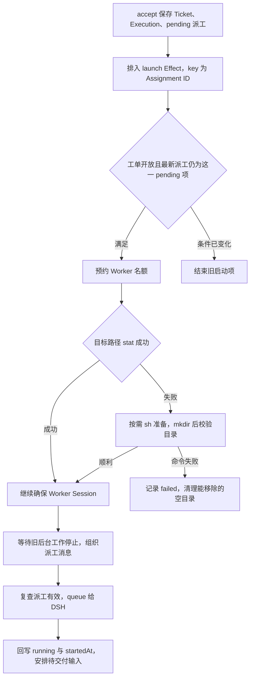

# 17 · Assignment 启动、工作区准备与执行环境

> 面试题　Agent 接到一条文案修复请求，已经生成 Ticket，面板却还显示排队。准备工作区的命令在写了一部分文件后失败。操作者点击重试，新的 Assignment 会重新跑准备命令吗？怎样判断随后执行的 Git 和 CLI 使用了哪个目录、哪个账号？

**短答**　接受任务时，原型就生成并保存 Ticket 的执行目录、短名和派工说明。首次 Assignment 通过持久 `launch` Effect 进入执行器，预约名额后检查工单和派工是否仍有效，按需准备目录，再确保 DSH Worker Session、交付首条消息，最后回写启动状态。当前准备分支用目标路径的 `stat` 是否成功决定是否重跑。失败命令留下的空目录会尝试移除，非空目录则保留，下一次重试可能直接使用残留工作区。Git worktree 用于隔开工作目录和分支，启动环境则通过 CLI 包装器和 Git 配置选择默认账号。真正的进程权限仍由宿主部署决定。 [执行器启动与准备](../dsh-superagent-prototype/src/executor/dsh.ts#L237) · [环境适配](../dsh-superagent-prototype/src/infra/environment.ts) · [执行文档](../dsh-superagent-prototype/docs/003-execution.md)

本文以本地提交 `7bd4741` 为源码基线。沿用 Alice 在 Issue #41 请求修帮助页术语的案例，令 Ticket 的示例短名为 `fix-help-copy-49152a2dcf77`，A1 为其首次 Assignment，A2 为重试后新增的派工。仓库 `acme/widgets`、编号和目录均作讲解。上一章说明两个 Session 的职责，本章关心 Worker 第一次工作的环境如何从这张 Ticket 推导出来。 [上一章](16-orchestrator-worker-sessions.md) · [部署文档](../dsh-superagent-prototype/docs/006-deployment.md)

## 1. 创建 Ticket 时确定哪些执行信息

当 Engine 接受 X，`Tickets.create` 从 Eval 批次取原 Trigger、Channel 和 Mandate，调用 Runtime 注入的 `prepareTicket`。该回调调用执行器的 `prepare`，又通过 `ticketExecution` 生成 Execution。这里的 prepare 是生成元数据的同步过程。目录的实际创建和脚本执行由后台启动流程负责。方法名接近，读调用栈时可以看两者的输入和输出，一个返回带 execution 的 Ticket，另一个调用子进程和文件系统。随后创建 pending Assignment、保存 Ticket、订阅相关 Thread，并通过 Executor.start 排 `launch`。数据写入与效果排队处在 accept 使用的领域事务内。 [Ticket.create](../dsh-superagent-prototype/src/core/tickets.ts#L37) · [Runtime 注入](../dsh-superagent-prototype/src/app/runtime.ts#L135) · [执行元数据](../dsh-superagent-prototype/src/executor/dsh.ts#L96)

| 字段或记录 | 在什么时候形成 | 后续作用 |
| --- | --- | --- |
| `execution.name` | 接受任务时以工作名加 Ticket ID 前 12 字符形成 | 执行目录的最后一段，也可作 Git 分支的最后一段 |
| `execution.directory` | 按当时配置的目录根加短名 | 启动时读已保存的目录，Worker Session 以这里作为工作位置 |
| `execution.assignment` | 接受时由实际授权类型、匹配规则、Scope 或路由 note 形成适用文本 | 首次派工正文或按引用读取，原 Trigger 另行传入 |
| `assignments[].id` | 创建 Ticket 或后续重试、恢复时生成 | `launch` Effect 的 key，也是实际派工回写的目标 |
| `worker-<ticketId>` | 确保会话时从 Ticket ID 计算 | 同一 Ticket 的多次 Assignment 继续关联这个会话 |

例如显式接受文案请求时，可给出 `fix-help-copy` 作为工作名。入口的 WorktreeNameSchema 允许小写英文 kebab-case，最多四段和 32 字符，首段是字母，后续段可带数字。执行器再拼接 Ticket ID 的 12 字符前缀，减少不同任务标题相似时在同一根目录内占用相同名字的概率。短名留在存储里，后续重试定位的是相同任务目录。默认根目录是 `<stateDir>/work`，设置可指定另一个绝对路径。修改根目录会在新 Ticket 生成 execution 时生效，已有 Ticket 的启动使用它已保存的目录。这里有稳定身份和可读性，仍没有在源码里做跨安装的路径唯一性证明。 [工作名 schema](../dsh-superagent-prototype/src/app/assessment.ts#L17) · [默认根](../dsh-superagent-prototype/src/app/execution-environment.ts#L16) · [配置 schema](../dsh-superagent-prototype/src/policy.ts#L88)

派工文本也有明确的形成时间。显式任务可以只有主 Session 给的路由备注，真正的请求随源 Trigger 卡片传给 Worker。推断任务会说明依据哪些规则接受、可做范围和相应过程指令。Worker 端还可以读完整报告、输入和原文。目录的基础元数据和授权由接受动作建立，准备命令则在实际启动时读取当前 `executor.prepare`。若管理员在 T 排队期间改了脚本，准备阶段依据启动时的脚本，而目标路径仍是 T 已存的那个。诊断时要对照两个读取时点。 [ticketExecution](../dsh-superagent-prototype/src/executor/dsh.ts#L96) · [准备命令](../dsh-superagent-prototype/src/executor/dsh.ts#L247)

## 2. 从 launch Effect 到 Assignment.started



### 2.1 启动和接受分开，排队时还能接收新消息

Effects 调用 `launchQueued`，它先从 Store 取 Ticket 的最新 Assignment。工单必须仍开放、ID 等于该 Effect 在启动时指向的派工、状态仍 pending。旧行如果已经被替换或者任务结束，会安静退出。通过检查后，在第一个异步等待之前预约 Worker 名额，finally 释放预约。持久队列也让正常启动与「人还在不断提交请求」同时进行。慢准备命令需占一个执行名额，其等待可以和另一张工单的准备或 Source 摄取重叠。一个任务的脚本失败后也应归还这个名额。 [launch effect 与启动守卫](../dsh-superagent-prototype/src/executor/dsh.ts#L263) · [准备并发测试](../dsh-superagent-prototype/tests/runtime-concurrency.spec.ts#L84) · [失败归还名额测试](../dsh-superagent-prototype/tests/runtime.spec.ts#L1619)

启动过程中每遇到可能较久的异步边界，例如准备完、ensure 已返回、等旧后台工作停止、查派工历史和获取源链接，代码再次检查 current。暂停时抛出 `Later`，Effects 延后处理。关闭过程也会中断后续启动，已写到磁盘的状态可供下次继续。如果在 prepare 正执行时暂停，并不靠暂停标志立刻杀掉这个外部命令。等该操作返回才进行下一次适用检查。找出报告「已接受」但 Worker 未运行的原因，应先看是排队、正在准备、暂停，还是启动错误，别把所有可观察的延时都记到模型推理。 [launch 的有效性检查](../dsh-superagent-prototype/src/executor/dsh.ts#L424) · [暂停中的启动测试](../dsh-superagent-prototype/tests/runtime-concurrency.spec.ts#L108) · [Later 的处理](../dsh-superagent-prototype/src/app/effects.ts)

### 2.2 从已有工作区到首个 Worker 回合

`Sessions.ensure` 先找 `worker-<ticketId>`，若不存在则用目标目录创建 Workspace 与对应 preset 的 Session，然后进行模型、prompt、工具装配。重试或恢复再次使用已有 Session 时，执行器会等待上一次后台清理。它也检查待交付的输入是否还留在旧 inbox，避免 A2 的启动恰好把尚待重投的旧副本带进第一次模型步。此前会话已持有首次派工消息时，后续派工通常发精简说明与代次。会话被删除而失去这份上下文时，再组织原请求、批次与派工摘要。 [启动消息组织](../dsh-superagent-prototype/src/executor/dsh.ts#L438) · [Sessions.ensure](../dsh-superagent-prototype/src/app/sessions.ts#L137) · [重启去掉旧 inbox 副本](../dsh-superagent-prototype/tests/runtime-concurrency.spec.ts#L693)

首次消息以 `assignment:<ticketId>` 标识。后续派工的请求 ID 增加 Assignment ID。派工说明超过内联上限会发布读路径，原始 Trigger 另有精简卡片。执行器以 queue 投递到 DSH，在实际交给宿主前再检查启动许可。宿主接纳回调与 await 返回后都调用 `assignmentStarted`。回写曾经成功而后续步骤重入时，`startedAt ??=` 保留第一次时间，已结束的 Assignment 不可被回写为 running。源码仍会对有效项再次请求后续交付或发 started 事件，因此面试中可以明确说「保持启动时间和已结束状态」，避免把这两次调用概括为仅发一次事件。 [启动请求和回写](../dsh-superagent-prototype/src/executor/dsh.ts#L462) · [Assignments.started](../dsh-superagent-prototype/src/core/assignments.ts#L30) · [过时启动回执测试](../dsh-superagent-prototype/tests/core-engine.spec.ts#L1241)

## 3. 准备命令怎样把一个目录变成 Git worktree

### 3.1 项目准备通用目录，部署脚本决定放什么

启动路径先对执行目录做 `stat`。如果返回成功，直接进入确保会话等步骤，能兼容手动预先准备的目录和旧版本留下的 worktree。如果失败，`prepareDirectory` 先创建目标的父目录，再读取并 trim 配置的 prepare 命令。命令非空时，用 DSH subprocess 在父目录中跑 `sh -c`，传入本 Ticket 的执行变量。命令成功以后，确保目标目录存在，再从 Worker 的子进程视角验证 Git 配置。未配置 prepare 时，会创建目录并执行同一检查，空目录也可以成为 Workspace。可否在其中运行仓库测试要看目录实际内容。 [launch 目录判断](../dsh-superagent-prototype/src/executor/dsh.ts#L424) · [prepareDirectory](../dsh-superagent-prototype/src/executor/dsh.ts#L247) · [复用早期目录测试](../dsh-superagent-prototype/tests/runtime.spec.ts#L1099)

准备命令的 cwd 是目标目录的父目录。例如目标是 `/srv/agent/work/fix-help-copy-49152a2dcf77`，脚本从 `/srv/agent/work` 开始，并用 `DSH_SUPERAGENT_DIR` 指向需要创建的完整位置。固定 checkout 可通过带 checkout 路径的 Git 命令操作。随后 Worker Session 的 cwd 才是目标目录。区分这两个 cwd 可以解释一个典型失败，脚本用了相对路径但相对的是父目录，结果把文件生成到了共用位置。排查时要直接对照进程参数和目标路径。 [命令 cwd 与入参断言](../dsh-superagent-prototype/tests/runtime.spec.ts#L1079)

### 3.2 工作树基线、分支名和 PR 绑定

部署文档的示例先在固定本地仓库 fetch，将请求对应的基线存进 `refs/dsh-superagent/<ticketId>`。如果来源是 PR，用 `DSH_SUPERAGENT_GITHUB_PR_HEAD` 对应的 PR head，普通 Issue 则回落远程 HEAD。接着以该引用建立 linked worktree，创建 `agent/<short-name>` 分支，把工作文件展开到 `DSH_SUPERAGENT_DIR`。这样两个 Ticket 可以共享本地仓库对象和必要的管理数据，却有各自工作树、HEAD 与 index。修改、暂存和测试主要在任务各自的目录发生。分支和引用的更新仍要尊重 Git 共享元数据。 [部署文档的 Worktree 示例](../dsh-superagent-prototype/docs/006-deployment.md#L148) · [GitHub PR head 变量](../dsh-superagent-prototype/src/sources/github.ts#L94)

同样的本地准备也有助于关联外部交付物。GitHub Source 会检查 PR 作者是否是部署的 Agent 账号、head 来自配置仓库，以及分支最后一段是否等于 Ticket.short name。对唯一命中等适用条件可自动绑定，Worker 用带 PR 号的 report 则可走显式认领，另外支持原请求本身是对应 PR 的场景。分支匹配是识别候选归属的一部分。已有其它开放 Ticket 的占用、源 PR 身份等也会被校验。纯目录命名无法证明 PR 已通过检查或属于合并流程中的任何具体状态。 [PR 匹配与认领](../dsh-superagent-prototype/src/sources/github-pull.ts#L22) · [生命周期篇](15-ticket-lifecycle-and-human-handoff.md)

本文另在临时目录用本地 source 和 mirror 演练了该过程。先提交一份帮助页文件，fetch 到独立的 Ticket 引用，再在临时执行根目录建 `agent/fix-help-copy-49152a2dcf77`。实际检查了 linked worktree 的 HEAD 与 source 一致，`.git` 是指向关联管理信息的文件，工作目录中的 help.md 内容也一致。这个演练说明 Git 布局与启动案例中的 ref、branch 和 directory 如何对应。真正的 GitHub 访问和账号行为由部署配置与适用测试另行验证。

## 4. 超时、失败与磁盘残留怎样改变重试

### 4.1 命令失败会结束本次启动，仍保留可处理的 Ticket

准备命令经 `runAsWorker` 调宿主 SubprocessRuntime。父级运行时 lifetime 和 10 分钟 timeout 组合成 AbortSignal，stdin 被忽略，进程结束请求的 graceMs 为 2 秒。stdout、stderr 有采集上限，分别为 1 MiB、64 KiB。失败优先取 stderr 作说明，再回落到退出或中断情况。正常成功时，准备流程用进程成功和文件事实继续，命令的 stdout 不作为工作区可用性的结构化结果。随后 Git 校验有 60 秒的独立超时。前面创建父目录和后面确保 Session 走各自流程，因此 10 分钟约束的是准备命令。 [10 分钟上限与组合信号](../dsh-superagent-prototype/src/executor/dsh.ts#L247) · [runAsWorker 与校验](../dsh-superagent-prototype/src/infra/environment.ts#L128)

如果配置的命令退出失败或被中断，`prepareDirectory` 首先尝试 `rmdir(directory)`，再用 `PrepareFailed` 把命令诊断带给 launchQueued。即便错误文本里写着 HTTP 503，这个类型仍跳过启动自动重试。常规非暂时错误会走 `launchFailed`，核对仍是同一开放工单的最新 Assignment 后记录 failed 和 relay。当前 Assignment 可能还处于 pending，因为失败发生在它成功交付首条消息之前，Ticket 一般仍开放。Worker 槽的释放由 finally 处理。暂停的 Later 以及关闭期间的错误则交回 Effects 的退出或延后路径。 [命令错误分类](../dsh-superagent-prototype/src/executor/dsh.ts#L269) · [启动失败报告](../dsh-superagent-prototype/src/executor/dsh.ts#L411) · [模拟 503 与准备失败的对照](../dsh-superagent-prototype/tests/runtime.spec.ts#L1575)

同为网络错误，准备脚本失败与准备完成后 `resolveAgent` 遭遇连接重置的安全条件不同。后者满足 transient 时，launch Effect 可以追加最多三次重试，默认等待从 5 秒起，依次到 10 秒和 20 秒。失败时已经创建过的目录由下次启动判断是否沿用。启动以外 Worker 请求失败后的回合续跑、以及 Input 送达失败各有自己的机制。诊断一段待重试时间时，先看错误属于哪个 handler，再解释其退避。 [launch 的退避配置](../dsh-superagent-prototype/src/executor/dsh.ts#L228) · [暂时错误分类](../dsh-superagent-prototype/src/executor/dsh.ts#L39) · [Effect 退避实现](../dsh-superagent-prototype/src/app/effects.ts)

### 4.2 目录是否存在决定重试时是否再次准备

| 启动现场 | 当前启动的处理 | 后续启动从哪里继续 |
| --- | --- | --- |
| 目标路径已能 stat | 直接走保证 Session、组织消息 | 使用现有路径 |
| 目标缺失，prepare 为空 | 创建父目录及目标目录，运行 Git 配置检查 | 可使用空工作区 |
| prepare 失败，未留下目标或只留下可移除的空目录 | 尝试 rmdir，记录失败 | 目标不存在时重跑当时的 prepare |
| prepare 失败，目标已有文件或 Git 元数据 | rmdir 不能递归移除，保留残留并报失败 | 再启动看到路径存在，跳过脚本和该准备分支的 verifyDirectory |
| prepare 成功后 verifyDirectory 失败 | 空目录清理仅在命令失败捕获中，校验失败另行报错 | 若路径仍存在，再走现有路径分支 |
| 已建工作区，ensure 暂时失败 | 按可重试分类延迟 launch | 复用现有目录再确保 Session |

表中「存在」指启动里对路径执行 stat 成功。它没有额外的完成标记、预期 Git commit 或文件树健康检查来决定这条路径。比如 worktree 命令已经返回成功，后续依赖安装失败，会留下非空目录。管理员点 retry 后的新 A2 可能收到 Assignment 消息，脚本余下的依赖安装仍未成功。若准备失败时目标里只有一个空目录，rmdir 成功后，下次就会重新跑当前命令。还有一种细节，Git 配置校验本身是新准备路径的一部分。它失败之后若目标路径仍在，下次启动并不会因为旧的失败报告自动再校验。 [目录存在检查](../dsh-superagent-prototype/src/executor/dsh.ts#L424) · [清理分支与校验顺序](../dsh-superagent-prototype/src/executor/dsh.ts#L247)

我在本地临时副本给 Runtime 的 subprocess 夹具补了两个用例。首次准备都失败，唯一区别是一条只创建空目录，另一条额外写了一个标记文件。空目录在失败后消失，重试进行了第二次 prepare 并成功启动。非空目录和标记内容保留，重试只看到一次 prepare，新的 Assignment 仍能进 running。这组对照能说明「启动成功」的精确含义，它确认派工送达会话，工作区是否满足原部署脚本的全部后置条件还需要检查。项目现有用例另验证较早版本已存在的目录也按可复用处理。 [早期目录兼容](../dsh-superagent-prototype/tests/runtime.spec.ts#L1099) · [失败后显式重试](../dsh-superagent-prototype/tests/runtime.spec.ts#L1575)

显式 retry 与新人的跟进也有区别。点击重试会替换符合资格的 Assignment，通过相同 Ticket 目录启动。若启动失败的旧 Assignment 仍 pending，正式人工跟进可解除等待并触发原待启动项，随后仍经过同一目录判定。在面试里可以画成两个回路，一条复用待派工，一条新建派工，两者都依靠目标路径的当前结果决定是否再次运行脚本。若系统收到 CI 等自动消息而任务仍等待人，通常继续保存历史，避免自动将失败任务反复唤醒。 [Tickets.retry](../dsh-superagent-prototype/src/core/tickets.ts#L168) · [人工消息重新发起待启动项](../dsh-superagent-prototype/tests/core-engine.spec.ts#L998)

### 4.3 假设要让重试更可预测，应区分路径、基线与验证记录

如果要求部分失败后可选择「继续修复」或「重建」，可以让准备过程显式记录期望的仓库、分支、基线和脚本版本，并在关键检查完成后写 ready 标记。重试根据标记与当前工件决定动作。没有标记但有文件时进入核对，已有用户改动的 worktree 可以继续修复，明确判定为可丢弃后再按部署语义重建。验收时对照准备成功、写了一半、已建 worktree 但尚未装依赖、以及崩溃发生在完成标记前等情况。这样能将「磁盘路径已出现」推进成可验证的准备合同。 [现有入口与完成判断](../dsh-superagent-prototype/src/executor/dsh.ts#L424)

这属于面试中对生产流程的扩展。若选择临时目录将完整产物再移动到目标，需考虑 Git linked worktree 对路径的登记、分支引用和半完成的写入，移动文件树后也要能验证 Git 元数据。若选择原地反复执行，脚本要先识别同一 Ticket 的 branch/ref 是否已经建好，并区别已成功的阶段与不确定阶段。可以用重试后首次有效检出率、重复 fetch 次数、残留目录的人为处置次数评估方案。用户在原工作区修了一半的场景最好单独用例覆盖，确保恢复不会覆盖已有人为提交。

## 5. 执行环境是怎样流进脚本、提示词和网络命令的

### 5.1 同一份工单信息有两种适配形式

`ticketEnvironment` 从 Store 当前配置和已解析部署读取环境，再用 Ticket 固定目录、短名和源 Trigger 补上值。prepare 路径将变量列表转成键值对象传给 subprocess。Worker 的系统提示也把变量、值和描述渲染成文本，用来解释自己应该在哪个目录、对哪个仓库、用哪个账号运行。仓库中的这段装配能证明准备命令获得 env 注入和系统提示中存在相同值。若要判断任意 Worker tool 的子进程一定传进了某个逐工单变量，还要继续看相应的宿主工具实现。 [工单环境查询](../dsh-superagent-prototype/src/app/runtime.ts#L188) · [环境生成](../dsh-superagent-prototype/src/app/execution-environment.ts) · [Worker 提示装配](../dsh-superagent-prototype/src/app/sessions.ts#L242)

| 变量组 | 代表字段 | 值从哪里来 |
| --- | --- | --- |
| 执行器逐工单 | `DSH_SUPERAGENT_DIR`、`DSH_SUPERAGENT_NAME`、`DSH_SUPERAGENT_TICKET` | 已持久化的工单字段 |
| 执行器部署 | `DSH_SUPERAGENT_BLOCKED_COMMANDS` | 当前 Executor 配置 |
| GitHub 部署 | `DSH_SUPERAGENT_GITHUB_REPOSITORY`、`DSH_SUPERAGENT_GITHUB_ACCOUNT`、`DSH_SUPERAGENT_GITHUB_COMMIT_EMAIL` | 当前已解析的仓库、账号和默认提交邮箱 |
| GitHub 源请求 | `DSH_SUPERAGENT_GITHUB_NUMBER`、`DSH_SUPERAGENT_GITHUB_PR_HEAD` | 该 Ticket 的原 Trigger，非相应来源或类型时为空 |
| 飞书 | `DSH_SUPERAGENT_FEISHU_BOT`、`DSH_SUPERAGENT_FEISHU_CHAT` | 部署机器人与原请求携带的聊天标识 |

执行环境同时包含固定和动态字段。已保存过的目录用于继续原工单，新的准备命令和阻止命令列表可以变。新增配置也不会从源 Trigger 自动推导另一个仓库，仓库值来自配置解析，而 PR head、Issue 编号来自需要检查的原请求。Worker 在收到其他 Thread 的附加消息后，原 Ticket 的 origin 仍保存原来的来源，所以环境里的原请求变量沿用原请求。对于没有飞书机器人或相应 Source 未启用的部署，行为看实际注册的 Source 环境。列表中的值说明自己的工作位置和身份方向，生成器没有把 token 内容放入这组逐工单变量里。 [Executor 变量](../dsh-superagent-prototype/src/app/execution-environment.ts#L7) · [GitHub 变量](../dsh-superagent-prototype/src/sources/github.ts#L94) · [飞书变量](../dsh-superagent-prototype/src/sources/feishu.ts#L118) · [启用 Source 的环境](../dsh-superagent-prototype/src/sources/registry.ts#L85)

### 5.2 CLI 包装器与宿主服务命令各有入口

Setup 首先探测配置的 GitHub CLI 能读出哪个账号与仓库、仓库回报的 push 权限。飞书可选，探测其机器人登录并检查 CLI 的 strict-mode 为 bot。随后按部署生成 `<stateDir>/worker-bin` 和 Worker Git 配置。正常 Worker 用 shell 查找按名的 `gh` 时，PATH 前面是该目录，找到 shim 后最终调用选定 CLI。这个 shim 先从 PATH 移除自己的目录，目的是让部署的包装器内部再调用同名命令时不会递归回到该 shim。没有配置飞书时，调用同名 lark-cli 的 shim 会直接失败并报原因。 [账号解析](../dsh-superagent-prototype/src/deployment.ts#L86) · [Setup](../dsh-superagent-prototype/src/app/setup.ts#L77) · [生成 CLI 包装器](../dsh-superagent-prototype/src/infra/environment.ts#L69)

Source 等模块也会运行命令。它们通过 `Commands` 使用部署解析出的 CLI 路径，以非 Shell 的 argv 调用和专门的超时、错误处理工作。Setup 的 commandEnvironment 从自身 PATH 中排除 Worker shim，供这些命令适配使用。对比 prepare，`sh -c` 的 cwd 与任务变量由 Worker 执行路径给出。排查「GitHub 能被 Source 读到，但 Worker 启动失败」时，可以并列检查部署探测、Source 命令、prepare 命令和 Worker 会话四个入口。一次 Source 读成功只说明该调用方式可用。 [宿主命令环境](../dsh-superagent-prototype/src/app/setup.ts#L31) · [Commands](../dsh-superagent-prototype/src/infra/commands.ts) · [prepare 运行环境](../dsh-superagent-prototype/src/executor/dsh.ts#L247)

### 5.3 Git 默认配置如何避免借用操作者的环境

`agentVariables` 清掉会干扰 Git 定位目录的变量，例如 GIT_DIR、GIT_WORK_TREE 和 GIT_INDEX_FILE，保留用于限制 Git 前往哪个目录查找的 GIT_CEILING_DIRECTORIES。设宿主恰好从另一个仓库的 Git 进程中启动，若直接继承这些位置变量，即使 Worker cwd 确实在 T 的工作目录，Git 仍可能读到宿主作用的仓库。去掉这些指向后，Git 可以从实际 cwd 按它的正常规则定位。用 Worker 专用 Git config 替换全局配置并关闭系统配置的读取，同时清理环境中的 Git 配置覆盖项。 [agentVariables](../dsh-superagent-prototype/src/infra/environment.ts#L30) · [宿主仓库位置测试](../dsh-superagent-prototype/tests/environment.spec.ts#L165)

生成的 Git 配置为 GitHub HTTPS 走部署 CLI 的凭据助手，清理默认助手设置，并将常见 GitHub SSH remote 归到 HTTPS。环境移除 GH_TOKEN、GITHUB_TOKEN 以及部分会继承操作者身份的变量。配置的 `user.useConfigOnly` 要求提交身份明确提供，提交作者、提交者和远端推送账号分别由相应 Git 配置和 CLI 身份决定。还能禁用交互终端提示和 askpass 路径，认证缺失可以报错而不在无人值守的任务里等输入。原型保留 Git LFS 过滤器配置，避免隔开原全局配置时缺失此处需要的过滤器。 [Git 配置和变量](../dsh-superagent-prototype/src/infra/environment.ts) · [作者和配置隔离测试](../dsh-superagent-prototype/tests/environment.spec.ts#L75) · [askpass 测试](../dsh-superagent-prototype/tests/environment.spec.ts#L99)

Setup 会实际用 Git 查询所选助手的配置来源，确认输出对应它写出的文件与 helper。工作区新准备后另有 verifyDirectory，通过 `git config --show-scope` 检查 local 或 worktree scope 的 credential 与 http.extraheader 类型选项，避免仓库自身配置使实际请求行为偏离安装设置。Git 的无匹配返回码按正常空结果处理，其它错误向上传递。检查覆盖的是新准备路径的这组配置键，前述提前存在目录的分支仍要单独记住。 [部署校验](../dsh-superagent-prototype/src/infra/environment.ts#L138) · [工作区校验逻辑](../dsh-superagent-prototype/src/infra/environment.ts#L149) · [本地 Git 校验测试](../dsh-superagent-prototype/tests/environment.spec.ts#L139)

### 5.4 工作目录、包装器与进程权限的三层约束

工作目录让 Git 和工具默认从各自的任务树开始。带短名的 branch 能在共享仓库对象的前提下避免无关任务交替切换同一工作树，但各工单仍共享宿主和部署资源。命令包装器让普通按名调用解析到部署选择，并对已列入配置的命令返回明确错误。安装按文件写入临时项再 rename，旧配置生成的文件可更新，对未标记为项目产物的文件或符号链接拒绝覆盖。设置变更后可以在当前运行时重写被限制的命令。设置库写入和宿主文件更新依次进行，因此排查失败时要同时核对已保存配置与实际生成的 shim。 [生成与所有权识别](../dsh-superagent-prototype/src/infra/environment.ts#L56) · [设置保存后的更新](../dsh-superagent-prototype/src/app/settings.ts#L182) · [热更命令测试](../dsh-superagent-prototype/tests/runtime.spec.ts#L1003)

进程访问什么则受到宿主 OS 账号、沙箱和外部凭证边界的支配。该原型的 Worker 使用操作者 OS 用户权限，Sessions.ensure 选的是 `danger-full-access`。目录和包装器的价值是统一常规执行路径，提高行为可预测性。若要求不同客户任务互不可见，需要由部署提供身份、工作目录的权限以及网络与凭证范围等约束。把 `DSH_SUPERAGENT_DIR` 加到 prompt 可以帮助模型理解正确路径。选择一个工作目录是进程属性，路径访问控制仍由系统执行。 [会话权限](../dsh-superagent-prototype/src/app/sessions.ts#L137) · [执行环境边界](../dsh-superagent-prototype/docs/003-execution.md)

配置的来源也需要边界。设置入口将目录根、prepare 与 blockedCommands 放在同一项执行环境检查里，只有面板权限允许改动，从主 Session 工具保存其它合法设置时仍要保持这些值。源账号的变更也有相应限制。原型把可决定宿主运行哪些 Shell 命令的配置交给部署权限，现有 Ticket 与通知文本无需解释成安装设置。安装过程中修改 process.env 以后会保留恢复回调，校验失败或 Runtime 停止时可退回之前的快照。 [Settings 入口守卫](../dsh-superagent-prototype/src/app/settings.ts#L24) · [面板专用设置测试](../dsh-superagent-prototype/tests/runtime.spec.ts#L897) · [恢复回调](../dsh-superagent-prototype/src/infra/environment.ts#L118)

## 6. 用一条时间线定位「已接受，但还没开始」

从面板中的 Ticket 开始取 `execution.directory`、最新 Assignment 状态和最后报告。仍 pending 且无报告时，可查看 launch Effect 是否等名额或暂停解除，是否已经发起 prepare。存在 failed 报告时，分清脚本退出、Git 检查失败、宿主 Session 创建失败或首条投递问题。单看相同的 pending 状态无法区分这些现场。确认磁盘残留时还应检查目录里的 Git 或部署产物是否达到预期，之后再解释重试会走表中的哪一行。 [启动状态写入](../dsh-superagent-prototype/src/executor/dsh.ts#L269) · [Ticket 阶段计算](../dsh-superagent-prototype/src/core/stage.ts)

从消息和会话倒查时，区分启动 Effect 的处理时间、Assignment.startedAt 和第一次模型读取派工文本。如果已经 started，说明宿主已接纳启动消息，新的模型回合和工具执行可能稍后发生。回执里偶尔还遗留上一代 Assignment 的错误，不代表 A2 正在报同一个失败。可以同时核对 `worker-<ticketId>` 与当前 Assignment ID，定位是同一会话上的新一代执行，还是在宿主重建后拿到的新会话对象。 [启动回写](../dsh-superagent-prototype/src/core/assignments.ts#L30) · [会话准备](../dsh-superagent-prototype/src/app/sessions.ts#L137)

## 7. 测试与本地演练

从临时 Git 副本离线同步依赖后运行了六个相关测试文件，**297 个现有用例全部通过**。空目录和非空目录两项补充用例也通过。它们模拟准备命令失败，实际在测试临时目录中检查文件保留以及重试时的 prepare 次数。另做了本地 Git worktree 演练，检查独立分支、基线提交和工作树文件。 [包的测试入口](../dsh-superagent-prototype/package.json) · [环境测试](../dsh-superagent-prototype/tests/environment.spec.ts)

```sh
corepack pnpm test tests/environment.spec.ts tests/commands.spec.ts tests/runtime.spec.ts \
  tests/runtime-concurrency.spec.ts tests/core-engine.spec.ts tests/role-models.spec.ts
```

| 待核对的行为 | 从哪个测试看 |
| --- | --- |
| prepare 的 cwd、env 与一次性准备 | [运行时准备测试](../dsh-superagent-prototype/tests/runtime.spec.ts#L1079) 检查 argv、任务变量、重试及失败报告 |
| 已经准备好的历史目录继续用 | [已有目录兼容](../dsh-superagent-prototype/tests/runtime.spec.ts#L1099) 把脚本换成失败命令，断言没有运行 |
| 异步启动并行，暂停时仍可保留任务 | [准备并行](../dsh-superagent-prototype/tests/runtime-concurrency.spec.ts#L84) · [暂停和恢复](../dsh-superagent-prototype/tests/runtime-concurrency.spec.ts#L108) |
| 旧启动回执与暂时错误分类 | [旧回执守卫](../dsh-superagent-prototype/tests/core-engine.spec.ts#L1241) · [launch 重试](../dsh-superagent-prototype/tests/runtime.spec.ts#L1575) |
| CLI 包装器和配置文件管理 | [防递归](../dsh-superagent-prototype/tests/environment.spec.ts#L26) · [保留非项目文件](../dsh-superagent-prototype/tests/environment.spec.ts#L49) |
| Git 提交身份及工作树配置报告 | [宿主 Git 配置](../dsh-superagent-prototype/tests/environment.spec.ts#L75) · [本地配置检查](../dsh-superagent-prototype/tests/environment.spec.ts#L146) |

## 8. 面试复述与五个追问

### 8.1 60–90 秒口述

> 接单事务先保存工单的短名、目录和首个 pending Assignment，然后排入 launch Effect。执行器检查工单仍开放、派工仍有效，预约名额后检查目录。路径缺失才按当前配置，在父目录用工单变量跑 prepare。成功后确保目标目录并检查本地 Git 配置，再创建或恢复按 Ticket ID 命名的 Worker Session，把原请求和派工说明送给它并回写 started。准备失败会尝试清理空目录，非空残留留在磁盘，所以点击重试有可能直接复用一个没完全准备好的路径。Worktree 可隔开各任务的文件、分支和 index，CLI 包装器选择默认账号。真正执行权限需要从宿主进程、文件系统和外部账号一起看。

### 追问一　为什么根目录调了，新派工还用旧路径？

目标路径在接受 Ticket 时写入 execution，重试替换 Assignment 并读取原 Ticket。当前 prepare 命令可更新，但目标目录来自原工单已存字段。新 Ticket 才会根据当前根目录生成自己的路径。 [execution 元数据](../dsh-superagent-prototype/src/executor/dsh.ts#L96)

### 追问二　准备脚本网络错误为什么不自动执行第二遍？

失败进程可能已创建分支、工作树或其他文件。原型将脚本错误包装为 PrepareFailed，先进入 failed。人补充信息或点击重试后，再按路径存在分支判断是否需要跑脚本。已完成准备之后的暂时会话故障有单独的有限重试。 [启动失败处理](../dsh-superagent-prototype/src/executor/dsh.ts#L269)

### 追问三　怎样让二次启动处理非空但未完成的目录？

把任务期望的基线、工作树引用、依赖准备和校验结果留作可识别的记录。准备完成才写标记，发现未经验证的目录先看上一阶段停在哪，确实可续时补做，涉及重建时核对已有人工改动。验收要在每个阶段中间模拟失败并观察路径和 Git 引用。 [原型现有分支](../dsh-superagent-prototype/src/executor/dsh.ts#L424)

### 追问四　Git 提交显示 Alice，为什么 PR 是 Agent 账号开的？

提交作者和提交者根据 Git 配置写进提交对象，创建 PR 时看实际 GitHub CLI 登录主体，推送时则由 Git 的远端认证路径决定。原型分别安排 Worker 提交身份、凭据助手和部署 CLI，检查 Git 历史和 PR 作者时应明确想验证哪件事。 [Git 默认环境](../dsh-superagent-prototype/src/infra/environment.ts) · [PR 作者匹配](../dsh-superagent-prototype/src/sources/github-pull.ts#L22)

### 追问五　有 worktree 和命令包装器，能提供多租户进程隔离吗？

Worktree 管理检出位置和 Git 工作状态，包装器约束正常按名调用的落点。若场景要求租户之间不能读写彼此的文件和凭证，还需宿主级隔离支持，并核验运行账户、可访问资源和外部权限。原型按单仓库的受信安装组织执行。 [执行文档](../dsh-superagent-prototype/docs/003-execution.md)

---

[返回连载目录](README.md) · [上一篇《Orchestrator 与 Worker 的 Session、模型与工具》](16-orchestrator-worker-sessions.md) · 下一篇《Worker 槽位、背压与优先级》
