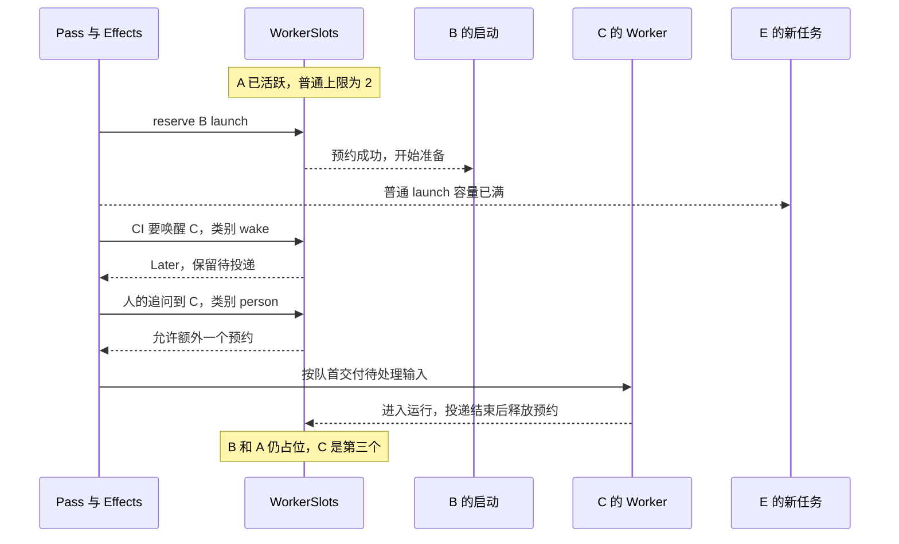

# 18 · Worker 槽位、背压与优先级

> 面试题　系统配置 `maxWorkers=2`。工单 A 正在执行一个模型回合，工单 B 的工作区还在准备，两张旧工单的 Worker 都空闲。同时又来一张新工单、一条 CI 反馈和一条人的追问。谁先执行？面板为什么可能显示三个 Worker 在运行，或者只显示一个，但新工单始终排队？

**短答**　执行器按 Ticket 统计占用。处于模型回合或仍在等本回合后台工作的 Worker 算活动占用，正在启动和唤醒的 Ticket 算预约。两者按 Ticket ID 去重。普通启动和自动消息唤醒使用配置内的槽位，已有派工的正式人工跟进或状态查询可使用一个额外槽。容量不足时，未完成的 Effect 和输入会继续等待。Pass 串行推动扫描与评估，已获准的启动和投递能异步运行。面板的 running 取活动数，预约与实际活动各自有用途。 [WorkerSlots](../dsh-superagent-prototype/src/executor/dsh.ts#L171) · [运行状态](../dsh-superagent-prototype/src/executor/dsh.ts#L403) · [Effects](../dsh-superagent-prototype/src/app/effects.ts) · [Passes](../dsh-superagent-prototype/src/app/passes.ts)

本文以本地提交 `7bd4741` 为基线。用同一仓库的几张虚构工单演算，A 修帮助页文案，B 正在准备导出任务的工作区，C 和 D 是已有 Assignment 的任务，E 是刚接受的一张新 Ticket。上一章追到工作区和 Session 创建，本章关注这些步骤何时拿到运行资源、什么时候把资源交回去。 [上一章](17-executor-workspace-and-environment.md) · [执行文档](../dsh-superagent-prototype/docs/003-execution.md)

## 1. 为什么这里计的是 Ticket 槽位

### 1.1 槽位约束的是一次受管理的执行机会

执行任务要经历文件准备、宿主会话创建、模型推理、工具调用、后台检验和人工交接。单看当前是不是正在向模型请求 Token，会遗漏准备期已经用掉的资源。如果两个任务都在启动后才计数，在第一个 Worker 的会话变 running 之前，第二个 Worker 可能已经开始准备。对于一个活跃 Worker 背后的两条 Input，也不能为每条都占一个新 Worker 槽。代码用 Ticket ID 表达任务运行单位，既覆盖启动期间的预留，也覆盖同一工单已活跃的回合。 [预约定义](../dsh-superagent-prototype/src/executor/dsh.ts#L165) · [启动与送达入口](../dsh-superagent-prototype/src/executor/dsh.ts#L263)

Assignment 的 running 与执行器认定的 running 承担不同业务职责。一个 A1 即使在等审阅，仍可能是该 Ticket 的当前运行派工，将来可在同一 Session 收到跟进。执行器的 `running(ticket)` 首先要求存在 running Assignment，再判断 DSH Agent 状态是否 running，或者执行器是否保留了该 Ticket 的后台等待 `settling`。无活动回合、无后台等待的 Worker 可闲置。控制面可以保留任意多这样的已开工工单，运行并发仍受当前配置约束。 [运行谓词](../dsh-superagent-prototype/src/executor/dsh.ts#L403) · [派工与 Ticket](../dsh-superagent-prototype/src/core/model.ts) · [第 15 篇](15-ticket-lifecycle-and-human-handoff.md)

### 1.2 预约集合怎样抵消一段短暂重叠

记 R 是满足执行器 running 的 Ticket ID 集合，S 是 WorkerSlots.starting 的键集合。源码中的 used 等于 R 与 S 的并集大小。比如 A 已抢到启动预约，还在等待 DSH 请求 flush，宿主此时已经报告 A 的 Agent 进入运行。短时间内 `R={A}` 且 `S={A}`，used 仍是 1。启动回调的 finally 删除预约后，A 继续由 R 统计。等 A 回合与相关在途后台工作真正结束，它才从 R 消失。将两集合各自计数再相加，会在重叠窗口把一个真实 Worker 算作两份资源。 [WorkerSlots.used/free](../dsh-superagent-prototype/src/executor/dsh.ts#L178)

当 `reserve(ticketId, by)` 被调用，若同一 Ticket 已有预约，方法直接返回。若为新预约，普通 launch 和 wake 要求 `used < maxWorkers`，person 要求 `used < maxWorkers + 1`。没有容量时抛 `Later`。计数使用回调，每次读当前活动 Ticket 和最新配置。这里的一个额外槽位是安装级共享的，所有需要额外醒来的旧任务竞争一个余量。名额在使用时不会固定指派给某个用户或 Ticket，也不会因为人提出了新需求就把在途任务顶掉。 [WorkerSlots.reserve](../dsh-superagent-prototype/src/executor/dsh.ts#L186) · [额外名额单测](../dsh-superagent-prototype/tests/runtime-concurrency.spec.ts#L868)

| 阶段或事件 | 计数来源 | 占位时间 | 典型退出 |
| --- | --- | --- | --- |
| 通过检查的新派工启动 | starting，类别 launch | 包括准备目录、确保会话和首次投递 | 启动结束的 finally 删除预约 |
| 唤醒已有但空闲的 Worker | starting，类别 wake 或 person | 投递并让 Session 有机会继续执行 | deliverQueued 的 finally 删除预约 |
| 真正在运行的模型回合 | R 中的 Agent running | 本回合活动期间 | 回合 idle，可能接着由 settling 持有 |
| 等本回合相关后台工作 | R 中的 settling | 挂起直到安静、新回合或等待超时 | 当前后台观察完成或被取消 |
| 已交给人且闲置 | 无活动占用 | 工单可开放等人 | 人工后续或其他输入按规则再唤醒 |

## 2. 为什么槽位预约要在启动遇到第一个 await 之前

### 2.1 同一线程运行异步任务也会产生竞争窗口

设只有一个普通名额。A 的启动检查看到余额可用，先去 await 文件系统，计划等目录存在后再登记。B 的启动在 A 还没有登记时也看到余量，就会同时进入文件准备。即使底层 JavaScript 在同一事件循环运行，也会把异步等待前后的状态读取拆开。先 reserve 再等待，能使第二个入口看到当前已经占掉的名额。launchQueued 在任何本任务的准备、Session 解析或外部查询前立即检查并记录预约，正常和错误路径都在 finally 释放。 [launchQueued](../dsh-superagent-prototype/src/executor/dsh.ts#L269) · [准备中的槽位测试](../dsh-superagent-prototype/tests/runtime-concurrency.spec.ts#L158)

投递唤醒也有类似的边界。deliverQueued 入口可以先等同一 Ticket 已经开始的后台清理。它等完回读当前工单与派工，再在真正唤醒、重建 Session 或加载消息卡之前检查并预约。关键是「检查是否有容量」和「记录预约」在这时是同一段同步操作。那次清理等待既不承诺有空槽，也没有唤醒旧 Worker。这样能避免把前置的清理过程重复计作已经开始的执行。若没有名额，投递等待在持久队列里，已提交的业务输入仍能查到。 [deliverQueued](../dsh-superagent-prototype/src/executor/dsh.ts#L289) · [投递等后台清理](../dsh-superagent-prototype/tests/runtime-concurrency.spec.ts#L505)

这个设计约束的是同一个 Runtime 装配的 Executor。R 来自本进程可见的 Agent 和后台观察表，starting 也是内存 Map。进程恢复后，会由当前持久任务状态、宿主会话和重启流程重新判断需要什么工作。将来如果要跨进程共享一个执行池，应另有共享的容量记账或任务租约。讨论当前面试案例时注明这是单 Runtime 的同步预约，可以免去把 JavaScript 原子性误当成跨进程锁。 [执行器装配](../dsh-superagent-prototype/src/executor/dsh.ts#L228) · [运行时启动](../dsh-superagent-prototype/src/app/runtime.ts#L201)

### 2.2 launches() 与 used() 不能直接互换

Effects 自己持有每个 kind 正在跑的 handler。对 launch 来说，它从 `handler.limit()` 中扣掉正在处理的 launch 数。WorkerSlots.launches() 因此先扣真实活跃的 R 和非 launch 预约中的 Ticket。launch 类预约一般对应 Effects 这一侧已计的 launch handler，不作为这里额外的扣减项。最终处理一个具体启动时，reserve 会再依据 used 做实际判断。在短暂的交接阶段，如果 Worker 已变为 running 而 launch handler 尚未退出，扫描时可能临时更保守。下一次 kick 会重算。 [launches 与 used](../dsh-superagent-prototype/src/executor/dsh.ts#L178) · [Effects 计算 room](../dsh-superagent-prototype/src/app/effects.ts#L103)

例如 `maxWorkers=2`，A 的回合已运行，B 的 launch handler 正 await prepare，且 B 的会话尚未 running。此时 R 只包含 A，S 只有 B 的 launch 预约，used 为 2。launches 返回 1，Effects 再扣 1 个正在跑的 launch，于是 room 为 0。若又错误地把 B 的 launch 预约先扣一次，再交给 Effects，常见情况下会少利用一个可用槽。当用纯调度表画状态时，分别写明 `launches()` 的输入、handler 并发和 `reserve()` 的实际闸门，会比只写「并发数等于二」更能解释源码。 [WorkerSlots 测试](../dsh-superagent-prototype/tests/runtime-concurrency.spec.ts#L853) · [执行器注册处理器](../dsh-superagent-prototype/src/executor/dsh.ts#L228)

## 3. 人工后续为什么能插进来

### 3.1 要取得额外槽位，先有可继续运行的派工

人工优先发生在已有 running Assignment 的 Ticket 唤醒。一个新任务即使由用户明确发起，也走 launch。自然结束的 Ticket 因合格人工跟进重新分配新 Assignment 后，启动的动作也走 launch。进入已有派工的 delivery 时，执行器先判断该工单是否已经 running。若已经活跃，额外 Input 可以 steer，不必再拿个槽。如果它当前 idle，从 undelivered 检查至少有一条 `fromPerson`，再尝试 person 类型预约。人类 Trigger 必须是正式而非 context-only 的输入，状态请求等 text Input 也可计入。CI、机器人、关联线程里只供参考的人的输入，或者主 Session 的 note 一般走普通路径。 [fromPerson](../dsh-superagent-prototype/src/executor/dsh.ts#L37) · [投递唤醒](../dsh-superagent-prototype/src/executor/dsh.ts#L289) · [恢复新派工](../dsh-superagent-prototype/src/core/tickets.ts#L252)

调用 `requestStatus` 要求开放工单的 running Assignment 最近报告 waiting，成功时增加一个明确的状态查询 Input。Worker 得到的是该次查询的指示。它可以在普通容量都占满时拿到人为干预名额，和已有工作的人工答复共享同一上限。对目的不同的两个 Input，源码没有再根据用户身份、职位分配额外槽位。来源准入、跟进归属与调度优先是三个单独的事实。比如跟进者不必因此具备为新工作签发 Mandate 的资格。 [状态请求守卫](../dsh-superagent-prototype/src/core/tickets.ts#L146) · [状态查询额外槽位测试](../dsh-superagent-prototype/tests/runtime-concurrency.spec.ts#L777) · [上文的归属](14-followup-ownership-and-handback.md)

### 3.2 优先是准入余量，Input 在 Ticket 内仍按顺序处理

观察代码会看到，判断 person 时查的是所有 undelivered Input，其中可以先有一条 CI，再有人补充。决定唤醒后，真正取的 Input 是队首 `undelivered[0]`，而不是优先挑出那一条人的内容。于是同一批次可以有 CI 在前、人工后续在后。人的出现让此 Ticket 能更早得到一次执行机会，仍按保存顺序交给模型所在的宿主。再次进 loop 还要看当前 Ticket 和 Assignment，以便因 stop 或替换及时退出。 [投递循环与整队判断](../dsh-superagent-prototype/src/executor/dsh.ts#L296)

人来之后启动更快也有边界。额外槽已占满时，另一个 idle Worker 的人工输入也会等待。暂停期间 launch 和 delivery 门限都是 0。Effect 有自己的 due 和既有在途数量，没有一个在所有种类之间比较消息等级的全局可抢占队列。代码体现的保证是普通工作只能用普通容量，人在适用的已有派工能用额外容量。新 launch 已预约时，人工唤醒也不会回收该启动的名额。实际延迟还依赖清理、宿主投递和模型服务。 [额外槽判断](../dsh-superagent-prototype/src/executor/dsh.ts#L186) · [handler 限制](../dsh-superagent-prototype/src/executor/dsh.ts#L228) · [容量例子](../dsh-superagent-prototype/tests/runtime-concurrency.spec.ts#L868)

## 4. 用 maxWorkers=2 演算七次变化

先假定 C 和 D 都已开始过工作，现在等待有用的输入。A 正在运行，B 已通过 launch 检查，prepare 比较慢。E 的 Assignment 已经入队。将 R 定义为真实活动工单集合，S 为预约集合，另以 L 表示 Effects 当前在跑的 launch 数。为了聚焦槽位，把多个不同的异步快照排成表，后续每一行都允许按需执行 `kick` 和等待 due 到时。没有额外主动就绪的工作时，表中用空集合表示。 [预约计算](../dsh-superagent-prototype/src/executor/dsh.ts#L178) · [Effect 调度](../dsh-superagent-prototype/src/app/effects.ts#L103)

| 时点 | 事件 | R | S | used | 启动或送达的结果 |
| --- | --- | --- | --- | --- | --- |
| t0 | A 活跃，B 正在 prepare，E 已接单 | A | B 的 launch | 2 | E 等。launches 为 1，L 为 1，room 为 0 |
| t1 | CI 结果到 C，C 正空闲 | A | B 的 launch | 2 | 普通 wake 先等待，C 有一条未交付 Input |
| t2 | 人也向 C 追问，delivery 再次可调度 | A | B 的 launch，随后有 C 的 person | 3 | C 取得额外槽，可先送已在队首的 CI，再送追问 |
| t3 | C 转为运行，预约释放，B 仍在准备 | A、C | B 的 launch | 3 | D 收到人的答复也要等，E 仍排队 |
| t4 | A 回合完全收尾，D 的 Effect 到期重试 | C | B 的 launch，随后有 D 的 person | 3 | D 能预约，E 仍没有普通余额 |
| t5 | B 准备成功进入活跃回合，D 也开始执行 | B、C、D | 空 | 3 | 释放 B、D 的预约后，实际活动仍有三个 |
| t6 | C 与 D 顺次收尾，只剩 B 活跃 | B | E 可以预约 launch | 2 | 普通容量恢复，E 可以开始准备工作区 |

t3 时若只看面板 running，看到的是 A 和 C，通常为 2。实际 used 为 3，原因是 B 还在准备。t5 面板才可显示 3/2。t6 先有一个 Worker 闲下来，从 3 降到 2 时仍没有普通启动空间，继续降到 1 才能再启动一张。这个案例的 t1–t2 演示同一工单的队内顺序，t3–t4 演示共享的额外名额。补充测试用两张先建成的空闲工单、两张运行工单和一张新工单验证了后者。另有让 prepare 保持未完成的现有用例验证预约期间不能被普通投递使用。具体的时间顺序是对源码行为的演算。 [prepare 会占槽](../dsh-superagent-prototype/tests/runtime-concurrency.spec.ts#L158) · [已有任务额外槽](../dsh-superagent-prototype/tests/runtime-concurrency.spec.ts#L146)



### 4.1 哪些改变是立即可见的，哪些要等下一次调度

A 变 idle 时，Worker 的 host 状态可马上变更。执行器是否把这个 Ticket 填入 settling 要经过空闲处理。Effect 需要被 kick 后重新检查容量。若 D 上次碰到 Later，队列记录还要到 due，新的 Input 通过同一 key 入队也可以刷新它的尝试时点。即使 D 在时序上已经具备人类队列资格，等待一次正常 dispatch 与已经进入模型回合仍是两个阶段。面试中可将 t4 描述为「D 的行重新可调度时，如果仍有符合条件的余量即可入场」。 [due 与刷新](../dsh-superagent-prototype/src/app/effects.ts#L60) · [空闲处理](../dsh-superagent-prototype/src/executor/dsh.ts#L601)

如果 C 已经运行，同一时刻再到一条消息，deliverQueued 的运行检查允许直接交付到原 Worker。多一条消息不会重新占用 person 名额。因此按发送者计数「有四条人类追问要四个额外槽」不适合作估算。要先判断哪些指向相同 Ticket、哪些目标已活跃、哪些还空闲。一个消息扇出到两个不同空闲 Ticket 时，还要按两个 Ticket 的独立投递检查剩余容量。 [按 Ticket 交付与预约](../dsh-superagent-prototype/src/executor/dsh.ts#L267) · [详细扇出](08-intake-thread-correlation-and-fanout.md)

## 5. 后台任务与人工交接怎样改变槽位

### 5.1 模型退出当前回合，测试仍能占用资源

假设 A 正跑一条等待 90 秒的测试。Worker preset 会让超过前台窗口的命令进入后台，Agent 可以完成当前步并空闲。若当前工单没有交给人，workerIdle 安装 settling 并调用 untilQuiet，观察属于本会话的相关 shell jobs 和子代理。仅读 DSH Agent 为 idle 会漏算资源使用。执行器的 running 谓词仍将 A 计在 R。后台完成可以唤醒它处理结果，运行事件使旧观察中止，新的回合结束后再次判断是否安静。最后没有相关后台工作才正常记录回合结束、更新 waiting，并按情况给主 Session 摘要。 [Worker preset](../dsh-superagent-prototype/cordis.patch.yml) · [直到后台安静](../dsh-superagent-prototype/src/executor/background.ts#L90) · [有 shell job 时仍占位的测试](../dsh-superagent-prototype/tests/runtime-concurrency.spec.ts#L264)

这个规则的效用可以从反例看出。若 Worker 每次把长命令交给后台立刻归还名额，队列在几秒内能启动许多工单，每一项仍占 CPU、文件句柄、网络或子代理配额。它们后台完成又都要回到模型，调用容易积到同一时点。原型令同一 Ticket 在这一轮相关工作结束之前保持一次运行资格，任务个数的约束更加贴近「还在处理多少项工作」。不同工作的资源成本仍可能相差很多，需要结合实际部署再加资源限额。 [活动量计数](../dsh-superagent-prototype/src/executor/dsh.ts#L403) · [子代理持续占位的测试](../dsh-superagent-prototype/tests/runtime-concurrency.spec.ts#L281)

### 5.2 等待窗口超时后的动作

每次进入这类 idle 观察，定时器给后台工作 30 分钟。新回合开始时会取消本轮观察，下一个 idle 再有自己的计时。到时间后按代码异步终止仍在运行和可清理的 shell jobs，记录相应说明。适用情况下子代理仍可继续，报告也会说明它们还在运行。观察结束时从 settling 删除本 Ticket，若当时没有别的活动回合，执行器不靠这次观察继续计占用。不能把 30 分钟解释为工单从建立起固定构成的硬截止时间，也不能把它解释为强制终止整个相关进程树。 [后台时间上限](../dsh-superagent-prototype/src/executor/dsh.ts#L629) · [每次 idle 单独计时测试](../dsh-superagent-prototype/tests/runtime-concurrency.spec.ts#L452) · [超时动作测试](../dsh-superagent-prototype/tests/runtime-concurrency.spec.ts#L475)

源码还区分 quiet 和达到 timeout。在 quiet 时才调用 `turnEnded` 记录这个读边界。达到 timeout 时它会生成 waiting 文案并按工作情况记录，后台结束通知可注入历史供下一轮读。因此「面板显示等待」「这轮状态报告已发」「所有输入都在结束时间以前被模型读取」要分别查证。第 19 篇将继续跟这个回执，理解此处只需知道后台观察到哪个时间才释放自己的占用。 [workerIdle 的两条分支](../dsh-superagent-prototype/src/executor/dsh.ts#L633) · [回合时间写入](../dsh-superagent-prototype/src/core/assignments.ts#L65)

### 5.3 从等待自动任务切换到人接手

另一条常见路径是 A 已经给人能用的结果。Worker 报 ready、当前有 Attention 且没有报告后送达的新输入，或仍因 blocked/failed 需要人。workerIdle 会在适用时用 handedOff 判断交给人。比如 ready 同时有尚未合并 PR，扔给人审查后，T 仍开放，但当前回合可归还槽位。如果新的 Input 已在该报告时或之后送达，ready 或 Attention 的判定会考虑这项证据。人直接在 DSH Worker Session 开始新轮时，执行器还核对记录的人工输入时间，在其晚于报告时继续处理这轮相关后台工作。 [handedOff 判断](../dsh-superagent-prototype/src/executor/dsh.ts#L611) · [人工在 Worker 会话继续的测试](../dsh-superagent-prototype/tests/runtime-concurrency.spec.ts#L364) · [新输入覆盖旧交接状态的测试](../dsh-superagent-prototype/tests/runtime-concurrency.spec.ts#L432)

handOff 会停止子代理 并把仍运行、可留给人的 shell jobs 收到 left 集合。例如为了让人核对页面而启动的预览服务器会继续运行，它被排除在普通背景观察之外，也不会因完成而直接唤起该 Worker。结束状态只注入到宿主历史中。交接使任务占位释放，仍运行的进程可以继续耗资源，所以调整并发时应同时查看 Worker 槽位和真正的主机运行负载。Assignment 终止或被替换时再按实际清理该工作。 [交接的实现](../dsh-superagent-prototype/src/executor/dsh.ts#L588) · [ready 交接释放槽位测试](../dsh-superagent-prototype/tests/runtime-concurrency.spec.ts#L358) · [留给人的任务不会被下一回合限时杀掉](../dsh-superagent-prototype/tests/runtime-concurrency.spec.ts#L381)

## 6. Effects 与 Passes 各自怎样提供背压

### 6.1 先持久化工作，再看有哪些动作可以开始

启动与投递走不同的 Effect kind 和 key。launch 以 Assignment ID 建记录，delivery 以 Ticket ID 建记录，一个 Ticket 的多个待投递输入仍保存在 Ticket 的 undelivered 列表里。对同 kind 与 key 重复 enqueue，SQL 用新 value 和 due 更新一行，保留 seq，增加 generation 并重置尝试计数。正在执行的旧代次不会删掉更新后的行，因为收尾匹配 kind、key、seq 和 generation。作用是将多次唤醒提示合并，保留各业务输入的记录。它和 WorkerSlots 对同一 Ticket 只算一次预约属于两层控制。 [Effect 去重](../dsh-superagent-prototype/src/app/effects.ts#L60) · [代次和收尾条件](../dsh-superagent-prototype/src/app/effects.ts#L130) · [并发更新测试](../dsh-superagent-prototype/tests/effects.spec.ts#L39)

普通 handler 查符合 due 的行，按 seq 挑候选，扣同 kind 已运行数量，按剩余 room 启动。在 launch 就绪的多行里，早入队者先尝试；若早入队的 launch 当前在退避，稍后到达而已经就绪的行仍可尝试。ordered 处理器另行取最早一行，旧行未到期便能挡住后续。比如主 Session 的 relay 与 notice 各用 ordered，保持各自的入队顺序。不同处理器之间不存在一个严格统一的 FIFO 调度顺序。 [dispatch](../dsh-superagent-prototype/src/app/effects.ts#L103) · [主 Session 队列登记](../dsh-superagent-prototype/src/app/sessions.ts#L100) · [队首失败持有测试](../dsh-superagent-prototype/tests/effects.spec.ts#L137)

| Effect kind | 当前 handler 并发限制 | 与 Worker 槽位的关系 |
| --- | --- | --- |
| launch | 未暂停时按 launches() 算，Effects 抵扣正在跑的 launch | 每张新派工真正开始前再预约 |
| delivery | 未暂停时最多 4 个 | 对已有活跃 Worker 可直接交付，唤醒 idle Worker 另查槽位 |
| assessment | 未暂停时最多 4 个 | 交付候选给主 Session，本身不分配 Worker 槽 |
| relay、notice | 各 ordered，分别同一时间最多 1 个 | 报告/通知到主 Session，由自己的消息协议处理 |
| reply | 未暂停时最多 1 个 | 发送外部 Channel，无需 Worker 槽 |

这张表也解释为什么调 maxWorkers 不能让投递和评估并行数同时翻倍。一次慢消息链接查询可占 delivery handler，即使目标已经活跃。反过来 delivery 四个尝试都已到期开始，其中第三个要唤醒空闲 Worker 仍可能拿不到槽。这两层背压共同控制不同阶段。若四个处理名额被不同 Ticket 的操作占住，人的消息也须等调度到自己的行，再使用额外资格。 [执行处理器](../dsh-superagent-prototype/src/executor/dsh.ts#L228) · [候选登记](../dsh-superagent-prototype/src/app/assessment.ts#L96) · [出站回复 handler](../dsh-superagent-prototype/src/app/outbox.ts#L22)

### 6.2 把「没轮到」与「执行失败」区分出来

环境饱和后，若一行 delivery 已经运行，但目标闲置且没有普通或额外名额，reserve 抛 Later。这个异常被 Effects 识别为调度延迟，将原行的 due 改为当前时间加该 kind 的初始延迟，保留已有错误尝试数。delivery 的默认初始值是 2 秒。launch 偶尔在处理器的限额估算与实际 reserve 之间遇到新占用，适用的初始值是 5 秒。如果调度时已经算出 room 为 0，就不会创建一次失败的 handler 尝试，行保持待执行。对于工单刚好停掉或已经替换派工的情形，处理器重新读当前状态并退出，属于旧任务失效。 [Later 的更新](../dsh-superagent-prototype/src/app/effects.ts#L130) · [启动与投递限额](../dsh-superagent-prototype/src/executor/dsh.ts#L228)

实际把 Input 交给 Session 时如果出错，例如目标会话暂时不可用，执行器可在 Ticket 上保存 delivery.error。此时 Effects 的普通重试递增 attempts，指数退避。delivery kind 设 quiet，使这些计数造成的单工单交付问题主要在对应 Ticket 上展示。Effect 队列自身发生异常仍有独立的 health 错误路径。观察告警时可以对照「当前真的出现过错误」和「有效工作正等待资源」。如果每次 Later 都算失败，短暂满载很快就会伪装成网络或会话故障。 [送达错误回写](../dsh-superagent-prototype/src/executor/dsh.ts#L318) · [队列健康投影](../dsh-superagent-prototype/src/app/effects.ts#L146) · [延迟不计失败的测试](../dsh-superagent-prototype/tests/effects.spec.ts#L122)

一条待处理 Input 可以经过几个状态。有正式人工 Input 入队，没有位置唤醒，保持 undelivered。位置出现并收到宿主回执，Input 从 undelivered 去掉，并更新 Assignment 上的送达时间。Worker 下一个合适的模型步骤把内容写进会话历史，执行器再处理 readAt。位置满只会使输入留在第一段，看到多条 undelivered 也不足以证明发生过网络错误。无法启动的 launch 状态类似，已提交的 Ticket 和写在 SQLite 的待处理 Effect 允许调度后来继续。 [交付与已读](../dsh-superagent-prototype/src/core/assignments.ts#L42) · [执行器事件监听](../dsh-superagent-prototype/src/executor/dsh.ts#L476)

### 6.3 Pass 串行，耗时 Effect 在其他异步任务里运行

Runtime 周期启动 Passes，默认每约两秒发一次 request。Source 存储新 Trigger、路由工具结束或适用设置保存后也能请求及时推进。Passes 用 pumping 和 pumpAgain 合并重叠请求。正在运行的 Pass 结束后，期间几个 request 共享一次追加推进。源码的 pumpOnce 做的是 kick Effects、检查是否还在关闭，再调用 Engine.evaluateDue。这个调用处理已到期 Eval、自然结束工单在暂停后恢复、以及为新待处理线程建立 Eval。不会在同一个 Pass 里等所有准备命令、模型回合或网络 IO 都跑完。 [Pass 的生命周期](../dsh-superagent-prototype/src/app/passes.ts#L22) · [Engine 时钟入口](../dsh-superagent-prototype/src/core/engine.ts#L68) · [重叠请求合并的测试](../dsh-superagent-prototype/tests/passes.spec.ts#L28)

例如 A 在时间点 0 准备目录，B 在时间点 1 的 Source 输入被存储。只要进程仍有机会执行调度，B 的候选可以先被观察并提交给主 Session，路由接受后再排自己的 launch。若还有空槽，B 能进入自己的准备。若普通槽位已经被占齐，它会留在 pending，后续还是可继续接收新的消息。实测的慢 prepare 用例把两个启动的准备暂时挂起，然后验证接受、摄取和评估继续推进。设计上将 SQLite 事务和 I/O 从等待关系上拆开，给容量控制留出了独立的边界。 [并发准备测试](../dsh-superagent-prototype/tests/runtime-concurrency.spec.ts#L84) · [Effects 事务后调度测试](../dsh-superagent-prototype/tests/effects.spec.ts#L29)

`idle()` 的合同也值得核对。它等待当前 Pass 和此刻能运行的 Effects。如果还有一行挂在未来的 due，或者检查容量是 0，它可以返回。工作区测试里等待 runtime.idle 以后仍看到未交付，常常就是要验证这种状态。宿主 Worker 的回合或后台进程还有独立生命周期。拿 idle 当成「所有 Ticket 已最终完成」会导致测试和运营误读。若要模拟重新到期，测试可以推进注入的时钟再调用 pump，验证新一轮处理究竟发生了什么。 [Effects.idle](../dsh-superagent-prototype/src/app/effects.ts#L89) · [Passes.idle](../dsh-superagent-prototype/src/app/passes.ts#L47) · [普通消息等槽测试](../dsh-superagent-prototype/tests/runtime-concurrency.spec.ts#L128)

### 6.4 处理暂停是一处调度开关

设置暂停后，新的 launch、delivery、assessment、reply 受到各自 handler 的 0 并发门限约束，Engine 不开启新 Eval，它会记录在途 Eval 的暂停边界。解除后，适用在途 Eval 的 deadline 按该期间顺延。候选已送达的 Eval 才开始计算超时。已处于回合中的 Worker 不会因为这项配置马上被取消。启动流程到下一个有效性检查边界时可以延期，已在执行的动作要由该入口检查其当前合同。来源仍可存新的 Trigger，恢复后依持久记录继续。ordered 的 relay 和 notice 在 Sessions 中另行登记，代码没有给这两个处理器同样的 pause 限额。 [暂停和评估期限](../dsh-superagent-prototype/src/core/evals.ts#L31) · [启动暂停检查](../dsh-superagent-prototype/src/executor/dsh.ts#L424) · [配置暂停](../dsh-superagent-prototype/src/app/settings.ts#L200) · [主会话队列](../dsh-superagent-prototype/src/app/sessions.ts#L100)

这一点与工作区失败需要人处理不同。比如管理员暂停后，一个新 Ticket 没启动，应该检查 paused 和调度记录。恢复时已有工作无需因为停了一段时间重新接受。若人在暂停期间给自然结束的 Ticket 发正式消息，解除后还要根据当时策略重新验证。暂停还和主 Session 接收候选的时长相关。不能把暂存期间消耗的墙钟时间直接当成模型的超时，应该读取 Eval 是否已送达、是否记录暂停与恢复。 [暂停期间保留待启动](../dsh-superagent-prototype/tests/runtime-concurrency.spec.ts#L108) · [暂停后再验证恢复](../dsh-superagent-prototype/tests/runtime-concurrency.spec.ts#L813)

## 7. 动态改上限、调度重试与容量诊断

### 7.1 改 maxWorkers 如何影响当前在途的工单

`executor.maxWorkers` 在配置中的默认值为 3，约束范围是 1 到 16。执行器构造 WorkerSlots 时传入的是 getter，读取 Store 的当前值。安装健康时，单改这个字段走 Settings 保存和 requestPass，下一次调度按新值处理，无需重建 Worker。场景一，运行时从 2 调为 1，已有两个活动 Worker 继续跑。现在普通 launch 不会开始，即使配置显示一个槽，观测上仍能读到 running=2。之后活动数降到 1 时普通槽仍用满，直到不足 1 才开始新 launch。场景二，已有两个活动 Worker 和一个 pending 工单，抬到 3 后，处理 Pass 能拉起后者。 [配置范围](../dsh-superagent-prototype/src/policy.ts#L89) · [限制常量](../dsh-superagent-prototype/src/limits.ts) · [实时上限](../dsh-superagent-prototype/src/executor/dsh.ts#L228) · [保存后 requestPass](../dsh-superagent-prototype/src/app/settings.ts#L175)

这两种变化都可以在现有夹具里按运行时字段证明。补充用例用真实 Settings HTTP 入口保存 2、1、3。确认两张工单 running 后，下调为 1 时这两张都没收到 cancel，新工单的 Assignment 仍 pending。调高到 3 后触发推进，排队派工进入 running。给面试官解读这个样本时可以说这是改变准入限制的配置，已有运行利用率会逐步回落或调整。它对模型供应商的额度、源系统调用频率、后台子代理数量都没有同步调整。 [配置历史测试](../dsh-superagent-prototype/tests/runtime.spec.ts#L600) · [设置入口](../dsh-superagent-prototype/src/app/http.ts)

对已在启动的 B 来说，热调低可能在它准备期间生效。已拿到的预约由 B 的 finally 释放。launch 路径之后仍检查的是 Ticket/Assignment 是否当前、暂停和关闭情况，并未因为数值减少而重新取消该启动。从调整的那一刻到所有现有预约或活动收尾之间，观察到 used 大于现配置有两种常见可能，人工额外槽或降低上限后的过渡。监控告警可以考虑这两类与意外泄漏的区别。 [启动有效性](../dsh-superagent-prototype/src/executor/dsh.ts#L424) · [预约和归还](../dsh-superagent-prototype/src/executor/dsh.ts#L269)

### 7.2 面板计数在哪些快照容易误导

HTTP 的 stateView 用 executor.activeCount 作为 running。这个值只枚举开放且 DshExecutor.running 成立的工单，启动中但 Agent 尚未 running 的 B 还不在里面。queued 用 ticketStage 对开放 Ticket 分类成 working/queued，数量可以包含当前正在启动、还没回写的 pending 派工。反过来，一个 Assignment 仍 running 的闲置工单，因没有槽而等一条人工或 CI 输入，未必被计入 queued。Effects 的 pending 统计又是按 kind 的持久队列，因此三个数量回答不同的问题。 [stateView](../dsh-superagent-prototype/src/app/http.ts#L105) · [活动数](../dsh-superagent-prototype/src/executor/dsh.ts#L403) · [queued 投影](../dsh-superagent-prototype/src/app/views/tickets.ts#L49)

假设看见 `1 / 2` 并有两个 queued，可先查最新 Assignment 和启动日志，确认其中一个是否在 prepare。面板 queued 能说明哪些 Ticket 尚未进入其运行状态，暂时不能区分准备阶段和等待别的工单腾位。若 used 确实更低，可看是否设置暂停、launch Effect 是否因错误在退避、或者当前配置刚保存还在等调度。如果另一张空闲任务收不到消息，转查 delivery 的 due 与 undelivered，而非仅看 queued 的大数字。这样可以把一处看似矛盾的截图还原为可验证的时间线。 [处理器并发与 due](../dsh-superagent-prototype/src/app/effects.ts#L103) · [暂停和启动验证](../dsh-superagent-prototype/tests/runtime-concurrency.spec.ts#L108)

### 7.3 Worker 回合异常后的重试也要重新拿槽

若活动 Worker 遇到可重试的供应商或网络故障，执行器按 Assignment 追踪暂时失败重试次数，排以后继续该回合的工作。这个回合 backoff 使用 15 秒起的指数等待，和 launch Effect 默认以 5 秒起重新尝试不同。重试计时到时，先核对仍在运行该 Assignment。处理暂停，或 Worker 此时是空闲、尝试预约普通 wake 时容量不足，代码再等 5 秒查看。这个自动回合重试不按人的 Input 获得额外空位。暂时失败引发的 idle 也不会被直接解释为任务已交给人。 [回合重试](../dsh-superagent-prototype/src/executor/dsh.ts#L544) · [错误识别及常量](../dsh-superagent-prototype/src/executor/dsh.ts#L24) · [暂时失败结束回合的测试](../dsh-superagent-prototype/tests/runtime-concurrency.spec.ts#L765)

举个组合场景。B 的回合暂遇 429，开始等待，A 准备结束。C 的正式跟进已经拿到额外名额，E 在队列里。B 到预定续跑时间若仍已活跃，可送续跑消息。如果已无活跃状态则按普通 wake 检查余额。可能出现 C 先运行，B 重试还要等。若问题来自供应商配额，应同时检查模型调用的节奏。429 可以是供应商侧限额，更大的并发会让更多 B 类任务同时等待。要区分任务继续推进、全局恢复和下次请求被接受的时刻。 [重试调度回调](../dsh-superagent-prototype/src/executor/dsh.ts#L555) · [供应商失败覆盖](../dsh-superagent-prototype/tests/runtime-concurrency.spec.ts#L191)


### 7.4 重启怎么恢复排队任务与容量，而不继承旧预约

启动预约属于内存状态。Runtime 重新创建 Executor 时，WorkerSlots 从本次运行的 Agent 与当前数据库工单重新开始计数。DshExecutor.resume 按开放 Ticket 的创建时间遍历。仍有 running Assignment 的先停止可能残留的宿主回合和后台工作，再调用 assignmentInterrupted。对任务报告已经稳定且报告后没有新送达的 Assignment，可以继续使用原会话并刷新等待输入。仍有在途工作的 Assignment 会按恢复逻辑建立替代派工，由新 launch 重新参与预约。未失败、仍 pending 的 Ticket 会补排 launch。failed 且在等人的任务满足相应条件以前不会被这次恢复当成新任务拉起来。 [重启扫描](../dsh-superagent-prototype/src/executor/dsh.ts#L519) · [Interrupted 判定](../dsh-superagent-prototype/src/core/assignments.ts#L77) · [失败启动与恢复](../dsh-superagent-prototype/tests/runtime.spec.ts#L1619)

举例说，B 准备期间宿主退出，B 的旧预约不再存在。下次开放后如果还是同一 pending Assignment，可以重新扫描启动。原 Effect 的 key 等于该 Assignment ID，补排更新的是现有待处理行并保留其队序。队列运行后，B 与其他符合条件的工作重新竞争当前配置的槽位。如果工单已经由另一个命令换成 A2，旧 A1 handler 查到 ID 不一致时退出。持久队列保存应尝试的业务意图，当下能开始的数量仍来自当前 Runtime。 [Effect 更新](../dsh-superagent-prototype/src/app/effects.ts#L60) · [旧启动守卫](../dsh-superagent-prototype/src/executor/dsh.ts#L269)

这也帮助解释为什么步骤继续了却没有旧 Worker 线程在运行。恢复与效果扫描为一个 Ticket 重新建立执行机会，同一目标目录和会话可能有检查过的事实或仍待处理的输入。面试中可以明确哪些证据来自前一次宿主，哪些是当前入口据此做出的新预约，不把某个日志时间直接当成重复创建 Ticket。 [运行中派工恢复测试](../dsh-superagent-prototype/tests/runtime.spec.ts#L523)

## 8. Worker 并发与模型供应商配额怎样配合

### 8.1 这两种上限使用的单位不同

设 A 每回合做十次短工具调用，B 把大量时间花在 worktree 和测试上，C 的会话携带两千字项目规则与很多已读历史。WorkerSlots 对正在处理的它们都只按 Ticket 算一份，即便当前模型请求频率、上下文长度和 CPU 消耗不同。主 Session 发起的候选评估也不经过这些 Worker 槽位。若角色模型恰用同一供应商路由，两类 Session 仍可能共用供应商给这个账号的预算。角色模型允许分别配置，可在实例选模或模型头上核实是否共享。供应商对模型请求的限制还会取决于实际账号和路由。 [Worker 槽位](../dsh-superagent-prototype/src/executor/dsh.ts#L171) · [角色模型初始化](../dsh-superagent-prototype/src/app/role-models.ts#L15) · [主会话送达](../dsh-superagent-prototype/src/app/runtime.ts#L121)

一个纯教学的数值例子。假设 provider 每分钟允许 40 次请求与 60,000 个 Token，两个持续忙碌的 Worker 平均每分钟各发 15 次，每次平均消耗 2,400 个 Token。请求数约为 30 次，Token 需求约为 72,000，先撞到 Token 的额度。这个工作负载最多支持平均 25 次同等规模请求每分钟。若人类额外唤醒第三个任务，它仍需排进同一个配额，另有主 Session 和可能的子代理调用。反过来，若任务大半时间等本地命令，即使 slots 满了，实际模型请求也可能很少。估算需求还应观察突发和上下文长度分布，平均值只能用来判断量级。原型测试并未跑这组参数或对应真实模型。 [槽位适用范围](../dsh-superagent-prototype/src/executor/dsh.ts#L165) · [子代理与后台](../dsh-superagent-prototype/docs/003-execution.md)

在应用里看到 429 时，要区分它被当作暂时异常进行续跑，还是进入宿主已有的模型重试。前者由 Executor 在 agent/error 根据可重试分类安排适用的回合重试。后者在模型事件中可观察到；项目的 RetryHealth 对结构化预算不足进行投影，普通 429 等限流不会全部归入「预算耗尽」。可见的 models health 不是吞吐控制器，也不会根据事件自动换模型。排查瓶颈时用实际调用、供应商和重试事件，比仅看到工作槽满更接近触发条件。 [Executor 的暂时异常](../dsh-superagent-prototype/src/executor/dsh.ts#L39) · [RetryHealth](../dsh-superagent-prototype/src/app/retry-health.ts) · [模型健康投影](../dsh-superagent-prototype/src/app/sessions.ts#L218)

### 8.2 面试中的生产扩展应明确准入在哪里发生

若需要同时控制 Worker、请求数和 Token，先保留工单级启动控制。在真正请求模型前，再按供应商和账号适用范围检查请求预算与估算的 Token 预算。请求开始前可预约一份估算值，请求完成后用实际 usage 核对。模型的输入和输出大小变化会影响估计，长上下文和带工具结果的下一步要重新估算。若系统由多个 Runtime 共用同一预算，可采用可原子更新的共享记账，避免每个运行时都乐观使用同一额度。为避免 Worker 都占着槽等模型，预算等待是否算作占用需要定义，确保归还后再推进仍要满足任务与会话状态条件。

人工跟进可以获得有限的优先预算，同时仍遵守供应商的硬上限。当前原型中 person 类容量优先让既有任务接着推进。若组织希望交互与后台任务各有延迟目标，可分别衡量普通队列等待、正式人工跟进的首个可处理模型步、429 频率、重试密度和实际 Token 消耗。只有人工优先可能会使连发跟进期间的自动任务和新任务等待太久，因此要选择对当前业务合适的策略，例如给不同类保证最少份额，再对等得很久的队列恢复处理机会。这个推演基于「预算调度器与工单调度器可交换一份明确的预约结果」的假设，属于面试里的扩展。 [原型已具备的容量与失败处理](../dsh-superagent-prototype/src/executor/dsh.ts#L171) · [原型的入口与状态](../dsh-superagent-prototype/docs/007-architecture.md)

优先级方案还有一个可见的取舍。给人在途的工作增加机会，影响的是前台跟进时间。它不会让后续消息立即完成模型、工具或代码提交。如果待派工均为长时间 prepare，把更多票发给模型阶段也不会释放这些启动预约。生产设计可能将 prepare、模型步和高 CPU 测试各自限并行，用任务级状态确保工件与授权能顺利过关。增加多个调度点会引入任务跨阶段等待与取消的复杂性，评价时可比较排队分布、取消后资源释放时间以及 Git 工作区的重复写入次数。 [启动占位](../dsh-superagent-prototype/src/executor/dsh.ts#L269) · [保持背景工作占位](../dsh-superagent-prototype/src/executor/dsh.ts#L629)

### 8.3 判断背压落在了哪一层

| 合成现场 | 从哪里优先取证 | 可以解释的现象 |
| --- | --- | --- |
| 流入新工作多于普通启动能力 | 观察 launch ready 行、当前启动预约、prepare 时长和活动工单 | 接单仍成功，派工队列持续增长 |
| 人无法继续一张已建工单 | 观察目标 Assignment、undelivered、delivery 因容量延后的 due | 资源不足时输入仍有记录，具备额外资格也需等其位置 |
| 多个 Worker 异常同时恢复 | 查看 agent/error、适用重试等待、上限热调后的活动数 | 退避到时还有名额和暂停两道闸门 |
| 模型请求耗时增加且频繁超额 | 主 Session、Worker、子代理按供应商分开统计，再查模型事件 | Worker 槽数字只能部分说明模型负载 |
| 面板待审数量高但 Worker 空闲 | 查 Worker 报告、Attention、PR 状态以及交接保留的后台工作 | 人工流程和执行容量处于不同阶段 |

用一个判断题串这些列。开着八张 Ticket，配置两个普通槽，其中两张已交人，三张 CLI 工作还在等待或运行，另三张刚收到消息。要报告系统是否过载，先筛出真实的活动 R，再看预约 S 与宿主实际工作。预览服务器留给人、后台测试在 settling、正在等清理的 delivery handler、以及被延后的 pending 行都可能在表中出现。它们分别占用主机、Worker 槽、handler 或队列存储。只有说明观测的是哪一种，才能由具体的调节动作改变那个指标。

## 9. 测试怎样证明一段异步时序

在临时 Git 副本中，用锁定依赖离线运行以下八个文件，**238 个现有用例全部通过**。另在临时副本增加了两个补充场景，分别验证 `maxWorkers=2` 时共享一个额外人工唤醒名额，以及经面板 API 修改上限对运行中任务和等待任务的影响。两个场景均通过。含模型或后台工作的应用测试使用本地宿主夹具来安排时序，结论限于调度与状态。 [测试脚本](../dsh-superagent-prototype/package.json) · [宿主夹具](../dsh-superagent-prototype/tests/fixtures/host.ts)

```sh
corepack pnpm test tests/runtime-concurrency.spec.ts tests/runtime.spec.ts tests/effects.spec.ts \
  tests/passes.spec.ts tests/stage.spec.ts tests/views.spec.ts tests/followups.spec.ts \
  tests/panel-execution.spec.tsx
```

| 表里的哪个推演 | 仓库里的断言 |
| --- | --- |
| 先登记预约，并发准备可以和 Source 输送并行 | [两个 prepare 暂时挂起](../dsh-superagent-prototype/tests/runtime-concurrency.spec.ts#L84) · [进行中的 launch 占容量](../dsh-superagent-prototype/tests/runtime-concurrency.spec.ts#L158) |
| 现有活动或预约按工单去重计算 | [WorkerSlots 单测](../dsh-superagent-prototype/tests/runtime-concurrency.spec.ts#L853) 核对计数与 launches |
| 人的追问有额外容量，普通自动输入等待 | [人类跟进](../dsh-superagent-prototype/tests/runtime-concurrency.spec.ts#L146) · [普通机器人输入](../dsh-superagent-prototype/tests/runtime-concurrency.spec.ts#L128) · [额外容量用满](../dsh-superagent-prototype/tests/runtime-concurrency.spec.ts#L868) |
| 空闲 Agent 的后台工作仍耗名额 | [后台 shell 占位](../dsh-superagent-prototype/tests/runtime-concurrency.spec.ts#L264) 等结束结果唤醒会话 |
| ready 可交人归还容量，后台有自己的时限 | [交接释放](../dsh-superagent-prototype/tests/runtime-concurrency.spec.ts#L358) · [按轮次计时](../dsh-superagent-prototype/tests/runtime-concurrency.spec.ts#L452) |
| 配置或后续任务不应被旧回执覆盖 | [Effect 代次](../dsh-superagent-prototype/tests/effects.spec.ts#L39) · [启动只生效一次](../dsh-superagent-prototype/tests/runtime.spec.ts#L1619) |
| 容量不足与执行异常不同 | [Later 延后](../dsh-superagent-prototype/tests/effects.spec.ts#L122) · [失败退避](../dsh-superagent-prototype/tests/effects.spec.ts#L85) |
| 串行 Pass 合并同时请求 | [推进请求合并](../dsh-superagent-prototype/tests/passes.spec.ts#L28) 断言四个请求共只有两次推进 |

额外名额样本先建立两张已空闲工单和两张活动工单，新增 E 后读到 pending。C 的正式跟进使活动数变成三，D 的跟进继续留在 undelivered，且当时没有 delivery 错误。A 释放并推进时钟到后续可调度时点，D 获得机会，E 仍 pending。这验证的是「普通容量满时还有一个机会」「第二次超过额外上限就等」，并没有检验所有消息到达顺序都必定由人先获得。热更样本在前一节给出了途经的配置值和可见的状态。写调度测试时，用一份未完成的准备 Promise 或假的时钟可以固定竞争顺序，再验证状态和任务调用次数。 [准备并发夹具](../dsh-superagent-prototype/tests/runtime-concurrency.spec.ts#L84) · [动态限额的 Effects 单测](../dsh-superagent-prototype/tests/effects.spec.ts#L51)

## 10. 面试复述与追问

### 10.1 60–90 秒口述

> 这里按 Ticket 计执行名额。一个槽从普通启动或已有会话唤醒时预约，到活跃回合或相关后台工作收尾才归还。预约必须在容量检查后的同一段同步代码完成，准备目录有异步等待，如果之后才登记，两个启动可能同时觉得有空位。运行和预约取 Ticket ID 并集。两张任务把普通槽占满时，已有派工的正式人工跟进和状态查询共享一个额外名额。新的工单和 CI 唤醒仍看普通容量。Effects 限制每类 I/O 并行并保存等待，Pass 串行推进扫描但不会等准备脚本全部跑完。面板的 running 与启动预约有不同口径。调低 maxWorkers 之后按新值准入，活动任务继续收尾。供应商的每分钟请求和 Token 限额还需在实际模型请求这层处理。

### 追问一　为什么启动要先预约，Effects 的并发限制还不够吗？

Effects 的限制是同一 kind 处理器的数量。launch 与已有 Worker 的 wake 使用相同的一组工单执行名额，检查双方当前活动与预约后才知道是否还有位置。prepare 和 Session 创建是异步的，先记预约可以让后来的工作在第一次回合出现前就看到它。 [WorkerSlots](../dsh-superagent-prototype/src/executor/dsh.ts#L171) · [各 kind 的限制](../dsh-superagent-prototype/src/app/effects.ts#L103)

### 追问二　人工优先会撤掉正在准备的工作吗？

适用人工输入尝试取得额外预约。正常 launch 已取得的预约继续有效，另一条输入如果超过额外上限则等待下次调度。只有看见运行中工单被停止或派工被替换时，才沿相应命令让当前工作退出。 [额外容量测试](../dsh-superagent-prototype/tests/runtime-concurrency.spec.ts#L868)

### 追问三　为什么 Worker 已 idle，普通工单还要排队？

idle 是宿主会话当前状态。如果有与本轮相关的后台测试或子代理，执行器把它放进 settling 继续计数。其次，另一张工单可能正在准备，面板 running 还未计这个预约。应同时查当前启动和后台观察。 [后台占位测试](../dsh-superagent-prototype/tests/runtime-concurrency.spec.ts#L264) · [预约计数](../dsh-superagent-prototype/src/executor/dsh.ts#L178)

### 追问四　如何知道队列是在等待资源，还是投递系统有故障？

没拿到槽时，Later 让 Effect 改期，不记新的失败。真正的投递错误会留下 delivery.error，适用 Effect 也记录失败次数和退避。对单条消息查 undelivered 与对应 Effect 的状态，能判断是继续等还是需要修复。 [Later 和重试](../dsh-superagent-prototype/src/app/effects.ts#L130) · [错误入库](../dsh-superagent-prototype/src/executor/dsh.ts#L318)

### 追问五　把 maxWorkers 从 2 调成 10 能解决供应商限流吗？

要看耗时所在的层。槽位决定有多少任务同时取得执行机会，模型侧还受供应商请求和 Token 额度限制，主 Session 也可能共享这份额度。调高任务并行度可以缓解有空余下游时的任务排队。若已经在消耗全部预算，应该看请求时机、模型路由和上下文大小，再评估独立预算闸门的效果。 [角色路由](16-orchestrator-worker-sessions.md) · [限额观测](../dsh-superagent-prototype/src/app/retry-health.ts)

---

[返回连载目录](README.md) · [上一篇《Assignment 启动、工作区准备与执行环境》](17-executor-workspace-and-environment.md) · 下一篇《Session 投递幂等与 Worker 已读回执》
