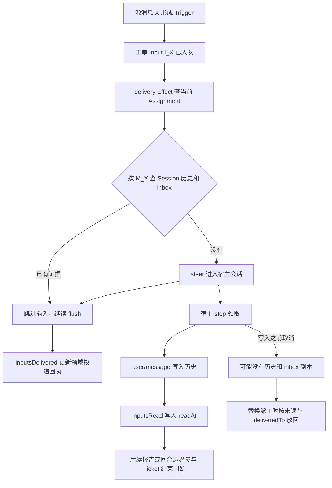

# 19 · Session 投递幂等与 Worker 已读回执

> 面试题　Alice 在工单讨论里补了一句「保留移动端按钮原文」。系统日志显示已经把消息交给 Worker，此时进程崩溃。重启后应该重发吗？如果宿主已经从 inbox 领取消息，模型步骤却在写入历史之前被取消，答案又是什么？

**短答**　应用把原始 Trigger、某张 Ticket 的 Input、送往 DSH 的 Message 和 Worker 的处理证据分别记录。一次投递重试使用相同的 Message ID，`AgentDelivery` 查当前 inbox 与 Session 历史，已有就跳过插入，并继续完成 flush。Executor 成功送达后用 `inputsDelivered` 更新当前 Assignment，宿主把消息写入历史才产生 `inputsRead`。仅被 step 领取而未写入历史，会留在未读状态。替换派工时，运行时把刚被换下的 Assignment 已送达、未读的 Trigger Input 放回队列，并清除宿主中等同的旧副本，再将原来的 Input ID 用于交付。还需要从 Ticket 关闭和外部动作的各自证据判断是否要重新评估或重做业务操作。 [AgentDelivery](../dsh-superagent-prototype/src/app/delivery.ts) · [读取与交付回执](../dsh-superagent-prototype/src/core/assignments.ts#L42) · [被替换派工的消息恢复](../dsh-superagent-prototype/src/core/tickets.ts#L328)

本文以本地提交 `7bd4741` 的原型源码为基线。仍用帮助页文案工单 T。Alice 在 Issue 或关联 PR 的正式 Thread 上发一条后续 X，第一次派工叫 A1，必要时用 A2 替换。X 是讨论消息，`I_X` 是它在 T 中的 Input，`M_X` 是投进 Worker Session 的宿主消息。讲解里的别名用来让时间线更易读，真实 ID 的派生规则在下文对照。第 18 篇讲槽位与背压，本篇从取得交付机会后继续。 [上一篇](18-worker-slots-and-backpressure.md) · [领域里的回执入口](../dsh-superagent-prototype/docs/007-architecture.md#L76)

## 1. 为什么业务系统要保存 Input，宿主还要保存 Message

### 1.1 一条后续消息经过四个记录位置

Source 将讨论消息转换为不可变 Trigger，Intake 查 Thread 订阅，为适用 Ticket 生成 Input。内容及作者可通过 Trigger 查证。Input 表示任务执行方应该接收这条事实，可能另有附加说明或参考标记。Ticket 可以有多个 Input，运行时将还没交给会话的 Input ID 留在 `undelivered`。Executor 对 running 的 Assignment 将这些 Input 构造成 DSH Message。宿主接下来负责按 Agent 回合策略在 inbox 挂起、领取和记录消息。需要判定任务有没有看到这条补充时，领域侧再从宿主历史事件投影出相应回执。 [Intake 创建 Input](../dsh-superagent-prototype/src/core/intake.ts#L48) · [Ticket.addInput](../dsh-superagent-prototype/src/core/tickets.ts#L230) · [运行时投递循环](../dsh-superagent-prototype/src/executor/dsh.ts#L289)

| 对象 | 作用域与身份 | 要回答的问题 |
| --- | --- | --- |
| Trigger X | 来源事件的稳定 ID | 哪个来源、谁、在哪个 Thread 说了什么 |
| Ticket Input `I_X` | 普通分发用 Ticket ID 与 Trigger ID 等派生 | 这条事实是否应由 T 的 Worker 获得，有无 note 或 context |
| `delivery` Effect | kind 为 delivery，key 为 Ticket ID | 何时再次唤醒执行器把 T 的等待队列推进 |
| DSH Message `M_X` | 稳定 requestId 哈希加生产者前缀 | 这条输入在一个 Session 中是否已经出现 |
| Assignment 回执与 Input.readAt | Assignment ID、Input ID 与时间 | 当时送给哪一代派工，何时真正进入模型可见历史 |

例如一条 X 由于订阅关系同时到达 T 和 U。各 Ticket 都有一个自己的 Input，可以分别等待自己的 Worker，不会因 T 消费而把 U 的等待删除。反过来，T 连续收到三条消息，交付队列可能仍然只留一行 delivery Effect，真正逐条的事实存在于 `ticket.inputs` 与 `undelivered`。因此用 Effect 行数求用户消息吞吐会低估一部分交付。研究幂等时必须先说明想守住的是 Trigger 摄取、Ticket 分发、Effect 重试还是 Session 的一次插入。 [扇出与排队](../dsh-superagent-prototype/src/core/intake.ts#L48) · [Effect 按 key 更新](../dsh-superagent-prototype/src/app/effects.ts#L60) · [Executor.deliver](../dsh-superagent-prototype/src/executor/dsh.ts#L267)

### 1.2 「已送达」与「已读」的判断语言

本文把成功送达称为宿主已接纳并且应用完成了相应回写。Ticket 上反映为 `I_X` 不再等待交付，Trigger Input 的 `deliveredTo` 更新为 A1、Assignment 的 `deliveredAt` 推进。`readAt` 反映本项目收到宿主写入消息历史的事件后，将该输入认定为已进入一个可读的模型步骤。两者发生的时间也可能交错。先收到历史事件再落送达回执的场景被实现主动兼容。执行器另外能观察停止、报告与回合结束。一个已读时间可以用于收口计算，不能推断模型理解了约束、运行了测试或执行完外部操作。 [Assignments.delivered、read](../dsh-superagent-prototype/src/core/assignments.ts#L42) · [读先于投递回写测试](../dsh-superagent-prototype/tests/core-engine.spec.ts#L1509)

课堂上容易只画「Producer 发送、Consumer 接收、ACK」。这里至少要明确两个确认。第一个确认是系统把该输入交给哪个执行世代，第二个确认需要宿主已经把消息写进 Session 历史。把 ACK 的意义缩成「Worker 完成了」会丢掉 cancel、在途工具、迟到报告和误发的处理。一个更稳的叙述是把两套存储里的状态拼好，再从业务记录判断工作是否真正接手。 [回执接口](../dsh-superagent-prototype/src/core/engine.ts#L178) · [Worker 报告](../dsh-superagent-prototype/src/core/assignments.ts#L100)

## 2. 从未送达列表到 Session 的三种投递方式

### 2.1 Executor 依有效派工逐条发送

`Tickets.addInput` 先检查相同 Input ID 是否已经存在，再追加输入。若任务正在等人而此时来的只是适用的自动输入，保留输入历史但可不进入投递队列。正常有 running Assignment 时，用 Executor.deliver 排 Effect。起步未完成的特定 pending 工单也可能通过启动路径继续。deliverQueued 先等该 Ticket 上旧后台工作停止，再查它是否开放、是否存在 running Assignment 和待发送的内容。每轮读 `undelivered[0]`，判断是否要对 idle Worker 做唤醒预约，将输入格式化后交给 Sessions。第 18 篇讲预约如何影响谁先运行。本篇要注意，Executor 读完首轮状态并不会用一份旧 Ticket 把整批消息全部发出。 [添加输入](../dsh-superagent-prototype/src/core/tickets.ts#L230) · [逐条投递](../dsh-superagent-prototype/src/executor/dsh.ts#L289)

遇到较长的 Trigger 或完整 Input 会按不同长度裁剪，并为 Worker 提供读原文或资源路径。源链接查询也是异步的。消息 ID 仍从业务 Input 得到，后来重算链接、重新格式化或替换文本时，模型可能只看到第一次已经写进 inbox 的同一 ID 的表示。如果需要明确增加一个可见的新事实，领域层要用新增 Input 或明确更新规则表现。全文引用使用 Ticket 作用域，不要求把每条长历史都直接塞给模型。 [裁剪、来源卡片](../dsh-superagent-prototype/src/executor/dsh.ts#L110) · [Input 格式及资源路径](../dsh-superagent-prototype/src/executor/dsh.ts#L149) · [按引用读 Input](../dsh-superagent-prototype/src/app/resources.ts#L261)

### 2.2 同一个发送适配器承载 queue、steer 和 inject

| 模式 | DSH Agent 调用 | 此处用途 | 对 Worker 或主 Session 的观察 |
| --- | --- | --- | --- |
| queue | `followup(message)` | Worker 新 Assignment 或适用续跑 | 交给宿主安排后续回合 |
| steer | `steer(message)` | Worker Input 以及主 Session 的候选与运行回报 | 可让已在运行的会话在适用 step 接收，或唤醒空闲目标 |
| inject | `inject(message)` | 设置变更等后台通知，部分后台任务说明 | 写入可读历史，不由这条消息发起回合 |

队列和 steering 下，代码把消息 source 配成 `{ kind: 'dsh-superagent', form: 'relay' }`。inject 源为 notice，带 summary。宿主看到的 role 可以统一是 user，但 source 能区分这是项目组织的内容还是用户直接在 Web UI 输入。这在事件监听时很重要。只有原型的该生产者消息可触发它对 Ticket Input 的读取匹配，在 Worker Session 里手打消息的 claim 可用于判断人的介入时间。 [AgentDelivery.send](../dsh-superagent-prototype/src/app/delivery.ts#L65) · [宿主事件区分](../dsh-superagent-prototype/src/executor/dsh.ts#L488)

主 Session 的 relay 与 notice 各自使用持久队列。relay 从有固定 request ID 的行走 steer，主 Session 接到候选或一些报告后可以开回合处理。相同 name 的等待 notice 行可以被新 payload 更新，真正进入会话的身份还包括 payload 哈希，同版本的重复通知去重，变了值的后续通知有自己的 ID。若主 Session 此刻无法解析，Sessions.inject 当前直接返回，使这个 Effect 可完成。这个分支说明后台提示的合同与任务输入不同。对运行中的 Worker 输入，Sessions.prompt 解析失败会抛错，符合条件的失败要以交付错误或退避方式处理。 [Sessions登记和通知](../dsh-superagent-prototype/src/app/sessions.ts#L100) · [不同模式的分支](../dsh-superagent-prototype/src/app/sessions.ts#L156) · [注入不唤醒测试](../dsh-superagent-prototype/tests/delivery.spec.ts#L128)

### 2.3 贯穿两套记录的 Message ID 怎样计算

普通 Input 已通过 `key('input', ticketId, 'trigger', trigger.id)` 派生。到 `Sessions.prompt` 时，业务 requestId 对单条 Input 就是这个 Input ID。再次应用 `key(requestId)` 后，`messageId` 添加 `dsh-superagent:` 前缀。模型内容文本内的 Trigger ID 只是上下文引用，宿主真正按外层 Message ID 识别它。Executor 收到宿主事件时使用 `sessions.promptedId(input.id)` 重算相同的宿主 ID，能反向匹配自己的 Input。这种映射与输入改成引用形式、链接更新、内容截断相互独立。 [ID 函数](../dsh-superagent-prototype/src/core/ids.ts) · [Sessions.promptedId](../dsh-superagent-prototype/src/app/sessions.ts#L161) · [Message ID](../dsh-superagent-prototype/src/app/delivery.ts#L14)

首次把原任务说明送给 A1 的 requestId 则是 `assignment:<ticketId>`，后续启动用含 Assignment ID 的版本。新的身份允许同一 Session 真的收到「新派工开始」。把旧消息继续交给 A2 的普通输入仍沿用原 Input ID。同一 Trigger 有意通过 attach 以不同语义发给工单时，则有条件产生新的 Input ID，例如从参考输入转为正式任务输入，或者已经发过的原消息附上新路由说明。去重范围应贴合具体业务，不宜以整个 Trigger 文本作全局唯一键。 [派工消息身份](../dsh-superagent-prototype/src/executor/dsh.ts#L444) · [Attach 生成 Input 的分支](../dsh-superagent-prototype/src/core/tickets.ts#L121)

## 3. 把状态画出来，确认「领取」和「进入历史」之间的窗口



图里 `inputsDelivered` 与 `inputsRead` 的箭头分开，因为它们没有必须先后相连的关系。一次将消息插入 inbox 的 steer 可能马上启动模型 step，快到生产者还在等 flush。当 Session 先报告进入历史，读取回执可以先存在，之后的送达回写不能用 null 抹掉它。相反，人在测试中让 Agent 先 claim 然后停止模型步时，读回执保持 null。这个分岔使系统对「用户没收到输出」有更细的归因，输入可能已经在模型上下文里，或者可能根本没进入历史。 [回执写入顺序](../dsh-superagent-prototype/src/core/assignments.ts#L42) · [claim 丢失的测试](../dsh-superagent-prototype/tests/runtime-concurrency.spec.ts#L670)

审计时常有第五种观察，Worker 通过 ACK 或带 answers 的报告明确接手内容，形成 TriggerDisposition.acked 或用于查回答的事实。它与输入被写进模型历史是两个业务动作。模型可以读到一句「谢谢」，继续按已有范围完成，且不必为这句感谢做外发确认。Worker 也可能收到新的需求并在合适时明确承担。结束时是否保留原工单、将未处理输入交给主评估，会综合这些证据。 [ACK 与 answers](../dsh-superagent-prototype/src/core/replies.ts) · [结束释放](../dsh-superagent-prototype/src/core/tickets.ts#L280) · [跟进归属篇](14-followup-ownership-and-handback.md)

## 4. AgentDelivery 如何处理同一请求的重试

### 4.1 第一次接触会话时，建立一份历史索引

`AgentDelivery` 为当前 Session 对象维护 WeakMap，存一组已经在会话历史里见过的消息 ID，以及一次共享的加载 Promise。第一次调用 history 时，先分配集合并放入 WeakMap，再 flush 宿主已有持久化写入，打开 Session 读取句柄。以 512 条记录一页往后读，处理的是所有已保存事件中的 `user/message`，保留归属于这个生产者的 ID。成功后，同一对象上的后续读取复用结果。若读取失败，清掉 loaded Promise，下一次尝试重新打开。资源句柄通过异步释放协议关闭，失败页也不应导致它永远卡在同一个 rejected Promise。 [历史索引](../dsh-superagent-prototype/src/app/delivery.ts#L31) · [分页异常测试](../dsh-superagent-prototype/tests/delivery.spec.ts#L99)

加载过程中仍可能有新消息进入历史。构造器提前订阅 session/event，因集合一开始就登记，对同一个 Session 的已识别事件能增加条目。磁盘分页和实时监听写进同一个集合，通过 Set 合并。一条消息从待处理 inbox 转入历史时，若只在读取开始时取一份旧快照且忽略实时事件，读完以后可能看不到它的位置。测试人工让消息在初始 history read 期间被消费，并且磁盘读取这页返回空，仍能凭监听到的事件拒绝重复发送。 [事件增量索引](../dsh-superagent-prototype/src/app/delivery.ts#L33) · [加载期间消费测试](../dsh-superagent-prototype/tests/delivery.spec.ts#L109)

WeakMap 的 key 是 Session 实例，作用域不是整个部署的所有历史。宿主重新加载 Session 后，新的对象会通过自己的历史或 inbox 查是否已见到相同 ID。这样可以从宿主持久记录重建现有索引，重启不需要把某个进程的内存集合复制过去。另一方面，第一次建立索引需要扫描历史，页大小限制的是一次读多少事件。总扫描开销仍依赖会话历史长度。要为很多冷会话设计更低的延迟，可考虑宿主可维护的 ID 索引，同时验证索引与真实历史写入的边界。 [history 的生命周期](../dsh-superagent-prototype/src/app/delivery.ts#L40)

### 4.2 inbox 与 history 两者都要检查

一次发送在真正派发前按 Message ID 检查两个集合。历史索引说明消息已留下事件。inbox 的 nextTurn 和 nextStep 则表示它还在等待一个回合或步骤。对一条已经入队的 relay，如果任务在生产者最后一次 flush 上收到错误，允许再来一次 send，检查到 pending 或 seen 就保留现有副本。同一个 ID 的第二次调用即使带了不同 payload，发现旧副本之后也不会以新的正文替换。需要有意传达内容更新时，业务端应选择能代表该次变化的新 requestId。 [send 的查重](../dsh-superagent-prototype/src/app/delivery.ts#L65) · [pending 和历史去重测试](../dsh-superagent-prototype/tests/delivery.spec.ts#L36)

`holds(sessionId, requestId)` 也采用同样的两类证据，所以「holds 为 true」最多证明应用看到了已有匹配的记录，无法进一步区分 Worker 是否在模型尝试中理解了它。Executor 用 holds 判断恢复后的 Worker 是否已持有初次派工说明，有了就可以只送本次 Assignment 的增量。当宿主会话已不存在时，Sessions.holds 会返回 false，重建之后执行器再为新会话拿到原始任务所需的正文和引用。这个判断使用首次派工消息的身份，不从 Worker 回复中猜有没有记住原请求。 [holds](../dsh-superagent-prototype/src/app/sessions.ts#L156) · [恢复派工说明](../dsh-superagent-prototype/src/executor/dsh.ts#L443) · [可见位置的测试](../dsh-superagent-prototype/tests/delivery.spec.ts#L137)

源码还认得早期格式。独立 producer source、旧的 `kind=plugin` 且 plugin 同名，或早期 user RPC 的 rpcId 可以被还原到当前可比的 ID。其他插件即使碰巧写了相同的 id 文本，也没有同一个 producer 身份。这里是在去重时识别旧保存格式，旧消息来源无需迁移成新的值。Worker 的实时已读监听则明确筛当前 `dsh-superagent` source 并检查 Input ID。兼容识别负责恢复消息身份，不能直接推论它用旧的 event 格式写回所有新式 readAt 字段。 [生产者兼容](../dsh-superagent-prototype/src/app/delivery.ts#L17) · [旧插件消息测试](../dsh-superagent-prototype/tests/delivery.spec.ts#L57) · [旧 RPC 标识测试](../dsh-superagent-prototype/tests/delivery.spec.ts#L78) · [实时已读筛选](../dsh-superagent-prototype/src/executor/dsh.ts#L493)

### 4.3 send 成功、accepted 回调与 flush 的顺序

AgentDelivery.send 的顺序是检查 lifetime、await 历史、再检查 lifetime 与当前 Agent 实例，随后执行 authorize。在同期的一段同步代码里计算 ID、查询 pending、决定是否实际送出。即使已在历史或 inbox 里找到 ID，authorize 仍必须过。同步段之后可调用 `accepted`，最后 await Session 持久化的 flush。对于 inject，适配器同时将 ID 加到 seen，保持下一轮重试能找到。在最小复现中，可以将最后一个 flush 设置为失败，观察本次 send 抛错时宿主已接纳的那份内容可能确实存在。 [send 顺序](../dsh-superagent-prototype/src/app/delivery.ts#L65) · [持久化阶段失败测试](../dsh-superagent-prototype/tests/delivery.spec.ts#L89)

需要特别区别两种调用者。启动一项 Assignment 供 Worker queue 时，传入的 accepted 回调会在 flush 前回写 assignmentStarted，await 返回后源码还会再调用一次。已 ended 的派工会拒绝旧 started，已有 startedAt 也保留。普通 Input 的投递没有那个提前确认的回调，它在 `await deliverInput` 后才调用 `inputsDelivered`。所以「生产者完成」在这两条路径的时序有所不同。分析崩溃点时，应先定位自己在讲的究竟是启动消息，还是已经运行的工单收到的新 Input。 [launch 确认回调](../dsh-superagent-prototype/src/executor/dsh.ts#L462) · [Input 回执的时点](../dsh-superagent-prototype/src/executor/dsh.ts#L311) · [started 的检查](../dsh-superagent-prototype/src/core/assignments.ts#L30)

本文的补充测试使用三次 send。第一次已调 steer 且调用 accepted，尾部 flush 出错。第二次用同一 ID 重试，模拟 Assignment 已失效，authorize 拒绝，accepted 和第二次发送都没有发生。第三次模拟授权仍可通过，看到原 pending 后继续 accepted 和 flush。最后整个测试仍只有一次 steer，inbox 中保留原正文。这个观察从实际调用顺序说明两条原则，当前权限仍要检查。尾部 flush 出错时，宿主也可能已经保留了内容。 [授权与去重顺序](../dsh-superagent-prototype/src/app/delivery.ts#L65)

## 5. 送达回写、宿主领取与 readAt 的不同职责

### 5.1 inputsDelivered 绑定具体 Assignment

`Engine.inputsDelivered(ticketId, assignmentId, inputIds)` 进仓储事务。Assignments 只有在 Ticket 仍开放、当前 running Assignment 的 ID 与传入相等时才更新。成功后从 undelivered 去掉确认的 Input ID，更新 Assignment.deliveredAt。Trigger 类型输入会设置 deliveredTo 和 `input.readAt ??= null`，于是「已交给会话而还没看到历史事实」能持久存在，也保留已先写入的 readAt。任何 Input 成功送达时会清理先前的 delivery 错误。一个迟到的 A1 回调不会清除 A2 的等待输入或交付错误。 [交付回执](../dsh-superagent-prototype/src/core/assignments.ts#L42) · [引擎事务](../dsh-superagent-prototype/src/core/engine.ts#L178) · [旧派工回执测试](../dsh-superagent-prototype/tests/core-engine.spec.ts#L243)

Worker 新一步可能在发送方完成最后一次 flush 之前把这条输入写进历史。这个情况下会看到 `readAt=某时刻`，暂时 `undelivered` 还包含 I_X。业务上仍需要对应交付回执，读取时间保持原值。已写好的时间不会因为一个后来到的送达事件被改成 null。相关用例先调用 inputsRead，再调用 inputsDelivered，最后报告 dropped，核对这条已经读到的内容没有被当作遗漏工作送回评估。 [先读后送达的测试](../dsh-superagent-prototype/tests/core-engine.spec.ts#L1509)

### 5.2 inputsRead 绑定 Ticket 自己的宿主会话和消息身份

DshExecutor 注册 session/event。只处理 `user/message`，解析 `worker-<ticketId>`，排除非本生产者或关闭过程的事件。实际回写延到一个 Promise 微任务，从 Store 重新读取 Ticket 的 Trigger Input，找尚无读时间且 promptedId 对上 event.data.id 的项，再调 `engine.inputsRead`。核心只更新仍开放的 Ticket，为匹配 Trigger Input 保留首次 `this.now()`。它记录的是应用观察时的时间，不直接抄平台原消息时间，也不一定等于宿主事件的序号或时间戳。它的身份是 Ticket 与 Input，函数没有绑定 Assignment ID 的参数。这与对应 Worker 在 A1 到 A2 之间共享同一个宿主 Session 的设计一致。 [事件匹配](../dsh-superagent-prototype/src/executor/dsh.ts#L493) · [read 的写入规则](../dsh-superagent-prototype/src/core/assignments.ts#L59)

`agent/inbox/claimed` 是宿主开始取消息的信号。它并没有在这里拿来替 Trigger Input 标记 readAt。源码只在一个人的直接 Session 消息被领取时记 personal，辅助 Worker 人工继续任务与空闲处理。若 step 领取队列后，在预处理、取消或错误期间没有把消息附进历史，插件收不到 end-to-end 读回执。若此时误用 claim 写 readAt，后面的 retry/restart 就可能认为不需要恢复它，且结束路径可能把一次实际看不到的请求埋在已处理的历史里。 [claim 与 history 事件的职责](../dsh-superagent-prototype/src/executor/dsh.ts#L488) · [截断步骤不算已读](../dsh-superagent-prototype/tests/runtime-concurrency.spec.ts#L670)

并非每个 Ticket Input 都有这两个逐项字段。Trigger Input 补 deliveredTo、readAt。内部 note、状态 text、Policy 通知等可以经同样的投递队列，但此处不作为「人的跟进是否已经被处理」的读取身份。就算能在宿主 transcript 看到相同文本，也不需要为一个提示条目伪造 Trigger 的 readAt。这种按类型的区别随后会影响重排条件。 [TicketInput 的数据结构](../dsh-superagent-prototype/src/core/model.ts#L235) · [对 Trigger 逐项写回](../dsh-superagent-prototype/src/core/assignments.ts#L47)

| 当前可观察的字段 | 此刻能确认什么 | 需要进一步看的信号 |
| --- | --- | --- |
| I_X 在 undelivered | 领域端仍等待这条输入的送达回写 | 当前 Effect、实际宿主 inbox、是否发生过先读 |
| I_X 已出队，deliveredTo=A1，readAt=null | A1 有过交付回执，尚无匹配的历史写入回执 | inbox 中是否还在，是否刚被领取或取消 |
| readAt 为时间 | Worker Session 已留下匹配的读取事实 | 后续报告、回合边界、认领与业务结果 |
| readAt 缺失 | 可能为新输入尚无记录，也可能是旧格式 | deliveredTo、历史 deliveredAt、当时的状态窗口 |
| 当前无输入排队但此前标记已释放 | 这条 Input 目前不再由该队列推进 | 结束/暂停/过滤与后续 Eval 的归属路径 |

## 6. 发送后崩溃，哪些情况下可以直接重试

### 6.1 先问应用是否仍有待交付项

假设 A1 还在处理正常工作，I_X 进了 Ticket 的 undelivered，Runtime 尚未调宿主就崩溃。SQLite 事务提交后，该输入与相应 Effect 的意图已存在，重启可以再根据当前 Ticket 和相应派工尝试。新的 Session 对象在持久历史和 inbox 都查不到 M_X 时，用同 ID 送出。此处再次执行 delivery 相当于把未发生的操作补上。若事务本身没有提交，则该投递不能凭「开始过流程」凭空成立，Source 入库或外层事件重试需要按自己的 ID 合同继续。 [持久 Effect](../dsh-superagent-prototype/src/app/effects.ts#L60) · [事务后执行的测试](../dsh-superagent-prototype/tests/effects.spec.ts#L29) · [Ticket 输入存储](../dsh-superagent-prototype/src/core/tickets.ts#L230)

如果已发进 inbox 或已入历史，进程却没完成送达回写，I_X 仍在应用待交付。Runtime 可能再走同一 ID 的 send。只要恢复能看到原来的待处理副本或持久历史，就不会再插一份。它可以继续确认 flush 后回写域记录。如果原内容在宿主未能持久化并且重启后两处都找不到，应用已有队列能驱动同 ID 再送。这个合同让应用的任务事实与宿主实际内容能逐步对齐。它依赖对相同 Session 的识别、当前有效派工以及宿主提供的可见证据。 [消息持久化和去重](../dsh-superagent-prototype/src/app/delivery.ts#L40) · [Handler 退出写入](../dsh-superagent-prototype/src/app/effects.ts#L130)

以上步骤涉及两个地方写入。宿主的 inbox/历史由 DSH 维护，应用的送达回执写入自己的仓储。源码没有把它们放进一个跨系统的 ACID 事务。目标是让重试有足够的证据补上遗漏的确认，并避免用新 ID 把原始内容重复派发。若应用落回执之前恰好读取到宿主消费，也仍能保持一致。讨论 exactly-once 时应说明这里保护的是同一消息身份在可观测的 Session 位置中的重复，而模型动作和外部写入分别需要自己的幂等机制。 [宿主发送顺序](../dsh-superagent-prototype/src/app/delivery.ts#L65) · [应用回执事务](../dsh-superagent-prototype/src/core/engine.ts#L178)

### 6.2 已完成送达回写的输入，需要派工恢复来决定重投

另一条路径中，I_X 已从 undelivered 移除，deliveredTo=A1 且 readAt=null。在 Session inbox 里可能还有副本。宿主也可能已领取它，读取历史之前被取消，当前已经没有副本。由于领域端之前确认送达，普通 delivery Effect 不会发现这条输入。点击 retry 或恢复遇到中断的派工时，核心的 `requeueUntaken` 才能以「Trigger 类型、readAt 正好是 null、deliveredTo 等于刚被换下的 A1、当前不在队列中」为条件把它们放回队列头。先前某代已结束留下的输入不能由 A2 的 retry 无条件重排。 [替换派工的条件](../dsh-superagent-prototype/src/core/tickets.ts#L164) · [requeueUntaken 谓词](../dsh-superagent-prototype/src/core/tickets.ts#L328) · [限定上一代的测试](../dsh-superagent-prototype/tests/core-engine.spec.ts#L1568)

重启时也有一种保留 A1 的情况。若最新报告处于 waiting、ready、blocked 或 failed，且没有在报告时及之后送达另外的数据，Assignments.interrupted 认为该派工已经稳定。它会继续适用的未送达输入，不强制替换 Assignment。报告后已有数据到达或当前工作未收尾，恢复路径创建替代派工，增加恢复说明再继续。这个判断使用 Assignment.deliveredAt 与 report.at，所以不能由 Agent 一帧 idle 或 pending 输入数量决定会不会换代。 [Assignments.interrupted](../dsh-superagent-prototype/src/core/assignments.ts#L77) · [重启扫描](../dsh-superagent-prototype/src/executor/dsh.ts#L519) · [稳定派工续送的测试](../dsh-superagent-prototype/tests/runtime-concurrency.spec.ts#L529)

### 6.3 重排之后先移除旧副本，再让新派工继续

设 I_X 满足 requeueUntaken，放回队列。A2 的启动从同一 Ticket ID 确保原 Worker Session。重启时旧 inbox 有可能保留，A2 的第一条派工消息本身可让下一步一起处理 inbox 的多条内容。执行器在 queue 新派工前，遍历当前 undelivered，把对应的旧宿主 ID 从 inbox 移除。之后 A2 开始时再调 delivery，使用原 I_X 身份按正常路径送出。这个顺序避免「A2 的启动顺便让旧副本进了第一步，而还留着的 Input 又作为另一份在随后送出」。同一测试能观察两次宿主发送动作，第二次对应恢复。需要查的是新派工刚准备开始时旧副本已经被移走。 [launch 清理 inbox](../dsh-superagent-prototype/src/executor/dsh.ts#L438) · [测试恢复留存 inbox](../dsh-superagent-prototype/tests/runtime-concurrency.spec.ts#L693)

若 I_X 已写进宿主历史且领域也有可用 readAt，它不会因为替换派工而落进未读重排。若领域回执一时还缺，但宿主已记录 M_X，后续同 ID 发送仍可能从 history 得到已有证据。这里宿主的历史去重与域的 readAt 并非同一条写入。不能把只有宿主历史、应用还没写 readAt 的崩溃窗口当成「历史扫描一定会补回全部域时间戳」。AgentDelivery.history 的职责是恢复它自己的 seen，实时处理宿主事件才是 readAt 回写的入口。 [历史与读取事件](../dsh-superagent-prototype/src/app/delivery.ts#L31) · [实时投影](../dsh-superagent-prototype/src/executor/dsh.ts#L493)

对于已送达的普通 note，核心没有通过这个 Trigger 专属判据把它重新放回。正常进程内的恢复可用 keepInbox 保留原有未消费的 note，新派工启动后由宿主继续处理。源码的现有测试明确对照了待在 Worker inbox 的内部 note 和已被领取但尚未写进历史的 Trigger。两者共享交付方式，替代派工引用与恢复强度不同。 [恢复时保留 inbox](../dsh-superagent-prototype/src/executor/dsh.ts#L524) · [内部 note 恢复用例](../dsh-superagent-prototype/tests/runtime-concurrency.spec.ts#L681) · [已领取 Trigger 恢复用例](../dsh-superagent-prototype/tests/runtime-concurrency.spec.ts#L710)

| 故障窗口 | 恢复时的领域状态 | 宿主证据 | 预期后续 |
| --- | --- | --- | --- |
| 提交 Input 后，第一次 send 还没发生 | I_X 等送达 | 无 M_X | 当前派工适用时按同 ID 发 |
| 已 steer，但还没写送达回执 | I_X 等送达 | inbox 或 history 仍有 M_X | 同 ID 省略插入，完成适用的确认 |
| 已 steer，但非持久副本被崩溃丢弃 | I_X 等送达 | 恢复后两处均未见 M_X | 同 ID 补送 |
| 回执已写，M_X 仍在旧 inbox | readAt=null，未必在 undelivered | 旧副本留在队列 | 满足 replacement 条件时重排并先移除旧副本 |
| step 仅 claim 就被取消 | readAt=null，已知 A1 是最后交付者 | 可能两处均无记录 | A1 被换下时按未读规则重排 |
| 已写进历史并留下 readAt | 时间和当时 Assignment 信息已持久化 | 有匹配历史记录 | 不按未读条件重投，结束仍看报告窗口 |

## 7. Stop 与送达并行时，在哪些地方重新检查

### 7.1 两次异步等待足以让旧快照失效

设投递开始时 A1 是当前派工，第一个检查通过，接下来要为 X 读源链接，链接没有立即返回。此时 Alice 或操作者停止 T。deliverInput 有一个 live 闭包，先在加载卡片之前检查开放和当前 Assignment，再将这个闭包传给 `Sessions.prompt`。后者又需要解析 Agent 并在 AgentDelivery 内加载历史，两次异步过程之后，send 在真正插入前再次调用 authorize。于是早先读取的有效状态还要在离宿主最近的地方复查。另一个防护是关闭或 Agent 在等待中 disposed 时，不会向已经失效的对象发消息。 [发送前复查](../dsh-superagent-prototype/src/executor/dsh.ts#L329) · [宿主取消与释放测试](../dsh-superagent-prototype/tests/delivery.spec.ts#L117)

旧 Worker 正在执行停止后台任务时，也可能需要暂缓传入新消息。停后台子代理可能让宿主短暂唤醒一个回合，再取消它。若此时把新 Input 交给正在清理的旧会话，后面的取消可能清掉它。执行器先等 `stopped(ticketId)`，准备完成后的 live 检查也会看 stopping Map。如果停止在这期间启动，就用 `Later` 延后。再次判断后可以安全接回同一 Ticket 的请求。这个延后的目标是保持新输入在应用内排队，等适用的下一次投递机会。 [后台清理与送达](../dsh-superagent-prototype/src/executor/dsh.ts#L289) · [交接停止期间的测试](../dsh-superagent-prototype/tests/runtime-concurrency.spec.ts#L505)

### 7.2 已经提交到宿主以后，域回执还有一个边界

一种更晚的顺序是 M_X 已同步进入 inbox，AgentDelivery 正 await 最后的 flush，T 才结束。此时应用不假设可以回滚已发生的宿主步骤。Stop 命令自己的事务提交后安排取消，Assignments.delivered 在晚回写时还要重新检查当前 Assignment。如果新的是 A2，则原回执不能动 A2 的 undelivered 或标错 deliveredTo。错误分支同样在写 `delivery.error` 前复查当前工作。不能把一个在旧路径发生的会话错误投影为当前 Worker 的故障。 [迟到回执 guard](../dsh-superagent-prototype/src/core/assignments.ts#L42) · [失败前复查](../dsh-superagent-prototype/src/executor/dsh.ts#L318) · [事务提交后取消](../dsh-superagent-prototype/tests/runtime-concurrency.spec.ts#L842)

如果取消发生在提交前，已结束或已换代时不会送到原目标。如果取消发生在提交后，宿主或模型已经观察到部分变化的可能性需要用宿主日志核对。现有测试覆盖了「正等 resolveAgent 时停车」和「停止事务回滚仍保留 Worker」，它们证明了明确的入口边界。对于外部平台写操作，服务端已经创建的 PR、评论或者回执，要看实际外部状态与独立键，不能因为本地取消或消息 dedup 而假设外部副作用被撤销。 [等待 Session 时停车](../dsh-superagent-prototype/tests/runtime-concurrency.spec.ts#L69) · [取消事务边界](../dsh-superagent-prototype/tests/runtime-concurrency.spec.ts#L842)

### 7.3 正常限流和真正错误怎样影响重试判断

在 deliverQueued 的前置槽位 reserve 失败、或收到 Later 时，Effects 只改 due，需要等到可调度再尝试，当前 Ticket 仍可查未送达输入。一个有效目标上发生普通会话失败时，会在 Ticket 上留字段 `delivery.error`，Effect 按适用退避再次尝试。失败发生在 send 最终 flush，执行器也会走相应错误路径，那时 inbox 或已消费历史未必为空。看见 error 就换一个新的 Input ID 来补发，会绕开原来从宿主识别旧消息的能力。重试应先保留业务身份，直到业务状态真的要求重新附加。 [送达错误与状态](../dsh-superagent-prototype/src/executor/dsh.ts#L305) · [Effect 延迟和退避](../dsh-superagent-prototype/src/app/effects.ts#L130)

## 8. Worker 已读之后，Ticket 收口还需要什么

### 8.1 readAt 是点，readUntil 是本次计算的边界

原型保留了另一步业务判断。读取时间写入后，任务直到随后一份报告或一次完成的回合，才拥有「这条输入有机会在本次结束之前得到处理」的信息。`readUntil(ticket)` 取最后一个符合要求的派工报告，以及各 Assignment 的 idleAt 中的最晚时间。对于 `Tickets.end`，通常会包含刚写入的结案报告。若因 PR 合入检查是否还有未完成工作，`unfinished` 会调用 readUntil(ticket, false)，排除 progress 报告作为边界。也就是说进度报告可以让普通结束判断某条输入已过读边界，但合入时正在处理已接手的跟进，仍可能需要一次更明确的报告或回合结束。 [模型时间边界](../dsh-superagent-prototype/src/core/model.ts#L337) · [结束条件](../dsh-superagent-prototype/src/core/tickets.ts#L345) · [PR 关闭时检查未完工作](../dsh-superagent-prototype/src/core/tickets.ts#L370)

新的 Input 有 readAt 数值时，按是否严格早于边界判断。设某个报告是 10:04:03.000。若 readAt=10:04:02.999，则可以判断这份输入已先进入模型历史。若 readAt 也是 10:04:03.000，没有进一步次序证据，于是按本规则算未在此前读到。本文用虚拟时钟做了这两个分支，控制同一工单和一条未认领的人类输入。等时结束后 X 进入 Eval，稍晚的报告结束则没有为 X 增加新的待处理项。这个差异可以辨别从时间日志读出来的「看起来差不多」与代码中严格条件的语义。 [readBefore](../dsh-superagent-prototype/src/core/tickets.ts#L15) · [一般结束测试](../dsh-superagent-prototype/tests/core-engine.spec.ts#L1509)

老版本没有记录 readAt 的历史 Input 走兼容逻辑。代码取旧 input.deliveredAt 与 input.at 较晚值，按小于或等于边界判断。明确的 readAt=null 则表示现代回执里已确认交付但还没有读取时刻，不能按旧字段来推断。需要追查历史工单时，最好先看 Input 采用哪种数据形态，再比较对应报告。单看可选字段缺省会把来自不同版本的活动混成一个解释。 [Input 字段](../dsh-superagent-prototype/src/core/model.ts#L235) · [读取比较](../dsh-superagent-prototype/src/core/tickets.ts#L15)

### 8.2 End 扫描哪些内容可以再走评估

Tickets.end 在结束工单前取 waiting 和 left。waiting 从尚未交付的 Input ID 中解析 Trigger。left 从还未越过读边界或仍在 undelivered 的 Trigger Input 筛选，并要求这张 Ticket 仍拥有该触发、尚未明确接手。然后写 ended、结束 Assignment、清掉待交付等状态，用 letGo 去除该 Ticket 对相关触发的 fanout。对 left 中的项目，只有没有剩余 owner、没有确认接手和适用的结束 Decision 守卫才排主 Thread。stop 自己结束本 Ticket 的那条 Trigger 还有专门的例外。这里发生的是评估责任转回主流程，属于哪张任务仍有待当前的路由或策略判断。 [候选计算与释放](../dsh-superagent-prototype/src/core/tickets.ts#L280) · [Ticket 结案事务内调用](../dsh-superagent-prototype/src/core/tickets.ts#L345) · [上一篇归属规则](14-followup-ownership-and-handback.md)

可以用一段带时间的状态表来说明 readAt 为什么不直接排除所有新的 Eval。仍假定 X 属于这张 Ticket，尚无 ACK、answer 和其它 owner，最后发生的是可能结束工单的事件。 [结案选取输入](../dsh-superagent-prototype/src/core/tickets.ts#L345) · [重启后报告测试](../dsh-superagent-prototype/tests/core-engine.spec.ts#L1540)

| X 的读取与 Worker 边界 | 结束时怎么解释 | 典型结果 |
| --- | --- | --- |
| 宿主已接纳，但 Step 未写历史 | readAt=null，还不能按读事实判定 | 若其它守卫允许，释放成新 Eval |
| 历史已经有 X，但停掉 A1 后一直没有更晚的报告或 idleAt | 已保存 readAt，尚未出现更晚的报告或回合边界 | 仍可能释放 |
| 恢复到 A2 后有更晚的报告 | 同一 Session 已有 X，并有后续处理边界 | 通常不因该条输入再评估 |
| 写 readAt 与结案报告落在同一时刻 | 新记录按严格小于比较 | 可作为尚未越过边界处理 |
| 旧数据只保存了 deliveredAt，且时间等于边界 | 使用历史兼容比较 | 在有证据符合旧规则时可视作已读 |

最值得讲给面试官的是第二行和第三行。A1 的模型已加载 X，随后 Worker 被重启。A2 共用旧会话，不需要仅因 A1 已结束重新制造 M_X。是否已完成到可以结束任务，需要看到新的回合边界或报告。源码有成对测试，模拟 A2 给出报告和不报告就由人停止，X 是否保留在主 Thread.pending 的结果不同。它覆盖的是任务收口的时序，不能从「历史已有」直接跳到「工作一定完成」。 [跨派工报告测试](../dsh-superagent-prototype/tests/core-engine.spec.ts#L1540)

## 9. 读日志时怎样避免把三种重复当成一个

### 9.1 先标出你想查看的边界

若看到「同一条留言似乎发了两次」，第一步要确认在比较什么。Source 可能重投同一事件，Intake 用 Trigger ID 拒绝重复入库。相同 Trigger 也可能明确参与两个不同 Ticket，各自有合法的 Input。一个 Ticket 内，attach、手动重评或已有 Note 更新可能根据业务意图生成新的 Input，宿主 ID 因此会变化。若连宿主 Message ID 都一样，才该到 AgentDelivery、inbox 与历史查可能的再次交付。至于发往外部 Channel 的消息，用 Outbox 的身份与平台回执做审计。下面列出从上游到下游的证据推进。 [Intake 事件入口](../dsh-superagent-prototype/src/core/intake.ts) · [同 Trigger 的新 Input](../dsh-superagent-prototype/src/core/tickets.ts#L121) · [Outbox 入口](../dsh-superagent-prototype/src/app/outbox.ts)

| 用户症状 | 建议先取的可核对记录 | 多少可以下结论 |
| --- | --- | --- |
| 工单一直没反应 | 当前 Assignment、undelivered、delivery Effect、Agent 活跃状态 | 能确定是待派工、待送达还是宿主已接收 |
| 报错却看到 Worker 收到了消息 | 送达时间、当前 Message ID、最后 flush 的错误 | 可能是事后屏障失败，重试保留相同身份 |
| 已看到阅读，但结案后又来一个候选 | readAt、报告和 idleAt、ACK、归属与释放原因 | 可判断读取是否早于边界以及是否有新授权 |
| 看到内容复用两次 | Session ID、Input ID、是否 attach 或切换执行代次 | 可区分旧副本恢复与一条新的业务输入 |
| 平台收到重复结果 | 外部 Channel、Outbox ID 和实际回复记录 | 可以判定外部发送链与内部分派各自发生过什么 |

面板详情的 Input 对外展示中，`delivered` 是根据是否在 undelivered 推导出的布尔值。比如被自动输入规则保留在历史但不参与应用投递的条目，或者任务结束后队列清空，容易被「不存在于待交付列表」的判断标为 true。要证明宿主真正接纳或模型开始读，最好拿具体 Input 类型、逐项 deliveredTo、readAt 和宿主消息 ID 进一步查证。对早期记录，要看其当时可能用什么字段。 [详情投影](../dsh-superagent-prototype/src/app/views/tickets.ts#L59) · [添加 Input](../dsh-superagent-prototype/src/core/tickets.ts#L230)

### 9.2 一条消息语义上的「只做一次」还可以怎样落地

实现对可见宿主内容做去重，但当前去重明确查询的是 pending inbox 和已经写下的历史。Claim 后还未落 Session 事件的窗口没有一个单独的领取日志被 AgentDelivery 查询。项目对被取消时失去其副本的行为使用未读重排来恢复。现有测试对已送达、claim 后取消和替换派工的路径给了证据。更强的跨进程交付合同仍需要看宿主的稳定领取、写事件与恢复能力，尤其是接收身份的有效范围和持久化时点。 [查重和读取规则](../dsh-superagent-prototype/src/app/delivery.ts#L61) · [claim 未提交用例](../dsh-superagent-prototype/tests/runtime-concurrency.spec.ts#L670) · [派工恢复用例](../dsh-superagent-prototype/tests/runtime-concurrency.spec.ts#L710)

从事故复盘角度，可以为同一个 Message ID 关联 Input 落库、队列交付、宿主历史序列、读回执时间和报告。若为了生产演进补偿「宿主有历史、应用还没投影」窗口，可以用宿主持久事件序列作为消费水位，在重启时经校验回放需要的已读证据。需要检验相同 Ticket 的历史并确认 Message ID 确由本插件派生，处理已经结束或已经转派的旧 Input。历史事件的时间与应用首次见到它的时间也要明确选择。若把恢复时间当成当时的读取时间，可能引入新的结案顺序差异。多进程时还应考虑另一实例是否已推进水位。这个方案属于系统设计追问，当前仓库以实时写回和恢复去重处理已覆盖的时序。 [实时读取投影](../dsh-superagent-prototype/src/executor/dsh.ts#L493) · [历史索引](../dsh-superagent-prototype/src/app/delivery.ts#L31)

如果 Worker 正要发一份外部结果，则还要在相应副作用里带可复用的身份或读回当前状态。即使确认模型只接受过一个 Message，模型仍可能在多个步骤重试同一个工具操作。比如 #57 已经开好，进程没有来得及报告，恢复说明让 Worker 检查工作目录、Git 历史和 GitHub 事实再继续，可以减少重复创建。要证明系统级业务只做一次，则还要验证具体平台是否支持幂等请求标识、本地结果是否能对外部事实重建，以及取消期间有没有已提交的动作。 [重启提示](../dsh-superagent-prototype/src/core/assignments.ts#L22) · [PR 认领](../dsh-superagent-prototype/src/sources/github-pull.ts#L35)


### 9.3 同一个 delivery Effect 可以跨多次队列更新

假设执行器处理 T 时，X 卡在等待资料链接，另一条独立的 Y 进入 T。新输入保存到 undelivered，按同一 Ticket ID 更新 delivery Effect。旧尝试仍可能完成 X 并继续读取队列头。Effects 保存 seq 和 generation，并在成功或失败时只更新与本次运行匹配的行。即使旧尝试结束，新代际的工作意图也不会被顺带删除。下一次扫描如果所有输入已完成，这个重复唤醒可以直接退出。如果 Worker 在等待中已换代，Executor 仍由读取当前 Assignment 和发送前校验决定哪些输入可交付。 [Effect 更新规则](../dsh-superagent-prototype/src/app/effects.ts#L60) · [完成时的代次检查](../dsh-superagent-prototype/src/app/effects.ts#L130) · [交付循环](../dsh-superagent-prototype/src/executor/dsh.ts#L289)

这让复盘可以沿两种计数交叉核对。Effect 尝试数衡量调度和失败重试，Input 成功送达数衡量应用积压消化。额外查 Session 的 Message ID 可以判断一次尝试是否真的增加了模型可见输入。多一次 Effect 运行可能只是为了发现没有剩余内容，单次 Effect 执行也可以送达多条 Input。统计每一步的身份与结果，比单用一行「delivery done」估计用户消息量更稳妥。 [同 key 更新期间的测试](../dsh-superagent-prototype/tests/effects.spec.ts#L39)

## 10. 已运行的验证与复现入口

本篇在临时 Git 副本中通过锁定依赖离线执行了以下八个文件，**345 个现有用例全部通过**。另外执行了 **3 个补充用例**，包括同 ID 重试时再校验授权的 1 个用例，以及使用虚拟时钟对照相同时间与严格晚于的 2 个用例，均通过。直接投递单测使用 DSH 接口夹具，运行时测试模拟取消、暂停、Session 重建等过程，域测试使用可控仓储和时钟。证据指向恢复算法与状态写入。 [测试入口](../dsh-superagent-prototype/package.json) · [AgentDelivery 测试](../dsh-superagent-prototype/tests/delivery.spec.ts) · [运行时夹具](../dsh-superagent-prototype/tests/fixtures/host.ts)

```sh
corepack pnpm test tests/delivery.spec.ts tests/runtime-concurrency.spec.ts tests/core-engine.spec.ts \
  tests/runtime.spec.ts tests/effects.spec.ts tests/followups.spec.ts tests/views.spec.ts tests/tools.spec.ts
```

| 需要验证的事实 | 对应观察 |
| --- | --- |
| 处于 pending、转入历史和新 Session 对象都能去重 | [queue 和 steer 的多位置断言](../dsh-superagent-prototype/tests/delivery.spec.ts#L36) |
| flush 失败后仍使用同 ID，只补持久化确认 | [发出一次的断言](../dsh-superagent-prototype/tests/delivery.spec.ts#L89) |
| 加载历史途中有消费，仍能留在索引 | [监听与分页重叠](../dsh-superagent-prototype/tests/delivery.spec.ts#L109) |
| 从历史读取中途取消或释放对象，禁止派发 | [lifetime 与 disposed](../dsh-superagent-prototype/tests/delivery.spec.ts#L117) |
| 已经 claim 但未进历史，还不能记录读取 | [readAt 保持 null](../dsh-superagent-prototype/tests/runtime-concurrency.spec.ts#L670) |
| 同一去重 ID 仍可在新派工恢复未读内容 | [旧 inbox 副本在启动之前移除](../dsh-superagent-prototype/tests/runtime-concurrency.spec.ts#L693) |
| 读取比交付回写早时仍能判断已读 | [先 inputsRead 后 inputsDelivered](../dsh-superagent-prototype/tests/core-engine.spec.ts#L1509) |
| 派工结束后拒绝迟到交付回执 | [当前 Assignment 的检查](../dsh-superagent-prototype/tests/core-engine.spec.ts#L243) |
| 重启后报告提供新的结束判断边界 | [有报告和无报告两组](../dsh-superagent-prototype/tests/core-engine.spec.ts#L1540) |

复述两组实验各固定一个可观察的时间条件。第一组只改「最后一轮模型步骤是否已把消息写下」。第二组只改「新的报告是否发生在该 readAt 之后」。固定原 Ticket、输入对象和当前派工，分别检查 undelivered、readAt、是否需要 requeue 以及 Eval 是否重新出现。若在测试里把取得历史的 await 和实际发送设成同时成功，会漏掉这篇最有价值的过程性证据。使用 Deferred Promise 和虚拟时钟能把竞争顺序固定下来，便于从断言追到代码。 [回执顺序测试](../dsh-superagent-prototype/tests/core-engine.spec.ts#L1509) · [取消期间的观察](../dsh-superagent-prototype/tests/runtime-concurrency.spec.ts#L69)

## 11. 面试复述与追问

### 11.1 60–90 秒口述

> 一条后续消息先成为 Ticket 的 Input，暂存在应用的未投递队列。Executor 按仍有效的 Assignment 交给 DSH，用 Input ID 派生稳定的宿主 Message ID。同一请求重试时，它先查当前 inbox 和已持久化的 Session 历史，能找到就跳过再次插入，再继续完成 flush。送达回执说明交给了哪代 Assignment。宿主仅领取消息还不算已读，必须写进 Session 历史才触发 readAt。若回合此前中断，替换执行者时会把刚被替换的派工已经送达却未读的 Trigger 放回队列，先清掉宿主旧 inbox 再用原 ID 投递。关闭 Ticket 时还会看后续报告、回合边界以及是否接手。这样能区分传输丢失、模型未读和业务没完成。GitHub 等外部副作用另有自己的事实与幂等约束。

### 追问一　为什么不能用 Agent 收到消息时的 ACK 记已读？

宿主接纳后可先排在 inbox。模型 step 领取到正文以后，也可能在正文写进历史以前被取消。已读回执绑定写入历史的事件，能在重启时帮助识别哪些输入当时还需要补。 [回执测试](../dsh-superagent-prototype/tests/runtime-concurrency.spec.ts#L670)

### 追问二　flush 失败发生在 steer 之后，重新调用会重复入队吗？

若相同 ID 仍在 inbox 或已写进历史，查重会保留原副本，重试只继续持久化确认。授权检查在实际是否插入之前执行，即使已发现副本也必须检查。崩溃后两处均无相同 ID 且应用仍有待处理项，才会按相同身份补送。 [send](../dsh-superagent-prototype/src/app/delivery.ts#L65)

### 追问三　恢复任务为何先移除 inbox 旧副本？

为了让 A2 的启动和 I_X 的投递按新的待处理队列继续。如果旧副本留在宿主，启动 A2 的消息可能把它带入第一步，同时领域队列还打算投递。清理针对当前重新待送的 Input ID，已经写成历史的内容仍可以由去重识别。 [重新启动检查](../dsh-superagent-prototype/src/executor/dsh.ts#L438)

### 追问四　为什么 inputsDelivered 要带 Assignment ID，inputsRead 可以只用 Ticket ID？

交付回执关联哪一代派工接管了待发送队列，迟到的旧回执不能改变新派工。读取识别的是同一 Ticket 的宿主会话历史与稳定 Input ID，Assignment 替换后可以继续引用这条历史。核心读回执仍要求当前 Ticket 开放。 [回执类型](../dsh-superagent-prototype/src/core/engine.ts#L178)

### 追问五　已经 readAt，为什么在关闭后还可能送回 Eval？

任务收口还比较该读取是否严格早于后续报告或回合边界，并检查是否接手、是否有其他 owner。读取记录和结案依据都成立时，才能将消息作为有机会处理的历史留下。 [读取判定](../dsh-superagent-prototype/src/core/tickets.ts#L345)

---

[返回连载目录](README.md) · [上一篇《Worker 槽位、背压与优先级》](18-worker-slots-and-backpressure.md) · 下一篇《后台命令、子 Agent 与退出清理》
