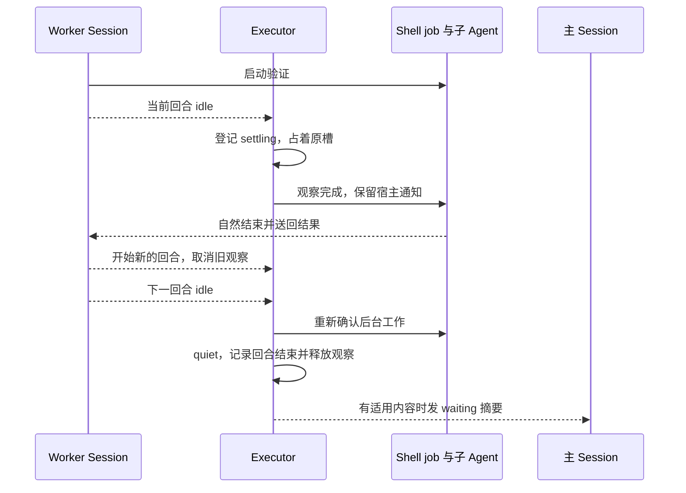

# 20 · 后台命令、子 Agent 与退出清理

> 面试题　Worker 启动了一套验证测试，又派了一个子 Agent 检查移动端。父 Worker 已经显示 idle，新工单却迟迟拿不到槽。后来 Worker 发出 PR 预览交给人，预览服务仍在跑，但槽位释放了。用户点击 Stop 时，怎样避免清理子 Agent 产生的完成消息把原 Worker 再唤醒？

**短答**　DSH 的 Agent idle 只说明当前主回合暂时没跑。原型在 `workerIdle` 中等待属于这个 Worker 的后台 shell jobs 和子 Agent，等待期间 `settling` 让 Ticket 继续计入活动槽位。满足人工交接条件时，执行器保留当前报告，释放子 Agent，保留在跑的 shell job，并接管它的完成通知，结果写进 Session 历史供下次读取。停止 Assignment 时在事务提交后终止后台工作，先接管 shell job 的完成事件再 kill，并在释放活跃子 Agent 后取消由完成消息唤起的回合。新派工与后续输入会等相关清理收尾。 [后台工作适配](../dsh-superagent-prototype/src/executor/background.ts) · [交接与等待](../dsh-superagent-prototype/src/executor/dsh.ts#L583) · [提交后清理](../dsh-superagent-prototype/src/executor/dsh.ts#L352)

以本地提交 `7bd4741` 为基线，沿用帮助页术语修复 Ticket T 与首次 Assignment A1。假设其 Worker 有长测试 J、检查移动端的子 Agent K，以及后来留给维护者 Alice 的预览服务 P。第 18 篇从容量推导了后台占槽，第 19 篇解释了取消并发时如何保留 Input。本篇专门追踪这三项后台工作何时有权唤醒父会话，以及它们在关闭和重启时的归宿。 [槽位篇](18-worker-slots-and-backpressure.md) · [投递篇](19-session-delivery-and-read-receipts.md) · [执行说明](../dsh-superagent-prototype/docs/003-execution.md)

## 1. 一个 idle 可能同时对应哪些活动

Worker bundle 的 shell 工具配置将前台等待窗口设为 5 秒，长命令可转入后台。它的 job 工具同步等待也配置了 5 秒的窗口。子 Agent 通过宿主 spawn，示例 preset 为 standard。原型读取 `ctx.jobs` 的 job registry，以及 `ctx.subagents` 的子会话服务。服务缺席时按对应类型没有可观察工作来处理。原型负责调整这些宿主活动对工单的意义，基础进程与子会话的实现仍由 DSH 提供。 [Bundle 设置](../dsh-superagent-prototype/cordis.patch.yml) · [Jobs、Subagents 接口](../dsh-superagent-prototype/src/executor/background.ts#L9)

| 要区分的事件 | 主要依据 | 对当前工单的影响 |
| --- | --- | --- |
| 主 Agent 当前回合暂时空闲 | 宿主 agent/status 报 idle | 启动 workerIdle，先看是否还在后台执行或发生交接 |
| Shell job 完成 | 按会话 owner 查 registry，等待终态或事件 | 正常结果可让 Worker 继续，接管后可只记历史 |
| 子 Agent 完成 | waitForChildren 与宿主发给父会话的结果 | 父会话可能被唤醒，结束旧观察 |
| 人工交接 | 有适用报告或 Attention，满足输入与回合条件 | 释放执行槽，适用的预览进程仍可运行 |
| Ticket/Assignment 结束 | 领域状态提交，再触发执行器清理 | 停止相关运行，保护下一代派工及输入 |

Job ownership 在这里很具体，`owned` 会同时按 job.owner 是否等于会话 ID、状态是否为 running 或 stopping、是否在排除集合过滤。因此看到 stopping 的进程应继续视为未完全终止。不能依据机器上的总进程数判断这张工单是否还有事。没有人接手时，宿主报告 idle 后，DshExecutor.running 仍可能从 settling 中计入这张开放的 Ticket。与之相对，交给人的 P 留在 registry 不代表仍占 Worker 槽。 [按 owner 与状态过滤](../dsh-superagent-prototype/src/executor/background.ts#L29) · [活动计数谓词](../dsh-superagent-prototype/src/executor/dsh.ts#L403)

## 2. 普通后台完成为什么有权继续父会话

### 2.1 从 agent/status 到 workerIdle

DshExecutor.install 监听 Agent 状态。Agent 进入 running 时取消该 Ticket 的旧后台观察。Agent 进入 idle 时，只有拥有仍开放 Ticket 且当前有 running Assignment，才进入 workerIdle。清理动作产生的特殊取消与关闭中的事件会被过滤。workerIdle 先等待宿主确认 idle，Agent 若已重新运行 或正在从暂时失败中等待续跑，当前观察应退出。这一步消除了把一次瞬态 idle 当成回合最终结束的误判。 [状态订阅](../dsh-superagent-prototype/src/executor/dsh.ts#L476) · [workerIdle 入口](../dsh-superagent-prototype/src/executor/dsh.ts#L601)

假定 A1 普通执行时让 J、K 留在后台，Worker 的当前回合转为 idle。原型建立本 Ticket 的 settling 记录，开始等普通后台工作 quiet。等待的 AbortSignal 结合 Runtime 生命周期、这次观察自身和 30 分钟窗口。新的活动回合先取消观察，从而让后续的空闲另开一轮。清理 finally 时要检查 Map 里仍是这一次的 controller，旧观察不能把新一轮的 settling 删掉。等待之后还要复查 Ticket 是否仍由 A1 承担。所以旧回合结束的异步处理不会轻易给已经重试的 A2 填错 waiting。 [settling 与当前派工守卫](../dsh-superagent-prototype/src/executor/dsh.ts#L629) · [换代后的回合测试](../dsh-superagent-prototype/tests/runtime-concurrency.spec.ts#L307)

### 2.2 untilQuiet 用观察型等待，保留完成结果的正常回路

`untilQuiet` 先通过宿主 `waitForChildren` 等子 Agent，再观察同一 Session 的 shell job。一旦收到 abort 或 Agent 状态不再为 idle 就返回 false。在同一轮检查中如果有后台工作曾被等待，循环会重新检查，只有一轮发现两类都无需等待且父会话仍 idle，才返回 true。若宿主子服务正在收敛，shell job 可以同时执行并结束。第二阶段看到 registry 中已经没有该 job 时，还必须检查父 Agent 有没有被其结果唤醒。已有用例正是在检查子 Agent 时完成 shell job，断言本次 quiet 不能成立。 [untilQuiet](../dsh-superagent-prototype/src/executor/background.ts#L89) · [醒来时返回 false 的测试](../dsh-superagent-prototype/tests/background.spec.ts#L19)

普通 `jobsEnd` 不对每个 job 调 `jobs.wait`，它按 owner 订阅 registry 的事件，遇到 settled 或 removed 才重新检查剩余运行项。很吵的 job 打印一百行 output，也不触发一百次列表重读。这个等待方式还可以让任务自然结束时的结果继续走 DSH 自己的通知机制。若执行器用接管式 wait 吞掉结束，Worker 可能一直等验证结论却没有结果回到会话。观测与收集在这个模块里各有明确用途。 [jobsEnd](../dsh-superagent-prototype/src/executor/background.ts#L66) · [高频输出的测试](../dsh-superagent-prototype/tests/background.spec.ts#L41) · [Job 宿主夹具](../dsh-superagent-prototype/tests/fixtures/host.ts#L42)

对子 Agent 的等待，可取消的是调用方对 Promise 的继续等待。DSH 的 join 本身不能由这里直接取消，模块用以 Agent 为 key 的 WeakMap 缓存仍未完成的 join，后续观察可以共用，join 完成后释放缓存。`until` 用 Promise.race 与 AbortSignal 或 timer 竞争，返回 false 并清理自己的监听，不等于已经对宿主的原操作施加了中断。因而「等得够久，已经退出观察」与「子 Agent 已结束」在日志和面试里应分别验证。 [until 与 childrenEnd](../dsh-superagent-prototype/src/executor/background.ts#L35) · [join 复用测试](../dsh-superagent-prototype/tests/background.spec.ts#L54)



## 3. 30 分钟到时，哪些任务真的会被停止

这 30 分钟从每次普通 idle 后的观察开始，并不从执行命令的那一刻或 Ticket 创建时间开始。比如 t=0 Worker 进入 idle，J 在 t=20 分钟自然结束并唤醒 Worker。它新开一次验证，在 t=25 分钟再次 idle。第二次计时的截止在 t=55 分钟，不会在 t=30 按上一轮的时间去杀第二个 job。测试人为运行两个连续后台任务，显式推进虚拟时间，在第一个窗口的 35 分钟之后断言仍未 kill，第二个窗口到时才允许处理。 [后台窗口](../dsh-superagent-prototype/src/executor/dsh.ts#L629) · [计时用例](../dsh-superagent-prototype/tests/runtime-concurrency.spec.ts#L452)

如果窗口结束仍未 quiet，就检查普通的运行中 shell jobs，排除已交给人的集合，异步调用 killJobs，再用 inject 将结束信息交给 Worker 的历史。若只有子 Agent，报告说明子 Agent 在窗口后仍活跃。该超时分支让子 Agent 继续，不把它们当作本次到期要释放的子会话。若同时还有 shell job，摘要主要记录这些 job。要确认子 Agent 是否仍活跃需查宿主状态。名额统计取 settling 与当前 Agent 状态，超时后旧观察已从 Map 清掉。 [超时分支](../dsh-superagent-prototype/src/executor/dsh.ts#L640) · [超时混合场景](../dsh-superagent-prototype/tests/runtime-concurrency.spec.ts#L475) · [只有子 Agent 的用例](../dsh-superagent-prototype/tests/runtime-concurrency.spec.ts#L497)

普通 quiet 时调用 `turnEnded`，保存 idleAt。超时路径可写新的 waiting 摘要，但在这里不会把超时当成 quiet 来登记 turnEnded。摘要由最新助手文本加上超时说明，并按是否有内容发给主 Session。如果当前已满足手动交接条件，则保留已有报告，避免等待覆盖已有的决定。后台仍有进程、有 waiting 报告或有 idleAt 是三个不同的观察。给面试官读日志时，先准确说明哪一个事件发生，再判断当前是否还能根据它证明本轮的工作都收尾。 [回合结束与 waiting 投影](../dsh-superagent-prototype/src/executor/dsh.ts#L640) · [回合时间回写](../dsh-superagent-prototype/src/core/assignments.ts#L65) · [已读篇](19-session-delivery-and-read-receipts.md)

## 4. 人工交接怎样保留可用的服务

### 4.1 判定的是现在由谁接着做

Worker 决定那个 PR 已验证可交付，运行了本地预览 P，接下来需要 Alice 看实际效果。A1 报 ready，并且挂着仍开放的 PR。此时 Ticket 没有结案。在 `workerIdle` 中，当前报告 ready 或已有 Attention，并且报告之后没有已交付的新 Input，可被视为 handoff。数据比较使用 deliveredAt 大于或等于 report.at 的条件，时间相同也当作需要继续核对的新送达。blocked 或 failed 的分支用 `waitsForPerson` 重新读是否仍在等人，已有更新的正式人类输入可以解除等待。于是「最后一份报告曾说 blocked」并不足以永远把背景工作留给人。 [handoff 判定](../dsh-superagent-prototype/src/executor/dsh.ts#L611) · [等人条件](../dsh-superagent-prototype/src/core/model.ts#L349) · [后续 Input 回到工作](../dsh-superagent-prototype/tests/runtime-concurrency.spec.ts#L432)

还有一类用户直接在 Worker Session 里输入，不经过 Ticket 的 Source。执行器在 claim 事件里记录来自 user 的人工时间。如果这个时间晚于当前报告，则普通 idle 处理继续照看这轮工作的后台命令和子 Agent。这样 Alice 直接接手会话、临时要求继续跑测试时，之前的 ready 不会立刻取消这轮的新后台工作。对照测试模拟了这种人工轮次，同时启动一个 job 与一个子 Agent，最后仍按正常执行路径占用槽位。 [人工 Session 输入监听](../dsh-superagent-prototype/src/executor/dsh.ts#L488) · [直接在会话继续](../dsh-superagent-prototype/tests/runtime-concurrency.spec.ts#L364)

### 4.2 shell job 与子 Agent 为什么用不同的交接动作

真正交接时先用 `turnEnded` 记录回合结束，再执行 handOff，原报告继续生效。对子 Agent，发起 stopSubagents 并登记同一 Ticket 的清理 Promise，保留父会话 inbox。对仍在运行的 owned shell jobs，记录到 `left.jobs`。这些项目在后续正常 untilQuiet 观察和 30 分钟清理范围内会被排除。给人留下 P 的理由是它可能正提供可直接验证的产物，回合与报告完成后预览仍有用。源码依据是当时 running 的 job 集合，不从 label 判断这个命令是否真的是预览。Worker 应在报告之前判断所需的验证是否已经做完。 [手动交接](../dsh-superagent-prototype/src/executor/dsh.ts#L583) · [保留服务的测试](../dsh-superagent-prototype/tests/runtime-concurrency.spec.ts#L381) · [Worker 报告约定](../dsh-superagent-prototype/prompts/work.md)

P 的结束用 `collectJob` 接管。它持有 job ID、owner 和 AbortSignal，每次调用宿主 wait 的窗口是 10 分钟。返回仍为 running 或 stopping 时继续等下一段，得到结束状态才返回名字和结果。观察被取消或 wait 报错时可以退出。这个 10 分钟仅是单次等待时长。本文补充用例依次返回 running、stopping、completed，验证三次 wait 与一次最终完成、全程没有 kill。最后 handOff 用 inject 将 P 的完成写入历史，Worker 不因为这份反馈单独起一轮。 [collectJob](../dsh-superagent-prototype/src/executor/background.ts#L121) · [交接通知注入](../dsh-superagent-prototype/src/executor/dsh.ts#L588)

| 对比动作 | 普通后台工作 | 交给人后的后台工作 |
| --- | --- | --- |
| 需要什么信息 | 检查 job/child 是否仍在运行 | 希望 preview 等 shell job 继续可用 |
| Job 完成通知 | 正常走宿主，适用时唤醒 Worker | 原型负责收集，完成摘要注入历史 |
| 子 Agent | 自然结论可回到父会话 | 释放当前活跃的子 Agent |
| 槽位 | settling 继续计入 | 交接后不再由这一轮持有 |
| 时间上限 | 当前观察超时后尝试终止适用 shell jobs | left 中的进程跳过此上限，最终清理跟随 Assignment 或宿主停止 |

假如 Alice 等审期间 P 自行退出，用户没有因此要求 Agent 再工作，应用可维持原 Ticket 和报告。若她之后提交新的正式输入，执行器通过常规槽位与 Input 投递重新开始。过去 P 的完成说明已在历史中供参考。留给人的进程仍可能使用 CPU、端口和内存。这项资源与面板上 Worker 槽的含义不同，做容量题时要分别列出还有多少活跃 Worker 和多少留下的进程。 [交接与消息行为](../dsh-superagent-prototype/src/executor/dsh.ts#L588) · [交接释放槽位](../dsh-superagent-prototype/tests/runtime-concurrency.spec.ts#L352)

## 5. 停止后怎样压住清理本身带来的唤醒

### 5.1 域事务先提交，执行器再取消当前回合

Ticket 的停止、结束或派工替换会让执行器收到 stop。它用 `Store.afterCommit` 排实际副作用。若一项管理动作在 SQLite 中回滚，回合不会因为该次无效变更提前被取消。成功提交后，执行器中止旧的 settling，必要时取消父 Worker，并发起后台清理，最后取消原 left 收集器及清掉人工时间。存在一个 ownTurn 特例。最新 report 为 ready 或 dropped 且没有新的输入送达时，初始取消可以让 Worker 自己完成这轮。它的后台工作仍会清理，有活跃子 Agent 需释放时仍适用后续取消。 [DshExecutor.stop](../dsh-superagent-prototype/src/executor/dsh.ts#L352) · [提交/回滚对照测试](../dsh-superagent-prototype/tests/runtime-concurrency.spec.ts#L842)

这种顺序体现了两种状态的关系。Ticket 和 Assignment 的数据库状态决定任务是否仍有效，宿主进程改变来自提交后的副作用。若在事务中先杀 shell、随后写数据失败，应用看到仍开放的任务实际已失去它所等的测试。另一方面，取消收到后也需要收尾，模型或其他系统已经完成的网络操作仍须由实际状态核对。停止和尽快回收资源之间需要同步，但无法靠回滚本地数据抹掉已经发生的外部事实。 [Ticket 结束保存](../dsh-superagent-prototype/src/core/tickets.ts#L345) · [事务提交后回调](../dsh-superagent-prototype/src/app/store.ts#L132)

### 5.2 Shell jobs 先登记接收，后发终止请求

`stopBackground` 先调 `killJobs`。它筛出当前 owner 的 running/stopping jobs，先为所有目标登记 wait，再逐一 kill，最后等适用的等待收敛。这样一项进程从 kill 很快结束，宿主也会通过已经登记的 waiter 收集结果，避免又给父 Worker 自动增加回合。正常的 jobsEnd 刻意只看事件，停止路径却要抢先收集。这是等同一个进程结束时最容易讲混的地方。 [killJobs](../dsh-superagent-prototype/src/executor/background.ts#L106) · [等待与通知策略模拟](../dsh-superagent-prototype/tests/fixtures/host.ts#L42)

每项 kill 的同步异常独立处理。即使 J1 的终止请求失败，也会尝试 J2，所有收集等待后把异常并成 AggregateError。stopBackground 再尝试释放已加载 Worker 的子 Agent，即使处理 shell 时出错。本文补充测试记录了 wait 与 kill 的调用顺序，让第一个 job 的 kill 抛错，核对当前 Worker 的另一个 job 仍处理、别的 Ticket 的 job 未被点名、子 Agent 仍进入 drain，最后报告聚合的异常。这里验证的是错误隔离和操作次序，终止请求的返回不能单独当作 OS 进程彻底退出的证明。 [聚合与继续清理](../dsh-superagent-prototype/src/executor/background.ts#L155) · [失败时继续其它 job 的现有用例](../dsh-superagent-prototype/tests/runtime-concurrency.spec.ts#L605)

### 5.3 子 Agent 的完成可能先唤醒一次，再取消这次回合

`stopSubagents` 先从宿主取这个父 Session 的子会话目录。目录会列出历史项，只有还在 ctx.agents 中的 Child ID 被认为活跃并交给 `drainChildren`。没有活跃项时会直接返回，目录里已结束且没有加载 Agent 的历史项不会因此触发一次父回合取消。正在释放的子会话结束时，宿主仍可能把其完成消息发给父会话。实现的做法是在 drain 后的 finally 中取消父 Worker，包括 drain 抛错或等待超过限时的分支。若父 Agent 已非 idle，将它加入 cancelled WeakSet，供下一次 idle 事件跳过。这样可防止清理唤起的回合又被原型当作用户正常完成了一轮。 [stopSubagents](../dsh-superagent-prototype/src/executor/background.ts#L136) · [cancelled 过滤](../dsh-superagent-prototype/src/executor/dsh.ts#L476) · [释放失败仍取消的测试](../dsh-superagent-prototype/tests/runtime-concurrency.spec.ts#L580)

子 Agent 清理的等待有两个 10 秒窗口，分别用于等待 `drainChildren` 及父 Agent 回 idle。前面的 listChildren 另属于宿主查询，源码没有给这一步套相同的计时。超时使调用方停止等待，尚在执行的宿主 Promise 并不会被通用的 until 自动结束。执行器的工具和结束守卫给出了另一处控制。Worker 与能识别归属的子 Agent 使用相应工作工具限制，操作时检查 Ticket 是否仍开放。换代或终止要看回合、子会话与存储的边界，不能从一个 10 秒窗口推导无限制进程的硬超时。 [超时与取消定义](../dsh-superagent-prototype/src/executor/background.ts#L22) · [子会话工具守卫](../dsh-superagent-prototype/src/app/sessions.ts#L282) · [子 Agent 等待上限测试](../dsh-superagent-prototype/tests/background.spec.ts#L65)

### 5.4 新输入不能落在旧清理即将取消的 inbox 上

DshExecutor.track 给 Ticket 存本次及此前尚未完成停止的合并 Promise，完成时仅清掉同一个条目。错误还会从原 Promise 更新 worker health，等待清理的路径可继续收尾。这个映射把「旧子会话释放会引起 cancel」转成新工作可以等待的屏障。启动和投递都会调用 stopped，等待当时已登记的清理。普通 Input 在实际送达前还有一次 stopping 检查，若已有新的清理则用 Later 延迟。它支持等待多个清理动作，代码并非对所有清理步骤作一条串行执行队列。 [track 与 stopped](../dsh-superagent-prototype/src/executor/dsh.ts#L375) · [交付前复查](../dsh-superagent-prototype/src/executor/dsh.ts#L289)

例如 A1 刚交接，Alice 又从原 Thread 发 X「按钮再大一点」。这时 Worker 正在释放 K。X 会先保存为 Ticket Input。投递如果抵达正待清理的 Session，离真正插入最近的授权检查也要看 stopping。A1 的取消完成后，X 才可执行实际送达。运行时测试人为阻塞了 Session 解析和子 Agent drain，逐个释放两条依赖，最终断言 X 的 delivery 调用顺序晚于最后一次 cancel。这组控制顺序比只期待「最终还收到了」更能证明旧回合不会清掉新消息。 [交接时收到输入的用例](../dsh-superagent-prototype/tests/runtime-concurrency.spec.ts#L505) · [会话投递的授权回调](../dsh-superagent-prototype/src/app/delivery.ts#L65)

## 6. 停一张工单、重试派工和关闭插件，各自回收哪一层

### 6.1 停止 Ticket 或替换 A1 后的结果

如果 Alice 停止 T，领域事务写 Ticket ended，并结束相关 Assignment。开放任务所用工具的 guard 随之拒绝后续调用。执行器发起取消和背景清理，留给人的 preview P 也在最终清理范围内。此前交接中排除 P，只对普通背景等待和观察超时生效。stopBackground 处理最终结束时调用的 killJobs 没有传 left 的排除集合。跨几个动作比较时，可以区分「暂时不让结束事件唤醒」「继续运行给人看」和「这项工作的所有执行都应该停止」。 [工单终止](../dsh-superagent-prototype/src/core/tickets.ts#L345) · [stopBackground 全量处理 owner](../dsh-superagent-prototype/src/executor/background.ts#L155) · [工具守卫](../dsh-superagent-prototype/src/app/sessions.ts#L282)

若是显式 retry，本次结束的是 A1，T 可以打开并由 A2 继续。A2 与 A1 使用同一个 Worker Session ID，所以清理边界更重要。核心把符合条件的未读 Trigger 放回 Ticket，后续 launch 和 delivery 等同一 T 的停止工作，然后重建必要的宿主输入。会话或目录可以继续复用，旧运行中的进程、后台结论或历史记录应按各自合同检查。重试不能简单等同于从零开始，也不能把已取消的旧后台等待结果填为 A2 的最终结论。 [派工重试](../dsh-superagent-prototype/src/core/tickets.ts#L164) · [launch 与旧后台](../dsh-superagent-prototype/src/executor/dsh.ts#L438) · [回执篇](19-session-delivery-and-read-receipts.md)

### 6.2 Runtime 停止先等回合，再做有界后台清理

Runtime.stop 复用同一次 shutdown Promise。shutdown 标记 closing，停 Pass、触发生命周期 abort、停止 assessor，并取消主 Session 和已加载 Worker 的当前回合，参数 keepInbox=true。等待此阶段的 Pass、Effect drain 和会话 idle 后，进入 DshExecutor.shutdown。它再把每个已加载 Worker 的背景工作停止请求并行发出。清理普通及交接留下的 shell jobs，释放子 Agent，之后结束仍在收集的任务并再取消期间可能产生的回合。这样安排，主要的宿主结束通知可以在原有工具限制仍安装时收敛。 [Runtime.shutdown](../dsh-superagent-prototype/src/app/runtime.ts#L228) · [Executor.shutdown](../dsh-superagent-prototype/src/executor/dsh.ts#L387) · [停后台再释放工具的测试](../dsh-superagent-prototype/tests/runtime-concurrency.spec.ts#L573)

后台这一段由 `until(stop(), undefined, SHUTDOWN_STOP_MS)` 按 10 秒约束外部等待。此前等待 Pass、Effect 和 Agent idle 的阶段在这里没有同一个计时。因为 until 不能取消被 race 的操作，超时也仅说明外层继续收尾。通常随后释放执行器监听和会话装饰，再 flush Session 持久化并关闭本地存储。shutdown 的 finally 恢复环境、关闭数据库、最后释放状态目录锁。若要证明宿主或所有外部子进程都已结束，仍应检查相应服务的实际状态，不能将整个关停命令理解为固定十秒的硬退出。 [Runtime 清理顺序](../dsh-superagent-prototype/src/app/runtime.ts#L228) · [后台阶段计时](../dsh-superagent-prototype/src/executor/dsh.ts#L391) · [等待函数](../dsh-superagent-prototype/src/executor/background.ts#L35)

### 6.3 重启时保留了什么，其余工作如何重新进入队列

若在同一个 DSH 进程重启插件，Agent 与背景设施可能还在。DshExecutor.resume 遍历开放 Ticket，取消仍挂在运行中 Assignment 的宿主回合，保留 inbox，并发起旧后台清理。Assignments.interrupted 根据最新报告和最近输入决定稳定派工继续，还是标为被中断并建立新派工。busy 的 A1 若在停机时背景验证未结，后续 A2 会拿到「先核查工作区、Git 历史和外部状态」的恢复说明。此时原来运行的 J 可能已经被终止，领域不能把清理产生的退出通知误当为原测试成功，更不能因此写一个正常的结束回执。 [resume](../dsh-superagent-prototype/src/executor/dsh.ts#L519) · [中断判定](../dsh-superagent-prototype/src/core/assignments.ts#L77) · [后台命令被停后的恢复测试](../dsh-superagent-prototype/tests/runtime.spec.ts#L1656)

| 触发条件 | inbox 策略与清理时点 | 下一次推进 |
| --- | --- | --- |
| 普通 handoff | 释放子 Agent 时保留 inbox，接管 shell 完成 | 人来答复或适用输入正常唤醒 |
| Ticket 终止 | 提交后开始清理，常规取消可丢 inbox | 既有 outbox 或域事实继续可查，工单按自身结束来源处理 |
| Assignment retry | 提交后清理旧跑次，待送输入按业务规则重投 | A2 等旧清理，再起新轮 |
| Runtime stop | 对已加载会话保留 inbox，后台阶段做有界收尾 | 关闭后仍有持久状态可由重启读出 |
| Runtime resume | 清理旧宿主活动，判断稳定还是中断 | 延续原 Assignment 或重建派工并重新调度 |

## 7. 用什么信号定位后台工作为什么还在

看见 Agent idle 且槽位为满，先查这张 Ticket 是否仍由一个 running Assignment 承担，执行器是否有 settling，再看 registry 中哪些 job 与 child 属于这个 Session。若只剩预览服务且已有成功交接，应检查该 job 是否列入 left，观察期间不会把它算进普通后台工作。若看到 waiting 报告但仍有子 Agent，核对是否是 30 分钟分支，它可留下子 Agent。若报告保持原 ready，则也可能因为人接手，面板只展示此时业务阶段。从一个 idle 标签很难直接推出全局空闲。 [活动状态](../dsh-superagent-prototype/src/executor/dsh.ts#L403) · [后台 timeout](../dsh-superagent-prototype/src/executor/dsh.ts#L629)

如果用户说「按了停止却又看到新回合」，可以按时间核对 Ticket 结束提交、具体 job settle 时间、子 Agent drain、cancel 调用和最后一次空闲事件。看是哪一种完成通知进入，而非单靠消息内容。对于没收到的新输入，再把它的 deliveredTo、readAt 与停止清理 Promise 的完成时点对应起来。如果新消息被保留至清理后送达，就不应归因给 Worker 忽略用户。对于发生超时的清理，则区分宿主等待已返回和底层进程确实拿到终态。这些都能用事件夹具固定前后顺序形成一次最小可复现的测试。 [wait/kill 次序](../dsh-superagent-prototype/src/executor/background.ts#L106) · [新消息等待清理测试](../dsh-superagent-prototype/tests/runtime-concurrency.spec.ts#L505)


运维数据可以把三段时间分别记录。第一段是父 Agent 从 idle 到确认 quiet，主要解释背景活动继续占用的时间。第二段是开始 handoff 到预览服务结束，反映留给人的实际资源寿命。第三段是提交停止到最后一次取消或清理完成，反映收尾是否拖延新派工。三段都有各自的起止事件，适合从同一 Ticket ID、Assignment ID 和 Job ID 核对。若宿主没有加载 job registry，原型只能看到相应类型没有受管的活动，观测范围以宿主服务为准。 [Job 可见范围](../dsh-superagent-prototype/src/executor/background.ts#L29) · [执行器停止跟踪](../dsh-superagent-prototype/src/executor/dsh.ts#L371)

## 8. 已运行的测试

在临时 Git 副本中通过锁定依赖离线执行六个测试文件，**282 个现有用例全部通过**。另加的 **2 个补充用例通过**，分别验证首个 kill 抛错仍处理其他 job 和子 Agent，以及 handoff 收集遇到 running、stopping 会继续等待、最终只返回一次完成状态。测试使用受控的 DSH 设施夹具。它能证明调用顺序和状态分支，实际 OS 进程退出与生产资源占用需有独立证据。 [测试入口](../dsh-superagent-prototype/package.json) · [后台单测](../dsh-superagent-prototype/tests/background.spec.ts) · [宿主夹具](../dsh-superagent-prototype/tests/fixtures/host.ts)

```sh
corepack pnpm test tests/background.spec.ts tests/runtime-concurrency.spec.ts tests/runtime.spec.ts \
  tests/core-engine.spec.ts tests/bundle-patch.spec.ts tests/delivery.spec.ts
```

| 从测试核对什么 | 相应观察 |
| --- | --- |
| 观察取消与宿主 join 复用 | [取消旁路等待](../dsh-superagent-prototype/tests/background.spec.ts#L29) · [只开一个 join](../dsh-superagent-prototype/tests/background.spec.ts#L54) |
| Shell 输出与终态各自的影响 | [输出不触发重扫](../dsh-superagent-prototype/tests/background.spec.ts#L41) · [普通完成唤醒](../dsh-superagent-prototype/tests/runtime-concurrency.spec.ts#L264) |
| 后台窗口、交人留服务 | [每轮计时](../dsh-superagent-prototype/tests/runtime-concurrency.spec.ts#L452) · [留给人后不因后续回合清理](../dsh-superagent-prototype/tests/runtime-concurrency.spec.ts#L381) |
| 清理故障仍处理父回合 | [释放超时](../dsh-superagent-prototype/tests/background.spec.ts#L65) · [释放抛错后取消](../dsh-superagent-prototype/tests/runtime-concurrency.spec.ts#L580) |
| 停止阶段的通知竞争和事务回滚 | [停止中继续收集](../dsh-superagent-prototype/tests/runtime-concurrency.spec.ts#L558) · [事务提交后取消](../dsh-superagent-prototype/tests/runtime-concurrency.spec.ts#L842) |

## 9. 面试复述与追问

### 9.1 60–90 秒口述

> 我先把 Agent 状态、后台任务和 Ticket 生命周期分开。Worker idle 后，执行器用 settling 保留槽位，untilQuiet 等子 Agent 和普通 shell job。正常完成要把结果送回父会话，结果唤醒新回合时取消旧观察。每次普通 idle 有 30 分钟窗口，到时收集并尝试终止适用的 shell job，可继续保留子 Agent。人工交接时释放子 Agent，把预览之类的 shell job 留给人，等待完成后只把结果注入历史。停止或替换派工要等事务提交。shell 先注册完成 waiter 再 kill，释放子 Agent 后可能还要取消被其完成消息唤起的父回合。后续新派工和输入等待同一工单的清理 Promise，避免取消旧回合时顺带清掉新消息。

### 追问一　为什么不在 Agent 显示 idle 时马上归还槽位？

普通后台任务执行的结果仍会回到这个 Worker，原型用 settling 把这段等待纳入当前工单的活动数。人工交接与后台超时各有各的释放条件。 [运行数判断](../dsh-superagent-prototype/src/executor/dsh.ts#L403)

### 追问二　为什么监听 job 的 settled，也要在清理时调用 jobs.wait？

普通观察需要保留宿主的结果通知，清理要接管这个结果以免触发新一轮。先等待再发 kill 能覆盖进程很快结束的顺序。 [jobsEnd 与 killJobs](../dsh-superagent-prototype/src/executor/background.ts#L66)

### 追问三　过了 30 分钟，子 Agent 为什么可能还在？

到时结束这轮观察，按超时路径处理未完成的普通 shell jobs。子 Agent 可以继续，报告据情况说明。停止 Assignment 或适用 handoff 时会有专门的子 Agent 释放动作。 [超时处理](../dsh-superagent-prototype/src/executor/dsh.ts#L640)

### 追问四　子 Agent 释放失败了，父 Worker 还会取消吗？

已有活跃子会话需释放时，父回合取消在 drain 的 finally 中，失败和超时也走这个路径。若已经唤醒，WeakSet 标记可过滤随后由这次取消产生的 idle。 [释放及取消测试](../dsh-superagent-prototype/tests/runtime-concurrency.spec.ts#L580)

### 追问五　为什么插件重启要保留 inbox，终止现有工单却可能清理它？

重启需要恢复工作意图和未处理输入，可能继续原 Assignment。Ticket 结束要先停旧工作。核心会按当前归属与已读、接手证据决定还需处理的输入，宿主的 inbox 只是其中一个位置。 [Runtime 关停](../dsh-superagent-prototype/src/app/runtime.ts#L228) · [Ticket 结束](../dsh-superagent-prototype/src/core/tickets.ts#L345)

---

[返回连载目录](README.md) · [上一篇《Session 投递幂等与 Worker 已读回执》](19-session-delivery-and-read-receipts.md) · 下一篇《PR 归属、Review/CI 与任务交付》
