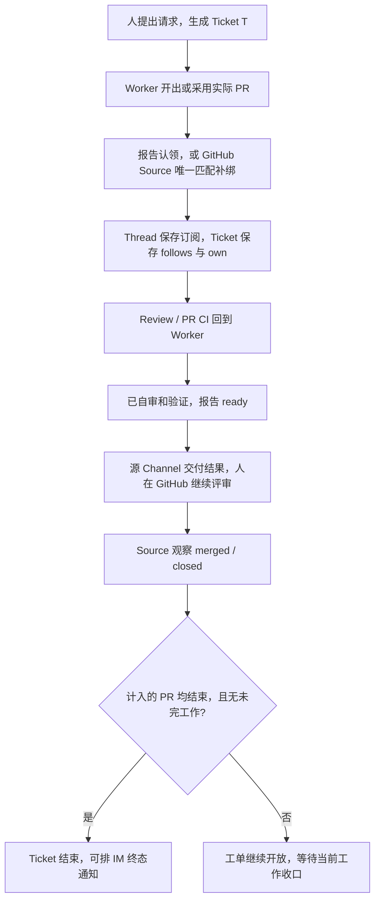

# 21 · PR 归属、Review/CI 与任务交付

> 面试题　Worker 做完帮助页文案改动，创建 PR #57 并报告 ready。另一张 Ticket 此时也给出 #57 的链接，CI 又在新提交上重跑。系统凭什么认定 #57 属于谁？评审没有正文还能唤醒 Worker 吗？GitHub 显示已合并之后，为什么 Ticket 仍可能开放？

**短答**　Worker 报告 PR 时，原型只接受原请求所在的 PR，或由部署 Agent 账号在配置仓库、匹配工单短名的分支上开的 PR，并检查是否已有另一张开放工单在跟踪该未关闭 PR。绑定同时建立 Thread 订阅和 `Ticket.follows`。Review 与 PR CI 随订阅进入 Worker，仍分别按人工输入和机器反馈处理。ready 表示结果可交复核，最后是否按 merged 或 closed 结束，由跟踪集合的外部关闭事实及工单当前的未完工作决定。自动合并属于交付提示里的操作约定，实际可合并条件由 GitHub 配置执行。 [认领与观察](../dsh-superagent-prototype/src/sources/github-pull.ts) · [订阅轮询](../dsh-superagent-prototype/src/sources/github.ts#L384) · [结案判据](../dsh-superagent-prototype/src/core/tickets.ts#L73) · [交付要求](../dsh-superagent-prototype/prompts/team/delivery.md) · [GitHub 分支保护](https://docs.github.com/en/repositories/configuring-branches-and-merges-in-your-repository/managing-protected-branches/about-protected-branches)

本文源码基线为本地提交 `7bd4741`。继续用虚构仓库 `acme/widgets` 的帮助页案例。Alice 让 Agent 更正按钮文案，Ticket T 的短名为 `fix-help-copy-49152a2dcf77`，Worker 开出 #57。为了说明 adopt 与 own 的区别，另举 T 从已有 PR #40 接下任务，再用 #57 交付的分支。第 15 篇追过 Ticket 的通用状态，本篇从 GitHub 事实怎样进入系统来解释交付。 [Ticket 生命周期](15-ticket-lifecycle-and-human-handoff.md) · [工作区命名](17-executor-workspace-and-environment.md)

## 1. 一段 PR 链接可以关联任务，归属要经源码核验

### 1.1 Worker 从报告工具认领实际 PR

默认工作提示要求 Worker 创建或采用 PR 后，立即用 `orchestrator_report` 的 progress 附 `pr_number` 登记，随后再做检查和预审。工具先验证输入格式，按编号从已配置仓库读取真实 PR，再开本地事务。事务里执行 `claimPull`、存报告，以及在报告应转发时写入 relay Effect。只给 summary 填一个 URL 不会走认领逻辑。一次普通 progress 报告可以完成绑定而保持内部流转，交给请求人的结果后面再发。 [Worker 提示](../dsh-superagent-prototype/prompts/work.md#L8) · [报告工具](../dsh-superagent-prototype/src/app/tools/executor.ts#L74) · [报告转发规则](../dsh-superagent-prototype/src/app/notices.ts#L117)

这里的报文通过和归属检查是两层。不符合目标 PR 条件，或者合法 PR 随同一份不允许的报告提交，例如 ready 还附了新提问，都能使事务回滚。测试分别给出一个不合法报告和一个错误目标 PR，断言没有新 follows、Attention、Assignment 报告或 relay。对已经在 GitHub 创建的 #57，报告回滚不会撤销远端 PR，稍后可以核对后按正常认领路径提交。复盘把本地状态事务与已经发生的远端动作分开看。 [事务回滚用例](../dsh-superagent-prototype/tests/runtime.spec.ts#L1327)

### 1.2 claimPull 接受的两种身份

第一种是原请求所在的 PR。它要求 Ticket.origin 的 Trigger 确为 GitHub Source，meta 说是 PR，且编号等于将认领的 PR。比如 Alice 在 #40 下交代修一个问题，Worker 直接更新该 PR 的分支，归属可来自这个请求。第二种是 Agent 开的本任务 PR。认领时，作者需要与部署 Agent 账号匹配，head 仓库应是配置仓库，分支最后一段与 Ticket 的 execution.name 相同。在示例里，`agent/fix-help-copy-49152a2dcf77` 能命中 T。短名是接单时保存的字段，模型填写的报告标题和一句「我负责这个 PR」不参与该比较。 [身份函数](../dsh-superagent-prototype/src/sources/github-pull.ts#L22) · [两种认领条件](../dsh-superagent-prototype/src/sources/github-pull.ts#L35)

| Worker 声称的 PR | 当前事实 | 认领结果 |
| --- | --- | --- |
| #40 是人的源 PR | 与原 Trigger 编号相符，且还开放、无人占用 | 可绑定，若没有同时命中 opened 条件则为 own=false |
| #57 由 Agent 开出 | 作者、head 仓库和分支最后一段吻合 | 可带 own=true 绑定 |
| 名字相同，但来自别的 fork 或由别人开的非源 PR | 不满足 opened，也非原请求 | 拒绝认领 |
| PR 可匹配 T，但另一张开放 Ticket 已跟踪其未关闭关系 | 已有开放归属 | 拒绝第二次认领 |
| 合法 PR 远端已经 closed，且其它守卫都过 | 当前不开放 | 认领返回无错误，但这次不新增跟踪 |
| T 在等待远端读取期间结束 | 本地事务重新读 T，不可用 | 拒绝报告的认领动作 |

注意最后两行的先后关系。源码先验证归属和占用，再用 PR.state 是否 open 决定是否 bind。PR 已关闭、归属检查通过时可以让后续 report 继续。该 report 的 readPull 本身不会把 closed 直接记入 follows。远端结束的观察由轮询路径负责。比如 #57 在 Worker 首次登记前已经被人关闭，不能从工具的 reported:true 推断这一趟完成了绑定。面试时说清「接收了报告」「查到远端 PR」「保存了跟踪关系」是可以分别核对的三件事。 [claimPull 完整守卫](../dsh-superagent-prototype/src/sources/github-pull.ts#L35) · [原 PR、同仓库及占用测试](../dsh-superagent-prototype/tests/sources.spec.ts#L943)

### 1.3 Source 发现漏绑如何补上

GitHub Source 在通知、已有 Ticket 的 PR 和订阅 Thread 等路径里取得 PR。同一轮用编号缓存读取 Promise，多个入口可共享同一份 PR 数据及 observePull 处理。观察到开放 PR 时，先用 Agent 作者和 head 仓库过滤，再找短名匹配的开放 Ticket。真是唯一命中，且这张 Ticket 没在跟踪别的开放 PR，才在普通路径自动 bind。已跟踪的自有 PR 重新打开是单独的适用分支。需要主动登记第二个 PR 时，通常由 Worker report 显式认领。即使能唯一匹配，claimPull 仍会查已有归属。 [轮询流程](../dsh-superagent-prototype/src/sources/github.ts#L273) · [每轮共享 PR 读取](../dsh-superagent-prototype/src/sources/github.ts#L375) · [自动补绑规则](../dsh-superagent-prototype/src/sources/github-pull.ts#L51)

本篇另做了一个带冲突的示例，把两张测试 Ticket 的短名设为同值，模拟扫描不具备唯一证据的情形。自动观察没有把 #57 给任何一张。显式认领给其中一张后，另一张再认领会被已有开放占用拒绝。这里测试的是自动关联的消歧和显式入口的占用守卫，不是日常短名生成会经常碰撞。另一个常见情况是一张 T 跟踪 #57 又看到同分支开了 #58，自动观察不切换它，显式报告可以在满足条件时把两个都加入 follows。 [唯一候选测试](../dsh-superagent-prototype/tests/sources.spec.ts#L403) · [允许显式记录多个 PR](../dsh-superagent-prototype/tests/sources.spec.ts#L436)

## 2. 订阅、follows、Channel 分别保留什么

绑定会在本地事务写 Thread 的订阅和 Ticket 的 follows，另把远端 PR URL、作者等元数据写到 Thread。订阅决定以后的评论和反馈发给谁，follows 记录这个外部工作物是否仍参与结案。字段 own 表明该 PR 是否被认定为本任务的产物，closed 则保存观察到的终止事实。绑定也会将原来只供参考的同一 Ticket 订阅转为正式订阅。任意 attach 可以让工单正式收到某段讨论，未必给它赋予跟踪 PR 关单的语义。 [绑定事务](../dsh-superagent-prototype/src/sources/github-pull.ts#L70) · [领域 bind 和 subscribe](../dsh-superagent-prototype/src/core/tickets.ts#L61) · [附加](../dsh-superagent-prototype/src/core/tickets.ts#L121)

Channel 关心向人回复的位置。假如 Alice 原来通过飞书提出修文案，T 即使绑定 GitHub #57，源 Channel 仍能把结果送回初始会话。对于 PR 里提出的具体问题，回复可能回到该 Trigger 的 Channel。二者可以形成「在 GitHub 评审变更，在源会话交付或提醒」的工作闭环。主 Session 的 report relay 帮它知道何时该回结果。评审问题有没有实际写回 PR，要查用途、地址和相应发送或 Worker 操作记录。 [创建时保存 Channels](../dsh-superagent-prototype/src/core/tickets.ts#L37) · [回复用途与来源](../dsh-superagent-prototype/src/core/replies.ts) · [GitHub Channel](../dsh-superagent-prototype/src/sources/github-channel.ts)



## 3. Review 如何进入同一 Worker 的任务链路

### 3.1 讨论、行级评论和评审意见从三个读取口进入

GitHub 粗看都是「评论」，原型按 PR 读取 conversation、inline、review。conversation 取 Issue/PR 对话评论，inline 取变更行上的评审评论，review 取整份评审结论。轮询使用检查点按更新时间、提交时间或创建时间筛选，并跳过当前 Agent 账号自己的评论。Trigger 带 PR 编号、类别、评论身份及适用位置。行级评论正文还可先拼 file、line 和 diff 尾部片段，reply-to 元信息可供读回上文。原始正文、Thread 与发言者让 Worker 能确认「这句改成什么」具体指哪个变更。 [PR 评论轮询](../dsh-superagent-prototype/src/sources/github.ts#L384) · [review 文本](../dsh-superagent-prototype/src/sources/github-trigger.ts#L48)

只有批准按钮、没有留言正文的评审也可能形成输入。commentText 对 review 的已给定非 COMMENTED 状态，拼入状态和对应 commit ID。Carol 对 H1 批准时，即使正文为空仍有说明「APPROVED review of commit H1」的内容。若是没有正文的普通 COMMENTED review，就可能得到空文本并被跳过。区别来自结构化评审状态，使在等人 review 的 Worker 能获知进展。订阅了 #57 的 Worker 仍应验证这条 review 针对哪个提交，不能从「看到批准」直接推导当前 head 已满足交付要求。 [commentText 和 Trigger](../dsh-superagent-prototype/src/sources/github-trigger.ts#L54) · [无正文评审用例](../dsh-superagent-prototype/tests/sources.spec.ts#L534)

### 3.2 评审反馈可能是任务继续，也可能只是参考

已订阅 PR 的有效人工反馈可以直接进已有 Worker。Intake 对这个 Trigger 使用该 Thread 的订阅与归属，普通评论可以无需再 @。要求范围内的修改，Worker 按原 Mandate 与原请求判断。涉及独立工作可留下 handback 让主 Session 重评。GitHub 用户类型、登录名的 bot 后缀和当前部署账号参与 human 的判定。用普通人账号发言的自动评审可能在 Source 分类为 human，团队提示还可以列出应按自动评审处理的账号。检查权限时要指出哪一层在识别「人」，以及哪一层只在审慎处理评审内容。 [身份分类](../dsh-superagent-prototype/src/sources/github-trigger.ts#L42) · [正式跟进与参考输入](../dsh-superagent-prototype/src/core/model.ts#L69) · [Worker 审查与归还约定](../dsh-superagent-prototype/prompts/work.md#L8)

评审回复的地址也值得展开。有具体行讨论地址时，GitHub Channel 可按相应 GitHub 评论 ID 找到讨论根，发到线程。原评论确实缺失时有降级到 PR 对话的分支。Channel 发送附稳定标记，重试前核对原账号及 marker。Worker 的 review 技能另给出按 Thread 读、回复和 resolve 的操作说明。路由工具和 Ticket 结案不会凭一个 ready 自动逐条解决评审评论。检查是否已回复或 resolved，应查实际评审线程或对应 Worker 证据。 [GitHub Channel 路由](../dsh-superagent-prototype/src/sources/github-channel.ts#L17) · [随项目打包的 GitHub 技能](../dsh-superagent-prototype/skills/dsh-superagent-github/SKILL.md)

## 4. PR CI 与默认分支 CI 为什么分成两条链路

### 4.1 PR CI 是有版本的本任务反馈

`pollTicketPulls` 先从开放 Ticket 查所有尚未标关闭的 PR，按编号去重。本轮读出开放且未合并的 PR 后，`pollChecks` 使用其 head SHA 读取 check runs 和 commit statuses。归一化时，检查记录提取 name、status、conclusion 后排序。状态按 context 取第一次出现的条目，再排序。最后用含 head 的 snapshot 计算 fingerprint。首次读取只保存基线和 Thread 的 CI fact。以后每次 fingerprint 变化才递增 revision 并产生 PR CI Trigger，ID 含 PR 号和 revision。重复轮询相同快照时，Worker 不会为同一个状态反复收到消息。 [CI 轮询与快照](../dsh-superagent-prototype/src/sources/github.ts#L404) · [检查结果归一化](../dsh-superagent-prototype/src/sources/github-read.ts#L59) · [PR CI Trigger](../dsh-superagent-prototype/src/sources/github-trigger.ts#L103)

本篇补充用例让 H1 上的两个成功 checks 换序到达，没有发出新 Trigger。后来改 head 为 H2，复用同一组结论，新的 head 进入指纹，仍产生 revision 1 的事件。这个事件的摘要会包含 H2 的短 SHA，说明「测试都通过」也必须对准提交。反过来，原型只看轮询采样和所保留字段，两个轮询之间出现又恢复的状态可能没有被看到，完全一样的内容也可能对应无法从这份快照识别的外部动作。要取最新或更详尽的证据，可以从 `github/pulls/<number>/checks` 等针对自身需求重读。 [CI 变更测试](../dsh-superagent-prototype/tests/sources.spec.ts#L548) · [按需读 PR CI](../dsh-superagent-prototype/tests/github-read.spec.ts#L31)

摘要优先报告失败，再报告仍运行，否则显示通过。实现按自己的失败状态集合计数，零项时也会形成没有失败或运行项目的结果。看到一张 CI passed 的卡片，应把它理解为这次观察中所受支持的 checks/statuses 的摘要。哪些检查被 GitHub 要求、是否属于当前 merge 条件，还要看远端配置与状态。尤其如果 H1 的测试全绿、H2 刚推但尚无检查记录，看卡片或摘要不等于证实新 head 的所有必要检查完成。 [CI 计数及摘要](../dsh-superagent-prototype/src/sources/github-read.ts#L13) · [GitHub 必要状态检查](https://docs.github.com/en/repositories/configuring-branches-and-merges-in-your-repository/managing-protected-branches/about-protected-branches#require-status-checks-before-merging)

### 4.2 机器事件能给已有执行提供反馈，准入另算

PR 的 CI Trigger 是 `human:false` 且 actor ID 为空，Thread 仍是 #57。先经 Source 入库，适用的开放订阅 Ticket 可以收到它。机器输入不取得人类跟进所有权，因此也到评估路径检查是否可作为新任务。原型把 observeCi 的作用范围放在带 branch 元信息的默认分支 CI，PR CI 不进入相应 admission row，machineGate 不会因 #57 的检查失败给出新候选授权。它能把新的验证状态交给已有 Worker，如果 Worker 仍处于等人的 blocked/failed，适用自动输入可只保留历史而不唤醒。 [Source CI scope](../dsh-superagent-prototype/src/sources/github.ts#L30) · [机器事件门控](../dsh-superagent-prototype/src/policy.ts#L170) · [两条 CI 路径的准入用例](../dsh-superagent-prototype/tests/policy.spec.ts#L442) · [等待人工输入的处理](../dsh-superagent-prototype/src/core/tickets.ts#L230)

默认分支由独立轮询建立 baseline，以失败项名称列表识别变化。首次看到、或者默认分支改名后，只建立新的观察基线。此前失败但新一轮只有未完成的检查时，先保留先前故障名单。完成且无失败后才可能产生恢复事件。这些事件进入 `github:ci:<branch>`，没有个人会话的 Channel，可以在 observeCi、准入表与模式合适时作为 inferred 候选。是否接受为新工作还要按启用规则和 auto 模式判断。默认分支失败的影响范围不止一张已在做的 PR，源码用不同的 Thread 和 gate 来控制这层主动性。 [默认分支故障基线](../dsh-superagent-prototype/src/sources/github.ts#L250) · [重复变化的稳定身份](../dsh-superagent-prototype/tests/sources.spec.ts#L1357) · [规则判据](../dsh-superagent-prototype/src/core/evals.ts)

| 场景 | 投递或准入的依据 | 不能从事件直接推出的事实 |
| --- | --- | --- |
| #57 收到人类 review | 开放工单与正式 Thread 订阅 | 对最新 head 已经获得充分审核 |
| #57 的 CI 变化 | 快照新版本、PR Thread 与适用 Worker | 新任务已接单，或全部必需检查通过 |
| 默认分支出现故障变化 | 首次基线之后的失败变化，策略限制候选 | Agent 已获得执行改动的授权 |
| 完全相同的快照重复读到 | fingerprint 相同，跳过 PR CI 事件 | 所有远端请求或工作流尝试相同 |

## 5. ready、auto-merge 与已经合入的边界

### 5.1 ready 是 Worker 的可复核交付

默认提示要求代码改动走实现、检查、自审、PR 和行为证据。如果 UI 变更要按交付要求提供同场景、视口、主题和状态的 Before/After 证据，缺真实 baseline 仍不应宣称可交付。项目本身的 `orchestrator_report` 检查结构、PR 归属和业务状态，核心按 report.state 判断 Ticket。Ready 这条记录不使用视觉 Diff、CI 强制规则或全部审批列表作为额外输入。它可以在等待审批前就生成结果供人审阅。主动检查工作真实、写下证据与风险属于 Worker 报告约定，后续的 GitHub 合并状态通过 Source 观察。 [工作提示](../dsh-superagent-prototype/prompts/work.md#L10) · [UI 证据约定](../dsh-superagent-prototype/prompts/team/delivery.md) · [Assignments.report 结案条件](../dsh-superagent-prototype/src/core/assignments.ts#L122)

### 5.2 自动合并用提交身份对齐评审，再交给平台执行

默认交付提示规定，没有另行指定 merge CLI 的默认流程由人合入。若提示明确配置了该 CLI，且 PR 属于本任务打开的分支，Worker 须核对 ready、改动小于 200 行（增加和删除之和）、所需批准覆盖 head。对用户可见改动，提示还要求明确指定审批人并满足同一提交的批准条件。命令约定传入 `--match-head-commit`，对齐申请操作时检查过的 SHA。推新提交前或条件失效后先撤销 auto-merge，再按新 head 重验。这个参数表达发起合并操作所要求的 head，后续 GitHub 是否允许合并仍取决于平台条件。 [默认交付提示](../dsh-superagent-prototype/prompts/team/delivery.md) · [CLI 的 head 参数](https://cli.github.com/manual/gh_pr_merge)

例如 #57 在 H1 上有批准，接着 Worker 修复一条评审意见并推 H2。应用中的 review Trigger 能说明旧批准对应 H1。默认提示还存在只改提交消息、tree 保持一致的评审署名约定，它内部怎样沿用审批的判断不改变 GitHub 的分支保护。真实仓库可以启用必须满足的评审、最新可评审推送的批准、过期批准失效，以及必要的 status checks。平台按仓库当前配置执行，账号是否可绕过规则也由实际设置决定。外部验证应拿 H2 与当前仓库的规则去看，原型的 autoMerge 标记与全套合并要求之间没有自动证明关系。 [评审与署名提示](../dsh-superagent-prototype/prompts/team/delivery.md) · [GitHub 分支保护选项](https://docs.github.com/en/repositories/configuring-branches-and-merges-in-your-repository/managing-protected-branches/about-protected-branches) · [GitHub auto-merge 的条件](https://docs.github.com/en/pull-requests/how-tos/merge-and-close-pull-requests/automatically-merging-a-pull-request)

原型对 auto-merge 的可见信息来源于 `pr.auto_merge`，发现还开放且该字段非空时设置 Thread fact，取消或关闭时清掉。这个 fact 用来展示上次的外部观测。它可以跟首次 CI 基线和 PR 观察同轮更新，但不会自己触发一次 merge 命令。对于面试里的「原型如何确保不自行合入」，精确说法是默认提示要求人执行，配置可指定另一 CLI，项目没有独立的合并状态机。平台强制措施需要按实际仓库核验。 [autoMerge fact](../dsh-superagent-prototype/src/sources/github-pull.ts#L57) · [单轮读与 auto-merge 状态测试](../dsh-superagent-prototype/tests/sources.spec.ts#L548) · [本地自动合并说明](../dsh-superagent-prototype/docs/003-execution.md#L80)

## 6. 合并和关闭怎样让 Ticket 收口

### 6.1 先记录外部关闭，再看计入的 PR 集合

轮询读到 PR.state 为 closed 或 merged 为真时，`observePull` 走 closePull。该函数只给仍在跟踪该未关闭关系的开放 Ticket 报告关闭，取 merged_at、closed_at、当前时间中第一项适用值，以 merged 布尔值决定结果。Engine 规范化时间并在事务中交给 Tickets.threadClosed。后者先写 follow.closed，即使这个 Ticket 暂不能结束，也能保留当时的 PR 事实。相同 PR 已标 closed 的记录在普通重复关闭轮询中不会反复触发结束。 [关闭观察](../dsh-superagent-prototype/src/sources/github-pull.ts#L76) · [Engine.threadClosed](../dsh-superagent-prototype/src/core/engine.ts#L59) · [领域写入](../dsh-superagent-prototype/src/core/tickets.ts#L73)

`followsDone` 使用集合来推导。如果有 own=true，计入的只有 T 自己开的 PR。如果没有，全部 follows 都要考虑。计入集合为空时这个函数没有外部关闭结果，有任一项开放也不能判已到终点。所选集合全结束后，以这些项里时间最晚的关闭作为结果。例如 #57 10:05 合入，#58 10:03 关闭未合且其状态晚一点才被观察。若两项都属 T，收齐后按 10:05 的 merged 取结果。单看 Ticket outcome 为 merged，也还要分别查 #57 和 #58 的外部状态。没有绑定 PR 的 ready 则可直接按普通 completed 路径结束。 [followsDone](../dsh-superagent-prototype/src/core/tickets.ts#L91) · [多个 PR 的测试](../dsh-superagent-prototype/tests/sources.spec.ts#L436) · [无 PR 直接完成](../dsh-superagent-prototype/tests/runtime.spec.ts#L372)

| T 的当前跟踪 | 新观测到的变化 | 可能的工单结果 |
| --- | --- | --- |
| 只采用人的源 PR #40 | #40 关闭，未合并 | 无未完工作时以 closed 收口 |
| #40 是源 PR，自己只开 #57 | #57 已合，#40 继续开放 | 以 #57 决定外部条件 |
| 自己开 #57 和 #58 | 只见 #57 合入 | #58 仍待完成，工单开放 |
| 工单继续时 #58 从 closed 变 open | Source 观察到且仍符合自有归属 | 可重新 bind，清掉 #58 的 closed |
| #57 合入时 Worker 正处理已接手的追问 | 外部关系记为 merged | 暂保留开放，后续报告时再结案 |

已结束的 Ticket 通常还保留 PR Thread 的订阅。Observe 重新打开一个 PR 时，自动候选只找开放 Ticket，自身不把已结束工单恢复为开放。若人在正式订阅 Thread 发新消息，Intake 与 wake 可按当前授权重新恢复符合条件的自然结束工单，这之后开放的 Ticket 可再跟踪适用的重新打开的 PR。若人早先明确停掉它，普通订阅触发不会恢复。审计「为什么 reopen 之后还是 ended」时，应同时看外部 reopen、是否有人发来可处理输入和工单的结束来源。 [重新绑定](../dsh-superagent-prototype/src/sources/github-pull.ts#L57) · [重新打开 PR 用例](../dsh-superagent-prototype/tests/sources.spec.ts#L453) · [工单恢复条件](../dsh-superagent-prototype/src/core/tickets.ts#L252)

### 6.2 已合入以后，还有两种需要保护的工作

第一种是已明确接手的人类追问。比如 A1 报 ready 后，Alice 又问更正后的按钮在移动端是否生效，Worker 对这条所属输入做了 ACK，开始运行验证。GitHub 此时已把 #57 合入，`unfinished` 可见该输入已接手，但还没有后续非 progress 报告或回合结束能越过读取边界。轮询先写合并事实，Ticket 仍开放。后续报 ready 或适用 dropped 时可以按已保存的外部状态结束为 merged。若 X 完全没接手且 Worker 在结束边界前没读到，结束过程可按正常归属规则把内容送回主 Thread 评估。 [未完工作判据](../dsh-superagent-prototype/src/core/tickets.ts#L364) · [已接手的追问对照](../dsh-superagent-prototype/tests/core-engine.spec.ts#L541) · [已读和边界](19-session-delivery-and-read-receipts.md)

第二种是关闭发生之后才创建的派工，例如 #57 在 10:05 关闭，本地到 10:09 才见到，期间 10:06 已因需要继续工作启动 A2。代码用关闭时间比较最新 Assignment 的 createdAt，如果创建更晚，又没有 ready 或还有后续相关 Input，则保持开放。事件时间和观察时间的区别使迟到的关闭事实不至于误伤之后的工作。若已符合结案，外部 PR 能在 Worker 尚未报告 ready 时结束 Ticket。这样既支持「准备好才交付评审」，也能处理维护者先关掉一个已无用 PR 的情况。 [结案观察](../dsh-superagent-prototype/src/core/tickets.ts#L77) · [恢复后尚在工作的测试](../dsh-superagent-prototype/tests/core-engine.spec.ts#L1087)

### 6.3 分清发往人的结果通知与最终结案通知

Worker 的 ready 可以让主 Session 读取结果、给源 Channel 说明可审。最终结案时，Runtime 在 ticket.ended 检查该 Ticket 的结束结果，从适用的已关闭 PR 选对象，生成非 GitHub Channel 的通知。GitHub 会话已有外部 PR 状态，源码跳过给那里的额外终态提醒。通知的身份由 PR 编号、渠道 Source、地址和 outcome 构造，源请求文字用于选语言。因此同一 PR 结束后因为人追问而又恢复、再以同一 outcome 结束，同一地址可继续使用先前的 notice ID。另一 outcome 则有自己的身份。 [终态通知逻辑](../dsh-superagent-prototype/src/sources/github-pull.ts#L85) · [Runtime 写 Outbox](../dsh-superagent-prototype/src/app/runtime.ts#L147) · [再次结束的通知去重测试](../dsh-superagent-prototype/tests/sources.spec.ts#L403)

操作问题「我收到了可审链接，为什么还没有合并提醒」可以依次核对 ready 已报告、源结果是否送出、PR 是否真已关闭、所有计入项状态、Ticket 是否已 end、是否有非 GitHub Channel、Outbox 是否已送达。完成这个诊断不需从 Worker 文案推断 GitHub。相反，「GitHub 显示已合但任务打着开放标签」要优先核查 PR 属于谁、Source 是否已观察到、以及此刻到底有无正在处理的追加工作。 [结果发送规则](../dsh-superagent-prototype/src/core/replies.ts) · [结案后通知集成测试](../dsh-superagent-prototype/tests/runtime.spec.ts#L1420)


### 6.4 PR 无合并关闭也能是协作流程的正常分支

假设 Alice 已在自己的 PR #62 中带上 T 的修改。默认交付提示要求 Worker 确认该分支确实含有相同工作，才关闭自己的 #57，并在相应 PR 说明该去哪里查看。仅标题相似或解决同一类问题不足以认定代码已被接手。核心不会比较两个 PR 的补丁是否等价。它之后只观察到 #57 closed，并以 follows 条件决定何时结案。这个 outcome 表示 T 的跟踪对象以何种结果结束。要证明用户需求最终进了默认分支，还要从 #62 的远端事实取证。 [重叠工作交付约定](../dsh-superagent-prototype/prompts/team/delivery.md) · [closed 的状态来源](../dsh-superagent-prototype/src/sources/github-pull.ts#L80)

团队可以用三个状态时间定位交付成本。从绑定 PR 到 ready 代表执行与自审过程，从 ready 到平台关闭或合并代表人审查和 GitHub 合并条件，从平台关闭到 Ticket 结案代表 Source 观测与未完成工作的收尾。一次长延迟可能出现在任何一段。对当前样本还要确认执行者是否已推了新 head、最新评审是不是针对它、有没有另一个 own PR 在等待。用同一 Ticket 与 PR 编号做关联，能先在不同记录中还原发生了什么，再讨论是否要缩短哪段时间。 [单轮观察缓存](../dsh-superagent-prototype/src/sources/github.ts#L375) · [外部时间与结案](../dsh-superagent-prototype/src/core/tickets.ts#L73)

## 7. 源码验证与实验

在临时 Git 副本中用锁定依赖离线运行以下八个文件，**684 个现有用例全部通过**。补充的 **2 个用例**也通过。第一个构造同短名的两张开放 Ticket，断言自动观察不绑定，并在一张显式认领后拒绝第二张。第二个对 checks 顺序与 head SHA 分别施加变化，检查触发次数、revision、机器身份及对应 PR Thread 无新评估待处理项。测试证据围绕本地实现，实际仓库审批配置没有参与执行。 [GitHub Source 测试](../dsh-superagent-prototype/tests/sources.spec.ts) · [仓库测试入口](../dsh-superagent-prototype/package.json)

```sh
corepack pnpm test tests/sources.spec.ts tests/github-read.spec.ts tests/policy.spec.ts \
  tests/runtime.spec.ts tests/runtime-concurrency.spec.ts tests/core-engine.spec.ts \
  tests/followups.spec.ts tests/outbox.spec.ts
```

| 想直接复读的行为 | 现有用例 |
| --- | --- |
| 只绑定源 PR 或合法的 Agent PR，并防止第二份开放归属 | [显式认领测试](../dsh-superagent-prototype/tests/sources.spec.ts#L943) |
| 报告拒绝时，已读到的 PR 也不会半绑定 | [报告原子性](../dsh-superagent-prototype/tests/runtime.spec.ts#L1327) |
| #58 重新打开时恢复跟踪 | [多 PR 中的 reopen](../dsh-superagent-prototype/tests/sources.spec.ts#L453) |
| 批准无正文进 Worker，普通空 review 跳过 | [评审正文测试](../dsh-superagent-prototype/tests/sources.spec.ts#L534) · [通用的 Worker 跟进路由](../dsh-superagent-prototype/tests/followups.spec.ts#L14) |
| PR CI 建立基线后才报变更，默认分支另有准入 | [轮询一次读](../dsh-superagent-prototype/tests/sources.spec.ts#L548) · [CI 门控](../dsh-superagent-prototype/tests/policy.spec.ts#L442) |
| 合入后仍有接手的工作，会延迟结束 | [已接手且仍在后台](../dsh-superagent-prototype/tests/runtime-concurrency.spec.ts#L414) |
| 终态通知沿用渠道、支持多次结案去重 | [通知 ID](../dsh-superagent-prototype/tests/sources.spec.ts#L403) · [恢复后结案](../dsh-superagent-prototype/tests/runtime.spec.ts#L1420) |

## 8. 面试复述与五个追问

### 8.1 60–90 秒口述

> 原型把 PR 当作外部交付物。Worker 报告时可以登记原请求中的 PR，或者登记 Agent 在本仓库按工单短名分支开的 PR。后者查作者、head 仓库、分支和现有开放占用。Source 唯一匹配时能补绑定。绑定同时设置 Thread 订阅和 Ticket.follows，因此 Review 和 CI 能回到已有 Worker，工单也能跟随 PR 状态。无正文的批准仍会把状态和 SHA 组成 Trigger。PR CI 按当前 head 快照比较变化，反馈已有任务，默认分支 CI 另有主动准入。Worker 可先报 ready 给人评审。只有看过计入的 PR 的关闭事实和当前是否有未完工作，才能结案。自动合并按提示执行，必要审批与状态检查由 GitHub 实际配置决定。

### 追问一　工单是在 #40 下创建，为什么 #57 合入后 #40 开着也能结案？

若 #57 是这张 Ticket 自己开的，followsDone 优先看全部 own 项。#40 作源 PR 可以提供后续输入，自己的交付物都已经结束时，只要也无未完工作就能结案。 [集合条件](../dsh-superagent-prototype/src/core/tickets.ts#L91)

### 追问二　收到 #57 的批准，为什么还要看 head SHA？

评审对应具体 commit，可能仍是旧 H1。Worker 要核对新 H2 的报告、要求的评审和适用配置。分支保护可要求最新可评审推送获批准或让过期批准失效。 [评审 Trigger](../dsh-superagent-prototype/src/sources/github-trigger.ts#L54) · [GitHub 分支保护](https://docs.github.com/en/repositories/configuring-branches-and-merges-in-your-repository/managing-protected-branches/about-protected-branches)

### 追问三　为什么 PR CI 全红不会直接给系统再建一张工单？

PR CI 属于既有 PR Thread 的机器反馈，已订阅的 Worker 可以收到。Source 的默认分支 CI 有独立 row，PR CI 的触发不走这个准入。新任务仍需 Policy 与明确的 Decision。 [CI scope 与准入](../dsh-superagent-prototype/tests/policy.spec.ts#L442)

### 追问四　Worker 报 ready 时 PR 恰好已关闭，这个报告会失败吗？

如果 PR 身份和占用守卫都通过，closed 本身允许 report 继续，但不会在这一步建立新的 follows。后续结束依据以实际保存的关系、报告与 Source 观察为准。如果 Ticket 已经因关闭先结束，报告会被拒绝。 [工具及认领逻辑](../dsh-superagent-prototype/src/sources/github-pull.ts#L35)

### 追问五　合入通知为什么还没发给请求人？

先核对这张 Ticket 是否已经结束为 merged。仍有其他开放的 own PR、已接手的请求或更晚创建的工作，都可能推迟结案。如果已经结束，还要核对源 Channel 类型与 Outbox 状态。GitHub 上的 PR 合并可以与源会话收到消息发生在不同时点。 [终态通知条件](../dsh-superagent-prototype/src/sources/github-pull.ts#L85)

---

[返回连载目录](README.md) · [上一篇《后台命令、子 Agent 与退出清理》](20-background-jobs-and-subagents.md) · 下一篇《SQLite 持久化、索引与迁移》
