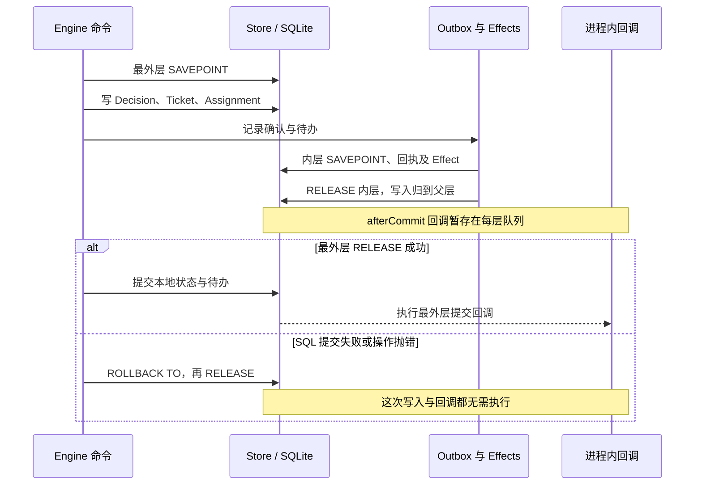

# 22 · SQLite 持久化、索引与迁移

> 面试题　维护者在 Issue 里请 Agent 修正文案。系统已经创建 Decision、Ticket 和第一项 Assignment，却在准备启动 Worker 前崩溃。重启后凭什么知道任务已接受、启动还没做？历史工单积累很久，调度为什么不必把每个 JSON 都读一遍？迁移到新版本时，其中一条旧记录读不出来，其他数据会处在哪个版本？

**短答**　原型用 `node:sqlite` 将业务聚合、读取所需的关联、配置版本、出站回执和待办动作放在同一个数据库。领域命令通过嵌套 SAVEPOINT 提交，核心记录和待执行 Effect 可以一起入库。调度高频查询用从 JSON 派生的生成列和部分索引，只从有待办或开放等适用记录中读取。状态目录锁负责防止两个 Runtime 同时管理一份安装数据。提交后的内存回调负责及时取消或更新状态，可恢复的异步动作有持久队列。schema 10→11 则在启动时集中转换，失败回滚迁移内的写入，版本标记也留在 10。 [Store](../dsh-superagent-prototype/src/app/store.ts) · [Runtime](../dsh-superagent-prototype/src/app/runtime.ts#L87) · [迁移入口](../dsh-superagent-prototype/src/app/migration.ts#L30)

本文以本地提交 `7bd4741` 的原型为基线。沿用 Alice 的帮助页工单 T，Source 输入叫 X，接受后有 Decision D、首次 Assignment A1 和一条待启动记录。数字与 ID 只是示例。前几篇分别追过接单、Session 投递和 PR 结束。本篇将这些动作对齐到 SQLite 的状态，重点看「读取哪一个字段能证明发生了什么」和「事务失败时究竟回滚哪一层」。 [PR 与任务交付](21-pull-request-ownership-and-completion.md) · [领域合约](../dsh-superagent-prototype/docs/007-architecture.md)

## 1. 状态目录、Store 与宿主 Session 各保存什么

### 1.1 状态目录由一个 Runtime 持有

Runtime 在打开 `<stateDir>/orchestrator.sqlite` 之前，先用 `lockSync` 获取状态目录锁。源码传入 stale=30,000 毫秒，表示该锁机制使用的陈旧判断参数。它保护的是本项目一份安装状态的单 Runtime 所有权，包括谁负责迁移、轮询检查点、派工和副作用调度。锁被报告失效时，Runtime 标记健康状态出错并触发生命周期中止信号。关闭时先收尾调度与 Session，再关闭数据库和释放锁，构造阶段失败也尝试释放已经拿到的资源。 [目录锁](../dsh-superagent-prototype/src/app/runtime.ts#L87) · [构造失败清理](../dsh-superagent-prototype/src/app/runtime.ts#L166) · [关停顺序](../dsh-superagent-prototype/src/app/runtime.ts#L228) · [启动失败测试](../dsh-superagent-prototype/tests/runtime.spec.ts#L1404)

与 SQLite 只允许一个写者同时提交相关，目录锁控制的是更长的生命周期。设两个独立 Runtime 都能轮流成功写 SQLite，仍会有两个驱动者扫描同一个业务 Effect，还可能同时向同一 Worker 发起操作。SQLite 的写锁能排序写入，无法代替 Runtime 的角色所有权。反过来，只有一个 Runtime 仍需要事务，因为单条命令会改多张表。如果某一步抛错或进程中断，目录锁也不能让已经执行的若干条 SQL 一起撤销。 [架构的状态目录说明](../dsh-superagent-prototype/docs/007-architecture.md#L149) · [SQLite WAL 并发](https://sqlite.org/wal.html#concurrency)

Store 用 `DatabaseSync`。查询、写入、SAVEPOINT 都在调用线程执行，领域事务里的回调按同步合同组织。若调用者在 atomic 回调里启动 async 函数并跨 await，atomic 会先看到一个 Promise 返回并释放保存点，后续写入就失去原事务边界。实际代码把请求 GitHub、模型调用这类外部等待留给事务外或持久 Effect。比如 Worker 提交 PR 报告，先异步读取 PR，再同步完成绑定、报告、relay 入队。短命令可以在同一运行线程按清楚的次序执行，大迁移或宽扫描也会占用这个线程，属于需要度量的代价。 [Store.atomic](../dsh-superagent-prototype/src/app/store.ts#L133) · [报告工具的边界](../dsh-superagent-prototype/src/app/tools/executor.ts#L85) · [Node.js DatabaseSync](https://nodejs.org/download/release/v24.18.0/docs/api/sqlite.html#class-databasesync)

### 1.2 从接单案例看表的职责

| 表 | 主键或查询身份 | 在示例中负责的证据 |
| --- | --- | --- |
| trigger | id，附独立 at | X 是谁发来、何时发生、哪些 Thread 可读 |
| disposition | Trigger ID | X 是否被过滤、分发给谁、是否待重评或接手 |
| thread | Thread key | 订阅、关联、待评估 Trigger 和活动 Eval |
| decision | Decision ID，附 thread | D 的类型、所评估输入和授权证据 |
| ticket | Ticket ID | T 的原请求、Mandate、执行目录、派工与后续 Input |
| trigger_thread | `(thread, id)`，附 at 与 human | X 在一个或多个 Thread 的时间轴入口 |
| kv | typed key 或前缀 | 检查点、设置与 prompt revision、主 Session ID 等 |
| effect | `(kind, key)` | 要尝试的 launch、delivery、relay 等，附顺序、代次和退避 |
| outbox | Message ID | 外发消息/回执及其 pending、sent、dropped 状态 |

存储侧的 `effect` 不是宿主任务本体。查到 launch 行，可以证明应用持有要执行的派工意图。Worker 是否已创建、消息是否在 DSH Session 历史，需要对应宿主证据和 Assignment 回执。Ticket 对应的代码文件由执行目录与 Git 管理，GitHub PR 状态由 Source 后续读入。状态库可以帮助定位这些对象，单份 SQL 快照不能直接证明外部写入是否已完成。 [数据库表](../dsh-superagent-prototype/src/app/store.ts#L69) · [执行目录与 Session](17-executor-workspace-and-environment.md) · [宿主回执](19-session-delivery-and-read-receipts.md)

### 1.3 WAL 提供读写可见性与持久提交的基础

Store 打开 DB 后设置 `journal_mode=WAL` 与 `synchronous=FULL`。WAL 把提交涉及的页写入日志，checkpoint 才将页转回主文件。SQLite 的读事务可以在自己的快照里继续读取旧状态，另一连接在 WAL 模式仍可做一个写事务。提交时额外同步 WAL 是 FULL 模式的持久性选择。持久性的基础是 SQLite 与底层 VFS 和文件系统能履行同步语义。一次已提交记录短时间还在 WAL 属正常情况，不能仅看主文件修改时间判断某条关键动作丢失。 [打开连接的设置](../dsh-superagent-prototype/src/app/store.ts#L58) · [SQLite WAL 原理](https://sqlite.org/wal.html) · [SQLite synchronous](https://sqlite.org/pragma.html#pragma_synchronous)

本篇的一个补充实验在同一临时文件开两个连接。先写 old，第二连接 begin 并读 old 后固定读快照。Store 在事务里改成 new，另一连接事务内仍读 old。提交后，原读事务内也仍是 old，等它结束再读才看到 new。另一次写入抛错回滚，第二连接继续看 new。实验还核对 `journal_mode=wal` 和同步等级 2。它展示读快照、提交与回滚的界线，没有模拟突然断电或文件系统损坏。若需要做跨进程的在线备份，须以 SQLite 的一致备份方式理解 WAL 和快照，单独复制正在使用的主文件无法保证拿到最新提交。 [数据库连接配置](../dsh-superagent-prototype/src/app/store.ts#L58) · [WAL 文件的持久状态](https://sqlite.org/wal.html#the_wal_file)

## 2. JSON 聚合与有列的关系表为什么要搭配

### 2.1 领域写的大部分动作以整份聚合为单位

Engine 通常会从 Ticket 中同时读 Mandate、Assignment、Input 和 ends。在停止时要更新对应用途的结束事实和派工，事务一起保留这些变化。把它们作为单行 JSON 能在 Store.get 时一次还原对象，也避免每次保存都按不同子表手工拼同一个聚合。Thread、Trigger、Decision 和出站回执也以 JSON 留下完整含义。对消息历史、项目配置与状态不断演变的原型，改变少量字段后集中迁移，比每次为类型中的一个小分支拆表容易操作。不过整段 JSON 读写有明确成本，持久的 Input 与 Assignment 越多，单条 Ticket 的序列化、复制与重写负担就越大。 [聚合保存](../dsh-superagent-prototype/src/app/store.ts#L200) · [结束工单修改内容](../dsh-superagent-prototype/src/core/tickets.ts#L345)

有些查询天然适合放表列与独立索引。Trigger 有独立 at 以便时间排序。Decision 除 JSON 外保存 thread，按 thread 查询可借索引。Effect 的 kind、key、due、seq、generation 独立于 payload，队列可以用 SQL 找已到期的行和匹配的代次。这里的切分依据是查询和更新的形态。整个对象的业务含义留在 JSON，大量重复的可比较字段或关系由 SQLite 做有界查询。 [DDL 与索引](../dsh-superagent-prototype/src/app/store.ts#L69) · [Effect 查可运行项](../dsh-superagent-prototype/src/app/effects.ts#L103)

### 2.2 生成列统一工作集合的判据

Store 的 SETS 为高频路径定义 `ticket.open`、`ticket.active`、`thread.active`、`thread.subscribed` 和 outbox 的两个衍生列。列使用 SQLite 的生成表达式，根据当前行的 value 计算。未写 STORED 修饰时是 VIRTUAL，可从旧表增列。写入聚合时无需再手工同步一份布尔值。大部分集合外记录返回 NULL，部分索引用 `WHERE <col> IS NOT NULL` 让索引只保留该集合中的行。工作集很小的场景就能避免每轮把历史读入 JS 再逐条筛。 [生成表达式](../dsh-superagent-prototype/src/app/store.ts#L26) · [增列及建索引](../dsh-superagent-prototype/src/app/store.ts#L102) · [SQLite 生成列](https://sqlite.org/gencol.html) · [SQLite 部分索引](https://sqlite.org/partialindex.html)

| 生成列 | 从 JSON 判定 | 典型读者 |
| --- | --- | --- |
| ticket.open | 找不到 ended 字段时产出 1 | 开放工单列表、执行器、外部 PR 观察 |
| ticket.active | undelivered 非空，或最后一项 Assignment pending/running 时为 1 | 推进活跃工作以及检查可能恢复的工单 |
| thread.active | 有 pending Trigger 或 evaluating 时为 1 | Engine.evaluateDue |
| thread.subscribed | subscriptions 非空时为来源名 | Source 按来源找需要继续检查的 Thread |
| outbox.dropped | dropped.at 的时间 | 近期掉落数与管理列表 |
| outbox.pending | pending 且有 Ticket ID 时生成 Ticket 与 Channel.thread 的组合 | 检查同工单、同会话是否等前序回复 |

`active` 和 `open` 有不同真值表。一个自然结束但人在暂停期间写来正式输入的 Ticket，可能 `open=NULL`、有 `undelivered`，于是 active=1。恢复处理需要能找到它。反过来，open 但没有待交付且最近派工也结束的历史任务状态，未必在 active 集合里。源码还假设新增 Assignment 前会关闭上一次，因此生成列只看数组最后一项。若将来允许一个 Ticket 同时有多项派工并行，工作集判断必须跟着变。测试用内存和 SQLite 两套仓储保存同样的例子，检查两处返回相同的集合。 [工作集返回](../dsh-superagent-prototype/src/app/store.ts#L233) · [时钟入口](../dsh-superagent-prototype/src/core/engine.ts#L68) · [SQLite 与内存的一致性](../dsh-superagent-prototype/tests/store.spec.ts#L48)

### 2.3 索引实际被选中并不证明性能上界

例如库里累计一万张工单，其中 120 条符合 active，部分索引只维持这类活跃项。查 active 可以少读取已完成工单的完整 JSON。实际用时还包含每个活跃 Ticket 的行读取和 JSON 解码、其它语句及排序，并受数据分布影响。源码在查询所有 subscribed Thread 的分支显式加 `INDEXED BY thread_subscribed`，因为仅按 rowid 排序时计划器可能选择扫表。指定来源时用 subscribed 源值作查询条件。本文在本地 SQLite 对热路径运行了 `EXPLAIN QUERY PLAN` 并核对索引名，`ticket_active`、`thread_active`、`thread_subscribed` 与 `trigger_thread_at` 均出现在预期语句的计划里。这是构造数据库上的计划验证，未测量实际规模下的响应时间。 [读取订阅 Thread](../dsh-superagent-prototype/src/app/store-read.ts#L76) · [生成列定义](../dsh-superagent-prototype/src/app/store.ts#L26)

对于当前版本已有的数据库，开库也检查生成列。它查看 `pragma_table_xinfo` 中的生成列和 `sqlite_master` 的定义文本。如果定义变化或列不再需要，删除关联索引和旧列。缺列则从原 JSON 建新列及索引，不需要逐条用 TypeScript 把布尔值写回。Effect 缺 generation 时另补显式列。布局修复与迁移在相同的 atomic 中完成，schema 已经是 11 的库也会核对适用的当前布局。长历史上创建索引的成本仍要通过启动时间实际观察。 [addColumns](../dsh-superagent-prototype/src/app/store.ts#L102) · [旧定义替换测试](../dsh-superagent-prototype/tests/store.spec.ts#L203)

## 3. Trigger–Thread 关系与读取投影

### 3.1 为什么把关联从 Trigger 的 JSON 数组展开

同一个 X 可能同时进入飞书讨论和一个 GitHub 引用关联的 Thread，Trigger 保存所有 ThreadRef。如果每次读取某一段时间轴都遍历所有 Trigger 的 JSON 数组，即使业务上只读一页也要筛很多历史。Store 把关联投影为 `trigger_thread`，每个 `(thread, id)` 一行，带 at 和 human。时间轴查询先在该 Thread 上选中若干 ID，再 join 到 Trigger 读取正文。X 作为事件只保存一份，对不同时间轴分别有窄记录。读取首个可用于命名的人工 Trigger 也能按 human 筛选，不必先加载整段对话再检查每个完整对象。 [关联表与索引](../dsh-superagent-prototype/src/app/store.ts#L72) · [时间轴查询](../dsh-superagent-prototype/src/app/store-read.ts#L36) · [人工首条消息的测试](../dsh-superagent-prototype/tests/store.spec.ts#L89)

`Store.triggers.save` 在 atomic 中先 upsert 主记录，再删除当前 id 的旧关联并按 Trigger.threads 重建。复合主键及插入去重防同一 thread/id 重复。领域 Intake 也有自己的事件重复判断，它在入库前若发现相同 Trigger ID 就可直接结束。前者保证仓储每次保存的对象与索引一致，后者定义正常业务不应该把相同传入事件处理两次。测试手工保存同一 Trigger 两次并更新所关联 Thread，旧 Thread 查不出它，新 Thread 仍能读到。即使生产流程多数 Trigger 是不可变事件，仓储接口与迁移仍能据这项能力维护索引。 [主行与关联同写](../dsh-superagent-prototype/src/app/store.ts#L127) · [Trigger 保存入口](../dsh-superagent-prototype/src/app/store.ts#L201) · [Source 去重](../dsh-superagent-prototype/src/core/intake.ts) · [关联重建测试](../dsh-superagent-prototype/tests/store.spec.ts#L26)

一次反例能看出事务的意义。假设 X 的 JSON 更新到新的关联，但重建索引删除旧边后抛错。无事务时，按 id 查询正文可见、按 Thread 却看不见，恢复线程上的评估可能漏掉上下文。当前两步属于同一保存点，外层若为接收事务，Trigger、Thread、disposition 和 Effect 仍需等最外层提交。在修复或迁移中直接用 SQL 改 Trigger 时间或关系字段，也要同时维护对应投影。schema 10→11 的时间转换明确同步 `trigger.at`、`trigger.value.at` 和 `trigger_thread.at`，所以时间排序不会因读入口不同而继续用旧值。 [保存点的关系](../dsh-superagent-prototype/src/app/store.ts#L133) · [迁移同步时间](../dsh-superagent-prototype/src/app/migration.ts#L92)

### 3.2 到达顺序、事件顺序与翻页定位

管理读取中至少有三套对照的顺序。recentTriggers 以 rowid 从新到旧，强调插入到库的顺序。Thread 时间轴通常按事件 at，再按 id 选择前后。另一个 threadPage 分支在相同时间下按 Trigger 的 rowid 倒序，提供 offset 分页。firstTrigger 则按 at、rowid 升序以找首条，并可以限制 human。把这些接口都叫「最新」不够精确。一条迟来的旧平台事件可能在到达列表前面，却在原时间轴的更早处。 [列表与时间轴 SQL](../dsh-superagent-prototype/src/app/store-read.ts#L8)

假设同一秒有 X1、X2，另一个 X3 稍晚。使用只包含 at 的游标，请下一页用时间严格小于 t 的条件，可能跳过与 t 同时刻的另一条。当前 `threadTriggers` 以 (at,id) 作边界，先按两个字段倒序选最近的 limit 条，再 reverse 成从旧到新的页面内容。锚定某条 Trigger 的页面可使比较包含当前行，普通向前翻页用严格小于。这是给相同时间戳提供平局顺序，和能否以现有索引完成全部排序是两件事。现有 `trigger_thread_at` 定义是 (thread,at)，没有把 id 作为最后一段。索引可以收窄 Thread 和时间域，最后的 tie-breaker 是否需要临时排序应从实际查询计划判断。 [时间轴、游标和邻居](../dsh-superagent-prototype/src/app/store-read.ts#L36) · [索引列定义](../dsh-superagent-prototype/src/app/store.ts#L78) · [锚定读取入口](../dsh-superagent-prototype/src/app/views/threads.ts#L29)

### 3.3 面板的计数是投影，有明确的统计口径

`Store.read.triggerStats` 按 source 聚合，使用 Trigger 的 at 统计时间窗口内接收、filtered 数，同时报告各 Source 所有记录中的最新 at。flow 会把 Decision 中的 `triggerIds` 用 `json_each` 展开，与 Trigger join。judged 数窗口内至少达到一个 Decision 且通过过滤的不同 Trigger，accepted 数有窗口内 Trigger 的不同 accept 或历史 reopen Decision。举例一项批量 Decision 覆盖三条新 Trigger，面板可以看到 judged 加三而 accepted 加一。前者表示输入的判断覆盖，后者按决定计数。它们适合解释控制面工作流，不能拿来直接衡量真实提交或每项 Worker 完成的请求数。 [统计 SQL](../dsh-superagent-prototype/src/app/store-read.ts#L10) · [Overview 使用](../dsh-superagent-prototype/src/app/views/overview.ts#L65)

这里还能看到 SQLite 加 JSON 的代价边界。source、kind 和正文搜索有路径取值及 LIKE，全量聚合可扫大量历史。当前没有为所有临时页面应用创建生成列。若将来追加大量长期 stats 或全文检索，按实际 SQL 的扫描成本来决定专用投影或索引。会话资源经常用短文本和分页读取，主要目的仍是减少 Agent 输入大小。数据库是否过滤了历史，与模型是否收到完整正文同样需要分开量化。 [搜索和 Decision 过滤](../dsh-superagent-prototype/src/app/store-read.ts#L55) · [上下文分页篇](09-bounded-context-and-resource-reads.md)

## 4. typed KV、配置版本与给 Source 留下的检查点

### 4.1 typed key 解决键名和调用类型的一致性

`KV` 将单个键和带前缀的一组键集中定义。record 将字符串带上 TypeScript 类型标记，family 还提供可调用参数、前缀和格式化规则。例如 `KV.github.cursor(number)` 对应每个 Issue/PR 的读位置，`KV.github.ci(number)` 返回指纹与 revision 结构。Feishu 有按会话存历史位置、topic map 和消息去重集合。Runtime 用 master-id 在重启后找到同一个主 Session，Session 版本使用记录亦独立保存。给键一个统一的所有者，查看迁移时可以直接定位哪个模块应该继续写它。 [typed KV 定义](../dsh-superagent-prototype/src/kv.ts) · [键名集中测试](../dsh-superagent-prototype/tests/store.spec.ts#L133)

这个类型标记在运行时不会变成 JSON Schema 验证。Store.get 解析 JSON 后按 V 返回，Store.set 保存序列化值。实际数据约束来自各层，例如 SettingsSchema 既在保存时解析，也在读取当前设置时解析。迁移需要旧字符串键就用 untyped 入口。列出 family 时 `Store.keys` 转为带转义的 LIKE 前缀查询。若键名出现下划线或百分号，按字面匹配，避免某条旧 Source 前缀扫进其他记录。配置与检查点都放 kv，含义和生命周期由 Key 区分。 [Store.get/set/keys](../dsh-superagent-prototype/src/app/store.ts#L163) · [LIKE 字符的测试](../dsh-superagent-prototype/tests/store.spec.ts#L255)

用 GitHub Source 的通知游标作例子。某轮处理各通知后，应用可在同一事务写下通知位置和待重试的 PR/Issue 列表。这样游标前移并不意味着所有读都成功，失败条目会留作稍后处理。下次 Source 能查看现有位置，再按重试与 Thread 检查点推进。它与 Agent 记住「刚才已读 #41」没有直接关系，属于 Source 自己留下的可恢复输入进度。 [GitHub 游标与重试](../dsh-superagent-prototype/src/sources/github.ts#L296) · [同事务更新](../dsh-superagent-prototype/src/sources/github.ts#L330)

### 4.2 当前设置怎样只由一份快照得出

`Versions` 管修订号指针与一组历史快照。保存时在同一事务算出下一 revision、写入快照、更新当前指针。Store.saveSettings 的外层事务还可以推进一个 block 的 revision 并记录来源、保存时间、Policy 版本及影响的工单。读取当前设置时经指针找到一份快照，缺失时以默认配置解析。现代版不再另外维护一份同内容的 legacy settings。这样的好处是当前值、审计历史和回滚查看可以用同一个快照 ID。若快照写了而指针漏写，两步不同事务就可能保留一个用户无法看到的配置。若指针先改而这份快照还没写，读取会出现版本缺失。 [Versions](../dsh-superagent-prototype/src/app/versions.ts) · [设置持久化](../dsh-superagent-prototype/src/app/store.ts#L183) · [当前快照测试](../dsh-superagent-prototype/tests/store.spec.ts#L192)

还要区别全局 revision、设置块 revision 和 Policy version。全局指针表示第几份全量快照，block revision 是面板保存某块时用的乐观并发凭据。例如两个页面都读取 executor 的 revision 3，其中一个改 maxWorkers 并保存，另一个还拿旧 block ID 保存，就会得知已有更改。Policy version 只由与准入和授权判断有关的配置导出，作用是判断在途 Eval 是否该重新评估、提供授权重验证。修改执行并发可以只更新设置修订号而不变策略版本。Prompt 则复用相同 Versions 组件，持有另一组 pointer 和 family。 [Settings 保存入口](../dsh-superagent-prototype/src/app/settings.ts#L145) · [Policy 版本函数](../dsh-superagent-prototype/src/policy.ts#L116) · [保存历史测试](../dsh-superagent-prototype/tests/runtime.spec.ts#L600)

## 5. 嵌套 SAVEPOINT 怎样保证记录和待办动作为同一结果

### 5.1 一次接单的写入为什么会自然嵌套

`Engine.decide` 入口使用仓储 atomic，Eval 接受后记 Decision 与 Mandate，再调用 Tickets.create 建 T 和 A1。典型情况下保存 Ticket、维持订阅和触发器结果，也可能通过 `Replies` 接到 Outbox 保存确认意图。Outbox.send 会在自己的 atomic 写 Pending Receipt 和 reply Effect。与此同时执行器 start 为 A1 保存 launch Effect。内部方法自己有保存边界，也可以复用在已经有外层事务的命令中。一处最终结论是 D 和 T 只有在最外层成功提交后才成为持久事实。先前已经放进本地表的待执行动作会随这批写入一起提交。 [Engine 决定入口](../dsh-superagent-prototype/src/core/engine.ts) · [建单及启动](../dsh-superagent-prototype/src/core/tickets.ts#L37) · [Outbox.send](../dsh-superagent-prototype/src/app/outbox.ts#L26)

`Effects.enqueue` 同步写表，再调用 kick 安排 microtask。Store.atomic 的回调与释放保存点也是同步的，故正常运行中这次派发从同步事务执行后读表。若有一项回滚，microtask 仍可能触发扫描，但查不到已撤销的 Effect 行。应用不会为一次撤回的工作留下 Worker launch。这种方式允许先保证业务和排队一致，再让调度器在进程正常或重启时读出已提交行。持久队列并不替远端操作提供恰好一次，执行时仍要核对当前 Assignment 和外部结果。 [效果入队与 kick](../dsh-superagent-prototype/src/app/effects.ts#L60) · [事务提交才跑 Effect 的测试](../dsh-superagent-prototype/tests/effects.spec.ts#L29) · [启动守卫](../dsh-superagent-prototype/src/executor/dsh.ts#L269)

### 5.2 Store.atomic 和 SQLite 的保存点如何配合

Store.atomic 先使用深度生成本层保存点名称，同时创建本层的回调数组。同步执行 operation，工作无异常就 `RELEASE`。内层释放时，变化合入父事务，最外层释放才相当于 COMMIT。任一步抛错进入 catch 时，对这一层 `ROLLBACK TO`，然后 `RELEASE` 清掉已经回滚的保存点并抛出。SQLite 的 ROLLBACK TO 保留目标保存点，因此还要释放是有理由的。函数的 finally 降回深度。若父级捕获内层错误，父事务还可以提交已保存的其他写入。若父级也退出带异常，整个外层会回到它自己的保存点。 [Store.atomic 手续](../dsh-superagent-prototype/src/app/store.ts#L133) · [SQLite 保存点语义](https://sqlite.org/lang_savepoint.html)

比如外层写入一份新设置，内部一个适用子动作更新临时 KV A，并注册某个健康状态回调，随后抛错。外层捕获后可以继续写结果 B。提交后应看到新设置和 B，而没有 A，也没有已失败子动作的回调。另一个分支里，内层成功释放，一份本地回执已经写入父事务，外层后来发现别的领域守卫不符而回滚。最初的回执也不能保留。可以分别用测试校验数据库与 MemoryRepositories 在相同接口上表现出一致的父子撤销结果。 [父子事务的测试](../dsh-superagent-prototype/tests/store.spec.ts#L220) · [回调所属层级](../dsh-superagent-prototype/tests/store.spec.ts#L147)



### 5.3 operation 完成了，为什么还要演练 RELEASE 报错

简单测试在 operation 中主动 throw，能证实普通回滚。要检查另一条路径，可人为使用延迟外键约束，让内层成功留下一个引用未存在父键的记录。内层 RELEASE 后，同一个连接能读到那份暂存的改动。等外层 RELEASE 真正尝试提交，SQLite 才检查该约束并抛错。原型在 try 内执行 RELEASE，因而此处也进入同一 catch 进行 ROLLBACK TO 和 RELEASE。本文用临时 Store 的两张测试表复现。写入的 KV 与非法子行都消失，内层排的 afterCommit 没运行。下一笔正常事务仍能写入并执行它自己的回调。这个结果更贴近「整个应用函数已经返回一份候选结果却还没真正提交」的失败窗口。 [Store 的 RELEASE 与回滚](../dsh-superagent-prototype/src/app/store.ts#L140) · [SQLite 外层 RELEASE](https://sqlite.org/lang_savepoint.html)

这个实验建立了明确的错误条件，未使用 production 的领域表添加外键。原型的表关系多由 Engine/Store 保存协议维护，测试表只是用实际 SQLite 语义稳定注入最外层失败。面试回答也应区分「操作抛错」「提交时报错」「提交成功后进程没做完下一步」。第一和第二属于 DB 写入失败的窗口，若第三步还要靠重启补偿，需要由表里保留的业务状态和 Effect 行来决定。 [数据库 DDL](../dsh-superagent-prototype/src/app/store.ts#L69) · [持久队列](../dsh-superagent-prototype/src/app/effects.ts)

### 5.4 afterCommit 能放哪些操作

`afterCommit` 在事务中把函数加入当前层的数组。内层 RELEASE 成功只把自己的回调并入父层，最外层成功释放才实际运行。回滚后这次注册不会执行。无事务时直接调用 action，没有排队。在最外层逐条运行时，回调抛错会被捕获并交给 reporter。现有 Store 测试让第一个回调抛出 cancel failed，后一个回调仍运行，已提交的 KV 保留。在该仓库 Runtime 的 reporter 是日志记录分支，提交状态已经不再由回调结果改变。 [回调实现](../dsh-superagent-prototype/src/app/store.ts#L149) · [回调抛错测试](../dsh-superagent-prototype/tests/store.spec.ts#L164) · [运行时 reporter](../dsh-superagent-prototype/src/app/runtime.ts#L96)

典型用途是取消进程内 Worker。用户停止 T 时域记录还未提交，取消作为无须持久化的动作暂存在 callback。提交成功后才停止正在运行的回合，这样无效回滚不会把仍开放的工单提前踢出执行。Effect 的 `cancel` 也可以在事务内删除一行后通过 afterCommit 更新进程内健康视图。若在提交刚完成时崩溃，回调没有独立的重放记录。对需要崩溃恢复的 launch 或发外部消息，业务照样要在事务里保存 Effect 或相应意图，并靠重启重新检查。 [Worker 停止时点](../dsh-superagent-prototype/src/executor/dsh.ts#L352) · [撤掉 Effect 后刷新健康](../dsh-superagent-prototype/src/app/effects.ts#L77) · [停止回滚测试](../dsh-superagent-prototype/tests/runtime-concurrency.spec.ts#L842)

| 故障时点 | SQLite 中可见的结果 | 内存与异步一侧的动作 |
| --- | --- | --- |
| 内层抛错，外层捕获继续提交 | 只保留外层未撤销的写入 | 失败内层注册的回调不运行 |
| 最外层 RELEASE 失败且保存点还能回滚 | 整次写入被撤销 | 不发本次提交后的回调 |
| RELEASE 成功，某个回调抛错 | 新记录已经提交 | reporter 可留错误，其余回调在 reporter 正常时继续 |
| RELEASE 成功，Runtime 未执行后续动作即退出 | 业务和 Effect 意图已经可见 | 重启可处理 Effect，内存回调没有同等的重放能力 |
| 外部动作已执行，效果尚未来得及确认 | 本地可能仍见 pending | 重新核对活跃域状态与外部身份再决定如何补偿 |

这张表里最容易混的是最后两行。出现第一次崩溃窗口时，任务可能没有真正对外执行，已提交意图要继续推进。第二个窗口中，外部系统已收到，下一次如果只看本地 pending 就盲目重复，仍可能触达外部。数据库事务限制的范围在 SQLite。具备新证据的重试需要各消费者的幂等方案。比如按 DSH Session 消息 ID 查历史就是派工交付的去重方式，Outbox 对外还要按照各平台处理回执。 [Session 投递篇](19-session-delivery-and-read-receipts.md) · [Outbox 存储](../dsh-superagent-prototype/src/app/store.ts#L251)

## 6. Schema 10→11 迁移哪些事实，为什么顺序重要

### 6.1 开库把结构升级和数据升级放在一个提交里

当前 `SCHEMA_VERSION=11`，`OLDEST_SCHEMA=10`。版本存在时，低于 10 或高于 11 直接报错。Store 从 kv 的 schema 键读版本，这里没有使用 SQLite 的 user_version。未见版本键时按初始化路径创建当前结构并保存版本，此处没有 schema 10 的转换调用。版本为 10 的库走 migration。版本为 11 的库仍会确保结构和生成列存在。代码在版本检查前先打开连接、调整文件权限、设置 WAL 与 FULL、确保 kv 存在。版本内迁移「未变化」描述的是事务内的数据和结构结果，对文件字节、mtime 或事务之前的连接初始化不作同等保证。 [开库流程](../dsh-superagent-prototype/src/app/store.ts#L58) · [支持版本常量](../dsh-superagent-prototype/src/app/migration.ts#L20) · [拒绝旧版本测试](../dsh-superagent-prototype/tests/migration.spec.ts#L40)

通过版本检查后，Store 在一个 atomic 中执行 DDL、补工作集列和索引、按条件调用 migrateTo11，最后才能把 schema 标为 11。Runtime 在 Store 返回成功后才继续生成 Effects 和会话服务。迁移对旧行重新写成当前 shape，主运行路径可以按它整理后的数据处理，而无需在每次 read 都遍历旧版本的字段组合。某些历史提示、兼容的只读资源地址等仍有专门分支，且迁移明确保留早期版本留下的旧表，因为它们未必全被前次升级导入。无需从版本提升推出所有不再写入的数据都被删除。 [迁移提交边界](../dsh-superagent-prototype/src/app/store.ts#L68) · [Runtime 构造](../dsh-superagent-prototype/src/app/runtime.ts#L95) · [领域迁移步骤](../dsh-superagent-prototype/src/app/migration.ts#L36)

### 6.2 单条 Ticket 从旧 meta 恢复成新领域字段

旧 Ticket 的来源和执行目录可放在 meta。migrateTo11 先读可用旧记录，用 `ticketOf` 构造 origin、execution、delivery、follows、answers 等。人类 Input 字段可从原 Trigger 补出。先前等待送达的 reopen 输入转成保留原 ID 的 text 恢复说明，仍在历史上的旧 reopen 保留原形用于读取。旧 GitHub opener Channel 可以识别为自有 PR，旧 meta 中的 prNumber 可补为跟踪关系，再从旧 PR 结束键读取对应 closed。转换完成再清理旧 `github-ended:`。若提前删除旧键，当前 Ticket 只知道自己跟踪 #57，却可能误以为它还开着。 [ticketOf 与 PR 重建](../dsh-superagent-prototype/src/app/migration.ts#L358) · [删除旧 PR 状态](../dsh-superagent-prototype/src/app/migration.ts#L500) · [完整迁移测试](../dsh-superagent-prototype/tests/migration.spec.ts#L48)

同一轮还有 `withoutCopies` 去掉从当前字段可推导的冗余。比如状态由 ended 表达，Worker Session ID 由 Ticket ID 派生，每个 Assignment 不再重复保存 ticketId 和 ref。如果旧版只有顶层 summary 且派工里没有报告，可以放到最近的 Assignment 成为 progress。已有有效报告则保留它。理由字符串会转换到当前的结构化 reason 表达，已知值走稳定 code，其余历史说明可作为文字保留。迁移不应把一段旧摘要硬改成「当前已完成」，原先能知道的证据范围仍应保留。 [去冗余逻辑](../dsh-superagent-prototype/src/app/migration.ts#L414) · [状态摘要迁移测试](../dsh-superagent-prototype/tests/migration.spec.ts#L424) · [理由转换测试](../dsh-superagent-prototype/tests/migration.spec.ts#L437)

### 6.3 待办、回执和检查点不能在升级时丢掉

旧版本的 main Session relays 和部分背景通知从 KV 导入 effect，按原用法整理成 relay 或 notice。迁移运行时 Effects 尚未创建，直接 SQL 插入并使用 `INSERT OR IGNORE`。若相同 kind/key 已有正式队列行，迁移保留它及当前错误和等待状态。出站回执另走 `outboxReceipts`。发现旧 sent 列时优先按 dropped 记录判，再看 sent，否则 pending。只把 pending 回复投进新的 reply Effect，保留适用的 attempts 和最后错误，旧退避时点移除，新记录可由当前调度接手。最后移除旧待发送索引与 sent 列。已经发送过的回执保留用户消息的身份，升级后无需再排相同的外部消息。 [旧队列导入](../dsh-superagent-prototype/src/app/migration.ts#L119) · [迁移前的写入方法](../dsh-superagent-prototype/src/app/migration.ts#L134) · [旧回执迁移](../dsh-superagent-prototype/src/app/migration.ts#L144) · [回执保持终态测试](../dsh-superagent-prototype/tests/migration.spec.ts#L176)

Source 状态也从旧形式统一。GitHub 的通知和订阅线程曾有两个逐对象 cursor，合并时留下较晚位置。退役的 github-issue 事件改归 github，对历史仍在适用轮询窗口内的待处理条目转入 retry map。Feishu topic 列表转换为带最近时间的字典，直接聊天标记可从登记的 chat 类型补到已有 Channel 及回执，便于刷新时按当前地址含义继续。若迁移只让新版代码能打开旧库，却丢掉这些进度，下一轮可能重复扫描或者跳过应重读的消息。 [Source 记录转换](../dsh-superagent-prototype/src/app/migration.ts#L521) · [Source 测试](../dsh-superagent-prototype/tests/migration.spec.ts#L370)

活动 Eval 的待办有专门补偿。过去的 assessment Effect 可能没有 triggerId，迁移用仍在 evaluating 的线程来定位，能找到当前批次的首条 Trigger 就补字段。已经失效的旧 Effect 可以删除。对于未记 delivered 的活动 Eval，补入相应 assessment，确保后续送到 Session 才启动超时周期。这样既能叫醒之前挂起的工作，也不将历史已结束的候选再发给主 Session。 [Eval 迁移适配](../dsh-superagent-prototype/src/app/migration.ts#L599) · [升级后重新交付候选测试](../dsh-superagent-prototype/tests/migration.spec.ts#L527)

### 6.4 当前配置不合法与旧历史不可解析的处置不同

当前 settings 必须可被新版 schema 解析，否则启动时会加载错误的活跃配置，所以迁移这一步会抛错。旧历史设置中若某份结构无法解析，迁移可以保留原 settings 值，同时转换可识别的旧保存来源。旧 prompt 有专门的兼容逻辑，来源于旧结构或不可解析时保留原内容作 legacy，现行配置可退到此前可读版本。若旧 prompt 设置含先前的自动合并阈值或跨平台同事账号提示，还有按条件生成新 revision 的流程。原型为当前运行明确需要的数据采用严格校验，同时控制旧历史异常何时需要阻断运行。 [历史与当前设置](../dsh-superagent-prototype/src/app/migration.ts#L179) · [Prompt 迁移](../dsh-superagent-prototype/src/app/migration.ts#L296) · [原配置保留测试](../dsh-superagent-prototype/tests/migration.spec.ts#L300)

## 7. 迁移中途失败，哪些变化也要撤销

现有测试用 schema 10 库注入无效的现行设置或缺 inputs 的工单，Store 启动明确报出失败步骤或 Ticket ID。由于 schema 这个 KV 最后才写，失败时不会标成 11。控制情况中重新用 SQLite 打开该文件，仍能看到旧配置、旧 Ticket 字段和 schema=10。异常从 Store 构造函数向外传出前会关数据库句柄，Runtime 的构造失败路径再释放目录锁。下次启动仍是尝试旧到新的迁移，错误可复现定位。 [迁移失败的错误包装](../dsh-superagent-prototype/src/app/store.ts#L90) · [无效现行设置](../dsh-superagent-prototype/tests/migration.spec.ts#L199) · [坏记录的测试](../dsh-superagent-prototype/tests/migration.spec.ts#L474) · [Runtime 锁释放测试](../dsh-superagent-prototype/tests/runtime.spec.ts#L1404)

只测第一步出错会遗漏一个风险。假如更前面的 KV 重命名、旧回执转换或增列已经发生，启动到最后才在规范化 Trigger 时间处失败，是否也都撤销？本篇另在独立临时副本构造 schema 10 库，用测试用 SQLite trigger 让最后的时间更新抛错。检查的项目包括旧 settings 与 relay-queue、尚未出现的新 relay Effect、旧 outbox.sent 列和原始时间字符串，连同仍为 10 的版本。这个用例覆盖了迁移靠后的失败点以及前面 DDL 和记录写入都位于同一个提交边界。注入 SQLite trigger 的目的是稳定控制失败位置，现有领域没有这条额外约束。 [迁移步骤顺序](../dsh-superagent-prototype/src/app/migration.ts#L36) · [回执的 DDL](../dsh-superagent-prototype/src/app/migration.ts#L144) · [schema 写入条件](../dsh-superagent-prototype/src/app/store.ts#L68)

| 发现的状态 | 应从哪层解释 | 查哪项证据 |
| --- | --- | --- |
| 版本太老或太新 | 当前二进制不承诺此版本形态 | kv.schema、支持上限和下限、构造错误 |
| 升级报某条 Ticket 或 settings 错 | 本地迁移事务失败 | schema 仍旧、原数据和布局是否保持 |
| schema=11 后旧会话能读记录 | 事务已经提交当前 shape | 具体 KV、Ticket、Thread、回执与待办的新含义 |
| 版本相同但生成列重建 | 当前代码仍会对齐索引布局 | pragma_table_xinfo、索引和实际读取计划 |

### 7.1 统一时间格式前后，为什么相同的 SQL 会有不同顺序

以 Trigger 时间为例，旧记录可能同时有 `10:00:00Z` 与 `10:00:00.001Z`。直接对对应文本排序时，同一秒内旧格式中的 Z 和带毫秒格式的点会相遇，字符排序不符合前者更早的真实顺序。迁移用 isoTime 把合法时间规范化成同宽的毫秒 ISO 表示，改主列与 JSON，并把关联表更新到相同值。依赖 Trigger 统计 Thread 最近活动的旧记录也会补时间，并规范化现有 Thread 时间。这样基于文本比较实现的分页、时间窗口和最近记录计算使用同一种格式。实际测试检查同一 Trigger 的两个 SQL at 字段都得到同一个规范化值。 [时间规范化](../dsh-superagent-prototype/src/app/migration.ts#L92) · [活动时间回填](../dsh-superagent-prototype/src/app/migration.ts#L509) · [迁移时间的用例](../dsh-superagent-prototype/tests/migration.spec.ts#L458)

对于面试官要求「迁移后业务行为相同」，可以解释为证据含义得到保留，某些输出的排序、字段或判断更接近新合同。比如 旧的授权依据与处置原因转换为结构化字段，阅读不再解析旧文案。旧的生成列可能一度把已经完成的工单算入 active，重建后活跃集合会按当前规则变化。验证兼容时，既查现存业务事实和未执行动作有没有丢，也查读取投影是否符合新版口径。单测「打开无异常」无法证明二者都成立。 [字段与原因处理](../dsh-superagent-prototype/src/app/migration.ts#L475) · [新增工作集测试](../dsh-superagent-prototype/tests/store.spec.ts#L75)

## 8. 数据增长时，什么时候该再拆表或增加索引

### 8.1 先确定读写压力来自哪个入口

JSON 聚合适合经常整体读取和原子修改的 工单状态，以及少量会变化的控制字段。生成列和部分索引让几乎每轮都要访问的活跃条件借 SQLite 确定，让历史留在折叠路径里。它的有效性依赖当前活跃集明显小于总集，并且单个聚合的大小可控。比如 T 已累计上千条 Input，哪怕 active 索引精准命中它，一次状态保存仍要序列化整个大对象。在相反场景，工单 JSON 普遍很小，但面板每秒都聚合全部历史 Trigger，先应定位统计读查询。同一个「数据库变慢」症状可能需要完全不同的优化。 [整份 JSON 保存](../dsh-superagent-prototype/src/app/store.ts#L233) · [统计扫描口径](../dsh-superagent-prototype/src/app/store-read.ts#L10)

把数据诚实地拆开，先记录活跃比例、Ticket JSON 大小的分位数、各写事务时长、轮询和面板查询的计划。若关系查询以某 Thread 的短窗口为主要行为，trigger_thread 是合适的窄表。热点分页若总在相同 at 下处理大量记录，可以度量包含 id 的复合索引是否减少排序。这会增加写入维护和索引体积，仍应以旧库升级的时间代价与新请求耗时对比。若报告或输入演进为巨大且常独立追加的历史，子表或冷热拆分能降低改一条状态就写整段内容的放大。迁移需保留 Trigger 和 Input 的身份引用及查询合同，避免影响恢复后的去重。 [关系表与索引](../dsh-superagent-prototype/src/app/store.ts#L78) · [报告资源定位](../dsh-superagent-prototype/src/app/resources.ts#L235)

### 8.2 三层保护分别看什么指标

| 机制 | 保护对象 | 诊断时优先查的证据 |
| --- | --- | --- |
| 状态目录锁 | 一份安装的 Runtime 归属与启动/退出顺序 | 锁获取、失效、生命周期信号和释放 |
| SQLite 保存点与 WAL | 应用本地记录的提交、可见性和恢复 | 事务结果、数据库版本、WAL 及查询计划 |
| Effect 与 Outbox | 提交后仍要继续的工作及外部回执 | 主键、当前代次、due、attempts、远端对象 |
| DSH Session 历史 | Worker 或主 Session 是否已接到模型侧消息 | request ID、Inbox 与持久事件 |

例如启动后 effect 表有 A1 的 launch，Ticket 仍 pending。目录锁取得只说明当前进程得以接管这份状态，不能推断所有到期行都被处理。应查该行 due 和会话执行条件，再用第 18、19 篇的槽位和投递证据定位。有 ACK 已发送却仍显示 pending 时，又是外部状态和本地回执的跨边界恢复，单开一个更长的数据库事务无法代替远端身份校验。分析原型时先把问题归到具体层，再讨论 WAL、锁或者队列哪项设计能解决它。 [效果派发](../dsh-superagent-prototype/src/app/effects.ts#L103) · [Worker 槽位](18-worker-slots-and-backpressure.md) · [Session 投递](19-session-delivery-and-read-receipts.md)

在假设读连接与写连接分布于同一主机的场景，可同时观察长读事务和 WAL 文件。如果长期固定旧读快照，SQLite checkpoint 不能越过该读者仍需的页。因而 WAL 比较大可能是长事务造成，而非 SQLite 放弃了检查点。原型使用一个应用 Store 连接，外部诊断使用另一连接时也要保留这个条件。本文双连接实验证明的是快照可见性，未模拟长时间写压力。线上是否调整 checkpoint、事务划分或读投影，还需要本库的空间与暂停时间数据。 [SQLite WAL 与 checkpoint](https://sqlite.org/wal.html#ckpt) · [Store 连接](../dsh-superagent-prototype/src/app/store.ts#L58)

## 9. 实际执行过的测试与复现入口

以 Node.js v24.18.0 与本机 SQLite 3.53.1，在临时 Git 副本中用锁定依赖离线运行以下八个文件，**341 个现有用例全部通过**。另跑了 **4 个补充用例**，分别观测最外层 SQLite RELEASE 失败、WAL 两连接快照、工作集查询计划和迁移最后一步失败后的 DDL/数据回滚。各实验在临时测试库完成。查询验证确认选择了相关索引，没有测量生产吞吐、断电恢复或大库迁移时间。 [项目测试入口](../dsh-superagent-prototype/package.json) · [Store 测试](../dsh-superagent-prototype/tests/store.spec.ts) · [迁移测试](../dsh-superagent-prototype/tests/migration.spec.ts)

```sh
corepack pnpm test tests/store.spec.ts tests/migration.spec.ts tests/effects.spec.ts \
  tests/runtime.spec.ts tests/sources.spec.ts tests/queue.spec.ts tests/views.spec.ts \
  tests/core-engine.spec.ts
```

| 场景 | 直接证据 |
| --- | --- |
| 写 Trigger 时更换关联，不残留旧 Thread | [关联重建](../dsh-superagent-prototype/tests/store.spec.ts#L26) |
| SQLite 工作集合与 MemoryRepositories 一致 | [open、active、subscribed](../dsh-superagent-prototype/tests/store.spec.ts#L48) |
| 老表缺生成列或定义变化 | [添加旧表缺列](../dsh-superagent-prototype/tests/store.spec.ts#L75) · [替换旧定义](../dsh-superagent-prototype/tests/store.spec.ts#L203) |
| 内层失败回滚自己的状态 | [嵌套一致性](../dsh-superagent-prototype/tests/store.spec.ts#L220) |
| 回调只在外层提交后运行，某个抛错仍保留提交 | [回调边界](../dsh-superagent-prototype/tests/store.spec.ts#L147) · [回调异常](../dsh-superagent-prototype/tests/store.spec.ts#L164) |
| 旧版本整库转换与错误保留旧 schema | [完整 schema 10 转换](../dsh-superagent-prototype/tests/migration.spec.ts#L48) · [升级报错](../dsh-superagent-prototype/tests/migration.spec.ts#L199) |
| 迁移前的 Settings 指针落后与候选未送达 | [全量快照指针修复](../dsh-superagent-prototype/tests/migration.spec.ts#L485) · [候选恢复](../dsh-superagent-prototype/tests/migration.spec.ts#L527) |

复现提交失败时，可以让事务回调内的语句都正常跑完，再单独观察 RELEASE 的返回，而不是仅在回调第一行主动 throw。复现迁移失败，则在较晚步骤注入 SQLite 异常，然后用另一连接查询结构、旧业务记录和版本标记。两类测试都要记录失败之后能否从已有持久证据继续工作，成功断言既包含错误内容也包含写入是否残留。 [迁移错误诊断](../dsh-superagent-prototype/src/app/store.ts#L90) · [SQLite 保存点](https://sqlite.org/lang_savepoint.html)


### 9.1 用实际查询计划检查一次索引演进

比较新旧查询时，先固定数据库的形状、数据量和过滤条件。例如，对使用 active 生成列的版本，可以在构造的干净数据库执行以下查询计划。测试检查使用的索引名字。若换成将 JSON 取回 Node 之后才判断 active，即使最终两边返回相同 Ticket，数据库计划也会呈现不同工作量。创建列后还应重复保存一次 Ticket，使它从 pending 改为 ended 并清空 undelivered，检查下一次扫描是否正确退出集合。这样同时验证查询入口与更新后的事实。 [工作集查询](../dsh-superagent-prototype/src/app/store.ts#L233) · [变更后的工作集用例](../dsh-superagent-prototype/tests/store.spec.ts#L48)

```sql
EXPLAIN QUERY PLAN
SELECT value FROM ticket WHERE active = 1 ORDER BY rowid DESC;
```

比较迁移前后时，可以再记录两类 SQL 输出。用 pragma_table_xinfo 看生成列是否存在、是否已删掉旧列，用表读取检查具体业务内容。旧版 outbox 转换为回执时，这两个断言缺一就难区分「只改变布局」和「待办也迁走了」。在本篇的晚失败用例里，先前用于新回执的 DDL 与新排的 Effect 一起恢复到旧样子。验证跨版本存储时，应优先检查原先还能继续做的事情是否仍有对应记录，而不仅检查能找到一个 schema 数字。 [回执转换](../dsh-superagent-prototype/src/app/migration.ts#L144) · [源记录的新格式测试](../dsh-superagent-prototype/tests/migration.spec.ts#L370)

## 10. 面试复述与追问

### 10.1 60–90 秒口述

> 原型用 SQLite 保存 Ticket、Trigger 和持久 Effect。接单事务把 Decision、工单和启动意图一起写入，提交后崩溃还能从 Effect 继续。聚合主体是 JSON，Thread 时间轴用 trigger_thread 关系表，常扫的 active、open 和 subscribed 借生成列与部分索引，只处理命中的工作集。Store.atomic 用嵌套 SAVEPOINT，内层释放将写入和回调归到父层，最外层才提交。afterCommit 用于进程内取消等及时动作，抛错时不会逆转已经提交的数据库。迁移在启动占有状态目录锁后执行，schema 10 的旧记录、索引与队列在一个事务更新，最后才标 11。关键点是分清目录锁管 Runtime 所有权，本地事务管数据一致性，外部恢复再靠持久队列和稳定身份。

### 追问一　为什么不用一张按 ID 存 JSON 的表把所有数据都放进去？

按主键读完整领域对象适合 JSON。Thread 时间轴和 Effect due 需要关联、过滤和排序，把这些局部字段投影为关系表或生成列能减少对大量历史的读入。先从访问形态选择有列的查询路径。 [表与索引](../dsh-superagent-prototype/src/app/store.ts#L69)

### 追问二　已经独占状态目录，为什么仍会遇到需要回滚的情况？

目录锁使协作的 Runtime 只由一个实例接管。一条命令仍有多次 SQL 写入、可能抛错或提交失败。SQLite 事务决定时序和可见性，未成功的所有关联写入才可一起撤销。 [目录锁与数据库](../dsh-superagent-prototype/src/app/runtime.ts#L87) · [事务](../dsh-superagent-prototype/src/app/store.ts#L133)

### 追问三　内层 RELEASE 成功后能直接启动 Worker 吗？

内层释放把写入并入父层，父层仍可能回滚。对当前进程立即需要的动作可以注册 afterCommit。需要在下次启动继续的动作要在事务里把 Effect 记好。 [SQLite RELEASE](https://sqlite.org/lang_savepoint.html) · [提交后回调](../dsh-superagent-prototype/src/app/store.ts#L149)

### 追问四　schema 10→11 失败，为什么不会继续读成混合格式？

结构变化、旧数据转换和 schema 标记共用本地事务。失败会回到原保存点，关库并报告具体出错步骤。恢复先看版本与原始数据，避免把一个错误处理阶段误当成成功迁移。 [构造事务](../dsh-superagent-prototype/src/app/store.ts#L68) · [回滚验证](../dsh-superagent-prototype/tests/migration.spec.ts#L199)

### 追问五　有 WAL 和 Effect 意图，能保证对 GitHub 只操作一次吗？

本地提交记录可恢复执行意图。远端可能已经接到动作但本地没来得及成功确认，下一次要用稳定身份与实际外部状态决定如何补偿。 [出站回执](../dsh-superagent-prototype/src/app/store.ts#L251) · [提交与派发测试](../dsh-superagent-prototype/tests/effects.spec.ts#L29)

---

[返回连载目录](README.md) · [上一篇《PR 归属、Review/CI 与任务交付》](21-pull-request-ownership-and-completion.md) · 下一篇《持久 Effects 队列与异步一致性》
