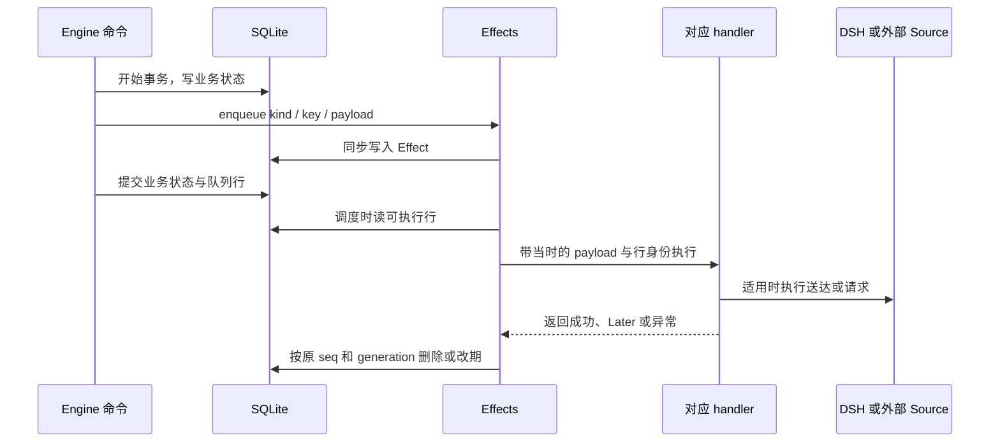

# 23 · 持久 Effects 队列与异步一致性

> 面试题　系统接受了一张文案工单，事务刚提交就崩溃，Worker 怎么还能启动？一条设置通知耗时很长，期间管理员又保存了两次。旧处理结束时怎样保证不删掉新版通知？如果旧通知先被取消，随后以同一个 key 重新入队，原回执还能认出该保护谁吗？

**短答**　原型在 SQLite 同一次事务里保存业务变化与待执行 Effect。Effects 按种类和处理能力在提交后派发，运行和完成之间用 `(kind, key, seq, generation)` 匹配原行。同一个 key 更新 payload 时保留队序、提升 generation。删除再入队会有新的 seq，哪怕 generation 又是 0。旧执行可以收尾，它的数据库结果只能作用到自己原先读取的那一代。对外发送已成功、确认尚未落库时，重启可能再次尝试，具体消费者仍需用稳定消息身份或远端状态收敛。 [Effects](../dsh-superagent-prototype/src/app/effects.ts) · [SQLite 表](../dsh-superagent-prototype/src/app/store.ts#L69) · [宿主投递去重](../dsh-superagent-prototype/src/app/delivery.ts)

本文以本地提交 `7bd4741` 为基线。继续用 Alice 请 Agent 更正帮助页文案的任务。她的请求成为 Trigger X，在 Thread 上触发 Eval E，主 Session 接受后生成 Ticket T 和首次 Assignment A1。Worker 陆续接到补充，最后给出可审阅结果。同一期间管理员改了执行并发上限。下面按记录和调用边界说明哪些动作可以一起提交，哪些执行依赖后续恢复。 [SQLite 持久化篇](22-sqlite-transactions-indexes-and-migrations.md) · [应用架构里的 Effects](../dsh-superagent-prototype/docs/007-architecture.md#L164)

## 1. 为什么事务提交时先保存的是执行意图

### 1.1 两个错误顺序都可能把任务挂在中间

第一个错误顺序是数据库尚未提交就发起外部动作。假设 D、T 和 A1 正在写，先调用宿主启动 Worker，然后后面一个领域检查使事务回滚。会话已经被唤醒，应用里却没有合法工单可引用，也无法靠 SQLite 回滚撤销这次外部调用。第二种顺序在事务完成后才开始记一份独立的待办。若在两个提交间退出，T 留在 pending，下一次没有对应启动项。对于这条链路，可靠性的起点是让「工作获得授权」与「有必要去启动」共享一份本地提交。 [建单流程](../dsh-superagent-prototype/src/core/tickets.ts#L37) · [启动 Effect 入队](../dsh-superagent-prototype/src/executor/dsh.ts#L263) · [Store.atomic](../dsh-superagent-prototype/src/app/store.ts#L133)

`Effects.enqueue` 同步写 SQLite 的 effect 表，再用 kick 安排 microtask。Store.atomic 执行的是同步函数和保存点提交，正常处理下这次异步调度等 JS 同步栈结束才开始读队列。若命令回滚，已经安排的 kick 仍可运行，已经回滚的行不在结果里。现有测试在一笔事务里放一条正常 relay，另一笔放一条让事务抛错的 relay，只看到第一条被运行。这项保证依赖生产者按同步事务边界写入意图，源码没有把跨 await 的外部请求塞到 atomic 里。 [入队与唤醒](../dsh-superagent-prototype/src/app/effects.ts#L60) · [提交后才派发的测试](../dsh-superagent-prototype/tests/effects.spec.ts#L29) · [本地事务详解](22-sqlite-transactions-indexes-and-migrations.md)

### 1.2 领域状态、队列行和观察回执可以各自解释

以 A1 为例，Ticket 说明授权和最近 Assignment 的状态，launch 行说明系统仍需尝试启动，宿主会话历史能说明第一次派工消息有没有进入 inbox 或历史。再如一项外部 reply，outbox 表保存消息内容和 pending、sent、dropped 回执，effect 表保存调度所需的 due、attempts 和错误。发送成功后 effect 行可以删掉，回执仍用于去重与审计。整张 effect 表既包含未执行的，也包含当前正在执行的行。运行中状态由当前 Runtime 的 tasks 集合掌握。看到行存在时，先根据内存运行状态、due 和现场日志定位。 [effect DDL](../dsh-superagent-prototype/src/app/store.ts#L77) · [Outbox 的事务](../dsh-superagent-prototype/src/app/outbox.ts#L22) · [回执存储](../dsh-superagent-prototype/src/app/store.ts#L251)

| 列或记账 | 用途 | 更新行为 |
| --- | --- | --- |
| kind、key | 队列的复合主键 | 一个逻辑工作身份只能有一行 |
| value | kind 所需的 JSON payload | 同 key 再入队可替换 |
| seq | 某行在本 kind 排序时的入队位置 | upsert 保留，删除后再入队使用本 Runtime 的新顺序值 |
| generation | 该行 payload 的更新代次 | 同 key upsert 自增，新行从 0 开始 |
| due | 可被派发的最早时间，以毫秒数保存 | 新入队可立即尝试，重试或 Later 推迟 |
| since | 该队列行起始等待时刻，用于诊断 | 更新同一行不重置 |
| attempts、error | 最近连续异常的重试计数与简短原因 | 普通错误累加，新 payload 将其重置 |
| 内存 tasks | 本 Runtime 当前占用 handler 的 kind/key | 结束并返回后移除，重启重新构建 |

这里的 seq 不要求等于第几条完成的任务，也不是跨所有进程永久递增的审计编号。构造 Effects 时从已持久的最大 seq 继续。一次 upsert 仍会推进内存中的下一个编号，但不会改已有行的 seq，所以可以留空档。事务回滚也不会让这个 JS 计数回拨。重要的是剩下的现有行与新入队行为有序，同一 Runtime 执行中的旧行能和重排后的新行区分。 [取最大 seq 与 upsert](../dsh-superagent-prototype/src/app/effects.ts#L52) · [重启的排序测试](../dsh-superagent-prototype/tests/effects.spec.ts#L174)



## 2. 六类 Effect 为什么用不同的 key 与 handler

### 2.1 从请求到执行，assessment、launch、delivery

**assessment** 以 Eval ID 为 key，payload 只保存 Trigger ID。Evals.start 先保存 active Eval，再通过 Assessor.request 排队。handler 重新从 Engine 读取候选，若现在的 Eval 已经不同则直接返回。仍适用时构造候选卡，用 `candidate:<evalId>` 的稳定身份交给主 Session。等投递返回，再调用 candidateDelivered 记送达并起算 Eval deadline。排队或还没成功递交卡片不直接消耗这段超时预算。该步骤负责候选交付，模型的评估动作通过主 Session 工具另外提交。 [Evals.start](../dsh-superagent-prototype/src/core/evals.ts#L105) · [候选 handler](../dsh-superagent-prototype/src/app/assessment.ts#L89) · [候选送达期限](../dsh-superagent-prototype/src/core/evals.ts#L43)

评估处还有一个值得具体说明的窗口。handler 在构造卡片前查当前 Eval，卡片构建和宿主送达本身有异步等待。这个入口没有一项跨远端传输期间始终占住的领域锁。假如同一时刻 Policy 变化使 Eval 作废，晚到的送达回执仍按 Eval ID 查活动记录，无法修改另一个 Eval。后续评估工具又用当前在途候选或 evalId 核对语义与权限。在面试里不能只凭「曾经进了 main inbox」推断该候选现在一定可提交。 [handler 的读与送达](../dsh-superagent-prototype/src/app/assessment.ts#L94) · [Eval ID 校验](../dsh-superagent-prototype/src/core/evals.ts#L120)

**launch** 以 Assignment ID 为 key，保存 Ticket ID 和 Assignment ID。T 在不同执行代次可以先后排不同 key 的 launch。消费者再读开放 Ticket 与最新 pending Assignment，否则无效旧行可完成。随后 reserve Worker 名额，进入准备目录、确保会话和投递首条任务。慢 prepare 的 Effect 会占启动处理名额及预约容量，主会话仍可继续接单。遇到本地 prepare 命令明确失败时，执行器可将 Ticket 记为 failed 并正常返回给队列，旧 launch 行即清掉。可重试的宿主故障在尝试额度内才作为异常交给 Effects 延期。 [launch 处理](../dsh-superagent-prototype/src/executor/dsh.ts#L263) · [准备命令篇](17-executor-workspace-and-environment.md)

**delivery** 以 Ticket ID 为 key，payload 不把各条 Input 的文本和 Assignment ID 复制进同一行。业务队列已经持久保存在 Ticket，当前 Effect 只表示来读这一张 Ticket 有什么可交付。执行器按顺序处理 undelivered，并在每轮重新读合法的 running Assignment。空闲 Worker 需要先拿唤醒名额。它送达一件后回写成功，也能接着读同一 Ticket 的其他输入。新消息合并到同一个 delivery key 时，业务输入不会因为 UPSERT 被合并丢失。实际合并的是唤醒动作，数据以 Ticket 的多项记录保留。 [Input 推进](../dsh-superagent-prototype/src/core/tickets.ts#L230) · [delivery 任务与循环](../dsh-superagent-prototype/src/executor/dsh.ts#L267)

### 2.2 跨会话与对人交付，relay、notice、reply

**relay** 以业务 request ID 为 key，value 携带发送给主 Session 的文本。比如 X 的人类跟进 relay 用 `followup:<triggerId>`，Worker 提问和报告按其实际身份生成另一个 ID。handler 用 steer 让主 Session 可以继续处理这些消息，按照 ordered 的队列顺序。已有业务信息往往需要同场景下按先后理解，早一条明确的交接结论卡住时，后来的相同 kind 会等待。与 assessment 不同，relay 的入队通常来自已经发生的 Worker 报告或跟进，而候选 assessment 有专门的 Eval 送达规则。 [报告与跟进 relay](../dsh-superagent-prototype/src/app/notices.ts#L98) · [Session handler](../dsh-superagent-prototype/src/app/sessions.ts#L100) · [Runtime 事件对接](../dsh-superagent-prototype/src/app/runtime.ts#L138)

**notice** 也是 ordered，但它用 inject 写入历史，不为了这个提示另开模型回合。某些设置采用 `settings:<block>`、prompt 采用 `prompts`，相同主题的等待 payload 可以被较新状态替换。对于每次发生都要留证的事件，生产者用独立标识的 receiptNotice，不必复用原 Trigger ID。inject 的宿主身份用 name 加内容哈希，让新内容可以进历史，重复内容可以去重。若 resolveAgent 返回找不到之类的错误结果，当前 inject 实现直接返回。真实注入抛错则仍会重试。对这个队列看到没有 pending，应按该 handler 的含义理解它完成了尝试。 [通知标识](../dsh-superagent-prototype/src/app/notices.ts#L15) · [inject](../dsh-superagent-prototype/src/app/sessions.ts#L170) · [等待设置合并测试](../dsh-superagent-prototype/tests/queue.spec.ts#L28)

**reply** 的 key 是 Outbox Message ID，payload 为空对象，发送时候再查同 ID 的 pending receipt 得到 Channel 与文本。一次 enqueue 由 Outbox 的本地事务和一份新回执触发。消费者发现已经不是 pending 可以直接结束。如果 Source 当前不可用，则 Later。目标永久不可接收，或已经因范围配置禁止，可将回执明确结算为 dropped。成功外发后则落 sent。settings 通知只需合并到最新配置，出站消息则用独立的回执语义。这种 key 的设计让队列只留执行需要的引用，外发事实仍按业务 ID 可查。 [Outbox handler](../dsh-superagent-prototype/src/app/outbox.ts#L22) · [状态读取](../dsh-superagent-prototype/src/app/store.ts#L251)

| kind | key | 默认安排 | 完成时一般表示 |
| --- | --- | --- | --- |
| assessment | Eval ID | 未暂停时最多 4，独立候选可并发 | 候选已交付并记回执，或这个 Eval 已经失效 |
| launch | Assignment ID | 按可启动 Worker 名额 | 启动成功、旧派工失效，或业务已记录最终启动失败 |
| delivery | Ticket ID | 未暂停时最多 4，唤醒还要查额外条件 | 尽可能推进此工单输入，各条有自己的域回执 |
| relay | request ID | 严格队序，最多 1 | 适用消息已递交给主 Session |
| notice | 主题名或唯一通知 ID | 严格队序，最多 1 | 提示已注入，或 resolveAgent 错误结果的分支无需继续 |
| reply | Outbox Message ID | 未暂停时最多 1，另有每会话顺序判断 | 已发送、已掉落，或消息保持终态 |

源码注册的 handler 是以 kind 分配，一个 kind 不允许有第二个 handler。类型定义让 payload 明确，但运行时是从 SQLite JSON 解析，而后用当前 handler 解释。旧库里结构变更需要启动迁移补上字段，不是每次执行都依据旧数据猜出演化语义。统一队列负责调度协议，各个业务消费者负责判断任务是否还有效、究竟完成了什么。 [typed payload 与注册](../dsh-superagent-prototype/src/app/effects.ts#L11) · [旧 assessment 转换](../dsh-superagent-prototype/src/app/migration.ts#L599)

## 3. 同一种 Effect 怎样成为当前可以运行的任务

### 3.1 有序与普通扫描的取数不同

每次 dispatch 先根据 started 和 stopped 判断生命周期，才按注册的 kind 遍历。对 ordered kind，SQL 直接取该类 seq 最早的一行，随后才判断 due 是否到期以及是否已有本 kind 的任务运行。若最早行没到期，第二行即便已经 due 也不会作为候选。对普通 kind，SQL 先用 due 条件挑出可运行行，再按 seq 排序取一批。代码给普通 kind 的取数窗口为 `16 + running.size`，然后排除相同 key 已经在本 Runtime tasks 的行。较旧但未到期的工作不会挡住已到期的下一行。 [dispatch 两条查询](../dsh-superagent-prototype/src/app/effects.ts#L103) · [排序与并发的测试](../dsh-superagent-prototype/tests/effects.spec.ts#L51)

就绪候选形成之后，才读取 `handler.limit()`，减去本 kind 当前在跑的 key 数，得本轮 room。没有就绪候选时不会去取限额。ordered 再把 limit 压到最多 1。启动 handler 的时候保留在途任务对象，避免同一 kind/key 同时另开一份。handler 的 Promise 完成后，从 tasks 移除并 kick，下一轮可启动其它行或该 key 的新代次。不同 kind 各自限额，并没有根据一处全局 seq 拼成一个严格的业务顺序。 [handler 注册](../dsh-superagent-prototype/src/app/effects.ts#L67) · [在途与完成](../dsh-superagent-prototype/src/app/effects.ts#L103) · [没有可执行行时的限额测试](../dsh-superagent-prototype/tests/effects.spec.ts#L150)

动态限额只能关住下一次调度，已经在执行的 Promise 仍按自己的合同继续。假如管理员把 maxWorkers 从 2 调低，launch 的 limit 读取最新余额，而一个慢 prepare 已经开始，当前运行时并不会只因配置变化撤掉这次任务。又如暂停，launch、delivery、assessment、reply 已注册 0 门限，Sessions 的 ordered relay 和 notice 没有相同暂停判断。如果旧 reply 在暂停前已开始等待外部结果，它是成功结算还是留作以后重试，要看实际执行结果。不要把门限变化误读为取消或回滚外部动作。 [Executor 限额](../dsh-superagent-prototype/src/executor/dsh.ts#L228) · [会话 handler](../dsh-superagent-prototype/src/app/sessions.ts#L100) · [外发 handler](../dsh-superagent-prototype/src/app/outbox.ts#L22) · [槽位热更](18-worker-slots-and-backpressure.md)

### 3.2 串行不等于严格先进先出

考虑 t=0 入队 L1、L2。L1 第一次运行失败，将 due 改为 t+2 秒。两个队列都限制同一时刻只跑一个 handler。如果是 ordered relay，L2 已经到期也得等 L1，因为 SQL 先取最早 seq 再判断 due。若是非 ordered 且 limit=1，下一次 dispatch 会在已到期的行里选 L2，等 L1 重试时间到再尝试它。单并发控制同时跑几个，严格队序决定预期处理顺序，两种选择适用的业务不相同。 [ordered 模拟测试](../dsh-superagent-prototype/tests/effects.spec.ts#L137) · [普通 kind 的扫描](../dsh-superagent-prototype/src/app/effects.ts#L107)

这期补充用例给非 ordered 的 reply kind 一个不依赖 Source 的 handler，刻意让 old 第一次失败，再入队 new。实际调用顺序为 old、new、old。在这个实验里 new 成功是因为没有业务条件要求它等 old，说明 Effect 层单并发允许绕开退避中的行。真实 Outbox 的 handler 还附有 per-Ticket/per-conversation 顺序检查。若新 reply 与尚未发出的旧 reply 属同工单同会话，旧者仍在失败阈值内，则返回 Later。这层顺序由业务谓词决定，不能由测试的轻量 handler 推出任意两条真实回复都能越序。 [Outbox 顺序检查](../dsh-superagent-prototype/src/app/outbox.ts#L39) · [同会话匹配查询](../dsh-superagent-prototype/src/app/store.ts#L255)

评估卡片需要来源链接，可能一组连接变慢。assessment 的 limit 是 4，且这类队列并无严格队首观察。场景中一张卡等待时，另一个 Thread 的卡仍可准备并进入主 Session。Worker 报告的 relay 与它分属不同 kind。即使 relay 因队首失败阻住后续 report，assessment 自己还有能力尝试。严格队序保留到达顺序，坏一条拖住后续是代价。如果未来需要按 Session 或 Thread 分区保序，需要明确每个分区内可被重试和持久化的身份，以及如何避免某分区挤满全部并发。 [候选异步处理](../dsh-superagent-prototype/src/app/assessment.ts#L89) · [慢候选链接对照](../dsh-superagent-prototype/tests/runtime-concurrency.spec.ts#L31)

### 3.3 Passes 定期推进，kick 尝试调度

两个入口共同启动扫描。enqueue、handler 注册、某任务结束等事件可以 kick，把多个同步请求合并到一个 microtask。定时的 Passes 每 2 秒尝试推进。Source 保存新 Trigger 和一部分工具操作也可以申请立即跑一轮。Passes 用 pumping/pumpAgain 避免两轮扫描进度互相穿插，多次请求在当前 Pass 后合并到一个后续 Pass。每轮先 kick Effects，再调用 Engine.evaluateDue。它不会等待异步 handler 全部完成再让 Source 进来。 [kick](../dsh-superagent-prototype/src/app/effects.ts#L83) · [Passes](../dsh-superagent-prototype/src/app/passes.ts#L22) · [重复请求合并测试](../dsh-superagent-prototype/tests/passes.spec.ts#L28)

重试计算把 due 写 SQLite，没有为每个待办单独启动一个到期定时器。若 t=1000 队列到期，而周期扫描迟到到 t=1500，执行也可以在后者才发生。due 是最早调度时间，真实延迟还要加扫描、容量、队首、宿主、网络等待。idle(kind) 是给调用者等「眼下能跑的这类工作」的助手。它触发全局 dispatch，但只等符合该 kind 的在途 Promise。队首因 due、暂停或无槽暂时不可跑时，它可以返回，pending 表里仍保有行。因此测试题的「等到 idle」应明确究竟要断言没有当前任务，还是未来队列也已消失。 [idle 与扫描](../dsh-superagent-prototype/src/app/effects.ts#L89) · [周期](../dsh-superagent-prototype/src/app/passes.ts#L28) · [队首存在的行为](../dsh-superagent-prototype/tests/effects.spec.ts#L137)

## 4. 两个同 key 并发例子为什么分别需要 generation 和 seq

### 4.1 同一行更新 payload 时，旧尝试仍会返回

假设 key 是 `notice/settings:executor`，t0 入队值 v1，seq=10，generation=0。host 迟迟没有成功注入。t1 管理员保存 v2，上一次处理在途，SQLite 更新同一行为 seq=10、generation=1。t2 v3 再入队变成 generation=2。v1 的 handler 拿到的是旧 row.value，接下来仍可成功或抛错。队列没有用 abort 强制中断 v1。新 value 在数据库，现存 tasks 的 kind/key 还会限制这次更新立即开第二个 handler。等 v1 完成才可能走新一次扫描。 [UPSERT 行保留](../dsh-superagent-prototype/src/app/effects.ts#L60) · [同 key 在途](../dsh-superagent-prototype/src/app/effects.ts#L103)

v1 成功，它尝试删除 `kind=notice, key=settings:executor, seq=10, generation=0`。数据库当前 generation=2，因此匹配 0 行。v1 如果失败，预计进行 attempts+1、写 error、改 due，同样按照这四个字段，更新 0 行。若 v1 返回 Later，只推 due 也须匹配这代，不能把 v3 往后推。三条收尾路径都保护当前有效 payload。v2 已经被 v3 覆盖并且从未开始，实际常见顺序是 v1 和 v3，不保证 v2 一定走一遍外部消费者。这是设置快照等合并意图的合同。 [按旧身份收尾](../dsh-superagent-prototype/src/app/effects.ts#L130) · [覆盖期间只执行首末版本](../dsh-superagent-prototype/tests/effects.spec.ts#L39)

本文补充用例分别让 v1 返回普通错误和 Later，在 v2 开始后停住它并直接检查行。结果显示 seq 与 since 沿用旧行的起始值，新代次的 attempts 仍为 0，error 为空，due 保持 v2 入队时的可执行时间。v2 则没有被旧失败弄成等待。这个测试比只检查最终送出了 v2 更强。若旧尝试错误地加了 1 次失败但调度最终又成功，最终没有重复消息的断言看不出错误，它会影响运营健康指标与下次退避。 [失败与代次分支](../dsh-superagent-prototype/src/app/effects.ts#L130)

这里的 upsert 也没有比较旧值与新值的 JSON 是否相同。生产者再次 enqueue 同一内容，仍会更改 generation、清空已有错误并把 due 提到现在。因此调用次数过多时，不能把看到 attempts 重置当作故障已经恢复。应将这条记录与上游是否重新提交工作一起核对。 [upsert 字段](../dsh-superagent-prototype/src/app/effects.ts#L60)

### 4.2 取消后重新入队，generation 可以和旧行一样

另一个序列是 t0 入队 `relay/K`，seq=20、generation=0，开始执行。t1 `cancel(relay,K)` 直接删行。旧 handler 的 Promise 仍继续，也会保持在 tasks，一次数据库 DELETE 不会取消它已发出的请求。t2 又以同样 key 入队，成为 seq=21、generation=0。在同一 Runtime，旧回执只匹配 20，这时不能删 21。两个 generation 都是 0，所以只比代次仍不够。反过来，同一行 upsert 保留 seq，所以只比 seq 也无法保护 v3。 [cancel 与 enqueue](../dsh-superagent-prototype/src/app/effects.ts#L60) · [取消重排测试](../dsh-superagent-prototype/tests/effects.spec.ts#L160)

| 现场 | 旧 handler 看到的 seq/gen | 现存行的 seq/gen | 用更少字段会发生什么 |
| --- | --- | --- | --- |
| 同 key 更新 payload | 10/0 | 10/2 | 只比 seq 会更新或删除新版 |
| 取消后以原 key 新建 | 20/0 | 21/0 | 只比 generation 会把新行认成旧行 |
| 没有更新，正常返回 | 22/0 | 22/0 | 完成应当结算当前这一行 |
| 已取消且没重建 | 23/0 | 无 | 旧执行只结束内存任务，已无行可改 |

可以把这条规则想成带版本的条件更新。handler 使用已经取得的行快照，收尾相当于「只有还是同一行、同一代才写结果」。保护窗口只涉及 effect 行，不能替代对业务对象的二次检查。比如取消一个 reply 并不撤回已送到外部平台的请求，删除行也不能中断原来已经起步的准备命令。要限制不再有效的业务动作，需要派工、Eval、回执各自的状态守卫，必要时使用对应服务的取消协作。 [队列条件更新](../dsh-superagent-prototype/src/app/effects.ts#L130) · [取消 API 说明](../dsh-superagent-prototype/src/app/effects.ts#L78) · [停 Worker 的实际控制](../dsh-superagent-prototype/src/executor/dsh.ts#L352)


### 4.3 投递循环可能已经读到新输入，为什么还保留新代次

拿 delivery 举一个不同于快照通知的例子。I1 已入 T 的等待队列，投递 Effect 开始处理它。此时 I2 又到达，在同一次领域事务里和同 key 的 upsert 一起保存。旧 handler 送完 I1 后，循环会重新读 T，有机会在这一轮顺带送达 I2。旧行的 generation 仍更新过，因此这轮旧尝试成功不能删除新版 Effect。下一次扫描这张 T 时，若两个输入的送达回执都已写好，新 handler 看见 undelivered 已空，安静退出并清理新版。这种有时多一次空扫描的安排，让队列层无须根据每类消费者的内部循环去猜有没有处理新工作。 [delivery 逐项回读](../dsh-superagent-prototype/src/executor/dsh.ts#L289) · [新旧代次写回](../dsh-superagent-prototype/src/app/effects.ts#L130)

另一种顺序中，I2 在旧 handler 最后一次读队列之后才加入。旧 handler 已经准备返回，自己没有看到 I2，Dispatcher 必须依靠新代次再次尝试。仅凭「旧任务这次返回成功」无法区别这两种情形。正确的派发策略依赖两份可核对状态，SQLite 里的新版行表达还需要看一眼，Ticket 的队列表达实际剩余输入。若为了少一次查询而无条件用 kind/key DELETE，第二种顺序会丢掉唤醒。每次消息都有独立的领域 Input 与宿主身份，也使第一次顺带处理过的消息经回读能够识别为已完成。 [Input 入库和触发](../dsh-superagent-prototype/src/core/tickets.ts#L230) · [回执更新](../dsh-superagent-prototype/src/core/assignments.ts#L42)

判断新任务是否真的执行过，可以至少查三次状态。旧 handler 已开始时取它读到的 generation。保存 I2 后单独查行的 generation 和 queue 内容。放行旧 Promise 后，再观察是否出现新版 handler 及 I2 的送达回执。业务循环越能主动读最新状态，越需要在测试里精确冻结这些时间点。否则一个测试可能只看到所有消息最终送到，无法覆盖旧 handler 刚读到空队列就退出的分叉。 [并发 upsert 断言](../dsh-superagent-prototype/tests/effects.spec.ts#L39)

## 5. 重试什么时候发生，为什么三次失败以后还在队列里

### 5.1 同一次执行有三类返回结果

Effects.attempt 首先把实际调用 handler 的异常捕获为 failure，再根据结果按旧行身份提交本地处理。成功时删除此行。这个返回常常表示适用工作完成，也可以表示消费者发现领域对象失效，已经没有必要执行。比如 launch 看到 A1 不再是当前 pending，直接返回且只清理旧启动记录。若 handler 已处理失败并把它记录成业务终态，例如 worktree prepare 失败，Effect 层也能把这次启动从队列退掉。不能从一次删除反推「每个 handler 都产生了预期的远端副作用」。 [attempt 的结果分支](../dsh-superagent-prototype/src/app/effects.ts#L130) · [launch 处理业务失败](../dsh-superagent-prototype/src/executor/dsh.ts#L269)

第二种是 `Later`，它表示该动作现在不该做或暂时拿不到依赖。Effects 只把 due 调到当前时间加初始重试延迟，不增加 attempts，不改已有的 error。比如 delivery 的空闲目标还没有槽，或者较早的同会话 outbox 回复仍挡着当前消息，均可能走 Later。这不会把单次正常背压变成故障告警。Later 是由 handler 抛出的调度结果。如果一开始 limit=0，handler 根本没获得执行机会，记录仍保留原 due。 [Later 结果](../dsh-superagent-prototype/src/app/effects.ts#L130) · [没有槽位的检查](../dsh-superagent-prototype/src/executor/dsh.ts#L186) · [Outbox 等待条件](../dsh-superagent-prototype/src/app/outbox.ts#L39)

第三种是普通异常，attempt 会增加 attempts、把异常字符串截到一千字符并保存 error，并用当前 row 最初读到的 attempts 算指数退避。延迟等于初始值乘以 2 的幂，并受 kind 的上限约束。默认情况下从 2 秒开始，最大 60 秒，launch 和 reply 从 5 秒开始、最大 300 秒。由于是按原行字段匹配，先前代次的异常不会推迟刚加入的新 payload。 [安装参数与退避公式](../dsh-superagent-prototype/src/app/effects.ts#L67) · [行级选择](../dsh-superagent-prototype/src/app/effects.ts#L130) · [launch handler 的配置](../dsh-superagent-prototype/src/executor/dsh.ts#L228) · [reply handler 的配置](../dsh-superagent-prototype/src/app/outbox.ts#L22)

| 一个默认 relay 的尝试 | 开始前的 attempts | handler 结果 | 保存的新 attempts 与退避 |
| --- | --- | --- | --- |
| 第一趟到期 | 0 | 普通错误 | 1，当前时间加 2 秒 |
| 第二趟到期 | 1 | 普通错误 | 2，当前时间加 4 秒 |
| 第三趟到期 | 2 | 普通错误 | 3，当前时间加 8 秒 |
| 下次因某项业务等待返回 Later | 3 | Later | 仍 3，延后初始的 2 秒 |
| 后续同 key 新有效 payload | 旧行仍留 | upsert | 重置为 0，due 更新为现在 |

表里「当前时间」是写回结果用的 clock，得先等这次 handler 运行结束。一次 30 秒失败加 2 秒 backoff，等待时间不是从启动起只算 2 秒。重试也不保证马上在 due 那一毫秒开始，实际要等后续扫描、并发限额和其它阻塞。Later 不重置已有错误，因此监控可以既看到某一次正常延期，也看到该行之前真实的连续失败。新 enqueue 的合同则明确将计数重置。 [普通退避用例](../dsh-superagent-prototype/tests/effects.spec.ts#L85) · [Later 的直接用例](../dsh-superagent-prototype/tests/effects.spec.ts#L122)

### 5.2 区分队列健康、运行时健康和工单错误

`report(kind)` 查询的是该 kind 表中仍在的行数、最早 since、最大 attempts，以及一个按 seq 从新到旧选出的失败理由。最大 attempts 达到 3 且该 kind 并非 quiet，就投影成 health.error。这里的 3 是展示故障阈值，队列没有因此移动到死信表或停止重试。错误摘要也不按每次失败发生的时间排序。若多个 key 同时报错，仍应查询相关行。任务成功并删除后，剩余行若无超过阈值的记录，状态可回到 ready。ready 也可以有 waiting 记录，只反映当前表示健康的口径。 [健康投影](../dsh-superagent-prototype/src/app/effects.ts#L147) · [三次失败再恢复的用例](../dsh-superagent-prototype/tests/effects.spec.ts#L85)

delivery 注册时 quiet=true，让会话交付错误如 `ticket.delivery.error` 主要展示在对应 Ticket。队列本身的 SQL 失败、限额计算异常和写回错误仍可触发 `failed(kind,error)`，记录 broken 和健康异常。这个 broken 在后来 dispatch 成功时清掉并通过 report 更新现态。如果 Pass 做领域时钟推进抛错，又走的是 runtime health。面试提到「告警了但任务没挂」要先问是一个 Effect key 反复失败、一种 queue 调度出错，还是推进整个 orchestrator 出错。它们的恢复入口各不相同。 [队列异常恢复用例](../dsh-superagent-prototype/tests/effects.spec.ts#L192) · [quiet 测试](../dsh-superagent-prototype/tests/effects.spec.ts#L150) · [运行时 Pass 测试](../dsh-superagent-prototype/tests/passes.spec.ts#L17)

还有一个易混的 3 在 Outbox。查询同 Ticket 同 Channel.thread 的早期 pending reply 时，考虑它的 reply Effect attempts 是否仍小于阈值。达到阈值后这一行不再阻挡较新的回复，旧回执本身仍可能是 pending，其 Effect 仍会重试。它避免这个会话长期被一条损坏回复阻塞。ordered 的 relay 队首依旧遵循该 kind 的顺序，health 达到 3 不自动放行后续 relay。相同数字来自共享常量，具体业务动作仍需查消费端。 [Outbox 顺序](../dsh-superagent-prototype/src/app/outbox.ts#L39) · [回执 behind 查询](../dsh-superagent-prototype/src/app/store.ts#L255) · [ordered 选择策略](../dsh-superagent-prototype/src/app/effects.ts#L103)

## 6. 从关闭到重启，哪些待办会被接起来

### 6.1 drain 控制派发边界，当前任务由自己的合同收尾

启动时构造 Effects 并注册各 kind handler，队列可先写下意图。Runtime 完成 Setup、确保主 Session、恢复执行器并启动 Passes 后，才调用 effects.start 开始派发。未配置阶段即使看到行也可以等待。关停时先让生命周期信号中止，停止 Pass 和 assessor，再等待 Effect drain 与会话 idle。Effects.drain 设 stopped，禁止新 handler 启动，然后 await 当时正在执行的 tasks。它自己不会把所有 Promise 当场取消。那些调用最终交给 Runtime 与宿主服务的关闭合同来结束。 [Runtime 初始化](../dsh-superagent-prototype/src/app/runtime.ts#L201) · [Runtime 关闭顺序](../dsh-superagent-prototype/src/app/runtime.ts#L228) · [Effects start 与 drain](../dsh-superagent-prototype/src/app/effects.ts#L83)

若某个已经在跑的 handler 在 stopped 后成功返回，它仍会按旧身份删自己那一行。若它抛错，attempt 的失败分支看到 stopped 后就返回，队列行原样保留。关停时不再把这次被中止的操作写成一次业务失败或新的退避。还没启动的行也不从表中移除。新 Runtime 读表，把剩余 seq 最大值作为当前起点，按现有 due 尝试恢复。对于同 key 如果某个上层恢复流程明确再次 enqueue，upsert 可依正常合同重设本行的尝试与 due，所以要分清「只重开 SQLite」和「业务恢复重新安排」。 [停止后的分支](../dsh-superagent-prototype/src/app/effects.ts#L130) · [初始化 seq](../dsh-superagent-prototype/src/app/effects.ts#L57) · [Worker 恢复扫描](../dsh-superagent-prototype/src/executor/dsh.ts#L519)

补充实验刻意让 ordered relay `a` 第一次失败，`b` 在后面等。drain 之后真正关闭 SQLite 文件，再开新的 Store 与 Effects，新排 `c`。待 a 上次退避时间没有到时，handler 没有开始，SQL 查到 attempts=1、due 仍是原来时间。推进虚拟时钟后，调用顺序为 a、b、c。这个例子看到了真正的持久数据跨连接存活。现有测试还覆盖了关停切断在途 handler 且随后恢复两条待办，以及新任务排到已经等待的行之后。 [关停恢复用例](../dsh-superagent-prototype/tests/effects.spec.ts#L105) · [重启后序列顺序](../dsh-superagent-prototype/tests/effects.spec.ts#L174)

### 6.2 迁移怎样接起旧版本保存的待办

schema 10→11 启动期间，在任何当前 handler 跑起来以前，旧 relay 和 notice 从 KV 导入统一 effect 表。取原业务 key 和 payload，按待办的顺序写入。已有相同 kind/key 的行在迁移时不被覆盖。迁移内写好新行后让旧 KV 被清除，一旦迁移回滚，布局和记录仍处于老版本。旧 assessment 记录缺 Trigger 引用时使用在途 Eval 补齐，已经失效的旧评估可以删除，未送达的活动 Eval 可补排一次正确的交付。启动恢复的是以前保存的工作意图，依据新队列规则执行。 [旧队列导入](../dsh-superagent-prototype/src/app/migration.ts#L119) · [assessment 修复](../dsh-superagent-prototype/src/app/migration.ts#L599) · [旧队列迁移端到端测试](../dsh-superagent-prototype/tests/queue.spec.ts#L10)

旧队列的测试先让库以 schema 10 形态保存一个报告 relay、一条订阅变化、一个 prompt 保存通知及一个设置通知。Runtime 打开迁移后，断言主 Session 通过 steer 拿到报告，通过注入看到通知，旧 KV 和当前已通过的队列行可移除。这里验证从旧持久意图到当前消费者的接续。另一个用例让主 Session 短时间无法注入通知，在此期间多次修改 pause，最后只看见能代表最新值的通知。把旧业务记录的迁移与快照消息的合并分开，可以解释哪些内容本来就无需在主会话中逐条重放。 [旧队列用例](../dsh-superagent-prototype/tests/queue.spec.ts#L10) · [合并等待通知用例](../dsh-superagent-prototype/tests/queue.spec.ts#L28)

## 7. 已提交的本地状态之外，仍要处理两次触达

### 7.1 五个故障窗口，分别从哪一处恢复

以给 Alice 发出确认的 reply R 为例。接受操作保存 T、A1、回执与相应 Effect。真正出站在后来。用户是否能看见结果取决于多个提交时点。下表用 X、T、R 表示同一任务和消息身份，所有补送还需满足目标未撤销及原业务当前有效。 [确认写入](../dsh-superagent-prototype/src/app/outbox.ts#L26) · [回执状态](../dsh-superagent-prototype/src/app/store.ts#L251)

| 崩溃或停机时点 | 本地记录可能是什么 | 消费者重新处理要做什么 |
| --- | --- | --- |
| 域事务尚未提交 | T、回执、Effect 随事务撤销 | 从允许重试的生产路径继续，不执行已经撤销的意图 |
| 已提交，reply handler 未开始 | 持久 pending receipt 与 Effect | 从队列表恢复并再次检查目标 |
| 远端未收到或尚不确定 | 本地仍 pending | 以原 Message ID 检查或继续尝试 |
| 远端已写，回执更新前中断 | 本地仍 pending，远端可能已有结果 | 利用平台身份去重或查询已发送证据 |
| sent 已落库，旧 Effect 尚在 | 同 ID 回执已终态，Effect 仍可被取出 | handler 读到非 pending 即返回，队列据原身份清行 |

最需要解释的是第四行。没有一个横跨 SQLite 与 GitHub 或飞书接口的事务提交。SQLite 记录了这件事该做，远端收到了它仍可能只在远端知道。Outbox 重新调 handler 的请求保持 Message ID，可据平台行为检查是否已经发过。将 Worker 报告 relay 到 main 也有类似的结构，区别是主会话由 DSH 适配，重试补送会查持久历史或当前 inbox。只要原副本可见，就没有必要为同一请求再插一个 Message。 [GitHub 消息适配](../dsh-superagent-prototype/src/sources/github-channel.ts#L17) · [Feishu 回复参数](../dsh-superagent-prototype/src/sources/feishu-channel.ts#L18) · [DSH 适配](../dsh-superagent-prototype/src/app/delivery.ts#L61)

采用 GitHub adapter 时，源码把 Outbox ID 写入评论的 HTML marker，重试前读符合账号、评论对象和标记的消息。飞书 adapter 传的是同一 Outbox ID 作为请求的 idempotency key。前者靠查找远端已有事实，后者把去重合同交给接口。两种方式的覆盖仍依赖真实的外部行为与回执，不应从本地 SQL 谓词推导远端在所有情况下只发送过一次。第 24 篇会详细展开不同 Channel 的含义。本篇的核心是队列每次重试仍指向有稳定业务身份的对象。 [GitHub 幂等 marker](../dsh-superagent-prototype/src/sources/github-channel.ts#L23) · [Feishu 稳定 key](../dsh-superagent-prototype/src/sources/feishu-channel.ts#L19)

### 7.2 幂等需要分别核对队列、业务和宿主身份

一个 `kind/key` 相同的行解决的是本地合并与调度。同一个 handler 在外部可以产生多个调用，也可能一次都没产生。Generation 保护的是旧结果与新一代 Effect 字段。Ticket、Assignment 与 Trigger ID 约束的是业务交付对象。Host 或远端协议中的 request ID 才用于识别实际插入或出站。比如 delivery 以 T 合并，I1、I2 的 Message ID 仍各自不同。如果把 T 直接当 DSH 消息的唯一身份，I2 会被误认为 I1 的重试而失去。 [delivery 的批次](../dsh-superagent-prototype/src/executor/dsh.ts#L267) · [Session 发送身份](../dsh-superagent-prototype/src/app/sessions.ts#L156) · [投递幂等篇](19-session-delivery-and-read-receipts.md)

ordered 允许任务交付顺序符合消费者约定，也可能让系统整体等待同一失败行。按 Ticket/会话保存每个键的业务状态时，可以选择「当前 key 不再有效就处理完这一行」，也可用健康与延迟指标反映长期失败。若未来做独立多 worker 队列服务，应另外设计 claim/租约等跨进程协调。当前内存 tasks 与状态目录独占一起约束本安装的调度，行没有跨 Runtime 可见的运行租约字段，失败关闭后的下一次尝试还要靠业务层守卫。 [表结构](../dsh-superagent-prototype/src/app/store.ts#L77) · [运行任务内存记录](../dsh-superagent-prototype/src/app/effects.ts#L46) · [状态目录保护](../dsh-superagent-prototype/src/app/runtime.ts#L87)

## 8. 把六类 Effect 展开到一次任务时序里

### 8.1 同一个原始请求怎样形成多个独立待办

沿 T 这次任务从头走。X 进入 Source，Engine 保存 Trigger、Thread 和适用的待评估信息。一个 Pass 再开启 Eval E，写入 assessment 行。E 有自己的状态与期限。接着主 Session 得到候选并提交 accept，D、T、A1 形成，这个事务产生 launch，若需要确认则还写 reply。launch 和 reply 在同一笔接受内作为并列待办出现，实际 Worker 初始化与请求人收到确认可以并行推进。SQLite 提交顺序不能替这两个异步 handler 排出跨 kind 的顺序。遇到请求人先看到确认而 Worker 暂时没有目录，可以分别看 launch 的容量、错误和 A1 状态。 [接收与评估](../dsh-superagent-prototype/src/core/engine.ts#L64) · [初次派工与确认](../dsh-superagent-prototype/src/core/tickets.ts#L37)

设 A1 已运行，Alice 又在 PR Thread 发送 Y。正式订阅让 Y 产生 T 的 Input 和 delivery。Runtime 也可能因为这次跟进给主 Session 记一条 followup relay。这个 relay 表达「某个 Worker 正负责这条后续」的事实。它与创建一个需要主 Session 评估的新候选走不同路径。两个 Effect 可分别被不同 handler 控制。当主会话临时离线，delivery 仍可能让 Worker 看见原话，随后主会话再得到此前等待的 relay。不能从主会话没显示 Y 推断 Worker 没有收到它，反过来通知到了也不能证明 Worker 已读。 [运行时的 follow-up](../dsh-superagent-prototype/src/app/runtime.ts#L138) · [跟进分属不同会话的用例](../dsh-superagent-prototype/tests/followups.spec.ts#L14)

Worker 经过验证交给人，报告 ready 的事务会保存最新报告，并在适用时排入另一条 relay。主 Session 收到后如果提交外部 result，Outbox 再为该 result 生成自己的 reply。此处两个 Effect 之间存在一个模型回合和受控工具提交。它不像 launch 与最初 ack 那样由同一次接单并列产生，也不该因两个记录 key 不同而忽略积压的上游。若找不到预期 result 的 reply，应先查是否已经要求外发、主 Session 是否消费报告，以及确定了哪个 Channel。直接重放 Worker 报告不能替代人的目标消息、认领和答复用途这些业务判断。 [报告入库与 relay](../dsh-superagent-prototype/src/app/tools/executor.ts#L85) · [回复入口](../dsh-superagent-prototype/src/app/tools/main.ts#L223) · [Outbox 入队](../dsh-superagent-prototype/src/app/outbox.ts#L26)

### 8.2 管理员改配置是一条不同的控制面路径

同一期间操作者把最大 Worker 并发从 2 改到 3，又改到 4。Settings 保存实际配置以及适用的 notice。队列 value 代表让主 Session 知道的提示内容，权威配置仍可从 Store 读。若待注入时合并相同 key，早一份通知 payload 可以被后来覆盖。Effects 与执行器也会在合适的后续调度直接看当时配置，这项行为不依赖模型先读到通知再重说一遍。Notice 在模型接到下一项工作时便于知道系统发生过变化。对需要保留每个审计事件的场景不能照搬这个 key 选择，应给每个独立事件保留自己的身份。 [配置保存](../dsh-superagent-prototype/src/app/settings.ts#L175) · [通知 key](../dsh-superagent-prototype/src/app/notices.ts#L15) · [执行器实时限额](../dsh-superagent-prototype/src/executor/dsh.ts#L228)

这条路径也解释为什么 receipt notice 与 settings notice 可以同属一个 handler。入队系统的单位按 key 决定，通知类型和内容由上层填。Settings 只有最新快照足以指导后续时可合并，单次 stop 或再次重评等各有证据价值的事件由生产者选择独立 ID。会话层在完成注入时还加上内容哈希，一个主题的新 payload 不必与旧内容用同一个宿主 Message ID 去重。相同逻辑的不同对象可以将「业务上最新」「告知曾发生」「重复传输」分开处理。 [通知生成](../dsh-superagent-prototype/src/app/notices.ts#L38) · [宿主 notice 身份](../dsh-superagent-prototype/src/app/sessions.ts#L180)

## 9. 面板和日志怎样区分几种等待

### 9.1 先查行，再查依赖的事实

现实排查可先从 Effect kind 与 key 查一行，接着看 seq、generation、attempts、due 和 since。若 due 未到，查看最近是正常 Later 还是出错退避。若 due 已到仍在等，查看 handler 限制、Runtime 是否恢复、同 kind 运行数或是否 ordered 的旧队首缺依赖。若行已消失，再去找消费者的业务结果。对于 reply 查 receipt，对于 launch 查 Assignment，对于 delivery 查当前 Input 是否仍待送和实际 Session 回执。单独从表的「有没有这一行」只能追到调度状态，不能替代任务结果审计。 [队列状态与取数](../dsh-superagent-prototype/src/app/effects.ts#L75) · [运行面板读回执](../dsh-superagent-prototype/src/app/store-read.ts#L68)

| 一个观测 | 可优先验证的条件 | 治理时适用的证据 |
| --- | --- | --- |
| 等待数高但 health 仍 ready | 无行触发显示失败阈值，或该 kind quiet | 记录实际积压、到期时间与受限资源 |
| due 早已到达，只有后续 relay 等 | ordered 队首更早，当前仍在途或未到期 | 查队首 ID 和该 Session 的错误 |
| 相同 key 有新 payload，但消费者仍在处理上一版 | 当前旧任务仍在 tasks，行的 generation 已增加 | 区分在途快照与 SQLite 的当前行 |
| 业务显示 failed，原 launch Effect 无行 | handler 记录了有效的启动失败并返回 | 查报告与能否用受控 retry 新建 Assignment |
| reset 后 attempts 变成 0 | 对该 key 又 enqueue，重置字段 | 查看是否该更新为新的意图，而非把它当成恢复成功 |
| 行已删除但用户没见到结果 | handler 已结束，其结果不等于外发成功 | 看域事实、宿主历史或 Outbox |

可为每个 kind 单独度量队首到期延迟、连续失败时长、正在执行时间与每次 handler 的成功完成比例。一个按 `MIN(since)` 算出的最老等待时间很有用，也会包含正在执行和未来才 due 的行。想定义更贴近延迟目标的指标，可以加「最早可运行但尚未开始的任务年龄」，再明确 CPU、模型等待和网络延迟分别走哪些队列。历史工单累计总数通常无法描述当前 Effects 的请求压力。 [health 汇总 SQL](../dsh-superagent-prototype/src/app/effects.ts#L151) · [当前在途的计算](../dsh-superagent-prototype/src/app/effects.ts#L103)

### 9.2 面试的演进题可以从可验证的假设开始

如果想把 ordered relay 拆成几个会话队列，可先假设不同主 Session 的消息互不依赖，同一主 Session 的业务仍要求序列可用。新增分区要保留每个序列的出错重试、配置热变与容量公平。收益是坏一条只阻塞其分区，代价是读模型与 key 要包含可复用的会话身份，迁移时还要组织现有工作。若系统仍只允许一个统一的主 Session，就优先缩短真正卡住的那条消息发送，并检查是否主 Session 的宿主或模型在慢，拆分未必减少它必须看见的事件。 [适配主 Session 的 ordered 队列](../dsh-superagent-prototype/src/app/sessions.ts#L100)

在更大的部署里，持续失败的 key 也可能被设计成可隔离的待修复状态。这里需要先确定哪类任务能被跳过，如何给它留下业务回执并允许操作者安全再次提交。启动 Assignment 若已经失效，可以由当前守卫确认完成。用户确认或结果通知若仍有生命力，过期处理要与交付约定匹配。这归结为一个设计选择，是否允许根据时间失效，失效后保留哪一条可追踪事实，以及从哪上游主动补偿。不能仅因为某任务超过通用的三次健康阈值就推定可以丢弃。 [业务失效检查](../dsh-superagent-prototype/src/executor/dsh.ts#L269) · [reply 的不同结算](../dsh-superagent-prototype/src/app/outbox.ts#L39)

## 10. 已执行的源码验证与复现入口

本篇在临时 Git 副本中用锁定依赖离线运行以下九个文件，**218 个现有测试全部通过**。另有 **4 个补充用例通过**。它们分别检查旧普通错误、旧 Later 对新代次的影响，真正关闭并重开数据库后保留退避与队序，以及单并发普通队列可处理已到期的后续项。程序与 SDK 测试使用 SQLite、受控时钟及 DSH 或 Source 夹具。它们验证应用行为，未向真实 GitHub 或飞书发送消息。 [测试入口](../dsh-superagent-prototype/package.json) · [Effects 单测](../dsh-superagent-prototype/tests/effects.spec.ts) · [旧队列测试](../dsh-superagent-prototype/tests/queue.spec.ts)

```sh
corepack pnpm test tests/effects.spec.ts tests/queue.spec.ts tests/passes.spec.ts \
  tests/delivery.spec.ts tests/runtime.spec.ts tests/runtime-concurrency.spec.ts \
  tests/outbox.spec.ts tests/followups.spec.ts tests/migration.spec.ts
```

| 可以核对的时序 | 已有断言 |
| --- | --- |
| 同一事务内入队，回滚的行不会派发 | [Effects 与事务](../dsh-superagent-prototype/tests/effects.spec.ts#L29) |
| 正在运行时同 key 再写两次 | [只看到首个与最终 payload](../dsh-superagent-prototype/tests/effects.spec.ts#L39) |
| cancel 后重排同 key，旧完成保护新行 | [两个执行都成功收尾](../dsh-superagent-prototype/tests/effects.spec.ts#L160) |
| 有序等待、限额与 Later 的区别 | [队首阻塞](../dsh-superagent-prototype/tests/effects.spec.ts#L137) · [等待而非失败](../dsh-superagent-prototype/tests/effects.spec.ts#L122) |
| 关停保留失败的在途与后续待办 | [drain 后恢复](../dsh-superagent-prototype/tests/effects.spec.ts#L105) · [重启后队序](../dsh-superagent-prototype/tests/effects.spec.ts#L174) |
| 旧队列迁移恢复至主 Session | [旧 relay 和 notice](../dsh-superagent-prototype/tests/queue.spec.ts#L10) |
| 宿主同 ID 失败重试时识别旧消息 | [flush 失败后的重复重试](../dsh-superagent-prototype/tests/delivery.spec.ts#L89) |
| Pass 与慢 I/O 互不推导完成 | [追加 Pass 合并](../dsh-superagent-prototype/tests/passes.spec.ts#L28) · [两个 prepare 的压力点](../dsh-superagent-prototype/tests/runtime-concurrency.spec.ts#L84) |

设计回归时，先用一个 Deferred 把旧任务固定在异步边界，再操控数据库进行 upsert 或 cancel，最后放行旧 Promise。能查看数据库的测试，分别验证「旧任务确实在跑」「新行代次可见」「旧回执返回但新值未变」「新 handler 派发成功」。若仅比较两个调用最后都得到了结果，无法发现中途由于旧错误把新行多推迟几秒、次数或诊断字段被污染。 [在途替换用例](../dsh-superagent-prototype/tests/effects.spec.ts#L39) · [收尾主键](../dsh-superagent-prototype/src/app/effects.ts#L130)

## 11. 面试复述与追问

### 11.1 60–90 秒口述

> 原型把接单、派工等业务更新和待执行动作写在同一个 SQLite 事务，提交后由 Effects 按种类处理。Assessment 发候选，launch 启动派工，delivery 推进工单输入，relay 向主 Session 转发，notice 注入提示，reply 用 Outbox 发送。每个 kind 独立限额。有序队列先取队首再判断 due，所以头部失败可以阻塞后面。普通队列先筛到期。相同 key 覆盖 payload 时保留 seq、增加 generation，删除后重新入队有新 seq。旧 handler 只按两者都匹配的条件删行或写重试。Later 只延期，普通错误退避。事务成功只能证明本地意图可恢复，跨宿主和平台还要用稳定身份核对是否已经执行。

### 追问一　为什么用 generation 还不够？

同 key 取消后再插入，新行的 generation 可以回到 0，和旧行一样。新的 seq 识别它是另一条队列记录。同一行原地更新时 seq 不变，才用 generation 识别 payload 代次。 [两个字段的匹配](../dsh-superagent-prototype/src/app/effects.ts#L130)

### 追问二　重试三次失败是否会丢掉任务？

三次只是 Effects 的健康阈值。普通错误仍在退避后重试，一些消费者会依业务记录结束或放过阻塞的后项。要结合业务回执判断结果。 [故障投影条件](../dsh-superagent-prototype/src/app/effects.ts#L151)

### 追问三　为什么 reply 只有一个并发，还可以在特定条件下绕开旧回复？

单并发只表示同一时间一个 handler，非 ordered 先按 due 选候选。真实的回复还查同 Ticket、同会话的早期 pending 项，其失败未到阈值时可能继续等。 [队列机制](../dsh-superagent-prototype/src/app/effects.ts#L103) · [Outbox 顺序](../dsh-superagent-prototype/src/app/outbox.ts#L39)

### 追问四　开库发现 pending 行，能认定刚才没有发出去吗？

pending 可以代表本地没来得及落 sent，远端可能已经成功。重新入场时保留原业务身份，并结合适配器提供的去重或远端查证。 [Outbox 送达](../dsh-superagent-prototype/src/app/outbox.ts#L39)

### 追问五　为什么还需要 Pass，enqueue 不是已经 kick 了吗？

enqueue 通知有新可能的工作，某行退避至未来时，仍需要之后的定期推进。Pass 也同时驱动 Eval 到期和适用工单恢复。多次重叠的请求合并，Effect I/O 自己异步执行。 [Passes 的机制](../dsh-superagent-prototype/src/app/passes.ts#L22)

---

[返回连载目录](README.md) · [上一篇《SQLite 持久化、索引与迁移》](22-sqlite-transactions-indexes-and-migrations.md) · 下一篇《对外回复、Outbox 与通知节制》
