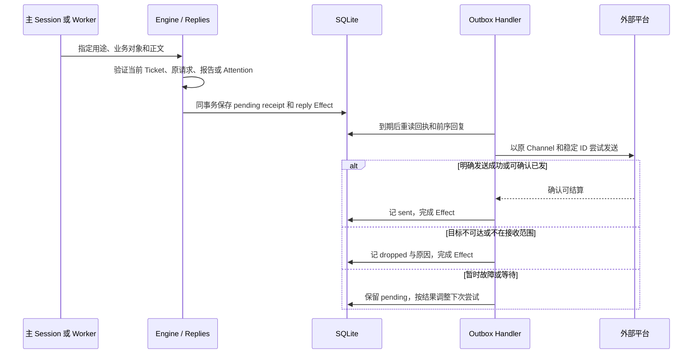

# 24 · 对外回复、Outbox 与通知节制

> 面试题　Alice 在飞书请 Agent 修帮助页文案，Worker 在 GitHub 评审中需要她确认一个选项。系统该去哪里问？如果确认消息已经到达平台，但应用崩溃前尚未写入 `sent`，怎样恢复？一条确认连续发不出去，又为什么不会让同会话的最终结果一直发不出来？

**短答**　原型先按回复目的验证业务证据，再由原始 Trigger 或 Ticket 选择 Channel。消息与 reply Effect 通过本地事务入库，异步发送后保留回执。暂时不可用时重试，确定对话不可达或范围不允许时按原因结束。发送次序按同 Ticket、同 Thread 的早期待发消息约束，前项达到失败阈值后不再挡住后项。远端已写、本地还没结算时，GitHub 通过稳定标记查找已有评论，飞书则向 CLI 传同一个幂等键。通知节制还依赖 Worker 的结构化报告及主 Session 的沟通规则。 [回复规则](../dsh-superagent-prototype/src/core/replies.ts) · [Outbox](../dsh-superagent-prototype/src/app/outbox.ts) · [GitHub Channel](../dsh-superagent-prototype/src/sources/github-channel.ts) · [飞书 Channel](../dsh-superagent-prototype/src/sources/feishu-channel.ts)

本文以本地提交 `7bd4741` 为源码基线。沿用帮助页场景。Alice 在飞书 X 提出修正文案，系统建 T。Worker 在关联 PR #57 收到 Carol 询问是否连移动端也改的消息 Y。为了演示提问、回答和结果交付，假设其中确有一项需要人确认的范围细节。X、Y、T 和示例正文用于说明状态，平台身份与消息 ID 以实际 Trigger 和 Channel 为准。第 23 篇讲持久 Effect 的通用调度，本篇看消费者怎样决定能不能说、对谁说、什么时候算说过。 [Effects 篇](23-durable-effects-and-consistency.md) · [PR 工作流](21-pull-request-ownership-and-completion.md)

## 1. 为什么要先判断通知的用途

### 1.1 将「模型知道了」与「请求人需要知道」区分开

主 Session 可以收到候选、Worker 提问、进度和结果的不同记录，许多还只出现在 Ticket 内部。外部协作者通常需要得到几类可行动的反馈。有人提交工作时，简短确认可以表明系统承接的对象和预计结果。已有明确问题时，需要一个可读的答复。缺一项真正需要人的决定时，发送待处理问题。交付达到可审或可用状态时，再回源会话说明该做什么。如果把状态变更直接映射为外部通知，单次 PR 创建、CI 变化、重试和报告进度都可能触发一次消息，协作者仍不一定知道何时要介入。 [团队沟通规则](../dsh-superagent-prototype/prompts/team/communication.md) · [Worker 工作提示](../dsh-superagent-prototype/prompts/work.md)

原型把回复门槛落成几组结构化输入。主 Session 的 `orchestrator_reply` 只接受 answer、result、attention，Worker 的 `orchestrator_ack` 通过绑定的 ticketId 确认其实际收到的人类请求。程序可以校验当前是否有 Attention、是否有可交付的报告或此前记录的回答事实。正文是否简洁、是否真有用户可用的结果、是否应该对一句感谢保持安静，还依赖工具提示和团队约定。面试时可以陈述哪些写入守卫能由单测证明，哪些是 Agent 执行沟通任务的行为约束。 [主工具](../dsh-superagent-prototype/src/app/tools/main.ts#L223) · [Worker 确认入口](../dsh-superagent-prototype/src/app/tools/executor.ts#L24) · [回复提示](../dsh-superagent-prototype/prompts/replies.md)

### 1.2 同一工单上的几种反馈有不同证据

| 用途 | 谁正常触发 | 依赖的业务证据 | 默认去向 |
| --- | --- | --- | --- |
| acknowledgement | 接受任务时或该 Ticket 的 Worker | 人类 Trigger 有 Channel，Worker 确认时还要工单开放且具备正式可达关系 | 被确认的消息所在会话 |
| answer | 主 Session | 人类的原问题，适用 Ticket 已报告其回答，或没有关联 Ticket 的直接答复场景 | 原问题的 Channel |
| attention | 主 Session 在 Worker 建立具体问题后 | 当前仍有效的 Attention，参数要匹配它的问题文本 | 引出该问题的人类消息的 Channel，或 Ticket 源会话 |
| result | 主 Session | 开放且最近有 ready，或已是允许结果回复的终态 | Ticket 源会话 |
| PR 终态 notice | Runtime 根据结束事件生成 | 实际结束结果及符合通知条件的 PR | 工单里适用的非 GitHub Channel |

最后一行不是回复工具多一个 purpose。它由 Runtime 在 ticket.ended 读取结束事实，按 PR 通知规则直接写 Outbox。普通的 Worker 报告 relay 则只发往主 Session。两者都可用稳定业务 ID，但读到一个 report relay 不意味着用户已经收到成果。沿着队列名称核对送达对象，能区分主 Session 的上下文传递和平台真正的外发消息。 [终态通知](../dsh-superagent-prototype/src/sources/github-pull.ts#L85) · [Runtime 的事件接入](../dsh-superagent-prototype/src/app/runtime.ts#L138) · [报告 relay](../dsh-superagent-prototype/src/app/notices.ts#L107)

## 2. Replies 的目的检查怎样工作

### 2.1 确认接手用 Trigger 身份，保留第一份正文

初次接受由 Tickets 与 Replies 协作，若接受给了确认文案，源 Trigger 是人写且有 Channel，自动确认可用 `key('ack', trigger.id)`。普通 Worker ACK 沿用同一身份。它先看 Ticket 开放、Trigger 存在、满足 `reaches(ticket, trigger, false)`，且有 Channel。有旧回执就保留，原同 ID 文案不被后来提供的替代。创建新的 ACK 还要求 Trigger 为 human。来源 Trigger 带参考上下文时的可达性需要核对，典型 context-only Thread 不具备确认权限。不能因为 Worker 获得了某个引用就代表该工单在这条线上承诺接单。 [自动确认与 Worker 确认](../dsh-superagent-prototype/src/core/replies.ts#L39) · [context-only 守卫](../dsh-superagent-prototype/tests/core-engine.spec.ts#L1349)

如果两张 Ticket 适用地收到了 Y，两个 Worker 也选择确认，程序可给两次动作同一个 ACK ID。第二次会使用原有的 pending、sent 或 dropped 状态，接手事实仍能通过 takeUp 记录给相应 Ticket。这使「人只收到一次确认」和「每个 Worker 是否认领了它」用不同记录。状态 `reused` 回答的是有无同 ID 确认，`acked` 与任务结束的输入释放有关。一个 pending 甚至后来 dropped 的 ACK，也可能已经形成接手事实。运维不能把出站失败理解为工单失去先前的处理决定。 [接手字段](../dsh-superagent-prototype/src/core/part.ts#L49) · [同一身份的确认使用](../dsh-superagent-prototype/src/core/replies.ts#L48) · [确认测试](../dsh-superagent-prototype/tests/runtime.spec.ts#L445)

默认沟通约定是为新的人类工作确认具体对象，在短答场景直接回答即可。已开始跟进时不需要每次再次 @ 智能体，却仍可有新的 Trigger 和记一次 ACK。机器人、CI、普通聊天或感谢不应无条件引出 ACK。若这条消息在接单时已有 Worker 要求确认的自动回执，也不另外经 CLI 再发一份。这样把「一句已收到」留给请求人确实需要知道的变更，并保留 Worker 作判断的可见证据。 [确认沟通约定](../dsh-superagent-prototype/prompts/replies.md) · [接受任务的回执](../dsh-superagent-prototype/src/core/tickets.ts#L37)

### 2.2 answer 要落到人的原问题和相应报告

假如 Y 真的是「这个文案也适用于移动端吗」。Worker 处理后在 `orchestrator_report` 的 `reply_to_trigger_id` 指向 Y。Assignments 会校验它是可由 T 处理的人类消息，报告保存后把 Trigger ID 并入 `ticket.answers`，并登记接手。然后 reportRelay 提醒主 Session 有 answer_to，可以读取报告再通过 answer 把答复送回 Y 的 Channel。普通 summary 的一句「进度很好」不会产生相同的授权事实。原型根据类型和消息身份校验，是否确为清楚的疑问、回答是否有证据，仍需 Worker 与主 Session 阅读原话。 [Worker 报告入口](../dsh-superagent-prototype/src/app/tools/executor.ts#L74) · [回答记录](../dsh-superagent-prototype/src/core/assignments.ts#L99) · [转发报告](../dsh-superagent-prototype/src/app/notices.ts#L115)

核心处理 answer 时要求真实的人类 Trigger。明确传 Ticket ID 时读取对应 Ticket，未传时可从这条 Trigger 的可达关系找第一个已有 Ticket。找到关联 Ticket 后，若没有已经记录的 answer 权限且也没有相同的出站 ID，就拒绝新的正文。一次实际授权发送把对应 Trigger 从 answers 移除，即使回执此时只是 pending。相同 Trigger 和字面正文会得到原来相同的出站身份。旧回执仍可满足同 ID 的重试判断。新正文一般不再拥有刚消费掉的授权。对没有关联 Ticket 的人类问题，代码不要求制造一张 Ticket 后才能直接回答，有合法 Channel 等前置条件仍适用。 [回答检查与消费](../dsh-superagent-prototype/src/core/replies.ts#L64) · [答复去重的测试](../dsh-superagent-prototype/tests/core-engine.spec.ts#L1278)

answer、result 的普通身份按 `key('reply', trigger?.id ?? ticket?.id ?? '', request.text)` 生成。代码没有给普通 reply 再加 purpose 或 Channel 维度，因此命令应按合同使用。answer 附原问题，result 通常以 T 为输入，两者的实际身份由参数组合决定。内容「语义基本相同」也不同于字段相同，多一个标点会改变文本哈希。去重适合重试同一次输出。要修改一份已准备发送的结果，需要把它当作本次应用操作的新问题看待。 [普通 reply 的身份](../dsh-superagent-prototype/src/core/replies.ts#L75) · [工具参数描述](../dsh-superagent-prototype/src/app/tools/main.ts#L223)

### 2.3 结果交付要查实际工单状态

result 用于传回源请求可审或可用结果。Replies 首先检查 T 开放、最新 Assignment 报 ready，或 T 结果为 merged、completed、dropped。没有合法 Ticket，或仍是普通 progress、blocked 等，不可将它直接包装成结果。默认提示进一步要求 dropped 只在规则要求收尾等适用情形告知。核心看到 dropped 允许用 result，并未在该条分支重新校验提示中的全部沟通条件。需要说明「有哪个代码守卫」与「用户希望 Agent 怎样克制」的区别。 [结果校验](../dsh-superagent-prototype/src/core/replies.ts#L69) · [提示用途说明](../dsh-superagent-prototype/src/app/tools/main.ts#L223)

即使 T 最终在 GitHub #57 交付，只要 X 起于飞书，result 默认还是源 Trigger 的 Channel，缺失时退到 Ticket.channels 第一项。最终结果可直接给用户一条短的 ready 文案和真实 PR 链接。在大型工程里，验证细节可以留 PR 或报告里供展开。CI 当前结果、PR 是否正式合入和 Worker 是否自审是独立事实，报告与通知应保持能核查其来源。 [源 Channel](../dsh-superagent-prototype/src/core/replies.ts#L83) · [结果交付约定](../dsh-superagent-prototype/prompts/team/communication.md) · [PR 事实篇](21-pull-request-ownership-and-completion.md)

## 3. Attention 为什么可以在 progress 阶段生效

### 3.1 给仍需要人解决的问题一个版本化身份

回到 X、Y 场景。Worker 觉得 PR 的移动端要求需要确认，可在 progress 报告附一个 `human_action` 和 `question_for_trigger_id=Y`。这里 progress 描述当前仍有效的工作状态，human_action 是请人采取动作的事。核心要求有实际问题才能给出 askedBy，并核对它确为正式可达且有 Channel 的人类消息。Ready 与开启一个新问题同时出现会被拒绝，带新问题的报告也不能一并宣称有 answers。真实排查时能从 Attention 的 ID、question 和 triggerId 找到请谁作决定的证据。 [报告守卫](../dsh-superagent-prototype/src/core/assignments.ts#L95) · [Worker 的问题约定](../dsh-superagent-prototype/prompts/handoff-worker.md)

若同样的 question 文本再次报告，代码复用旧 Attention，保留已有身份和指向哪条 Trigger。不传 question 时保留这个当前对象。给不同文本时新建，传 null 或报 ready 则清掉。主动清除或替换会撤销旧问题尚待发送的消息，身份为 `key('attention-reply', attention.id)`。已经成功送达的 old receipt 不会随状态清除而删除。本篇的补充用例在暂停出站期间连续排一个同文问题，尝试用不同外发文案回复它，确认旧回执保留第一份文本。换问题后旧行和 Effect 同时消失，恢复发送只看到新问题。 [Attention 生命周期](../dsh-superagent-prototype/src/core/assignments.ts#L113) · [撤销的 Outbox 事务](../dsh-superagent-prototype/src/app/outbox.ts#L33)

### 3.2 发送时再次检查当前问题，路由跟着触发它的人走

报告里确有 human_action 时，Sessions 会收到 `worker_attention` relay。主 Session 需要读取当前问题，再调用 attention，`human_action` 参数与 Ticket.attention.question 精确匹配。实际外发 text 可重新表述，仍应是相同决定。旧问题此前有报告，等主 Session 消费消息时已经被替换，传回旧问题会被拒绝。这个检查解决的是模型持有过时的请求卡片。回复 Channel 优先从 attention.triggerId 取，缺失才取工单源会话。于是同一个 T 的结果仍回飞书，一个因 PR 评审 Y 提出的选择却回到 GitHub 对话。 [Attention relay](../dsh-superagent-prototype/src/app/notices.ts#L115) · [发送的当前对象与目标](../dsh-superagent-prototype/src/core/replies.ts#L75) · [跨 Source 目标测试](../dsh-superagent-prototype/tests/runtime.spec.ts#L754)

Attention 是否真的存在也帮助判断普通阻塞。如果 Worker 报 failed 并描述某项可尝试修复的失败，主 Session 可知道失败、查看报告，但程序不会只靠一段 summary 造出一个当前问题。处理需要人的具体缺口时，应该有清楚的对象与最小动作。项目用两个不同协议同时做到早知道状态和少打扰人，前者经内部报告，后者经结构化问题的送达。 [阻塞报告的沟通边界](../dsh-superagent-prototype/prompts/handoff-orchestrator.md) · [报告转发规则](../dsh-superagent-prototype/src/app/notices.ts#L115)

## 4. Channel 同时承担目标地址和会话顺序

### 4.1 用于回复的地址，比排队分组更细

ChannelRef 有 source、thread、address。thread 用于表示发送顺序的会话范围，address 给适配器实际的目标。飞书构造 `feishu:<chatId>` 作为 Channel.thread，用 messageId 指到要回复的消息，并在私聊时显式记录 direct 字段。输入侧的 Thread key 则可能以聊天与话题根消息共同组成，用来决定 Trigger 处于哪段讨论和哪些 Ticket 订阅。由此，同一 Ticket 在一个飞书群里的两条外发消息，即使回复不同话题，也可能落到一组顺序判断。不能把用户看到的「跟帖」等同于 SQL 分组维度。 [飞书输入与输出身份](../dsh-superagent-prototype/src/sources/feishu-trigger.ts#L5) · [顺序所用列](../dsh-superagent-prototype/src/app/store.ts#L38)

GitHub Channel.thread 是 `github:<number>`，而 address 可含编号及原评论 URL，URL 中的行级评审定位让适配器识别讨论。也就是说，同一个 PR 顶层评论与行级讨论的地址不同，但都可以纳入同 Ticket 对这份 PR 的顺序。Alice 在飞书交工单后到 GitHub 看代码，Worker 的问题若来自 GitHub review，实际发送仍按那个 Channel。请求人是谁由 Trigger 保留，应用没有根据两个平台用户名的相似度自行把它换到另一边。 [GitHub Channel 与解析](../dsh-superagent-prototype/src/sources/github-trigger.ts#L6) · [回复目标选择](../dsh-superagent-prototype/src/core/replies.ts#L83)

### 4.2 发送前重新检查来源与接收范围

Outbox.deliver 先取 pending receipt。Source 未安装或已关闭时，当前行抛 Later，保留用于将来恢复。正常开启而当前 Channel 超出监听范围，则直接结算 dropped，原因是 channelIgnored。飞书的 Channel.allowed 用配置检查该 chatId 与 direct 类型是否仍 listened。范围看的是实际配置。移除聊天白名单后，若另一项配置仍允许当前聊天，未必马上符合 dropped 条件。把「来源模块暂停使用」和「这个会话明确不再接收」做成两类状态，能避免临时运维停机时不可恢复地丢回复。 [出站检查顺序](../dsh-superagent-prototype/src/app/outbox.ts#L39) · [Registry 的 Channel 检查](../dsh-superagent-prototype/src/sources/registry.ts#L75) · [飞书范围](../dsh-superagent-prototype/src/sources/feishu.ts#L54)

若 Source 在元数据检查之后被卸载，Registry.send 可返回 waiting，再次走 Later。适配器返回 gone 时，Outbox 把它记作 channelGone。与之不同，网络超时、频率限制或仍有机会修复的权限错误会向上抛，队列保留 pending。比如 Feishu bot 被提示不在群，Commands 可整理成可行动错误，让运维补群权限后继续同一个待办。对于已经 dropped 的回执，普通重试沿用原回执。只要 ID 还在，同一个回复又被提出时会看到原终态。沟通规则也要求遇到被丢弃的消息不能改到别的 Channel 发送。 [适配器返回结果](../dsh-superagent-prototype/src/sources/registry.ts#L91) · [Outbox 导向](../dsh-superagent-prototype/src/app/outbox.ts#L39) · [飞书成员问题测试](../dsh-superagent-prototype/tests/commands.spec.ts#L72) · [发送提示](../dsh-superagent-prototype/prompts/replies.md)

| 现场 | 应用中的处理 | 用户或运维可以如何确定 |
| --- | --- | --- |
| 执行暂停 | reply limit 为 0，尚未开始的发送等待 | pending，无新平台调用 |
| Source 暂未安装或关闭 | Later，适用时恢复 | 按 Source 状态看，回执仍在 |
| Source 开启，Channel 已不在当前监听范围 | dropped / channelIgnored | Source 回执列表按原因定位 |
| 适配器判定目的地不可达 | dropped / channelGone | 有持久原因和时间，不再按同 ID 发 |
| 其他临时或不明确错误 | pending，错误与重试写到 Effect | Overview 能查 attempts 与原因 |
| 确认发送或核对远端已有内容 | sent | 可用 Message ID 回到回执或远端内容 |

### 4.3 区分 GitHub 的评审根评论与 PR 会话

当 address.url 能解析为配置仓库的 PR 评审行定位，而且其编号与组织的 Channel 一致时，GitHub adapter 读该评论。如果它本身是回复，使用 `in_reply_to_id`。如果是根评论，使用自身 ID。写回时选对应根的 replies 路径。这与 GitHub REST 接口要求根评论 ID 的约束一致。对于查这个特定 inline comment 时得到 404 或 410 的分支，原型转到同一 PR 的顶层对话评论发送。普通 Issue/PR 评论也走顶层会话路径。它保留原 PR 的上下文，和在另一个 chat 上去找别人转发属于不同操作。 [适配器选择与根定位](../dsh-superagent-prototype/src/sources/github-channel.ts#L23) · [原评论缺失测试](../dsh-superagent-prototype/tests/commands.spec.ts#L106) · [GitHub 的评审回复接口](https://docs.github.com/en/rest/pulls/comments#create-a-reply-for-a-review-comment)

这里尤其要留意 404 的位置。若是读取具体 review comment，404 会在内部用于回落候选。如果已经选择正常的对话目标后在列出或发送时得到普通 404，外层没有按 gone 处理，可继续重试。外层对 410 或带 locked 文本的 403 才按相应的项目策略结算为 gone。这样不把另一种暂时权限丢失当作已永久删除。线上日志要保留是哪一个操作阶段返回的 HTTP 状态，只有数字时容易解释错。 [GitHub 错误分类](../dsh-superagent-prototype/src/sources/github-channel.ts#L10) · [删除与锁定的测试](../dsh-superagent-prototype/tests/commands.spec.ts#L92)

### 4.4 飞书使用具体消息回复，稳定 key 随传输保留

飞书适配器取 address.messageId，要求有明确可回复消息，用 lark-cli 的 reply-in-thread 参数写回原话所在的讨论。Commands 选择部署里已配置的机器人 CLI，用 `--as bot`。Markdown 经当时安装的 CLI 转换。错误分类走 CliError，项目将带明确撤回、对应的找不到消息等信号放到 gone 分支，没有服务明确错误号的网络超时不能用正文碰巧含 withdrawn 判断成撤回。具体错误码与能够恢复的操作都应看实际返回。 [Lark 适配器](../dsh-superagent-prototype/src/sources/feishu-channel.ts#L12) · [超时不当作撤回](../dsh-superagent-prototype/tests/commands.spec.ts#L86)

同一次发送的本地 Message ID 会被传给 `--idempotency-key`。上游 Lark CLI 文档把这条回复接口的同 key 去重描述为一小时窗口。因而本地保存同 ID、在窗口内安全重试与「过了很久永远不会重复」有不同保证。项目实际部署可指定 CLI 路径，本文的测试校验了参数、账号模式与稳定 ID，不直接确认线上安装版本或平台始终可见。这里引用上游说明的是机制的时间范围，不能把它当作当前测试得到的线上结果。 [本地参数用例](../dsh-superagent-prototype/tests/commands.spec.ts#L56) · [Lark CLI 回复参数](https://github.com/larksuite/cli/blob/main/skills/lark-im/references/lark-im-messages-reply.md?plain=1)

## 5. 从业务决策到 Outbox 回执，中间有几次提交

### 5.1 消费回答授权和记录待发送属于同一笔事务

`Engine.reply` 将 Replies 的业务逻辑置于仓储 atomic。Outbox.send 在其中创建 pending receipt，只有该 ID 此前不存在时才 enqueue `reply`。两项写入共享同一提交，reply 的 payload 为空，实际内容通过 ID 回读。若是新的 answer，Replies 在记录待发送后消费 Ticket.answers。若接下来的任何检查抛错让整个事务回滚，回执、Effect 和回答授权一并回到先前状态。若应用在提交后的第一时间崩溃，回复需要由持久队列恢复，主 Session 无须重新编一段回答。 [引擎 reply 入口](../dsh-superagent-prototype/src/core/engine.ts) · [Outbox.send](../dsh-superagent-prototype/src/app/outbox.ts#L26) · [消费答案授权](../dsh-superagent-prototype/src/core/replies.ts#L86)

记住两个实体的分工有助解释故障。outbox 行保留 Markdown 文本、目标 Channel、消息用途及投递终态。Effect 行表达调度意图与未完成尝试。成功后可以删 Effect，sent receipt 继续作为已处理的身份依据。一次普通异常只需要改 Effect 的 due 和 attempts，outbox 仍是 pending。发送失败后的用户状态不是一个名为 failed 的新回执。永久不可发送才会变 dropped，并附时间和原因。后续对同 ID 的工具重试返回已存在回执状态，避免变成第二条业务消息。 [Receipt 字段与查询](../dsh-superagent-prototype/src/app/store.ts#L251) · [Effect 收尾](../dsh-superagent-prototype/src/app/effects.ts#L130)

主工具会在排入后调用 `sendReplies()`，它经 Outbox.sent 实际等的是 Effects.idle('reply')。因此本次操作会推进可运行的发送并读最新回执，返回 sent、dropped 或 pending。idle 可以在暂停、退避未到或当前无可执行行时返回，工具没有在这里一直等到所有历史回复完成。Worker ACK 的工具同样在必要时推进并回读状态，另外告诉调用者 reused。要回答用户「你收到我的回复了吗」，还要区别服务返回成功与对方实际阅读。当前回执保存传输的应用结算，系统不会因此得到人类已读事件。 [工具回读状态](../dsh-superagent-prototype/src/app/tools/main.ts#L233) · [ACK 工具](../dsh-superagent-prototype/src/app/tools/executor.ts#L28) · [idle 何时返回](../dsh-superagent-prototype/src/app/effects.ts#L89) · [工具状态测试](../dsh-superagent-prototype/tests/tools.spec.ts#L249)



### 5.2 撤销只删还在 pending 的消息，回执如何处理在途竞争

比如 Q1 问「要不要保留原标签」，Alice 已在真实评审中给了足够答案，Worker 改为 Q2「移动端也需要改吗」。在报告取代旧 Attention 时，应用对第一条消息调用 withdraw。如果 Q1 只是队列等待，receipt 与 reply Effect 可在同一事务删掉。若早先结算为 sent 或 dropped，withdraw 的条件不成立，状态保留。应用这一步是撤销本地待办，不会 post 后再去删除一条已经让人看见的消息。分析「我刚回答为什么还收到旧提问」时，要核对两个动作的实际顺序。 [Attention 替换](../dsh-superagent-prototype/src/core/assignments.ts#L113) · [撤销接口](../dsh-superagent-prototype/src/app/outbox.ts#L33) · [只删 pending](../dsh-superagent-prototype/src/app/store.ts#L282)

考虑更窄的窗口，Q1 的 handler 已读取 pending 并交给 Source，await 远端响应期间 Q2 的报告删掉旧行。删除队列并不会强制取消已在传输的 Promise。在送达成功的情况下，`receipts.settle` 试图更新当前 pending 回执，没找到便用原消息与 sent 状态补建记录。如果已经有终态，`INSERT OR IGNORE` 保留现有记录。于是旧 Q1 虽一度被撤销，真实成功的传输仍有可审计凭据，同 ID 不会因数据库之前没有这行而被当成全新消息重发。现有测试就是在 send 调用内主动撤销，随后返回 sent，断言原文本的 sent 保留。 [在途终态补建](../dsh-superagent-prototype/src/app/store.ts#L270) · [撤销时正在发送的测试](../dsh-superagent-prototype/tests/runtime.spec.ts#L1210)

应用也正因没有跨远端的事务撤销，不会在发送进程中保证每条 Attention 始终反映用户最新决定。过期问题的工具守卫与本地队列撤销可以缩小窗口，已经发出的信息应按当前沟通约定说明或忽略。面试无需承诺「旧消息一定不会被人看到」。可证明的顺序是待发先撤销，已发结果仍按外部事实补记，再检查续发是否需要新的 Attention 身份。 [问题更新与撤销边界](../dsh-superagent-prototype/src/core/assignments.ts#L113) · [送达状态](../dsh-superagent-prototype/src/app/outbox.ts#L39)

## 6. 同会话的回复怎样按顺序，又避免长时间阻塞

### 6.1 单并发限制，另外还有按业务分组的前序检查

reply kind 注册 `limit=1`，在通常的一次扫描中，同一时间执行一个 reply handler。它未启用 Effects 的 ordered 模式，普通队列会先根据 due 筛选已可运行行，因退避而未来才到的消息不会挡住所有其它发送。随后进入 Outbox.deliver 又查 `receipts.behind`，它比较的是同 Ticket、同 Channel.thread、比当前 rowid 更早且仍 pending 的回执，结合前序 reply Effect 的 attempts。当前进程的发送队列借此约束同一交付链的顺序，例如先送确认，后送结果。 [reply 的设置](../dsh-superagent-prototype/src/app/outbox.ts#L22) · [非 ordered 扫描](../dsh-superagent-prototype/src/app/effects.ts#L103) · [behind 查询](../dsh-superagent-prototype/src/app/store.ts#L255)

Outbox.pending 生成列只有状态为 pending 且有 Ticket ID 才生成组合键。没有 Ticket 的 notice 或适用的直接回答不参加这条分组约束，其他工单即使在同一群也有不同键。同 T 发往 GitHub #57 和飞书群时，Channel.thread 不同，亦可分别推进。假设 Alice 的 X 与接下来的 Z 都在同一个飞书 chat，但实际 messageId 不同，若属于同一个 T，仍用同一组顺序。直到前序结算，或者前序的失败次数达到阈值，后项才无需为这条前序继续停留。 [生成列](../dsh-superagent-prototype/src/app/store.ts#L38) · [独立工单和不同会话测试](../dsh-superagent-prototype/tests/runtime.spec.ts#L1182)

### 6.2 如果确认连续发不出去，让后续仍有机会

例如确认 A 先入队，同组结果 R 在后，另有无关工单 T2 的通知 B。A 的第一次外部发送失败，下一次在约 5 秒后重试。R 对 A 的 attempts=1 仍执行 behind 检查，走 Later，默认推迟到下一次可尝试的时点。B 不因这样的分组等待而一起停住。A 第二次失败后约再等 10 秒，第三次失败达到阈值。R 下一次被处理时看到 A 的次数已足够，不再被 A 阻挡。此时面板仍可报告 A 的发送错误。实际发送时点会受 Pass 调度、due 和在途工作影响，5、10 是默认退避时间。 [默认 backoff](../dsh-superagent-prototype/src/app/outbox.ts#L22) · [回执顺序与阈值](../dsh-superagent-prototype/src/app/outbox.ts#L44) · [三次失败放开结果的测试](../dsh-superagent-prototype/tests/runtime.spec.ts#L1196)

| 阶段 | 前项 A | 同 Ticket 同 Channel.thread 的 R | 另一组消息 B |
| --- | --- | --- | --- |
| 首次失败后 | pending，attempts=1 | 被前项规则推迟 | 可以照常检查发送 |
| A 恢复并成功 | sent | 前项约束消失，到期可送 | 自己独立前序决定 |
| A 第三次失败 | pending，attempts=3 | 该前项不继续阻挡 | 仍按自身条件 |
| A 随后成功补送 | sent | R 可能已先收到 | 不受这笔组内变化影响 |

所以这个方案的顺序语义允许在遇到重复故障时后项先送。不会把 A 自动变成 dropped，也没有把队列三次失败当最大次数。普通错误的 Effect 一直到能被处理或适用撤销、终态分支收尾。一次 Later 不增加 attempts。若前项属于等 Source 恢复、没有普通失败，仍可能继续保留其前序关系。把所有 pending 都猜成已失败若干次，会误判这一特殊边界。 [Effect 结果处理](../dsh-superagent-prototype/src/app/effects.ts#L130) · [behind](../dsh-superagent-prototype/src/app/store.ts#L255)

## 7. 平台已写、本地还是 pending，恢复凭什么继续

### 7.1 用故障窗口判断有哪些证据可寻找

在同一个 SQLite 事务里写回执和待办可以排除「已交工单却没记 ACK 意图」。它仍无法让远端 HTTP 操作与 SQLite 共享同一次提交。把消息送出以后的两个关键步骤是平台接受、应用收到明确结果并写 sent。在二者之间崩溃，外部回复可能已存在，本地却只能看到 pending。应用再次发送的业务身份需要稳定，适配器才能用同一语义检查或去重。若每次尝试生成一个新的 ID，现有平台判据会把已产生的原副本与新尝试分成两件事。 [本地事务](../dsh-superagent-prototype/src/app/outbox.ts#L26) · [传输后结算](../dsh-superagent-prototype/src/app/outbox.ts#L39)

| 故障点 | 此刻能观察到的记录 | 恢复中可以做什么 |
| --- | --- | --- |
| 门控通过，待发送事务尚未提交 | 没有已提交的 pending receipt | 根据合法的业务重试重新推进 |
| 已提交 pending 与 Effect，未开始发送 | 有本地工作意图 | 按当前 Channel 检查，再以原 ID 发 |
| 请求已经发出但结果未知 | 本地仍 pending | 用同 ID 查远端已发证据或提供幂等键 |
| 平台成功，本地 sent 已落但 Effect 还没清 | 有 sent receipt | handler 读到终态便结束，清理匹配的 Effect |
| 本地撤销时远端已经开始写 | 旧回执可能暂时被删除 | 真实成功返回可用原 ID 重建终态 |

第四行是一处经常被忽略的安全窗口。Outbox 先结算回执后返回，Effects 就可以用原 row 快照做删除。若两步间退出，下一次扫描仍能读到同 ID 的 sent。消费者的 pending 守卫让这条残留动作变成无副作用的处理。第五行也显示 pending 与 outbox 在途不必完全同步。排查时要同时看远端调用、receipt 与队列代次。 [消费者入口判断](../dsh-superagent-prototype/src/app/outbox.ts#L39) · [Effect 删除条件](../dsh-superagent-prototype/src/app/effects.ts#L130)

### 7.2 GitHub 的恢复证据是匹配作者、讨论与标记的评论

GitHub 发送前读取所选评论集合，按部署账号匹配作者。对评审线程，还约束该回复的 root ID。评论正文里必须包含由 Outbox ID 得出的 marker。若找到匹配就返回 sent，不重新 POST。查不到才追加含 marker 的正文。由于原型的 reply handler 并发为一，单个 Runtime 不会在两个相同本地待办之间主动重叠发送。远端查证依赖读操作准确、原评论仍存在、作者和回复目标没有变化。把读到已有评论认定为送达是项目的协议；它的查证与写入是两次调用，无法提供平台端的原子「仅缺失就创建」。 [GitHub marker 查询](../dsh-superagent-prototype/src/sources/github-channel.ts#L23) · [已知 marker 的适配器测试](../dsh-superagent-prototype/tests/commands.spec.ts#L35)

本篇补充测试用了有状态的模拟 GitHub。第一次 POST 把带 marker 的消息写入模拟评论集合，然后抛出响应丢失。应用仍 pending，Effect 累计一次错误。虚拟时钟推进到可重试，GitHub adapter 读到同账号同 ID 的评论，回传 sent，应用补记成功并清掉 reply 行。测试核对整个期间 POST 调用只发生一次。它把简单「第一次失败，第二次成功」区分成「外部已经成功一次，第二次只是确认」。真实网络和平台可见性没有被这组夹具保证，线上要按可读返回进一步查证。 [状态确认](../dsh-superagent-prototype/src/app/outbox.ts#L48) · [远端匹配条件](../dsh-superagent-prototype/src/sources/github-channel.ts#L33)

若远端先前发在行级线程，此后原评论变为不可查，下一次可能转向 PR 顶层作为恢复地址。旧 marker 如果只存在于另一种评论集合，这趟读就未必能看到。marker 的查找范围取决于目标路径。核对历史时需要原发送身份和正确的评论集合。真正外发的约束目标是尽量保留原上下文与身份，在无法确认旧状态时为运维留下可见的证据。 [回落与查重](../dsh-superagent-prototype/src/sources/github-channel.ts#L25)

### 7.3 飞书分开观察本地身份和远端去重窗口

原型把本地 Message ID 作为 lark-cli 回复请求的幂等键，正常的待办恢复仍使用原地址与同 ID。远端在协议覆盖期间可以合并同一次操作。本地终态一旦写出，此 ID 有回执拦新的队列项。长停机让丢失确认一直 pending 并超出上游 CLI 描述的去重窗口时，稳定 key 提供了关联身份，但不能单凭该字段推导平台肯定会去重。面试的可靠表述是「本地防止重复入队，适配器按平台提供的机制降低重复发送，远端仍需结合窗口与回执确认」。 [Feishu 发送](../dsh-superagent-prototype/src/sources/feishu-channel.ts#L18) · [本地终态](../dsh-superagent-prototype/src/app/store.ts#L251) · [上游去重时限](https://github.com/larksuite/cli/blob/main/skills/lark-im/references/lark-im-messages-reply.md?plain=1)

## 8. 通知节制如何兼顾人与机器的可见性

### 8.1 普通进展留在任务里，需要人行动的状态单独传递

同一个 T 会经过生成工作区、第一次修改、修复测试、打开 PR、追加评审修改、准备可审产物等环节。源码为 progress 报告保留内部记录，普通进度无 question 和 answers 时，reportRelay 不给主 Session 排新消息。带问句或答案的报告有明确结构，因此适用时立刻提示主 Session。其他结果和阻塞可经 relay 提供进展事实，仍应由用途和沟通策略判断是否对人外发。这样一层一层说明「状态可以记录」「模型应该知道」「需要人现在看」之间的条件，应用不会为了降低噪声就失去内部审计。 [报告保存](../dsh-superagent-prototype/src/core/assignments.ts#L99) · [报告 relay 分支](../dsh-superagent-prototype/src/app/notices.ts#L115) · [沟通提示](../dsh-superagent-prototype/prompts/team/communication.md)

以主 Session 判断 blocked 为例。若编译暂时失败且 Worker 可以继续调查，错误报告是事后证据，默认保持内部。若需要人决定真实产品范围、访问关键资料或无法继续工作，Worker 可以依规范报告具体缺口，问题则有 Attention 记录与当前版本。面向用户的消息要答清楚「你现在需要做什么」，无需再把日志和过去的调查历史贴一遍。若用户主动要技术细节，answer 可以保留适用细节与完整记录链接。少打扰与不隐瞒会同时体现在 Outbox 只有真实外发意图，Ticket 始终有完整报告给系统读取。 [团队对阻塞的约定](../dsh-superagent-prototype/prompts/team/communication.md) · [handoff 说明](../dsh-superagent-prototype/prompts/handoff-orchestrator.md)

### 8.2 一次交付中的确认、审阅和合并可以分别有价值

可以这样复盘飞书起点、GitHub 交付的 T。接单自动确认向 Alice 表示将修正哪个对象，Worker 自己不补发第二条相同 ACK。创建 #57 之后只登记 progress，使 Source 后续能跟踪。CI 跑完或修复一条普通 review 时没有新外发理由。若确实需要 Carol 确认其评审提出的移动端要求，Attention 发去 GitHub。Worker 报告已验证的结果时，主 Session 把真实 PR 链接和范围回到飞书 X。GitHub 后来合入，Ticket 适用关闭时再决定是否生成最终 IM notice。每一步给不同的观众和不同动作，不需要每次状态抖动都告知所有人。 [Worker 绑定 PR 的进度](../dsh-superagent-prototype/prompts/work.md) · [报告与通知](../dsh-superagent-prototype/src/app/runtime.ts#L138) · [终态通知](../dsh-superagent-prototype/src/sources/github-pull.ts#L85)

这里的结果和最终提醒都经 Outbox 发送，各有自己的消息 ID。ready 是可复核结果，可以带请审阅的必要下一步。merged 或 closed 是结束性质的远端事实，可由 Runtime 按 PR ID、Channel 与 outcome 合成稳定 notice ID，给适用的非 GitHub 渠道排队。相同 PR 因人工后续恢复、稍后再结案，仍能重用原终态身份。直接在 GitHub 里已能看到合并或关闭，项目跳过为 GitHub Channel 再造同类提醒。这个机制体现了「哪一个地方已解释了事实」也影响用户通知设计。 [结案时的 IM 选择](../dsh-superagent-prototype/src/sources/github-pull.ts#L85) · [通知身份用例](../dsh-superagent-prototype/tests/sources.spec.ts#L403)

### 8.3 简短的文案约定和 100 词检查各管一层

项目提示希望日常 IM 简短，常规完成消息给用户可见改变、实际链接和必要下一步。代码对 `IM_WORDS=100` 作词语分段检查，`Intl.Segmenter` 取 isWordLike 段，不以中文字符数或 UTF-8 字节数估算。Markdown 的链接标签、URL 等正文内容也参与统计。Worker ACK 和接单确认使用 AcknowledgementSchema，它限制分词数。一般的 Feishu reply 由 Outbox.send 校验，Feishu Channel 在实际命令前也校验。主工具另有 text 的字符数上限，GitHub 一般 reply 也要区分其入口和团队提示。这些约束覆盖的是可提交的长度或语法，十几个字的空泛文案仍需要用实际内容判断。 [计数与校验](../dsh-superagent-prototype/src/infra/text.ts#L1) · [ACK schema](../dsh-superagent-prototype/src/app/tools/tool.ts#L14) · [IM 字数测试](../dsh-superagent-prototype/tests/runtime.spec.ts#L1358)

从系统设计角度，100 词拒绝条件能防某些异常超长输出，但无法自动发现一组短消息合起来很烦，也不应鼓励模型把同一状态拆成多条短提示。Agent 的沟通提示明确提出同一信息不要彼此复述、普通计划与日志内部记录。应用如果想度量通知质量，可以统计每次实际接手的人类请求对应的 ACK 数、每个必要问题的 Attention 数、结果能否回到源 Channel，以及整条工单的失败实例。比单纯压低发送总数更接近用户体验，也不容易把应有的结果错删。 [消息节制规则](../dsh-superagent-prototype/prompts/team/communication.md) · [回复用途](../dsh-superagent-prototype/src/core/replies.ts)

## 9. 运维该看哪一份记录，才能区分安静与失败

### 9.1 同样没有消息，可能是三条不同路径

第一种是业务没有产生外发 intent，例如当前只是验证，程序内部记录 progress。第二种确实有回复意图，receipt pending 且正在等可发送条件。第三种已经结算为 dropped，后续不会按该 ID 再发。没有消息的时候，应先查经过门控的目的和目标，验证是否真的排进 outbox。对 pending 再看 Source 启用、队列 due、attempts 与前序规则。对于已到终态的回执，实际成功或永久不可用可按对应记录解释。按照这三条路径观察，好比用户看到的都是「没收到」，平台和 Agent 的下一步却不同。 [源码的用途检查](../dsh-superagent-prototype/src/core/replies.ts) · [Outbox 状态推进](../dsh-superagent-prototype/src/app/outbox.ts#L39)


| 观察到的现象 | 优先查看的证据 | 能解释的状态 |
| --- | --- | --- |
| Worker 已跑了多步但没有结果消息 | Assignment 最新报告、有没有受控 result 委托 | 普通进展不需要产生外发 |
| 问题卡片存在却没送达人 | Attention ID、对应 receipt、当前是否已替换或暂停 | 可能未提交外发，或还在 pending |
| 回执 pending，实际日志有网络失败 | 对应 reply Effect 及 platform 调用结果 | 等待发送、重试，或需向远端核验 |
| 早前确认卡住，较晚结果先送 | 同 Ticket 的前序 attempts 和 Channel.thread | 失败阈值打破原队序 |
| 用户没有收到被 dropped 的消息 | dropped.reason 与时间、Source 及目标范围 | 对话终态，定位配置或外部消失 |
| 用户收到两条看似相同的回复 | 稳定 ID、正文、平台评论定位与发送时段 | 内容重新排队、幂等窗口或确认故障有不同证据 |

### 9.2 运维面板既能看错，也支持没有外部干扰

Overview 的 outgoing 问题列表会从仍在失败的 reply Effect 联接 outbox，展示预览、attempts 和 error。第一次失败即可出现在这一列。Effect 整体健康的错误显示有三次阈值，两个视图关注不同粒度。dropped 的消息则按持久回执记录，在 Source 状态视图里按时间和渠道显示，可带工单或 Thread 引用。出现 dropped 时可到终态列表查原因。pending 也包括暂停和 Later，应按 Effect 行查有无实际错误。 [失败记账](../dsh-superagent-prototype/src/app/store-read.ts#L68) · [Overview 问题列表](../dsh-superagent-prototype/src/app/views/overview.ts#L57) · [Source 终态列表](../dsh-superagent-prototype/src/app/views/sources.ts#L60)

假设 Alice 等待 T 的结果，应用里查到 dropped 后，程序不会自动改换目的地。可以先定位 ChannelIgnored 是何时被当前范围拒绝或 ChannelGone 是什么平台响应。若原请求真的需要更改目的地，新的外发应由明确业务动作选定合法 Channel，使发送理由和身份都可审计。对于尚可恢复的 Source off，应先恢复有效来源再继续 pending。这条区别让运营人员可以看到故障而不会因每次退避让用户收到新的提醒。 [掉落状态](../dsh-superagent-prototype/src/app/store.ts#L270) · [原因与范围测试](../dsh-superagent-prototype/tests/runtime.spec.ts#L1257) · [通知约定](../dsh-superagent-prototype/prompts/replies.md)

### 9.3 生产演进需要选择可靠程度并定义通知预算

如果一个服务的长停机可能超过平台去重窗口，或者 GitHub 评论可能改变位置，设计可以把「外部成功但应用未知」作为需核对的恢复状态。给操作层提供稳定 ID、最后目标、实际支持的远端查证，以及哪个结果证明已经送达。对同一工单不同目的的消息，也可明确哪些允许合并、哪些需要完整记录。如果用不可变 outbox 键，修改文案需要明确生成新业务意图，不能让一次重试借重新生成正文改变请求身份。成本在于要保留更多回执或 reconciliation 记录，收益是减少不确定恢复时的重复通知。本文的原型机制及模拟用例能证明当前本地状态边界。 [业务发送身份](../dsh-superagent-prototype/src/core/replies.ts#L48) · [回执持久化](../dsh-superagent-prototype/src/app/store.ts#L251)

要验证这样的改造，可以使用不接平台的有状态夹具，分别让「POST 前断连」「写入成功但没有响应」「回应后本地写入失败」发生。配合虚拟时钟精确区分本地相同 ID、队列重试和外部实际新增的条目。对通知节制则在同一 T 上录入普通 progress、待答、Ready 与 GitHub 终态，验收期望的外发数、目标和消息身份。可用同一套证据回答为什么我们看到出站重试次数增加，但实际用户收到的数量保持正确。 [发送重试](../dsh-superagent-prototype/src/app/effects.ts#L130) · [ready 与提问测试](../dsh-superagent-prototype/tests/runtime.spec.ts#L320)


### 9.4 同样的正文出现在不同地方，怎样判断是不是重复

假设 Alice 在飞书先见到一条「已准备好审阅」，又在 GitHub 看到意思相同的评论。先从各自的 Channel 与实际消息查是一个请求的确认、一个问题的回答，还是该 Ticket 的最终结果。飞书以具体 messageId 定位原话所在的讨论，GitHub 以 PR 或评论根确定写入位置。这两处看起来相似的内容可能是独立任务或不同目的。若同一个 source trigger、相同目的与稳定 ID 一致，才进一步比较回执、Effect 的尝试及外部记录。这样可以分别发现模型多发了一次新意图、队列正确重试、以及适配器未能确认上一次送达。 [回复身份的选择](../dsh-superagent-prototype/src/core/replies.ts#L79) · [两个平台的 Channel](../dsh-superagent-prototype/src/sources/github-channel.ts#L23)

已有回执时还要看是否从 pending 进入真实终态。比如 R 已 sent，另一 Worker 拿相同确认文本再调用相应工具，返回值可能看起来像一次新的成功，实际复用旧回执。若新消息被应用明确赋予另一个 ID，重复正文也不会被 SQL 唯一键自动发现。这里的可复核验收是按新旧意图统计实际出站条数，以及把需要人行动的语义在第一次就说明白。 [回执写入规则](../dsh-superagent-prototype/src/app/store.ts#L263) · [Worker ACK 结果](../dsh-superagent-prototype/src/app/tools/executor.ts#L28)

## 10. 已执行的源码验证

本篇使用临时 Git 副本和锁定依赖离线运行了以下十个文件，**381 个现有测试全部通过**。两个补充用例也通过。第一个让模拟 GitHub 完成写入之后丢失响应，断言最终通过 marker 补记 sent，只有一次 POST。第二个暂停出站，验证相同 Attention 保留第一份正文，新问题替换后撤掉旧 Effect，恢复只发新问题。用例使用 SQLite 与测试宿主，不会实际向 GitHub 或飞书发出消息。 [测试入口](../dsh-superagent-prototype/package.json) · [Outbox 测试](../dsh-superagent-prototype/tests/outbox.spec.ts) · [适配器测试](../dsh-superagent-prototype/tests/commands.spec.ts)

```sh
corepack pnpm test tests/outbox.spec.ts tests/commands.spec.ts tests/runtime.spec.ts tests/tools.spec.ts \
  tests/core-engine.spec.ts tests/effects.spec.ts tests/delivery.spec.ts tests/sources.spec.ts \
  tests/followups.spec.ts tests/views.spec.ts
```

| 想验证的行为 | 现有回归的观察 |
| --- | --- |
| ACK 合并，已接手与发送独立 | [Worker 确认同一条跟进](../dsh-superagent-prototype/tests/runtime.spec.ts#L445) · [记录接手后影响结束回收](../dsh-superagent-prototype/tests/core-engine.spec.ts#L529) |
| Answer 与 result 检查对应事实 | [答复和同 ID 恢复](../dsh-superagent-prototype/tests/core-engine.spec.ts#L1278) |
| 实际提问路由追到评审消息 | [跨平台 Attention](../dsh-superagent-prototype/tests/runtime.spec.ts#L754) |
| 一时失败与三次失败后的队序 | [同工单确认先送](../dsh-superagent-prototype/tests/runtime.spec.ts#L1182) · [达到阈值释放后项](../dsh-superagent-prototype/tests/runtime.spec.ts#L1196) |
| 暂停和 Source 临时不可用可恢复 | [暂停出站](../dsh-superagent-prototype/tests/outbox.spec.ts#L17) · [重加载 Source](../dsh-superagent-prototype/tests/outbox.spec.ts#L30) |
| 撤销时已发，保留同 ID 的成功回执 | [在途撤销](../dsh-superagent-prototype/tests/runtime.spec.ts#L1210) |
| 平台错误区分可重试和永久失败 | [飞书错误](../dsh-superagent-prototype/tests/commands.spec.ts#L72) · [GitHub 错误](../dsh-superagent-prototype/tests/commands.spec.ts#L92) · [保留终态](../dsh-superagent-prototype/tests/runtime.spec.ts#L1289) |

## 11. 面试复述与追问

### 11.1 60–90 秒口述

> 我会先按目的判断回复。工单确认用原 Trigger 的身份，回答要对应人的问题和 Worker 报告。需人处理的问题以当前 Attention 为准，可能回到发起评审的 GitHub，结果则回工单的源会话。符合用途后，应用把回执与待办同事务入库，消费时按同 Ticket 同 Channel.thread 维护前序顺序。前项连续失败三次后，后项可以继续，旧项仍按适用条件重试。Source 暂停等恢复，明确不监听或目标不可达则记 dropped。平台已收但本地没落送达是跨系统窗口，GitHub 查原作者和稳定标记，飞书传同一个请求键，结合各自的去重条件补认。内部进度仍可审计，只有可交付结果、实际问题和必要回复才按沟通规则送给人。

### 追问一　为什么 Worker 先写 Attention，再由主 Session 发？

Worker 最清楚缺哪项具体决定，主 Session 则判断何时给人外发并根据结构化问题选择渠道。发送之前还核对当前问句，替换过的问题便可拒绝。 [问题守卫](../dsh-superagent-prototype/src/core/replies.ts#L75)

### 追问二　为什么人只收到一次 ACK，仍可能有多个 Worker 记录接手？

ACK 用 Trigger ID 统一身份。Worker 确认时仍可把本 Ticket 加进接手事实。消息去重与工作责任分别统计，后者会影响结束时是否放回评估。 [确认与认领](../dsh-superagent-prototype/src/core/replies.ts#L48)

### 追问三　回复已 dropped，为什么不改到另一个群发送？

Channel 源自原问题或 Ticket 源会话。掉落意味着当前允许的目的地没能送达，应用保留可查原因。另换会话涉及新的用户范围，不能由重试自动授权。 [沟通约定](../dsh-superagent-prototype/prompts/replies.md) · [Drop 处理](../dsh-superagent-prototype/src/app/outbox.ts#L39)

### 追问四　为什么 SQLite 的唯一键还不够防止对外重复？

它阻止同一意图重复入队。远端已接受而本地没落 sent 的时刻，重启仍可再次进入 handler，这一层要靠远端可检查的标记或请求幂等机制。 [本地结算](../dsh-superagent-prototype/src/app/outbox.ts#L39) · [GitHub 查重](../dsh-superagent-prototype/src/sources/github-channel.ts#L33)

### 追问五　为什么不一直等确认，直到成功再发结果？

正常情况同会话确认先送。前项连续失败达到阈值后继续挡着会使结果也长期得不到，把规则放开能保留后项的交付机会。前项的错误和后续尝试仍可从同一个 Message ID 追查。 [前序检查](../dsh-superagent-prototype/src/app/store.ts#L255) · [顺序阈值测试](../dsh-superagent-prototype/tests/runtime.spec.ts#L1196)

---

[返回连载目录](README.md) · [上一篇《持久 Effects 队列与异步一致性》](23-durable-effects-and-consistency.md) · 下一篇《Prompt、Skill 与模型接口的版本治理》
