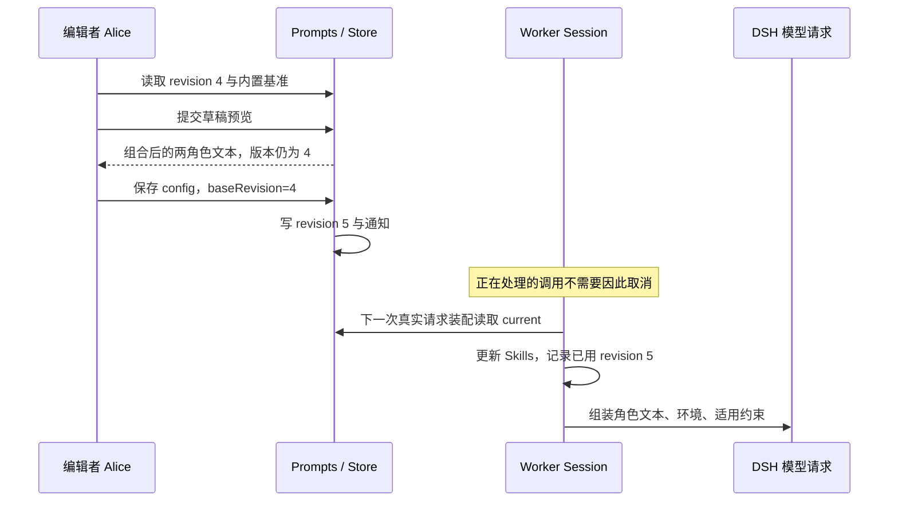

# 25 · Prompt、Skill 与模型接口的版本治理

> 面试题　团队把交付规范从「只交 PR 链接」改为「同时说明可复核的界面证据」。两个操作者都打开了旧版本编辑页，Worker 正在处理原工单。谁的修改会生效？只有 Prompt revision，够不够还原当时 Agent 看到的内容？怎么发现一段指令把 Worker 指向了只有主 Session 才有的工具？

**短答**　原型把团队文本、Skill 与内置片段覆盖保存为可追溯的 Prompt 配置版本。面板和主 Session 通过 `baseRevision` 做乐观并发，保存后的配置在下一次模型请求装配时生效。Session 持久记录自己用过的版本，工具注册和业务守卫仍有独立的约束。要复盘完整模型输入，还要查本次生效的内置文本、动态 Policy、部署和工单环境、模型请求和宿主上下文。仓库用实际启动的测试宿主收集两类角色的 Prompt、Skill、工具说明和运行时消息，再与登记接口做一致性检查。 [Prompts](../dsh-superagent-prototype/src/app/prompts.ts) · [Session 装配](../dsh-superagent-prototype/src/app/sessions.ts#L232) · [模型可见接口测试](../dsh-superagent-prototype/tests/model-surface.spec.ts)

本文以本地提交 `7bd4741` 为基线。沿用帮助页 Ticket T，Alice 负责请求和验收，主 Session 负责准入路由与回复，Worker 在原工作区验证修复。本篇关注同一个软件在配置、会话与代码各自升级时怎样仍然讲得清。第 16 篇讲 Session 的模型与工具装配，这里重点讲可编辑规则的存储、比较与验收。 [角色与运行](16-orchestrator-worker-sessions.md) · [Prompt 架构约定](../dsh-superagent-prototype/docs/004-prompts.md)

## 1. 同一份配置如何变成两种角色的模型输入

### 1.1 静态文件、团队文字与运行时证据各有来源

`context.ts` 从安装包的 prompts 读取 shared、orchestrator、worker、subscriptions、work 等默认文本，也取团队默认章节与 handoff 指引。`promptFile` 处理行尾、把段内折行整理为单行段落，同时确保打包缺失或文件为空时明确报出路径。两个来源 Skill 的详情从包内 SKILL.md 加载，文件头的 name、description 与正文会被拆出。由于运行环境和 Policy 要由安装实时读取，这些内容留在模板中，直到装配时才填充。 [默认文本来源](../dsh-superagent-prototype/src/app/context.ts#L7) · [包内文件加载](../dsh-superagent-prototype/src/app/skill-files.ts) · [内置片段目录](../dsh-superagent-prototype/src/app/prompts.ts#L51)

`PromptConfigSchema` 要求三段团队说明 `communication`、`scope`、`delivery`，以及自定义 skills 字典，可选 overrides。字段由团队写入，环境和授权条款由运行时依据实际事实加入。比如团队可在 Delivery requirements 写改动前后的截图要求，又可改变普通沟通的语气。用于准入的启用规则、版本、模式仍应从已校验的 Settings 生成，Worker 的执行路径和 Ticket 的授权随工单读取。将这几种数据分开，回看旧文字时可以明确是「当时编辑成什么」还是「当时运行状态是什么」。 [配置 schema](../dsh-superagent-prototype/src/app/prompts.ts#L18) · [动态环境](../dsh-superagent-prototype/src/app/execution-environment.ts) · [Policy 渲染](../dsh-superagent-prototype/src/app/prompts.ts#L87)

### 1.2 主 Session 和 Worker 的拼接顺序

| 拼接阶段 | Orchestrator | Worker |
| --- | --- | --- |
| 起始角色说明 | shared、orchestrator | shared、worker |
| 团队自定义章节 | communication → scope → delivery | 同序 |
| 共用业务规则 | subscriptions、replies | 同序 |
| 角色操作 | dispatch、admission、主角色 handoff | work、Worker handoff |
| 动态环境 | 部署变量 | 部署与该 Ticket 的变量 |
| 角色专用追加 | 当前 Policy 作为应用 prompt 的最后一段 | Session section 随当前工单追加适用的 Mandate 文本 |

`promptParts` 给每段返回 name、kind、key 与 text。固定节的 key 标识 override 应覆盖哪段，命名相同的 handoff 可以对应不同角色的 key。团队段包含固定标题，空字符串对应的段落会被省略。`composePrompt` 用段间空行连接。环境未就绪时可以给 Setup 提示，Policy 没有启用规则时另用相应模板。Worker 持 inferred Mandate 时，运行器会附当前任务适用的范围指示。主 Session 的提示在 DSH 项目节注册成 complete，Worker 还可继承宿主与仓库的指令。面板预览展示原型两角色的装配结果，预览 Worker 不是绑定一张具体 Ticket 后的完整运行时输入。 [顺序函数](../dsh-superagent-prototype/src/app/prompts.ts#L98) · [环境与 Policy](../dsh-superagent-prototype/src/app/prompts.ts#L80) · [装配与继承](../dsh-superagent-prototype/src/app/sessions.ts#L242) · [装配顺序的测试](../dsh-superagent-prototype/tests/prompts.spec.ts#L47)

### 1.3 两处模板填充处理不同文本边界

模板里固定使用如 `{variables}`、`{version}`、`{mode}`、`{rules}`。原型先用自己的 fill 匹配占位符，只有在明确给定的对象里存在这个属性，才替换。单次 replace 不会对替换进来的字符串递归展开。Policy 的规则名和指令先压成一行再插入，每条规则保留原来的 ID。另一个阶段是 DSH 提示词渲染。应用把自己的整个 section 设置 interpolate:false，因此团队文案里描述的 CI 花括号或代码例子可以按字面继续读到。第一阶段是应用知道要填哪些字段，后一阶段保留普通文本。 [应用模板](../dsh-superagent-prototype/src/app/prompts.ts#L77) · [禁用二次模板插值](../dsh-superagent-prototype/src/app/sessions.ts#L243) · [保持原花括号的测试](../dsh-superagent-prototype/tests/runtime.spec.ts#L1055)

## 2. 允许覆盖内置片段，怎样避免升级时丢失信息

### 2.1 override 的 base 是文字来源的指纹

假设团队只想改 Worker 的 handoff 指引。它可以在 `runtime/handoff/worker` 填一份 override，保存 text 与 base。运行时读取这个片段时优先使用已保存文本，未覆盖用软件包默认值。base 由默认片段的文本计算。它描述这份改写参考的是哪一版内置文字，与 SQLite 中第几次保存整份 Prompt 配置无关。保存新 override 时优先用提交里显式给的 base，其次沿用这个片段已保存的 base，最后才用当前内置文本的指纹。正常保存里若等于当前默认的基准且旧文本还未保存，Store 会留一份 `prompt-built-in:<base>` 的原文本供日后对照。 [内置文本与 base](../dsh-superagent-prototype/src/app/prompts.ts#L70) · [标准化和选择 base](../dsh-superagent-prototype/src/app/prompts.ts#L159) · [保存旧正文](../dsh-superagent-prototype/src/app/prompts.ts#L202)

软件升级把内置片段从 B1 改到 B2，而团队仍按 B1 写过改稿。装配会继续使用团队 override，`defaultChanged` 找出当前 B2 的指纹与保存的 B1 不同。面板可展示当时文字（如果 Store 还留着）、新默认与团队文本，让人保留原 override、明确改基准或者采用新默认。若旧内置文字找不到，仍可显示团队实际写法与当前默认，审计时不能凭 base 字段逆推基准全文。清空 override 或让 text 完全等于当前默认，会让它随未来版本的内置文本变化。 [升级差异](../dsh-superagent-prototype/src/app/prompts.ts#L182) · [客户端基准重选](../dsh-superagent-prototype/src/client/prompt-config.ts#L25) · [面板对比测试](../dsh-superagent-prototype/tests/panel-prompts.spec.tsx#L144)

### 2.2 校验规则允许受控的差异

可覆盖的 key 从 `builtInParts` 自己的属性表读取。未知片段直接提交会拒绝。如果某个旧 override 已在当前存储中，而软件升级删除了这段的定义，下一次保存可以把它从有效配置剔除。这个分支用于清理历史内容，陌生拼写不会被当成合法新增片段。真正覆盖的文本还要非空。模板有必需占位符，例如 environment 仍要有 variables，Policy 有规则版本和 mode，以及带规则时的 rules。保存时只核对必需的占位符存在。是否按业务要求正确描述这些变量，还要由模板作者和接口一致性测试把关。 [覆盖校验](../dsh-superagent-prototype/src/app/prompts.ts#L159) · [未知片段与占位符测试](../dsh-superagent-prototype/tests/prompts.spec.ts#L164) · [已移除片段测试](../dsh-superagent-prototype/tests/prompts.spec.ts#L204)

| 想问的变更 | 对应的处理 |
| --- | --- |
| 新增未知内置 key | 拒绝保存 |
| 升级移除了以前确实存过的 key | 读取时标为已移除，下一次保存可去掉 |
| 覆盖生成模板时忘了一个必需占位符 | 失败并给片段及缺少的变量 |
| 团队写回了与当前默认完全一致的文字 | 规范化时移除覆盖 |
| 重新在最新默认上编辑、内容改写大体相同 | base 可以更新，历史会记录该片段有变 |

`promptMaxChars` 在保存和预览时取当前部署限制，限制的是规范化配置 JSON 序列化后的字符串长度，包含自定义 Skills、overrides 与其他配置项。管理路由还有 HTTP body 自身的大小限制。两处限制也不能把线上 Token 数直接确定下来。后续装配会加入固定片段、Policy、工作目录和工具等运行信息，模型适用的 Token 预算属于后续验证。 [Prompt 长度校验](../dsh-superagent-prototype/src/app/prompts.ts#L164) · [HTTP body 上限](../dsh-superagent-prototype/src/app/http.ts#L154) · [配置限额热更测试](../dsh-superagent-prototype/tests/runtime.spec.ts#L1380)

## 3. 版本如何发布、冲突如何解决、回滚实际写了什么

### 3.1 发布的是带父版本的完整快照

`Prompts.save` 先校验配置，再在 SQLite 事务里读取 current，与调用者的 baseRevision 比较。第一次保存自定义配置前，会把默认配置作为 revision 0 入库。每次正常保存由 Versions 写下完整 config、previousRevision、savedAt、source，再推进当前指针。两个编辑者 Alice 和 Bob 都持有 revision 4 时，先完成者写出 5。另一人随后用 4 保存会被拒绝，HTTP 入口把 PromptConflict 映成 409。其提交的 Skill 或 override 不会轻易覆盖掉第一人的文本。 [Prompts.save](../dsh-superagent-prototype/src/app/prompts.ts#L202) · [Versions 写指针](../dsh-superagent-prototype/src/app/versions.ts#L21) · [HTTP 409 映射](../dsh-superagent-prototype/src/app/http.ts#L86)

面板使用完整编辑草稿，记录 base、草稿文本和 revision。后端 revision 变化后，客户端可对草稿的起点、本地编辑和远端最新版做三方合并。比如 Alice 只改 delivery，Bob 只新增一个不同的 override，保留双方非冲突修改，并基于新 revision 再审阅。都改同一文本且无法合并时，会标出冲突路径。通用合并可以暂保留本地值供人选择，服务器仍要拒绝基于旧版本的保存。客户端处理的是用户编辑体验，服务器决定哪次版本提交生效。 [Prompt 草稿](../dsh-superagent-prototype/src/client/prompts.tsx#L27) · [三方合并](../dsh-superagent-prototype/src/client/draft.tsx#L17) · [不同 override 的面板测试](../dsh-superagent-prototype/tests/panel-prompts.spec.tsx#L190)

历史页面按版本倒序，可比较三段文字、各 Skill 与覆盖对象。每条覆盖的内容或 base 变动都能计入 diff。迁移保留旧 config 的 legacy 字段时，界面使用历史兼容标记处理逐段不可直接比较的情形。选择旧版恢复只将相应配置放入编辑，再按当前版本保存成新的 revision。例如把 revision 4 的配置恢复到现在的 5，提交后的版本是 6。原先的 4、5 仍能查。恢复的是配置快照，当前内置默认与运行数据仍然要通过正常装配。 [历史 diff](../dsh-superagent-prototype/src/app/prompts.ts#L217) · [恢复历史与版本关系测试](../dsh-superagent-prototype/tests/prompts.spec.ts#L24) · [旧格式保存原文的测试](../dsh-superagent-prototype/tests/migration.spec.ts#L300)

### 3.2 预览、保存通知与实际生效是三个事件

面板可用 POST prompts/preview 提交完整草稿，服务端校验后返回合成的两个角色提示、片段与 Skills。主 Session 的 `orchestrator_prompts_save` 也支持 preview，返回分页可读的 `prompt-preview/<id>` 引用。内容存在内存页缓存，按调用 Agent 的 Session ID 作用域存取。只做预览不会写新 revision。正式保存时必须指定 baseRevision。面板来源的保存会在同一次事务排 prompt notice，内容指出下一请求生效。主 Session 自己经工具保存，不再为自己的动作排相同的提示。 [HTTP 保存与预览](../dsh-superagent-prototype/src/app/http.ts#L205) · [工具预览与保存](../dsh-superagent-prototype/src/app/tools/main.ts#L278) · [保存的通知入口](../dsh-superagent-prototype/src/app/prompts.ts#L238)



notice 到达只是告知主 Session 有新配置。真正的应用从下一个系统提示装配步开始，不取消在途模型调用，也不因保存为 Worker 立即开回合。可能出现「配置保持 5，当前 Worker 工作仍绑定 4」「预览已显示 5，工具读 prompts/current 仍返回 4」的观测组合。判断是否生效，应查会话最后绑定的版本和下一次实际组装，而非将管理页在某时刻展示的文字理解为所有 Session 已经同时开始用它。 [Session 版本查询](../dsh-superagent-prototype/src/app/sessions.ts#L187) · [版本在请求时绑定](../dsh-superagent-prototype/src/app/sessions.ts#L328) · [工具预览用例](../dsh-superagent-prototype/tests/tools.spec.ts#L277)

## 4. Skills 怎样随会话和版本滚动

内置 GitHub Skill 默认加入，飞书 Skill 在部署有可用的机器人配置时加入，随后还会加入团队为两类 Session 准备的额外 Skill。名称统一以 `dsh-superagent-` 注册，团队名称须符合小写字母起始的格式，并不得占用 feishu、github。内置可通过相应 `skill/<name>` override 更新文本，注册描述与资源目录仍来自 bundle。团队 Skill 的简短描述从正文压缩空白后截取，正文整体作为 Skill。它们可以为模型提供按需读取的工作指引，写入 Skill 配置不会注册同名工具。 [Skill 选择及名称](../dsh-superagent-prototype/src/app/prompts.ts#L18) · [来源 Skill 列表](../dsh-superagent-prototype/src/app/prompts.ts#L140) · [资源与内容注册](../dsh-superagent-prototype/src/app/sessions.ts#L314)

Sessions.decorate 通过 Agent 的 skills scope 登记默认版本。真正下一次请求切换 revision 时，`bindSkills` 先调用旧注册的 disposer，再登记当前版本。相同 revision 已绑定就不再次注册。Skill 服务重建时会产生空 scope，代码重置 binding.skills 后再装当前版。Session 对象释放也会清理其注册。这就避免一个任务一直同时看见多个版本的同一说明。它与运行中的全局 Settings 仍有依赖边界，比如飞书是否可用还取决部署。复盘注册变化时可以查是否创建了新 scope，还是同一 Agent 只进入了下一步。 [装饰与 scope 初始化](../dsh-superagent-prototype/src/app/sessions.ts#L232) · [重绑与释放](../dsh-superagent-prototype/src/app/sessions.ts#L314) · [来源 Skill 条件测试](../dsh-superagent-prototype/tests/prompts.spec.ts#L115)

本篇补充实验给 Worker T 保存新 revision，增加 `audit-note` Skill 和一句团队沟通指引。直接显示 section 时能看到新文字，之前持久绑定的版本没变，新 Skill 也未注册。随后模拟真实请求的 signal 上下文，版本标记更新、新 Skill 被注册。再模拟一次同 revision 请求，注册记录数量没有重复增长。这个对照能把「已经可以预览最新版」与「这张工单开始按新版工作」清楚分开。 [请求是否绑定的分支](../dsh-superagent-prototype/src/app/sessions.ts#L242) · [版本与 Skill 更新规则](../dsh-superagent-prototype/src/app/sessions.ts#L314)

## 5. 用 Prompt revision 可以回溯到哪里

每次用带 signal 的上下文装配模型请求，`promptFor` 从 Store 读当前配置，把该 revision 放到 `session-prompts:<sessionId>` 列表尾部，避免同一活动 revision 反复写入。历史记录可在重启后读取，所以 Worker 可以访问自己的已用快照。已绑定时 prompts/current 取最后记录，尚未绑定时用系统当前版本。Worker 知道其他版本号也只允许读当前或它跑过的那几项，不能查询主 Session 专用的版本总览与默认清单。面板会枚举当前已加载且有记录的 Session，显示其绑定结果。这些记录标的是应用装配时观察到的版本，无法单凭记录证明外部模型请求最终成功或产生了有效回答。 [绑定与版本记录](../dsh-superagent-prototype/src/app/sessions.ts#L328) · [资源授权](../dsh-superagent-prototype/src/app/resources.ts#L175) · [重启后仍能核对已用版本](../dsh-superagent-prototype/tests/runtime.spec.ts#L1033)

| 审计问题 | Prompt revision 能提供的证据 | 还要同期核对 |
| --- | --- | --- |
| 当时部署保存了什么文字 | 团队章节、Skill 与内置覆盖 | 该构建的包内默认文本与历史基准 |
| 当时允许哪些主动规则 | 可查配置内模板 | 实际 Settings 的 Policy version、mode 与启用规则 |
| Worker 具体执行条件 | 自定义的工作指引 | Ticket Mandate、工作目录、来源与实际输入 |
| 模型看到哪些工具与能力 | 文案中引用的工具 | 角色的 preset、登记 schema、资源授权与实际注册 |
| 某一步发给哪个模型 | 不能从此字段定位路由 | Session 的模型选择与请求配置 |

第二个补充用例不修改 Prompt 配置，只变更一条已启用的 Policy instruction。在同一个主 Session 上按请求装配，两次第一行的 revision 完全一致，生成的 Policy 段却不同。这是运行时读取 Settings 的自然结果。并且安装包升级后，当前没有覆盖的部分用当前发布包默认值，过去保存的 revision 本身未为每一条默认文本做完整拷贝。Worker 还继承宿主系统 Prompt、仓库指令及具体 Ticket 上下文。若要支持严格输入复盘，设计上要能关联当时的构建版本、生成段、Prompt revision 与真实请求表面，再根据数据保留策略决定是否保存完整渲染内容。 [生成 Policy](../dsh-superagent-prototype/src/app/prompts.ts#L87) · [默认文字](../dsh-superagent-prototype/src/app/prompts.ts#L76) · [请求装配](../dsh-superagent-prototype/src/app/sessions.ts#L242) · [角色选模](../dsh-superagent-prototype/src/app/role-models.ts)


版本号 0 也有一个特别容易误读的分支。第一次正式保存前，current 可以用当前默认配置构造 revision 0。首次保存时这份配置才固化为历史快照。主 Session 的 prompts/defaults 资源会现场列出当前包中的默认配置和内置片段，返回值也带 0。已经升级过应用时，旧快照 prompts/0 的团队字段与现在读取的 defaults 未必一致。要比较「原团队起点」与「这次软件提供的默认起点」，应分别查这两个资源。审计时也应将恢复过去保存的配置与采用当前默认区分开。 [第一个快照的保留](../dsh-superagent-prototype/src/app/prompts.ts#L202) · [defaults 与编号读取](../dsh-superagent-prototype/src/app/resources.ts#L175)

会话版本记录还可以解释为什么某些历史版本 Worker 始终读不到。例如先保存 5 再保存 6，而两次之间 Worker 没有真正装配请求，下次它直接绑定 6。它可能从此能读 4 和 6，版本 5 虽然是合法的全局历史，仍未参与这张工单工作。这个差异能帮助追踪「我们曾发布过规范」与「这个具体 Worker 当时使用了规范」两种说法。 [会话版本授权](../dsh-superagent-prototype/src/app/sessions.ts#L196) · [跳过未使用版本的测试](../dsh-superagent-prototype/tests/runtime.spec.ts#L1033)

## 6. 如何控制模型看到的接口与真实工具能力

### 6.1 从指令到动作有四处检查

第一层是 Prompt 和 Skill。它们告诉模型何时该调用工具、哪些字段从哪个对象来，以及协作惯例。比如指明一个人类追问贴在原 Ticket 的 Thread 时要先看 Scope，然后决定答复、接手还是退回。第二层是 Zod schema。Sessions 将 schema 转成 JSON Schema 暴露给模型，实际调用时再执行 schema.parse 并附 AbortSignal。工具描述可与字面入参同时约束模型，但有些按用途的组合要由执行时的函数检查。 [Tool 定义](../dsh-superagent-prototype/src/app/tools/tool.ts) · [注册与解析](../dsh-superagent-prototype/src/app/sessions.ts#L205)

第三层是 DSH 角色工具集合、allowlist 与 guard。主 Session 拿路由与评估工具，Worker 收到本任务的 report、ack、handback 等。两个角色可有同名的 `orchestrator_read`，Worker 由闭包固定 Ticket ID。一个资源名称可解析，并不把工单的权限给 Worker。readResource 路由与授权还要检查当前 Ticket 是否能看相应材料，结束后的工具也经 guard 检查。第四层是领域规则。即使用户输入的 JSON 完全符合 schema，Engine 仍可能依据当前 Eval、Trigger 归属、Ticket 是否开放或策略强度拒绝变更。 [角色工具装配](../dsh-superagent-prototype/src/app/sessions.ts#L260) · [Worker 工具闭包](../dsh-superagent-prototype/src/app/tools/executor.ts#L22) · [资源业务范围](../dsh-superagent-prototype/src/app/resources.ts) · [路由命令](../dsh-superagent-prototype/src/core/engine.ts)

比如团队 Skill 误写「Worker 调 orchestrator_route 接受另一个任务」，虽然文本能装进合法配置，Worker 侧不会因此登记主角色工具。即使把工具改写为正确的 handback，领域层还要查该 Trigger 是否到达这张 Ticket。类似地，团队文案允许什么样的代码改动，仍需与已有 Mandate 签发的工作范围结合。Prompt 可以影响判断，也可以被错误配置，但句子内提出的任何动作都须走实际工具和领域入口。研判风险时应验证每一步的证据与守卫，避免从「说明写得很严」推出「实际系统一定拒绝」。 [Worker 的工具列表](../dsh-superagent-prototype/src/app/tools/executor.ts) · [Worker 请求归还](../dsh-superagent-prototype/src/core/evals.ts#L176)

### 6.2 集成测试从实际登记的接口开始

`model-surface.spec.ts` 启动本地 Runtime 与模拟 DSH 宿主，在 Agent 的工具和系统 Prompt 接口采集真正注册的参数与文字，再驱动典型流程。它构造显式与推断两类工单，让主 Session 和 Worker 产生候选、跟进、恢复标记、策略变化、Attention 和报告等消息。采集器把这些运行中的消息和固定段、生成段、工具的 JSON Schema 描述、内置 Skills 与一个回复拒绝错误加在一起，并标记负责的模块和角色。因而生成的引用也能按测试的归属标签回到对应源码。 [建立测试宿主](../dsh-superagent-prototype/tests/model-surface.spec.ts#L69) · [流程驱动](../dsh-superagent-prototype/tests/model-surface.spec.ts#L159) · [采集](../dsh-superagent-prototype/tests/model-surface.spec.ts#L238)

检查会从两角色已登记工具中提取可用名，从 JSON Schema 收集枚举项，从 Ticket 环境得到变量集合，把公开资源名模板编译为匹配规则。然后检查文案是否引用了不存在的工具、字段枚举、变量或资源格式，是否仍出现某些退役词，是否把报告状态写成 Ticket stage。针对某个角色的文案中即便出现另一角色拥有的工具，陈述清楚是另一角色负责时可允许。这个测试能保护常见的模型接口漂移，例如某工具合并后旧名已删，但某个示例仍要求调用它。错误按拥有文字的文件报告，方便追查修改点。 [契约检查](../dsh-superagent-prototype/tests/model-surface.spec.ts#L300) · [模型接口覆盖](../dsh-superagent-prototype/tests/model-surface.spec.ts#L350)

资源正则代表路径是否符合全局资源目录，枚举检查基于提取出的字段选项集合，文本引用的限制依赖启发式匹配。它不会自动证明每个实例资源对每个角色和 Ticket 都允许，也不会穷举模型可能产生的同义句。于是还要靠工具集成测试证明 Worker 实际读不了不可达的 Ticket、Decision 或 Trigger，核心用例验证参数合法的命令仍会受授权规则拒绝。维护这类测试时，可先在新增的模板字面内容上跑接口一致性，再通过单个真实路径确认边界拒绝和结果状态。 [读取实际拒绝的测试](../dsh-superagent-prototype/tests/tools.spec.ts#L445) · [契约结果断言](../dsh-superagent-prototype/tests/model-surface.spec.ts#L369)

### 6.3 长度预算是测试合同，也有明确的测量口径

测试对两个角色分别设 Prompt 加工具定义的字符预算，Orchestrator 59,000，Worker 40,500。它拿宿主登记的文本与序列化工具 schema 的长度相加，先去掉部分机器相关变量值和当前规则行。它用来捕捉默认说明和工具描述无意增长，与配置保存的 JSON 总长度限制、实际提交到模型的 Token 预算不同。测试同时对 100 词的 IM 文本、30 词的路由说明做运行时断言。这样一次改说明时，除了看数字有没有写成想要的值，还能实际验证超过限定时会不会被工具拒绝。 [测试预算定义](../dsh-superagent-prototype/tests/model-surface.spec.ts#L40) · [运行时词数断言](../dsh-superagent-prototype/tests/model-surface.spec.ts#L377) · [角色预算检查](../dsh-superagent-prototype/tests/model-surface.spec.ts#L389)

## 7. 一次更新怎样验收到 Worker 真正可执行

沿用 T 的交付准则变更，可以先预览两个角色的生成结果，确认团队段仍按原顺序、Worker 的工作约定没有误覆盖到 Router。若对内置模板做覆盖，应核对必要占位符。调整 Skill 时，可用真实装配夹具确认新增 Skill 在请求切换后才出现。保存时用当时页面观察到的 revision，遇到远端领先的 409 就先比对改了什么。新的 T 或原来的 Worker 进入下一请求后，以它当时的 binding 确认版本，而非仅看面板新配置保存成功。最后用同样的任务输入调用工具，检查角色是否有权限、请求是否符合用途、报告能否进入相应领域状态。 [校验和预览](../dsh-superagent-prototype/src/app/prompts.ts#L159) · [并发保存测试](../dsh-superagent-prototype/tests/tools.spec.ts#L277) · [版本绑定测试](../dsh-superagent-prototype/tests/runtime.spec.ts#L1033)

回顾已有任务出现不同结果时，可保存一份与这次请求关联的版本关系。先问 prompt revision 有无改变，再问运行的包版、Policy version 和宿主注册是否仍相同。若只是团队缩短报告格式，Engine 原接受的 Mandate 范围未必产生变化。若调整的是允许发起工作的成员和规则，生效途径属于 Settings 与 Policy，不能从 Prompt 的历史差异推断。第 26 篇将讲独立设置块、API 和操作面板如何表达这些变化。 [授权变更的前文](13-decisions-mandates-and-revalidation.md) · [Prompt 版本资源](../dsh-superagent-prototype/src/app/resources.ts#L158)

## 8. 已执行的源码验证

在临时 Git 副本用锁定依赖离线执行十个相关测试文件，**197 个现有测试全部通过**。两个补充用例也通过，分别验证预览与真实请求的版本及 Skill 绑定分支，并确认同一 revision 下生成 Policy 可以不同。补充用例通过本地测试宿主捕获装配与登记行为，没有实际向模型提交推理请求。 [测试脚本](../dsh-superagent-prototype/package.json) · [Prompt 测试](../dsh-superagent-prototype/tests/prompts.spec.ts) · [接口测试](../dsh-superagent-prototype/tests/model-surface.spec.ts)

```sh
corepack pnpm test tests/prompts.spec.ts tests/model-surface.spec.ts tests/prompt-config.spec.ts \
  tests/panel-prompts.spec.tsx tests/draft.spec.ts tests/tools.spec.ts tests/runtime.spec.ts \
  tests/migration.spec.ts tests/role-models.spec.ts tests/bundle-patch.spec.ts
```

| 核对维度 | 回归证据 |
| --- | --- |
| 保存全量配置、保留旧版、用新 revision 恢复 | [版本仓储](../dsh-superagent-prototype/tests/prompts.spec.ts#L24) |
| 覆盖生成模板必须保留占位符 | [覆盖校验](../dsh-superagent-prototype/tests/prompts.spec.ts#L164) |
| 升级后可比较基准、当前默认与 override | [升级差异](../dsh-superagent-prototype/tests/panel-prompts.spec.tsx#L144) |
| 预览没有保存副作用，正式修改需 revision | [工具保存](../dsh-superagent-prototype/tests/tools.spec.ts#L277) |
| 限定 Worker 能读的版本历史，跨重启保留 | [已用版本授权](../dsh-superagent-prototype/tests/runtime.spec.ts#L1033) |
| 运行时注册的角色工具与文本引用一致 | [采集范围](../dsh-superagent-prototype/tests/model-surface.spec.ts#L350) · [词汇和选项](../dsh-superagent-prototype/tests/model-surface.spec.ts#L369) |
| Policy 段列出当前启用项 | [运行时规则核对](../dsh-superagent-prototype/tests/model-surface.spec.ts#L407) |

## 9. 面试复述与追问

### 9.1 60–90 秒口述

> 原型把团队的沟通、任务范围、交付规则、Skills 和内置覆盖保存成全量 Prompt 配置，通过 baseRevision 防止并发覆盖。Override 有内置文本的基准指纹，升级后可以比较新旧默认与团队文本。保存不会马上取消会话，下一次模型请求才装配最新配置，更新 Skill 注册与会话已用版本。版本能说明保存过的文字，还要结合当时的软件包、Policy、工单、宿主工具和模型请求信息才能复盘完整上下文。工具由角色实际注册，输入经 schema，业务决策再经 Engine。项目用测试宿主收集两种角色的真实提示、Skill、schema 和运行时消息，检查引用是否对得上接口，并对长度和实际权限做用例。

### 追问一　为什么每个 override 要有 base，已有全局 revision 还不够吗？

revision 表示配置快照的提交顺序，base 标识团队从哪版包内默认编辑，能提醒软件升级后该段默认是否变动。查到旧文本时还可呈现详细对比。 [基准比较](../dsh-superagent-prototype/src/app/prompts.ts#L182)

### 追问二　Worker 为什么读到 prompts/current 还显示旧版？

如果该 Session 已绑定版本，读的是它最近实际装配使用的 revision。保存后的系统当前版本要等下一模型请求读入，预览不会替 Worker 写绑定。 [当前与可读版本](../dsh-superagent-prototype/src/app/sessions.ts#L188)

### 追问三　还原配置版本可以保证复现模型输出吗？

还需当时的动态 Policy、环境、宿主提示、工具、模型及消息。不覆盖的内置文字可能随包更新。相同配置版本只提供一部分模型输入证据。 [动态装配](../dsh-superagent-prototype/src/app/sessions.ts#L242)

### 追问四　Skill 里写了主 Session 的工具，Worker 就能用了？

Worker 真实可调工具由角色注册和 DSH 约束。Skill 内容提供指导，工具还需要通过 schema 与业务状态验证。仓库用模型可见接口测试发现错误引用。 [实际登记](../dsh-superagent-prototype/src/app/sessions.ts#L260) · [角色文本测试](../dsh-superagent-prototype/tests/model-surface.spec.ts#L369)

### 追问五　回滚为什么写新 revision？

写新快照能保留此前的差异、操作来源和时间，让每个 Session 已使用的历史版本仍可查。恢复也按当时当前版本进行冲突检查。 [版本保存](../dsh-superagent-prototype/src/app/prompts.ts#L202)

---

[返回连载目录](README.md) · [上一篇《对外回复、Outbox 与通知节制》](24-outbox-replies-and-attention.md) · 下一篇《设置、权限历史、管理 API 与运营面板》
