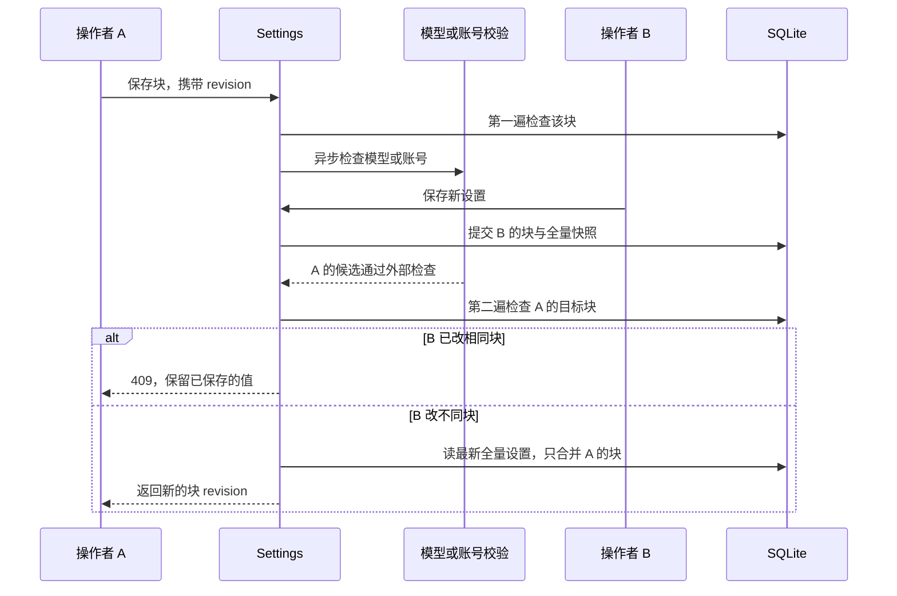

# 26 · 设置、权限历史、管理 API 与运营面板

> 面试题　Alice 在飞书请 Agent 修帮助页文案，半天没有见到结果。面板上应该先看哪里，才能区分平台消息未摄取、策略拒绝、Worker 排队和外发失败？两个操作员都基于昨天读到的配置，其中一个正在等待账号检查，另一个已提交新值，系统怎样防止覆盖？

**短答**　原型的 React 面板通过类型化客户端读取 SQLite 之上的管理视图，并调用业务入口执行有限操作。排查时从 Source 健康与原 Trigger 查摄取，再看 Thread、Decision 和 Ticket，最后查消息回执。设置保存按块比较 revision，异步校验之后再比较一次，并把通过的块合并到此刻最新的全量设置。全量设置历史、块 revision 和 Policy version 分别用于审计、冲突检查与授权。账号配置可能需要重新执行部署检查，容量等日常设置可继续由当前 Runtime 使用。 [管理路由](../dsh-superagent-prototype/src/app/http.ts) · [设置保存](../dsh-superagent-prototype/src/app/settings.ts#L139) · [运营概览](../dsh-superagent-prototype/src/app/views/overview.ts)

本文以本地提交 `7bd4741` 为基线。继续用帮助页工单 T。用 X 表示某条有明确来源的请求，D 表示可能出现的授权判断，R 表示一条预期外发结果。示例中 X 可以在不同阶段卡住，每种判断都要回到实际记录。第 25 篇的 Prompt revisions 另有入口，本篇集中在管理状态、运行配置和授权历史。 [Prompt 篇](25-prompt-skill-and-model-surface.md) · [项目部署文档](../dsh-superagent-prototype/docs/006-deployment.md)

## 1. React 面板怎样读出应用状态

### 1.1 共享 API 契约让页面控制动作和数据来源可查

`src/app/api.ts` 用字符串键描述 method、route、请求参数或 query、body 和返回视图。客户端 `caller` 以此检查 TypeScript 入参，再把替换进路径和 query 的字符串编码，统一向当前站点的 `/orchestrator/api/` 请求。服务器按 method、路径段数和命名参数匹配 route，运行对应的 Zod 解析或业务检查。这些类型说明页面会取哪些对象，浏览器传来合法 JSON 则仍需由服务端验证，不能因为前端能构造请求就视作授权成立。 [API 路由类型](../dsh-superagent-prototype/src/app/api.ts#L20) · [类型化客户端](../dsh-superagent-prototype/src/client/api.ts#L112) · [服务端匹配](../dsh-superagent-prototype/src/app/http.ts#L218)

读请求经应用视图形成页面需要的数据。例如 Overview 用 Store 的 active Threads、出站失败 SQL、域阶段和 Runtime 的 health 生成概览。Ticket 详情读取工单、Decision、Input 与各 Assignment，还可以加上适用的工作目录环境。写请求则调用 Engine 或 Settings，尝试变更状态。比如面板的 retry，不依赖按钮样式或客户端存的上次状态重跑，而是服务端核验当前 Ticket 是否符合业务条件。页面是诊断和发命令的入口，状态与授权仍保存在控制面。 [Overview 视图](../dsh-superagent-prototype/src/app/views/overview.ts#L38) · [Ticket 详情](../dsh-superagent-prototype/src/app/views/tickets.ts#L59) · [HTTP 操作](../dsh-superagent-prototype/src/app/http.ts#L173)

### 1.2 管理入口约束本地来源，错误形态供客户端区分

原型启动时要求管理 Web 服务监听 `127.0.0.1`。请求到 API 前，校验 Host 是目标端口上允许的回环地址或 localhost、有 `x-orchestrator-request: 1`，且 Origin 为空或与该 Host 的 HTTP 地址相同。匹配路由后还要等 Runtime.ready。Setup 未配置时 Runtime 可返回可管理的状态，操作者能先补配置。这里的检查体现安装按本机管理来设计，代码中的请求判据没有随操作写入企业用户会话或本人身份。安全边界在下一篇展开。 [注册与 sameOrigin](../dsh-superagent-prototype/src/app/http.ts#L75) · [入口与 Runtime.ready](../dsh-superagent-prototype/src/app/http.ts#L230) · [同源测试](../dsh-superagent-prototype/tests/http.spec.ts#L70)

服务端对 Zod 返回带字段路径的 400，对 SetupError 带结构化 setup 问题，对明确缺记录的请求返回有 JSON 内容的 404。设置冲突和 Prompt 冲突用 409。客户端还区分 fetch 不可达或 DSH 重启期间路由卸下后留下的空 404，这些会归入 unreachable，而不是「工单已被删除」。解析 error、issues 或 setup 使面板可以用用户可读的语言呈现原因。也因此同一个 404 示意，捕到的响应有无应用体是实际诊断证据。 [服务端错误转换](../dsh-superagent-prototype/src/app/http.ts#L80) · [客户端 ApiError](../dsh-superagent-prototype/src/client/api.ts#L8)

### 1.3 每 5 秒轮询的是页面数据，不是所有 Source 的节拍

面板 Provider 轮询 GET state，各页面分别用 `usePoll` 读当前数据，例如 Overview 或已显示的 Ticket 列表。默认间隔 5 秒，页面隐藏时下轮等待乘六，重新可见会请求刷新。同一轮询作用域内串行提交手动 reload 与自动读取，上一响应不会晚于下一响应覆写。依赖参数改变时旧订阅标为非 active，已发出请求即便返回也不改变新视图。失败仍保留最近一次成功的数据并附 error，相同成功结果可跳过刷新组件。因此页面的当前文字可能来自上一次成功响应。 [客户端轮询](../dsh-superagent-prototype/src/client/api.ts#L58) · [全局面板状态](../dsh-superagent-prototype/src/client/provider.tsx#L74)

在伴随后端重启的保存之后，面板的 state 轮询可缩到 1 秒，观察服务先断开、后恢复。若重启正好发生在两次检查之间，提示最多等设定时间收起。这不修改 GitHub 的 polling interval 或 Feishu 事件消费，也不保证对应 Source 恢复读取某个评论。管理页读成功表示控制面能答复这一轮请求，业务读取还要另查 Source 的近期状态与检查点。 [重启观测](../dsh-superagent-prototype/src/client/provider.tsx#L85) · [Source 健康投影](../dsh-superagent-prototype/src/app/views/sources.ts#L30)

## 2. 一条没看到结果的请求，按哪些页面定位

| 要核对的阶段 | 主要页面或 API | 可作为证据的记录 |
| --- | --- | --- |
| 安装和服务是否可用 | GET state、Overview | setup 问题、Source 是否安装与开启、暂停、各模块 health |
| Source 有没有摄取 X | Sources、Trigger 与 Thread 时间轴 | Source 近期记录、单 Thread pollError、按消息 ID 找到的原 Trigger |
| 是否被过滤或准入失败 | Thread 详情、Eval/Decision | disposition.filtered、候选状态、Decision 的 kind、reason 与 audit |
| 已有工作是否直接收到 X | Thread 的 fanout、Ticket Inputs | 归属当前 Worker、handback 理由、实际 Input |
| 已受理工单是否正在执行 | Execution 与 Ticket 详情 | working/queued、Assignment、运行名额、输入送达错误 |
| 结果是否已经进入外发链路 | Overview 和 Sources 的外发信息 | send 错误、attempts、dropped.reason、相关 Channel |
| 哪个设置决定了当前行为 | Settings 与配置历史 | 当前块的内容、revision、Policy version、被通知的 Ticket |

### 2.1 先找 X，判断它有没有变成 Trigger

用户说「没反应」时，先根据来源链接、评论或消息 ID 找到那条输入。若找不到，检查 Source 是否 installed、enabled、是否等待 Setup，哪个读取任务失败。Sources 的列表将插件缺失、关闭、error、starting、paused、ready 等综合投影，并保留近期统计。不应从某个 Source 处于 ready 推断每个 Thread 都没读失败。GitHub 的个别读取错误还能保存在 Thread.meta.pollError，Thread 页面优先显示相关错误状态。来源没有生成 Trigger 时，面板关于策略的筛选没有对象可以解释。 [Source 状态](../dsh-superagent-prototype/src/app/views/sources.ts#L30) · [Thread 状态](../dsh-superagent-prototype/src/app/views/records.ts#L155) · [检索入口](../dsh-superagent-prototype/src/app/http.ts#L156)

X 已入库的话，区分 `disposition.filtered` 和后来出现的 ignore。前者是 Source 的范围过滤，后者属于系统曾进入准入或路由后产生的决定。比如群聊不在允许摄取范围，记录会带 Source 过滤理由；来源已摄取但发言者无法按当前规则新建任务，则应定位到 Decision 的 reason。若显示 delivered，要注意 TriggerView 中这个值来自 `followupOwners` 的投影，表达当前有人类后续由对应 Worker 判断。它本身无法证明 Session 已读。某些旧队列同时还保存这个 ID 时，面板会优先展示当前归属。 [TriggerView](../dsh-superagent-prototype/src/app/views/records.ts#L74) · [输入已读边界](19-session-delivery-and-read-receipts.md)

### 2.2 Eval 不接单、Worker 排队、外发错误各有自己的页面证据

未等到 Ticket 时查 Thread 是否在 evaluating、候选何时开始、是否存在较新的 Decision。Eval 记录用筛选视图展示 accept、ignore、stop、unavailable 等，适用时可取审计字段。Overview 列出了当前的超时与近期未被后续工作接续的 unavailable 等问题。它排除已被 dismiss、已进入新评估或有后来 Decision 的历史问题。dismiss 改的是问题是否继续冒泡给运维，保留原决定及理由可读。requeue 是让符合条件的 Trigger 用当前准入重新走评估。两种操作都不会直接制造新的 Mandate。 [Decision 路由](../dsh-superagent-prototype/src/app/http.ts#L177) · [Overview 的未决评估](../dsh-superagent-prototype/src/app/views/overview.ts#L12)

有了 T 时，先看 Execution。待人、idle、working / queued 与 ended 走不同的投影。如果 Ticket 已待启动，可能是准备目录中或等 Worker 槽，面板 running 以活动数为准，不会把每一项准备预约都写成活跃回合。已有 Worker 却无法获得输入时查 undelivered 与 message delivery 记录。若 ready 后没有收到回复，再查是否确实排了 R 和送往哪里。Overview 可列出已发生异常的 outbound Effect。Sources 还展示永久掉落的消息及 reason。这能分清「还没形成外发意图」「暂时 pending 等恢复」和「已结算 dropped」。 [Ticket 阶段](../dsh-superagent-prototype/src/core/stage.ts) · [执行负载](../dsh-superagent-prototype/src/app/views/tickets.ts#L49) · [出站问题记录](../dsh-superagent-prototype/src/app/views/overview.ts#L59) · [掉落回执](../dsh-superagent-prototype/src/app/views/sources.ts#L60)

## 3. 设置为何按块保存，异步检查如何避免丢更新

### 3.1 配置块、整库快照与 Policy version 是三个独立标识

面板的 GET settings 将 policy、eval、executor 各自带值与 revision 返回。每个已配置 Source 也用 `source:<id>` 给出独立的 config、启用开关和 revision。界面还拿到来源描述、字段列表、哪些字段触发重启、Scope 准入行与同步状态。一般保存通过 PUT settings/:block 发送该块完整的 value 和 revision。调用语义是以已提供的合法块替换该块，缺字段如何默认由应用 schema 决定，普通响应中的 revision 是块的并发凭据。暂停由单独 API 管，推进的是 pause block revision，保留操作者已有的 Executor 草稿。 [设置读视图](../dsh-superagent-prototype/src/app/views/settings.ts) · [保存和暂停路由](../dsh-superagent-prototype/src/app/http.ts#L193) · [暂停与草稿的测试](../dsh-superagent-prototype/tests/runtime.spec.ts#L942)

| 标识 | 在哪里读 | 修改并发或复盘时的用途 |
| --- | --- | --- |
| block revision | Settings 某块或 Source 实例 | 提交该块时检查有没有并发写入 |
| settings 全量 revision | KV 指针和配置历史 | 定位保存发生前后的完整配置快照 |
| Policy version | 当前状态、历史、Eval/Decision 相关证据 | 当作授权相关结构的指纹，识别评估何时要重新开始 |
| Source 同步 health | `sync:<id>` 条目 | 成员名单的外部同步是否成功，不改块版本判断方式 |

例如 B 提高 maxWorkers，这个操作会加 executor 的块 revision，并产生新的全量快照，但 Policy version 可以保持原值。指纹计算使用规则、eval.mode、Policy 的各 Source 部分和固定格式版本。变更模型、槽位或轮询周期不会直接写进这个 hash。Source 实例 config 也有自己的字段，虽然主要不参与这个 hash，仍影响实际摄取与当前 Scope 读取。审计时不要把「发生过配置提交」「授权证据版本发生变化」「Source 此刻是否启用」混成一个数字。 [Policy 指纹](../dsh-superagent-prototype/src/policy.ts#L111) · [设置快照](../dsh-superagent-prototype/src/app/store.ts#L183) · [配置历史测试](../dsh-superagent-prototype/tests/runtime.spec.ts#L600)

### 3.2 两次检查都要针对同一个块

Settings.save 首先拿请求 revision 比较当前目标块。通过后解析并校验 schema，在所读取的全量 settings 上生成候选。若改了非空的角色模型配置，需要 await resolveRoleModel。改涉及账号或仓库的字段也可 await Setup.checkAccounts。这个等待期间，同一个进程可以处理另一个请求。通过外部检查只说明待提交值能用，保存前仍得比同块 revision。若已变，后来的结果抛 SettingsConflict，保留另一人已提交的值。源码现有测试用 Deferred Promise 暂停模型校验和账号校验，分别在等待时提交同一块的新值，验证两个分支都拒绝迟来的旧草稿。 [二次检查](../dsh-superagent-prototype/src/app/settings.ts#L148) · [竞争测试](../dsh-superagent-prototype/tests/settings.spec.ts#L18)

若另一个请求改的是不同块，通过二次检查时仍可保存。但不能拿 await 前的候选对象直接落全量库。Settings 会重读最新 settings，再将当前这一个解析过的块合并进去。这样即使第一个操作者之前看到的是旧 Eval 配置，也只覆盖其要提交的 Executor。本篇补充用例让 Executor 的模型校验暂停，期间另一个请求保存 eval.timeoutSeconds。放行后，两次顺序落为 eval、executor，最终模型、Worker 上限和新的超时都保留，各自块 revision 加一。同块冲突由 revision 防止，跨块保留还需要最后从最新状态合并。 [最新值合并](../dsh-superagent-prototype/src/app/settings.ts#L168)

如果解析、更新后的状态与已存状态一致，代码可返回 saved=true，沿用原 revision，没有做新配置版本。事务中只在有真实变更时保存全量快照、适用的 notice 和领域变化。面板的通用草稿也保留编辑基准，看到新 revision 后可以三方比较未修改项与冲突路径。不同字段即便都属于同一块，服务端先拒绝旧 revision；由客户端在更新后查看是否能合并再提交。前端成功接收响应时可显示提交值，等待后续轮询赶上保存的 revision。 [no-op 判定](../dsh-superagent-prototype/src/app/settings.ts#L168) · [草稿三方合并](../dsh-superagent-prototype/src/client/draft.tsx#L17) · [轮询旧值测试](../dsh-superagent-prototype/tests/draft.spec.ts#L95)

## 4. 权限历史的结构，以及策略变化如何影响在途任务

### 4.1 历史保存的是配置和作用范围

一次 Settings.save 进入事务时，记录 source（面板、工具、同步等）、block、当时 Policy version、policyChanged、notified 以及全量快照。界面请求 `GET policy/history` 时，后端取近期 30 份设置版本，按相邻连续 revision 计算差异。规则按 ID 对照，Source 行按字段定义与行键找增加、删除或改变，admission 更新用相应 Source 的一条摘要。变更细节映成结构化 code 供页面本地化，notified 可补 Ticket 标题。旧历史缺相邻版本，或其 Source 数据不符合当前 schema，差异会返回 null，但原历史版本仍留在清单中。 [配置历史](../dsh-superagent-prototype/src/app/settings-history.ts) · [连续版本对照测试](../dsh-superagent-prototype/tests/views.spec.ts#L196) · [面板历史显示](../dsh-superagent-prototype/tests/panel-settings.spec.tsx#L63)

这里的 source 字段表示保存的入口来源。示例问「谁在周一禁用某条规则」时，历史能说明何时、从哪个入口改动了规则，哪些工单受到通知。能否关联到某位登录的操作者要看部署是否另有身份审计。每条 D 和 T 自己还有建立时的 Policy version 与授权依据，复盘可同时核查当时的 Decision、对应快照及目前配置。用最新 allowlist 猜当时为什么接受一个任务，会丢失当时决策可见的规则。 [历史记录结构](../dsh-superagent-prototype/src/app/store.ts#L21) · [Decision 与 Mandate](13-decisions-mandates-and-revalidation.md)

### 4.2 policyChanged 后重新评估什么，通知哪些 Worker

Settings 发现 before 与 after 指纹不同，先用两版配置与各自 Source Scope 评估开放 Ticket。对于匹配过的 rule 有变、授权条件不再满足等适用项，生成 PolicyEffect。随后在同一段本地事务内保存版本，调用 Engine.policyChanged。Engine 给受影响的开放 Ticket 添加政策变更 Input，并让在途 Eval 按新 Policy 排队。对于正在执行的 Ticket，已有 Mandate 是过去发生的授权证据，配置更新不会自动写一句「已人工停止」。自然结束工单重新恢复时另有当前 Policy 的适用检查。 [差异与输入](../dsh-superagent-prototype/src/policy.ts#L143) · [Engine 更新](../dsh-superagent-prototype/src/core/engine.ts#L252) · [在途评估与开放任务测试](../dsh-superagent-prototype/tests/runtime.spec.ts#L408)

比如团队禁用此前命中的文案修订规则，尚在等待结果的主动 Eval 可以因版本变化重新判断，开放 T 得到对应规则变更 Input。如果只是把容量从 2 改到 3，Settings 保存历史与同步通知仍可发生，待启动工单看最新名额，Policy version 不需要改变。这种不同影响对应了面板中常见的现象，配置历史有更新但 Eval 并没有重新开始。不应仅为「看起来更新了」而强行重排所有工作。 [Settings 的 effect 条件](../dsh-superagent-prototype/src/app/settings.ts#L175) · [模型和容量的版本证据](../dsh-superagent-prototype/src/policy.ts#L111)

### 4.3 Source 成员同步同样要防异步覆盖

管理员可用 policy-sync/:id 请求同步。运行时先确认 Source 已安装、启用、Setup 就绪并且当前策略部分可同步。它在向外部来源拉取名单前记住 policy block revision，回来后再核对。若别人在等待过程中保存过 policy，即使改的是同一 policy 块的另一个子部分，也会拒绝这次旧同步。失败留在 `sync:<id>` health，并依适用重试计时再次尝试。若同步结果与已存部分相同，无需再保存版本。刷新聊天显示名称有另一个操作入口，它关注 labels，不代表成员名单授权已更新。 [同步与刷新](../dsh-superagent-prototype/src/app/settings.ts#L215) · [同步冲突测试](../dsh-superagent-prototype/tests/settings.spec.ts#L44) · [重试计时测试](../dsh-superagent-prototype/tests/settings.spec.ts#L60)

## 5. 修改账号和执行环境后，何时生效

### 5.1 字段决定是否需要面板、账号检查与重启

Settings.save 接收由调用方传入的 origin。HTTP 路由明确传 `panel`，主 Session 的管理工具传相应的 `tool`。对 executor，guard 比较 `directory`、`prepare`、`blockedCommands` 三项的组合。对 Source，guard 比较部署 Setup 会读取的字段，目前是 GitHub 的 `repository` 和 `cli`、飞书的 `cli`。这些字段更改会改变 Worker 用什么命令准备目录、通过哪个入口访问第三方，或者把工作指向哪个仓库，因而要求面板操作。普通容量、Eval 超时和既有字段可用各自的检查流程保存。不是所有能改变运行结果的值都进入同一个重启路径。 [字段 guard](../dsh-superagent-prototype/src/app/settings.ts#L23) · [Setup 字段定义](../dsh-superagent-prototype/src/deployment.ts#L45) · [执行环境入口测试](../dsh-superagent-prototype/tests/runtime.spec.ts#L897)

如果确实换了账号或仓库配置，`checkAccounts` 会用候选配置探测与本次保存相关的账号入口。只修改飞书时走飞书的验证路径。保存前碰到当前配置块自己的 SetupError，就把这次保存以明确的错误结束；另一个配置块已有的 Setup 问题不会挡住这次单独修正。此时还没进入保存事务，也还要经历异步之后的 revision 二次检查。配置没变的普通保存可以返回原 revision。若修复发生在面板外，例如原来配置的 CLI 已恢复可用，现有的 `POST setup/check` 可重新执行 Setup。服务已就绪、飞书也没有 Setup 问题时，该操作会被拒绝，以免把健康运行的执行回合打断。 [按账号探测和重检](../dsh-superagent-prototype/src/app/setup.ts#L53) · [账号检查与提交顺序测试](../dsh-superagent-prototype/tests/runtime.spec.ts#L884)

### 5.2 保存成功、主 Session 通知和部署就绪有三个观察点

当启动依赖的字段有变，或 Setup 尚未完成且本次有真实配置变更，保存结果会带 `restarting: true`。程序在提交后调度下一轮事件循环去调用 Cordis 的 fiber restart，让这次请求可以先返回。Runtime 会从保存值重新运行完整部署检查、写执行环境并验证可用性。GitHub 基础部署失败可使整个应用还在等待 Setup。飞书 Bot 自身的 SetupError 可单独暴露为飞书问题，让 GitHub 继续工作。重启成功后入口会触发 DSH settings describe，重启失败也有独立日志。收到保存回执后查 GET state 与对应来源的 health 才能确认恢复情况，原回执本身只说明已安排重启。 [重启调度](../dsh-superagent-prototype/src/app/setup.ts#L58) · [部署恢复与降级](../dsh-superagent-prototype/src/app/setup.ts#L76) · [插件入口](../dsh-superagent-prototype/src/index.ts#L10)

`context_delivery` 表达的是设置通知是否已注入主 Session 上下文。重启路径先返回 pending，面板发起的保存会把通知与配置写在同一段 Store 事务里。主 Session 自己从工具保存时跳过这条自我通知。面试里如果有人问「注入了为什么 Alice 还没有收到 R」，应检查 R 的出站回执。配置通知与外部业务交付使用的是不同记录。无需重启的保存还会请求调度 pass，让刚放开的容量等条件尽快被看到，但这一动作也不等同于某张 Ticket 已得到 Worker。 [通知和返回值](../dsh-superagent-prototype/src/app/settings.ts#L176) · [外发回执](24-outbox-replies-and-attention.md)

### 5.3 保存请求报错后，应先检查失败发生在哪一段

`blockedCommands` 是值得单独追踪的例子。面板保存新配置后，Settings 先完成 SQLite 的事务，再调用 `setup.blockCommands()` 重写 Worker 的命令包装器。现有测试确认正常写入时可以热更新，无需为此重启插件。在临时副本增加的一个用例让 `blockCommands` 在提交后拒绝。调用确实抛错，但重读 Settings 看到新配置已经持久化，executor revision 已推进，完整历史也还在。这种异常穿过管理路由时走普通服务端错误处理。若界面只看 HTTP 失败就立即重发同一个旧 revision，可能先遇到 409，既没有修复包装器，也没有说明配置已经写过。 [提交与文件更新的先后](../dsh-superagent-prototype/src/app/settings.ts#L182) · [HTTP 错误处理](../dsh-superagent-prototype/src/app/http.ts#L80) · [正常热更新测试](../dsh-superagent-prototype/tests/runtime.spec.ts#L1003)

因此排查时分别记录三个事实。先看当前块 revision 与目标值，再看历史是否包含本次修改，最后看包装器写入是否成功。若当前值已相同，普通保存会走 no-op，不能把它当作重做文件更新的入口。这个例子也解释了并发正确性的范围。CAS 可以保护配置快照，SQLite 事务可以绑定配置、历史和同库领域变化，事务外的文件动作需要另查执行证据。与之相对，若在异步账号校验阶段已返回错误，读取旧 revision 仍合理，因为此时保存路径还未到提交点。 [设置保存的各阶段](../dsh-superagent-prototype/src/app/settings.ts#L148)

## 6. 从 Overview 汇总回到原始证据

### 6.1 指标常有不同计数单位

Overview 的 `no-source` 根据已安装且启用的实例数量判断。某个实例启用但摄取报错时，通常看该实例的 `source-error`。只知道没有触发 `no-source`，还要检查故障时段的来源健康和请求 X 的原始记录。`no-allowed` 关注当前是否有允许发起任务的人。整体有准入规则时，Alice 的具体群、仓库或身份仍可能被当前 Scope 与 Policy 排除。反过来，Overview 的问题项也不是全量历史。它只列特定类型和状态，例如最近一天、最新判断为 unavailable 的线程要满足未 dismiss、没有更晚决策、此刻没有继续评估或等待评估等条件；查询还先取最多 200 条 unavailable 候选。追一条旧请求仍应按原始 Trigger、Thread 与 Decision 查询。 [问题清单与筛选](../dsh-superagent-prototype/src/app/views/overview.ts#L12) · [来源明细](../dsh-superagent-prototype/src/app/views/sources.ts)

看 24 小时流量时，`received` 和 `filtered` 按已记的 Trigger 统计，两者之差给出图中的触发数。judged 数通过过滤、关联到 Decision 的不同 Trigger ID，ignore 也可以贡献这个计数；accepted 数则是关联窗口内 Trigger 的不同 accept 或 reopen Decision ID。假如一次准入把三条补充消息合起来判断，三个 Trigger 可能对应一条 accept。若把 accepted 除以 judged，结果是两个不同去重单位的比值，无法直接描述用户请求的准入成功率。此外，evaluating 是读取时的活动线程数，dropped 以出站掉落时间计数。同一张卡片里的数据也可以使用不同的时间锚点。按 Trigger 时间筛选 Eval 列表，才能对上其中相应的流量指标。 [Overview 汇总](../dsh-superagent-prototype/src/app/views/overview.ts#L67) · [SQL 的时间窗与去重](../dsh-superagent-prototype/src/app/store-read.ts#L18) · [窗口测试](../dsh-superagent-prototype/tests/panel-overview.spec.tsx#L45)

### 6.2 用一次已接单但未交付的请求走完整链路

假设支持同学只拿到 Alice 发消息的时间、飞书消息 ID 和「帮助页改好了没有」的描述。先用原消息 ID 在 Trigger 中定位具体输入，核对 Thread 中同一时间附近的消息。如果 X 是追问，可能已经归属已有 Worker，没有新的独立 accept。若首次需求有可打开的 accept，则跟到 T 的 Execution，核对当期 Assignment 的启动、输入与完成证据。一个任务最终停在待人阶段时，需要看等待条件和下一步由谁完成，拥有可用 Worker 槽也不会消除这类等待。 [Trigger 搜索](../dsh-superagent-prototype/src/app/store-read.ts#L54) · [Trigger 时间线测试](../dsh-superagent-prototype/tests/panel-trigger.spec.tsx#L10) · [执行明细测试](../dsh-superagent-prototype/tests/panel-execution.spec.tsx#L53)

如果 T 已有完成结果，Alice 仍没收到群回复，就沿 R 查目的 channel、尝试次数与错误。Overview 的 failingReplies 查的是仍有 reply Effect 且 attempts 大于零的项目，已结算掉落的回执仍可从 Sources 查看。R 在问题列表中消失也可能是它已经永久掉落，需查具体回执确认。相反，如果只找到 Worker 的一段完成文字、找不到相应外发记录，证据只够支持「执行侧有产物」，还需要检查是否生成出站意图。此时重新派 Worker 会重复工作，修复交付需先定位业务动作走到了哪一步。 [失败与掉落查询](../dsh-superagent-prototype/src/app/store-read.ts#L69) · [掉落展示测试](../dsh-superagent-prototype/tests/panel-overview.spec.tsx#L97) · [出站失败展示测试](../dsh-superagent-prototype/tests/panel-overview.spec.tsx#L142)

## 7. 用测试核对关键判断

在临时副本运行了 Settings、HTTP、Draft、Runtime、Views 与六个相关面板测试文件，共 11 个文件、189 个现有用例全部通过。它们覆盖同块冲突、Policy 同步与退避、历史界面、执行阶段、异常展示等路径。另在临时副本执行两个补充用例，分别观察跨块并发合并和事务提交后的命令包装器写入故障。这些观察来自模拟模型及适配器的测试环境，可以核对调用顺序与持久状态。真实飞书账号或 GitHub 仓库的可用性需要具体部署验证。 [设置并发测试](../dsh-superagent-prototype/tests/settings.spec.ts#L18) · [草稿测试](../dsh-superagent-prototype/tests/draft.spec.ts#L95) · [HTTP 测试](../dsh-superagent-prototype/tests/http.spec.ts#L28)

跨块用例把 executor 的模型校验停在 await，期间保存 Eval 的 `timeoutSeconds`，再让模型解析返回。两次保存都成功，最后快照同时包含新超时值、Executor 模型和容量。这验证了「重读全量再替换自己的块」的作用。同一块的异步冲突由仓库既有测试覆盖，后完成的旧请求不能继续写库。测试这两个分支都需要控制异步检查完成的时机，否则两次连续保存即使通过，也没有走到设计要处理的交错。 [仓库中的控制异步测试](../dsh-superagent-prototype/tests/settings.spec.ts#L18) · [提交前重读](../dsh-superagent-prototype/src/app/settings.ts#L168)

## 8. 面试口述与追问

### 60–90 秒口述

我会沿一条请求在应用里留下的证据来排查。先在 Sources 看飞书健康与摄取范围，按消息 ID 找到 Trigger，区分 Source 过滤和后来 Policy 的 Decision。接着用 Thread 判断它在等 Eval、已被拒绝，还是已经被某张工单接收。到了 Execution，区分等待启动、Worker 正在处理和等待人。最后用出站回执确定是否生成回复、正在重试还是已经掉落。

配置保存用块 revision 做乐观并发。保存前检查一次，异步校验模型或账号以后再检查一次。若别人保存同一块，旧请求返回 409。若改的是不同块，就从最新完整快照合入当前块，两边都能保留。同一个 SQLite 事务写配置历史和适用的 Policy 变更。账号一类字段还会触发插件重启，因此我要分别确认配置已保存、插件已就绪和来源已健康。

### 五个追问

1. **Source 显示 ready，为什么仍要找原始 Trigger？** ready 是部件健康，不能证明某条消息一定被摄取。要用 ID 查该笔输入，再看 Source 过滤、后续归属或 Decision。当摄取证据和准入证据都不存在时，可先从消息所在群和当时的来源配置缩小范围。
2. **异步校验前已经比较了 revision，为什么要比较第二次？** 因为外部检查期间进程能处理别人的保存。第二次检查保护同块更新，重读之后的合并保护其他块已写的新值。两个动作解决的是不同的并发后果。
3. **Settings 历史新增一条，哪种情况下会重评正在进行的 Eval？** 保存导致生效后的 Policy 指纹变化，才走 Engine.policyChanged。容量和模型的普通调整可以有设置历史而没有新 Policy version。若还要解释 T 为什么收到政策输入，要进一步匹配该开放 Ticket 的适用规则。
4. **一次保存返回失败，为什么此后用旧 revision 重试会被拒绝？** 失败可能发生在事务提交后，例如写命令包装器过程中。先读当前 revision、目标值与历史确认保存状态，再按失败位置确认环境是否更新。
5. **面板能直接证明是谁改了规则，以及对方已经读到通知吗？** 历史能定位修改时间、调用入口、前后快照和被选择通知的 Ticket。若需要人的实名操作证据或通知确认，要查部署层的身份记录和相应投递证据。

上一篇是 [25 · Prompt、Skill 与模型接口的版本治理](25-prompt-skill-and-model-surface.md)，下一篇是 27 · 信任边界、最小权限与人工控制。 [系列目录](README.md)
