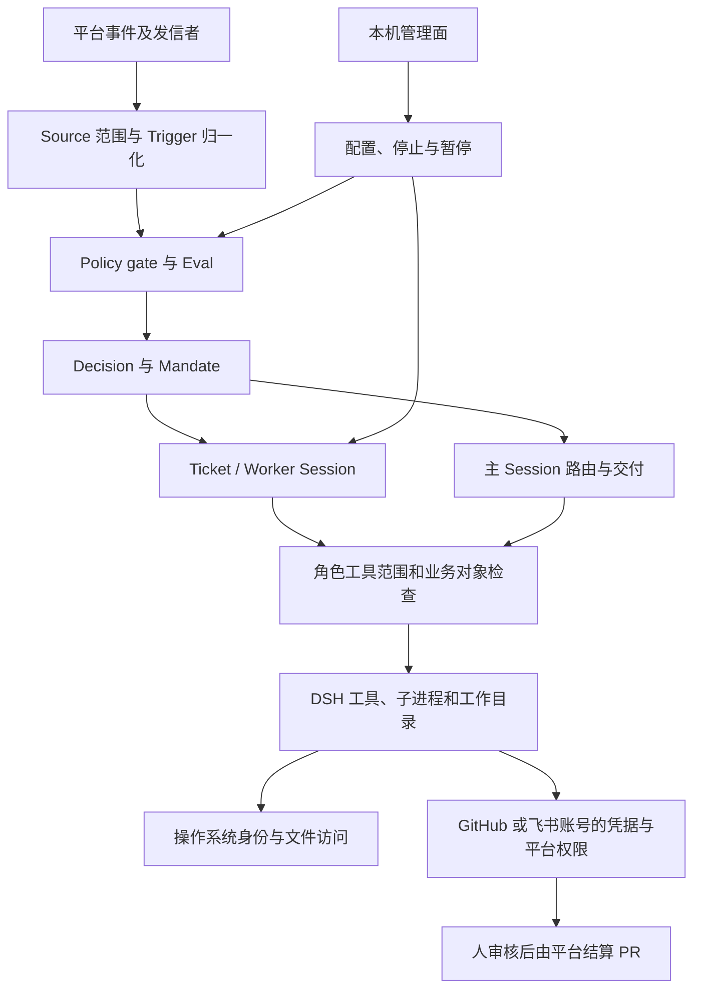

# 27 · 信任边界、最小权限与人工控制

> 面试题　Alice 在 GitHub Issue 中请 Agent 修帮助页文案，机器人在后续评论里贴了检查结果，飞书群里有人询问进度，Worker 最后报告 PR 已准备好。谁有权发起工作、扩展任务、改变配置和批准合并？如果这四件事都能用自然语言提出，系统分别在哪里做检查？

**短答**　先找真正执行检查的部件。Source 决定哪些事件进入处理范围，Policy 与 Engine 记录并校验开展任务的授权，Session 和业务工具限制可以发起的应用动作。进程可读的文件与账号能执行的外部操作，最终由操作系统和第三方平台约束。这个原型给托管 Session 设为 `danger-full-access`，配置的账号包装器主要防止误用个人凭据。交付 Prompt 说明何时可以申请合并，能否拦截一次不合规的合并尝试要看仓库保护和账号能力。人工停止、策略修改、暂停和撤销外部凭据分别作用于不同状态。 [部署权限](../dsh-superagent-prototype/docs/006-deployment.md#L13) · [会话初始化](../dsh-superagent-prototype/src/app/sessions.ts#L137) · [交付要求](../dsh-superagent-prototype/prompts/team/delivery.md)

本文沿本地提交 `7bd4741` 复用同一张帮助页工单。Alice 是虚构仓库的维护者，Issue #41 是原始请求，T 是工单，PR #62 是 Worker 为 T 准备的交付物。另一条后续评论可能来自列入名单的检查机器人。飞书中的讨论可能发生在允许监听的群，也可能只有操作者本人能读。案例里的用户和 ID 均为示意，结论以本仓库中的判断函数、测试和部署说明为依据。 [系列目录](README.md)

## 1. 画出一次动作的授权链

### 1.1 把主体、动作和资源放在同一句话里

「Agent 有权限」这句话缺三个要素。授权的主体可能是平台识别的发信人，也可能是当前 Session、运行进程的操作系统账号，或签署一次 API 调用的 GitHub 账号。动作可能是发起工作、读取工单内容、改本地文件、推送分支或发布结果。资源从某一条消息到整个仓库都可能有。把主语说全，才能问出证据。例如「Alice 能请原型创建工单」看 Source 和 Policy，「Worker 能否读另一张工单」看调用入口的资源检查，「PR #62 能否进入默认分支」要看平台批准的身份、目标分支和提交。三个结论可以同时成立，也可以各自失败。

下图选的是一次成功发起工作的主路径。上部处理从消息到 Mandate 的授权，下部处理从进程到外部写操作的能力。仓库里的文字、群历史、工具返回值进入模型时都保留数据身份。人工管理路径也能改变控制面状态；一旦管理面授权被误用，后面的控制面对入口做出的假定就会失去基础。 [Runtime 装配](../dsh-superagent-prototype/src/app/runtime.ts#L119) · [准入与复核](../dsh-superagent-prototype/src/policy.ts#L166) · [管理路由](../dsh-superagent-prototype/src/app/http.ts#L188)



### 1.2 哪些判断调用时会执行

遇到安全设计题，我会让每条限制回答四个问题。由谁做判定，读取哪些值，拒绝时怎样观察，资源还有哪些访问入口。比如「工单结束后拒绝 Worker 的新工具调用」可以在 Session guard 处看到拒绝文本，也可以查 Ticket 的持久状态；至于命令已经在此之前启动，需另核对 Executor 是否请求结束及副作用是否已发生。把两个时间点写进答案，能避免把一次工具入口拒绝解释成已经发生的文件写入或外部操作也随之撤销。 [工具 guard](../dsh-superagent-prototype/src/app/sessions.ts#L283) · [结束工单](../dsh-superagent-prototype/src/core/tickets.ts#L345)

| 评审问题 | 真正执行判断的位置 | 可观察的证据 | 结论范围 |
| --- | --- | --- | --- |
| 这个群或仓库的事件是否进入处理范围 | Source 注册表和 Intake | Source 配置、Trigger、filtered reason | 是否通过摄取处理，已到达的过滤事件仍可留痕 |
| 这条消息能否发起工作 | Policy gate、Eval 提交及 Engine | strength、Decision、Policy version、Mandate | 该次业务授权 |
| 某个调用能读哪张 Ticket | Session 的工具权限、资源读取函数 | 拒绝结果、调用固定的 Ticket ID | 该应用入口里的对象访问 |
| Worker 能否打开宿主文件 | 宿主账号与隔离环境 | 部署用户、文件权限、挂载范围 | 该进程的实际文件能力 |
| Agent 能否改远端分支或合并 | 远端平台、外部账号和仓库规则 | 平台返回、提交 ID、审批和分支事件 | 实际外部操作是否成立 |

以上表格可以用来复盘一个误判。比如审阅者从配置看到文件工具限制，直接认为主 Session 具有只读文件系统。接着查 preset 会发现还有 shell，查初始化又会看到两个托管角色都被设成高权限，最终结论要落到部署环境。如果审阅只看 Prompt，则更容易把「尽量少读」这一行为引导当成读取请求曾经被服务端拒绝。把证据落到调用点，才能判断这个约束覆盖了哪些路径。 [主 Session preset](../dsh-superagent-prototype/cordis.patch.yml#L125) · [Session 限制](../dsh-superagent-prototype/src/app/sessions.ts#L260) · [部署约束](../dsh-superagent-prototype/docs/006-deployment.md#L13)

## 2. 从外部消息到 Mandate

### 2.1 接收到内容和允许处理是两次判定

事件适配器从带类型的 GitHub 或飞书响应中取得发信人 ID，并构造带 Source 的 `actor`。GitHub 适配器区分 agent 自身、普通账号与机器人，飞书适配器根据事件的 sender type 标记人物消息，名字随后可作为展示信息。这样做能防止把一段引用里的署名、聊天昵称或正文中的自述直接当作发信人。对同一个人跨平台使用哪个授权，需要额外绑定身份，原型按 Source 下的 ID 查名单。 [GitHub 触发适配](../dsh-superagent-prototype/src/sources/github-trigger.ts#L56) · [飞书触发适配](../dsh-superagent-prototype/src/sources/feishu-trigger.ts#L27) · [Policy 发信人查找](../dsh-superagent-prototype/src/policy.ts#L119)

入库时 `Intake.receive` 先要求存在 Thread，按 ID 去重，再取 `sources.scope` 检查。若来源返回不监听，就保存 Trigger 与 filtered disposition 然后返回，跳过后续订阅投递和 Eval。这个设计提供了一个排查证据，也留下数据保留问题。运维面能看到这条事件被过滤，数据库里也仍可能留着事件正文。若生产需求是「范围外内容从未持久化」，需要在适配器或存储策略里另做裁剪，不能只通过 Policy 保证。反过来，有些消息根本没有被外部账号读到，应用就没有 Trigger 可以解释。 [接收与过滤](../dsh-superagent-prototype/src/core/intake.ts#L19) · [Source 注册表](../dsh-superagent-prototype/src/sources/registry.ts#L124) · [过滤记录视图](../dsh-superagent-prototype/src/app/views/sources.ts#L44)

对飞书，`scope` 根据是否私聊、是否配置到具体群、是否允许其他群提及，返回 listened、observed 和可选准入行。observed 影响未点名事件能否作为主动推断输入。对 GitHub，适配器的接收路径和仓库检查限制摄取范围，Scope 依据事件类型反映是否开启观察。以 T 为例，Issue 中提及 Agent 可以沿通知链路而来；没有提及的普通评论则要看观察配置、订阅与实际读取方式。两条样本即便文本完全相同，进入系统的理由也可能不同。 [飞书范围](../dsh-superagent-prototype/src/sources/feishu.ts#L35) · [GitHub 来源](../dsh-superagent-prototype/src/sources/github.ts#L41) · [GitHub 轮询链路](06-github-polling-and-checkpoints.md)

### 2.2 explicit 和 inferred 决定何时可以创建工单

以源码默认设置为例，列名的人直接点名是显式请求。未列名者直接点名默认忽略，但对应 Source 的准入行可以改为 explicit 或 inferred。列名人员未点名的消息，在能被观察的范围内默认可作为 inferred 候选。没有点名的输入不会由表格选成 explicit。列入名单的机器人也最多是 inferred，仍取决于 Scope、是否被观察或点名、Eval 模式。没有 sender 的 CI 或系统事件走单独的观察和表格条件。面试描述默认值时一起交代可配置项，避免把「能否点名」或「收到通知」当作一条固定超越 Policy 的权限。 [准入表默认值](../dsh-superagent-prototype/src/admission.ts#L8) · [人员与机器 gate](../dsh-superagent-prototype/src/policy.ts#L167)

订阅 Thread 的后续消息还有既有工单归属。Intake 会在监听判定后把输入分给匹配的订阅工单，并写 disposition；如果某个 Worker 仍有权决定这一条后续，控制面通常不会再为它开一个 Eval。来自上下文订阅的消息可以供参考，也可能因为没有 Worker 负责而进入 Eval。显式准入项优先于 Policy gate 中的 followup 兜底，但一个已经由 Worker 决定的 Trigger 仍受业务归属检查。面对「订阅后有陌生人说话」这个问题，应分别问已订阅会话中是否可见、谁处理该输入、能否创建新任务。 [订阅分发](../dsh-superagent-prototype/src/core/intake.ts#L30) · [准入顺序](../dsh-superagent-prototype/src/policy.ts#L191) · [已归属输入的决定约束](../dsh-superagent-prototype/src/core/evals.ts#L131)

### 2.3 模型的决定必须满足同一份业务约束

待评估的一批消息先逐条 gate。程序挑出最强授权，强度相等时优先较新的触发，记录 primary、actor、basis、policyVersion 和 deadline。已经用于创建过 Ticket 的输入会被识别并剔除，避免从已消费的 explicit 权限再开工作。一次决定可以说明多条消息，但授权依据仍能定位到哪个事件、哪个主体与哪条 Policy。直接拿一条 Trigger 来决定的入口也先走 `directEval` 的 gate。这样才能让「跳过等待队列」只改变决定方式。 [构造 Eval](../dsh-superagent-prototype/src/core/evals.ts#L70) · [直接判断](../dsh-superagent-prototype/src/core/evals.ts#L266)

inferred 路径只有在 auto 模式、存在被判断为匹配的规则、规则 ID 仍启用时，才能接受。代码能按 ID 和模式核验模型结果的结构，也能检查评估持有者与 Policy version；「这条规则是否真适用于这句话」仍包含语义判断。accept 时的 Mandate 记录 strength、actor、basis、Policy version 与评估给出的业务 scope。对本例而言，帮助页修订的授权范围支持复盘为什么修改一段文案。若要按文件路径强制阻止任何其他修改，需要独立的路径控制和平台规则，Mandate 字段本身只提供业务范围证据。 [接受限制](../dsh-superagent-prototype/src/core/evals.ts#L148) · [提交判断与授权记录](../dsh-superagent-prototype/src/core/evals.ts#L281) · [Mandate 细读](13-decisions-mandates-and-revalidation.md)

## 3. 从角色配置到每一次工具调用

### 3.1 Agent preset、permission preset 和工具约束各管一层

`Sessions.ensure` 先按 Session ID 尝试解析已有 Agent，需要新建时登记工作区和角色 preset，再初始化角色模型、装配提示词与工具，设置 DSH Session permission preset。主 Session 使用 `dsh-superagent-router`，Worker 使用 `dsh-superagent-worker`。初次使用前，若 Web UI 让托管 Session 选了其他 preset，插件监听选择事件，尝试恢复到对应角色；已经开始回合后的限制由 DSH 宿主执行。这个过程解释了「看见了某个工具」可能同时受创建时配置、插件注册与调用时策略影响。 [创建和恢复角色](../dsh-superagent-prototype/src/app/sessions.ts#L121) · [角色选择测试](../dsh-superagent-prototype/tests/runtime.spec.ts#L1675)

Agent preset 组织插件。Worker 需要文件读写、搜索、shell、后台作业、Skill 和受限的子 Agent，bundle 按环境加载对应的 shell。主 Session 面向路由和交付，文件插件配置把 write 和 edit 关掉，它仍需要读和执行有限的命令。两个角色的 Session permission preset 在原型中都设为 `danger-full-access`。因此「角色不同」可以减少模型有哪些直接工具，也能减少某类误操作，进程最终可以访问多少资源要看部署账号、宿主和第三方凭据。面试如果把这两种 preset 合称「沙箱」，就无法解释为何 Worker 能用工作目录之外的权限。 [Worker preset](../dsh-superagent-prototype/cordis.patch.yml#L20) · [主 Session preset](../dsh-superagent-prototype/cordis.patch.yml#L125) · [宿主权限配置](../dsh-superagent-prototype/src/app/sessions.ts#L137)

角色插件只是第一层工具表。装配的后半段为该 Agent 注册应用工具。随后主 Session 用 allowlist 约束继承的工具，允许 `skill`、`bash`、`read`、`read_image` 及三个 job 工具。Worker 从父作用域取已知的工作工具，与 `WORK_TOOLS` 求交。这里从父作用域读，是为了包含角色 preset 的工具，同时避免把 Agent 自己的本地工具名当作继承工具传给 restrict。应用工具由 `host.tools(agent, ticket)` 为各角色分别装配，主 Session 看到的路由和设置接口具有控制面含义，Worker 的报告则在创建工具时就固定本工单 ID。判断最终能力时需要查实际注入后的工具；例如工作工具名单虽包含 web fetch 名称，bundle 的 Worker preset 另有 `fetch: false`。 [工作工具集合](../dsh-superagent-prototype/src/app/sessions.ts#L55) · [工具注册与限制](../dsh-superagent-prototype/src/app/sessions.ts#L260) · [Worker 应用工具](../dsh-superagent-prototype/src/app/tools/executor.ts#L23)

### 3.2 每次调用读取 Ticket 状态

`workOnly` 在工具调用时从 Store 取得当前 Ticket。工单不存在或已经结束时，guard 拒绝调用。这是一项跟随时间变化的授权。Worker 早先拿到的工具 Schema 可能还在旧模型上下文中，调用发生时仍会重新判断。「blocked」和「failed」可以仍是活的 Ticket，保留工具供操作者在 Session 里继续处理；暂停自动投递与拒绝一切 Worker 工具是不同的操作。主 Session 的另一个 guard 主要限制阻塞等待，以便把下一条候选和报告更快送进 Session。它解决调度问题，不能凭它推导进程的文件或网络权限。 [运行时 guard](../dsh-superagent-prototype/src/app/sessions.ts#L283) · [主 Session 等待限制](../dsh-superagent-prototype/src/app/sessions.ts#L71) · [工单结束和工具测试](../dsh-superagent-prototype/tests/runtime.spec.ts#L1558)

Worker 产生子 Agent 后，宿主通常以 `standard` preset 启动它。插件从 `parentSession` 沿已加载祖先追溯，在代码设定的查找范围内确认所属 Worker Ticket，给它同样的 `workOnly` 约束，已有测试同时验证直接子 Agent 和下一层子 Agent。其他 Agent 保持各自配置。该逻辑依赖可识别的祖先与宿主的 Session 行为，不能从这两个测试推导出跨进程代理或任意深度委派都按 T 隔离。生产设计如果需要广泛委派，可让宿主在创建时签发明确而可撤回的父子工单绑定，并在每个调用入口校验它。 [子 Agent 归属](../dsh-superagent-prototype/src/app/sessions.ts#L298) · [直接子 Agent 测试](../dsh-superagent-prototype/tests/runtime.spec.ts#L1713) · [嵌套子 Agent 测试](../dsh-superagent-prototype/tests/runtime.spec.ts#L1732)

工单结束后的下一次工具调用，与结束以前已经发出的外部动作之间还有一个时间窗口。与 T 相关的工具可能已经开始网络读取，或有后台作业在运行。核心写入 ended，结束 Assignment 并请求 Executor 停止。哪怕进程收到了取消，一条已经由平台接收的提交或评论仍需从平台对账。可以在同一段源码找到这种时间窗口的局部防护。报告工具先检查 T 是否活着，再异步读 PR，随后重新用 `claimPull` 判断当前工单、PR 归属与活跃占用，最后在事务内记录报告和 relay。此处增强的是应用状态的一致性，第三方读取与提交状态仍有自己的生命周期。 [结束处理](../dsh-superagent-prototype/src/core/tickets.ts#L345) · [报告工具](../dsh-superagent-prototype/src/app/tools/executor.ts#L75) · [PR 归属重查](../dsh-superagent-prototype/src/sources/github-pull.ts#L31)

### 3.3 Schema 检查格式，业务入口检查对象

工具注册用同一份 Zod schema 生成模型可见的 JSON Schema，并在执行时再次 parse。这会拒绝不合格式的枚举、ID 类型或缺失的参数，但字符串满足格式仍可能引用错误对象。举例说，Worker 的 `orchestrator_read` 由服务端把当前 Ticket ID 绑定到调用。尝试读取另一张 Ticket 时会被拒绝，触发记录需有送达关联、工单起源或被跟随的 Thread 等可读依据。对于共用的 Thread，Worker 获得自己需要的页面数据，省去其他 Ticket 和 Decision 明细。读取 Prompt 历史也只开放当前 Worker 绑定过的适用 revision。 [工具解析入口](../dsh-superagent-prototype/src/app/sessions.ts#L205) · [资源检查](../dsh-superagent-prototype/src/app/resources.ts#L82) · [线程读取](../dsh-superagent-prototype/src/app/resources.ts#L133) · [不可读 ID 测试](../dsh-superagent-prototype/tests/tools.spec.ts#L445) · [历史 Prompt 绑定测试](../dsh-superagent-prototype/tests/runtime.spec.ts#L1033)

对象检查也有具体的业务含义。跟随 Thread 获取上下文时，可以理解相关讨论，但 Ack 只针对本工单确实触达、能回应的人类请求，context-only 不满足回执要求。主 Session 的 reply 以回答、结果或人工注意事项区分用途，验证结果状态、问题文本或人员输入，并从已记录的 Channel 选择发送位置。后续报告只是「已通过校验，送入了某个合法渠道」的一部分证据。自由文本能否包含私有内容，仍需另外核查来源、敏感度与目标渠道。外发入口控制了若干对象和时序，部署如果有保密要求，还应在这个共用出口验证正文与附件的用途。 [回执与回复](../dsh-superagent-prototype/src/core/replies.ts#L48) · [输出阶段和 Channel](24-outbox-replies-and-attention.md)

## 4. Shell、工作目录与账号的实际边界

### 4.1 工单工作目录主要提供可复现的执行上下文

Executor 用配置的执行根目录和工单短名确定目录，必要时执行管理员配置的 `prepare`。Prepare 在工作区父目录启动，带入工单和 Source 声明的环境变量，然后在新目录里检查 Git 配置。示例部署用 Git worktree 给每张工单准备检出目录。这样便于不互相覆盖临时改动、定位产物和复用会话。worktree 的目录边界与权限边界是两回事。它可以与其他工作区共享仓库对象，操作系统能访问哪些目录仍取决于运行身份。Launcher 看到已有目录会视为已准备，不能把新目录建立后的校验推广到每次复用旧目录。 [目录与执行元数据](../dsh-superagent-prototype/src/executor/dsh.ts#L96) · [准备与检查](../dsh-superagent-prototype/src/executor/dsh.ts#L242) · [启动与复用](../dsh-superagent-prototype/src/executor/dsh.ts#L427)

准备命令来自受控设置，模型输出的 assignment 和工单变量为任务提供上下文。这里要识别一条重要的权限关系。谁获准改 prepare，谁就获准影响未来 Worker 启动时执行的命令；这个人的能力高于普通工单发起人。Path、prepare 和 blockedCommands 被视作执行环境字段有直接原因。若把每个团队的目录和准备器开放给自助配置，平台需要将执行模板发布、实例选择和任意 shell 配置分开授权，然后限制模板所在运行环境的读写与网络能力。 [执行环境字段](../dsh-superagent-prototype/src/app/settings.ts#L23) · [面板保存路径](../dsh-superagent-prototype/src/app/http.ts#L195)

### 4.2 Wrapper、环境清理和 Git 检查降低误用默认凭据的概率

Setup 从配置解析 CLI，按 Worker 运行方式探测账号。GitHub 检查当前登录身份、目标仓库可读和 push 能力，并采用平台返回的规范仓库名。飞书检查应用与 Bot 的就绪状态、strict mode 必须是 bot、成功读取机器人身份。两者提供「默认走哪个账号」的可核查证据。比如 GitHub 探测能确认账号可推送预定仓库，不能因此推导出这就是该身份可见的全部仓库，更无法代表默认分支的实际合并规则。飞书 strict bot 检查的是 CLI 身份选择，机器人可访问的聊天及操作范围还需要第三方权限设置。 [启动账号检查](../dsh-superagent-prototype/src/deployment.ts#L87) · [Bot 身份检查](../dsh-superagent-prototype/src/deployment.ts#L108)

原型把 Worker 的 shim 目录加到进程 PATH 前面，让日常 `gh` 和 `lark-cli` 指向配置好的入口。额外的 blockedCommands 由同名拒绝 shim 表达，受保留命令表约束。Setup 清除常见 GitHub token 和 Git 位置、配置注入、作者身份环境变量，指定自己的 Git 全局配置，关闭交互式 Git 凭据询问。这里 `runAsWorker` 将子进程交给 DSH 宿主服务，源码注释说明宿主会处理凭据形状的环境变量；本仓可直接核对的是自己的变量覆盖与 subprocess 调用。得到这些证据后，可以描述默认执行环境的保护点，宿主实际环境读取和权限隔离应按具体安装验证。 [环境变量](../dsh-superagent-prototype/src/infra/environment.ts#L38) · [包装器和 Git 配置](../dsh-superagent-prototype/src/infra/environment.ts#L75) · [宿主 subprocess 边界](../dsh-superagent-prototype/src/infra/environment.ts#L118)

Git 环境还有两项不同的检查。启动时查询 git 配置，确认 GitHub credential helper 的来源和内容符合生成配置。准备工作区时，读取作用域，拒绝 local 与 worktree 中自设的 `credential.*` 或 `http.*extraheader`，因为这些选项可能改变访问远端时使用的凭据。包装器写入以临时文件加重命名替换单个文件，还检查已有文件是否为此程序拥有。对应测试覆盖正常配置、异物文件、交互提示和目录配置。它们保护的是默认凭据选择和配置完整性，部署用户能打开的其他目录仍由操作系统决定。 [Git 环境验证](../dsh-superagent-prototype/src/infra/environment.ts#L137) · [配置与工作区测试](../dsh-superagent-prototype/tests/environment.spec.ts)

### 4.3 从部署要求推导数据和凭据能放在哪里

部署文档建议独立 DSH profile，原因包括进程级 PATH 修改、独立启停与升级。同一文档指出两种托管 Session 均以部署操作者的操作系统身份运行。独立 profile 主要服务运维，真正把个人凭据隔开的做法是独立 OS 账号，并且该账号只保留 Agent 所需凭据。对于受管服务，可再用独立执行环境控制文件挂载、读取目录和可连接目标。在本例中，Alice 的个人凭据和能无条件修改受保护分支的凭据没有必要进入 Worker 运行域。否则即使日常任务用 agent wrapper，回顾权限时仍要把该 OS 用户可读数据计入风险范围。 [独立 profile 与用户身份](../dsh-superagent-prototype/docs/006-deployment.md#L5) · [Setup 应用进程环境](../dsh-superagent-prototype/src/app/setup.ts#L76)

会话、日志、数据库、外部附件和项目工作区别可以留存同一条消息的不同副本。比如飞书附件即便不进入最终 PR，原文仍可能出现在 Session、工具结果或下载缓存中。做保密设计时以最早能减少读取的环节为起点，再确认哪些数据确需送给模型、日志展示到什么粒度、历史谁能看、什么时候清理。日志只保存必要的消息 ID、任务 ID 和失败原因往往能满足关联需求。若确需留正文用于事故复盘，应规定更小的访问范围和保留期，并把模型供应商与附件存放处纳入数据流。 [读取与图像接口](../dsh-superagent-prototype/src/sources/registry.ts#L109) · [执行环境部署](17-executor-workspace-and-environment.md)

## 5. 管理面是独立的控制路径

### 5.1 panel-only 的判据绑定调用来源

同一个 `Settings.save` 接收由应用入口传入的 origin。HTTP 管理路由传 `panel`，主 Session 的设置工具传 `tool`。在 executor 块，guard 比较目录、prepare 和 blockedCommands。在 Source 块，guard 比较影响 Setup 的账号与仓库字段。它检查的是实际变更，所以只改可保存的运行额度时可以保留面板专用字段的原值。面板与工具共享 schema、异步校验和 revision 比较，避免两套写入语义不断漂移。 [两个入口的保存调用](../dsh-superagent-prototype/src/app/http.ts#L195) · [工具保存调用](../dsh-superagent-prototype/src/app/tools/main.ts#L248) · [字段级 guard](../dsh-superagent-prototype/src/app/settings.ts#L32)

「只在明确的人类请求下改设置」出现在设置工具说明和 Prompt 里。检查工具执行函数，会看到输入验证、origin、字段限制和 revision，但参数没有单独携带一枚签过名的「某位管理员确认了本次修改」的凭证。已有 guard 可以拦住工具入口对敏感字段的改动，其他块依然可能被有效写入。复盘时可查保存来自哪个应用入口、哪个 revision 发生变化，并进一步确认部署是否另有操作者身份。若团队要求敏感策略更改由人二次确认，应把确认和配置摘要一起放到受信任的写入路径，系统执行时再次校验，避免把模型记得提醒当成审批证据。 [设置工具输入](../dsh-superagent-prototype/src/app/tools/main.ts#L248) · [配置历史篇](26-settings-api-and-operations-panel.md)

### 5.2 HTTP 的 sameOrigin 以本机部署为前提

管理路由注册时要求 Web server 的 host 是 `127.0.0.1`。每个 API 请求还需满足三项判断。Host 要匹配实际端口的 `127.0.0.1` 或 `localhost`，带固定的请求标记，Origin 若存在要与允许的本地 HTTP 地址一致。随后才等待 Runtime 就绪、匹配具体路由、校验业务参数。这里校验浏览器来源与本地服务约定。固定标记属于协议，操作者凭证要由部署另行提供。对于有权运行在同一主机、能够访问管理服务的调用方，不能从这一段实现推导出它一定是管理员。 [同源请求判据](../dsh-superagent-prototype/src/app/http.ts#L75) · [路由装配](../dsh-superagent-prototype/src/app/http.ts#L230) · [本机入口测试](../dsh-superagent-prototype/tests/http.spec.ts#L70)

权限评审需要把浏览器、Agent 会话、普通本地应用和部署管理员画成不同主体。部署文档公开说明 API 也供本机自动化读取或管理，因此「面板能改」是这条调用路径的能力描述。如果服务放到团队网关后，来自同一连接端的请求仍可能属于不同成员。此时建议把 API 的身份鉴别和项目权限放到服务器校验，浏览器来源限制继续防另一类风险。只让前端隐藏暂停按钮，或者让网关改出一个符合预期的 Host，无法证明请求者有该项目的暂停权限。 [本机 API 说明](../dsh-superagent-prototype/docs/006-deployment.md) · [HTTP 操作表](../dsh-superagent-prototype/src/app/http.ts#L188)

### 5.3 revision、审计与身份各自回答一个问题

第 26 篇的块 revision 能防止旧配置覆盖新配置。一个操作者有合法写权限，仍可能因读取时间太早而冲突。反过来，提交时恰好持有最新 revision，也只说明其版本前提满足。来源字段 `panel`、`tool` 或 `sync` 提供调用路径与版本历史，可结合同次受影响 Ticket 复盘，但当前历史结构不能替代实名审计。生产审计需记录已验证的主体、操作目标、旧新版本与结果。对涉及凭据的配置，审计最好记录凭据引用及版本，避免把认证数据作为 JSON 差异传播。 [保存与版本](../dsh-superagent-prototype/src/app/settings.ts#L139) · [历史视图](../dsh-superagent-prototype/src/app/settings-history.ts#L78)

同样的原则适用于 Policy 同步。名单从指定来源读取，保存前仍会比较 policy block revision。部署者应对被设为名单同步来源的群与其人员变更流程负责。群成员同步成功只能说明应用收到了可解析的结果，不能自动证明在组织层面应授予这些成员业务发起权。如果把同步群当作授权系统的一部分，就要一起审查谁有权让某人加入群、多久同步一次、失败后谁能从界面发现过期名单，以及人工更改与同步发生冲突时由谁处理。 [飞书名单同步](../dsh-superagent-prototype/src/sources/feishu.ts#L106) · [同步并发](../dsh-superagent-prototype/src/app/settings.ts#L231)

## 6. 人工控制怎样落到工单与 PR 状态上

### 6.1 修改 Policy、暂停和停止分别改变哪些状态

原型收到 Policy version 变化会让在途 Eval 按新 Policy 重新处理，并向受影响的开放 Ticket 投递变更 Input。Worker 可以据此调整处理，但一个已经跑起来的工单不会因为删了名单成员就等同于被人停止。自然结束的 T 后来被人类消息唤醒时，`Tickets.wake` 先用当前 Policy 复核旧 Mandate。具体规则看 basis：例如显式点名来源与名单授权关联，推断来源还看 auto 模式以及适用规则是否启用。旧 Mandate 是接受当时的证据，复核决定它现在还能否支撑这一轮继续处理。 [Policy 传播](../dsh-superagent-prototype/src/core/engine.ts#L252) · [Mandate 复核](../dsh-superagent-prototype/src/policy.ts#L213) · [唤醒](../dsh-superagent-prototype/src/core/tickets.ts#L246)

若运维要暂缓新评估、执行分配和外发，可使用 pause，Source 仍能接收并留下 Trigger。暂停状态不能作为撤销某一个人的业务授权使用，也不承诺把已有 Worker 发出的效果收回。面板 stop 针对单张工单，经 Engine 写入由 human 结束，再请求结束 Assignment；已结束且由 human 停止的 Ticket 不沿旧授权自动复活。来源上提出停止的路径则经过 Eval，检查目标工单还活着并且当前评估是 explicit，随后记录 stop Decision。两条路径最终都让已停止工单退出继续处理，但触发者证据分别来自管理入口与外部 Trigger。 [暂停语义](../dsh-superagent-prototype/src/app/settings.ts#L197) · [HTTP stop](../dsh-superagent-prototype/src/app/http.ts#L188) · [来源 stop 校验](../dsh-superagent-prototype/src/core/evals.ts#L293) · [停止不复活测试](../dsh-superagent-prototype/tests/core-engine.spec.ts#L331)

| 操作 | 立即影响的状态 | 后续需要确认的证据 |
| --- | --- | --- |
| 移除准入名单或禁用规则 | 新判断按新策略，在途评估重排，适用的开放工单收到变更输入 | 是否仍有正在执行的 T，自然结束后能否用旧 Mandate 重启 |
| 暂停处理 | 调度、评估、适用的外发被暂缓 | 已运行的外部请求是否结算，Source 是否继续记事件 |
| 停止 T | 写入 human/stopped，结束活动 Assignment，后续应用工具被 guard 拒绝 | Executor 终止情况，已发布评论、分支或 PR 的状态 |
| 撤销外部账号或会话凭据 | 平台拒绝该身份之后的适用请求 | 平台确认的撤销时刻、其他凭据是否仍有效、之前的写入是否已发生 |
| 人审 PR 并由平台完成合并 | 远端主分支按平台结算发生变化 | 审批主体、目标提交、检查结果和最终 merge 状态 |

面试可从具体事故倒推操作。如 Alice 发现团队准入规则配置错误，只改名单能修正以后发起工作的条件。如果 T 已经开始改文件而团队要求它马上停止，还要对 T 做状态控制并核对已经发出的动作。如果怀疑账号本身泄露，主要动作发生在凭据签发与平台，停一张工单不足以收紧该身份对全部资源的能力。暂停服务可以争取核对时间，恢复应以状态与外部证据一致为条件。 [开放工单处理](../dsh-superagent-prototype/src/core/tickets.ts#L196) · [工单结束处理](../dsh-superagent-prototype/src/core/tickets.ts#L345)

### 6.2 绑定 PR、报告 ready 与合并是可分开取证的动作

Worker 的 report 带 PR 编号时，后端先用配置账号读取真实 PR，再验证是否是源 PR，或由 Agent 账号从配置仓库上匹配工单短名的分支创建。其他开放工单若已占用该 PR，认领会被拒绝。这样只有合乎对象归属的报告才更新本地 T。GitHub Source 还能根据作者及分支匹配发现与开放工单相符的 PR，并投影平台的 auto-merge 状态。业务状态中「绑定成功」说明编号与交付物的归属，可用于面板关联和跟踪，但没有审批者、门禁结果或合并提交的含义。 [认领 PR](../dsh-superagent-prototype/src/sources/github-pull.ts#L31) · [轮询状态](../dsh-superagent-prototype/src/sources/github-pull.ts#L51)

交付文本对涉及 UI 的改动要求前后对比，证据需明确基线与变更 revision，并保持场景与显示条件相当。默认没有配置 merge CLI 时，由人合并每个 PR。团队自定义规则如果明确提供了合并入口，示例文本要求只对满足条件的当前头提交申请 auto-merge，包括 ready、改动行数阈值、要求的同一提交审批，以及用户可见变更所需的批准。推送新提交或者出现要求修改的审查后，应重核条件。这些要求通过 Prompt 给模型。仓库测试实际断言的是交付文本内容和不存在相应的执行环境字段或 Mandate 阈值，未模拟真实仓库批准了某次合并。 [交付文本](../dsh-superagent-prototype/prompts/team/delivery.md#L1) · [运行时对 Prompt 的测试](../dsh-superagent-prototype/tests/runtime.spec.ts#L1067)

因此 PR #62 要拿三份证据。报告里有哪些验证与交付说明，平台审批指向哪个提交，平台最终是否把该提交或其合并结果落到目标分支。即使 Widget 文案只改一行，也不宜让 Worker 凭「看起来很小」拥有审批能力。以这套要求迈向生产，可以让 Worker 账号仅能提交到工作分支与开 PR。默认分支由平台强制状态检查和人员评审，涉及敏感路径时再要求指定责任人批准。如果要让系统代为执行最后一步，单独的合并服务应验证当时的 HEAD、审批范围和分支保护，并且只持有完成这一动作所需的能力。 [交付说明](../dsh-superagent-prototype/prompts/team/delivery.md#L9) · [工单与 PR 生命周期](21-pull-request-ownership-and-completion.md)

### 6.3 人工审批究竟批准了哪一个版本

一个常见追问是「审核之后又推了一次怎么办」。把审批对象定义为项目、PR、目标分支与当时的头提交。批准后发生写入时，需要检查新的提交是否改变已批准的语义，以及平台规则是否要求重新批准。面试可以直接用两个版本解释。审核人确认的是 H1 的帮助页 diff，Worker 随后推了 H2 修补另一个地方。即使模型说修改很小，H1 的审批记录不能独自证明 H2 可以合并。原型的交付 Prompt 提到了匹配头提交和变动后的处理，生产平台需把这一步落实成提交级的检查与结算约束。 [交付条件](../dsh-superagent-prototype/prompts/team/delivery.md#L9)

再看「已合并」的证据。GitHub Source 按平台 PR 状态推送 merged 或 closed 事实，Engine 按 T 实际跟随的 Thread 及尚未完成的工作判定是否结束。Worker 报告 ready 可能先让工单等人评审，也可能在特定情形结束无 PR 的交付。不能凭一次模型陈述把平台状态改写成 PR 已合并。生产面板在展示时可同时保留 Worker 的自评、已有人审的信号和平台结算事件，确保人看到的是哪一层的证据。 [PR 结算](../dsh-superagent-prototype/src/sources/github-pull.ts#L76) · [工单跟随状态](../dsh-superagent-prototype/src/core/tickets.ts#L73)

## 7. 用防御性场景审查提示词、越权和外发

### 7.1 在同一条消息里拆开事实、请求与权限

设检查机器人在 PR 留下一段结果说明，还附有一项与 T 无关的流程建议。对模型而言，这些都是需要理解的文本。对控制面而言，机器人身份、Thread、此事件是否能作为候选，以及是否能写设置分别有独立的输入来源。机器人可给现有工作提供分析材料。若它在名单内并满足观察条件，可以按 inferred 路径参与评估。它不会因为文案写得像运维指令就取得显式权限。防护测试可以用无害的额外请求验证模型只总结事实，或者验证即使模型试图提交超出范围的结构化动作，业务 guard 也会拒绝。 [机器人准入](../dsh-superagent-prototype/src/policy.ts#L170) · [Prompt 组装](../dsh-superagent-prototype/src/app/sessions.ts#L232)

也不能把所有危险语义都交给准入表。Alice 是可信的发信人，Issue 里可能引用了仓库说明、日志或其他人的文本。系统能从 Source 得到 Alice 的身份，却不能由此证明她认可引用片段中的每个动作。在产品里用可信的交互界面提出「确认哪一个动作」会更清楚。对 T 的正常能力是读和编辑本工单内容、提交 PR 供审。添加一个远离此范围的目标时，应由能力层判断资源与当前任务关联，或转交给明确的人工流程。模型得出的意图可辅助提示，执行侧仍须有自己的资源判断。 [Mandate 字段](../dsh-superagent-prototype/src/core/model.ts#L107) · [读取入口按工单](../dsh-superagent-prototype/src/app/resources.ts#L93)

### 7.2 越权读写需要查最宽的一条可达路径

「Worker 能不能读工单 U」至少有三个面。作为应用资源，入口检查自身 Ticket ID，其他工单内容会被拒绝。作为项目资产，要看两个工单工作区是否共享 OS 用户、仓库对象、缓存和挂载。作为外部内容，要看 Worker 持有的账号能在平台上读哪些仓库、群和附件。一个入口的拒绝证明那个守卫工作，整套系统的隔离强度取决于这些路径的组合。这也解释了为什么共享文件系统时，给每个 Worker 一个初始目录还不够。反方向看，如果给每个 Worker 强隔离但应用 API 能跨团队读取数据，文件隔离也修不住 API 资源归属错误。 [应用资源检查](../dsh-superagent-prototype/src/app/resources.ts#L235) · [工作区绑定](../dsh-superagent-prototype/src/app/sessions.ts#L137) · [部署权限说明](../dsh-superagent-prototype/docs/006-deployment.md#L13)

设计一组防御验证时，可以创建只含虚构内容的两个项目和对应会话，分别验证应用查询、执行环境挂载和外部代理 API 的拒绝。每个测试明确写出发起主体、目标对象、入口和期望状态。还要确认被拒绝调用有没有生成持久任务、发送消息或改变远端状态。权限回归的价值在于对不变量做断言，即使将来替换了模型，资源边界仍应该成立。一次模型自愿遵守请求不等于调用边界拒绝了该动作。 [应用资源测试](../dsh-superagent-prototype/tests/tools.spec.ts#L445) · [工单结束工具测试](../dsh-superagent-prototype/tests/runtime.spec.ts#L1558)

### 7.3 跨渠道交付需要信息流约束

回到本例，Alice 在飞书补充了内网链接和讨论记录，PR #62 可能在不同可见范围发布。Prompt 中已经要求避免把私有飞书内容发布到 GitHub。代码能从触发、工单和结果类型推导回复目的地，也能阻挡部分时序错误。发送正文仍是模型形成的内容。安全评审应查看图片、日志、工具输出是否跟随源数据进入该渠道，即使目标 PR 与本工单绑定也要检查这个问题。渠道归属验证保证对象正确，数据能否对该对象的读者公开是新的授权判断。 [主 Session 的跨渠道约束](../dsh-superagent-prototype/prompts/orchestrator.md) · [Worker 的跨渠道约束](../dsh-superagent-prototype/prompts/worker.md) · [实际 Channel 选择](../dsh-superagent-prototype/src/core/replies.ts#L64)

对应的生产设计可以在出站队列创建前检查渠道标签，记录消息和附件的来源分类。允许分享时只输出完成任务需要的摘要，审批时向审核者显示准确的目标受众和将发送的版本，其余内容保留在原来读取范围。需把附件和引用链接一起检查，避免文本通过而附带内容落到范围外。对曾在测试中写入虚构敏感标记的消息，可断言最终结果去向、内容边界、审批记录与该输入对应。若发现正文包含不应外发的数据，工单状态和发布状态应分别保存，运维才可在保留工作结果的同时处理交付。 [消息守卫与回执](24-outbox-replies-and-attention.md)

## 8. 扩到多个团队时，按业务信任边界补能力

### 8.1 在管理面建立可追溯的人的身份

假设平台要服务帮助页团队和发布团队，两个团队共用运营入口，但各自管理仓库、飞书群、规则和 Worker。第一步是让项目成为服务端授权检查的一部分。已登录用户携带组织身份，服务端根据项目角色判断他能否读取运行记录、修改准入、管理执行模板或停止工单。平台管理员管理安装和租户，项目管理员维护策略，工单操作者观察与处理任务，普通发起人用有限入口请求工作。PR 审核者由仓库权限体系或单独配置确认。每个写入口都要校验项目与对象归属，读面板上的统计和历史也要按相同主体过滤。 [原型管理路由](../dsh-superagent-prototype/src/app/http.ts#L151) · [当前配置历史](../dsh-superagent-prototype/src/app/settings-history.ts#L81)

实际落地时，HTTP Path 中的项目 ID 是资源定位线索，权限判断还需要可信身份与项目绑定。一次停止操作可以记录用户主体、角色、项目、目标工单、请求 ID、结果和时间。修改 Policy 可再记录提交前后的 revision，便于区分权限拒绝、并发冲突和持久化后的通知异常。批量操作也要对每一项检查权限，避免操作者只被允许管理一个项目，却因为一个批次通过而影响另一个项目。测试可以用两个虚构项目验证正向授权和越界拒绝，并确认拒绝后另一项目的配置 revision、工单和消息队列保持原值。

### 8.2 把工作执行与高权限操作拆到不同身份

工作执行服务在受限环境里访问当前项目或 Ticket 的工作区，按任务申请读、写分支或开 PR 的短期凭据。系统根据不可由模型任意指定的项目和工单绑定签发能力，减少一份长期凭据覆盖多个项目的情况。模型得到工具调用的结果，程序不把凭据值、宿主配置或其他团队目录交给模型。执行环境可按项目身份隔离，挂载对应仓库并经明确网络出口读外部依赖。管理平面和凭据发放面保留在 Worker 运行域之外。这样即使 Workspace 中的文件提出了额外请求，模型也只能使用该任务可达的能力。 [原型环境行为](../dsh-superagent-prototype/src/infra/environment.ts#L118) · [部署隔离前提](../dsh-superagent-prototype/docs/006-deployment.md#L13)

单仓原型把读取 GitHub 通知与 Worker 的操作身份连在一起。规模化方案需要安排何处读取消息、何处执行写请求，并逐步迁移。可以让事件读取服务持有摄取所需的凭据，让工作执行端的外部写入经项目级的控制服务处理，发布服务另外处理受保护分支。是否能换掉通知适配器取决于新的事件契约能否保留发信身份、线程关系和增量恢复能力。把一个 CLI 名称换成另一种凭据类型，仍需要验证 Source 丢失的事件和运行中的回执如何迁移。 [现有 GitHub 账号假设](../dsh-superagent-prototype/docs/006-deployment.md#L29) · [端到端案例](04-end-to-end-issue-to-pr.md)

### 8.3 撤权、审批与审计都要能量化

最小权限会增加等待、账号配置与调试成本。让低风险读动作按已签发的范围快速通过，把会改变共享状态或者扩大可见范围的动作留给显式批准。审批对象和当前版本绑定，实际执行前校验是否仍有效，过期或资源版本变化则进入重审。发生事故时，如果需要停掉一个团队的执行，把新工单、活动会话和外部凭据分别纳入撤权范围，同时保留其他团队可正常工作的证据。

可观察指标包括跨项目拒绝覆盖率、审批后换提交的拒绝率、访问外部资源的归属记录完整率、指令到 Worker 停止与凭据失效之间的延迟，以及正常交付的新增审批时间。对于撤权，区分「平台已接受停单」「应用已停发新调用」「外部平台已拒绝旧身份」三个打点。对于合并，在测试平台用虚构提交验证当前头、必要检查和评审身份，确认最后记录绑定同一 PR。风险收紧后还要跟踪正常任务是否因等待过久、审批内容不清、状态同步延迟而失败。这些是演进方案可验证的目标，原型没有对应的多租户实现或指标数据。 [原型的停止语义](../dsh-superagent-prototype/src/core/tickets.ts#L345) · [原型的合并事实](../dsh-superagent-prototype/src/sources/github-pull.ts#L76)

## 9. 读测试时把断言范围说清

在基线的临时副本安装锁定依赖后，两轮离线测试共 13 个文件、684 个用例通过。测试使用仓库夹具、模拟账号与模型，环境套件使用本地临时目录及 Git。用以下命令可在有对应依赖缓存的原型目录运行相同文件。结果说明当前代码在测试所模拟的入口满足这些行为，真实账号的仓库保护、操作系统隔离和模型抵御不可信文本的表现仍需对应环境的验证。 [测试脚本](../dsh-superagent-prototype/package.json) · [锁文件](../dsh-superagent-prototype/pnpm-lock.yaml)

```sh
corepack pnpm install --offline --frozen-lockfile --ignore-scripts
corepack pnpm test tests/environment.spec.ts tests/http.spec.ts tests/runtime.spec.ts tests/model-surface.spec.ts tests/admission-context.spec.ts
corepack pnpm test tests/policy.spec.ts tests/core-engine.spec.ts tests/followups.spec.ts tests/tools.spec.ts tests/bundle-patch.spec.ts tests/settings.spec.ts tests/deployment.spec.ts tests/sources.spec.ts
```

| 证据 | 关键输入 | 预期判断 |
| --- | --- | --- |
| [Policy 测试](../dsh-superagent-prototype/tests/policy.spec.ts#L420) | 同样来自观察范围的列名机器人和其他机器人 | 列名者至多 inferred，另一方无法按该规则成为候选 |
| [人工停止测试](../dsh-superagent-prototype/tests/core-engine.spec.ts#L331) | Ticket 人工停止后又收到人的消息 | 旧 Ticket 维持结束状态 |
| [工具读取测试](../dsh-superagent-prototype/tests/tools.spec.ts#L445) | Worker 读取共享 Thread、本 Ticket 和原始 Trigger | Worker 的响应隐藏另一张 Ticket 的 ID 和 Decision ID，主 Session 可看到相应详情 |
| [子 Agent 测试](../dsh-superagent-prototype/tests/runtime.spec.ts#L1713) | 子 Agent 所属 Ticket 已结束 | 工作工具会被拒绝 |
| [执行环境测试](../dsh-superagent-prototype/tests/environment.spec.ts#L133) | 临时仓库含本地凭据项，或 Git 配置无效 | 目录检查失败，输出能定位拒绝原因 |
| [HTTP 测试](../dsh-superagent-prototype/tests/http.spec.ts#L70) | 请求携带不同 Host、来源与协议标记 | 只有满足当前本机判据的请求进入 API |
| [交付要求测试](../dsh-superagent-prototype/tests/runtime.spec.ts#L1067) | 默认交付文本及一次模拟接单 | Prompt 讲清合并条件，Mandate 无行数门禁字段 |

这一组证据可以出一道反问题。测试在已有工单结束后验证 Worker 工具拒绝调用，能否证明用户看不到已发送的旧评论？可以指出题目把本地后续动作和平台已生效事实混在了一起。测试应另取外部模拟接收方验证「拒绝后没有新的外发」。旧评论的读写需要平台权限和独立运维动作。相同推理也适用于 revoked Mandate 与已开始的 Assignment。 [结束后的处理](../dsh-superagent-prototype/src/core/tickets.ts#L345) · [回执篇](24-outbox-replies-and-attention.md)

## 10. 面试口述与追问

### 60–90 秒口述

我会先把 Agent 权限拆到具体动作。外部消息先经过 Source 范围过滤，再由 Policy 决定它能以显式请求还是推断候选进入 Eval。接受后，Decision 和 Mandate 记录谁发起、依据哪版规则，以及任务范围。Worker 的角色 preset 配置插件，工具 allowlist 控制继承能力。读资源还检查是否属于当前工单，工单结束后再调用工具会被拒绝。

进程这一层要另外看。这个原型让托管 Session 以部署用户运行，命令包装器把日常 GitHub 和飞书操作指向指定账号。个人凭据要靠部署用户和运行环境隔离。Worker 可以报告 PR ready，最后的合并要看当前提交的人审和平台门禁。做成多团队服务时，我会给管理面加项目级身份和审计，让 Worker 凭据按任务收窄，并让受保护分支的发布在独立身份下完成。

### 五个追问

1. **有权限的人发了消息，为什么仍需把正文当作外部数据？** 平台身份只说明谁发了这条消息。正文里可能有引用、工具输出和其他人的建议。申请高风险动作时，应有可核验的资源绑定、当前范围和人工确认。 [Policy 主体检查](../dsh-superagent-prototype/src/policy.ts#L119)
2. **列名机器人可以触发任务吗？** 满足来源范围、观察或点名和评估条件时，它最多是 inferred。真正接工作还需要 auto 模式与适用规则。来源停止请求要是 explicit，所以机器人不能靠这一路直接停止工单。 [机器 gate](../dsh-superagent-prototype/src/policy.ts#L170) · [停止判断](../dsh-superagent-prototype/src/core/evals.ts#L293)
3. **给 Worker 配独立 worktree，再把读工具限制到本 Ticket，能证明什么？** 能说明执行目录选择和应用对象访问有约束。文件系统的可见范围要继续查 Worker 操作系统身份、挂载与实际读写权限，远端能力还取决于 Worker 使用的账号。 [部署权限](../dsh-superagent-prototype/docs/006-deployment.md#L13)
4. **从名单撤掉 Alice，此前接的 T 会立即中断吗？** 适用的开放工单会收到 Policy 更新，进行中的 Eval 会重新判断，T 自然结束后再唤醒还会复核旧 Mandate。若要求立即中断 T，应走停单路径，再核对执行停止和已经发生的外部效果。 [Policy 变更](../dsh-superagent-prototype/src/core/engine.ts#L252) · [工单复核](../dsh-superagent-prototype/src/core/tickets.ts#L246)
5. **Agent 报告 ready 并给出 PR 后，怎么保住人工合并权限？** 核对 PR 归属，再以平台证据检查目标提交、分支要求和审批主体。Worker 的身份只需完成提交和交接。若使用独立的合并服务，应在提交变化或审批过期后重新校验。 [PR 认领](../dsh-superagent-prototype/src/sources/github-pull.ts#L31) · [交付要求](../dsh-superagent-prototype/prompts/team/delivery.md#L9)

上一篇是 [26 · 设置、权限历史、管理 API 与运营面板](26-settings-api-and-operations-panel.md)。下一篇是 28 · 暂停、关闭、崩溃恢复与故障排查。 [系列目录](README.md)
