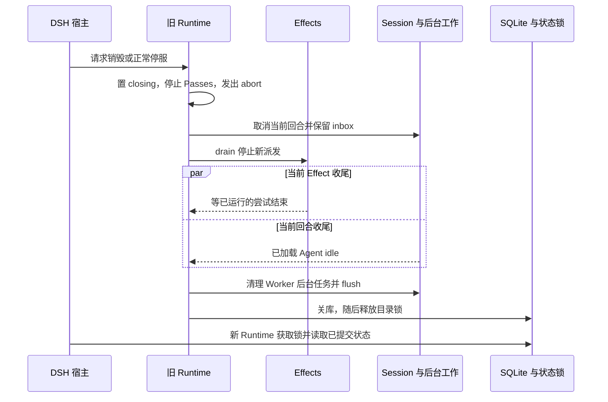

# 28 · 暂停、关闭、崩溃恢复与故障排查

> 面试题　Alice 请 Superagent 修帮助页错字。Worker 已经推送 PR，正要报告结果时服务下线。停机期间 Alice 又在 PR 里追加一条说明。恢复后会重新建单、继续执行、沿用原会话，还是等人处理？如果 GitHub 已收到一条回复，但本地仍显示 pending，你怎么判断下一次重发会做什么？

**短答**　先判断哪个生命周期发生了变化。暂停会保存处理开关，让 Source 继续记录，延后新评估、执行派发和外发。正常关机会禁止新 Effect、请求取消已加载的托管 Session 但保留 inbox，并等待已启动工作及 Session flush。重新启动后，Executor 按 SQLite 中的开放 Ticket 对账，恢复中断的 running Assignment、保留已经交接且没有后来输入的 Assignment，并补排可以启动的 pending 任务。运行到外部操作时，还要查 Session 历史、worktree 和平台记录。数据库提交、消息进入模型以及远端写入分别有自己的证据。 [暂停设置](../dsh-superagent-prototype/src/app/settings.ts#L197) · [Runtime 生命周期](../dsh-superagent-prototype/src/app/runtime.ts#L201) · [Executor 恢复](../dsh-superagent-prototype/src/executor/dsh.ts#L519)

本文使用本地基线 `7bd4741`。延续 Alice 在 Issue #41 请求修文案的案例。T 是 Ticket，A1 是第一次 Assignment，A2 是因宿主中断而建立的下一次 Assignment，X 是 Alice 在 PR #62 里的新留言，R 是面向外部会话的回复。数字和账号均为示意。下文会用相同的 T 放进不同的停机时间点，这些是几种独立情形。 [端到端案例](04-end-to-end-issue-to-pr.md) · [系列目录](README.md)

## 1. 先说清暂停、下线、停止工单分别改变什么

### 1.1 把运行开关、工单状态、进程生命期放在不同维度

`paused` 持久化为应用设置。下次加载同一状态目录时，程序仍会读到已保存的值。这个开关主要限制自动工作什么时候开始。管理面仍可读状态，已经就绪并启用的 Sources 仍可把事件送到 Intake。暂停期间新增输入可以入库并等待。要确认一个动作是否已经发生，应查看它有没有在暂停前取得执行机会，以及执行入口后续有没有重查开关。 [暂停设置](../dsh-superagent-prototype/src/app/settings.ts#L197) · [暂停判定](../dsh-superagent-prototype/src/app/runtime.ts#L198) · [Launch 的重查](../dsh-superagent-prototype/src/executor/dsh.ts#L424)

插件重启由 Cordis 的 fiber restart 执行。重启会让旧 Runtime 走其清理逻辑，再创建新 Runtime。DSH 宿主进程及其服务可能依然存在，所以恢复代码还要处理旧会话或者后台作业没有随插件消失的情形。正常退出宿主时，清理能否完整执行依赖宿主调用插件销毁回调并给它充足时间。突然崩溃时，程序没有机会依次等候、刷新会话或主动释放锁。此时重启依赖已经落盘的数据和平台当前事实。 [插件入口与清理回调](../dsh-superagent-prototype/src/index.ts#L10) · [Runtime 正常关闭](../dsh-superagent-prototype/src/app/runtime.ts#L228) · [插件内恢复](../dsh-superagent-prototype/src/executor/dsh.ts#L519)

停止 T 会把 T 写成 `ended.by = human` 且结果为 stopped，结束相关 Assignment 并请求停止执行。这个持久化事实在恢复时仍然有效，后来的人类消息不能自动唤醒这张工单。服务脚本也有独立的手工停止标记，用于让外部监控尊重运维有意停服。两者的资源分别是工单与部署 profile。面试如果说「stop 后不能恢复」，要明确是哪一个停止，以及之后的自动恢复由哪段代码判断。 [停止工单](../dsh-superagent-prototype/src/core/tickets.ts#L156) · [唤醒条件](../dsh-superagent-prototype/src/core/tickets.ts#L246) · [服务脚本](../dsh-superagent-prototype/scripts/dsh-superagent#L132)

| 动作 | 直接变化 | 再次运行时的依据 |
| --- | --- | --- |
| 面板 pause | 写处理开关，应用继续在内存中运行 | 配置、Thread、Ticket 与待处理 Effect |
| fiber restart | 旧 Runtime 清理并重新装配 | 同一状态目录、Session ID 与宿主仍存在的资源 |
| 宿主正常退出 | 有机会取消、等待和刷新持久化 | 已落盘 SQLite、Session 与工作目录 |
| 宿主意外中断 | 进程内调度状态可能丢失 | 已提交事务、宿主已保存的 Session、文件和平台事实 |
| 面板 stop T | T 和活动 Assignment 进入终态 | 保留停止记录，T 不沿旧 Mandate 自动恢复 |

### 1.2 四份状态各有什么证明力

SQLite 保存 Trigger、Thread、Ticket、Assignment、待处理 Effect 和 Outbox。原型启用 WAL 和 FULL synchronous。域命令用事务把工单变化与预定工作一起写入。这能保护同一个数据库里先后相关的事实。比如一次授权创建 Ticket 和待启动 Effect，启动代码可以据此发现已接活的任务，外部 PR 仍要查仓库。对 SQLite 的磁盘安全承诺还依赖部署的存储环境。 [Store 建表](../dsh-superagent-prototype/src/app/store.ts#L58) · [Engine 与 Executor 装配](../dsh-superagent-prototype/src/app/runtime.ts#L127) · [持久 Effect 篇](23-durable-effects-and-consistency.md)

DSH Session 保存对话历史，并提供当前 inbox 与历史读取能力。原型通过 `requestId` 形成稳定的消息 ID 来对账。发送成功、消息到过 inbox、被某个 step 取入历史、模型给出最终报告，是几个不同事件。Ticket 中 `deliveredTo`、`readAt` 和 Assignment 的 `deliveredAt`、`idleAt` 为业务层提供投影。读到一份旧 Session 的最后一句话，仍要看它对应哪次 Assignment，以及之后有没有输入。 [发送与去重](../dsh-superagent-prototype/src/app/delivery.ts#L31) · [Assignment 记录投递与读取](../dsh-superagent-prototype/src/core/assignments.ts#L44) · [Session 已读篇](19-session-delivery-and-read-receipts.md)

文件与外部平台是另两类恢复依据。worktree 可留下工作修改和提交，但本地提交并不自动出现在远端。远端 PR 可能已经创建、被人关闭或者合并，原型内的 T 仍可能停在较早阶段。做复盘时从工单号关联目录和 PR，再确认平台哪个结果能作为最终证据。至于内存里的重试计数、准备槽位和临时缓存，重启时需要按代码重新构建或重新读取。它们不能被当作上一个进程留下的永久收据。 [Executor 运行态](../dsh-superagent-prototype/src/executor/dsh.ts#L207) · [PR 状态对账](../dsh-superagent-prototype/src/sources/github-pull.ts#L51)

## 2. 暂停期间，哪些事仍然会发生

### 2.1 从保存设置追到四个 Effect 入口

`Settings.pause` 在事务里写 paused、保存历史，并按调用来源排主 Session notice。它单独使用 pause block revision，使暂停不挤掉尚未保存的 Executor 配置。等待当前可执行的设置通知后，请求一次 pass。Runtime 的 `paused()` 同时考虑 Setup 是否就绪，未配置时评估、派工和外发也处于禁止启动状态。管理路由会在 Setup 过程中注册，所以可以从面板处理坏配置。 [暂停保存](../dsh-superagent-prototype/src/app/settings.ts#L197) · [Runtime 初始化](../dsh-superagent-prototype/src/app/runtime.ts#L197)

追到每个 Effect 的 limit 可以看到暂停的传播。assessment 候选投递、launch、delivery 和 reply 都会在暂停时返回零个新执行名额。这样 Effect 行可以留在 SQLite，等下次可调度。源已经接到一个事件时，`Passes.receive` 检查服务是否 closing，再走 Engine 接收。这条路径没有按用户 pause 拒绝该 Trigger。relay 与 notice 的注册也没有共用这组 paused limit。因此「暂停后仍可看见事件、配置通知和既有状态变化」符合实现。若某个来源自身停用或 Setup 尚未通过，是否仍接收要另看该 Source 的循环条件。 [Passes 接收](../dsh-superagent-prototype/src/app/passes.ts#L34) · [候选投递限制](../dsh-superagent-prototype/src/app/assessment.ts#L93) · [执行限制](../dsh-superagent-prototype/src/executor/dsh.ts#L228) · [出站限制](../dsh-superagent-prototype/src/app/outbox.ts#L22) · [内部通知注册](../dsh-superagent-prototype/src/app/sessions.ts#L100)

已经运行的工作需要逐条看。比如 launch 在等待准备目录、创建 Session 或准备卡片后会重查当前状态。检测到暂停时抛 `Later`，Effect 把 due 往后移，保留队列行和当期错误计数。暂停的调用没有统一去取消已开始的 Worker 回合。已有的发送、报告、工具执行或一批正在交付的输入可能继续到其各自检查点。此处的可观察性最好同时显示暂停开关、已有运行量和未完成队列，避免把绿色或黄色标志误解为所有工作已经静止。 [Launch 守卫](../dsh-superagent-prototype/src/executor/dsh.ts#L424) · [Delivery 循环](../dsh-superagent-prototype/src/executor/dsh.ts#L290) · [Later 处理](../dsh-superagent-prototype/src/app/effects.ts#L130) · [暂停切入 Launch 的并发测试](../dsh-superagent-prototype/tests/runtime-concurrency.spec.ts#L108)

### 2.2 Eval 截止时间从候选送达开始，暂停会平移它

`Engine.evaluateDue()` 每轮先处理活动 Eval 的时间状态。发现 pause 时，Eval 第一次被扫描到会写 `pausedAt`，随后的扫描既不重复写这一标记，也不把 Eval 判为过期。恢复时按「当前时间减 pausedAt」把 deadline 往后移，然后清除标记。停止期间也没有活动进程提交超时判定，但普通进程重启没有将整段停机自动加到 deadline 的逻辑。未暂停的已送达 Eval 若在下线期间走过 deadline，新 Runtime 的 pass 可能对它执行过期分支。 [评估调度](../dsh-superagent-prototype/src/core/engine.ts#L69) · [暂停与截止时间](../dsh-superagent-prototype/src/core/evals.ts#L30)

例如候选在 10:02 送达，配置给 90 秒评估时间，原 deadline 是 10:03:30。假设 pass 于 10:02:30 观察到暂停，10:07:30 观察到恢复，则 deadline 延至 10:08:30，仍留 60 秒。时间取决于 pass 观察到开关的时间，实际不一定精确贴合点按钮的那一秒。如果候选一直在等卡片链接或 Session 投递，只有初始 deadline 占位，超时入口还要求 `delivered` 已记录。面对「Eval 很久没结束」要先区分未送达和已送达后没得出结果。前者优先查 assessment Effect，后者才算实际评估剩余预算。 [送达时设定截止时间](../dsh-superagent-prototype/src/core/evals.ts#L47) · [候选卡投递](../dsh-superagent-prototype/src/app/assessment.ts#L93) · [暂停时间测试](../dsh-superagent-prototype/tests/core-engine.spec.ts#L735)

一次超时后，原型可把该 Thread 的 Trigger 重新排队两次。连续第三次超时会记录 unavailable，原因是 timeout。超时重排用新的 Eval，旧调用如果带着过期的 Eval ID 再提交，就要核验它是否仍是持有者。重新准入时会采用当前 Policy。若 T 此前已自然结束，X 在暂停期间抵达其订阅 Thread，恢复的 pass 会读当前 Mandate 是否仍可用，再考虑是否建立下一轮 Assignment。这条路径跟「原来正在运行的 Assignment 因宿主中断而更换」分属不同入口。 [超时重排](../dsh-superagent-prototype/src/core/evals.ts#L56) · [Eval ID 校验](../dsh-superagent-prototype/src/core/evals.ts#L125) · [自然结束后唤醒](../dsh-superagent-prototype/src/core/tickets.ts#L246) · [暂停期间后续输入测试](../dsh-superagent-prototype/tests/runtime-concurrency.spec.ts#L813)

## 3. 正常关闭按什么顺序收尾

### 3.1 先关入口，再等已开始的动作收敛

关闭的入口是 `Runtime.stop`。多个调用共享同一个 Promise，避免清理两次或提前放掉数据库锁。shutdown 先立起 `closingFlag`，停止 pass 的计时器，并 abort Runtime lifetime。后续 Intake 收到 Trigger 时会在写入前拒绝，已经运行的 pass 仍可被等到。Assessor 也有自己的停止信号，用于终止关联读取。举例说，Alice 的 X 如果刚好抵达下线边界，是否入库要看该笔 receive 是否已经成功提交。来源仍需依靠游标或可重读事件来找回未摄取的消息。 [关闭入口](../dsh-superagent-prototype/src/app/runtime.ts#L228) · [Passes 的入口检查](../dsh-superagent-prototype/src/app/passes.ts#L27) · [Assessor 停止](../dsh-superagent-prototype/src/app/assessment.ts#L281)

随后枚举已加载的主 Session 与 Worker，调用 cancel 并设置 `keepInbox: true`。已在 inbox 里的消息有机会保留，便于同一宿主内的插件重载，或依实际持久化能力恢复。进行中的 turn 则接收到取消信号。Worker 事件处理在 closing 时跳过随取消到达的 idle 和 error，避免把一次宿主关停当作模型故障、真正交付完成或一次正常的 turn end。这个 guard 写的是因果关系。运维动作发生在 Runtime 层，不能仅由 Agent 出现 idle 推断业务推进到了哪一步。 [关机取消 Session](../dsh-superagent-prototype/src/app/runtime.ts#L228) · [Executor 生命周期监听](../dsh-superagent-prototype/src/executor/dsh.ts#L477) · [中断未记为正常结束的测试](../dsh-superagent-prototype/tests/runtime.spec.ts#L1443)

### 3.2 drain 的目标是稳定边界，留待下次启动的工作仍在库里

`Effects.drain()` 把调度器置为 stopped，然后等待当前已启动 task 的 Promise。尚未开始的行可以留在 SQLite。进行中的 handler 如正常结束，可删除同一代的 Effect。若在 drain 期间失败，它会保留该行，供下一实例重试。称其为 drain 容易让人联想到「把队列全部消费完」。在这个原型，适用的验收条件是停止派发并等已运行工作退出，对尚未执行、因限额不能启动、到期时间在未来的行保留可恢复性。类似地，测试里的 `runtime.idle()` 也只说明此刻没有可运行工作，数据库中仍可能存在延期的 Effect。 [Effects idle 与 drain](../dsh-superagent-prototype/src/app/effects.ts#L89) · [完成、暂停和失败分支](../dsh-superagent-prototype/src/app/effects.ts#L130) · [保存待办并重启的测试](../dsh-superagent-prototype/tests/effects.spec.ts#L105)

Effect 用 `kind + key` 唯一定位逻辑工作，`seq` 是队列位置，`generation` 表示同一行合并过新的 payload。执行者回写成功或失败时同时核对 seq 与 generation。因此正在结束的旧一代即使成功，也不会删除另一事务刚替换的代。若重试需要用最新状态，handler 应像 delivery 一样重新读取 Ticket，而不是只记住任务上一次运行时的内容。这里 SQL 行上的身份解决的是同一运行库中意图如何归并。若 Handler 能跨库或跨服务写入，还需要该边界的幂等或对账证据。 [Effect 入队与更新](../dsh-superagent-prototype/src/app/effects.ts#L57) · [Effect 结算](../dsh-superagent-prototype/src/app/effects.ts#L130) · [更新代次测试](../dsh-superagent-prototype/tests/effects.spec.ts#L39)

### 3.3 结束后台作业、刷新 Session，最后关库放锁

Runtime 会合并等待 pass、Effect drain 与已加载 Agent idle。接着 Executor 还要处理 Worker 拥有的 shell jobs 和 subagents。即使 Worker 此前把某些作业留给人用，宿主关闭时也会努力终止它们。停止作业先收集其结束结果，减少旧作业结束又唤醒 Worker。若过程中有回合重新启动，会再次取消并保留 inbox。此后台清理有 10 秒的等待上限，Runtime 其他等待和 Session 持久化有各自行为。面试时可以说「后台收尾有一段明确预算」，不能仅凭这一个常数说整个 stop 保证十秒完成。 [Executor 切断后台工作](../dsh-superagent-prototype/src/executor/dsh.ts#L387) · [作业结果收集与停止](../dsh-superagent-prototype/src/executor/background.ts#L106) · [清理时间常数](../dsh-superagent-prototype/src/executor/dsh.ts#L27)

最后释放 Executor 和 Session 绑定、卸管理路由，调用 DSH Session persistence 的 flush。finally 恢复进程环境，关闭 SQLite，随后尝试解除状态目录锁。关库先于解锁，目的是让下一进程拿到锁时，旧实例已不能再通过这个连接继续写库。如 Session flush 报错，finally 仍有机会执行，但不能从数据库已关闭推断 Session 当中的最新回合也已落盘。状态锁在启动新实例时获取，创建 Runtime 同步阶段报错和开库失败的路径，会尽力释放已开的资源。 [关闭顺序](../dsh-superagent-prototype/src/app/runtime.ts#L230) · [状态锁与构造](../dsh-superagent-prototype/src/app/runtime.ts#L87) · [启动失败后的释放](../dsh-superagent-prototype/src/app/runtime.ts#L166) · [重启获取锁测试](../dsh-superagent-prototype/tests/runtime.spec.ts#L1404)



### 3.4 用服务脚本理解部署层故障

仓库脚本 `scripts/dsh-superagent` 检测指定 profile 的 PID，并调本机管理 API 看 Runtime 状态。status 的退出码 0、1、2、3 对应可运行、进程或 Runtime 异常、部件有长期错误、等待 Setup。若已经有正常 Runtime 且只有某个 Source 报错，脚本不把这种情况等同于进程崩溃。部署建议让独立 profile 中的监控根据退出码选择行为，这样被监控进程下线时，监控自身仍然存在。 [退出码实现](../dsh-superagent-prototype/scripts/dsh-superagent#L102) · [部署运行手册](../dsh-superagent-prototype/docs/006-deployment.md)

脚本的 stop 写 profile 级标记后发送 SIGINT，等待目标进程退出。默认 stop 等待上限为五分钟，超时会报错，由运维检查状态。restart 的内部 stop 不创建新的手动停服标记，自动监控使用 `--respect-stop` 可避免重新拉起已被明确关停的 profile。脚本端另有操作锁，防同一 profile 的 CLI 控制操作并发。应用的状态目录锁保护数据目录，脚本锁保护操作顺序，两者的作用对象不同。恢复时还要看当前启动日志、管理 API 与状态目录是否一致，尤其在 profile 已更换端口或有重复进程时。 [脚本停止](../dsh-superagent-prototype/scripts/dsh-superagent#L132) · [操作锁与人工标记](../dsh-superagent-prototype/scripts/dsh-superagent#L209) · [手动停止与重启测试](../dsh-superagent-prototype/tests/service-script.spec.ts#L164)

## 4. 重启如何对账开放工单

### 4.1 恢复先于调度，读取的是已提交工作集

启动时 Runtime 先获取 stateDir 锁再开 SQLite，准备账号环境，装配 Session 和 Executor 监听。它重用持久化的主 Session ID，并确保主 Session 存在。接着同步当前可同步的 Source Policy，检查是否已收到关闭信号，随后调用 `executor.resume()`，最后启动 Passes 与 Effects。这个顺序让新实例先对账已经运行过的工单。Effect 可以在恢复时写入，派发必须等到 `effects.start()` 之后。若 Setup 仍未通过，管理面会给出修复信息，业务调度仍然等待。 [Runtime 构造](../dsh-superagent-prototype/src/app/runtime.ts#L87) · [启动顺序](../dsh-superagent-prototype/src/app/runtime.ts#L201) · [工作等待到 start](../dsh-superagent-prototype/src/app/effects.ts#L54)

`resume()` 扫描开放 Ticket，按创建时间排序。对于可启动且未等人的 pending Assignment，以原有 Assignment ID 补排 launch。起因之一是兼容早期版本可能在持久 Effect 之外排的工作。当前实现用同样的 kind 和 key 合并一行，已排过的保持原 seq，也会更新 payload、generation 和 due。因而「重复调用 resume」可以收敛到一次实际 launch。在已保存旧退避的个别行上，补排会重置当期错误与到期时间。恢复后仍要经过 pause、并发槽位和最新 Assignment 状态检查。 [扫描与补排](../dsh-superagent-prototype/src/executor/dsh.ts#L519) · [同键排队](../dsh-superagent-prototype/src/app/effects.ts#L60) · [启动时重查](../dsh-superagent-prototype/src/executor/dsh.ts#L269) · [重复补排只启动一次测试](../dsh-superagent-prototype/tests/runtime.spec.ts#L1619)

### 4.2 running 要看报告与最后投递的相对时间

对存在 running Assignment 的开放工单，Executor 请求取消可能留在同一 DSH 宿主里的旧 Agent 回合，保留 inbox，安排停后台工作，并通过 `assignmentInterrupted` 把事实提交给 Engine。代码里的 `busy` 在有旧报告且 `deliveredAt >= report.at` 时为真。相等也选忙，避免时间粒度下把同一时刻到达的新输入漏算。只有最近报告是 waiting、ready、blocked、failed 且未 busy，才视为已交接、可保留原 Assignment。仍有 `undelivered` 时，该分支会给原 Assignment 补排 delivery。这里有个重要区别。一个 Assignment 即使状态为 running，也可能在等人，或者已无 active turn。算法会利用报告和新工作的证据作进一步判断。 [扫描 running](../dsh-superagent-prototype/src/executor/dsh.ts#L524) · [报告与 busy 计算](../dsh-superagent-prototype/src/core/assignments.ts#L78) · [Worker 活动计数](../dsh-superagent-prototype/src/executor/dsh.ts#L403)

| 库中看见的情形 | 启动决策 | 观察点 |
| --- | --- | --- |
| T 已 ended | 不在开放工单扫描中启动 | 后续人的消息另外走可唤醒条件，人为停单仍保留终态 |
| 最近是 pending，尚可派工 | 使用现有 ID 补排 launch | 容量不足或仍暂停时留在队列 |
| pending 有失败报告且仍等人 | 保留待人状态 | 读失败摘要，看是否有人补充或是否应明确重试 |
| A1 running，最近没有交接报告，或仍是 progress | 结束 A1 并建立 A2 | A1 的 endedReason、A2 的状态、恢复提示 |
| A1 有 waiting、ready、blocked、failed，报告后无已投递输入 | 保留 A1，处理已有可投递输入 | 旧报告不被重写，既有待人语义延续 |
| A1 虽有交接报告，但此后已经投递新输入 | 视为中断中的工作，建立 A2 | 恢复后核对旧输入、Session 与新投递 |

比如停机前 T 已报 ready，Alice 的 X 如果尚未被投递，A1 可能保留，X 由等待的 delivery 续送。如果 X 已投递，晚于或者与报告同一时间，恢复会走 A2 路径。两者的区别落在 Store 的时间和输入记录，不能仅凭界面上「Ready」作判断。若 T 的 PR 在停机期间已于平台结束，Source 的后续轮询还会把事实写回来，Engine 依据该工单等待的工作与跟随关系判断何时结算。 [恢复判断](../dsh-superagent-prototype/src/core/assignments.ts#L78) · [PR 结算规则](../dsh-superagent-prototype/src/core/tickets.ts#L73) · [保留 waiting 与 blocked 的测试](../dsh-superagent-prototype/tests/runtime.spec.ts#L801)

### 4.3 A2 仍然属于 T，新的执行者要先查已做过的工作

`Tickets.restart` 结束旧 Assignment，记录 `hostRestarted`，把需补投的输入放回队列，建立下一次 Assignment，追加恢复 Input 并排 launch。这些操作经 Engine 的事务落在同一业务边界。T 的身份和 Mandate 仍保留，Worker Session ID 也继续由 T 派生。恢复说明提示 Worker 先看现有工作目录、Git 历史与 GitHub 状态，避免重复已经完成的外部操作，再继续原 assignment。该说明是执行指引，外部副作用仍要查平台。系统也可能在原 T 之后找到 PR #62 已经由原账号从匹配的分支开出，并通过 Source 的观察路径关联它。 [恢复提示文本](../dsh-superagent-prototype/src/core/assignments.ts#L21) · [中断事实事务](../dsh-superagent-prototype/src/core/engine.ts#L240) · [新建 Assignment](../dsh-superagent-prototype/src/core/tickets.ts#L317) · [PR 自动关联](../dsh-superagent-prototype/src/sources/github-pull.ts#L51)

恢复后的启动消息根据历史变化。Launcher 查询 Session 是否已有首个 assignment 请求。若找到，后续启动消息可只告诉 Worker 本工单的 Assignment 序号以及额外提示。若会话丢失首个消息，则重发包含任务说明和源 Trigger 的启动载荷。已有 worktree 时继续使用该目录。这个设计将恢复对象从「把内存指令的程序计数器还原」变成「重读上一阶段公开留下的事实」。对于有外部写入的工具流程，通过工单日志和远端状态逐步决策比盲目从第一步重跑更稳妥。 [启动消息选择](../dsh-superagent-prototype/src/executor/dsh.ts#L424) · [主 Session 和 Worker ID](../dsh-superagent-prototype/src/executor/dsh.ts#L23) · [恢复后收到合并的测试](../dsh-superagent-prototype/tests/runtime.spec.ts#L1420)

## 5. 用 X 推演 Session 与 SQLite 之间的中断

### 5.1 输入先进入业务队列，再取得宿主接受证据

X 通过摄取后成为 T 的 Trigger Input，Input ID 加入 `undelivered`，并生成按 Ticket ID 合并的 delivery。Handler 先等旧 Worker 后台停止，重新读 T，拿当前 running Assignment。每条输入都单独读取并判断。如果 Worker 正闲，要先争取相应的唤醒槽。模板和链接查询可能有异步等待，交付前还会重查 Ticket 和 Assignment 是否仍适用。到这个检查点时，T 有可能被人停止，A1 也可能已被 A2 替换。使用初次查库时拿到的对象继续执行，会造成迟到的工作进入旧会话。 [输入入库](../dsh-superagent-prototype/src/core/tickets.ts#L230) · [交付循环](../dsh-superagent-prototype/src/executor/dsh.ts#L286) · [交付前重查](../dsh-superagent-prototype/src/executor/dsh.ts#L329) · [停止与投递竞态](../dsh-superagent-prototype/tests/runtime-concurrency.spec.ts#L69)

对 X，`Sessions.prompt` 形成固定的请求键。AgentDelivery 首次读取会先 flush，再分页拿已持久化的 user/message 历史，并查 nextTurn 和 nextStep inbox。它用当前 Session 的事件持续补充已看到的 ID。见过该 ID 就跳过重复发送，否则走 steer 或 queue。发送过程末尾会再次等待 sessionPersistence.flush，delivery handler 返回后，由 Engine 把该 Input 从 `undelivered` 移除并记录 `deliveredTo = A1`。对第一次记录的 Trigger Input，`readAt` 暂为 null，等宿主发出对应的持久历史消息事件才填时间。只有后来未读的 Trigger Input 要重新放回队列的判断会用到这个刻意保留的 null。 [稳定消息 ID](../dsh-superagent-prototype/src/app/delivery.ts#L14) · [对账和 flush](../dsh-superagent-prototype/src/app/delivery.ts#L40) · [交付事实](../dsh-superagent-prototype/src/core/assignments.ts#L44) · [模型历史事件监听](../dsh-superagent-prototype/src/executor/dsh.ts#L493)

有了 Session 侧落点，业务投递等待失败时可在同一请求 ID 下重试。现有用例让宿主下一次 flush 抛错，确认同一 Session 还持有消息时，再次请求不会多发一条。这里的前提是对应 ID 仍可从 inbox 或历史发现。意外进程中断时，未落盘的状态是否存在，取决于宿主已写到哪里。因此恢复代码会同时接纳两种结果。若同键消息已在宿主能读到的历史里，可补记业务状态。若上下文还没有该消息，则正常再投，不需让用户复制一遍原文。 [持久化失败重试测试](../dsh-superagent-prototype/tests/delivery.spec.ts#L89) · [跨 inbox 与历史查询测试](../dsh-superagent-prototype/tests/delivery.spec.ts#L137)

### 5.2 已交付但未取走的消息会被重新排队

假设 X 已经从 `undelivered` 移除，Session 还没把它记进模型 step，随后进程中断。恢复判断 A1 尚未交接时，`Tickets.requeueUntaken` 选择 `kind === trigger`、`readAt === null`、`deliveredTo === A1` 且还没在队列里的输入，把它们置于原等待队列前。A2 的 launch 会移除 inbox 里这些旧输入 ID，随后让 delivery 用持久队列送一份。若宿主已丢弃旧 inbox，这一步删除只是无操作。保留 inbox 与按 ID 补投可以同时存在，因为它们的交叉部分会对账。 [把未取走输入重排](../dsh-superagent-prototype/src/core/tickets.ts#L317) · [启动前移除旧副本](../dsh-superagent-prototype/src/executor/dsh.ts#L446) · [模拟丢失 inbox 的测试](../dsh-superagent-prototype/tests/runtime.spec.ts#L1747)

如果原来 X 已记录 `readAt`，恢复逻辑不会按这个规则把它当作未读 Trigger。可从同一 Worker Session 历史继续获得 X 的上下文。读到消息仍不足以证明修改已提交。此时要看原 A1 报告、已读之后的 Git 或平台事实，再得出「未开始改」「改了未提交」「已推送未报告」之类结论。不同输入类型也各有约束。上述自动补排针对带有投递归属和读取标记的 Trigger Input，说明和其他自动上下文不能直接套用相同条件。 [读取标记](../dsh-superagent-prototype/src/core/assignments.ts#L59) · [补排的类型限制](../dsh-superagent-prototype/src/core/tickets.ts#L329) · [持久会话与读取证据](19-session-delivery-and-read-receipts.md)

### 5.3 状态回写的次序解释了为什么恢复需要对账

首次 launch 的回写和普通 Input delivery 有一个差别。启动消息送到 Agent 后，accepted 回调会在 flush 前尝试写 `assignmentStarted`，调用返回后 Launcher 也再次调用这个 Engine 入口。核心持久化过程中若对应 Assignment 已 ended 则不生效，`startedAt` 也只会填一次。在两个系统不共享事务的前提下，仍可观察到 SQLite 已写 running、宿主消息尚未完成 flush 的交错。重启不能只按 running 推断完整输入或模型执行已稳定，仍要用报告、Session 保存情况与 worktree 决定下一步。A2 启动前对首个 assignment 请求的 `holds` 检查正是其中一项核对。 [启动回调](../dsh-superagent-prototype/src/executor/dsh.ts#L465) · [宿主回调与 flush 次序](../dsh-superagent-prototype/src/app/delivery.ts#L65) · [Assignment 回写](../dsh-superagent-prototype/src/core/assignments.ts#L33)

| 进程中断点 | 可以找回的记录 | 下一步与证据边界 |
| --- | --- | --- |
| X 和投递意图已提交，尚未交给 Session | Input、undelivered、delivery | 后续按当前 Assignment 补投 |
| X 已进入 Session，业务 delivered 尚未提交 | 持久业务队列，及宿主可能可见的同键消息 | 同键查询后续投或补回写，依据是宿主可见 ID |
| X 已标 delivered，但 A1 尚未取入 step | deliveredTo、readAt=null，可能仍有旧 inbox | 若替换 A1，重排该 Trigger 并在启动时去掉旧副本 |
| X 已标为读，但未报告 | readAt、Session 记录和 A1 最新报告 | 从已读上下文续办，检查实际工作产物 |
| PR 已创建或合并，本地未写对应事实 | worktree、远端提交或 PR，T 可能还显进行中 | 读远端确认，按匹配关系收敛，避免重复建 PR |
| R 已被第三方接收，Outbox 还 pending | 有稳定 ID 的 R 及其 Effect，平台可能已有消息 | 通过 Source 去重机制重试，或核对该 ID 对应的远端证据 |

表中把「A1 已经读 X」视为能够重放的会话事实。若持久写入时主机失去电源，两处存储的最新证据可能不同步。面试里要说明这份表使用原型能观察的证据推理。缺失哪个观测点，就把不确定性保留在哪一层。比如业务没有 readAt，不能反证远端没有发生修改。相反，远端已有修改也不代表模型看到的上下文完整。 [交付事实](../dsh-superagent-prototype/src/core/assignments.ts#L44) · [PR 轮询事实](../dsh-superagent-prototype/src/sources/github-pull.ts#L51)

## 6. 故障矩阵及实操排查顺序

| 故障或等待 | 先去哪里看 | 原型的后续动作 | 人工介入依据 |
| --- | --- | --- | --- |
| GitHub 通知或某个 Thread 读取失败 | Sources 的 github 健康、轮询错误与 Thread 游标 | 按轮询节拍再读，单项失败可进入 retry map | 检查配置、读取权限和目标是否删除 |
| 飞书实时消费失败或历史有缺页 | feishu 与 history 健康、原消息 ID 和群历史游标 | 实时消费者退避重连，历史循环按各自游标尝试 | 检查 Bot、群范围和历史权限，确认消息在可回补范围 |
| 未启动 Eval 或未送达候选 | Trigger disposition、Thread 队列、assessment Effect | 受暂停和投递重试约束 | 检查 Source 过滤、准入、主 Session 与卡片生成 |
| Eval 已送达并持续超时 | Eval ID、delivered、deadline 与 Decision | 超时重排两次，再记 unavailable | 排除话题阻塞和模型问题，单独重评该 Trigger |
| Launch 排队 | 工单 pending、pause、Worker 运行量及 Effect | 等名额，启动前复核状态 | 解释当前阻塞点，评估是否调整额度或停掉无效工作 |
| Prepare 失败 | T 的最新 failed 报告、执行路径、命令错误 | 释放槽位并等待合适的人类输入或明确 Retry | 检查目录是否留下半成品，再决定如何恢复 |
| Worker 模型或网络临时失败 | Session 日志、Assignment、后续 retry 提示 | 按分类有限次重试，等待时保留业务态 | 区分短时故障、预算等待及凭据等持久错误 |
| 会话输入交付失败 | T 的 delivery 错误和 undelivered，核对 Session | 保留 Effect 退避，成功后清 Ticket 错误 | 检查宿主能否创建或打开会话，必要时显式 Retry |
| 外发失败或休眠 | Overview 的 outgoing、Outbox 与收件渠道 | 等待启用、按退避重试，或结算 dropped | 按稳定 R ID 核对远端目标与实际送达 |

### 6.1 先确认来源有没有留下 X

假设 Alice 说停机时加的 PR 留言没有得到处理。第一步根据消息 ID、Thread 和时间检索 Trigger。当前不存在时，区分来源停用、外部权限错误、落在回补范围之外与刚好尚未轮询到。GitHub 全局轮询按配置阈值记录连续失败。在通知流里，某个 Item 失败的记录与通知游标一起提交，并在下次先尝试此前失败的项。典型设计难题是一个坏对象不能阻塞整库通知，也不能在推进全局游标时忘掉自己漏了哪个对象。源码保存单项 Retry，将两件事绑定。被删除的对象和超过重试窗口的对象有清理条件，故障存活过久后不能承诺无损回填。 [来源轮询](../dsh-superagent-prototype/src/sources/github.ts#L124) · [通知与 retry map](../dsh-superagent-prototype/src/sources/github.ts#L297) · [连续失败阈值测试](../dsh-superagent-prototype/tests/sources.spec.ts#L1021)

GitHub 某些流在读完一段后才推进游标，并留出重叠时间使用 Trigger ID 去重。停机若发生在「已存几条 Trigger，尚未推进游标」之间，下一次读到旧内容时，Intake 会先识别已存在的 ID，余下内容继续入库。飞书用实时消费与历史回补配合，消费者失效后带退避再连。历史循环遍历配置群和已识别且允许的私聊，某个范围读取失败时不更新它的游标。首次没有游标的会话会建立当前起点，不代表会追溯从未配置过的所有旧消息。让健康变化与具体请求使用同一个排查时间窗，可以避免把另一个会话的异常误当成 X 的原因。 [GitHub 重叠游标](../dsh-superagent-prototype/src/sources/github.ts#L198) · [Trigger ID 去重](../dsh-superagent-prototype/src/core/intake.ts#L19) · [飞书消费重连](../dsh-superagent-prototype/src/sources/feishu-loops.ts#L43) · [飞书历史回补](../dsh-superagent-prototype/src/sources/feishu-loops.ts#L128)

若 X 已存在，查 disposition 是否 filtered、有无归属，以及 Thread 内的 Eval 状态。X 是 T 的有效后续时可能直接成为 Input，因而没有独立的 accept Decision。若评估不可用，Overview 的未决问题会筛选近期的 unavailable，要求没有更新的 Decision 或待评估工作，并排除已 dismiss 的记录。搜索具体故障时应查 Trigger 或 Decision 详情，不能以 Overview 没有相应卡片代表它从未失败。队列等待和已送达超时应按上一节的时间证据分别核对。 [摄取与分配](../dsh-superagent-prototype/src/core/intake.ts#L30) · [问题项筛选](../dsh-superagent-prototype/src/app/views/overview.ts#L12)

### 6.2 Ticket 已出现，分清排队、不可运行与输入通道出错

Execution 按优先级显示 stage。已 ended 先结算，delivery 错误、等待人回答、ready 等会被投影为不同待人动作。pending 可显示 working/queued，某些等待属于容量而非异常。当前活动量结合 Agent 运行状态与尚未收敛的后台工作计算。准备中的 launch reservation 也会占调度容量，但不一定显示为已有运行的 Worker。看面板数字时要同时问「还有名额能启动吗」和「现在有多少回合」，这两个问题读的是不同状态。 [Ticket 面板分类](../dsh-superagent-prototype/src/core/stage.ts#L8) · [WorkerSlots](../dsh-superagent-prototype/src/executor/dsh.ts#L171) · [活跃 Worker](../dsh-superagent-prototype/src/executor/dsh.ts#L403)

Prepare 的超时配置为十分钟，并结合 Runtime lifetime。命令失败时尝试移除空目录，非空目录会保留。Launcher 一般把既有目录当作已准备，所以不能无限自动重跑准备命令。假如第一次只创建目录，还没完成依赖或 checkout，下一次可能跳过准备。当前命令失败分支会在 T 记录 failed 并归还槽位，等人查看或走 Retry。若进程在 mkdir 后突然终止，尚未生成失败报告，启动路径仍会遇到「目录存在」的证据不足问题。面试时可把准备完成标记作为增强项，并说明它与验证成功之间的提交顺序。对非空目录应先核对其中是谁的工作，避免丢失可恢复的修改。 [准备命令与清理](../dsh-superagent-prototype/src/executor/dsh.ts#L242) · [启动失败分类](../dsh-superagent-prototype/src/executor/dsh.ts#L269) · [已有目录分支](../dsh-superagent-prototype/src/executor/dsh.ts#L424) · [失败释放槽位测试](../dsh-superagent-prototype/tests/runtime.spec.ts#L1619)

对于 Worker Session 创建或投递失败，delivery handler 只给仍活着的同一 running Assignment 记错误，并让 Effect 继续退避。正文可能待在 `undelivered`。一次成功交付会清掉旧的 delivery 错误。该 Effect 用 quiet 注册，因而反复处理失败主要显示在工单上，健康项可保持 ready 并报告有等待行。查错误也应留意源链接或宿主 Session 是否存在，代码可重新确保一个丢失的 Worker Session。面板 Retry 只有在等人失败、blocked 或存在 delivery 错误等符合域规则时可用，创建下一次 Assignment。它适合修复已明确的异常，正常排队无需用重试重新占容量。 [输入失败处理](../dsh-superagent-prototype/src/executor/dsh.ts#L290) · [Ticket 错误字段](../dsh-superagent-prototype/src/core/assignments.ts#L44) · [Effect 健康投影](../dsh-superagent-prototype/src/app/effects.ts#L151) · [人工 Retry 条件](../dsh-superagent-prototype/src/core/stage.ts#L23) · [Session 创建失败测试](../dsh-superagent-prototype/tests/runtime-concurrency.spec.ts#L179)

### 6.3 模型临时失败、预算退避与交接报告

Executor 区分网络或供应商临时异常与应该尽快报给人的失败。分类函数先检查数字状态码，408、429 及 500 以上归为可重试，其他情况下匹配若干连接错误和供应商过载描述。对 Worker 回合的临时失败，默认可续跑三次，初始退避 15 秒，随后倍增。恢复尝试时还需查工单是否活着、Assignment 是否仍相同、处理是否暂停及有无唤醒槽。再次启动通过短消息提醒继续原 Assignment。重试计数和定时器在进程内，正常回合真正结束时会清计数。重启后启动对账走报告与投递分支，不会恢复原定时器还差多少秒触发。 [临时失败分类](../dsh-superagent-prototype/src/executor/dsh.ts#L27) · [续跑和计数](../dsh-superagent-prototype/src/executor/dsh.ts#L545) · [清理计数](../dsh-superagent-prototype/src/executor/dsh.ts#L601) · [三次续跑测试](../dsh-superagent-prototype/tests/runtime-concurrency.spec.ts#L191)

launch 中的临时异常也有次数控制，但延期使用 launch Effect 的重试参数，初始五秒，最高五分钟。Worker 回合的续跑依赖进程定时器，Effect 的尝试与 due 可以入 SQLite。面试如果只说「模型失败会按指数退避」，还缺少失败发生在控制面启动阶段、宿主模型请求阶段，还是正在投递已有输入。这三者用的重试主体、计数和操作入口不同。分类无法解决所有错误，启动或回合失败到不适合继续时会持久记录 failed，便于定位具体 T。 [启动 handler 与重试](../dsh-superagent-prototype/src/executor/dsh.ts#L228) · [启动错误处理](../dsh-superagent-prototype/src/executor/dsh.ts#L269) · [Effect 退避写回](../dsh-superagent-prototype/src/app/effects.ts#L130)

另外，`RetryHealth` 从宿主的结构化 Session 事件投影模型预算等待。它根据 turn、step、retryId、provider、序号与失败类型跟踪活跃重试链，过滤旧事件。在当前 step 获得同一供应商的合适响应、回合结束或观察到 Agent idle 后，会清除相应健康状态。装配 Session 时可从宿主现有事件恢复投影。这个模块展示模型重试正在发生，重试策略本身由宿主控制。看到 models 红色时查是哪一个 Session、哪家 provider、开始时间和已尝试次数。若是账号鉴权或普通限流，也要看原始事件和 Executor 的失败分支，单从预算健康推不出原因。 [预算分类与投影](../dsh-superagent-prototype/src/app/retry-health.ts#L9) · [Session 汇总到 models](../dsh-superagent-prototype/src/app/sessions.ts#L217) · [恢复预算投影测试](../dsh-superagent-prototype/tests/retry-health.spec.ts#L119)

### 6.4 R 没收到，先区分延期、已失败和永久掉落

当 R 已有 pending 回执，reply Effect 的执行会检查目标 Source 是否启用，再看同一工单与会话是否有较早消息等待。未启用或等待在前的消息时用 Later 延期。真正调用平台失败后，Effect 记录 attempts、error 与下一次 due，Overview 能按失败记录列出 R。达到一般 Effect 健康三次阈值会显示错误，后续回合仍可重试。若源会话当前不在允许范围内，出站结算为 channelIgnored。对于平台确认目标永久不可达的情况，结算为 channelGone。这个区别使消息可以等待短期故障消退，同时让永久掉落定格在具有原因的回执。 [Outbox](../dsh-superagent-prototype/src/app/outbox.ts#L39) · [Overview 外发失败](../dsh-superagent-prototype/src/app/store-read.ts#L69) · [重试阈值](../dsh-superagent-prototype/src/app/effects.ts#L151) · [Reply 健康测试](../dsh-superagent-prototype/tests/runtime.spec.ts#L1143)

平台已收到但本地记账失败时，仍用同一 R ID 恢复。GitHub 适配器会先检查目标评论与同一账号发布的隐藏 marker，找到匹配就返回已发送。飞书适配器把该 ID 传作平台幂等键。若外部发布尚未可查、标记被编辑或清除、部署身份变化，原型能够依赖的证据会减少。GitHub 的查询和发布是两次远端调用，不能把它当作跨系统事务。人工处置时优先保存原 R ID、目标及可能的外部记录并核对，再判断是否应另发。通过改写文案生成新回复，可能改变应用使用的消息身份。 [GitHub 外发对账](../dsh-superagent-prototype/src/sources/github-channel.ts#L17) · [飞书发送](../dsh-superagent-prototype/src/sources/feishu-channel.ts#L18) · [消息身份与回复](24-outbox-replies-and-attention.md)

## 7. 完整走一遍停机前后的 T

假设日志显示 10:01 A1 被派出，10:04 Worker 推出了分支并开 PR #62，最后一条业务报告是 progress。10:05 服务意外中断，10:06 Alice 给 PR 留 X，10:08 新 Runtime 启动。面板看到 A1 ended、A2 pending 时，可定位到 `hostRestarted`。这个状态说明控制面看出原工单已启动但尚无稳定的交接事实。它不说明 PR 只存在本地。核对 T 的原分支和远端 PR，看到 PR #62 已开，就把它纳入后续检查。新 Worker 对照现有 diff 和未完成需求继续改，避免对同一工作另开 PR。 [Assignment 中断判定](../dsh-superagent-prototype/src/core/assignments.ts#L78) · [外部 PR 自动绑定](../dsh-superagent-prototype/src/sources/github-pull.ts#L51)

假设 X 当时还没被适配器读到。先等 GitHub 轮询对已有订阅和通知进行补读，核对游标与原触发 ID。若 X 已入库，确认它在 T 的 Input 里，有无正在等 delivery。换一个中断点，若同类后续在停机前已经进入 A1 的 inbox，需按上节的 `deliveredTo` 和 `readAt` 判定是否要对 A2 补投。这里有两种不同重放。Source 重读用 Trigger ID 去重，Session 交付用请求 ID 与 inbox、历史对账。两者分别保护外部事件到控制面、控制面到模型会话。 [来源重读](../dsh-superagent-prototype/src/sources/github.ts#L297) · [一次交付键](../dsh-superagent-prototype/src/app/delivery.ts#L61)

继续到 10:20。Worker 自检并报告 ready，维护者审查后合并。原型再按轮询得到 PR merged 的事实，具体哪张 Ticket 可以结算由跟随关系与未完成工作决定。如果 R 仍未显示到目标会话，查询 R 的目标、Effect 状态与平台已发送证据。至此可以把「工作做完了」「工单已结算」和「通知已送达」各写一行。一次事故记录保留这些不同状态以及它们的时间顺序，比只在首尾标记「故障」「恢复」更便于判断实际影响。 [Thread close 事件](../dsh-superagent-prototype/src/sources/github-pull.ts#L76) · [工单何时结束](../dsh-superagent-prototype/src/core/tickets.ts#L73) · [外发回执](../dsh-superagent-prototype/src/app/outbox.ts#L39)

### 7.1 连续两次采样，判断积压是否在前进

对于服务重启后仍在处理的 T，可以先保存一份只读快照。记录 Runtime、Source 和 pause 状态，写下 T 的当前 Assignment、最新报告、等待输入及 R 状态。在合理的轮询或退避间隔之后再读一次，尽量沿用相同的 ID。如果 Assignment 变成 running 且 X 从 undelivered 消失，应用队列正在前进，下一步看它是否写入 Session 历史。如果始终 pending，应先看有没有可用槽位、任务是否等人、以及 Effect 是否已到期。若工作已前进但 R 仍 pending，可以把定位范围缩到出站这一段。稳定 ID 让两次观测能比较同一件事，避免把后来到达的消息当成旧消息补投。 [任务读取](../dsh-superagent-prototype/src/app/views/tickets.ts#L59) · [调度选取到期行](../dsh-superagent-prototype/src/app/effects.ts#L103)

还要知道一次 pass 做多久以及谁触发下一次。当前触发源包括收到 Trigger、某些配置保存和每两秒的定时器。并发调用会合并多个请求，安排当前轮结束后的补跑。pass 触发 Effects 并检查领域调度；Effect 完成也会请求下一次派发。示例中某个任务因为 Later 延期，等 due 的判定通常会随下一次 pass 或其他触发推进。把所有等待都当作 Runtime 卡死，并连续提交 Retry 或重启，反而会使原失败原因和真实积压速度更难辨认。 [Passes 调度](../dsh-superagent-prototype/src/app/passes.ts#L27) · [Effects 运行与再派发](../dsh-superagent-prototype/src/app/effects.ts#L123)

## 8. 生产演进如何验证恢复效果

### 8.1 给高代价操作设置可查询的完成证据

如果团队把「工单恢复由 Worker 读工作树」当作正式保证，测试设计必须同时考虑外部写入成功、响应丢失的场景。对于自动创建 PR 或发布结果，建议为业务动作分配稳定的操作键，记录意图、目标对象和动作结果。调用方遇到未知结果时，先查询同键远端结果。仍无法判断的高代价动作需转人工，不应把未知结果当作失败再做一次。原型的两类出站适配器已经采用可关联的消息身份，PR 工作仍要按分支、作者、仓库与 PR 实际状态核查。 [持久外发流程](../dsh-superagent-prototype/src/app/outbox.ts#L26) · [PR 认领](../dsh-superagent-prototype/src/sources/github-pull.ts#L31)

目录准备也可采用同一原理。目录存在是一条粗粒度的事实。更强的证据可以包含对应工单、准备器版本、仓库和基准提交、验证是否完成。准备命令成功且校验通过后再写标记。目录存在但证据缺失时，用显式策略处理残留数据，保留人工改动并避免把半成品自动派给模型。引入准备标记会增加读取与迁移成本，已有目录需要兼容规则。相应指标可统计失败后残留目录、重复准备次数和准备耗时，验证增强方案是否改善恢复。 [现有目录判断](../dsh-superagent-prototype/src/executor/dsh.ts#L424) · [准备验证](../dsh-superagent-prototype/src/executor/dsh.ts#L242)

### 8.2 把恢复时间量到最后一层

服务级恢复时间可以量到管理 API 恢复、Setup 完成、Sources 各自 ready、待启动 Assignment 清理完成。业务级恢复时间要量到 X 补收、重新入队、T 继续并提交结果，以及 R 结算。一次 restart 能很快让 status 返回 0，但用户关键路径可能还在排队或者等平台。排查积压时，队列条数之外还应关注最老等待时间、连续失败次数、当前阻塞种类和能否派发。数据恢复范围也应按层说明。SQLite 上最后可见事务、会话历史最后持久化位置、Source 可重读窗口与平台幂等键的寿命各自影响最终结果。 [Runtime 就绪](../dsh-superagent-prototype/src/app/runtime.ts#L201) · [Effect 等待量与 since](../dsh-superagent-prototype/src/app/effects.ts#L151)

更严格的验证可在隔离测试环境给关键边界设置可控断点，只用虚构仓库与模拟服务。从接单提交、输入投递、readAt、外部写入完成到回执提交，令新实例逐个从这些位置恢复。每次断言 T 的身份未变、活跃 Assignment 数合理、输入能追溯、外部只产生对应动作，并检查无法确认的结果进入待核对状态。应分别记录正常关停、插件重载和进程意外中断的结果，避免用一个 restart 测试覆盖所有场景。

## 9. 离线验证与测试证据

这次在临时副本上跑了 11 个测试文件，413 个用例全部通过。可在已有锁文件依赖缓存的原型目录运行以下命令。它们覆盖持久队列和 Runtime 之间的关闭与恢复、模拟 Worker 和外发失败、来源补读等行为。重启类测试使用仓库的虚拟宿主和临时存储，未测真实平台写入或机器断电。 [测试入口](../dsh-superagent-prototype/package.json) · [依赖锁文件](../dsh-superagent-prototype/pnpm-lock.yaml)

```sh
corepack pnpm install --offline --frozen-lockfile --ignore-scripts
corepack pnpm test tests/runtime.spec.ts tests/runtime-concurrency.spec.ts tests/effects.spec.ts tests/delivery.spec.ts tests/retry-health.spec.ts tests/passes.spec.ts tests/outbox.spec.ts tests/service-script.spec.ts tests/settings.spec.ts tests/core-engine.spec.ts tests/sources.spec.ts
```

| 测试 | 如何制造分支 | 断言 |
| --- | --- | --- |
| [暂停中的 Launch](../dsh-superagent-prototype/tests/runtime-concurrency.spec.ts#L108) | 启动过程中设置 pause | launch 继续排队，恢复后完成 |
| [关停时的 Worker 事件](../dsh-superagent-prototype/tests/runtime.spec.ts#L1443) | 模拟 cancel 产生 idle 和 AbortError | 旧 progress 保留，替换 Assignment 并追加恢复提示 |
| [已投递的未读消息](../dsh-superagent-prototype/tests/runtime.spec.ts#L1747) | 已投递 X，清空模拟 inbox 后重启 | 旧执行结束，新执行收到一次补投 |
| [Effect 停止](../dsh-superagent-prototype/tests/effects.spec.ts#L105) | 运行中请求 drain，再创建调度器 | 余下工作留库并继续处理 |
| [持久化失败](../dsh-superagent-prototype/tests/delivery.spec.ts#L89) | 发送后让 flush 失败 | 同一键重试补 flush，保持一次发送 |
| [Eval 截止时间](../dsh-superagent-prototype/tests/core-engine.spec.ts#L161) | 候选送达后连续超时 | 重排两次，再记 unavailable |
| [全局中断与停止请求](../dsh-superagent-prototype/tests/passes.spec.ts#L36) | 把 Passes 状态置为 closing | 在 Engine 写入之前拒绝新 Trigger |

## 10. 面试口述与追问

### 60–90 秒口述

我会先问故障发生在哪个边界。暂停会写入处理开关，Source 还能记录事件，新的评估、派发和外发暂缓，活动 Eval 的截止时间恢复时会顺延。正常停服会关新入口、保留 Session inbox、等已运行的 Effect 收尾并 flush，未执行工作留给下次。

重启后，我会看 SQLite 里的开放 Ticket。pending 补排，同一工单上若旧 Assignment 正在工作，就替换为新 Assignment，已有交接且无新输入的执行可保留。已送达 inbox 但模型未取走的 Trigger 可以重新排队，再用稳定消息 ID 对账。对于 PR 和外发，还需要核对 worktree 与平台事实。例如已经创建 PR 但报告丢失，应先用仓库状态接续。每层恢复依据都能落到具体记录上。

### 五个追问

1. **暂停后为什么还有新的 Trigger 和报告？** Source 摄取仍可入库，既有回合可能还在执行。暂停主要限制新评估和 Effect 派发，并给有重查的运行入口延期。 [暂停与派发](../dsh-superagent-prototype/src/executor/dsh.ts#L228)
2. **为什么关机 drain 后库里还有 Effect？** drain 是停止启动新尝试，等已运行的任务收尾。未到期、暂时没有名额和关机中失败的行可以留在库里。 [drain 实现](../dsh-superagent-prototype/src/app/effects.ts#L98)
3. **为什么 A1 running 但重启后可能不创建 A2？** 已有 waiting、ready、blocked 或 failed 的交接报告，并且此后没有新投递时，保留 A1 的业务状态，有等待输入才安排交付。 [报告与投递时间判断](../dsh-superagent-prototype/src/core/assignments.ts#L78)
4. **数据库写了 delivered，为什么仍需要 readAt？** delivered 说明消息交付完成，readAt 对应宿主历史的读取事实。A1 中断且 X 仍未被取走时，可把它放回等待队列给 A2，并清理可能残留的 inbox 副本。 [补排未读输入](../dsh-superagent-prototype/src/core/tickets.ts#L329)
5. **平台收到回复但本地仍 pending 怎么办？** 保留 R 的稳定身份，检查目的会话和远端送达证据。GitHub 检查同账号 marker，飞书请求复用平台幂等键。无法确认的高代价外部动作进入人工核对。 [GitHub 消息](../dsh-superagent-prototype/src/sources/github-channel.ts#L17) · [飞书消息](../dsh-superagent-prototype/src/sources/feishu-channel.ts#L18)

上一篇是 [27 · 信任边界、最小权限与人工控制](27-trust-boundaries-and-permissions.md)。下一篇是 29 · 如何用测试证明这个 Agent 可信。 [系列目录](README.md)
