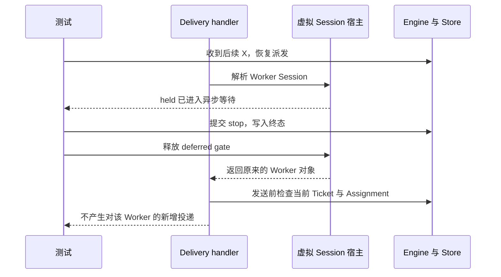

# 29 · 如何用测试证明这个 Agent 可信

> 面试题　假设 Alice 请 Agent 修帮助页文案，随后在同一条讨论里补了一句。消息投递卡在解析 Worker Session 的异步操作上，运维此时停止工单。当旧调用恢复时，你如何证明消息没进 Worker？如果所有单测通过，又怎样验证换一个模型之后，系统仍能接对任务并交付结果？

**短答**　给每个结论找能观测到它的测试。领域测试断言工单终态和授权，运行时并发测试把暂停点放在异步 Session 解析处，待停单提交后再释放它，查宿主投递记录。SQLite 测试检查回滚时工作意图是否还在，模型接口测试检查 Prompt、工具和 schema 是否一致。真实模型的授权判断和交付质量需要另做离线评估，用同一批经过人工标注的任务反复运行，分别计量误接、重复建单和有效交付。 [领域测试](../dsh-superagent-prototype/tests/core-engine.spec.ts) · [并发测试](../dsh-superagent-prototype/tests/runtime-concurrency.spec.ts#L69) · [模型接口测试](../dsh-superagent-prototype/tests/model-surface.spec.ts#L350)

本文沿用提交 `7bd4741` 中的原型。教学案例以 Alice 在 Issue #41 申请修订为起点，T 是已接收的 Ticket，X 是她或其他人在订阅讨论里发的后续，PR #62 是目标交付。源码中的并发测试使用飞书 Trigger 夹具复现同样的工单状态和投递关系。本篇中的模型评估数字是算例，用于说明统计口径。 [系列目录](README.md) · [飞书夹具](../dsh-superagent-prototype/tests/fixtures/host.ts#L21)

## 1. 先定义不变量，再挑能看到它的测试层

不变量是应该跨状态变化继续成立的条件。例如，对人为停止的 T，旧的 Worker 投递在等待后不能再给它输入。定义里应有主体、前置状态、发生的事件和可检查的现象。把这条要求写成「stop 返回 true」会漏掉原问题。HTTP 返回值只能说明某一次 API 处理结束，还要观察旧异步动作回来后有没有给同一 Session 发消息。把它扩大为「X 永远不被处理」也不对。工单结束时尚未接手的人类消息，可能按规则交给评估。受控的是旧工单后续接收的权限。 [终结与剩余消息](../dsh-superagent-prototype/src/core/tickets.ts#L338) · [结束后的消息去向](../dsh-superagent-prototype/src/core/tickets.ts#L288)

原型的测试可以按证据的来源来读。内存仓储与假时钟能快速遍历领域决策。真实 SQLite 临时库能核对数据与事务。用虚拟 DSH 服务启动 Runtime，可以检查控制面把什么有效请求交给哪个宿主入口。React 面板测试让我们看到人点了哪个动作、请求发了几次。构建检查确认独立产物可以生成。这些证据彼此衔接，定位同一个行为在不同路径中的回归。 [领域测试夹具](../dsh-superagent-prototype/tests/core-engine.spec.ts#L15) · [Runtime 夹具](../dsh-superagent-prototype/tests/fixtures/host.ts#L135) · [构建配置](../dsh-superagent-prototype/tsdown.config.ts#L9)

| 要证实的主张 | 用哪层测试 | 看哪条证据 | 还需补哪里的证据 |
| --- | --- | --- | --- |
| 已消费的 Trigger 不会再创建一个工单 | Engine + 可控 Policy / 内存仓储 | 再次 accept 返回原 Decision | 不同平台 ID 的语义近似请求需另测归并策略 |
| 回滚后没有对应 Effect 执行 | SQLite + 真实 Effects 调度器 + spy | handler 调用列表，与队列状态一致 | 外部写成功后回写失败需要远端对账测试 |
| 正在等宿主的 Worker 输入遇到 stop 会被丢弃 | 真 Runtime + 虚拟 Session 宿主 | 释放等待后没有对该 Worker 发送 | 实际宿主调度、I/O 和持久化行为需集成验证 |
| 用户双击停止确认只触发一次调用 | React + 替代管理 API | 同一 Ticket 的 POST 请求次数 | 服务端真实拒绝、权限和状态需 API 与领域测试 |
| 模型能在歧义请求下接对任务 | 冻结任务集 + 实际模型 + 交付判据 | 调用轨迹、Decision 与验证过的产物 | 需要按模型和环境版本重复运行 |

关键是选独立的断言对象。用刚被测的一段逻辑生成预期值，结果可能在逻辑出错时继续自洽。例如规则的描述和结果都来自同一个布尔值，测试只比它们是否一致，仍可能错放无权请求。源码用指定 Decision 形状、历史数据库旧字段和宿主实际调用数组作观察点。评估真实模型时也应由人工标签或工件检查提供预期，不把模型的自评分作为成功条件。 [Engine 的授权结果](../dsh-superagent-prototype/tests/core-engine.spec.ts#L899) · [迁移后的独立重读](../dsh-superagent-prototype/tests/migration.spec.ts#L199)

## 2. 单测如何处理状态机、事务和迁移

### 2.1 领域状态与仓储状态分别断言

`core-engine.spec.ts` 用 `MemoryRepositories` 和可替换的 Policy、Assessor、Executor、Outbox 来驱动 Engine。夹具可以推进自己的时钟，显式通知 Assignment 已启动、输入已交付或已读。这样就能直接构造「第一次 accept 已经成功，第二次才来」的场景，并比较两次返回的 Decision。还可以让后续到达一张人为停掉的 Ticket，断言 ended.by 仍为 human，启动次数保持初次的一次。两条断言中，一条读持久领域结果，一条读外部执行意图，即使某个实现回归只破坏其中之一也能发现。 [Engine 夹具](../dsh-superagent-prototype/tests/core-engine.spec.ts#L15) · [人为停单保持终态](../dsh-superagent-prototype/tests/core-engine.spec.ts#L331) · [重复 accept](../dsh-superagent-prototype/tests/core-engine.spec.ts#L899)

这个内存测试的 Policy 是为驱动状态转移提供的简化输入。它不能覆盖所有 GitHub 和飞书规则。用真实 Policy 的测试检查不同身份、Bot、观察模式、准入表和 Mandate 变化。真实 Store 的用例还会检查查询顺序、Thread 索引、设置版本和嵌套事务的局部回滚。面试时可以用一个例子说明分工。状态机样例告诉你已停止的 T 不复活。即使这项通过，如果持久仓储错误地丢掉 ended 标记，生产恢复仍会错。仓储测试和运行时集成分别补上数据和接线证据。 [真实 Policy 用例](../dsh-superagent-prototype/tests/policy.spec.ts#L287) · [索引与查询](../dsh-superagent-prototype/tests/store.spec.ts#L26) · [内存和 SQLite 的对照](../dsh-superagent-prototype/tests/store.spec.ts#L220)

### 2.2 事务回滚后的 Effect 不执行怎样验证

`effects.spec.ts` 每个用例开临时 SQLite 库，并创建真实的 `Effects`，用可控 clock 设置到期时间。它注册假的 relay handler 记录调用。在第一笔事务 enqueue `kept` 并提交，第二笔 enqueue `dropped` 后故意抛异常。调度器完成当前可执行工作后，断言完整调用数组只含 `kept`，而不是只检查「正常任务被调用过」。还检查 relay 队列没有残留。提交样本提供正向对照。如果调度器没启动或 handler 接线断了，正向断言会失败，不会得出「被回滚的动作没有执行所以通过」。 [Effect 用例与夹具](../dsh-superagent-prototype/tests/effects.spec.ts#L17)

源码层的原因是 enqueue 在调用方 SQLite 事务中写 Effect 行，调度的 kick 把实际读取安排到之后的微任务。事务同步返回后，保留下来的行才能被调度器看到。另一条用例让同键旧 payload 已交给 handler，再写两次新 payload。释放旧任务后只会继续执行最新值，正好检查 `generation` 保护了尚待处理的更新。这两个测试都用可观测到的 handler 调用做证明，后者验证的是运行期间覆盖的顺序，不要求同键始终只调用一次。 [队列入库与调度](../dsh-superagent-prototype/src/app/effects.ts#L60) · [代次匹配](../dsh-superagent-prototype/src/app/effects.ts#L130) · [覆盖中的合并测试](../dsh-superagent-prototype/tests/effects.spec.ts#L39)

停单还有一条相关的事务边界。`runtime-concurrency.spec.ts` 在外层事务调用 `engine.stopTicket` 后故意抛错，断言 T 仍未 ended、真实调度路径接到的假 Agent cancel 没调用；随后提交同样的停单，断言 cancel 一次。该逻辑用 Store 的 `afterCommit` 安排内存回合取消。内层 savepoint release 后要等外层提交，回滚的操作不能真的停止正在运行的 Worker。这个 callback 与持久 Effect 不同，它用于提交后的本地内存副作用。宿主在提交后中断仍需依赖持久的工单终态与启动对账。 [提交与回调](../dsh-superagent-prototype/src/app/store.ts#L133) · [Worker 取消](../dsh-superagent-prototype/src/executor/dsh.ts#L357) · [停单提交测试](../dsh-superagent-prototype/tests/runtime-concurrency.spec.ts#L842)

### 2.3 迁移失败要用新连接检查老库

`migration.spec.ts` 的 `schema10` 夹具用临时数据库构造旧版记录和部分旧表结构。一个失败用例把 executor.maxWorkers 写成无效字符串，期待 Store 打开时给出设置迁移错误。随后直接用 `DatabaseSync` 重开文件，查询 schema 仍是 10，并检查旧 Ticket 的 workspace 还在。另一个用例让旧 Ticket t9 缺少 inputs，期待错误标出 t9，之后重读同一行并与迁移前的对象比较。设置检查与后续 Ticket 转换位于不同阶段，可以分别检验错误定位。 [旧库夹具](../dsh-superagent-prototype/tests/migration.spec.ts#L16) · [无效设置回滚](../dsh-superagent-prototype/tests/migration.spec.ts#L199) · [旧 Ticket 原样保留](../dsh-superagent-prototype/tests/migration.spec.ts#L474)

构造函数先检查支持的版本，在同一个 `atomic` 中调整结构、运行迁移，最后写新版 schema。只检查抛错的话，可能已经写了一半旧数据，下一次重启才出现无法识别的混合形态。测试直接读文件，能核查这条出错路径上的版本与记录。如果要进一步证明「晚期失败后，所有先前变更都回滚」，可以给前序迁移步骤准备明确会被改写的样本，在后序注入故障，并逐一比较对应的行、索引或列布局。这是扩大验证范围的做法。现有测试的断言针对各自布置的数据与失败点。 [打开 Store 的迁移事务](../dsh-superagent-prototype/src/app/store.ts#L58) · [迁移步骤](../dsh-superagent-prototype/src/app/migration.ts#L31)

## 3. 并发用例如何稳定把 stop 插在两个 await 之间

### 3.1 用可释放的 Promise 固定事件顺序

`deferred()` 提供一个由测试控制完成的 Promise。并发夹具的 `holdSession` 只拦指定 Worker 的第一次 `resolveAgent`，同时暴露一个 held 标记。测试先暂停处理，接收 X，再恢复，使交付进入 Session 查找。等到 held 变真，调用 `stopTicket`，记住当时投递调用总数，然后放开 gate。最后只检查此后新增的调用。这个顺序保证测试确实覆盖「交付先读到旧状态，随后权限变了」的窗口。固定 sleep 则只能推测交付已经到达那里，运行机器快慢一变就可能测到另一个顺序。 [异步夹具](../dsh-superagent-prototype/tests/fixtures/async.ts#L4) · [挂起 Session 解析](../dsh-superagent-prototype/tests/runtime-concurrency.spec.ts#L18) · [迟到投递被丢弃](../dsh-superagent-prototype/tests/runtime-concurrency.spec.ts#L69)



### 3.2 同一个窗口要看状态、调用和失败归因

原型的 `deliverQueued` 反复读当前 Ticket，`deliverInput` 会把重新校验的函数传到 Session 交付入口。AgentDelivery 完成历史加载之后、准备追加消息前，会检查目标仍有效并运行该授权回调。测试选择在 `resolveAgent` 等待中停止 T，贴合这种先检查目标、后异步返回的竞态。拿最后的 ended 字段单独断言不够，因为函数完全可能在更新 T 之后仍把旧消息送回已停止的会话。用例同时检查无新增投递，及这次取消没有被写成错误的 delivery failure。针对跨工单阻塞的相关用例还检查了 ended.by 和空的 undelivered。 [交付循环](../dsh-superagent-prototype/src/executor/dsh.ts#L286) · [发送前核验](../dsh-superagent-prototype/src/app/delivery.ts#L65) · [两种并发取消](../dsh-superagent-prototype/tests/runtime-concurrency.spec.ts#L51)

虚拟宿主同时保留了若干重要行为。创建 Session 会注入工具注册，queue 与 steer 使用独立 inbox，夹具会模拟 claimed 与 user/message 两种事件，记录每次发送的 Session ID、模式、消息 ID 和文本。它允许测试故意在 claim 后切断，检验「领取输入」和「输入进入历史」的状态不同。另一方面，它的持久化读取和 flush 可以是空实现，模型动作由测试显式调用工具提供。要验证真正的宿主持久化和模型是否提出合适调用，需要另外的验证层。 [虚拟 Agent 事件](../dsh-superagent-prototype/tests/fixtures/host.ts#L163) · [持久化及宿主服务替身](../dsh-superagent-prototype/tests/fixtures/host.ts#L232) · [工具驱动接单](../dsh-superagent-prototype/tests/fixtures/host.ts#L265)

### 3.3 时钟、调度空闲和测试结束是不同条件

超时或退避类测试可以注入领域时钟，或只替换需要控制的计时器。例如核心测试推进自己的时间，先确认未送达 Eval 不过期，再登记送达，之后检查两次重排和最终 unavailable。运行时的暂停竞争测试则用 Promise 卡住 prepare 子进程，在要求暂停后才释放；再推进 Date，让被延期的 launch 变成到期可运行。测试的时间变化对应一个明确机制，避免用长时间等待来碰撞重试窗口。 [可控领域时钟](../dsh-superagent-prototype/tests/core-engine.spec.ts#L36) · [Eval 从送达计算期限](../dsh-superagent-prototype/tests/core-engine.spec.ts#L161) · [暂停和 launch 的竞争](../dsh-superagent-prototype/tests/runtime-concurrency.spec.ts#L108)

`runtime.idle()` 可等待当前 pass 和可运行 Effect 收尾，不能据此判断未来 due 的行已经处理完。编写负面断言时，先确认已进入预期的等待点，放开门闩，再等待相应 settling 条件，最后检查完整调用与持久状态。需要覆盖重试时，明确推进到重试时刻，再查是否发生重放。否则「没有发消息」可能只表示任务还在队列里。夹具还要在测试结束时停止 Runtime、恢复 spy 并清理临时状态，这样下一组测试不会拿到前一组的宿主或 DB。 [idle 语义](../dsh-superagent-prototype/src/app/effects.ts#L89) · [Passes 等待](../dsh-superagent-prototype/src/app/passes.ts#L47) · [宿主清理](../dsh-superagent-prototype/tests/fixtures/host.ts#L291)

## 4. 模型接口、HTTP、面板和构建各能检查什么

### 4.1 模型能看到的接口可以做契约测试

模型能消费的接口包括角色 Prompt、工具描述、JSON Schema、技能文本、候选和状态卡片、工具拒绝信息与执行环境说明。一个常见回归是重命名工具，但 Prompt 还叫模型使用旧名。类型检查依然能过，因为提示词是字符串。另一个回归是 Worker 的恢复卡引用只有主 Session 才能调用的工具。模型会受到文案误导，可能反复调用当前角色没有的接口。仓库的 `model-surface.spec.ts` 会先驱动 Runtime 形成两类角色的接口，再收集这类真实产出的文本和对象。检查项包括工具引用、schema 枚举、环境变量名称、角色可用性和旧术语等。 [构造与驱动场景](../dsh-superagent-prototype/tests/model-surface.spec.ts#L159) · [收集模型接口](../dsh-superagent-prototype/tests/model-surface.spec.ts#L239) · [按接口检查文本](../dsh-superagent-prototype/tests/model-surface.spec.ts#L300)

收集后，测试对比发现的差异与显式登记列表 `KNOWN_FAILURES`，既报新问题，也提示已修复条目应去掉。当前基线的该列表为空。长度测试还计算去掉机器相关变量值和团队规则后的内置 Prompt 与工具定义总字符数，用角色上限约束膨胀。这个上限按字符数计，跟具体模型 tokenizer 或运行时历史长度需要另外测量。另一条边界测试直接用「正好够」与「超一个词」喂入消息限额和路由备注，检查报错是从哪个阶段出来的。这样可核对文本承诺在工具执行阶段确实有对应验证。 [差异列表](../dsh-superagent-prototype/tests/model-surface.spec.ts#L60) · [文本检查与字数断言](../dsh-superagent-prototype/tests/model-surface.spec.ts#L369) · [角色长度预算](../dsh-superagent-prototype/tests/model-surface.spec.ts#L387)

举例说，T 已经停掉后，一条新规范可以告诉 Worker 「不要继续」。模型接口测试可以检查这句话是否出现、涉及的工具是否合法。运行时应另外断言工具 guard 和迟到投递是否拒绝。把这两条测试分开，可在文案没说清时发现契约问题，也能在控制面状态检查丢失时发现真实行为问题。实际模型是否会理解同时含停单与新需求的句子，需要让模型选择动作，再用人工标签和最终记录核对。 [恢复与停止文案断言](../dsh-superagent-prototype/tests/model-surface.spec.ts#L399) · [已结束 Ticket 的工具限制测试](../dsh-superagent-prototype/tests/runtime.spec.ts#L1558)

### 4.2 同一个 stop 可以从用户交互追到后端状态

面板测试用 React 的挂载与点击接口驱动真实组件，并用假管理服务替代 fetch 后端。点击停止按钮后能看到确认框，提交前请求列表里还没有 stop。点击确认后，记录中可见对应 Ticket 的 POST。双击确认的用例检查该路径只被请求一次。假服务根据共享 API 类型实现路由和返回，并在每次用例后检查实际调用中是否出现未声明的 query 或错误的 body 有无。这能避免一个组件即使使用错误路径也因通用 mock 返回成功而通过。 [确认和请求](../dsh-superagent-prototype/tests/panel-execution.spec.tsx#L43) · [防重复点击](../dsh-superagent-prototype/tests/panel-execution.spec.tsx#L217) · [假服务校验](../dsh-superagent-prototype/tests/fixtures/panel-server.ts#L413)

把这条链连到底时，HTTP 套件核验真实路由处理器的路径、输入解析、拒绝状态及本机管理检查。Runtime 夹具的 API 入口能够直接把模拟请求交给注册的真实 handler。再往里，领域测试检查 ended 和归属，并发套件检查后续投递，分别覆盖控制面行为。面板勾对了状态不代表后端写过库，后端成功也不能保证用户理解当前停的是哪一张工单。设置页的冲突提示同样需要两侧验证。前端用收到的 revision、草稿保留和告警来表达冲突，服务端用二次 revision 检查保护落库结果。 [HTTP 测试](../dsh-superagent-prototype/tests/http.spec.ts#L28) · [Runtime API 夹具](../dsh-superagent-prototype/tests/fixtures/host.ts#L284) · [面板草稿冲突](../dsh-superagent-prototype/tests/panel-settings.spec.tsx#L12) · [服务端设置竞态](../dsh-superagent-prototype/tests/settings.spec.ts#L18)

### 4.3 源码测试之外还要验证发布产物

仓库用 Vitest 收集 `tests/**/*.spec.{ts,tsx}`，并将 React 相关模块去重，避免客户端测试在同一运行中拿到不同实例。类型检查覆盖源码和测试，构建分别生成服务端 ESM、声明文件和浏览器入口。客户端通过宿主 ModuleLoader 包装，使用其构建配置的 CJS 格式。错误可能只在打包时出现，例如模块入口路径、原始文本导入或外部依赖配置。源码测试通过之后运行构建，能暴露这类发布问题。拿到构建文件后，如果还需要确认特定 DSH profile 中的加载行为，应增加安装和启动冒烟，用实际部署环境观察控制面就绪与客户端注册。 [Vitest 配置](../dsh-superagent-prototype/vitest.config.ts) · [TypeScript 检查范围](../dsh-superagent-prototype/tsconfig.json#L22) · [tsdown 入口和宿主包装](../dsh-superagent-prototype/tsdown.config.ts#L9)

## 5. 为真实模型设计离线评估

### 5.1 固定题面，给每个样例写清授权和验收边界

真实模型评估需要冻结的不只是输入文本。评估记录要能定位模型及配置、Prompt revision、Policy 与 Source 设定、仓库基线提交、事件顺序、可用工具和运行预算。对于 Alice 的案例，可以准备同一个小型虚构仓库，含明确的文案错误、可复现测试和一份预期允许修改的文件范围。在事件里保留角色、Thread、真实可见的正文和已存在工单。先以同一输入驱动一遍来源归一化和业务状态，再让真实模型完成路由、可选执行和报告。对外写入使用隔离环境的可观测适配器或专门测试仓库，工件应在每次运行后保留用于复判。 [Trigger 数据结构](../dsh-superagent-prototype/src/core/model.ts) · [Policy 接受规则](../dsh-superagent-prototype/src/policy.ts#L166) · [Prompt 版本篇](25-prompt-skill-and-model-surface.md)

样例至少覆盖被允许的显式请求、被禁止的请求、需要推断并有匹配规则的观察、允许读取但不能发起新工作的上下文、一个 Trigger 重放、已有工单的后续和自然结束后按条件恢复。设置两条相似文本的对照，固定内容只换发信权限或准入配置，更能定位模型是否使用了正确证据。对于「停止旧工作并开一个新需求」这类复合输入，标注要写允许的动作组合，不能简单用「建新单就是重复」判错。拆成 Train 或开发样例、固定回归样例和保留评估样例时，按原始任务或语义近似组划分，同一条 Issue 的改写不跨多个用途。 [模型接口的复合路由说明](../dsh-superagent-prototype/tests/model-surface.spec.ts#L399) · [后续与新工作](14-followup-ownership-and-handback.md)

人工标签应先于跑模型分配。两位标注者按同样的 Policy 和业务材料独立记录允许动作、禁止动作、评审用工件和需人澄清处。冲突样例复核后保留依据，可以单列确实有多种合法解的场景。有效交付用工具可验证的事实与人工验收共同判定。例如文案修正要有正确 diff，验证命令通过，目标 PR 归属 T，回复送到允许的会话。在要求人合并的样例里，Agent 的职责完成点可以是交付一个可审的 PR。人的合并耗时不应直接作为模型失败。 [交付流程](04-end-to-end-issue-to-pr.md) · [执行报告与 PR 关联](../dsh-superagent-prototype/src/app/tools/executor.ts#L75)

### 5.2 三个指标，使用事先固定的分母

| 指标 | 分子 | 分母 |
| --- | --- | --- |
| 授权误接率 | 禁止创建新 Ticket 的试次里，实际创建至少一张禁止工单的次数 | 全部标注为禁止创建的试次 |
| 重复建单率 | 至多允许建一张工单的重放试次里，该任务产生两张及以上 Ticket 的次数 | 全部设计为至多一张的重放试次 |
| 有效交付率 | 经事务记录与工件验收确认，达到场景验收点的试次 | 全部标注应交付并纳入本评估的试次 |

假设有 20 个禁止建单样例、40 个授权且应交付样例，每个场景跑 5 次。规定 40 个授权场景都包含重复事件，允许至多一张工单。禁止组总共 100 次，实际误接 2 次，误接率为 2%。授权组总共 200 次，其中有 3 次为同一任务建了重复工单，重复建单率为 1.5%。如果有效的试次有 154 次，有效交付率为 77%。这些数字用于展示口径。一次模型提出不当 accept 被 Engine 拦截，可以另计「提议违规后被拦截」的频次。对运行风险来说，拦截后的实际误接与模型本身的错误倾向各有价值。

有效交付分母保留漏接、错误路由、未完成和预算内未交付的任务。如果仅对「已接单且成功启动的任务」计算，就丢掉系统接不住需求的证据。基础设施中断时，可以同时汇报主口径的可复现完整分母、基础设施失败数与额外诊断切片。提前约定模拟平台失败是否属于题目，以及真实运行故障如何重跑。跨版本比较必须使用匹配的试次，缺失的配对标明原因，避免把难样例从分母扣掉后把涨幅解释成模型提升。

### 5.3 重复运行要量到差异来自哪一环

固定样例顺序或记录随机顺序，每次独立初始化状态、使用同一仓库基线，保留模型参数、可用工具与预算。模型若无法严格复现采样，也能通过重复运行估计结果分布。对同一场景配对比较基线模型与候选模型，报告成功变失败和失败变成功的数量。置信范围应考虑同一个样例反复运行的相关性，可以按原始任务分组重抽样。样例量少时直接给计数和典型失败证据，避免用小数位掩盖不确定性。

失败归因从结构化记录往回找。Source 未摄取与模型没处理是两个故障。工具 schema 拒绝和领域授权拒绝有各自记录。已接对任务但 Worker 没产出、工件有回归、外发确认不到也要分别统计。以 T 为例，一条轨迹从 Trigger、Decision、Assignment 到 PR diff 和送达回执可复核，面试时拿同一条失败轨迹就能说明错误停在哪一层。迭代后先确认回归测试仍通过，再在固定保留集上比较模型表现。 [管理视图与排查](26-settings-api-and-operations-panel.md) · [故障恢复篇](28-pause-shutdown-and-crash-recovery.md)

## 6. 本次验证与可复现命令

在临时源码副本中用锁定依赖运行了仓库的 `check`。`tsc --noEmit` 通过，Vitest 的 **59 个测试文件、1,197 个用例**全部通过，服务端和浏览器产物均构建成功。首次从 Corepack 直接调用时，package script 找不到嵌套的 `pnpm` 命令，后续在临时目录启用 pnpm shim 后完整运行成功。构建输出了通用的 CommonJS 格式建议，仓库配置仍使用宿主要求的客户端包装。此次调用使用本地依赖缓存，未接真实模型或平台账号。 [仓库脚本](../dsh-superagent-prototype/package.json#L47) · [锁文件](../dsh-superagent-prototype/pnpm-lock.yaml) · [客户端构建入口](../dsh-superagent-prototype/tsdown.config.ts#L9)

可在已具备 Node、Corepack 和相应依赖缓存的隔离副本中复现。要理解本篇的三条主线，可以先运行并发、Effect、迁移三个套件，再跑完整检查。

```sh
corepack pnpm install --offline --frozen-lockfile --ignore-scripts
corepack pnpm test tests/runtime-concurrency.spec.ts tests/effects.spec.ts tests/migration.spec.ts
# 已启用 pnpm 命令时，运行完整仓库检查
corepack pnpm check
```

## 7. 面试口述与追问

### 60–90 秒口述

我会把可信拆成可以检查的声明。以停单为例，领域层要断言结束状态和不会重新启动。并发测试把消息交付卡在获取 Session 的 await 上，确认已经进入窗口，再提交 stop，释放等待后检查发送数组。数据库层要保证回滚的工作没有发生，Effect 测试会同时排一次提交、一次回滚，用实际 handler 调用列表验证。迁移失败后还要用新连接检查旧版本和旧记录。

工具、Prompt、API 和面板都有各自的契约。完整测试通过，说明这些实现行为经过验证。真实模型能否把请求解释对，仍要用有标注的样例重复运行。评估时我会分别报告实际误接、重复建单和按工件验收的交付率，保留失败样例和预先固定的分母。

### 五个追问

1. **如何确认测到竞态本身？** 用可控 Promise 把异步入口停在指定位置，观察它确实开始，再改变授权或工单状态。放开等待后看宿主调用和持久结果。 [并发用例](../dsh-superagent-prototype/tests/runtime-concurrency.spec.ts#L69)
2. **回滚 Effect 的测试为什么还要有提交样本？** 提交样本应执行，是正向对照。两条都没执行时，测试会暴露调度器可能没启动的问题。 [Effect 回滚测试](../dsh-superagent-prototype/tests/effects.spec.ts#L29)
3. **升级失败能靠捕获异常判定安全回滚吗？** 还要重开数据库检查 schema、旧数据与受影响结构，验证原来可用的记录仍可用。 [迁移失败重读](../dsh-superagent-prototype/tests/migration.spec.ts#L199)
4. **主 Session 的 Prompt 带着正确工具名，真实模型就会正确选择吗？** 契约测试支持它能看到可用接口，实际选择需要用有标签的真实模型运行核对，要把它的工具提议与 Engine 最终结果一起记录。 [接口收集测试](../dsh-superagent-prototype/tests/model-surface.spec.ts#L350)
5. **为什么交付率的分母要包含漏接？** 用户需要的是从输入到可验证交付的完整链。漏接使用户到不了执行阶段，应留在端到端分母。可额外报告已接单任务的交付率用来定位 Worker 的表现。

上一篇是 [28 · 暂停、关闭、崩溃恢复与故障排查](28-pause-shutdown-and-crash-recovery.md)。下一篇是 30 · 单仓库原型如何演进到生产级多租户。 [系列目录](README.md)
