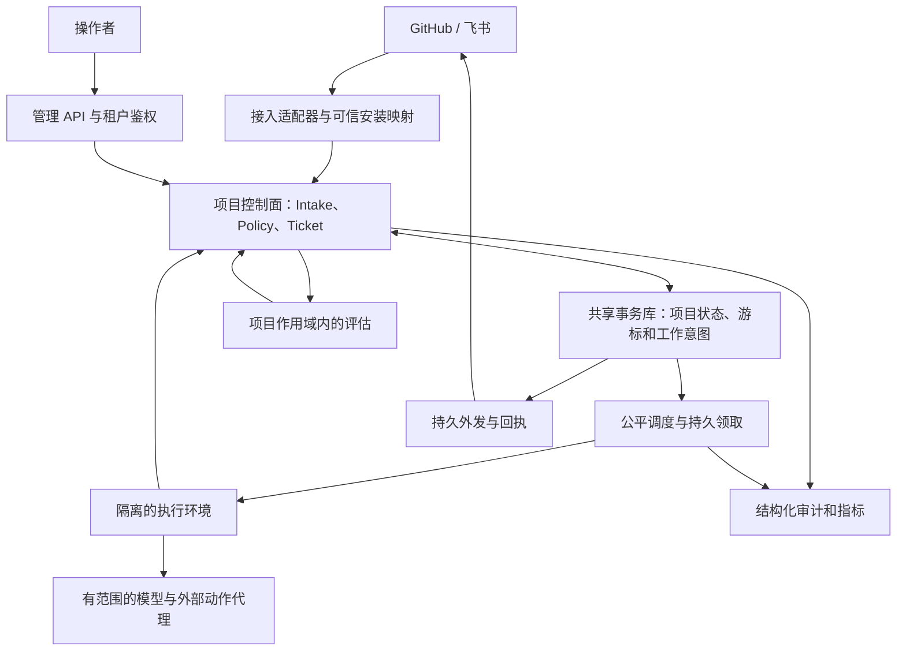
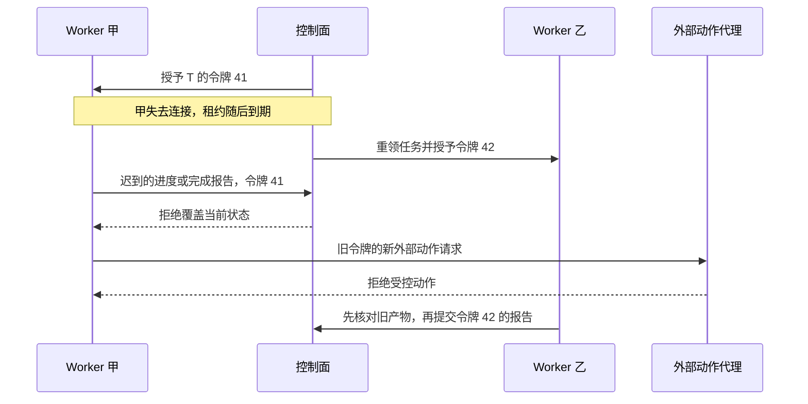

# 30 · 单仓库原型如何演进到生产级多租户

> 面试题　公司已有一个能自主处理 GitHub Issue 和飞书请求的 Superagent。现在要服务 30 个团队的 120 个仓库。忙时有 60 个候选每分钟，其中 15 个需要新开任务。一个新工单平均占用 Worker 4 分钟。你会配多少槽位？如果大仓库遇到故障，一次积了几百个重试，怎样让其他团队继续工作？旧 Worker 恢复后，又怎么防止它覆盖新 Worker 交付的结果？

**短答**　先从原型的部署边界看起。一份 Runtime 对应一个状态目录、一份 SQLite、一个主 Session 和一个已配置 GitHub 仓库。小规模可按项目部署独立实例，共享基础运维，给每个实例独立状态、执行身份和额度。需要统一治理、弹性资源和跨节点恢复后，再引入共享控制面、按项目分区的持久队列及隔离 Worker。容量算例中，每分钟 15 批任务各占槽 4 分钟，平均用 60 个槽位。按 75% 的目标利用率配 80 个。这个结果还要经模型令牌、命令进程、尾延迟、故障和突发流量验证。 [Runtime 装配](../dsh-superagent-prototype/src/app/runtime.ts#L87) · [部署结构](../dsh-superagent-prototype/src/deployment.ts#L45) · [Worker 槽位](../dsh-superagent-prototype/src/executor/dsh.ts#L165)

本文的现状依据为工作区提交 `7bd4741`。后半篇设计的是尚未实现的生产方案，负载、预算、指标目标和迁移阈值均为白板算例。沿用 Alice 在帮助页仓库提出文案修订的案例。她的请求进入本项目的 Ticket，Worker 提交 PR，维护者在同一项目内复审和合并。另一团队即使也有 Issue #41，也应拥有独立的配置、Thread、执行身份和回执。 [项目概览](../dsh-superagent-prototype/README.md) · [端到端案例](04-end-to-end-issue-to-pr.md)

## 1. 单仓原型真正绑定了哪些资源

### 1.1 一份状态目录界定一个运行实例的配置与恢复

`Runtime` 在打开 `orchestrator.sqlite` 前取得状态目录锁。锁保护同一个目录上的启动、迁移和写入顺序。Store 通过 SQLite 保存 Trigger、Thread、Ticket、Decision、Outbox 和 Effect，并使用 WAL 和 FULL synchronous。Settings 和 Prompts 在同一个 Store 有各自的版本，主 Session ID 也记录在其中。Executor 在启动后对账开放工单，再启动 Passes 与 Effects。因为这几个模块共享一份库，领域写入与待执行意图可以一起提交，重启后也能从同一位置读回。 [状态目录锁](../dsh-superagent-prototype/src/app/runtime.ts#L87) · [Store 结构](../dsh-superagent-prototype/src/app/store.ts#L58) · [初始化恢复](../dsh-superagent-prototype/src/app/runtime.ts#L201)

原型的 GitHub Source 解析一个仓库和一个执行身份，Setup 查询规范仓库名及账号访问能力。Source 注册表识别不同平台的来源类型，飞书可补充接收入口。一个实例有多个 Source 只意味着几个适配器能给同一业务域送事件。当前配置和关系模型仍以选定仓库为中心。Thread key 由 `source:id` 形成，GitHub 游标支持按 Issue 或 PR 编号读取。同一个部署拥有自己的 Policy、主 Session 与 Worker 槽位。如果复制一个 repo 参数并将两批数据写进同一 SQLite，即使暂时没出现 Ticket ID 冲突，也会遇到游标、线程、规则和 Session 上下文的作用域问题。 [部署账号解析](../dsh-superagent-prototype/src/deployment.ts#L87) · [Thread key](../dsh-superagent-prototype/src/core/model.ts#L7) · [游标键](../dsh-superagent-prototype/src/kv.ts#L41)

### 1.2 Worker 独立会话便于编排，资源上限仍在进程内

执行器用 Ticket ID 派生 Worker Session ID，按执行根目录和工单短名选择工作区。prepare 可为 T 创建一个 worktree，便于接着上次的修改继续工作。WorkerSlots 统计当前活动与启动预约，同一 Ticket 只占一个计数位。启动与唤醒在异步工作前先保留槽位。人类有效后续还可以使用普通限额之外的一个唤醒名额。原型的 executor.maxWorkers 默认 3，由当前实例的 Settings 控制。起两个实例并把每个配置成 3，潜在的总并发随实例数增长，没有统一的限额。 [执行路径](../dsh-superagent-prototype/src/executor/dsh.ts#L96) · [WorkerSlots](../dsh-superagent-prototype/src/executor/dsh.ts#L165) · [默认配置](../dsh-superagent-prototype/src/policy.ts#L90) · [人类后续额外槽位测试](../dsh-superagent-prototype/tests/runtime-concurrency.spec.ts#L868)

占用槽位的时间不同于工单自创建到合并的总时长。Worker 等人审查之前可能已释放槽位，也可能在模型回合结束后仍跑后台任务。已有的运行量投影与启动预约也有区别。用 Ticket 表的开放数量直接估算执行节点，会把等人几小时的工作算作一直占 CPU。反过来，人的交接后保留下来的部分 shell jobs 即使释放了 Worker 槽位，也可能占内存和进程额度，所以资源管理员还需要独立看运行器的配额。 [活动 Worker 计算](../dsh-superagent-prototype/src/executor/dsh.ts#L403) · [交接后台工作](../dsh-superagent-prototype/src/executor/dsh.ts#L583) · [后台工作持槽测试](../dsh-superagent-prototype/tests/runtime-concurrency.spec.ts#L264)

### 1.3 原型中的事务模式值得带到新架构

`Effects` 以 `kind + key` 去重，用 seq 控制队列位置，payload 更新时推进 generation，避免旧 handler 完成时删除新意图。已有的顺序、并发上限、退避、重启补排在同一控制面发挥作用。要扩大规模，可以复用几个设计原则。业务事实和持久工作意图要一起提交。运行器接到旧任务还得重查当前状态。外部副作用要有自己的幂等身份。多个消费者争用一个远程队列时，需要再引入可持久化的领取所有权与失效规则，当前文件锁和进程内集合并不表达这些信息。 [Effect 入队](../dsh-superagent-prototype/src/app/effects.ts#L57) · [代次结算](../dsh-superagent-prototype/src/app/effects.ts#L130) · [Executor 启动守卫](../dsh-superagent-prototype/src/executor/dsh.ts#L424)

## 2. 面试先定义租户、项目和服务承诺

按本题的假设，租户是共享管理与预算的组织，项目是「此租户下可独立接入、授权及关闭的仓库配置」。一个项目可含 GitHub 与飞书接入，项目明确哪些群能唤起哪个仓库。默认情况下同一飞书事件只映射到有明确规则的项目。若管理者允许一个消息同时触达多个项目，各自的 Ticket 及副作用也要有单独授权与关联，不能因全局去重把另一个合法投递吞掉。跨项目的读、写、模型请求和审计都要保留这个绑定。

业务遵守三个时间约定。第一，收到来源事件后要尽快产生可追溯的摄取证据。轮询延迟由源配置和平台节拍影响，若承诺数秒级接收，需评估适合的事件入口及重放机制。第二，排队 SLO 以「具备调度条件的任务进入执行」为测量点，例如在声明的常态峰值下，待启动任务 p95 排队小于两分钟。第三，独立核查不可重复的外部效果及停单。停止后新动作需及时受限，已被平台接受的结果还要对账。到人审通过的耗时可以另外统计。原型 GitHub 配置的默认轮询间隔为 60 秒，并与平台返回的要求取较大者。 [GitHub 轮询配置](../dsh-superagent-prototype/src/sources/github.ts#L25) · [轮询节拍](../dsh-superagent-prototype/src/sources/github.ts#L127)

这些目标是需求边界。对于内部低风险项目，可能允许独立实例上的分钟级状态传播。对跨组织、凭据价值高且有发布门禁的项目，则要求在执行环境和外部动作前重新核验项目身份。不要只按仓库总数选架构。同一批 120 个仓库若每小时各来一个请求，调度压力与 20 个其中几个持续出错的仓库不同。决定何时投入平台化，还要问每个团队是否需要独立审计、集中升级、配额共享或跨节点恢复。

## 3. 从到达率算到槽位、积压、令牌和节点

### 3.1 明确每一分钟的流量是在哪一层数出来的

| 白板输入 | 假设 | 容量意义 |
| --- | --- | --- |
| 安装规模 | 30 个租户，120 个项目 | 影响连接器、权限关系、配置管理与轮询量 |
| 常态忙时摄取 | 240 个原始事件/分钟 | 包含可能重复、过滤和已有工单的跟进 |
| 送到准入判断 | 60 个候选/分钟 | 按独立候选估算，评估与路由另有负荷 |
| 新执行需求 | 15 批等价工作/分钟，平常约 6 批/分钟 | 算例将跟进和恢复的平均开销计入每批占用，实测应分开 |
| 平均占槽时长 | 4 分钟/批 | 合并准备、活跃推理、必要后台时间，不包括不占槽的人审 |
| 容量利用目标 | 常态忙时约 75% | 给长尾、突发和故障后恢复留余量 |
| 短时突发 | 24 批/分钟持续 10 分钟 | 观察积压增长和恢复斜率 |

候选不是原始事件数量。三条对同一 Thread 的补充可能组成一个评估，订阅的 X 也可能直接走已有 Worker。因此每分钟 60 个候选与每分钟 15 个新工单是算例设定，而非源码写死的比例。容量估算可将执行需求折成单位时间内占用的槽位时间。若到达率 15 批/分钟、每批平均占用 4 分钟，稳定窗口里平均忙 60 个槽位。把目标利用率定在 75%，则需要 `ceil(60 / 0.75) = 80`。Little 定律描述稳态中平均在途数、到达率与平均停留时间的关系。在这里只对占槽的服务阶段使用，排队和人审可另用各自阶段的统计。 [Little 1961 年原论文](https://pubsonline.informs.org/doi/abs/10.1287/opre.9.3.383)

如果一个项目的每个新 Ticket 后面都会产生昂贵跟进，最好分别按 `各类到达率 × 各类平均占槽时间` 相加。可用一段样例说明。同样是 60 个平均忙槽位，60 个较短任务均匀散布，和成批出现的长命令，对同项目排队 p95 的影响会不同。80 个槽位是初始规模，用实际时长分布、模型并发和各租户热点压测验证它是否能达到排队目标。需要保留故障余量时，应以实例失效后还能提供的容量核算。

### 3.2 用流量守恒估算积压增长与下降

在 80 个槽位、每批 4 分钟的理想近似下，满负荷服务率约 20 批/分钟。如果突发到 24 批/分钟，10 分钟内净增加约 40 批积压。突发结束回到 15 批/分钟后，每分钟净清约 5 批，因此约 8 分钟恢复至原积压水平。突发结束时队尾的简化等待可估为 `40 ÷ 20 = 2 分钟`。这个数字假设工作可均匀完成、队列近似先进先出，且没有配额、热点和冷启动影响，不等于真实请求的 p95。如果模型变慢，平均占槽变成 5 分钟，服务率降为每分钟 16 批，积压在同一突发中约增 80 批，随后只剩每分钟 1 批的清空速度，恢复约 80 分钟。因此应在容量测试里同时改变负载与占槽时间，观察进入高利用率区间后的恢复速度。

传入事件的初始尖峰通常也会影响摄取。120 个实例若每 60 秒各启动一个通知轮询，平均是每分钟 120 次轮询开头，实际请求可能因分页、订阅 Thread、CI 和回补更高。如果部署时间相同，第一批轮询也容易集中。工程上要同时测每个平台、每个安装身份、每个项目的请求节拍，加入分散的轮询启动和受控重试，把外部限制反映到实际完成率。估算中的平均值可以指导方向，尾部和共享配额仍要在运行曲线上验证。 [GitHub 一轮来源读取](../dsh-superagent-prototype/src/sources/github.ts#L275)

### 3.3 Worker 槽位之外，模型和节点会先卡住哪一个

假设一个候选平均一次模型请求，2,000 输入 token 与 500 输出 token。一个执行任务平均十次请求，共 15,000 输入与 3,000 输出 token。常态忙时估算为每分钟 `60 × 2,500 + 15 × 18,000 = 420,000` token，约 210 次模型请求。若为可计费重试预留 15%，则约需 483,000 token/分钟与 242 次请求/分钟的窗口。输入和输出也应各自汇总，分别约为 396,750 与 86,250 token/分钟。实际供应商如何记账以选定配置的限额为准，需要核对缓存、拒绝请求、流式输出与单次上下文窗口。不能只按工作线程数去买模型额度。

如果 24 批的突发对应 96 个候选/分钟、执行端在满载稳定到 20 批/分钟，按相同假设的需求约 690,000 token/分钟、341 次请求/分钟。若总模型额度显著低于这一段需求，队列可能先受模型约束，3.2 节的服务率就需要重算。节点侧假定可用于 Worker 的内存为每台 24 GiB，实测单任务高位内存约 2 GiB 的情况下，内存给出至多 12 个的规划上限。若 CPU、I/O 压测只能稳定支持每台 8 个，80 槽须 10 台有效节点。希望掉一台仍有 80 槽，按此假设至少配 11 台，配额、故障域与超分策略另验。

## 4. 两条部署路线，按问题逐步迁移

### 4.1 每仓库一个独立实例

第一条路线保留原型的分治方式。为每个项目独立创建 DSH 进程、状态目录、Session 持久化作用域、worktree 根、外部凭据和模型预算。平台可以统一登记实例地址、版本、配置模板、状态快照与升级计划，再把经鉴别的管理请求代理到对应实例。本机的管理 API 当前以回环监听和来源限制为前提，统一入口需自己做用户鉴别并检查该用户与项目的关系。不要把「中心能访问实例」等同于「当前请求者有权修改这个实例」。 [原型独立 profile](../dsh-superagent-prototype/docs/006-deployment.md#L5) · [本机管理路由](../dsh-superagent-prototype/src/app/http.ts#L230) · [权限篇](27-trust-boundaries-and-permissions.md)

这条路线适合项目少、负载稳定或故障影响范围比资源利用率更重要的阶段。坏仓库的进程和 SQLite 问题通常能局限在一个运行单元，升级也能按项目分批。也要检查共享依赖。多个进程共用同一机器、模型账号或 GitHub 安装身份时，仍可能因宿主资源或外部限流互相影响。原型会改进程级 PATH 和 Git 环境，同一 DSH 进程内挂两个插件实例不足以把这些资源隔开。真实数据安全还依赖不同执行身份、文件可见范围与账号权限。 [进程级环境](../dsh-superagent-prototype/src/infra/environment.ts#L118) · [部署权限假设](../dsh-superagent-prototype/docs/006-deployment.md#L13)

代价是每个实例都有控制面、评估 Session 和轮询。小项目很多时，忙的仓库会排队，闲实例的槽位无法自动借出。若给每个项目至少一个独立并发上限，120 个项目的配置上限总数至少为 120，实际占用可以远低于这个数字。原型单实例允许配置的范围为 1 到 16，单仓的忙时指标可能在这个范围内已适当。把总容量 80 平均分给 120 个仓库会涉及某些实例被停用或等待基础设施拨给配额，需要在部署层处理。集中监控可以先收集实际数据，判断昂贵的是冷实例底噪、外部轮询、还是分散的执行资源。 [Worker 设置范围](../dsh-superagent-prototype/src/limits.ts#L6) · [原型运行量](../dsh-superagent-prototype/src/executor/dsh.ts#L403)

### 4.2 共享控制面，按项目调度隔离执行

第二条路线令接入、Policy、Ticket、审计和调度使用共享的控制面。执行层使用弹性 Worker 池。Worker 接到分配时只取得当前项目与 Assignment 需要的工作区和能力，任务结束后按约定回收。共享控制面接收的不只是工具执行结果，也包含开始、心跳、报告、外部效果申报及终结信息。更新域状态前要核验项目归属、当前 Assignment 及领取版本。对需要访问远端模型和平台的动作，控制面可提供限额与仲裁服务，由专门的边界检查授权。



主 Session 也需要选择边界。指令和读权限最多覆盖它获准处理的项目，候选不会拼在任意租户共用的一份模型历史里。可以先为每个项目保留逻辑主 Session，按负载唤醒。对于高峰项目再把评估拆成带显式上下文的任务，由控制面维护 Thread 的 Eval 状态与版本。保留主 Session 的连续上下文有助于归属判断，还会增加热项目单会话排队。将必要上下文显式化有利于弹性扩展，代价是每次装配、恢复和审计都要解决上下文范围与新鲜度。原型把候选交给一个持久主 Session，因此这一改造要专门复测后续归属与停止语义。 [原型主 Session](../dsh-superagent-prototype/src/app/runtime.ts#L104) · [评估投递装配](../dsh-superagent-prototype/src/app/runtime.ts#L127)

### 4.3 用观测结果决定切换顺序

| 要做的决策 | 何时选择 | 成本或验证点 |
| --- | --- | --- |
| 项目级独立实例 | 值班团队能管理实例数，单项目负载适配上限 | 会话底噪与轮询成本偏高，要统一升级和备份 |
| 共享控制面与 Worker 池 | 项目之间忙闲明显，需要统一配额、弹性与审计 | 要验证租约、网络分区、同项目时序及隔离 |
| 按租户或项目分多个控制面分区 | 共享库争用、运维影响或地域约束超过目标 | 跨区看板与迁移复杂，借用容量要有明确规则 |
| 给极大或敏感租户单独运行单元 | 大租户长期挤占资源，或数据与身份要求独立 | 单独值班、容量预留，使用相同业务契约避免分叉 |

例如先用独立实例服务十个团队，收集四周的每项目排队、槽时、模型消费、故障耗时和运维人时。若忙项目频繁排队而池总体空闲，先共享调度与执行容量，或者把高峰租户单独给足。若复杂度主要来自版本和审计一致性，先建设统一配置发布与审计入口。架构分层跟随被观察到的瓶颈。把控制、模型、命令、通知一口气拆成很多服务，会立刻引入跨边界重试与授权成本。

## 5. 租户数据边界要出现在主键、查询和外部身份里

### 5.1 给每种记录选能解释其归属的身份

在共享数据层，先确定 `tenant_id`、`project_id`、`source_connection_id` 的归属关系。来源连接代表一个经验证的外部安装和一份接入配置。平台事件先解析外部稳定身份，再由登记关系指向项目。同一个 GitHub 编号在不同仓库下可重复，同一飞书群也可能经配置连到多个项目。原型 `source:id` 的格式在多个独立数据库可以工作，进入共享库就要补上来源作用域。历史工单 ID 可以保留，跨项目访问始终额外核查 project key。 [现有 Thread 标识](../dsh-superagent-prototype/src/core/model.ts#L7) · [原型 GitHub / 飞书游标](../dsh-superagent-prototype/src/kv.ts#L39)

| 记录 | 拟议的逻辑身份 | 要防止的错误 |
| --- | --- | --- |
| 外部事件及 Trigger | 项目、来源连接、稳定平台事件 ID，必要时再带事件种类 | 同一个投递重试重复建单，或不同项目合法投递误合并 |
| Thread | 项目、来源连接、平台 Thread ID | 两个仓库 #41 混入同一对话 |
| Source 游标 | 项目、来源连接、读流与适用分段 | A 的成功推进 B 的 checkpoint |
| Ticket / Assignment | 项目、Ticket ID、各自 Assignment ID | 旧执行更新另一项目或后来启动的任务 |
| Effect | 项目、kind、逻辑 key | 两个项目外发或合并队列互相覆盖 |
| 外发回执 | 项目、来源连接、目标与逻辑动作身份 | 将 A 的收件渠道和 B 的幂等标记共用 |
| 设置与 Prompt | 项目或明确的租户默认范围、版本 | 模型使用错误规则，历史决定无法复盘 |

如果采用全局生成的 Ticket ID，仍需把项目带入所有服务端校验。外键可以用 `project_id` 和目标主键组合约束，使属于 A 的 Assignment 关联到 B 的 Ticket 即时报错。请求地址中的项目字段只是定位值，实际授权来自已验证的主体与服务端关系。查询数据、缓存键、对象存储前缀、Session 恢复标识和异步负载都要遵守相同约束。前端筛选可以帮助阅读，但不足以约束查询和写入。

外部仓库更名时，用在该平台有效的稳定身份维系同一个项目，名称留作可变属性。接入换账号时要知道外部读视野可能变化，游标未经核对不得自动给新安装继续读。相同来源的同一项目若通过历史回补和实时事件两条路径看到同一对象，连接身份的定义也要统一。若两路实际代表同一逻辑来源，应在归一化后使用同一业务事件键。迁移时可保留旧 ID 和新逻辑身份之间的映射，方便把已有 PR、消息标记和历史 URL 继续关联。 [原型仓库规范名解析](../dsh-superagent-prototype/src/deployment.ts#L87) · [接收去重](../dsh-superagent-prototype/src/core/intake.ts#L19)

### 5.2 在项目内只串行具有因果关系的操作

适合串行的边界是一个 Thread 的活动评估或一个 Ticket 的当前 Assignment。新候选与旧评估可能同时提交，应该使用 Thread 版本及 Eval ID 确定哪次判断仍有效。远端模型调用在事务之外完成，回来时用输入快照和版本核对 Policy 是否已变、候选是否还由此 Eval 持有。有冲突可重新判断或返回终态。原型已有 Eval ID 和 Policy version 校验，搬迁后需要在多个 API 副本上原子执行同样的语义。禁止为等模型一直持有数据库事务，因为同一项目的停单、追加消息和配置保存也需要写。 [决定前检查 Eval](../dsh-superagent-prototype/src/core/evals.ts#L125) · [Policy 变更核对](../dsh-superagent-prototype/src/core/evals.ts#L281)

以 Alice 追加 X 为例。如果 X 属于 T 已拥有的 Thread，应记录其到达关系，保证不会因两个控制面副本同时看到就开两张工单。对「同一个可建单事件只接受一次」可以有独立业务唯一约束，并在写 Decision、Ticket、第一 Assignment 和 launch 意图时一起生效。如果多条 Trigger 共同授予一次接单，则需覆盖用作建单依据的事件集合。重复请求读既有 Decision，非法新请求走自己的拒绝条件。跨 Thread 同时订阅 T 时，需要按稳定次序更新相关记录或使用冲突重试，避免在许多仓库之间引入一个巨大的总锁。 [原型接单创建](../dsh-superagent-prototype/src/core/evals.ts#L305) · [订阅和首次 Assignment](../dsh-superagent-prototype/src/core/tickets.ts#L32)

## 6. 持久队列、租约和 fencing 怎么配合

### 6.1 控制面事务记录业务变化和工作意图

接受 Alice 的需求时，控制面一次提交写入 Decision、T、第一份 Assignment 以及 launch 意图。已经确认接收的动作有可恢复的记录。若发送到队列失败，扫描器可以从未结算意图恢复。若仅在收到模型结果后先发一个消息，再记录 Ticket，Worker 可能看到库里还没有这张工单。反向分成两个互不约束的操作也有问题。先提交 Ticket，后续进程崩溃，就可能忘了派工。原型用同库事务覆盖这种边界，生产版应把该约束保留到控制面，即使后续有专门的消息系统。 [原型事务入口](../dsh-superagent-prototype/src/app/store.ts#L133) · [原型 launch 入队](../dsh-superagent-prototype/src/executor/dsh.ts#L263)

数据量仍适中时，可以先使用关系库里的工作表。该设计草案用 `project_id`、`kind`、`logical_key` 标识任务，另存 due、attempt、领取状态和 owner。消费者在选到公平调度给出的项目后，用短事务领取到期记录并交换所有权。在 PostgreSQL 队列表中可以用 `FOR UPDATE SKIP LOCKED` 减少多个领取者等待同一行，但被锁的行会被跳过。每线程时序和公平性仍需业务分区、头部依赖和调度规则，不能从该选项推出全局严格先进先出。目录准备、命令和模型调用都在提交领取之后发生，心跳与结果也只做短事务。 [PostgreSQL SELECT 文档](https://www.postgresql.org/docs/15/sql-select.html)

当数据库扫描和更新压力明显升高，可用事务 Outbox 发布工作指针给队列，再由消费者按指针领取。发布器在「送出成功但未写已发布」时可能再送，消费者仍要按项目和逻辑身份去重。保留数据库为当期 Assignment 和外发回执的权威，消息系统负责让工作更快达到执行端和承接突发。增加中间件会增加投递滞后、水位差、死信检查和重放成本，迁移前应先用 queue age 与数据库争用数据确认瓶颈。

### 6.2 租约给出可恢复的持有者，fencing 阻止迟到者回写

执行不能永远只由第一次拿到任务的 Worker 负责。计划在同一事务中记录领取者、受控的到期时间和单调递增的令牌。Worker 在有效期内定期续租。续租只接受当前 owner 与令牌，并按服务端时间判断。租约到期后，调度器可由另一进程领取，同时提高令牌。这个令牌就是用来隔离旧执行的 fencing token。令牌要在受保护对象的生命周期内单调。重领时即使创建 A2，也要验证 T 的当前 Assignment 已切换，并且旧 A1 无法以自身的旧令牌回写 T。

假设节点甲在令牌 41 时接到 T，随后与控制面断开。等租约确认过期后，节点乙取得令牌 42。甲恢复时，它手里仍可能保存运行结果与调用参数。控制面接受开始、进度、完成和释放槽位请求时要验证当前令牌，且校验与更新同事务执行。所有权匹配失败时，拒绝状态回写和新外部操作。这里需要的是在资源接收端确认请求是不是当前持有者，光让 Worker 自我检查心跳不足以约束已经延迟到达的调用。这个设计借鉴 Chubby 的 sequencer 思路，把持锁代次传给受保护资源并由接收方验证。 [Chubby 论文 §2.4](https://static.usenix.org/events/osdi06/tech/full_papers/burrows/burrows_html/index.html)



原型的 Effect generation 解决同一进程中旧 handler 清理 payload 的问题。生产版还要考虑换 owner、多个节点和跨系统延迟。一个设计可以同时维护业务对象版本、Effect payload generation 与执行租约令牌。业务版本决定此次修订基于哪个状态，payload 版本标识执行的是哪份意图，领取令牌决定哪个进程有权写回。也可以用更少的字段统一实现，只要在每种变更的生命周期都能区分这三类竞争。调度器取消一个 Worker 时应标记失效，并能用同一事务限制后来外发；审批或等待人的状态不占用短租约，需要唤醒时另发新领取。 [原型 Effect 代次](../dsh-superagent-prototype/src/app/effects.ts#L130) · [原型 Assignment 重查](../dsh-superagent-prototype/src/core/assignments.ts#L44)

### 6.3 第三方 API 与本地 worktree 是两个额外的边界

外部平台通常不会读取自定义的 fencing token。首先让 Worker 只调用受控的动作服务，由服务在接受意图时验证当前项目、Assignment 与令牌。其次为每个逻辑动作保留稳定 ID，在可用的平台接口使用幂等键，或在未知结果时按远端标志和目标状态先查询。若一个旧请求在切换前已经被代理接受，恰好在切换后抵达平台，数据库的拒绝并不能回收这个已在路上的请求。新执行需读取动作账本，将处于未知状态的旧意图止于对账，不要直接重复发布。对影响大且平台无法判重的操作，进入人工确认。原型的飞书发送传消息 ID，GitHub 回复按同一身份检查 marker，这可作为外发对账的起点。 [飞书出站](../dsh-superagent-prototype/src/sources/feishu-channel.ts#L18) · [GitHub 出站](../dsh-superagent-prototype/src/sources/github-channel.ts#L17)

工作区也要阻止旧节点继续改新节点正在编辑的目录。可按项目、Ticket 和当前执行令牌划分可写区，每个领取者使用自己的目录。重领时只读取可信快照或已确认的提交，再创建新的可写区。若必须复用同一持久卷，应确认旧进程已失去写访问，再转交。令牌若只存控制面表而文件写入绕过控制面，旧文件写入仍可生效。发布 PR 时也要用已核实的分支、头提交与当前授权，外部结果可证明后才推进业务结算。

| 失败窗口 | 会看到的事实 | 对应的处理 |
| --- | --- | --- |
| Ticket 已提交，队列通知未发 | 存在 launch 意图 | 扫描并再次发布工作指针 |
| 领取已提交，Worker 还没开始 | 当期租约一直无续租 | 到期重新领取，推进令牌 |
| 旧 Worker 储存结果后才恢复网络 | 当前 owner 或令牌已经改变 | 拒绝旧回写，保留已发生结果的审计线索 |
| 外部请求超时，结果未知 | 有动作身份，可能已有平台结果 | 先查目标和远端回执，再决定续办或人工核对 |
| Effect 已执行，成功回写丢失 | 行还可重新领取，业务侧可能有新状态 | 幂等检查与版本核对，结算同一动作 |

## 7. 公平调度、模型配额与工作区生命周期

### 7.1 把一个仓库的重试限制在它自己的调度份额里

全局只有一个简单 FIFO 的问题在故障时最明显。假设 A 的源异常后有 300 条待重试，B 的一项新显式请求进入末尾。即便全局还有可用槽位，B 的事件和外部 API 请求也可能一直排不过去。共享调度可以先按租户选，再按项目选，最后从项目的就绪队列领具体任务。给每个租户或项目设并发上限、保底和权重，空闲份额可以临时借用，有竞争时按保底重新给后续工作分配，不强行中断运行中的低优先任务。设租户保底时需要确认承诺之和能由失效后的有效容量承担。

同一个项目内把新工作、人类后续、机器观察和故障重试纳入不同优先级或预算。保留人类跟进及时送达的机制，同时给旧任务和重试保留进度机会。假设 80 个全局执行槽，某普通租户最多同时使用 8 个，它最多 2 个可被重试使用。全局可另设一个重试上限，例如 8 个。A 即使排 300 条，也不能通过反复到期占满 80 个。由于其中部分重试是来源 API 或 Outbox，不消耗 Worker 槽，需对连接器请求和外发分别设置相似限制。原型对人类后续有额外槽位，这提供了优先保证人的跟进的一种方式，跨租户的调度份额仍需新增。 [原型唤醒槽位](../dsh-superagent-prototype/src/executor/dsh.ts#L185) · [原型外发并发与退避](../dsh-superagent-prototype/src/app/outbox.ts#L22)

重试要区分容量不足、临时错误、需要人配置和永久失效。临时错误用指数退避加抖动，按租户或安装身份计入独立预算。共享服务返回限流信息时，可以把该账号后续工作推迟到新的允许时间，避免全部任务同一秒再请求。长时间失败的项目要保留诊断与人工修复入口，暂停产生更多机器推断，仍按约定接收高价值的显式输入。在队列过长时采用持久摄取加延后处理，明确提示长等待，以及哪些低优先类型可以按规则合并或过期。任何降级都要保留选择依据，方便事后区分漏收、延迟与受控舍弃。 [原型 Later 与失败差异](../dsh-superagent-prototype/src/app/effects.ts#L130) · [故障排查](28-pause-shutdown-and-crash-recovery.md)

### 7.2 模型额度既要限流，也要限制一次任务的消耗

控制面的项目 Policy 决定能否做事，模型配额决定当天或当前一分钟用多少资源。原型可分别设 Eval 和 Executor 的角色模型，以配置初始化新 Session，已有的模型选择有自身持久语义。生产版可在调用前依次查供应商全局额度、租户预算和项目上限，同时给每个 Ticket 限制调用次数、token 和 wall time。估算待请求 token 后先预约，响应结算真实用量并释放多余份额。对没有可靠计量的超时请求暂保守记一笔，待供应商记录或本方超时政策对账。使用不同供应商后仍需看实际可用性、数据授权和评估结果。 [角色模型初始化](../dsh-superagent-prototype/src/app/role-models.ts#L7) · [模型重试健康](../dsh-superagent-prototype/src/app/retry-health.ts)

例如把每租户的模型余额与请求限额独立保存，满足全局和租户预算才可执行。Eval 的额度保留一部分给显式请求，防止大量主动候选耗尽它。预算不足时可限制新推断工作、让用户看到排队状态或选择按 Policy 允许的配置降级。每次降级记录旧新模型、Prompt 版本、原因和结果。模型切换本身也会改变可处理上下文与工具表现，所以要用上一章的固定评估集看误接和有效交付是否受影响。对于大客户自带账号的方案，额度隔离仍可能共享本地执行资源，二者要分别配置。 [实际模型评估设计](29-testing-agent-invariants.md)

### 7.3 工作区需要完整的创建、恢复与回收流程

在原型里，Ticket 有持久工作目录，启动时如果目录存在会按已准备处理。生产执行池需要在接到 Assignment 后明确工作区属于谁，校验仓库、基线提交、准备模板版本及已验证标记。正常关停时持久化恢复所需的提交、验证报告和有限的 Session 上下文。节点丢失就用可信提交或快照重建。快照要带项目作用域、生成 Assignment、构建环境与完整性元数据。接手者先核对当前 PR 与仓库状态，避免根据旧快照覆盖已经合并的工作。 [原型 launch 复用目录](../dsh-superagent-prototype/src/executor/dsh.ts#L424) · [恢复时的提示](../dsh-superagent-prototype/src/core/assignments.ts#L21)

执行进程使用受限身份、按需创建短期凭据和最小挂载。一个项目只挂载自己的工作区，连接外部平台通过可观察的出口。共享依赖缓存可做不可变内容缓存，私有依赖、构建输出和临时 token 分开管理。清理时从控制面的状态确认执行完成、等待恢复的保留期、审计或故障留存要求，再回收目录。节点突然消失时由后台检查处理孤儿，核验已经没有租约持有者或活跃任务。存储成本随长期保留增长，回收过快又会失去恢复证据。可以给普通已结束工单较短保留期，失败及待人处理者用明确期限保留必要工件。 [当前工作目录与变量](../dsh-superagent-prototype/src/app/execution-environment.ts#L18) · [原型权限界限](../dsh-superagent-prototype/docs/006-deployment.md#L13)

## 8. 操作审计与项目级迁移

### 8.1 看得见谁在何时作了什么决定

共享系统中，一条可复盘路径可由以下事实串起来。接入记录放项目、安装连接和外部消息 ID。Decision 记录参与判断的 Trigger、当时的 Policy 与 Prompt 版本以及授权来源。Assignment 记录领取令牌、执行环境和模型配置。外部动作记录逻辑动作 ID、目标、审批证据、当前状态与平台返回 ID。管理操作另外记录已认证的人员主体、变更前后版本、发生时间及结果。审计可用 correlation ID 连接事件，原始凭据、私人群内容和大量模型文本按最小化原则另行管控。原型配置历史的 source 字段提供入口线索，多人管理还要把具体主体带进写入和审计。 [原型授权记录](../dsh-superagent-prototype/src/core/evals.ts#L305) · [配置历史](../dsh-superagent-prototype/src/app/settings-history.ts#L81)

运营面至少能按项目解释「为什么等」和「最后一次成功在哪」。建议读控制面统一指标并保留租户级查询能力。低基数的指标统计阶段延迟、队列最老年龄、重试、租约过期率与模型额度。对某个具体项目的长尾，从受控的结构化日志或审计事件检索，避免把大量 Ticket ID 挂在每条时间序列上。衡量隔离可比较 A 故障前后 B 的 p95 排队和失败率，设置能容许的变化范围。若全局总体 p95 正常但小项目长期饥饿，调度目标仍然有缺口。 [原型 Overview](../dsh-superagent-prototype/src/app/views/overview.ts#L38) · [原型 Effect 健康投影](../dsh-superagent-prototype/src/app/effects.ts#L151)

### 8.2 从只读影子开始，一次只交接一个项目

可以先为原型增加外部部署层的项目目录和统一只读看板。盘点状态数据、Session 持久目录、worktree、平台身份和进行中的工单，有完整备份与恢复演练。其次构造影子控制面，把同样的事件和配置导入隔离副本，仅计算预计的 Policy 结果、Ticket 归属与 outbox 意图，再比较旧实例。同一事件在两端都收录时要对比稳定逻辑身份。影子记录需要防止任何真实外发与执行，确保它只度量行为差异。对含敏感信息的历史，在复制与保留之前核对租户授权和存储要求。 [原型备份说明](../dsh-superagent-prototype/docs/006-deployment.md#L233) · [原型用副本验证的说明](../dsh-superagent-prototype/docs/007-architecture.md#L608)

切换时首选低风险项目。先停止旧实例接受新的外部写入任务，处理活动工单和未知状态的动作。确定最后的输入游标和已落库水位，再暂停或停止旧项目消费者，将后续事件保留给可重放入口。原型的 pause 仍可能摄取 Trigger，所以要获取完整停写快照时，应协调旧 Source 与旧实例停止，避免把 pause 当作所有写入都被冻结。将该项目的 Trigger、Decision、Ticket、回执、待办、配置版本和游标导入新状态，对照关键 ID、版本、未结算数量、会话和工作区引用。确认旧写路径已经失去执行权限之后，再更新项目路由与连接器归属，放行新端。迁移起点可有重叠回读，由新端业务键去重。 [暂停进入点](../dsh-superagent-prototype/src/app/settings.ts#L197) · [Runtime 管理关闭](../dsh-superagent-prototype/src/app/runtime.ts#L228)

切换前后要维持一个项目只有一个外部写入所有者。切换中发生网络或数据库故障时，宁可先保持只读并记录积压，不能让两个执行端分别假定自己是现任。旧系统快照可用于了解切换当时的状态。新端已经写过平台或收过新事件时，简单恢复旧快照会丢掉这部分进度，甚至重复发布。回退前先阻断新写入，导出新端新增事件与外部动作，做兼容的反向迁移或在平台对账后从确定水位重放。原型文档明确说明旧版本不能直接打开已升级的库，因此数据版本和退路都要做演练。 [原型版本回退条件](../dsh-superagent-prototype/docs/006-deployment.md#L236)

### 8.3 验收抓住能改变架构选择的测试

| 验证 | 环境与操作 | 可验收的证据 |
| --- | --- | --- |
| 常态忙时容量 | 按每分钟 15 批有代表性的任务运行足够长的窗口 | 槽位占用、p95 等待、模型用量和用户交付时间 |
| 突发与慢供应商 | 施加 24 批/分钟的 10 分钟尖峰，另测占槽 5 分钟 | 峰后队列水位、恢复时间、不同租户受损程度 |
| 热租户重试风暴 | 让 A 的连接进入可重试异常，持续为 B 注入正常工单 | A 不超过自身预算，B 的排队或失败符合约定 |
| 执行权交接 | 暂停旧 Worker 的心跳，转移给新节点，再释放旧报告 | 旧写入被拒绝，新结果保持，同一动作的未知结果可查 |
| 双仓库同编号 | 在 A、B 创建相同编号的虚构 Issue，读遍管理面、会话与工件 | 两套状态和凭据隔离，访问另一项目被拒绝 |
| 迁移与回退 | 单项目实演影子比较、冻结、导入、切换及回退 | 业务水位一致，无重复建单与重复外发，可明确指出差异 |

容量验收应使用能代表该项目的服务时间分布，包含人类跟进、少量长作业、供应商限流和故障恢复。隔离验收用两个虚构项目和可观察的外部服务，检查拒绝后是否留下越界写入。设计方案若以「两分钟排队」作为常态承诺，要同时约定采样窗口、哪些任务进入分母和故障窗口的单独目标。多租户系统的可靠性来自这些约束逐条可测。

## 9. 本次验证与可复现入口

在临时源码副本中用离线依赖运行了 10 个测试文件，共 279 个用例全部通过。原型测试验证了进程内启动占位、人类唤醒、工作报告后的释放、Effect 重排、事务和部署等行为。容量表的四则运算也已独立复核。共享队列、租约、隔离以及迁移方案是设计，仍需用上节的负载和交接试验验证。 [启动占槽测试](../dsh-superagent-prototype/tests/runtime-concurrency.spec.ts#L158) · [保留额外唤醒槽测试](../dsh-superagent-prototype/tests/runtime-concurrency.spec.ts#L868) · [同键 Effect 测试](../dsh-superagent-prototype/tests/effects.spec.ts#L39) · [角色模型测试](../dsh-superagent-prototype/tests/role-models.spec.ts#L24)

```sh
corepack pnpm install --offline --frozen-lockfile --ignore-scripts
corepack pnpm test tests/runtime.spec.ts tests/runtime-concurrency.spec.ts tests/effects.spec.ts tests/store.spec.ts tests/deployment.spec.ts tests/settings.spec.ts tests/sources.spec.ts tests/outbox.spec.ts tests/role-models.spec.ts tests/service-script.spec.ts
```

## 10. 面试口述与追问

### 60–90 秒口述

原型通过一份状态目录把单仓库的 SQLite、Policy、主 Session 和 Worker 槽位绑在一起。团队少时我会按仓库跑独立实例，先把监控、备份和升级集中起来。需要共享容量时，再把事件、工单、审计和持久派工放在共享控制面，执行面按项目隔离。Thread、游标和外发都带项目和连接身份。

按每分钟 15 批、平均占槽 4 分钟算，要平均用 60 个槽，按 75% 利用率配 80 个。如果每分钟 24 批持续十分钟，理想情况下多出 40 批积压，回到常态后约八分钟消化。模型慢一分会显著拉长恢复，所以还要测真实的占槽时间与 token 限额。队列按租户分配份额，重试有单独预算。Worker 重领时加新令牌，回写和外部动作都核验当前执行身份，结果未知就先对账。

### 五个追问

1. **开放 Ticket 有两千张，是否需要两千个 Worker？** 先统计每分钟实际占槽的工作量和占用时间。很多 Ticket 等人回答或审查，开放状态会持续很久。另一方面，已释放槽位的后台作业仍可能需要 CPU 和内存，相关额度须单独统计。 [Worker 槽位计算](../dsh-superagent-prototype/src/executor/dsh.ts#L165)
2. **为什么同一个 repo id、Issue 编号或全局 UUID 还不够？** 资源定位之外还需确认访问主体和项目。项目要进入关联约束、查询条件、缓存和执行上下文。连接游标也必须知道哪个安装身份和项目写入。 [当前 Thread 标识](../dsh-superagent-prototype/src/core/model.ts#L7) · [当前游标](../dsh-superagent-prototype/src/kv.ts#L41)
3. **租约到期就能安全接手吗？** 到期使任务可重领，新令牌使旧写回在受保护入口被拒绝。已经被第三方接受的旧动作需要幂等或者对账。工作区也要限制旧进程的写入。 [Chubby 的代次校验思路](https://static.usenix.org/events/osdi06/tech/full_papers/burrows/burrows_html/index.html)
4. **一个仓库的重试怎样避免拖垮其他仓库？** 租户有并发上限和公平队列，重试占独立预算。对共享模型和平台身份再限流，配合失败分类和抖动。用正常租户的排队及交付指标验证隔离。 [原型重试行为](../dsh-superagent-prototype/src/app/effects.ts#L130)
5. **怎样平滑迁移状态并保留回退能力？** 按项目影子验证，切换时冻结旧写入并记录游标及未知外部动作，导入后验证关键关系，再把执行所有权交给新端。回退需迁回新增事实或从可靠水位重放。 [原型备份与回退](../dsh-superagent-prototype/docs/006-deployment.md#L233)

上一篇是 [29 · 如何用测试证明这个 Agent 可信](29-testing-agent-invariants.md)。下一篇是 31 · 成本、时延、质量与有限主动性的评估。 [系列目录](README.md)
