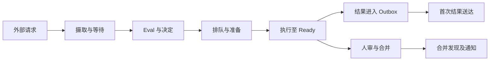

# 31 · 成本、时延、质量与有限主动性的评估

> 面试题　Agent 一周多建了 30% 的 Ticket。你怎么判断团队有没有因此节省时间？如果切到 auto 后，工单更多、模型更贵、平均时延更短，但维护者收到更多无关消息，你会放量还是回退？

**短答**　先用相同的任务群体比较。把收到的 Trigger、真实的请求意图、授权 Decision、执行 Assignment、人工验收与外发回执连起来，分别看误接、漏接、有效交付和消息噪声。用时间戳拆开摄取、评估、排队、执行、人工等待与外发，通过用量账本算整批成本。当前原型可以从记录推算一部分结果，完整时序、成本和人工质量还需补证据。推断工作在 observe 先看建议质量，通过范围有限的 auto 试点再衡量实际交付与副作用。 [Decision 与 Assignment](../dsh-superagent-prototype/src/core/model.ts#L190) · [运行概览](../dsh-superagent-prototype/src/app/views/overview.ts#L38) · [准入模式](../dsh-superagent-prototype/src/policy.ts#L40)

本文使用本地提交 `7bd4741` 的原型。延续 Alice 请 Agent 修帮助页文案的案例，T 是工单，PR #62 是交付物，R 是用户收到的结果回复。后面的批次、时长、报价与放量门槛都是教学数据。第 29 篇用测试证明程序行为与设计一致，这篇处理上线之后怎样判断系统值不值得继续扩大主动范围。 [系列目录](README.md) · [测试篇](29-testing-agent-invariants.md) · [原型对注意力的取舍](../dsh-superagent-prototype/docs/000-philosophy.md)

## 1. 先决定用什么对象做分母

用户真正关心的是「有没有一件该做的事被可靠完成」，而系统里最容易计数的是消息。Alice 在 Issue 中描述错字，随后补了目标文案和移动端截图。这三条信息可以合并成同一件修订工作，落入一个 Eval 和一张 T。PR 中追加说明时，若属于这张 T，可能直接交给 Worker，未必独立产生新的 Eval 或 accept。从一条 Trigger 到一次 Decision，从一次 Decision 到一张 Ticket，再从一张 Ticket 到若干 Assignment 和回执，每一层都有自己的身份。申请执行、执行尝试和最终产物也各有成功条件。 [一次 Eval 聚合](../dsh-superagent-prototype/src/core/evals.ts#L70) · [接单与建 Ticket](../dsh-superagent-prototype/src/core/evals.ts#L305) · [后续归属](../dsh-superagent-prototype/src/core/model.ts#L68)

评估可以给同一业务请求分配一个分析用的 `request_id`。它是拟议的观测字段，不必用它改写原型的 Trigger ID 或路由状态。固定规则是同一项改动的补充属于一个请求，明显独立的新要求另算。关联多条消息时保留所有消息 ID 与产生的一张或多张 Ticket，再人工处理有歧义的例子。这样就能用请求算漏接和交付，用 Trigger 算来源过滤，用 Assignment 算重试和槽时，用 Outbox 逻辑消息 ID 算外发。只有先确定单位，增量才有解释。 [Ticket 起源与执行记录](../dsh-superagent-prototype/src/core/model.ts#L276)

### 1.1 Overview 的 24 小时指标是运行导航

Overview 的 received 来自进库的 Trigger，以 `Trigger.at` 定窗口，包含被 Source 过滤的记录。数据库按 Trigger ID 去重，所以这一项不会计算所有平台重复投递尝试。filtered 取带过滤处置的 Trigger 数，triggers 是两者的差。judged 查询去重后的 Trigger ID，要求未被当前过滤处置排除且关联 Decision。accepted 查询的是关联窗口内 Trigger 的 accept 或 reopen Decision ID，按 Decision 去重，使用自己的条件。前者数消息，后者数决定，而且筛选条件有差异。一个 accept 关联三条 Trigger 时，可能给 judged 加三、给 accepted 加一。拿 accepted 除以 judged 得到的数不宜命名为请求准入率。 [计数 SQL](../dsh-superagent-prototype/src/app/store-read.ts#L10) · [概览聚合](../dsh-superagent-prototype/src/app/views/overview.ts#L67)

同时，evaluating 是读取时的活动评估线程数，dropped 用回执结算掉落的时间过滤。临近时间窗边界的一条 Trigger 可在今天入窗、明天产生 Decision，当前作业又可能从更早时段进入。该视图适合找到卡在哪一层。做质量验收则应冻结一批首次进入的请求，等同一观察截止点再追结果。另一个容易混淆的字段是 TriggerView 的 delivered。它表示该人类后续目前仍由工单的 Worker 决定，若要确认模型读取，应查工单 Input 的 readAt 与 Session 事件。 [统计与评估筛选](../dsh-superagent-prototype/src/app/store-read.ts#L57) · [Trigger 的视图语义](../dsh-superagent-prototype/src/app/views/records.ts#L79) · [Input 读取字段](../dsh-superagent-prototype/src/core/model.ts#L235)

### 1.2 哪些能从库中得到，哪些要补采集或人工验收

| 证据 | 已有记录可回答的问题 | 补充证据 |
| --- | --- | --- |
| Trigger、Disposition | 哪条外部事件落库，是否被过滤，目前是否关联某工单或 Decision | 上游尝试数、稳定的首次到达与提交时刻、重复投递历史 |
| Decision、Mandate | 当时准入强度、规则版本、输出结果与部分审核元数据 | 独立授权标签、上下文出处、因重排丢失的过程时间 |
| Assignment、Ticket | 当前或曾经启动的执行、最近报告、部分结束原因及跟随的 PR | 每次状态转换、模型和工具用时、人工答复及审阅投入 |
| Outbox、Effect、Health | 等待、失败、成功或掉落状态，部分失败原因与当前健康 | 成功送达的时间、历次尝试、渠道是否有人看到及噪声标签 |
| 产物与费用 | 可用 Decision、Ticket、Session、PR 作为关联键 | diff 与验证结果、人工质量评价、供应商计费及节点用量 |

这里的「推算」也有时间边界。原型的 Thread 保存当前 Eval，完成时会移除活动记录。Decision 保存 evalId 与结果时刻，但不自带完整的 startedAt、delivered 时间链。Assignment 的 report 是这个执行的当前报告，可以被下一次报告替换。Outbox settle 成功时写 sent 状态，掉落才显式记 dropped.at，现有成功回执没有同等的 sentAt。当前 Effect 可以提供 attempts，完成后工作行消失。要重建每次队列、失败和送达时序，需要在状态变化时追加可关联的事件。Intake 会在 Disposition 记录本地处理时间，可给现有数据提供近似摄取点。若要统一历史迁移、回补和数据库提交的统计语义，可再保留独立的首次提交事件。 [摄取处理时刻](../dsh-superagent-prototype/src/core/intake.ts#L19) · [Eval 完成和 Decision](../dsh-superagent-prototype/src/core/evals.ts#L317) · [Assignment 字段](../dsh-superagent-prototype/src/core/model.ts#L211) · [回执结算](../dsh-superagent-prototype/src/app/store.ts#L270) · [Effect 成功删行](../dsh-superagent-prototype/src/app/effects.ts#L130)

## 2. 用固定请求批次算授权、重复、交付和注意力

### 2.1 给拒绝、失败和未完成的样本留位置

假设采样窗口捕获 132 次上游投递，其中 12 次重复。原型归并后保存 120 条 Trigger，24 条被 Source 过滤，96 条通过。通过的 96 条中，40 条是此前工单的跟进，另 56 条归到 44 个待判断的新请求。人工按当时的 Source 范围、Policy、意图和方向是否确定，标出 32 个应接、12 个不应接。标签可以区分「主体无权」「任务越范围」「方向未定、应等待澄清」等。另有事件根本未摄取，要从独立的上游样本检查损失情况，这组 44 个是已摄取且纳入新请求评估的群体。

在约定的观察截止时，44 个请求中共有 22 个请求被实际建单，其中应接 20 个、误接 2 个。有一个被接请求产生两张 Ticket，因此库里有 23 张关联 Ticket。在 20 个正确接单的请求里，16 个通过验收并按题意完成交付，7 个发生计划外的人工介入。16 个与 7 个允许重叠，例如人帮忙修复一次失败投递后，T 仍然成功。另对整批关联的实际外发消息评审，假定 40 条 sent 中有 4 条被标为不必要或重复。按预先定好的分母，得到下表。

| 指标 | 算例与结果 | 该怎样使用 |
| --- | --- | --- |
| 授权误接率 | (2 / 12 = 16.7%) | 不应接的请求中到底有多少实际开了工 |
| 已建单请求的误接比例 | (2 / 22 = 9.1%) | 运营看到的已接工作中，不该接的份额 |
| 漏接率 | (12 / 32 = 37.5%) | 正例里没在时限内被接到的比例，区分错判和未判 |
| 建单覆盖率 | (22 / 44 = 50.0%) | 在该请求群体中的建单动作覆盖面，附 raw Ticket 数 23 |
| 已接请求重复建单率 | (1 / 22 = 4.5%) | 对允许至多一单、已建单的请求检查重复 |
| 端到端有效交付率 | (16 / 32 = 50.0%) | 用户发起的应接请求在时限内成功交付的份额 |
| 正确接单后交付率 | (16 / 20 = 80.0%) | 对已正确接手的工作单独排查执行与交付 |
| 计划外人工介入率 | (7 / 20 = 35.0%) | 在正确接单中，额外需要人工修复或补做的份额 |
| 消息噪声率 | (4 / 40 = 10.0%) | 发出的逻辑消息中，有多少条经评审缺少价值 |

如果评估 Replay 专项，重复建单的分母可改为所有设计为允许至多一单的重放试次，需明确这是另一项指标。失败和未知也要有去处。应接样本到期后仍无结果，端到端口径保留在分母，另说是未完成还是证据缺失。对于授权误接，证据不全的样本标为未知，应报告覆盖率、确认的误接数及未知范围。不能自动认为未收集到日志的任务都符合授权。对比不同版本时采用同一批请求与截止规则，按意图、Source、规则和任务难度切片。复用重复运行结果时按原始请求分组统计，避免一个高频长 Thread 支配结论。 [测试样例与分母设计](29-testing-agent-invariants.md)

### 2.2 有效结果、人工步骤和噪声都需要标注规则

以帮助页修订为例，验收要看需求授权、正确文字、限定文件的 diff、相关测试或截图、PR 对应的工单，以及结果是否发到允许的会话。若职责到提交可审 PR，已发送可审结果就是交付点，后面人的合并另行统计。若要求合并并通知，则先见到平台已合并、再见到最终回执。Worker 报 ready 后可以进入验收，仍应以可验证的工件或运行结果核实测试是否通过。有些请求正确判断应当忽略，评估可把它记为良好授权结果。 [PR 汇报与结算测试](../dsh-superagent-prototype/tests/runtime.spec.ts#L320) · [人工评审的交付条件](../dsh-superagent-prototype/prompts/team/delivery.md)

人工介入拆成计划内审核、正常澄清和用于恢复的干预。人在权限流程里批准 PR、或者补充只有本人知道的选择，有自己的时间与注意力成本。重试启动失败、纠正错误实现、手动搬运漏发结果则属于异常修复。可以同时报告发生计划外介入的请求比例和实际分钟数。消息也应按 ack、问题、结果、终态通知分层审阅，以是否帮助用户下一步行动为标签。同一个逻辑回复可能被 Effect 重试三次。实际调用平台的尝试数会增加，费用按计费规则核算。若平台只收到一份，噪声仍按一份算。反过来同一目的被多条不同 ID 发出来，要由人工或明确规则识别重复。 [回复与状态门槛](../dsh-superagent-prototype/src/core/replies.ts#L48) · [Outbox 的幂等与重试](../dsh-superagent-prototype/src/app/outbox.ts#L22) · [团队沟通规范](../dsh-superagent-prototype/prompts/team/communication.md)

## 3. 端到端时延从哪个时钟开始

### 3.1 用同一条链路的时间差做分解

不同角色看到的「开始」不相同。Alice 从平台发帖算，摄取者从发现事件算，Worker 从被派发算。对接单到交付的面板可以优先使用稳定的域记录，测摄取及全量执行等待则应补专门的时间点。下面的表给 T 一条合成时间线。它假定主要步骤在关键路径上连续发生，使用同一时区与匹配 ID。标记「新增」的观测点用于建议埋点。

| 时间 | 边界 | 这一段耗时 | 对应证据 |
| --- | --- | --- | --- |
| 10:00:00 | Alice 的请求在平台出现 | 起点 | 该样例的外部事件时间 |
| 10:00:40 | Trigger 入库 | 摄取 40 秒 | 现有 Disposition.at 可近似，建议单记首次提交 |
| 10:01:00 | 进入 Eval | 候选前等待 20 秒 | 活动 Eval startedAt，完结后需留事件 |
| 10:01:10 | 候选卡到主 Session | 投递候选 10 秒 | 活动 Eval delivered，完结后需留事件 |
| 10:01:45 | 决策并创建 Assignment | 评估和决策 35 秒 | Decision.at 与 Assignment.createdAt |
| 10:02:05 | launch 开始 | 执行排队 20 秒 | 新增领取或启动准备事件 |
| 10:02:30 | Worker 已接受首条启动输入 | 准备和启动 25 秒 | Assignment.startedAt，宿主已读另有时间 |
| 10:06:00 | Worker 报告 ready | 执行至报告 210 秒 | 保留 ready 事件及该次验证事实 |
| 10:06:05 | 结果 R 写入 Outbox | 结果组织 5 秒 | 新增稳定消息入队时间 |
| 10:06:15 | 回执达到 sent | 外发 10 秒 | 捕获从 pending 到 sent 的时间 |

这条关键路径到 R 共 (375) 秒，即 6 分 15 秒。若 PR 在 10:21:00 合并，ready 到合并又过 15 分钟，人审与排队一同反映在这个差值里。因为 R 对应的是交给人评审的结果，这段时间不用再加进首次交付时延。若目标是合并后通知，应另外设合并时刻、平台被轮询发现的时刻及终态通知送达的时刻。平台事件时间和本机写入时间也要区分。部分系统观察触发可能使用 Adapter 生成的时间，不能一律拿 Trigger.at 当作平台真实的最初发生时间。 [平台 CI 事件的时间](../dsh-superagent-prototype/src/sources/github-trigger.ts#L96) · [候选送达后开始期限](../dsh-superagent-prototype/src/core/evals.ts#L47) · [Worker 启动回写](../dsh-superagent-prototype/src/core/assignments.ts#L33) · [PR 观察与上报](../dsh-superagent-prototype/src/sources/github-pull.ts#L76)



### 3.2 看 p95 之前，先看任务有没有到达终点

只对成功工单求 p95，会让排队超时和始终未送达的请求从尾部消失。应同时报告每阶段完成的样本数、观察截止前未完成的份额和目标达标率。对固定 30 分钟交付指标，用所有应交付的请求做分母，超时记未达标。另报已观测结果的耗时分位数时，注明它的样本来自已完成任务。出现多轮 Assignment 时，可测从首次接单到最终交付，还可测各次活跃执行和等待，只在同一条因果路径对不重叠的阶段求和。整体 p95 应从每条请求的端到端时间重新计算。

恢复也要定义终点。若 T 的 Worker 在 10:03:00 中断，运行时于 10:04:00 ready，T 于 10:04:40 重新运行，结果于 10:06:15 送出，三个耗时分别是 60 秒、100 秒和 195 秒。故障探测前没有可信时刻时，记录检测到的时间与实际起点未知。原型可从 `endedReason=hostRestarted`、下一 Assignment.startedAt 与健康信息定位重启。健康项展示当前状态，完整的历史、停机原因和送达时刻仍需采集。用户关心业务恢复，平台也要有可管理状态恢复时间，两者应一起报告。 [旧 Assignment 的结束原因](../dsh-superagent-prototype/src/core/tickets.ts#L317) · [Runtime 就绪状态](../dsh-superagent-prototype/src/app/runtime.ts#L201) · [故障恢复篇](28-pause-shutdown-and-crash-recovery.md)

## 4. 费用应按模型请求、资源消耗和人工投入归账

### 4.1 在模型边界记录真实用量与重试

原型能配置 Eval 和 Executor 的角色模型，Session 可记录实际选择。运营面还能看到某些预算重试的会话、provider、次数及起止线索。它们有助于定位等待。现有工单和健康记录无法提供一份完整的计费账本。尤其是给主 Session 阅读的 transcript 只保留选定消息和工具结果，代码明确省略用量。也不能从 Prompt 长度上限推算真实花费，运行时还会带 Session 历史、工具返回与加载的上下文。 [模型选择](../dsh-superagent-prototype/src/app/role-models.ts#L7) · [模型健康](../dsh-superagent-prototype/src/app/retry-health.ts#L25) · [Transcript 投影](../dsh-superagent-prototype/src/app/context.ts#L28)

建议在宿主模型请求或可信的模型代理边界记录逻辑调用 ID、实际尝试 ID、角色、模型、输入与输出 token、缓存命中类型、结束原因、计费状态，并关联 Session、Eval、Ticket 和 Assignment。对失败或取消请求，能匹配计费证据就纳入实际费用。结果未知的请求先保留未知费用和覆盖率，待账单对齐。外部命令也记录运行时间和资源用量。对一批候选共用一次模型路由的情况，可保留一个共同成本池，再按事先定义的分摊口径分到请求。总账为共同调用记一笔费用，再按既定口径分摊给受益的请求。

Eval 可以给后来没有建单的请求花钱，Worker 可以给失败、重复、超时和重试的工单花钱。算单位成功成本，应在固定批次里把这些开销都放进分子。只抽成功的 T 算 token 能帮助优化单任务，但会遗漏 observe 的候选成本、失败执行与无用 PR。若平台账单同时覆盖多项目，要对得上标价版本、折扣和未关联用量，避免不完整的分摊表看起来比实际更便宜。容量预算可以先用估算值，财务复盘则写明账单来源以及估算缺口。 [第 30 篇的模型容量算例](30-production-scaling-and-multitenancy.md)

### 4.2 延续同一批 16 个有效结果计算单位成本

仍用第二节的 44 个请求。假设模型调用账本已完整收集，货币统一记为「成本单位」。以下单价仅为算例，缓存和价格折扣已忽略。主 Session 的一笔用量可能涵盖筛选、跟进、结果组织等任务，因此这一行以角色聚合为准。人工时间明确覆盖这批的额外干预，固定的例行人审另作比较条件。

| 成本项 | 计算 | 金额 |
| --- | --- | --- |
| 主 Session 用量 | 60 万输入 × 每百万 1，加 12 万输出 × 每百万 5 | 1.20 |
| Worker 用量 | 180 万输入 × 每百万 2，加 48 万输出 × 每百万 8 | 7.44 |
| 沙箱、执行环境及命令 | 按这批实际消耗归账 | 20.00 |
| 控制面与来源运维分摊 | 按固定口径分摊 | 8.00 |
| 技术成本合计 | 上四项相加 | 36.64 |
| 额外人工 | 7 个请求累计干预 35 分钟，每分钟 0.6 | 21.00 |

技术成本除以 16 个有效结果是 2.29 每个。加上额外人工后，综合边际口径约 3.60 每个。若一版把 Worker 模型费用减少一半，却需要工程师多手动修五次，效果应从这个合计看。对于团队净节省，还要配一个原流程基线。比如同一类文案问题在人工流程平均需要多少编辑、验证、审阅时间，有多少原本就会自动修复或不值得动。把已节省的人工时间与新出现的检查、失败修复及消息负担一起列出，才能回答「成本变低是否值得」。团队若不希望把注意力直接定价，也可并列货币、人工分钟和无用消息三项指标。

## 5. 有限主动性怎样从 observe 验证到 auto

### 5.1 解释三档模式时，先分清显式工作和推断工作

模式主要控制推断路径。off 不让普通推断候选进入这条评估路径，observe 会实际评估推断候选，auto 允许符合准入条件的推断请求成单。已通过准入的显式请求可以在三档工作，已有工单的后续归属也有自己的处理路径。observe 是把拟接的推断决定记下来以便核对，它仍消耗评估资源。源码的 `assessmentOutcome` 要求每条启用规则恰好判断一次，接受还需规则命中、implementation intent、确定的方向和意图证据。若 inferred 候选原可被接受，但模式非 auto，返回 ignore，审计写 `would_accept=true` 和 proposal。面板把这个 ignore 投影成 wouldAccept。它没有生成实际 Ticket，不能计入交付。 [判断原理](../dsh-superagent-prototype/src/policy.ts#L25) · [接入模式](../dsh-superagent-prototype/docs/002-authorization.md#L92) · [wouldAccept 投影](../dsh-superagent-prototype/src/app/views/records.ts#L184)

证据要说到实现层。Runtime 用没点名但明确指定改法的飞书消息构造 inferred 候选，observe 时调用评估工具，测试断言没有 Ticket，Decision audit 中有 would_accept 与 proposal。随后切到 auto，发送另一个相似消息，命中 copy 规则后确实建单，Mandate 记录 inferred 与 auto。这个用例支持「两种模式的控制面结果符合约定」。工具参数由测试给定，对于真实模型能否稳定匹配同一条规则，仍需用有标签的观察窗口评估。 [Observe 与 Auto 的集成测试](../dsh-superagent-prototype/tests/runtime.spec.ts#L265) · [Policy 条件测试](../dsh-superagent-prototype/tests/policy.spec.ts#L287)

### 5.2 观察期既复核想接的请求，也抽查没接的

先用明确、可回退的任务作为观察范围，例如既有帮助页的错字修复，方向已经由用户说明。保留显式请求的基线，单独分析 inferred，从 wouldAccept 的审计看规则原因、方向和拟议改动。审阅者核对原消息与上下文，并记录是否真的值得自动执行。只看 proposal 会遗漏「本来值得做，Agent 没提议」的样本。可以全审高风险候选，再从普通候选、ignore、unavailable，以及被接入过滤的相关事件中按比例抽样。对温度、源范围、Prompt revision 和原仓库快照分别留版本。若抽样分层的比例不同，计算总体指标时按原分布重加权，同时单报高风险切片。

假设一个观察批次有 60 个可判定的 inferred 请求，18 个标为 wouldAccept。人工复核认为 14 个范围恰当、4 个需要澄清或不应自动干，当前提议准确比例为 14/18，约 77.8%。这说明有些建议可用，也说明当前规则仍有明显误接风险。若还没核对另外 42 个请求里的应接任务，则缺漏提议率。若评审对某类短句分歧大，可先缩范围或完善标注，再用独立一批样本验证，避免按当前 60 条围绕性改 Prompt 后宣称稳定提升。

即使一次观察没有发现违规，也要给分母。假设 30 个独立、同分布的高风险样本零错误，设真实错误概率为 (p)，看到零错误概率为 ((1-p)^{30})。令该概率为 5%，得到单侧 95% 上界约 9.5%。若同样条件下有 300 个独立样本且零错误，上界约 1.0%。同一个 Thread 多个近似用例往往不独立，不能平移这个结果。在真实团队评估里按项目、工作日或请求组报告覆盖和分歧，对尚未覆盖的范围保持观察。样本不足时可把它表述为「这批没有看到」并保留线上停止条件。

### 5.3 用小范围自动执行确认价值，再决定扩大

从 propose 到交付有多个额外变量。Worker 是否遵守范围、有没有可验证工件、仓库检查是否通过、团队是否看到了合适的结果，全要在试点观察。可以先为一个隔离项目启用 auto，只开放可机器验证且可审查的低风险任务，用既有 Source 范围、准入格和启用规则来限制输入。原型的 `eval.mode` 是该实例的设置。若要求同一实例内更细的按组试点或按比例曝光，需要另做分流，或者以独立实例隔离项目。计划试点时写清每日工单上限、谁审核、哪些操作必须人批、预算和回退人。 [设置及模式](../dsh-superagent-prototype/src/policy.ts#L83) · [部署边界](30-production-scaling-and-multitenancy.md)

| 阶段 | 首要观测 | 暂停放量的条件示例 |
| --- | --- | --- |
| Observe | wouldAccept 与人工标签、漏提议、评估用量及明确请求排队 | 越界建议、方向经常不明、权限标签覆盖不足 |
| 小范围 Auto | 实际误接、有效交付、用户注意力、计划外人工和成本 | 出现明晰的越权外部写入，或工件质量和消息噪声明显偏离约定 |
| 扩围 | 按项目和任务类型对照基线，下钻尾部延迟与重试 | 合意的显式工作被明显拖慢，或新增范围超出已验证风险等级 |

试点最好固定扩围判据和回退条件，并为实际执行留对照。若同一群中的工作会互相影响，可按项目或 Thread 划分试点和对照，避免同一工单被两端执行。比较应接请求的有效交付增量，以及额外增加的费用、人工分钟数和消息。Observe 缺少 Worker 的真实干预结果，因此它能筛选准入风险，但不足以单独衡量 auto 带来的交付收益。试点中若发生高严重度违例，可先保护相关的活跃工单与外部渠道，再回滚范围。切回 observe 可以挡住后续推断接单，已有活跃工单按 Policy 变化获得相应状态更新，并不会通用地一键结束。需要立即停止时，应使用工单 stop 或处理级 pause，再核查已开始的外部动作。 [Policy 变更](../dsh-superagent-prototype/src/core/engine.ts#L252) · [通知开放工单](../dsh-superagent-prototype/src/core/tickets.ts#L196) · [暂停与停止](28-pause-shutdown-and-crash-recovery.md)

## 6. 用一份事件账本验证数据质量

建议把指标事件按阶段追加，记录观测主体、发生时刻、写入时刻、原始业务 ID 和运行版本。任务维度可由请求 ID 串到 Eval、Ticket、Assignment 和外发 ID。模型调用跨多试次或重放时，以请求及尝试身份去重，迁移或重放的样本不要污染实际用户指标。报告中写出缺关联率、缺时间戳率、未知费用及未审阅份额。一份可信的报表允许解释哪条数据为何留白。通过权限过滤的上游采样可核对漏摄取，地址、内容和真实凭据应各有访问限制。时间比较最好同时留同进程单调耗时与标准时钟的事件点，用于区分跨系统时钟误差和真延迟。

本次在临时源码副本跑了 Policy、Assessment、Core、Runtime、并发、面板 Overview 和 Eval、Outbox、Store、RetryHealth，共 10 个文件、666 个用例通过。另用临时 SQLite 做了一次补充验证。先创建窗口内五个 Trigger，其中两个被同一个 accept 决定关联，一个有关联 would_accept 的 ignore，一个被来源过滤，一个无 Decision。再保存一个窗口外 Trigger，并给它一条在窗口内写入的 accept。读原型 Store 查询得到 received=5、filtered=1、judged=3、accepted=1。该结果验证统计窗口由 Trigger 时间决定，两个 Trigger 关联同一 accept 时，judged 与 accepted 各自按不同的键去重。算例的比值、时序和成本也已独立复核。没有使用真实业务请求、账单或模型耗时。 [原型计数查询](../dsh-superagent-prototype/src/app/store-read.ts#L10) · [面板窗内指标测试](../dsh-superagent-prototype/tests/panel-overview.spec.tsx#L45) · [掉落计入概览的测试](../dsh-superagent-prototype/tests/runtime.spec.ts#L1289) · [预算重试投影测试](../dsh-superagent-prototype/tests/retry-health.spec.ts#L17)

```sh
corepack pnpm install --offline --frozen-lockfile --ignore-scripts
corepack pnpm test tests/policy.spec.ts tests/assessment.spec.ts tests/core-engine.spec.ts tests/runtime.spec.ts tests/runtime-concurrency.spec.ts tests/panel-overview.spec.tsx tests/panel-eval.spec.tsx tests/outbox.spec.ts tests/store.spec.ts tests/retry-health.spec.ts
```

## 7. 面试口述与追问

### 60–90 秒口述

我会先冻结进入评估的请求。一个请求可能有好几条 Trigger、一个或多个 Decision，后续也可能直接交给已有 Worker。用请求做分母算误接、漏接与有效交付，用 Assignment 算重试和占槽，用外发回执算消息。原有面板里 judged 数 Trigger，accepted 数 Decision，不能直接当作准入率。

时延按摄取、评估、排队、准备、执行和外发拆开，人工审核另计。成功送达时间、全量模型费用和质量标签需要补采集。成本用整批开销除以有效交付，失败、重试和人工干预都算上。推断任务先跑 observe，人工标注 wouldAccept 和错过的机会，再小范围开 auto 验证实际交付。高风险违例触发回退，并检查活跃工单与外部副作用。

### 五个追问

1. **为什么工单涨了 30%，还不能说主动 Agent 更有价值？** 还要看增长来自新合意请求、重复接单还是低价值主动工作。用固定请求群体同时核查误接、交付、额外人力与消息噪声。
2. **为什么 wouldAccept 不能当作真实接单？** Observe 中它是 Decision audit 的拟接受记录。样例没有创建 Ticket，也没有后续执行与交付的验证。 [模式测试](../dsh-superagent-prototype/tests/runtime.spec.ts#L265)
3. **送达 p95 下降为何仍值得检查？** 若变慢的请求仍待处理，它们不会出现在完成者分布里。应附到期完成率及未完成计数，确认是否因为删去了慢样本。
4. **如何验证便宜模型真的降本？** 用冻结的同一批请求比较，计入失败、重试和人工恢复。既看总成本与每个有效结果的成本，也核对质量、时延和越权的回归。
5. **发现 Auto 越界后怎样止损？** 收紧 Source 或切回 observe 以阻止新的推断成单。对已经运行的 T，按风险使用 stop 或 pause，核对外部动作是否已发生。保留 Decision、配置版本和审计用于定位。 [设置与生命周期](../dsh-superagent-prototype/src/app/settings.ts#L176)

上一篇是 [30 · 单仓库原型如何演进到生产级多租户](30-production-scaling-and-multitenancy.md)。下一篇是 32 · 系统设计白板题与项目面试答辩。 [系列目录](README.md)
