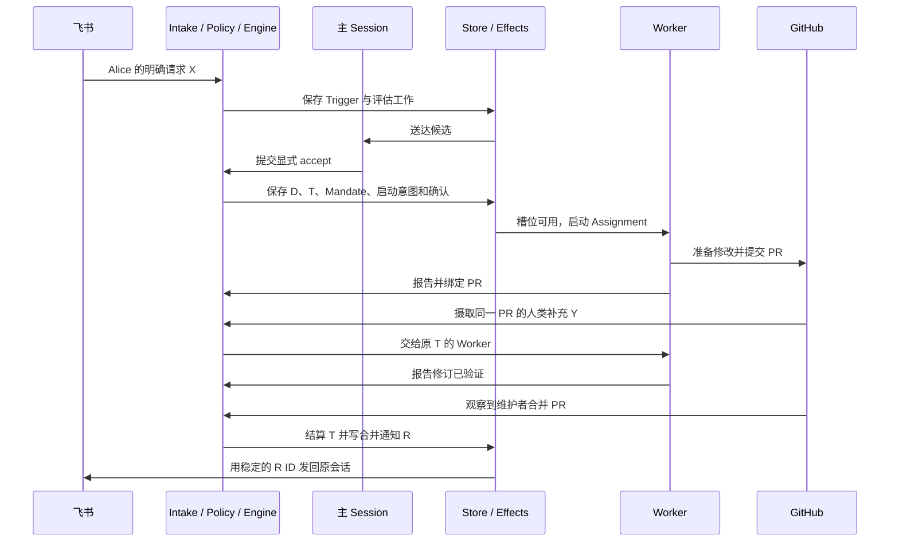

# 32 · 系统设计白板题与项目面试答辩

> 白板题　设计一个服务研发团队的 Superagent。它从飞书群接收一条明确的文案修订请求，到 GitHub 提交 PR。维护者在 PR 里补充意见，Worker 继续同一个任务，由人审查并合并，最后回执发回飞书。请画出正常路径，再回答三个追问。主 Session 暂时不可用时任务在哪里等？原发起者的权限中途被撤销时，已有执行怎样处理？飞书其实已经收到回执，但本地还写着 pending 时，能否再发一次？

**短答**　把事件摄取、业务授权、任务执行、消息交付拆开讲。Source 把外部事实变成稳定 Trigger，Engine 把决定与授权写进 Ticket，Worker 在独立会话处理业务，Outbox 按稳定身份回传结果。主 Session 失联、授权变化和回执重放分别要查候选投递、Mandate 与工单状态、平台侧投递事实。白板扩展先用负载和故障范围选择部署方式，再谈共享调度、限额与租约。 [架构图与接口](../dsh-superagent-prototype/docs/007-architecture.md) · [授权规则](../dsh-superagent-prototype/docs/002-authorization.md) · [Outbox](../dsh-superagent-prototype/src/app/outbox.ts#L22)

本篇是 32 篇源码精读的最后一篇。源码基线是工作区提交 `7bd4741`。把前文「先从 Issue 发起」的案例反过来做一次，起点换成飞书，执行仍落到同一个虚构 GitHub 仓库。Alice 的飞书账号是示意 ID `ou_alice`，GitHub 上的维护者账号是 `alice`，两侧身份各由平台提供，系统分别校验。原始消息 X 建立工单 T，Worker 开 PR #62，PR 的反馈记为 Y，合并通知记为 R。面试可用这些简短标记对齐图和日志。 [GitHub 到 PR 案例](04-end-to-end-issue-to-pr.md) · [系列目录](README.md)

## 1. 开场先交代系统范围和证据范围

原型服务一个已配置 GitHub 仓库，可选接入飞书。它作为 DeepSeek Harness 的 bundle 运行，复用宿主的 Agent、Session 持久化、模型调用和工具能力。项目自身实现 Source contract、对话关联、Policy 与领域状态机、持久工作队列、Worker 协调和管理 API。讲项目时可以说「我以本地原型源码作为案例，沿调用链读了这些模块」。只有确实写过代码、做过压测或参与过上线，才能把它写成自己的贡献。源码里的预期与真实团队上线数据要分开，回答面试中「你验证了什么」时就能说出具体证据。 [原型包说明](../dsh-superagent-prototype/README.md) · [插件入口和宿主注入](../dsh-superagent-prototype/src/index.ts#L7)

面试官很可能让你从「支持自动修代码」进一步落到动作责任。可以把承诺说成，允许的请求会被记录和判断，适合的任务会被分配，结果需要可跟踪，外部写入需要授权。模型会解释文本、提出分派、写代码和产生报告。控制面验证模型的结构化请求、记录事实并保护状态边界。平台身份、仓库保护和人审才决定远端某个操作能不能完成。这样一开场，后续被问到 Prompt 注入、崩溃重放或人在 PR 上插话时，都能继续沿着同一张图讲。 [运行装配](../dsh-superagent-prototype/src/app/runtime.ts#L127) · [权限篇](27-trust-boundaries-and-permissions.md)

| 面试时间 | 应给出的内容 | 给下一轮追问留的入口 |
| --- | --- | --- |
| 90 秒 | 对谁解决什么问题，正常链路，最关键的两个取舍 | 用 T 及其权限、回执证明认识的是具体系统 |
| 5 分钟 | 模块与函数串联，写了哪些状态，哪里是异步边界 | 下钻停机、状态竞争、跨平台关联 |
| 30 分钟 | 产品假设、容量、数据归属、故障、放量和验证 | 给可证伪的指标、设计替代和演进条件 |

## 2. 90 秒项目介绍

### 可以直接口述

> 我读的是一个面向研发团队的单仓库 Superagent 原型。它能从 GitHub 或飞书接收任务，维护对话与工单关系，再调用 DeepSeek Harness 的 Worker 做修改。以飞书里修文案为例，Source 根据消息和发信人生成可去重的 Trigger。Policy 和 Engine 判断这条输入有没有权发起工作，主 Session 选择接单或续接。接单时保存 Decision、Mandate、Ticket 和持久启动意图。
>
> Worker 有自己的会话和工作目录，验证修改后提交 PR，把结果报告给主 Session。维护者在 PR 里补充意见时，原 Ticket 能沿订阅收到输入。由人合并后，GitHub Source 看到平台状态，系统再把合并结果送回飞书。
>
> 我会强调授权和交付两个边界。模型负责理解与执行建议，业务代码校验授权和状态。数据库事务能保住接单与待办，外部发送要靠稳定消息 ID 或远端记录对账。单实例把状态和权限范围收在一个部署里，扩到多团队后，我会再增加租户隔离、公平调度和旧执行回写校验。

前 30 秒说清问题与边界，中间给一个用户能看到结果的具体例子，最后 30 秒讲为何这样设计。如果面试官提前打断，记住原始请求 X、工单 T、PR #62 和通知 R 四个点就够，先定位他问的是哪一次授权或持久化。自我介绍不要声称已在生产实现多租户、验证真实平台送达，或凭借原型实现了外部动作严格一次。把后续计划放在最后一句，既能表现设计判断，也便于对方继续追问。 [同库持久队列](23-durable-effects-and-consistency.md) · [多团队演进](30-production-scaling-and-multitenancy.md)

## 3. 5 分钟源码讲解

在图上保留控制面与执行面的分界。Feishu 和 GitHub 是外部事实来源。主 Session 和 Worker 都使用 DSH 宿主。Store 包住本地业务事务，外部系统通过 Effects、Session 或各 Source 查询与写入。箭头表示一条成功路径，排队和审查等非即时动作需要分别说明。



### 0:00–0:50　飞书事件在哪里变成业务记录

先开 `feishu-loops.ts`。实时 Bot 消费把一行事件解析后交给 `feishuTrigger`，也有历史补读与已订阅 Thread 的读取。转换用平台 message ID 生成稳定的 Trigger ID，将 chat 和 root/message 形成 Thread，保存 actor、点名、时间及 Channel。Bot 自己发的消息会被排除。这样实时与历史看到同一条消息时，Engine 的 Intake 可沿同一 ID 去重。Intake 按当前 Source scope 决定是否记录为 filtered，通过才继续走 Thread、订阅分发和评估。收到不等于授权，源读权限也只决定接入能看到什么。 [飞书实时消费](../dsh-superagent-prototype/src/sources/feishu-loops.ts#L86) · [飞书事件转换](../dsh-superagent-prototype/src/sources/feishu-trigger.ts#L16) · [摄取](../dsh-superagent-prototype/src/core/intake.ts#L19)

讲述时可以用这一句加深印象。**平台给的 ID、身份和点名标记是结构化事实。消息文本是待解释的请求，即便正文自称管理员也不会让它自动变成有权限的人。** 如果 X 没看到后续，先从消息 ID 查 Trigger，其次看过滤原因与 Thread。连 Trigger 都没有时查 Bot、历史和接收范围，先不用归咎于 Worker 模型。 [飞书来源范围](../dsh-superagent-prototype/src/sources/feishu.ts#L54) · [来源和触发详情](../dsh-superagent-prototype/docs/005-panel.md#L13)

### 0:50–1:40　为什么候选送到主 Session 后还要再校验

Alice 位于飞书名单，且在配置群里 @ Bot。Policy 把它判为 explicit。活动 Thread 上的多条输入可合为一次 Eval，以最强的合规 Trigger 作为授权依据。主 Session 收到候选之后用 `orchestrator_route` 提交 accept。工具以明确的 Trigger ID 和结构化参数调用 Engine。Engine 仍看这个 Trigger 当前是否可决定、是否属于某 Worker、是否已经接过、Policy version 是否有效。推断候选走评估路径，要满足更严格的模式与规则。模型对内容的理解更灵活，程序的状态验证则确保它没用过期证据建单。 [Policy gate](../dsh-superagent-prototype/src/policy.ts#L191) · [评估合批](../dsh-superagent-prototype/src/core/evals.ts#L70) · [路由工具](../dsh-superagent-prototype/src/app/tools/main.ts#L84) · [决定的检查](../dsh-superagent-prototype/src/core/evals.ts#L125)

若对方问「批次怎么处理」，说同一 Thread 在同一时间有一项活动评估，等待队列里的多个 Trigger 可以在同一次评估被决定。批量工具的不同路由项各走自己的处理边界，一项被拒不用撤销其他已成功的项。落库的 Decision 带评估 ID，Mandate 带主体、最强合规输入提供的授权依据和范围。复盘时能从 T 的 origin 找回当时有哪些消息，也能解释为什么一条原来已经创建工单的 Trigger 再次 accept 仍返回旧决定。 [单 Thread 状态](../dsh-superagent-prototype/src/core/model.ts#L135) · [路由批次处理与拒绝](../dsh-superagent-prototype/src/app/tools/main.ts#L125) · [重复接单验证](../dsh-superagent-prototype/tests/core-engine.spec.ts#L899)

### 1:40–2:25　接单的成功回执能证明哪些事

accept 经 Engine 的事务写 Decision 和 Mandate，并建立 T、订阅、首个 Assignment、初始确认的出站意图和 launch Effect。确认消息有稳定的身份，以后可从回执判断是否送出。向面试官指出两条并行的后续路径。一条是 Assignment pending 等执行，一条是外发确认等待 Channel。两条路径都被提交了，不代表确认已达飞书或 Worker 已经占到槽。Worker 等槽时，后续的 Trigger 还能继续进入控制面。挂掉后重启便可读持久队列补排。 [Engine 的事务入口](../dsh-superagent-prototype/src/core/engine.ts#L89) · [Ticket 初始化](../dsh-superagent-prototype/src/core/tickets.ts#L32) · [出站持久化](../dsh-superagent-prototype/src/app/outbox.ts#L26) · [接单链路断言](../dsh-superagent-prototype/tests/runtime.spec.ts#L219)

可以顺手画出检查点。接单成功后的 T 应有 origin、Decision、Mandate 和 Assignment。没有对应工作目录或 Session 时查 launch 和执行准备。有 Session 时，继续核对模型 step 是否开始。确认消息另查 Outbox。超时问题要先回答卡在哪层，才能选择排队、Retry 或人介入。这样能够把「主 Session 回了个票号」转成几份能核对的记录。 [启动与交付](../dsh-superagent-prototype/src/executor/dsh.ts#L424) · [Ticket 视图](../dsh-superagent-prototype/src/app/views/tickets.ts#L56)

### 2:25–3:15　Worker 怎样成为能持续工作的执行者

`DshExecutor` 以每工单固定会话和目录启动 Worker。它按配置准备目录、保留并发槽，向 DSH 宿主投递任务消息，设置执行角色的 Prompt、Skill 和工具。人类占用额外唤醒槽是原型对跟进时效的取舍。执行者可以看原任务、搜索仓库、修改及验证。打开 PR 后它可在结构化报告里带 PR 编号。后端重新读取 PR，验证这是源 PR，或由 Agent 账号从配置仓库上匹配工单短名的分支建立。它还避免同一 PR 被另一开放 Ticket 占用。这样一条真实 PR 的归属经代码检查，模型写在文本里的 URL 只是线索。 [WorkerSlots](../dsh-superagent-prototype/src/executor/dsh.ts#L165) · [Worker 报告](../dsh-superagent-prototype/src/app/tools/executor.ts#L75) · [PR 归属检查](../dsh-superagent-prototype/src/sources/github-pull.ts#L31)

要解释主 Session 为什么不顺手完成这次修改。主 Session 面向后续候选、路由和交付，长时间构建或写入会推迟下一条请求。Worker 则围绕一个明确 Mandate 执行，可持有专属工作区并按报告交接。两个角色用不同 preset 与工具面。当前原型还借助 shell 后台化及 Worker 活动态处理长任务。运行时的角色拆分让成本和故障位置更清晰，虽然也增加了跨 Session 消息和回执。 [角色会话](../dsh-superagent-prototype/src/app/sessions.ts#L137) · [Worker 工作区和后台](../dsh-superagent-prototype/docs/003-execution.md#L23)

### 3:15–4:10　为什么 PR 上的补充通常接到原工单

PR #62 已绑定后，GitHub Source 的后续读取把评论转成带 `github:62` Thread 的 Trigger Y。Intake 按订阅把 Y 放到 T 的 Input，Worker 有权决定这条人类后续是否属于现有工作。我们假定维护者要求把同一个错字也修到移动端帮助表述，范围核对通过就继续原工单。如果 Y 实际提出另一个目标，Worker 用 handback 退回，再由控制面判断能否新开工作。上下文订阅可用于阅读参考，取得消息并不代表得到新授权。 [GitHub 评论转换](../dsh-superagent-prototype/src/sources/github-trigger.ts#L56) · [订阅交付](../dsh-superagent-prototype/src/core/intake.ts#L30) · [Worker handback 工具](../dsh-superagent-prototype/src/app/tools/executor.ts#L65)

如果面试官追问「飞书 Alice 和 GitHub alice 怎么认同」，答本题可以是假设同一位维护者，但源码没有按显示名跨平台身份自动合并。系统分别保存 actor source 与 ID，判断已存在工作是靠 Thread 与 Ticket 绑定。涉及发起新任务或重新授权时，各自检查对应来源规则。Worker 的 delivered 状态也需说明。运营视图的 delivered 可能表示后续归属，Input 交付和模型已读分别要看相关的持久记录与会话事件。 [按 Source 查人](../dsh-superagent-prototype/src/policy.ts#L119) · [视图投影](../dsh-superagent-prototype/src/app/views/records.ts#L79) · [已读篇](19-session-delivery-and-read-receipts.md)

### 4:10–5:00　验收与通知的最终事实在哪里

Worker 报 ready 时已有 PR 要人审，报告可作为交接依据。主 Session 可按规则把 PR 信息发回飞书。人合并之后，GitHub Source 观察到 merged/closed，再由 Engine 根据 T 跟随的 PR 和未完成工作决定何时结束。若 Y 的处理还在进行，PR 关闭事实可先记录，工单在符合完成条件后再结算。最终 IM 通知由 `ticket.ended` 路径构造，避免在 GitHub 已显示合并的地方重复写同一件事。对飞书，消息 ID 也会传给渠道作为幂等键。本地是否显示 sent 要看回执写入，面试里这里刚好接第一次「远端成功，本地失败」追问。 [完成条件](../dsh-superagent-prototype/src/core/tickets.ts#L73) · [PR 终态通知](../dsh-superagent-prototype/src/sources/github-pull.ts#L76) · [通知入队](../dsh-superagent-prototype/src/app/runtime.ts#L139) · [飞书发送](../dsh-superagent-prototype/src/sources/feishu-channel.ts#L18)

## 4. 30 分钟白板推演

### 0–3 分钟　用可检验的承诺收敛需求

先说假设，服务 30 个团队的 120 个仓库，以第 30 篇的容量算例为基准。每个项目有 Source 配置、允许的发起人和规则，Worker 可以提交可审 PR，默认由人合并。要求任务在中断后有可恢复的状态，跨项目的内容、凭据、模型会话保持隔离。衡量交付可定义为「被授权的请求在规定时限内收到可审 PR」，人的合并耗时和最终通知另计。假设使用普通 GitHub 轮询时，不承诺秒级摄取。若需求方强制秒级响应，先确认能否引入可信的事件推送和补读。 [原型仓库设置](../dsh-superagent-prototype/src/deployment.ts#L45) · [轮询节拍](../dsh-superagent-prototype/src/sources/github.ts#L127) · [交付口径](31-evaluation-metrics-cost-and-latency.md)

在白板上写三个要验证的约束。已接受的逻辑请求可追溯到一次授权。停止后新的受控外部动作应被拦住，已发出的动作可对账。一个项目上的积压或权限错误不能跨越其数据边界。三条约束分别牵动本地事务、控制面与外部服务的边界，以及公平调度和执行隔离。此时先交代必须保住什么，再填入技术组件。

### 3–8 分钟　画架构并让读写路径可追踪

左边画两个 Source。把外部消息规范化，写稳定 ID、来源元数据和回读位置。中间画控制面，按项目处理权限、Thread 和 Eval，读规则状态并把 Decision 写入库。接受后持久化 launch 与必要回执。右边画 Worker 和平台代理。Worker 只接触自己任务的上下文和盘，平台代理约束可执行动作和目标。主 Session 与 Worker 的状态从领域记录关联。管理面按项目鉴权，读取故障、配置历史以及真实操作可用性。读面板和写状态使用同一归属规则，专属管理动作经过独立写入口。对照原型，本机管理入口已具备同源校验与结构化状态，集中管控还需用户身份和项目权限。 [Runtime 组装](../dsh-superagent-prototype/src/app/runtime.ts#L127) · [HTTP 入口](../dsh-superagent-prototype/src/app/http.ts#L230) · [面板用途](../dsh-superagent-prototype/docs/005-panel.md)

用 X 指着图读一遍。原始飞书消息 X 映射到项目 A。Accept 写 T 和 launch，按槽分到 Worker。同一个 PR 的 Y 转入 T 的 Input，终态从 GitHub 回来。跨系统只传递需要的身份与事件，事件正文到模型后仍视为数据。用户若问为什么不用固定状态流就够，答状态转移可以写成规则，理解自然语言、确定要修改什么、分析代码则对模型有价值。关键是各自的错误在有记录的位置被拦住或复盘。

### 8–13 分钟　把不变量落实到主键、事务和时序

写出四个对象关系。来源事件用「项目、接入连接、平台事件 ID」标识。Thread 用项目和平台会话标识。Ticket 记录 Mandate 与 origin。Assignment 是同一 Ticket 的执行尝试，重启可生成下一份。队列工作与平台动作另外有逻辑键。说明同一场景不同编号各自解决什么问题。Feishu 事件重放通过 Trigger ID 去重，重复路由通过已接收 Decision 返回原 Ticket，Session 投递通过 request ID 查 inbox 或历史，远端回执通过平台支持的幂等方式或 marker 对账。每个键都应对齐自己那一层的业务范围。 [原型 Thread 键](../dsh-superagent-prototype/src/core/model.ts#L7) · [重复接受](../dsh-superagent-prototype/src/core/evals.ts#L131) · [Session 送达](../dsh-superagent-prototype/src/app/delivery.ts#L61) · [外发篇](24-outbox-replies-and-attention.md)

接着指出事务在哪结束。Decision、Ticket、Assignment 和 Effect 可由一个数据库事务保护。模型请求、Shell 和 GitHub 写入在事务外。此时必须假设进程可在任何两次记录之间中断。若两个消费者竞争同一项目的活跃工作，领取记录和业务状态应带当前所有权，结算时原子校验。该校验应在权限决定的消费者或资源接收侧生效。数据库版本检查还要分清「写的记录版本」和「执行者本身是否有权」。Worker 换到新节点时，旧执行的迟到报告不能覆盖新 Assignment。 [原型 Effect 结算](../dsh-superagent-prototype/src/app/effects.ts#L130) · [多租户租约设计](30-production-scaling-and-multitenancy.md)

### 13–18 分钟　做容量算例并给出回压入口

写 `平均占槽数 = 到达率 × 平均占槽时间`。假设常态忙时每分钟产生 15 批执行工作，每批平均占槽 4 分钟，则平均在用 60 个。取 75% 的规划利用率，需要约 80 个槽。突发每分钟 24 批持续十分钟，按每分钟 20 批清掉，积压约 40 批。回到每分钟 15 批后，以每分钟 5 批净消化，约八分钟清完新增积压。实际长尾、准备时间和模型配额会改变服务率。读到有 2,000 张开放工单也不能直接开 2,000 个 Worker，因为其中大量可能等待人。这个算例估的是占槽的活跃阶段。 [Worker 计数](../dsh-superagent-prototype/src/executor/dsh.ts#L165) · [前篇容量及突发](30-production-scaling-and-multitenancy.md)

问到模型吞吐时可接第 30 篇的假设，60 个候选每分钟、每候选 2,500 token，15 批执行每分钟、每批 18,000 token，重试预留 15% 后约 483,000 token 每分钟。它是配置额度的估计，不是生产实测。若模型请求先限流，再增加 Worker 会把等待挪进执行面，反而持槽更久。应用应按租户和项目分配资源，给有效的人类后续留下能力，给故障重试单独预算，观察同等负载下小租户是否仍能接任务。 [模型退避健康](../dsh-superagent-prototype/src/app/retry-health.ts#L25) · [原型人类唤醒额外槽位](../dsh-superagent-prototype/tests/runtime-concurrency.spec.ts#L868)

### 18–24 分钟　画三次中断与恢复

依次圈三个边界。先在候选写库到主 Session 的箭头画叉，查已经送达没有、是否已经有 Decision。再在 Runtime 已接受 T 之后改 Policy，分开新工作、在途 Eval、开放 Ticket 与自然结束后复核。最后在外部发送成功、本地写 sent 前画叉。这三个叉的状态与处置按下一节推演。必要时增加一个测试用的屏障，控制晚到的异步接口在 stop 提交后才返回，验证不会有新的 Worker 调用。这会比列一串重试术语更能表明你能验证并发行为。 [停止与等待投递的并发测试](../dsh-superagent-prototype/tests/runtime-concurrency.spec.ts#L69)

### 24–27 分钟　选择最先做的演进

少量敏感仓库可先独立部署，每个实例隔离文件、账号和配置，集中监控与审计。等忙闲差明显、配额冲突或集中管理成本过高，再分离共享控制面与隔离运行器。切换按项目做影子比较，用同一批事件对比 Decision 与待办，禁止影子直接外发。交接时确保单项目只有一个写入所有者，记录稳定游标和未知外部动作，验证可以回退。如果新端已经写过远端，回退之前需迁回或对账，再继续。这个顺序把可验证的改动切成几次交付。 [部署与备份](../dsh-superagent-prototype/docs/006-deployment.md#L233) · [共享架构和迁移](30-production-scaling-and-multitenancy.md)

### 27–30 分钟　说如何验收，最后回到用户结果

白板收尾列出三组证据。安全边界看未授权开单、跨项目读写和旧执行回写被拒的范围。吞吐看 Source 延迟、评估和队列 p95、按租户的失败恢复与稀缺模型额度。人机协同看合意请求的有效交付率、计划外人工时间和多余回复。成功率需给分母，未完成的任务在固定观察窗口内仍有位置。先从 observe 检查 wouldAccept 和漏判的候选，验证拟议范围，再小流量 auto 看真实执行。收尾一句话可以说「我会用同一条请求追到平台回执和人工验收，扩到多团队再按故障域和账单复核」。 [评估模式](../dsh-superagent-prototype/docs/002-authorization.md#L91) · [上线指标](31-evaluation-metrics-cost-and-latency.md)

## 5. 三个故障追问的完整回答

### 5.1 主 Session 不可用时，先确认 Eval 在哪个状态

如果整个宿主下线，Source 的实时处理可能也中断，要依靠平台的补读能力与保存的游标。这里假设 Runtime 仍在，只有主 Session 解析失败或无法处理候选。摄取到的 X 可以已写 Trigger 与待评估记录。MasterAssessor 用持久 assessment Effect 试图投递候选，期望 Session 接受消息并完成持久化，再向 Engine 登记送达。宿主解析、候选卡生成或投递失败时，可看 assessment 的等待和失败记录，该候选未登记 delivered 时不会按评估期限过期。长期未送达也需要可观测，原型的到期条件本身不会帮它自动结束。 [候选投递顺序](../dsh-superagent-prototype/src/app/assessment.ts#L93) · [宿主发送与 flush](../dsh-superagent-prototype/src/app/delivery.ts#L65) · [Eval 期限条件](../dsh-superagent-prototype/src/core/evals.ts#L30)

候选若已登记送达而模型没给结论，就进入另一分支。原型从 delivered 开始计算 deadline。连续超时可两次重排，第三次留下 unavailable。恢复后的迟到决定仍校验 Eval ID 与 Policy version。若主 Session 故障发生在 T 已接单后，持久 launch 可以由 Executor 撑住，新结果的 relay 也可能留在队列。最终飞书回复若已经排入 Outbox，可由其独立尝试发送。若主 Session 已损坏而未有可用处理者，应先修复会话或部署，再按记录恢复，不能看到等待就跳过 Policy 强制建单。 [Eval 超时重排](../dsh-superagent-prototype/src/core/evals.ts#L56) · [身份与版本核对](../dsh-superagent-prototype/src/core/evals.ts#L125) · [Session relay](../dsh-superagent-prototype/src/app/sessions.ts#L170)

**白板上怎样验证**　让假宿主在候选投递或历史加载处等待，读 store 查 delivered 是否为空、是否已有 Ticket。释放后验证只记录一次有效送达，再推进时钟模拟模型超时。运营上量候选排队年龄、未送达分布和已送达超时率，分别报出模型预算事件或宿主建会话失败。必要时在生产版把主 Session 评估能力按项目拆开，调度和持久评估仍按 Thread 串行。 [持久屏障重试测试](../dsh-superagent-prototype/tests/delivery.spec.ts#L89) · [候选的超时与重排测试](../dsh-superagent-prototype/tests/core-engine.spec.ts#L161)

### 5.2 权限撤销时，分开旧授权、未提交决定和当前执行

管理员将 Alice 从名单移除或收紧 Source 范围后，要先问采用的是哪个设置块，是否引发 Policy 指纹改变，以及新配置从什么时候生效。新 X 走当前规则。在途 Eval 遇到 Policy version 变化可取消该次持有并重排，旧决定提交时会被额外检查。对于开放工单，Settings 算出受影响范围并分发 Policy 变更 Input。已经接受的 Mandate 仍是当时授权的审计事实，不能把设置保存理解为停止所有 Worker。自然结束且收到合适的后续时，`wake` 重新验证 Mandate，原始显式发起人授权失效时可能无法恢复。最终判断应按当时 basis 的具体分支。 [Policy 影响计算](../dsh-superagent-prototype/src/policy.ts#L143) · [控制面 Policy 变更](../dsh-superagent-prototype/src/core/engine.ts#L252) · [自然唤醒复核](../dsh-superagent-prototype/src/core/tickets.ts#L246)

如果这是紧急撤权，需要把控制面状态和远端能力都收住。管理员可以对 T 发 stop，数据库写 human/stopped、结束 Assignment，提交之后再请求宿主取消。之后再发的工具调用或迟到输入有状态 guard。已经发出的 GitHub 操作仍需查平台并处置，撤销远端凭据是外部平台操作。同一账号仍能读文件或访问其他项目时，属于部署隔离问题，不能从本地 stop 推导其权限已消失。生产版可在每次高风险外部动作前重新核查授权版本和执行令牌，把紧急撤权做成可度量的延迟。 [结束与取消](../dsh-superagent-prototype/src/core/tickets.ts#L338) · [afterCommit 取消](../dsh-superagent-prototype/src/executor/dsh.ts#L357) · [Worker 工具 guard](../dsh-superagent-prototype/src/app/sessions.ts#L283)

**白板上怎样验证**　把迟到 decide 和迟到 delivery 分开模拟。更新 Policy 后前者不得使用过期候选建单，对 T 停单后者不得抵达 Worker。另保留「无 stop，仅改 Policy，开放工单收到变更输入」的对照，防止把预期的有限影响测试成错误的强撤销。再测已结束的工单复核，区分无法唤醒与是否允许新请求。 [改变 Policy 的运行时测试](../dsh-superagent-prototype/tests/runtime.spec.ts#L408) · [撤销后不能自动恢复](../dsh-superagent-prototype/tests/core-engine.spec.ts#L339)

### 5.3 第三方已收到 R，如果本地 pending 该怎么处理

先保持 R 的原身份，检查 Store 里的 Outbox 行和 reply Effect，确认目标 Source、会话、逻辑 ID、最后尝试及是否还 pending。消息的本地发送意图和 reply Effect 是同一事务写入，外部发送和本地 settle 分开。若平台已接受请求而进程在 settle 前中断，恢复时待办仍可触发。飞书的发送使用同一个消息 ID 作为幂等键，GitHub 的回复会先查询相同目标、同一作者和稳定 marker 再决定是否发。高代价动作遇到未知结果，应先查信号再决定，重新生成一个完全不同的回复 ID 会失去同一身份的复用机会。 [Outbox 顺序](../dsh-superagent-prototype/src/app/outbox.ts#L22) · [飞书稳定键](../dsh-superagent-prototype/src/sources/feishu-channel.ts#L18) · [GitHub 查询与发送](../dsh-superagent-prototype/src/sources/github-channel.ts#L17)

已写 sent 而 Effect 尚未删行时，重放会先查回执状态并返回。永久掉落时系统保留 dropped 及原因，不应把运营面已无 pending 解释成一律送达。平台幂等受其能力约束，GitHub marker 的查和发是两个调用。遇到权限改变、远端记录不可见或未知执行结果，应当保留对账入口。面试答「持久意图允许重试，可见结果尽量按逻辑动作去重」就足够具体。验证可以用模拟平台返回成功，令本地回执故意尚未写成 sent，核查重放是否使用同一 ID，再独立检查实际平台的适配器行为。 [回执状态写入](../dsh-superagent-prototype/src/app/store.ts#L270) · [原型暂停后的发送测试](../dsh-superagent-prototype/tests/outbox.spec.ts#L17)

## 6. 四类岗位把追问落在不同证据上

以下四种侧重点可用于 DeepSeek、腾讯、字节跳动、阿里云等公司的相关岗位准备。它们分别考察模型系统、协作应用、事件与调度、云平台能力。面试职位与团队标准以具体信息为准。每组都从同一张 T 出发，换一个故障条件考察设计能否继续成立。

### 6.1 Harness 与模型协作

**场景**　面试官问「把大模型接到工具上已经可以完成修改，为什么还需要 Harness？上下文窗口不够怎么办？」先用 X 说明判断和执行。模型读候选、理解自然语言、提交路由或评估工具。工具的 JSON Schema 来自 Zod，服务端会实际解析参数。Engine 则用 ID、授权强度和当前状态拒绝不合法动作。Worker 可读仓库及任务上下文，报告时把 PR 判断交给代码去核实。第 25 篇的 Prompt revision 是解释一轮行为的材料之一，还要记录当时角色、模型、工具和输入。 [工具 Schema 和执行](../dsh-superagent-prototype/src/app/sessions.ts#L205) · [资源的授权读取](../dsh-superagent-prototype/src/app/resources.ts#L82) · [Prompt 治理](25-prompt-skill-and-model-surface.md)

**失败推演**　假设 X 的表面只写「这儿不对」，主 Session 还读了两则旧讨论。模型试图把旧讨论中的改法认成当前的明确目标。推断路径应检查意图、方向和规则，并在缺适用证据时拒绝或等待人。上下文读取采用与候选绑定的页数、时间限制和可读引用，减少无边界抓取。规则 schema 能要求模型给出 evidence，并校验字段是否满足接单条件，证据该不该被相信仍属于模型与人工评估的问题。正文中出现工具名称也不会新增工具注册。 [有界上下文](../dsh-superagent-prototype/src/app/assessment.ts#L138) · [方向与规则校验](../dsh-superagent-prototype/src/policy.ts#L18) · [模型接口契约测试](../dsh-superagent-prototype/tests/model-surface.spec.ts#L369)

**替代和度量**　固定路由加窄上下文适合显式低风险工作。语义有争议时可以独立评估，输出允许范围与证据，再由 Engine 决定。上下文预算不足可分阶段读取，先查源与近邻，再按引用追远处，留下调用记录。用同一份已标注请求比较有无相关上下文、两种模型或两版 Prompt，记录误接、遗漏、工具拒绝率、端到端交付与使用 token。要求每个改进能关联到一个失败案例，指标变化不能只凭模型分数解释。顺着追问「换更强的模型是不是就够」，可举相反证据，模型更好仍要受旧版本检查和停单约束。 [测试与模型评估设计](29-testing-agent-invariants.md) · [成本统计](31-evaluation-metrics-cost-and-latency.md)

### 6.2 IM 协同与权限

**场景**　面试官问「有人在飞书某个群 @ 了 Bot，是否一定能开工？在 PR 里补充一句会不会开第二张？」先画三层。Source 范围决定是否接收或观察该消息。Policy 用来源内的 actor、点名和规则判定明确或推断。Intake 使用已有 Thread 订阅决定后续交给谁。X 是名单用户明确点名，可经显式路由，Y 在已绑定 PR 上可能交给原 T。若是只为阅读而跟随的 Thread，则没有这种授权关系。Worker 发现范围外请求可 handback。 [Source 的范围](../dsh-superagent-prototype/src/sources/feishu.ts#L54) · [按来源的 Policy](../dsh-superagent-prototype/src/policy.ts#L191) · [后续所有权](../dsh-superagent-prototype/src/core/model.ts#L68)

**失败推演**　某个外部群允许收提及，但该用户没有发起权限，观察到它不能跳过准入表。另一种情况是维护者在飞书贴了内部链接，要求修同一 PR。即使后续依据可来源于原 T，也要单独决定将哪些内容公开到 GitHub。工具能验证工单与 Channel，正文保密还需人工或策略管控。若来源用户被撤销，沿上一节处理所有在途动作和旧 Mandate。飞书 Bot 身份、GitHub 执行账号与最终仓库合并人也分别用各自授权。不要用跨平台显示名称代替身份链接。 [拒绝非名单场景](../dsh-superagent-prototype/tests/policy.spec.ts#L60) · [上下文订阅](../dsh-superagent-prototype/docs/002-authorization.md#L40) · [对话目的地规则](../dsh-superagent-prototype/src/core/replies.ts#L64)

**替代和度量**　接一个新的企业 IM 平台时，让适配器输出稳定事件 ID、可信发言者、Thread、是否点名、合理 Channel 和可回补能力。保留 Engine 的订阅、Policy 与 Ticket 逻辑。平台没有天然线程 ID 时先定义会话归并窗口和显式引用，再测试哪些输入可跨窗口迟到。若做跨组织服务，在带审计的配置中维护平台身份关联和项目归属，敏感内容通过范围受限的发布审查。用重复事件率、路由错工单率、跨渠道误发及人工澄清次数验收。对于容易误用的主动提醒，把真实送达和无用消息占比一起看。 [新增 Source 的接口](../dsh-superagent-prototype/docs/008-cookbook.md#L111) · [回复 Channel 的实现指引](../dsh-superagent-prototype/docs/008-cookbook.md#L151)

### 6.3 事件吞吐与 Agent 调度

**场景**　面试官把每分钟请求翻倍，问「系统先堵哪里，怎么知道需要的是多跑 Workers 还是提高摄取并行度？」答先给每个环节的单位和观测点。Source 读的是通知、补齐上下文和平台限流，Intake 处理去重和入库，Thread 评估只串行同会话，launch 受并发槽，模型受 token 或请求预算，外发还受渠道限速。跟进和创建新工作对槽的影响不同，Active Assignment 的持久状态跟瞬时活动 Worker 也有差别。以 T 为例，PR 里的后续 Y可能唤醒已有 Worker，不必再排一个漫长的新建任务。 [GitHub 轮询](../dsh-superagent-prototype/src/sources/github.ts#L275) · [活动 Worker](../dsh-superagent-prototype/src/executor/dsh.ts#L403) · [执行量投影](../dsh-superagent-prototype/src/app/views/tickets.ts#L50)

**失败推演**　A 仓库临时失败聚积大量重试。单靠全局 FIFO 会让正常队列延后，也可能把外部额度打满。先用实际日志判断 A 卡在读取、prepare、模型还是回执，因为这些阶段消耗的资源不同。检测到外部限额的错误应延迟适用账号的后续尝试。原型有按 Effect 的到期时间和并发限制，并保留人的跟进槽，未提供多项目公平调度。一个常见陷阱是看到失败重试显著增多就加 Worker，若瓶颈是供应商，更多槽只会更久等待。 [队列选取与限额](../dsh-superagent-prototype/src/app/effects.ts#L103) · [模型失败分类](../dsh-superagent-prototype/src/executor/dsh.ts#L44) · [启动占槽测试](../dsh-superagent-prototype/tests/runtime-concurrency.spec.ts#L158)

**替代和度量**　为项目分别设置并发上限、吞吐预算和最老等待报警，把高优先的人类跟进、普通新工作和重试调度分别计入。用公平队列允许空闲容量借用，并用稳定事件 ID 和可持久化游标面对突发。压测至少含正常峰值、突然翻倍、一个热点租户与慢模型。看 p95 和 deadline 达标之外，记录队列净增长和回落时间、正常租户受影响比例、实际消耗及超时后未闭环的数。能按一个请求的 X、T、R 串起证据，才能说明延迟从哪段迁移到了哪段。 [容量与公平设计](30-production-scaling-and-multitenancy.md) · [时延统计](31-evaluation-metrics-cost-and-latency.md)

### 6.4 云上隔离与可靠交付

**场景**　面试官问「能否把所有仓库塞进同一服务，再用工作目录和用户级 Token 隔离？如果 Worker 节点故障怎样接手？」先说原型 Runtime 用状态目录锁，在单实例中保护 SQLite 迁移与写入。Worker preset 提供工具约束，托管 Session 在部署用户的权限下运行。Git worktree 是复用仓库和保存工作阶段的一种方式，文件读写还是以宿主身份和环境为界。项目隔离要在 API、数据、执行和外部凭据都生效。 [状态锁与库](../dsh-superagent-prototype/src/app/runtime.ts#L87) · [Session 权限](../dsh-superagent-prototype/src/app/sessions.ts#L137) · [部署隔离说明](../dsh-superagent-prototype/docs/006-deployment.md#L13)

**失败推演**　T 已交给甲，网络隔离后控制面将执行权切到乙，甲的迟到报告或已经发布的 PR 各有处理。甲的旧令牌在本地更新和受控远端动作入口被拦，乙用已确认的工作区或提交重建执行。若甲曾在接手前已经提交外部操作，乙还要查询远端及动作回执。回退同样要迁回事实，不能把旧快照直接覆盖已发生的动作。保持同一逻辑操作 ID、记录所属 Assignment 和实际平台结果，是恢复与审计的基础。 [原型的恢复说明](../dsh-superagent-prototype/src/core/assignments.ts#L21) · [原型启动恢复](../dsh-superagent-prototype/src/executor/dsh.ts#L519) · [令牌与对账设计](30-production-scaling-and-multitenancy.md)

**替代和度量**　少量高敏感仓库用独立进程、账号、状态目录和权限。资源需要池化时，再部署项目约束下的 Worker 与动作代理，结合短凭据和运行隔离。终态通知可以从平台事实没确认时留 pending，到确认后再结算，中间可查询。用丢节点、旧执行者返回、同编号跨仓库、已写远端而回执丢失的模拟验证。把租约接手时间、过期写入被拒数、正常任务再次启动和业务送达时间分别测，并审计实际外部副作用。信任边界不能只从进程健康推断。 [权限与人工控制](27-trust-boundaries-and-permissions.md) · [回执与重放](24-outbox-replies-and-attention.md)

## 7. 自测和五道递进追问

### 7.1 用可验证的行为给自己打分

| 维度 | 及格证据 | 需要重讲的信号 |
| --- | --- | --- |
| 能串到正常结果 | 不漏掉 Trigger、Mandate、Assignment、PR 和 R，口头能定位相应函数 | 只会画模型和几个工具，没有明确状态归属 |
| 会讲授权与人机协作 | 能按平台主体和 Thread 解释新工作、后续与人审 | 以模型自述、引用的署名或显示名代替授权 |
| 能推演并发与恢复 | 能指出失败瞬间已有记录、下一次动作以及如何去重 | 用全局重试和严格一次术语掩盖未知外部结果 |
| 会给扩容算例 | 写单位、活跃时间、峰值与退避，指出瓶颈怎样验证 | 把所有开放工单换算成并发，或从模拟代码断言生产 SLA |
| 说明证据范围 | 区分源码、模拟宿主、账单、真实平台效果与工程提案 | 将未上线的多租户或不存在的性能数据描述成既成成果 |

复习时可先隐藏小节正文，在两分钟内画完路径。请同伴任选一个阶段，让你在不重画整图的情况下移动一个时间点，例如 PR 已关闭但还有处理中的后续，或者两条消息到同一个工单但只有一条已进模型历史。你要给出这个改动影响了哪条状态，以及应再看哪个字段。然后拿测试里的同类输入核对。若有亲自改过的模块，再说明改动前后对比、最初判断为什么错、哪条测试抓住了具体回归。工作没有验证的地方写出观察计划，把假设留在证据能支持的范围内。

### 五个追问

1. **X 重发了三次，为什么原型有多层去重？** Source 事件的稳定 ID 让三个传输可落成一个 Trigger，Engine 查已经接受的 Decision 防止又产生一张 Ticket，Session 消息键避免一次业务输入在 inbox 内重复，Outbox 键处理外部回执。每一层针对一种独立的重放。 [摄取](../dsh-superagent-prototype/src/core/intake.ts#L19) · [重复接受](../dsh-superagent-prototype/src/core/evals.ts#L131) · [消息投递](../dsh-superagent-prototype/src/app/delivery.ts#L61)
2. **把 Eval 交给多台主 Session，是否只需启动更多 Agent？** 要按项目和 Thread 保留候选归属，短事务领取工作，用 Eval ID 与 Policy version 拒绝过期结果。若上下文跨项目混入，会扩大模型和工具的可见范围。先验证读范围及当期决定，再量吞吐。 [Eval 身份与版本](../dsh-superagent-prototype/src/core/evals.ts#L281) · [共享控制面方案](30-production-scaling-and-multitenancy.md)
3. **Y 写进 inbox，紧接着 GitHub 合并，可以结算吗？** 需看 Y 是否被 Worker 接手、是否已经取入模型 step、处理进度及跟随 PR 的规则。已经接手的后续仍未得到处理时，合并事实可先保留。未接手且符合条件的后续可被释放后重新评估，不能把投递视为完成。 [判定 unfinished](../dsh-superagent-prototype/src/core/tickets.ts#L364) · [已读与未读测试](../dsh-superagent-prototype/tests/runtime-concurrency.spec.ts#L747)
4. **Worker 下线又恢复，怎样避免新旧同时写？** 单实例在接手前请求停止旧执行，并用当前 Assignment 拒绝迟到投递。多节点时，续租、令牌和受控外部入口共同执行所有权检查。已发出的远端动作用身份和事实对账。 [重启恢复](../dsh-superagent-prototype/src/executor/dsh.ts#L519) · [外部写入窗口](28-pause-shutdown-and-crash-recovery.md)
5. **是否应在所有团队默认打开自动成单？** 先量各任务类型的授权、范围可判定性和用户注意力。观察 wouldAccept 与没接的样本，再对可验证的低风险工作小流量启用。实际放量要核对质量、有效交付、误接、费用与消息噪声。 [准入模式](../dsh-superagent-prototype/docs/002-authorization.md#L91) · [评估题目](31-evaluation-metrics-cost-and-latency.md)

## 8. 复演一条证据链，检查答辩能否落到源码

### 8.1 用一条跨平台用例核对交接时间

这次在临时源码副本中运行了仓库的 `check`。类型检查通过，59 个测试文件的 1,197 个现有用例全部通过，服务端与客户端产物成功构建。客户端构建有一条建议采用 ESM 的通用提示，当前客户端入口仍按 DSH 的装载配置生成 CJS。所用依赖来自本地缓存。 [验证命令](../dsh-superagent-prototype/package.json#L47) · [构建入口](../dsh-superagent-prototype/tsdown.config.ts#L9)

补充的跨平台用例在临时副本中模拟 Alice 的飞书点名、PR #62 的绑定、来自 GitHub 的 Y、对原 Session 的投递，以及最终合并与飞书回执。它重放了同一条评论和同一份合并结果。断言包括仍只有一张 Ticket，评论只投递一次，已收到结果且最终回执用同一稳定键发回原消息。测试使用假平台响应、模拟的 Worker 工具调用及宿主事件。由此能确认同一个 T 贯穿控制面，真实模型生成修改和第三方平台接受幂等键的行为仍须在部署环境检验。 [接单与确认测试](../dsh-superagent-prototype/tests/runtime.spec.ts#L219) · [现有 PR 绑定与终态测试](../dsh-superagent-prototype/tests/runtime.spec.ts#L320)

第一次补充用例只把 Y 交进 inbox，随后让假 Worker 报告并声称该报告回答了 Y。合并到达后，Ticket 没有结束。代码把回答关联记为 Worker 接手了该输入，但这时 `readAt` 仍为 null，缺少在报告之前取入模型 step 的记录。进一步检查 `readBefore` 可见，对于带 readAt 的现代输入，比较使用严格的小于，不能用相同时间戳模拟先后。补充用例发出匹配消息 ID 的 Session `user/message` 事件并核对 readAt，再在稍后提供报告。用真实记录的 readAt 核对先后，避免把异步断言的当前时刻当作输入时刻。补齐这一步后，T 结算为 merged，飞书终态回执 sent，仅观察到一次对应幂等键的发送调用。 [输入交付与读取](../dsh-superagent-prototype/src/core/assignments.ts#L44) · [报告记录与接手](../dsh-superagent-prototype/src/core/assignments.ts#L116) · [监听宿主已读](../dsh-superagent-prototype/src/executor/dsh.ts#L493) · [判定读到与工作未完成](../dsh-superagent-prototype/src/core/tickets.ts#L15)

这段复演可以直接用作答辩的证据。追问「接口返回 ready 又收到合并事件，为什么还没结束」时，先读 PR 是否属于 T、哪个人类后续已送达、哪个已进入 Session 历史、报告何时发生。然后按 `followsDone` 与 `unfinished` 找分支。一条看起来简单的「开了 PR，合并就完了」会在有后续的交接过程中丢失关键条件。把这些状态摆在一起，才知道是否需要等待 Worker，而不用给状态机补一条笼统的「GitHub 已合并时覆盖本地状态」规则。 [线程关闭](../dsh-superagent-prototype/src/core/tickets.ts#L73) · [合并时释放尚未读取输入的已有测试](../dsh-superagent-prototype/tests/runtime-concurrency.spec.ts#L747)

### 8.2 在本地重复已有验证

已启用 pnpm 的隔离副本可跑完整检查。若只练习本篇的正常和故障路径，先跑 Runtime、并发、领域、投递及 Outbox。补充跨平台用例只在临时副本中运行。自行复演时按「飞书点名 → 接单 → PR 绑定 → 重复摄取 Y → 匹配的已读事件 → 下一次 ready → 重复观察合并 → 同键 R」布置输入。检查点依次为显式 Mandate、原 Worker 唯一输入、读取时间早于报告、T 的 merged 状态、原消息 ID 对应的 sent 回执。

```sh
corepack pnpm install --offline --frozen-lockfile --ignore-scripts
corepack pnpm test tests/runtime.spec.ts tests/runtime-concurrency.spec.ts tests/core-engine.spec.ts tests/delivery.spec.ts tests/outbox.spec.ts
# pnpm 已在 PATH 上时运行完整检查
corepack pnpm check
```

面试前最后做一次倒着讲。拿到一条 R，反查它的 Ticket 和来源 Channel，再定位 PR 终态、Worker 报告、Mandate 与第一条飞书 Trigger。如果其中一条关联缺失，说清现在能确认什么，后续到哪个系统查询。得到一段证据后再回答接下来能否继续运行。这个方法贯穿前 31 篇，从某条业务事实出发找责任模块，然后在面试官指定的失败窗口修改一项条件，看设计还能不能解释现象。 [管理 API 与视图](26-settings-api-and-operations-panel.md) · [测试的不变量](29-testing-agent-invariants.md)

### 8.3 带一张排障证据表进模拟面试

| 面试官给出的第一条线索 | 先查哪条记录 | 用什么条件作下一步判断 |
| --- | --- | --- |
| Alice 的飞书消息链接 | Search 中的 Trigger 和 disposition | 是否摄取，是否因来源范围被过滤，是否仍在归属工单 |
| 一个候选卡但没看到票号 | Thread、活动 Eval 与 Decision | 候选是否已送达，决定是否被拒，同一 Eval 的 ID 是否仍有效 |
| 已有票号但 Worker 没动 | Ticket 的 Assignment、阶段、最新失败和 undelivered | 排队、目录准备、因权限过期而丢弃、等待人为处理要各自有证据 |
| 有 PR 链接且模型说完成了 | Report、PR 归属、平台审查及结算事实 | ready 说明交接条件，实际合并状态要查平台 |
| 飞书收到两条相似回执 | Channel、Outbox 逻辑 ID、平台回执 | 同一意图重试与不同意图重复发送需要分开计数 |

练习时可以让同伴只给其中一条线索。例如只拿到票号，就先通过 Ticket 找 origin 与 Decision，指出它为何获权，再查 Assignment 从哪次准备开始停滞。如果现场读到一条已经 merge 的 PR，仍要核对 Y 的读取、最近报告与合并时刻。建议回答采用「已有事实、尚缺的证据、可执行的下一步」三个句子。这样即使面试官只留一分钟，仍能讲出可核查的因果链。源码中的态势看板适合找异常入口，回答某次事故时应再下钻到具体记录。 [记录页阅读](../dsh-superagent-prototype/docs/005-panel.md#L26) · [工单详情](../dsh-superagent-prototype/src/app/views/tickets.ts#L56)

上一篇是 [31 · 成本、时延、质量与有限主动性的评估](31-evaluation-metrics-cost-and-latency.md)。32 篇的顺序和每篇主要追问见 [系列目录](README.md)。
